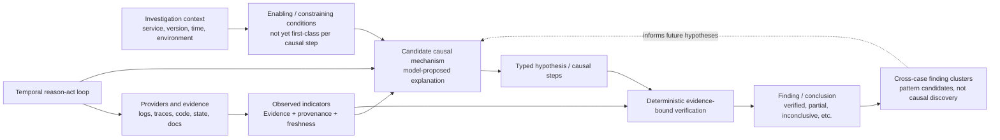

# Generative Architecture: Mechanism–Outcome Configurations for IAP

**Date:** 2026-10-25  
**Status:** Conceptual architecture note; recommendations only. No implementation authorized.  
**Source paper:** Jörg Krauter, “The Generative Architecture of Leadership: A Critical Realist Exploration of Mechanism-Outcome Configurations,” *Open Journal of Leadership*, 15(1), 2026, pp. 89–145, [article](https://www.scirp.org/journal/paperinformation?paperid=149227), [DOI](https://doi.org/10.4236/ojl.2026.151005).

## 1. Purpose and transfer boundary

This paper offers a useful vocabulary for separating **underlying causal mechanisms**, **observable indicators**, **contextual conditions**, and **outcomes**, then asking how context-specific combinations may generate different outcomes. This document applies that vocabulary as an architectural lens to Investigation Agent Platform (IAP).

The paper studies leadership, not software architecture or incident-investigation systems. Its five leadership mechanism families, K1–K16 indicator nodes, and outcome mappings are domain-specific and are **not evidence that the same taxonomy or causal relationships apply to IAP**. The proposal here is to borrow the distinctions and inquiry discipline, not import the leadership labels or findings. Any IAP mechanism classification remains a hypothesis until grounded in IAP evidence and evaluated.

The source paper is exploratory: its study used a cross-sectional survey of 71 leaders, single-item indicators, Spearman correlations, PCA, clustering, and retroductive interpretation. The paper explicitly treats observed associations as clues to plausible mechanisms rather than causal proof. It reports uneven alignment between theoretical and observed configurations and notes limitations including small sample, common-method bias, no temporal ordering, and no robustness tests. Refer to §§2.1–2.6, 3.2–3.8, 4.3–4.6, 5–10; Tables 1–3 and 10–12; Figures 1–2. Thus it is a conceptual prompt for IAP, not a software-system validation source.

## 2. IAP baseline in one view

IAP already has several adjacent concepts, but they are not yet a single explicit mechanism/context/outcome model:

- **Evidence/observations:** normalized, provenance-bearing evidence records, provider operations, and investigation facts.
- **Causal explanation:** typed claims and `HypothesisCausalStep` records with cause, mechanism text, effect, and evidence IDs.
- **Context:** operational investigation context and profile configuration; these are not generally attached as explicit enabling/constraining conditions to each causal step.
- **Outcomes:** verification results, findings, conclusion statuses, and action/workflow outcomes.
- **Configurations:** evidence correlation graphs and causal chains exist, but a correlation edge or a causal-step assertion does not itself demonstrate a generative mechanism.
- **Reasoning:** an LLM proposes candidate actions/hypotheses; deterministic evidence retrieval, verification, and conclusion gates constrain accepted results. This is one reason/act/verify loop, not a multi-agent architecture.
- **Pattern surfacing:** finding clustering can surface similarities across cases; it does not prove a recurring causal mechanism.

**Interpretation rule:** arrows in the diagram show the proposed analytic relationship, not a claim that IAP currently measures or validates every link. Current implementation maturity is itemized below.

## 3. Concept-by-concept mapping

### 3.1 Generative architecture and open systems

**Paper concept.** The Systemic Leadership Model treats leadership as an emergent phenomenon in an open system. Multiple causal powers can interact; system outcomes are not assumed to be additive effects of isolated variables. The model is a heuristic for explaining how underlying powers may generate observed patterns (§§1, 2.1, 2.6).

**How IAP currently uses it.** IAP is already a multi-component investigation system: provider adapters return evidence; the reasoner proposes actions and hypotheses; Temporal orchestrates durable execution; claim-specific verification and the conclusion gate govern what can be reported. The architecture has distinct effects from evidence, model proposals, deterministic controls, and external provider failures. Relevant implementation includes `application/investigation/reasoning.py` (`ReasoningCoordinator`), `application/worker/workflows.py` (`RunInvestigationWorkflow`), `application/evidence/gateway.py`, and `application/investigation/verification.py` (`VerificationEngine`, `ConclusionGate`). However, IAP does not model this as a formal generative-causal system, and an architecture flow is not proof of a causal explanation.

**How IAP can adopt it going forward.** Use “generative architecture” as a diagnostic stance: explain outcomes by tracing interactions among evidence, source behavior, tool/agent actions, context, and verification rules. Keep the current modular-monolith and Temporal boundaries. Do not add an agent network, service tier, or new graph store merely to represent conceptual interactions. When a reported conclusion matters, require a traceable claim-to-evidence-to-verification path and name which conditions were observed, unknown, or not evaluated.

### 3.2 Real, actual, and empirical domains

**Paper concept.** Critical realism distinguishes the **real** (causal powers), **actual** (events/tendencies when powers operate), and **empirical** (events experienced, measured, or recorded). The domains are related but not interchangeable (§2.1, §3.1).

**How IAP currently uses it.** IAP separates observed evidence from hypotheses and outcomes in code, but does not name these three domains. `domain/evidence/models.py` defines observed evidence; `domain/hypothesis/models.py` defines claims and causal steps; `domain/finding/models.py` defines findings/conclusions. `application/investigation/verification.py` distinguishes claim support from final conclusion status. A `HypothesisCausalStep.mechanism` value is an asserted explanation, not direct access to a real mechanism. Missing evidence is not evidence that an event or mechanism did not occur.

**How IAP can adopt it going forward.** Use the distinction in prompt and result contracts without adding a domain ontology immediately: label each statement as (a) observed/retrieved, (b) inferred causal explanation, or (c) reported outcome/status. Make source, time, and confidence/limitation explicit. Ensure APIs and UI language do not present an inferred mechanism as an observed fact. Keep unknown and unobserved values distinct from “absent.”

### 3.3 Generative mechanisms / causal powers

**Paper concept.** Mechanisms are underlying structures or powers that generate tendencies; they are not variables, indicators, behaviors, or latent factors. Their effects can be enabled, blocked, or counteracted by other mechanisms and context (§§2.1–2.3).

**How IAP currently uses it.** IAP has a causal explanation shape: `HypothesisCausalStep` records `cause`, `mechanism`, `effect`, and `evidence_ids` in `domain/hypothesis/models.py`. In `application/investigation/verification.py`, functions including `causal_step_grounding` and `causal_relation_demonstrated` require evidence grounding for causal steps. The model may generate the mechanism wording; the code validates evidence linkage and relation cues rather than proving a domain-general causal power. This is a production causal-step contract, not a first-class mechanism ontology.

**How IAP can adopt it going forward.** Preserve the plain-language mechanism account but label it as a **candidate causal explanation**. Require evidence IDs and explicit cause/mechanism/effect semantics; where evidence supports only correlation or co-occurrence, return that limitation instead of promoting it to causality. Only introduce a small typed mechanism vocabulary if recurring evaluation cases demonstrate that it improves discrimination, next-evidence selection, or verifier precision. Do not let an LLM-selected mechanism label satisfy a proof obligation.

### 3.4 Observable indicators and evidence

**Paper concept.** Indicator nodes are empirical traces that may signal mechanism activation; indicators are not the mechanism itself. The paper classifies 16 leadership-specific nodes and explicitly distinguishes K1 Leader Agency as a mechanism and K4 External Factors as context in Table 2, despite terminology variation elsewhere (§2.2, Table 1, Table 2).

**How IAP currently uses it.** IAP has a broad `EvidenceType` vocabulary and `Evidence` records with provider/source, provenance, freshness, classification, redaction, and payload references in `domain/evidence/models.py`; `domain/provenance/models.py` defines `EvidenceProvenance` and `EvidenceFreshness`. `AsyncEvidenceGateway` selects and normalizes provider results. IAP evidence is often a direct source observation or artifact, not a standardized “indicator” derived from a theory. Repeated evidence rows do not by themselves prove a mechanism.

**How IAP can adopt it going forward.** Keep evidence as the primary record and treat “indicator” as an optional role attached to a **specific claim or diagnostic question**, not a replacement evidence type. For example, a timeout log is an observed event; “resource saturation” is a candidate mechanism; CPU metrics or queue depth may be evidence relevant to it. Link indicator interpretation to source, time window, query scope, and freshness. Avoid a permanent taxonomy until a real set of investigation scenarios demonstrates stable and useful categories.

### 3.5 Context, enabling and constraining conditions

**Paper concept.** Context is not itself necessarily a mechanism; it can enable, constrain, or modulate whether a mechanism activates and what effects follow. The paper explicitly classifies K4 External Factors (VUCA) as context for adaptive learning, not as a mechanism (Table 2, §§2.2–2.3.5).

**How IAP currently uses it.** `InvestigationContext` in `domain/investigation/models.py` carries operational context such as environment, deployment version, service, host, time window, identifiers, and application metadata. Profile configuration carries provider/correlation policy. `EvidenceFreshness` and source provenance add temporal/source context. These values are used for scoping and retrieval; they are not generally attached to causal steps as explicit conditions that enable or block a proposed mechanism.

**How IAP can adopt it going forward.** Bind causal claims to relevant case context, such as deployed revision, time interval, service instance, feature flag, or provider coverage. Distinguish **observed condition**, **assumed condition**, **unknown condition**, and **not applicable**. If context is absent or stale, reduce the claim's scope or abstain. Add only the context fields needed for a concrete verification rule; avoid making environment/profile metadata a free-form causal model.

### 3.6 Mechanism families and taxonomy

**Paper concept.** The paper groups leadership mechanisms into structural-power, cultural-normative, relational-affective, human agency/psychological, and adaptive-learning families. These families organize the proposed leadership model and are specific to its domain and theory (§2.2, Table 2).

**How IAP currently uses it.** IAP defines claim kinds (`DEFINITION`, `CALL_EDGE`, `BEHAVIOR`, `ABSENCE`, `HISTORY`, `CAUSAL`, etc.) and finding types such as `ROOT_CAUSE` and `CONTRIBUTING_FACTOR`; these classify claims or findings, not underlying generative mechanisms. No IAP mechanism-family taxonomy was identified in the reviewed source. The paper's leadership categories should not be transplanted to software diagnosis.

**How IAP can adopt it going forward.** If repeated evaluation shows that causes cluster into actionable categories, consider a versioned, IAP-specific vocabulary (for example, configuration, resource contention, dependency failure, concurrency, data-quality, or control-flow mechanisms) with definitions and counterexamples. Keep category selection advisory until category-specific evidence obligations exist. A mechanism family must not be inferred solely from an evidence type or symptom label.

### 3.7 Mechanism configurations, interactions, and non-additivity

**Paper concept.** The paper argues that distinct outcomes can be produced by different combinations of mechanisms; mechanisms interact, may activate selectively, and need not have uniform or additive effects (§§2.4–2.6, Figure 1). The paper's theoretical outcome mappings are compared separately from empirical activation patterns in Tables 10–12.

**How IAP currently uses it.** IAP can represent multiple evidence rows, typed claim-local evidence bindings, causal steps, contradictions, and evidence relationships. `domain/correlation/models.py` defines `CorrelationGraph`, `CorrelationNode`, and `CorrelationEdge`; `application/correlation/engine.py` builds correlation expansions. These structures help relate observations but do not encode a validated interaction rule from context + mechanism to outcome. A causal chain or graph edge alone does not establish causation.

**How IAP can adopt it going forward.** For multi-factor explanations, represent a small set of evidence-grounded causal steps and their dependencies, then verify each step and the composition separately. Make alternative or counteracting mechanisms explicit. Do not sum confidence scores from separate clues as if causes were independent. If the system cannot establish an interaction or ordering, label it as a candidate relation and preserve the limitation.

### 3.8 Outcomes as emergent system states

**Paper concept.** The paper treats psychological health, task performance, OCB, job crafting, and innovative behavior as outcome domains that may emerge from selective mechanism configurations—not as mechanisms themselves (§2.4, Table 3).

**How IAP currently uses it.** IAP's “outcomes” are investigation and product outcomes, not organizational leadership outcomes: `ActionOutcome` captures tool execution results; `ConclusionStatus` and `InvestigationConclusion` capture statuses such as insufficient evidence and established findings; workflow state records execution completion/failure. The separation between action execution, epistemic conclusion, and workflow completion exists, although names and status semantics must remain precise. A completed workflow can appropriately conclude insufficient evidence.

**How IAP can adopt it going forward.** Keep operational outcome (workflow/action succeeded), epistemic outcome (claim supported/contradicted/inconclusive), and user-facing investigation disposition separate. If measuring system quality, use outcomes such as correct evidence-bound conclusion, useful abstention, time-to-evidence, or successful recovery—each with explicit evaluation criteria. Do not treat “workflow completed,” “model confidence,” or “finding cluster assigned” as diagnosis correctness.

### 3.9 Emergence and cross-case pattern surfacing

**Paper concept.** Emergence refers to system-level properties arising from interactions among mechanisms; the paper interprets clusters and correlations as possible patterns, not direct observation of emergent causal powers (§§2.1, 2.4, 4.3–4.6).

**How IAP currently uses it.** `application/finding/clustering_service.py` and `domain/finding/clustering.py` can group related findings across investigations. This is production pattern surfacing; it does not infer or prove a shared mechanism. The proof-kernel modules implement typed rule evaluation and certificates, but the reviewed normal verify/conclude path does not make the test-only `ProofPublicationService` authoritative. Definition-shadow observations are explicitly non-authoritative. These distinctions matter: clustering, proof-kernel artifacts, and shadow output must not be described as production causal discoveries.

**How IAP can adopt it going forward.** Treat cross-case clusters as candidate patterns for human or rule-based investigation. Any proposed common mechanism should be linked to the source findings, underlying evidence, context differences, and counterexamples. Require a separate validation step before promoting a cluster to a reusable diagnostic rule. Keep shadow and test-only mechanisms non-authoritative unless a separately reviewed rollout establishes otherwise.

### 3.10 Retroductive reasoning and empirical pattern interpretation

**Paper concept.** Retroduction asks what underlying causal mechanism could plausibly generate an observed pattern. The paper's sequence is description → abduction → retroduction, and its analyses use correlation, PCA, and clustering as diagnostic clues, not causal estimates (§§3.1, 3.4–3.5). It cautions against treating statistical regularity as mechanism proof.

**How IAP currently uses it.** `ReasoningCoordinator` and the investigation workflow formulate hypotheses from evidence and propose next actions. The verifier tests typed claims and evidence bindings, and `ConclusionGate` restricts accepted conclusions. This resembles a hypothesis-generation/evaluation loop, but IAP does not identify a formal retroduction procedure, systematically record competing mechanisms, or evaluate whether each mechanism predicts a discriminating observation. `FindingClusterService` surfaces patterns but does not perform retroduction. The chat and onboarding agent paths are separate; the current onboarding coverage activity is deterministic and explicitly not an LLM judgment path.

**How IAP can adopt it going forward.** Make the reasoning discipline explicit in the existing loop: (1) record the observed pattern and its source; (2) formulate one or more candidate explanations; (3) state a discriminating prediction or next evidence query for each; (4) compare predictions with evidence, contradictions, and context; (5) accept, reject, or abstain. Persist the reasoning trace only if there is a concrete audit/evaluation need and a stable contract. Do not add a separate retroduction agent or orchestration layer by default.

### 3.11 Selective activation, absence, and non-observation

**Paper concept.** Mechanisms can exist without activating, activate without being observed, or be counteracted; a missing empirical association does not prove that a mechanism is absent. Context and measurement sensitivity affect what is seen (§§2.1, 5–7).

**How IAP currently uses it.** IAP distinguishes retrieval outcomes such as rows, scoped empty, partial rows, and search failure in the retrieval ledger; verification includes incompleteness/failure paths and can return insufficient evidence. These are important distinctions between a genuine scoped empty result and an inability to observe. They are not yet a general model of causal mechanism activation or counteraction.

**How IAP can adopt it going forward.** Preserve three-way semantics: observed evidence, scoped non-observation with a demonstrated search boundary, and unknown due to failure/incompleteness. A “not found” result can support absence only when search scope, revision, time window, provider state, and completeness satisfy the relevant proof obligation. Never infer “mechanism inactive” from an empty provider response or lack of correlation alone.

## 4. Paper-derived configuration examples and IAP stance

The paper proposes five outcome mappings (§2.5; Table 12) and reports separate, uneven empirical activation patterns (Tables 10–12). For example, it reports OCB as the clearest family-level alignment, while innovation and task-performance mappings are less aligned; job crafting has no significant node associations in the reported sample. Its own abstract, detailed tables, and discussion contain some inconsistent descriptions of which families activated for particular outcomes, and the paper notes substantial measurement/design limitations. These are findings about the sampled leadership data, not IAP.

| Paper outcome domain | Theoretical mechanism configuration | Reported empirical pattern in the study | IAP interpretation |
|---|---|---|---|
| Psychological health | Relational-affective + cultural-normative + human agency | Significant node links include structural and cultural/relational/psychological indicators; Table 12 reports only partial family-level alignment. | Do not assume that a software incident outcome has one universal cause family; identify which source, context, and proof obligations support the case-specific explanation. |
| Organizational citizenship behavior (OCB) | Relational-affective + cultural-normative | Table 12 reports the strongest/full family-level alignment in the paper's comparison. | A pattern may be a useful hypothesis, but it requires independent IAP cases and operationally meaningful outcomes before use as a diagnostic rule. |
| Innovative behavior | Adaptive learning + cultural-normative + relational-affective | Tables report associations including implicit dynamics and emotional contagion, while Table 12 describes only relational-affective activation and low alignment. | Preserve discrepancy between predicted and observed configuration; do not harmonize conflicting summaries into a stronger claim. |
| Task performance | Structural-power + adaptive learning + human agency | The study reports K9 implicit dynamics as the sole significant node association; Table 12 calls family alignment low. | A single signal or correlated clue should not be promoted to a complete causal chain or sufficient proof. |
| Job crafting | Human agency + adaptive learning | No significant node associations reported; authors warn this is not proof of no relation and note measurement/power limits. | Distinguish “not observed in this evidence window” from “does not exist”; IAP already needs complete scope and provider success for absence claims. |

The mappings above are paper-specific leadership results, included to show the difference between theoretical expectation and empirical activation. They are not proposed IAP mechanism categories or IAP outcome configurations.

IAP should adopt the **comparison discipline**, not these configurations:

1. Keep prior theoretical expectations separate from observed system behavior.
2. Record the population, case context, evidence coverage, and denominator for any pattern claim.
3. Show mismatches between expected and observed mechanism/outcome relationships rather than smoothing them away.
4. Treat no association, no evidence, and insufficient measurement as distinct results.
5. Re-test proposed patterns on independent cases and against counterexamples before converting them into policy or routing rules.

## 5. Suggested low-complexity adoption sequence

No new mechanism taxonomy or service is recommended as a first step. If the owner chooses to pursue the ideas, use this sequence:

1. **Vocabulary only:** update investigation prompts/results guidance so observed fact, inference, context, and outcome are clearly distinguished. No persistence or behavior change.
2. **Evaluation rubric:** select a small set of synthetic and attributable investigation cases; grade whether conclusions distinguish observations from candidate mechanisms and identify missing/contradicting evidence.
3. **Causal-step refinement:** if measured failures justify it, extend the existing causal-step contract with explicit evidence role and relevant context-condition references. Preserve unknown/unavailable states and current verifier authority.
4. **Configuration comparison:** evaluate whether candidate mechanism combinations predict different evidence needs or outcomes across independent cases. Report disagreement and abstention, not just aggregate score.
5. **Taxonomy or automation only on evidence:** add a small versioned mechanism-family set or mechanism-directed routing only when a stable, repeated evaluation gain justifies maintenance cost and the proof contract is independently reviewable.

**Defer** adding a general causal graph engine, causal inference library, separate agent, model-generated mechanism registry, or new persistence schema until there is a demonstrated need. Triggers: repeated evaluation cases where current claim/causal-step contracts cannot express needed context or alternatives; measurable improvement in grounded conclusions or useful abstention from a prototype; and an owner-approved definition of the evidence and verification contract.

## 6. Source and repository basis

### Paper references

- Krauter, J. (2026). “The Generative Architecture of Leadership: A Critical Realist Exploration of Mechanism-Outcome Configurations.” *Open Journal of Leadership*, 15(1), 89–145. [Full paper](https://www.scirp.org/journal/paperinformation?paperid=149227), [DOI](https://doi.org/10.4236/ojl.2026.151005).
- Concepts: §§2.1–2.6; classification: Tables 1–3; theoretical mappings: §2.5 and Figure 1; study design: §§3.2–3.8; empirical results: §§4.3–4.6, Tables 6–12 and Figure 2; interpretation/limitations: §§5–10.

### IAP source locations inspected

- Reasoning and workflow: `src/investigation_agent_platform/application/investigation/reasoning.py`, `context_compiler.py`, `src/investigation_agent_platform/application/worker/activities.py`, `workflows.py`.
- Evidence/context: `src/investigation_agent_platform/domain/evidence/models.py`, `domain/provenance/models.py`, `domain/investigation/models.py`, `application/evidence/gateway.py`.
- Causal claims and outcomes: `src/investigation_agent_platform/domain/hypothesis/models.py`, `domain/finding/models.py`, `application/investigation/verification.py`.
- Correlation and cross-case patterns: `src/investigation_agent_platform/domain/correlation/models.py`, `application/correlation/engine.py`, `application/finding/clustering_service.py`, `domain/finding/clustering.py`.
- Proof boundaries: `src/investigation_agent_platform/application/proof/publication_commit_service.py`, `domain/proof/definition_shadow.py`, and `docs/IAP-proof-kernel-design-v1.0.md`.
- Evaluation context: `tests/evaluation/test_incident_replay.py`, `tests/evaluation/test_acceptance_gates.py`, `docs/IAP_IMPLEMENTATION_ROADMAP.md`, and `docs/REV_BATTERY_CLOSE_PLAN.md`.

Repository review was read-only. Tests were inspected by the exploration agent but **not executed** for this task; no live LLM, worker, or evidence provider was contacted. Existing current, test-only, shadow, and design-only boundaries described above are not claims of successful production runtime behavior.

## 7. Recommendation ledger

The architectural observation and recommendation to keep causal mechanism, indicator, context, and outcome roles distinct—and not import the paper's leadership taxonomy as software fact—are recorded as an OPEN item in `docs/IAP_Arch_Eng_Recommendations.log` pending an owner decision on further design or implementation.
