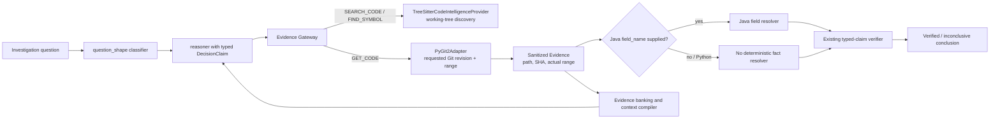

# Design: IAP Python Language Code-Fact Resolution

**Status:** Phases 0–4 implemented 2026-10-21 (v2 verifier mismatch fixed with regression tests; shared-enum contract, no versioned envelope per pre-prod decision; `application/analysis/python/` resolvers for assignments, parameter defaults, class attributes, and dataclass/Pydantic frameworks; worker `.py` dispatch and `.py` source-value forcing; navigation `has_error` fail-closed; 21-case fixture battery in `tests/fixtures/python/`). Full unit suite 2441 passed. This document remains the audit record; behavior authority is the code cited in `docs/IAP-architecture-v1.0.md` §59.

## Context

### A. Executive verdict

IAP can find Python files, parse their syntax with Tree-sitter, expose class/function symbols and candidate call relationships, retrieve exact Git source ranges, and carry typed claims through the existing investigation workflow. It cannot currently deterministically resolve a Python variable, parameter default, class/instance attribute, dataclass default, or configuration value. The only GET_CODE fact resolver found is Java-specific (`resolve_java_field_fact`); the Java-specific v2 resolver family adds more Java source facts, but those resolvers do not establish Python semantics. Python code-fact questions therefore rely on the reasoner interpreting fetched text and the generic evidence/claim path; a verified location is not proof of a Python value.

The strongest source-grounded conclusion is that a requested Python value is not presently provable by a Python analyzer. Python questions about source locations and call sites may be supported as bounded code-navigation answers if their claim-specific evidence gates pass. Runtime-effective values, decorator effects, dynamic dispatch, import execution, mutation order, configuration overrides, and framework-generated behavior require explicit runtime evidence or an abstention.

**Verifier gate:** The existing legacy `CodeFactResolution` path correctly rejects a contradictory numeric value in the existing regression tests. The newer `CodeFactResolutionV2` path has a reproducible mismatch: `java_fact_proof` accepts a claim when its structured value is `3` but its statement says `999`, and also accepts a source-value claim when the structured value is absent. This is a cross-language correctness concern because Python support is expected to share that verifier. Repair and regression-test this contract before adding Python categories or broadening verification.

### B. As-built architecture

The source-grounded path is:



This diagram reflects actual wiring, not the target design. `classify_question_shape` labels a small set of source-value phrases as `code` (for example, “default value of,” “what value does,” and “declared default”), then `reasoning.py` steers code-shaped questions toward code capabilities (`domain/analysis/question_shape.py:37-58,90-113`; `application/investigation/reasoning.py:100-109`). This is a datasource-choice hint, not a Python semantic analyzer.

`AsyncEvidenceGateway` reuses tenant/application authorization and source-provider selection for search, symbol discovery, and GET_CODE. Search and symbol operations can enforce revision capability (`application/evidence/gateway.py:927-1030`); GET_CODE validates request safety and authorization, passes requested revision and line bounds to the source provider, then sanitizes the evidence (`application/evidence/gateway.py:1289-1318`). `PyGit2Adapter` resolves the requested ref to a commit and records its actual SHA, actual returned range, and path in source provenance (`infrastructure/evidence/code/git.py:370-430,482-549`).

The Tree-sitter code-intelligence provider explicitly declares `revision_supported = False` and describes its output as candidate discovery, not pinned proof (`infrastructure/evidence/code/intelligence.py:89-103`). Although the protocol receives a requested revision, its `find_symbol`, `find_callers`, and `find_callees` methods do not pass that revision to their working-tree sync implementations (`infrastructure/evidence/code/intelligence.py:1094-1131`). Search is literal text matching with snippets and candidate line locations, not semantic name resolution (`infrastructure/evidence/code/intelligence.py:483-525`). Python Tree-sitter parses can produce syntax trees and symbols, but the common navigation parser does not reject `root_node.has_error` before walking a tree (`infrastructure/evidence/code/intelligence.py:386-450`).

`GET_CODE` reads are numbered and provenance-bound. The worker labels path-only reads as discovery, and currently calls `resolve_java_field_fact` only when a `field_name` parameter is supplied (`application/worker/activities.py:3144-3182`). No analogous Python dispatch exists. `CodeFactResolution` and `CodeFactResolutionV2` are validated when present on an `Evidence` object (`domain/evidence/models.py:152-178`). The compiler includes the legacy `code_fact_resolution` payload in a code packet (`application/investigation/context_compiler.py:312-337`), and the reasoner is instructed to copy its value semantics and claimed value into the typed claim (`application/investigation/reasoning.py:88-97`).

Typed claim structure already includes `ClaimKind`, `ClaimTarget`, `fact_category`, `value_semantics`, and `claimed_value` (`domain/hypothesis/models.py:35-73`; `ports/reasoning/reasoner.py:16-32`). Value verification requires structured analyzer output and evidence binding. `validate_location_claim` explicitly declines to certify value assertions (`application/investigation/verification.py:1863-1873`); `evaluate_hypothesis` sends value-like claims through value/fact validation and otherwise returns inconclusive (`application/investigation/verification.py:2798-2841`). Java v2 fact verification provides a broader category dispatch (`application/investigation/verification.py:819-961`), with the mismatch exception described in sections E and F.

The architecture document at `docs/dev/architecture.md` does not exist. The active architecture source reviewed for this design is `docs/IAP-architecture-v1.0.md`, particularly §58 for the existing Java field-fact implementation.

### C. Capability matrix

Labels describe the IAP Python fact-analysis capability, not the general ability of Python or Tree-sitter to represent the syntax. **Implemented** means a deterministic Python fact resolver and proof rule are wired and tested; **partial** means a limited Python-aware navigation or inventory mechanism exists but does not prove the requested semantic fact; **missing** means no Python semantic resolver was found; **unverified** means relevant framework/runtime details were not established in this read-only review.

| Area | Status | As-built evidence and boundary | Candidate regression |
| --- | --- | --- | --- |
| A. Names, assignments, and scope | Partial | Tree-Sitter symbol/navigation support exists, but there is no Python binding/scope/dataflow fact resolver. Search is textual; same-named bindings, rebinding, closure capture, and `global`/`nonlocal` are not proven (`infrastructure/evidence/code/intelligence.py:386-450,483-525`). | Later function assignment makes a name local; chained/unpacked assignment; comprehension scope; shadowed same-name target. |
| B. Functions and methods | Partial | Function and async-function grammar nodes are recognized as navigation symbols (`infrastructure/evidence/code/intelligence.py:60-75`); no resolver distinguishes declaration defaults, call arguments, annotations, implicit `None`, generators, coroutine behavior, wrappers, or redefinitions. | `def f(x=10)` vs `f(20)`; positional-only/keyword-only; implicit return; decorated default. |
| C. Classes and attributes | Partial | Python classes/functions are indexed as symbols, not class-body/instance state. No property, descriptor, MRO, slots, or constructor-result analyzer was found. | Class constant vs `self.x`; reassignment; property returning a computed value; base/derived override. |
| D. Python defaults | Missing | The Java default semantics in `CodeValueSemantics` do not model Python’s parameter-default object lifetime, `default_factory`, missing assignment, optional annotation, or framework defaults. | Explicit `None` vs absent assignment; dataclass `default` vs `default_factory`; `Optional[int]` without `= None`. |
| E. Expressions and deterministic resolution | Missing | Python parser is available via `tree-sitter-language-pack`, but no static Python expression evaluator is present under `application/analysis` (`pyproject.toml:10,27-28`; `application/analysis/` contains Java resolvers only). | Literal `30`; constant arithmetic; unsupported call must be `PARTIAL`, never evaluated. |
| F. Imports and package resolution | Partial | Repo traversal can find `.py` files and parse symbols, but no import graph/binding resolver is demonstrated. Runtime import side effects, hooks, namespace packages, and conditional imports are not modeled. | Alias, re-export, relative import, circular import, and a shadowed imported name. |
| G. Inheritance, polymorphism, and dispatch | Partial | Generic call graph edges are navigation evidence, not proven execution; provider resolves names textually and strips qualified receiver names (`infrastructure/evidence/code/intelligence.py:689-745`). No Python MRO or dynamic receiver resolver exists. | Known single-inheritance MRO; unknown receiver must not assert an override as guaranteed. |
| H. Decorators and generated behavior | Partial | Existing Python FastAPI profile generator uses regular expressions for route, Pydantic, HTTP-client, and environment-key inventory, not decorator execution semantics (`integrations/profile_gen/generators/python_fastapi.py:15-33,35-108`). | Stacked wrapper order, `@property`, dataclass generation, unknown decorator abstention. |
| I. Exceptions and control flow | Partial | Tree-Sitter parsing is used for syntax-aware navigation and exception-handler discovery, but no path-sensitive Python function-behavior analysis is present. Parse errors are not a fail-closed signal in common symbol extraction. | Branch-specific returns, `finally` override, short-circuit, exception propagation, syntax error. |
| J. Mutation and state changes | Missing | No Python write-site/alias/mutation resolution is wired to the fact verifier. A visible assignment alone would not establish that it runs or wins. | Constructor `new` then other-method `processed`; list mutation through alias; mutable default persists. |
| K. Configuration/framework integration | Partial | Project configuration layering is explicit in `infrastructure/configuration/layers.py:4-13,26-39`; runtime process environment and secret-store resolution are separate. Python FastAPI generator only inventories selected names via regex. No repo-specific config value resolver exists. | YAML/default/env precedence without reading secret values; declared default vs runtime override. |
| L. Async, concurrency, lifecycle | Partial | IAP itself uses async worker/gateway infrastructure, but source analysis has no Python coroutine/task happens-before or lifecycle resolver. | Concurrent writes to shared value must be partial; generator suspension/resumption not final value. |
| M. Types and annotations | Partial | Parser can retain source text; no annotation/type-system proof or postponed-evaluation handling exists. `Python` support in package metadata declares `requires-python = ">=3.13"`, not the target repository’s grammar version (`pyproject.toml:10,80-82`). | Annotation with no assignment; `Annotated`; forward ref; overload/stub mismatch. |
| N. Serialization, persistence, and data models | Partial | Python FastAPI generator inventories selected Pydantic field constraints, but no Pydantic model default/factory/validator/alias or ORM/database-default resolver is wired (`integrations/profile_gen/generators/python_fastapi.py:55-75`). | Pydantic default/factory/alias; client-side vs DB-side default; persisted row must use authorized DB evidence. |
| O. Version-dependent/dynamic features | Partial | IAP declares its own runtime floor as Python 3.13; no analyzer pins the analyzed repository’s grammar/source version or detects dynamic execution as a proof boundary. Tree-Sitter package is a dependency. | Feature gated by target version; `exec`, `eval`, import hook, or runtime patch produces a named limitation. |

### D. End-to-end traces

**Question: “What is the default value of `retry_count` in a Python file?”** The phrase matches the current source-value classifier, yielding `code`. The reasoner is steered to SEARCH_CODE/FIND_SYMBOL/GET_CODE. Discovery may return a working-tree candidate and is not revision-pinned. GET_CODE then retrieves the requested revision and actual range. The worker invokes only the Java resolver when a `field_name` is supplied; with a Python source path there is no deterministic value resolution. The context may show the code and the LLM may formulate a `DEFINITION` claim, but the existing legacy value verifier has no Python-resolution payload to compare. The location fast path refuses value assertions; absent a Java resolution, the claim should remain inconclusive. This flow cannot currently substantiate the numeric Python answer.

**Question: “Where is `handle_request` declared?”** The classifier recognizes “where is,” search/symbol discovery can find candidate declarations, then the agent must range-read the candidate with GET_CODE. `ClaimKind.DEFINITION` requires a range window containing the symbol (`application/investigation/verification.py:1181-1199,1907-1913`). Python declaration parsing is not used as a verifier proof; the source window and path/revision provenance provide the grounding. Same-name ambiguity and module-qualified identity remain limitations.

**Question: “Which implementation runs for this object?”** FIND_CALL_GRAPH/TRACE_LOGIC can return candidate graph edges, but the generic call graph is not a proof of runtime receiver type or Python MRO. A matching base method location does not establish that a subclass override is invoked. Without a statically closed receiver/MRO proof or authorized runtime observation, the result must qualify the candidate or abstain.

**Question: “What is the effective production timeout?”** The source may declare a default, while configuration layering, environment values, secret-store values, per-app configuration, and later mutation can change the effective value. `layers.py` documents process defaults < dotenv < YAML < runtime environment < secret-store values, with YAML limited to unset allowlisted values and secret-manager values resolved separately. The analyzer must not read/log secret values. Source-only analysis can establish declarations and a source-proven precedence chain, not a live production setting.

### E. Root-cause findings

| Rank | Finding | Impact / evidence strength | Affected contracts and consequence |
| --- | --- | --- | --- |
| 1 | V2 source-value verification does not reconcile the statement literal with the structured claim value and does not require a structured value. | Critical correctness; directly executed two false-positive probes. | `java_fact_proof` / `evaluate_hypothesis`; wrong asserted values can reach VERIFIED in the v2 category path. Fix before any Python analyzer is added. |
| 2 | Python has no deterministic fact-resolution dispatch in GET_CODE. | High correctness; direct source inspection of worker branch and no Python resolver under analysis. | Python defaults and values are inferred from snippets, not a verified analyzer result; common direct fact questions cannot be answered deterministically. |
| 3 | Python code discovery is working-tree/text oriented, not a source-revision semantic index. | High provenance risk; direct provider source inspection. | Search/symbol/call-graph hits are candidate evidence, not proof that the same declaration exists at the source SHA later read. Keep range-read confirmation mandatory. |
| 4 | The common navigation parser can walk Tree-Sitter error trees. | Medium correctness; direct source inspection plus diagnostic parse probe showing `has_error=True` for invalid syntax. | Partial symbol/call results can be mistaken for complete source understanding unless parser errors become explicit discovery limitations. |
| 5 | Existing shared fact vocabulary is Java-named and field-oriented, despite a generalized v2 claim verifier. | Medium contract risk; direct model inspection. | Python facts need language-neutral categories/semantics and target identity without breaking strict legacy readers or silently widening Java proof rules. |
| 6 | Generator/config inventory uses regexes and cannot prove evaluated Python/Pydantic semantics. | Medium correctness; direct source inspection. | Route/field/environment-key inventories should remain discovery metadata and not be reused as fact-resolution proof. |

## References

- User-supplied audit scope (working notes, unshipped): Python anatomy, verifier counterexamples, contract, evaluation requirements, and deliverables — all incorporated into this design below.
- [`docs/IAP-Code-Java-lang-impl-design.md`](./IAP-Code-Java-lang-impl-design.md) — Existing Java language analyzer baseline, shared CodeFactResolution evolution, Java category proof limits, and candidate phases.
- [`docs/IAP-architecture-v1.0.md`](./IAP-architecture-v1.0.md) — As-built Evidence Gateway, provider, code evidence, typed claim, verifier, and Java fact flow.
- [`docs/DS_REVIEW_v0.1.md`](./DS_REVIEW_v0.1.md) — Code grounding, revision/range/evidence binding, code packet visibility, and investigation evaluation constraints.
- [`pyproject.toml`](../pyproject.toml) and [`.python-version`](../.python-version) — IAP’s Python runtime floor and Tree-Sitter dependencies; these are not the analyzed repository’s Python version declaration.
- [Tree-sitter Python grammar](https://github.com/tree-sitter/tree-sitter-python) — Syntax grammar reference for a bounded parser-based implementation; grammar acceptance alone does not establish runtime semantics.
- [Python `ast` documentation](https://docs.python.org/3/library/ast.html) — Standard-library AST and grammar-version reference; not currently used by IAP’s code-fact path.
- [Python 3.13 execution model](https://docs.python.org/3.13/reference/executionmodel.html) — Name binding and scope semantics to guide precise resolver rules; Context7 lookup confirmed assignments determine local binding and `global`/`nonlocal` alter binding scope.
- [Python 3.13 function definitions](https://docs.python.org/3.13/reference/compound_stmts.html#function-definitions) — Default expressions are definition-time values, distinct from arguments supplied at a call site.
- [Python 3.13 dataclasses documentation](https://docs.python.org/3.13/library/dataclasses.html) — Framework-defined constructor/default and `default_factory` semantics.
- [Python descriptor/howto](https://docs.python.org/3/howto/descriptor.html) — Attribute lookup boundary for properties and descriptors.
- [Pydantic v2.14 fields](https://docs.pydantic.dev/2.14/concepts/fields/) — Framework-defined model defaults and factories for a later narrowly scoped adapter; Context7 lookup confirmed Optional annotations do not imply a `None` default, default validation is configurable, and Pydantic v2 deep-copies supported mutable defaults.

## Goals / Non-Goals

**Goals:**

- Preserve the Evidence Gateway authorization, evidence sanitization/banking, source provenance, code packets, typed claims, and verifier.
- Make the Java v2 value-verification mismatch the first release gate.
- Add a bounded, deterministic Python source-fact resolver only for supported constructs and exact Git range evidence.
- Preserve the distinction between source declaration, statically evaluated expression, possible override, constructor outcome, lookup result, and runtime observation.
- Carry unresolved/partial status, limitation codes, immutable source identity, exact ranges, and supporting evidence IDs to the existing verifier and conclusion mapping.
- Build a synthetic fixture suite with immutable commit SHAs, exact ranges, positive/negative assertions, and verifier checks.
- Keep this report an audit/design deliverable. It authorizes no code, migration, configuration, deployment, commit, or live-data change.

**Non-Goals:**

- A complete Python interpreter, arbitrary expression execution, `eval`, imported-module execution, general symbolic execution, alias/points-to analysis, or whole-program proof.
- A second agent framework, evidence gateway, claim system, verifier, persistence aggregate, API, MCP tool, or queue.
- Proving production values from source alone, exposing environment/secret values, or querying unauthorized runtime/database state.
- Treating call graphs, symbol names, filenames, or source location as proof of an asserted value or executed behavior.
- Rebuilding Python web-framework/profile generation or using its regex inventories as semantic proof.
- Broadening the review to unrelated IAP subsystems.

## Decisions

### D1: Close the v2 value-claim mismatch before adding Python verification

**Decision:** Before Python facts can produce a source-value claim accepted by the v2 path, require a non-null structured claimed value for `SOURCE_VALUE_FACT`; compare it exactly to the analyzer result; compare any confidently parsed literal in the claim sentence to the same value; compare `value_semantics`, subject identity, path, revision, range, and evidence binding; and reject mismatches. Keep source-location verification separate from value verification.

The design-level verifier contract is:

```python
# Proposed rule within VerificationEngine.java_fact_proof / language-neutral successor.
if category == SOURCE_VALUE_FACT:
    if claimed_value is None:
        return False, "source-value claim has no structured claimed_value"
    if canonicalize(claimed_value) != resolution.canonical_value:
        return False, "claimed value conflicts with resolved source value"
    statement_value = parse_supported_claim_literal(statement)
    if statement_value is not None and canonicalize(statement_value) != resolution.canonical_value:
        return False, "claim statement conflicts with resolved source value"
```

This is a contract sketch, not implementation code. The exact canonical value comparator and statement parser must be separately specified and tested; permissive substring or numeric-token matching is not acceptable.

**Alternatives considered:** Defer the mismatch because the Python analyzer is not yet wired; rejected because it is an existing cross-language proof failure in the very verifier Python must reuse. Rely on the model prompt to copy the value; rejected because a prompt instruction is not a verifier invariant.

**Rationale:** The executed false-positive cases demonstrate verifier correctness is a prerequisite, not a future hardening task. The legacy verifier’s existing wrong-value test does not protect the newer v2 fact-category branch.

**Trade-offs:** Strict required fields may turn malformed/legacy typed claims into inconclusive results. Preserve existing legacy claim behavior and add explicit versioned contract tests rather than weakening the gate.

---

### D2: Keep source facts, runtime observations, and inference distinct

**Decision:** Continue using `DecisionClaim`, `ClaimTarget`, `HypothesisEvidenceAssessment`, existing evidence IDs, `SourceLocation`, and existing verification/conclusion flow. Treat `ClaimKind` as the evidence-binding axis and a language-neutral fact category/semantic stage as the fact axis. Do not equate `DEFINITION` with a value fact. Use a typed `claimed_value` rather than parsing prose as the sole claim source.

For a source-only value result, only the precise semantic contract proven by the resolver may verify. A default expression does not become a call-site argument; a declared value does not become a post-construction value; a potential write does not prove it executes; a code range does not become a runtime observation. Existing `ClaimKind.BEHAVIOR` source-plus-runtime requirements remain in force.

**Alternative considered:** Add a Python-specific `ClaimKind`/hypothesis type and verifier; rejected as a duplicate claim system. Fold all semantics into prose; rejected as ambiguous and untestable.

**Rationale:** The current models already carry typed target/value fields, and the verifier already rejects location-only value fast paths. Reuse the established investigation architecture and add only the semantic distinctions the Python audit proves necessary.

**Trade-offs:** The existing `JavaFactCategory` name is not suitable as a permanent cross-language type. A neutral category model must be introduced with a versioned payload/alias rollout; do not silently repurpose strict v1 or v2 payloads.

---

### D3: Propose an ephemeral language-neutral v3 resolution envelope

**Decision:** Use a new versioned ephemeral `code_fact_resolution_v3` evidence attribute for generalized Python and future language-neutral facts. Do not persist a new table or add public API fields. Keep the legacy v1/v2 readers and Java payload behavior unchanged until reader compatibility has explicit tests. V3 carries a language-neutral fact category and semantic stage, a typed canonical value, identity/provenance, and explicit limitations. Do not emit both new and old keys unless a conversion function can prove they agree for every represented field.

The detailed candidate shape appears in **Data Structures**. `DecisionClaim` and `ClaimTarget` remain the claim channel; the resolution remains evidence-attached analysis output.

**Alternative considered:** Add Python categories directly to the Java enum and extend the v2 shape; rejected as namespace leakage and strict-reader/versioning risk. Add a database table; rejected because the fact is derivable from immutable source evidence and current persistence already carries evidence attributes.

**Rationale:** Existing models use `extra="forbid"`; new JSON shapes cannot be assumed readable by older strict consumers. A versioned key gives explicit validation and replay behavior without a schema migration.

**Trade-offs:** Temporary dual readers may be necessary. Implement v3 only after auditing all evidence validators, serializers, context hydration, worker replay, and downgrade paths. V3 must fail closed on unknown categories or status/value combinations.

---

### D4: Bound the first Python resolver to safe, high-value syntax

**Decision:** Initial deterministic scope: exact numbered source-window validation; unique lexical target selection; literal assignments and immutable constant references; parameter default expressions; module/class constants; explicit `None` versus no assignment; simple literal collection construction; a small documented side-effect-free expression subset; potential attribute writes; basic dataclass default/factory classification; and a simple static MRO/override result only when all relevant classes are in the same pinned analysis scope.

Never import or execute analyzed code. Never call user functions to compute a value. For an unsupported call, dynamic import, decorator, descriptor, metaclass, dynamic `__getattribute__`, reflection, `exec`/`eval`, uncertain version grammar, invalid syntax, incomplete/truncated source, unresolved dependency, or concurrent runtime override, return `PARTIAL`/`UNRESOLVED` with stable limitation codes.

**Alternative considered:** Use Python’s `ast` evaluator plus arbitrary constant folding; rejected because AST availability is not semantic proof and arbitrary call/import execution is unsafe. Parse source with Tree-Sitter; chosen to reuse the installed package and existing Python code-provider convention, while treating its syntax tree only as syntax.

**Rationale:** The target is deterministic evidence, not execution. A small exact subset is useful for common defaults and can be acceptance-tested without pretending to handle Python’s dynamic object model.

**Trade-offs:** Initial abstention rate will be material. Add one semantic rule only when a fixture defines its preconditions, output meaning, verifier rule, and failure code.

---

### D5: Require source and revision continuity across discovery, analysis, and verification

**Decision:** The resolver accepts only sanitized `SOURCE_CODE` evidence produced by an authorized source read, carrying a repository identity, immutable commit SHA (not `HEAD`/`UNPINNED`), exact file path, actual line range, and complete contiguous numbered lines. Analysis and verifier must use the same evidence IDs, path, revision, and declaration span. Search/index results remain discovery-only; re-read the target with GET_CODE before resolution.

**Alternative considered:** Resolve from Tree-Sitter live-checkout symbol results; rejected because that provider explicitly cannot pin to the requested revision. Re-open repository files directly from the analyzer; rejected because it bypasses gateway authorization and can observe a different checkout/revision.

**Rationale:** Existing `PyGit2Adapter` already retrieves a requested Git revision and records actual SHA/range provenance. The Java provenance helper has the right fail-closed shape and is reusable conceptually, but Python needs its own source extension/contract and grammar-version identity.

**Trade-offs:** Facts outside the retrieved range require another bounded GET_CODE operation. A relevant reference outside the range stays unresolved rather than being loaded by hidden filesystem access.

## Data Storage

No new persistent storage is proposed. `CodeFactResolutionV3` is an immutable, ephemeral object serialized under a versioned `Evidence.attributes` key; it remains attached to the already-authorized source evidence and may be persisted by the existing evidence repository like other evidence attributes. Existing source/evidence persistence and migrations remain unchanged.

The resolution must not copy secret values from configuration. It may name an environment key or configuration source and state that an override may exist, but it must not include the runtime value. A live/runtime observation, if gathered through an existing authorized runtime evidence capability, remains a separate evidence row with its own observation time and source identity.

## Data Structures

The following is a design contract, not current source code. The model should be added only after verifier mismatch and v3 compatibility tests pass.

```python
# Proposed domain/code/facts_v3.py (or equivalent neutral module).
from enum import StrEnum
from typing import Any, Literal
from uuid import UUID

from pydantic import BaseModel, ConfigDict, Field, model_validator

class ResolutionStatus(StrEnum):
    RESOLVED = "RESOLVED"
    PARTIAL = "PARTIAL"
    UNRESOLVED = "UNRESOLVED"


class CodeFactCategory(StrEnum):
    DECLARATION = "DECLARATION"
    SOURCE_VALUE = "SOURCE_VALUE"
    LANGUAGE_SEMANTIC = "LANGUAGE_SEMANTIC"
    POTENTIAL_OVERRIDE = "POTENTIAL_OVERRIDE"
    CONFIGURATION_DECLARATION = "CONFIGURATION_DECLARATION"
    RUNTIME_OBSERVATION = "RUNTIME_OBSERVATION"


class ValueSemantics(StrEnum):
    DECLARED_INITIALIZER = "DECLARED_INITIALIZER"
    PARAMETER_DEFAULT_EXPRESSION = "PARAMETER_DEFAULT_EXPRESSION"
    STATICALLY_EVALUATED_EXPRESSION = "STATICALLY_EVALUATED_EXPRESSION"
    LANGUAGE_DEFAULT = "LANGUAGE_DEFAULT"
    FRAMEWORK_DEFAULT = "FRAMEWORK_DEFAULT"
    CONSTRUCTOR_ASSIGNMENT = "CONSTRUCTOR_ASSIGNMENT"
    POTENTIAL_LATER_WRITE = "POTENTIAL_LATER_WRITE"
    ATTRIBUTE_LOOKUP = "ATTRIBUTE_LOOKUP"
    EFFECTIVE_RUNTIME_VALUE = "EFFECTIVE_RUNTIME_VALUE"


class SourceSpan(BaseModel):
    model_config = ConfigDict(frozen=True, extra="forbid")

    file_path: str = Field(min_length=1, max_length=1024)
    line_start: int = Field(ge=1)
    line_end: int = Field(ge=1)
    column_start: int | None = Field(default=None, ge=0)
    column_end: int | None = Field(default=None, ge=0)


class CodeFactResolutionV3(BaseModel):
    model_config = ConfigDict(frozen=True, extra="forbid")

    schema_version: Literal["code-fact/v3"] = "code-fact/v3"
    status: ResolutionStatus
    language: str = "python"
    repository: str = Field(min_length=1, max_length=256)
    revision: str = Field(min_length=1, max_length=128)
    subject_identity: str = Field(min_length=1, max_length=1024)
    scope: str = Field(min_length=1, max_length=1024)
    fact_category: CodeFactCategory
    value_semantics: ValueSemantics
    # Tagged, canonical JSON-compatible value; strings are not overloaded
    # to represent None, absence, booleans, numbers, or collection identity.
    canonical_value: dict[str, Any] | None = None
    raw_expression: str | None = Field(default=None, max_length=2048)
    source_evidence_ids: tuple[UUID, ...] = ()
    primary_span: SourceSpan | None = None
    related_spans: tuple[SourceSpan, ...] = ()
    potential_override_spans: tuple[SourceSpan, ...] = ()
    limitation_codes: tuple[str, ...] = ()
    assumptions: tuple[str, ...] = ()
    analysis_method: str = "tree-sitter-python-static-v1"
    parser_version: str = Field(min_length=1, max_length=128)
    language_version: str | None = Field(default=None, max_length=32)

    @model_validator(mode="after")
    def validate_proof_shape(self) -> "CodeFactResolutionV3":
        if self.status == ResolutionStatus.RESOLVED:
            if self.revision in {"HEAD", "UNPINNED"}:
                raise ValueError("resolved source fact requires an immutable commit SHA")
            if self.primary_span is None or not self.source_evidence_ids:
                raise ValueError("resolved source fact requires exact source evidence")
            if self.fact_category == CodeFactCategory.SOURCE_VALUE and self.canonical_value is None:
                raise ValueError("resolved source-value fact requires a typed value")
        elif not self.limitation_codes:
            raise ValueError("partial and unresolved facts require limitation codes")
        if self.fact_category == CodeFactCategory.RUNTIME_OBSERVATION:
            raise ValueError("runtime observations require a separate observation contract")
        return self
```

For runtime values, the candidate source-fact model intentionally refuses to masquerade as an observation. A later runtime-observation envelope must separately require an authorized observation source identity and observation timestamp, and the verifier must require runtime evidence.

The claim remains the existing typed contract: `ClaimKind.DEFINITION` or another appropriate `ClaimKind`; `ClaimTarget.symbol`, `scope`, `file_path`, `line_start`, `line_end`, `value_semantics`, `claimed_value`, and `fact_category`; plus claim-specific evidence IDs. For Python, the shared neutral category/value enums must be added with strict compatibility tests; the current `JavaFactCategory` must not be relabeled in place.

## Interfaces

No new REST, CLI, MCP, or user-facing interface is proposed. The candidate integration uses the existing investigation question flow, code actions, GET_CODE range read, evidence persistence, compiled code packets, typed claim fields, and verification/conclusion path.

The candidate worker flow is: `GET_CODE` with file/range/revision plus a validated Python target descriptor; existing gateway authorization and source adapter return exact evidence; Python resolver runs only against that evidence; `code_fact_resolution_v3` is validated and attached to that evidence; context compiler surfaces the v3 resolution; the reasoner copies its exact semantic category/value into a typed claim; verifier revalidates resolution status, identity, value, semantic stage, evidence IDs, source range, and claim text; conclusion remains inconclusive for unresolved/partial or category-mismatched results.

No GET_CODE parameters should be accepted as fact truth. Any new action parameter should be limited to a validated target selector (for example qualified symbol and fact operation) and must not let the model supply repository identity, resolved value, language version, or source identity. Repository identity and revision come from evidence provenance and trusted repository metadata.

## Implementation Detail

### F. Verifier counterexamples and actual execution

The verifier was probed with existing Java v2 fact helpers because Python v3 does not exist yet. This tests the shared verifier path that a Python implementation would reuse. These are observed executions, not proposed results.

| Probe | Source / claim | Executed command and result | Assessment |
| --- | --- | --- | --- |
| V2a: wrong prose literal | Source: `class Foo { int x = 3; }`; resolved v2 value `3`; structured value `3`; statement: “The default value of x is 999”. | Executed isolated probes using `resolve_java_field_fact`, `legacy_to_v2_resolution`, and `VerificationEngine.java_fact_proof`; `java_fact_proof` returned `(True, '')`. Calling `validate_java_fact_claim` returned `status=VERIFIED`, `tier=established`. | **False positive.** V2 verifies a statement contradicting the structured and resolved value. Fix by reconciling the claim statement’s supported literal with structured and resolved values. |
| V2b: missing structured value | Same source/resolution; structured `claimed_value=None`; statement says `999`. | Executed the same isolated probe with `claimed_value=None`; `java_fact_proof` returned `(True, '')`. | **False positive.** V2 source-value proof allows omission of the value. Require the structured value and reject contradictory value assertions. |
| Legacy mismatch baseline | Source declares Java field value `3`; legacy typed claim says `999`. | `.venv/bin/pytest -q tests/unit/test_evidence_bound_verification.py -k 'correct_value_passes_and_conflicting_value_is_inconclusive or location_fast_path_does_not_verify_value_assertion or value_claim_without_resolution_is_inconclusive'` — 3 passed. | Legacy exact-value path rejects the mismatch. This does not cover the v2 statement/structured mismatch above. |
| Python `timeout = 30` | Synthetic Python source and direct value claim. | Not executable against IAP: no Python fact resolver or Python verifier integration exists. | Proposed positive test; expected `RESOLVED` canonical integer `30` and VERIFIED only with matching claim. |
| Absent assignment vs `None` | One source contains only annotation; another contains `x = None`. | Not executed: no Python fact resolver. | Proposed negative/positive pair; absent is unresolved/no binding, explicit `None` is a resolved `None` literal. |
| Parameter default vs call-site argument | `def f(limit=10)` and `f(20)`. | Not executed: no Python fact resolver. | Proposed category/semantic-stage distinction; cannot call the default the supplied call-site value. |
| Dataclass factory | `@dataclass; items: list[int] = field(default_factory=list)`. | Not executed: no Python fact resolver. | Proposed classification: framework factory; never claim a shared literal list or eagerly execute factory. |
| Later possible mutation | Constructor sets `self.status = "new"`; another method sets `"processed"`. | Not executed: no Python write-site resolver. | Proposed partial result with both write spans; do not assert the later method executes. |
| Override/runtime dispatch | Base and subclass define same method; receiver runtime type unknown. | Not executed: no Python MRO fact resolver. | Proposed static override fact; runtime selected method unresolved absent receiver type evidence. |
| Computed property | Property returns expression based on backing value. | Not executed: no Python attribute-lookup resolver. | Proposed partial/runtime-required; backing storage is not proof of lookup result. |
| Configuration override | Declared default, environment/YAML override chain, value omitted from test output. | Not executed as a fact resolver; no configuration values were read. | Proposed rule separates declared default, precedence path, and live effective value; never log secret values. |
| Unsupported call | `timeout = load_timeout()` with no inputs/runtime evidence. | Not executed for Python. Existing Java analogue is covered by `test_partial_wires_to_typed_limitation_and_next_check` in `tests/unit/test_java_phase1_verifier.py`. | Proposed Python result is `PARTIAL` with `unsupported_call_expression`; no arbitrary function invocation. |
| Revision A / range B | Discovery points at A; source evidence carries B. | Not executed as a dedicated Python probe. Existing verifier code compares fact source evidence revision/path and source window; the v3 suite must pin an explicit cross-revision rejection. | Proposed negative test; mismatched identity cannot verify. |
| Invalid or unsupported syntax | Tree-Sitter parses malformed `def f(:` to a module with `has_error=True`. | Executed `.venv/bin/python -c` diagnostic using `get_parser("python")`; output included `syntax_error root= module has_error= True`. | Navigation parser currently does not check this flag in `_extract_symbols_from_tree`; fact resolver must reject parser errors explicitly. |
| Ambiguous/shadowed name | Two scopes declare same identifier, claim identifies only bare name. | Not executed for Python. | Proposed `UNRESOLVED` with `ambiguous_target_identity`; require qualified scope or unique span. |

The legacy wrong-value test is `tests/unit/test_evidence_bound_verification.py:558-574`; the location fast-path exclusion is at `:576-587`. The v2 regression should be added to `tests/unit/test_java_phase1_verifier.py` before v3 verifier reuse. This review did not modify or add tests.

### G. Minimal shared contract and verifier rules

The smallest compatible contract is the v3 resolution described above plus existing typed claims. The verifier must fail closed unless all of the following hold:

1. Exactly one well-formed v3 resolution is attached to cited evidence; duplicate conflicting payloads fail.
2. Resolution status is `RESOLVED`; partial/unresolved returns an inconclusive result with named limitation codes.
3. Requested category and `value_semantics` exactly match the resolution. A declaration default cannot satisfy an effective-runtime-value claim.
4. The claim has a structured value and its canonical tagged value exactly equals the resolution’s canonical value. Any supported literal parsed from the statement must agree; unsupported/ambiguous claim wording cannot be promoted based on location alone.
5. The claim target identity/scope matches the resolved symbol; file path, repository, revision, evidence IDs, and actual line range all match the same immutable source evidence.
6. The primary declaration span is contained by the recorded range and the evidence is not discovery-only, truncated, malformed, or noncontiguous.
7. Any unresolved relevant override, dynamic attribute hook, unsupported expression, unknown receiver type, or incomplete source dependency prevents a certainty-level claim. Potential-write results may verify only a `POTENTIAL_OVERRIDE`-shaped assertion and may not establish the final value.
8. Source facts never validate a runtime-observation claim. Runtime claims require an observation evidence family and observation identity/time under the existing behavior/runtime policy.

Do not add arbitrary confidence values to the resolution. Use status plus finite limitation codes. Preserve cause/effect verification as an existing claim-verification concern, not an analyzer output.

### H. Regression suite and acceptance criteria

Create `tests/fixtures/python/` with a manifest containing `case_id`, fixture path, target qualified identity, expected category, expected status, typed canonical value, semantic meaning, exact source spans, limitation codes, source SHA, and correct/incorrect claim expectations. Generate fixtures into a temporary Git repository, commit them once in the test setup, and bind every expected result to that commit SHA. No live or external repository is needed.

Minimum fixture cases:

| Case group | Fixture interaction | Required acceptance |
| --- | --- | --- |
| Literals and bindings | `timeout = 30`, `timeout = None`, annotation-only, chained/unpacked assignment | Correct typed literal resolves; explicit `None` differs from absent; target span is exact. |
| Defaults and calls | Positional/keyword-only/positional-only defaults, mutable defaults, call-site supplied arguments | Declared default expression is distinct from supplied invocation value and mutable object lifetime. |
| Scope and closures | Later assignment, global/nonlocal, nested closure, comprehension, shadowing | Correct binding identity or explicit ambiguity; no bare-name cross-scope substitution. |
| Class and attributes | Class constant, `__init__`, later write, `__new__`, property, descriptor, slots, deletion | Declared/constructor/potential-write/lookup semantics stay distinct; dynamic lookup abstains. |
| Dataclasses and frameworks | Literal default, `default_factory`, generated init, Pydantic field default/factory/alias | Factory is classified, not executed; framework behavior uses only explicit trusted rules. |
| Expressions | Literals, unary/binary/bool/conditional, f-string subset, literal collections, constant reference | Only named side-effect-free subset resolves; calls, unsupported formatting, or unknown references are partial. |
| Imports and inheritance | Aliases/re-export, package init, relative import, conditional import, MRO/override, monkey patch | Definition identity may resolve; effective binding/runtime dispatch abstains when environment/type is unknown. |
| Control flow and mutation | Branches, loops, try/finally, return, `match`, collection alias mutation, async task writes | Syntax facts and possible writes do not imply reachability or a unique final value. |
| Configuration/persistence | Declared defaults and source-proven precedence; Pydantic/ORM/database default distinction | Do not surface actual secret/environment/DB values; source model declaration is not persisted state. |
| Parser/version/provenance | Syntax error, unsupported grammar version, truncation, gaps, duplicate lines, wrong revision, same-name ambiguity | Stable partial/unresolved codes; no resolution on mismatched provenance or incomplete source. |

Verifier acceptance must include the 12 prompt probes: (1) `3` vs claimed `999`; (2) `None` vs `0`; (3) default `10` vs claim `20`; (4) `default_factory=list` vs shared mutable list; (5) constructor `new` plus potential later `processed`; (6) base implementation vs subclass override; (7) property result vs backing attribute; (8) declared config default vs environment override; (9) unsupported function call; (10) discovery revision A vs source range B; (11) syntax error/unsupported parser; and (12) duplicate/shadowed symbol. Each should assert both correct and incorrect claim outcomes, not just analyzer payloads.

The minimum acceptance checklist from the request is covered explicitly: `timeout = 30`; absent vs explicit `None`; default vs call argument; factory classification; property/descriptor boundary; possible mutation; static override vs runtime dispatch; declared config vs override; unsupported dynamic behavior; revision mismatch; wrong value despite correct path/symbol; and compatibility of non-Python existing verifier behavior.

### I. Dependency-aware implementation roadmap

| Phase | Prerequisite and file areas | Acceptance gate | Rollback |
| --- | --- | --- | --- |
| 0. Verifier hard gate | `application/investigation/verification.py`; `tests/unit/test_java_phase1_verifier.py`; existing evidence-bound tests | Add v2 missing-value and statement-vs-structured-value false-positive tests; both must be inconclusive/rejected while matching values still verify. No verifier fast path may accept a contradictory sentence. | Keep Python dispatch absent. Revert only the v2 rule change if the Java proof suite regresses; preserve new failing regression cases for diagnosis. |
| 1. Contract/provenance | New neutral fact model module; `domain/evidence/models.py`; contract and compatibility tests | Versioned v3 payload round-trip, strict unknown-category rejection, repository/SHA/range/evidence ID validation, contiguous numbered lines, partial limitation requirements, no persistence migration. | Stop emitting v3; existing v1/v2 payload readers/writers remain unchanged. |
| 2. Python syntax and identity baseline | `application/analysis/python/` or `python_facts.py`; Tree-Sitter adapter; synthetic fixtures | Python grammar parse diagnostics and node-to-source spans are exact for configured grammar; unique target selection; syntax errors, truncation, gaps, and ambiguous names abstain. | Resolver remains uncalled by worker; symbols and code navigation continue unchanged. |
| 3. Scalar facts | Python resolver, `activities.py` GET_CODE hook, `context_compiler.py`, reasoner prompt, verifier tests | Literal assignments, parameter defaults, annotation-vs-assignment, immutable references, supported expression subset; 12-case verifier gate on supported values; no execution/import. | Feature-gate or remove Python resolver dispatch; v3 evidence attributes remain optional and ignored by old readers. |
| 4. Classes, frameworks, and potential writes | Narrow additions for class/instance facts and explicit dataclass/Pydantic rules; tests | `default_factory`, property, descriptor, constructor write, possible override, MRO and configuration boundaries all produce exact categories/statuses; unsupported rules stay partial. | Disable each resolver rule independently; no public interface or DB migration to roll back. |
| 5. End-to-end evaluation | Existing investigation test harness and synthetic source Git fixtures; `tests/fixtures/python/` | Repeated offline cases cover routing, correct revision, retrieval, resolution, typed claim, verifier outcome, and abstention; supported-case precision and unsupported-case abstention reported separately. Live evaluation only after approved test environment and worker/source version are established. | Keep deterministic analyzers available to unit tests only; leave production claim path unchanged until gate passes. |

Do not parallelize semantic phases that depend on a shared category/verifier contract. The analyzer’s parser/range baseline and independent verifier hardening may be developed separately only after the contract tests define both sides.

### J. Non-goals and unresolved questions

Do not implement general symbolic execution, points-to/alias analysis, full Python import execution, full MRO across unavailable modules, descriptor evaluation, arbitrary decorators/metaclasses, dynamic framework binding, concurrent final-state analysis, database-value inference, or production environment inspection in the first increment. Do not add migrations, dependencies, endpoints, action types, or a persistence model without a specific tested consumer requirement.

Open questions for a later implementation decision are: which exact Tree-Sitter Python grammar and package version will be recorded as parser identity; whether `CodeFactResolutionV3` is placed in `domain/code/models.py` or a dedicated module; which JSON canonicalization distinguishes tuple/list/set/bytes/decimal and object identity without execution; which target Python version is trusted from repository/build metadata; which Pydantic major-version behaviors merit explicit support; how claim prose is reconciled with structured values without a brittle natural-language parser; and whether the v3 payload should be accepted in persisted evidence replay by any separately deployed/older worker.

### K. Final recommendation

The smallest first corrective change is the v2 verifier integrity fix: require a structured source-value claim and reject a claim whose supported statement literal differs from the analyzed value. The need is directly demonstrated by two executed false-positive probes and contrasts with the existing legacy exact-value test. Before broader Python analysis, add tests proving a source value of `3` rejects both (a) structured `3` with statement `999` and (b) missing structured value with statement `999`, while matching structured and prose value `3` remains accepted. No Python resolver work should proceed past this gate until those tests pass.

## Testing Philosophy

### Executed audit checks

The following local checks were executed during this review:

- `.venv/bin/pytest -q tests/unit/test_java_phase1_verifier.py tests/unit/test_java_field_facts.py tests/unit/test_java_expressions.py tests/unit/test_java_phase0_baseline.py tests/unit/test_evidence_bound_verification.py` — **120 passed**.
- `.venv/bin/pytest -q tests/unit/test_infra_coverage.py::TestCodeSchemaGraphIntegration` — **18 passed**. This group includes Python repository graph pipeline coverage, not semantic Python fact resolution.
- `.venv/bin/pytest -q tests/unit/test_evidence_bound_verification.py -k 'correct_value_passes_and_conflicting_value_is_inconclusive or location_fast_path_does_not_verify_value_assertion or value_claim_without_resolution_is_inconclusive'` — **3 passed**.
- Tree-Sitter diagnostic probe with installed `tree_sitter_language_pack.get_parser("python")` — valid class/function and literal assignment parsed; malformed `def f(:` returned `root_node.has_error == True`.
- Two isolated v2 probes — both returned `(True, '')` for the contradictory/missing claim value counterexamples in section F.

An exploratory `pytest -k python` selection on `test_infra_coverage.py` selected no tests because the test names do not include `python`; the actual code-graph integration test class was then executed directly and passed. No full repository suite or live evaluation was run. No environment values, credentials, production data, or external service calls were used.

### Parser and analysis correctness

For the future Python resolver, measure supported-subset accuracy, unsupported-case handling, duplicate/shadowed-target abstention, exact AST-to-source mapping, and source SHA/path/range consistency. Every resolved value fixture must include a negative counterexample with a different value. Parser-version and language-version assumptions must be recorded; a syntax error or incompatible grammar must never silently yield a resolved fact.

### Claim-verification correctness

Track false positives and false negatives separately. The first gate is the pair of v2 mismatches reproduced above. Then assert exact target, category, semantic meaning, canonical value, evidence-ID binding, immutable SHA, and source-window containment. Verify that partial and unresolved payloads can never be converted into VERIFIED by a location, call-graph, cited-path, or statement-mapping fast path.

### End-to-end investigation quality

Use offline synthetic repositories and pinned commits for natural-language questions spanning basic defaults, ambiguous identifiers, multi-file references, inheritance, configuration precedence, unsupported dynamic constructs, revision mismatch, and abstention quality. Grade route selection, evidence retrieval, deterministic resolution, typed-claim generation, verifier disposition, and final wording separately. Repeated live runs are out of scope until approved test environment, API/worker versions, source SHA, tenant scope, and external dependencies are known.

## Documentation Plan

### `docs/IAP-Code-python-lang-impl-design.md`

**Audience:** IAP implementers and reviewers. This file is the source-grounded audit and candidate design, including the as-built capability matrix, actual verifier counterexamples, proposed v3 contract, synthetic regression suite, and dependency-aware implementation gates. Update its status and executed test evidence only after corresponding implementation/tests are actually completed.

### `docs/IAP-architecture-v1.0.md`

**Audience:** IAP operators and architecture readers. No architecture update is required for this review because no Python fact capability is implemented. After a future implementation, update the code-evidence/fact-resolution section to distinguish Java and Python resolver coverage, v3 evidence payload and provenance requirements, supported Python subset, limitations, and test proof. Do not claim current Python fact support from the design alone.

### `docs/dev/architecture.md`

No `docs/dev/architecture.md` exists in the project. The active architecture reference is `docs/IAP-architecture-v1.0.md`; if a future implementation changes architecture, update that existing document rather than creating a duplicate architecture authority.

## Risks / Trade-offs

### False-positive value verification

**Risk:** The v2 category verifier currently accepts contradictory or absent structured values, which can turn a correct source location into a false value verification.

**Mitigation:** Make v2 claim-value presence and claim-text reconciliation the first hard gate. Keep explicit regression tests that fail on both reproduced cases.

### Python dynamic semantics

**Risk:** Python attributes and values may be changed by descriptors, wrappers, imports, monkey-patching, framework code, concurrency, or runtime inputs that are invisible in a bounded source range.

**Mitigation:** Return partial/unresolved results with explicit limitation codes unless the specific construct has an explicit trusted rule and all preconditions are satisfied. Keep runtime observations separate.

### Revision and candidate discovery drift

**Risk:** Tree-Sitter search/symbol/call results are drawn from a working checkout and cannot prove that a candidate declaration exists at the exact SHA later read.

**Mitigation:** Treat discovery as candidate-only; perform the actual resolver and verifier against the same range-read evidence with immutable commit SHA and source spans.

### Strict-model compatibility

**Risk:** Existing fact payload models use strict `extra="forbid"`; silently widening or changing serialized shapes can break persisted evidence replay or older workers.

**Mitigation:** Use an explicitly versioned v3 payload key and round-trip/replay tests. Do not add persistent columns or migrations without a demonstrated consumer.

### Overbroad expression evaluation

**Risk:** A seemingly small evaluator can become a hidden interpreter, invoke arbitrary project logic, or report values for expressions dependent on environment, imports, or object identity.

**Mitigation:** Define a narrow operator/literal whitelist. Never use `eval`, import analyzed modules, instantiate application classes, or invoke arbitrary functions. Unsupported expressions produce stable partial results.

### Configuration and secret disclosure

**Risk:** Resolving an “effective” configuration value could expose secrets or report one environment’s value as another environment’s truth.

**Mitigation:** Source analysis names declarations and precedence only. Never read or print secrets in tests; effective values require authorized, scope-specific runtime evidence and must not be attached to a source-only fact.

### Investigation answer variance

**Risk:** Deterministic resolution can reduce semantic ambiguity but does not guarantee the reasoner routes correctly, cites the resolution, or phrases an abstention accurately.

**Mitigation:** Grade analyzer correctness, verifier correctness, and end-to-end answer quality independently. Keep claim-specific citations and deterministic verifier gates authoritative over model instructions.
