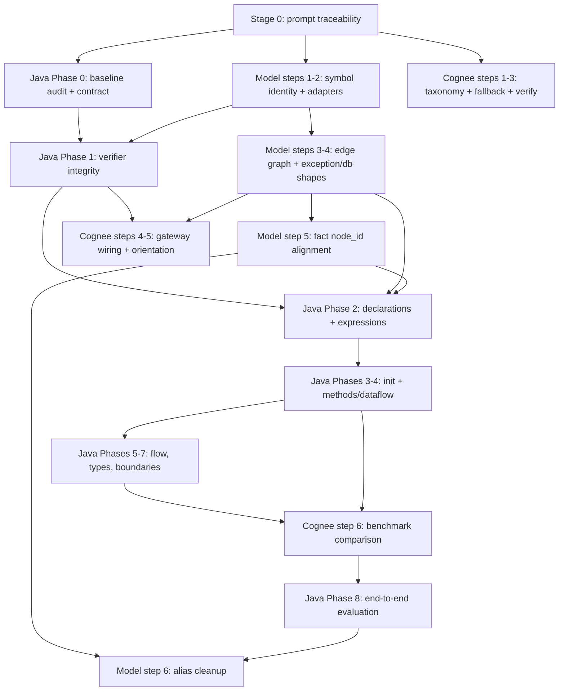

# IAP Implementation Plan: Java Language, Source-Code Models, Cognee Boundary

**Status:** Complete in working tree (uncommitted): Stages 0–5 — prompt traceability, model identity + edge shapes with alias warnings, Java Phases 0–8, Cognee fallback logic + gateway wiring + benchmark gate. Commit, worker GET_CODE dispatch wiring for the new resolvers, and any ADR amendment on benchmark numbers remain operator decisions.

## Context

Three designs converge on one investigation pipeline and share one identity layer:

- `docs/IAP-Code-Java-lang-impl-design.md` — Java fact resolution, candidate Phases 0–8. Normative source: `docs/JAV_PROMPT.md` (promoted to tracked docs in Stage 0).
- `docs/IAP-Source-Code-model-enhancement.md` — deterministic symbol identity, column ranges, edge-based call graph. No new dependency, no migration.
- `docs/IAP-Cognee-integration-design.md` — structural-first fuzzy fallback inside the evidence gateway, behind `IAP_COGNEE_ENABLED=false`. Bounds: `ADR-COGNEE-001` (P4–P8 declines stand).

As-built anchors: field-fact baseline (`application/analysis/java_field_facts.py`, `tests/unit/test_java_field_facts.py`), architecture §58, `domain/topology/models.py` identity (`compute_ast_node_id`), Cognee pilot adapter (`infrastructure/topology/cognee_adapter.py`).

## Dependency graph

## Stages

### Stage 0 — Traceability (done, uncommitted)

Move the normative prompt to a tracked path so fresh checkouts keep the requirement source. Update design references accordingly. Commit left to the operator.

Gate: `docs/JAV_PROMPT.md` tracked; no remaining references to the ignored path outside ledger history.

### Stage 1 — Parallel foundations (open)

Three tracks, different files, no shared surface. May run concurrently.

**1a. Model identity** (`IAP-Source-Code-model-enhancement.md` steps 1–2): `CodeSymbol.create` with deterministic `node_id`, `SYMBOL_TO_TOPOLOGY_TYPE`, columns, `qualified_name`, `signature_hash`, `parser_version`, UUID parenting; migrate parser adapters; legacy aliases keep old construction green.

**1b. Contract lock** (Java Phase 0): baseline audit against prompt + §58 + ledger; counterexample fixtures (non-Java spellings, escapes, source levels, class-vs-instance init); legacy/new payload round-trip tests; versioned-key vs reader-first decision recorded.

**1c. Fallback pure logic** (Cognee steps 1–3): `CodeRecallMiss` taxonomy, capped retrieval-only fallback with injected search callable, authority re-verification. No `cognee` import; fully green without the dependency.

Gate per track: focused suites green plus full unit suite green, `ruff check` clean, zero new `mypy` errors on touched files.

### Stage 2 — Synchronization (opens when Stage 1 gates pass)

- **2a.** Model steps 3–4 (edge `CallGraph`, node-referencing exception/db) on top of 1a.
- **2b.** Java Phase 1 + Model step 5 jointly: proof dispatch, `fact_category` fields, `node_id` verifier match. Joint round-trip test: `CodeSymbol.create` and `ASTNodeIdentity.create` agree on `node_id` for identical inputs.
- **2c.** Cognee steps 4–5 gateway wiring + orientation, flag off. Orientation-only support never verifies.

### Stage 3 — Java semantics (opens at 2b)

Java Phases 2–4 in order on the hardened identity. Per-phase correct-target and wrong-target counterexamples; `0o`/escape/overflow pins stay green.

### Stage 4 — Advanced + measure (opens at Stage 3 + 2c)

Java Phases 5–7; Cognee step 6 benchmark with on/off arms and frozen gates. Precision, latency, cost, leakage, determinism reported separately.

### Stage 5 — Close-out (opens at Stage 4)

Java Phase 8 E2E battery; Model step 6 alias cleanup; architecture §58 updates; ledger items to `IMPLEMENTED` with test evidence.

## Standing rules

- Parallel within a stage, sequential across stages. Stage 2b is the first synchronization point.
- One handoff test per boundary (identity agreement, authority-index resolution, benchmark deltas into the E2E gate).
- Cognee stays behind `IAP_COGNEE_ENABLED=false` until the D7 benchmark gate passes with its own ADR amendment.
- Declined scopes (symbolic execution, points-to, container startup, Cognee P4–P8) stay declined; reopening needs a new ledger item with evidence.
- No commits, pushes, merges, or deploys by agents; working tree only.
