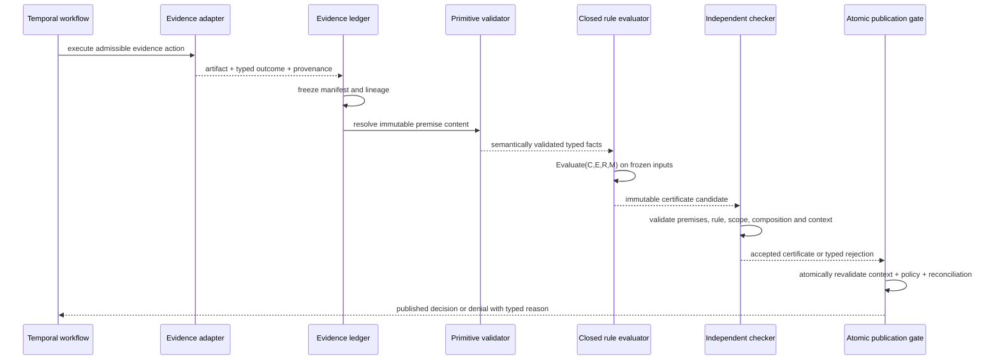
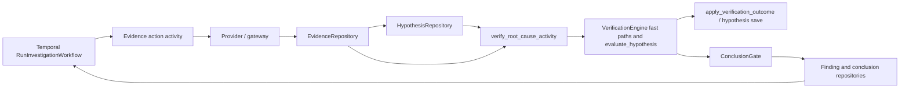
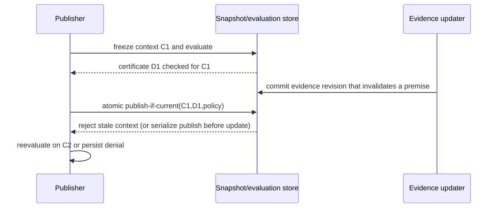

# Design: Query-to-Verify Improved Proof Core

Native proof-and-evidence core for IAP: claim-local retrieval binding, typed relation edges, a shared proof-obligation vocabulary, and deterministic obligation-directed routing inside the existing workflow, with optional analyzer path witnesses and narrow constraint-solver checks gated behind shadow evaluation. No new runtime dependency, no authoritative role for any external witness.

> **Revision 2 — source-grounded design update.** This Luna copy retains the earlier D1–D12 proposal as decision history, but the normative addendum at the end supersedes any conflicting statement or pseudocode above it. In particular, proof confidence is non-authoritative; speculative-edge ceilings are presentation-only; repair never grants proof; the independent checker and immutable certificate are the proof boundary; model-graded entailment is advisory and cannot discharge a source-code obligation; publication requires one atomic current-context decision; and every legacy path must be audited before authoritative kernel rollout. This is a design artifact, not implementation authorization. The detailed staged sequence is `IAP-proof-kernel-plan-v1.0-luna.md`; `IAP-QUERY-TO-VERIFY-IMPROVE-IMPL-PLAN-luna.md` is retained only as historical work-package provenance, with conflicting ordering explicitly superseded.

## Context

IAP investigates source code by decomposing questions into typed claims (`ClaimKind`: `DEFINITION | CALL_EDGE | BEHAVIOR | ABSENCE | HISTORY | CAUSAL` in `src/investigation_agent_platform/domain/hypothesis/models.py:35-54`) with revision-aware targets (`ClaimTarget` in `domain/hypothesis/models.py:56-76`), banking evidence rows with provenance (`domain/evidence/models.py:118-151`, `domain/provenance/models.py:10-51`), and verifying deterministically in `VerificationEngine` (`src/investigation_agent_platform/application/investigation/verification.py:513-521`) under `ConclusionGate` (`verification.py:3909-3981`). Live battery runs show a banked-but-unverified signature: evidence rows exist yet hypotheses stay `INCONCLUSIVE` and conclusions persist `INSUFFICIENT_EVIDENCE`, with zero recorded causal chains and generic blockers that do not say which proof obligation failed. The verified mechanisms behind that signature are binding-scoped, not retrieval-scoped: formulate validates citations against rows existing at that turn, per-claim IDs stay claim-local (`application/worker/activities.py:5265-5332`), verify/conclude re-resolution drops stale or foreign IDs (`activities.py:5859-5869,6821-6831`), range repair joins only revision-matching range reads (`verification.py:2252-2317`), any bound refuting evidence withholds fast paths (`activities.py:5911-6032`), and causal steps attach only on `VERIFY_HYPOTHESIS` with resolvable IDs (`activities.py:5466-5533`). This design closes that hole natively first, then adds optional witnesses only where measured gaps remain.

### Changes to architecture documentation

No `docs/dev/architecture.md` exists in the project. On implementation, update `docs/IAP-architecture-v1.0.md` with a new section covering the per-claim retrieval ledger, the typed relation edge and resolution tiers, the shared obligation vocabulary, and the deterministic routing policy, plus the shadow-evaluation and graduation bars for the optional analyzer and solver pilots. Record each rollout flag and its default in the same section so operators can reason about behavior without reading code.

## References

- [docs/IAP-architecture-v1.0.md](./IAP-architecture-v1.0.md) — Current IAP architecture, verification states, gate semantics, and profile conventions this design builds on.
- [docs/REV_BATTERY_CLOSE_PLAN.md](./REV_BATTERY_CLOSE_PLAN.md) — Battery failure analysis and proof-obligation tracking plan whose failure buckets this design adopts as the diagnostic vocabulary.
- [docs/DS_REVIEW_v0.1.md](./DS_REVIEW_v0.1.md) — Code-grounding contracts (target, revision, evidence, verification) whose range-containment and revision-agreement rules remain authoritative.
- [docs/BATTERY_LIVE_PROTOCOL.md](./BATTERY_LIVE_PROTOCOL.md) — Live battery execution and grading protocol reused for shadow evaluation and graduation decisions.
- [SMT-LIB standard logics](https://smt-lib.org/logics.shtml) — Defines the `QF_LIA` and `QF_LRA` fragments that bound the optional constraint-solver pilot to decidable linear arithmetic.

## Goals / Non-Goals

**Goals:**

- Claim-local retrieval-to-proof closure: every checkable claim binds its own retrieval attempts, grounds citations strictly, and demotes loudly on evaporation.
- Typed relation edges with resolution tiers and honest unresolved state for call and data-flow relationships.
- One shared proof-obligation vocabulary produced by the verifier and consumed by routing.
- Deterministic smallest-valid-action routing inside the existing durable workflow, shadow-tested before it owns any decision.
- Eval gates that enforce zero-unsatisfied-on-verified by default with a labeled report-only override.
- Optional analyzer path witnesses and narrow constraint-solver checks, each shadow-gated with explicit graduation bars and no gate authority.
- Preservation of honest abstention and all existing fail-closed gates.

**Non-Goals:**

- A second durable runtime, checkpoint store, or orchestration framework — the existing workflow stays.
- A central graph database or analyzer platform — native resolvers and the existing call-graph providers stay primary.
- Lexical or model-judged proof of source-code relationships — deterministic predicates remain the only code proof.
- Solver-based reasoning over call graphs, history, absence, dispatch, or whole-program behavior.
- New persisted tables, caches, or API surfaces before shadow evidence justifies them.
- Threshold or semantics changes to `VERIFIED`, `INCONCLUSIVE`, `CONTRADICTED`, `ANSWERED`, `LIKELY`, or abstention states to improve answer rate.

## Decisions

### D1: Synthetic proof-closure harness gate as a hard precondition

**Decision:** No verifier, prompt, or routing change lands until a test-only proof-closure harness demonstrates that reported battery failures classify into exactly one explicit failure bucket each. The harness builds representative L2 (caller enumeration), L3 (history), L5 (guarded behavior), and L8 (nonexistent target) shapes in the banked-but-unverified, bound-but-wrong-type, wrong-revision, evaporated-ID, missing-causal-step, and genuinely-absent variants, runs the current verifier and battery grader over them, and reports the bucket per fixture. The gate passes when every fixture lands in exactly one bucket, existing honest-abstention fixtures still abstain, and a sampled set of real banked-but-unverified runs classifies the same way. Until the gate passes, only harness fixtures and pure helper functions may be written; no authoritative wiring changes.

```python
# src/investigation_agent_platform/application/investigation/proof_closure.py
"""Test-only proof-closure harness. No production wiring reads this module."""
from __future__ import annotations

from pydantic import BaseModel, Field


FAILURE_BUCKETS: tuple[str, ...] = (
    "never_retrieved",
    "retrieved_but_unbound",
    "bound_but_wrong_type",
    "withheld_by_refuting",
    "provider_or_analyzer_failed",
    "genuinely_insufficient",
    "wrong_revision_or_scope",
)


class ClosureFixture(BaseModel):
    """One synthetic or sampled-real run shape with a known-correct bucket."""

    fixture_id: str = Field(description="Stable fixture identity, e.g. L2-caller-enumeration-evaporated.")
    battery_shape: str = Field(description="Battery shape under test: L1, L2, L3, L4, L5, or L8.")
    expected_bucket: str = Field(description="The single failure bucket this fixture must report.")
    must_abstain: bool = Field(
        default=False,
        description="True when the correct terminal outcome is honest abstention.",
    )


class ClosureReport(BaseModel):
    """Harness outcome for one fixture."""

    fixture_id: str = Field(description="Fixture identity from ClosureFixture.")
    reported_bucket: str | None = Field(
        default=None,
        description="Bucket reported by the current verifier plus grader, or None if unclassifiable.",
    )
    abstained: bool = Field(default=False, description="Whether the run abstained.")
    passed: bool = Field(description="True only when reported_bucket matches expected and abstention matches.")


def grade_closure(fixtures: list[ClosureFixture], reporter) -> list[ClosureReport]:
    """Run each fixture through the supplied reporter and check single-bucket classification.

    The reporter callable wraps the current verifier plus battery grader and returns
    (reported_bucket, abstained) for a fixture. This function performs no I/O itself.
    """
    reports: list[ClosureReport] = []
    for fixture in fixtures:
        reported_bucket, abstained = reporter(fixture)
        bucket_ok = reported_bucket == fixture.expected_bucket
        abstain_ok = abstained == fixture.must_abstain
        reports.append(
            ClosureReport(
                fixture_id=fixture.fixture_id,
                reported_bucket=reported_bucket,
                abstained=abstained,
                passed=bool(bucket_ok and abstain_ok),
            )
        )
    return reports


def gate_passed(reports: list[ClosureReport]) -> bool:
    """Hard gate predicate: every fixture classified exactly once and correctly."""
    if not reports:
        return False
    return all(report.passed and report.reported_bucket is not None for report in reports)
```

**Alternative considered:** Proceeding directly to verifier demotion in parallel with harness construction. Rejected — the demotion paths bake the bucket taxonomy into product behavior, and a wrong taxonomy would misattribute every future failure and then route on it.

**Rationale:** The harness is the cheapest falsification of the shared premise that binding, not retrieval or verifier semantics, dominates the battery failures. It costs fixtures, not rework.

**Trade-offs:** Live signal is deferred by one slice, and synthetic fixtures cannot capture model sampling or retrieval variance, so the gate additionally requires sampled real runs to classify the same way or the taxonomy is fixed instead of proceeding.

---

### D2: Per-claim retrieval ledger

**Decision:** Every checkable claim carries its own retrieval ledger recording the query text that was issued for it and the evidence IDs each attempt returned. Verification resolves a claim's citations against that claim's retrieved set first and the investigation bank second, and records retrieved, bound, grounded, and evaporated ID sets per claim. Uncheckable claims (taste, preference, value judgement with no code anchor) never dispatch retrieval and never enter the publish denominator. Legacy rows without a ledger entry degrade to an explicitly labeled `unmapped` fallback rather than failing or silently verifying.

```python
# src/investigation_agent_platform/application/investigation/retrieval_ledger.py
"""Per-claim retrieval ledger. Pure data helpers; no I/O, no LLM calls."""
from __future__ import annotations

from datetime import datetime
from uuid import UUID

from pydantic import BaseModel, Field


class RetrievalAttempt(BaseModel):
    """One provider operation issued for one claim."""

    operation: str = Field(description="Provider operation, e.g. GET_CODE, SEARCH_CODE, GET_HISTORY.")
    query_fingerprint: str = Field(description="Provenance query fingerprint of the issued operation.")
    returned_evidence_ids: list[UUID] = Field(
        default_factory=list,
        description="Evidence IDs returned by this attempt in this investigation.",
    )
    attempted_at: datetime = Field(description="When the attempt executed.")


class ClaimRetrievalLedger(BaseModel):
    """Retrieval history for one (statement, claim-kind) claim."""

    claim_key: str = Field(description="Deterministic key: normalized statement plus claim kind.")
    search_query: str = Field(
        default="",
        description="Keywords plus symbol stems issued for this claim, 3-10 terms when present.",
    )
    checkable: bool = Field(
        default=True,
        description="False for unfalsifiable claims, which never dispatch retrieval.",
    )
    attempts: list[RetrievalAttempt] = Field(default_factory=list)


def claim_local_ids(ledger: ClaimRetrievalLedger) -> set[UUID]:
    """Union of IDs retrieved for this claim across all attempts."""
    found: set[UUID] = set()
    for attempt in ledger.attempts:
        found.update(attempt.returned_evidence_ids)
    return found


def partition_citations(
    cited_ids: list[UUID],
    ledger: ClaimRetrievalLedger,
    bank_ids: set[UUID],
) -> tuple[set[UUID], set[UUID], set[UUID]]:
    """Split cited IDs into claim-local, bank-fallback, and unknown sets.

    Returns (claim_local, bank_fallback, unknown). Unknown IDs are dropped by the
    caller and recorded as evaporated with an explicit reason, never silently.
    """
    local = claim_local_ids(ledger)
    cited = set(cited_ids)
    claim_local = cited & local
    bank_fallback = (cited - local) & bank_ids
    unknown = cited - local - bank_ids
    return claim_local, bank_fallback, unknown
```

**Alternative considered:** Keeping the global bank as the sole resolution scope with an evaporation audit. Rejected — without claim-local linkage the loop cannot distinguish never-retrieved-for-this-claim from retrieved-but-wrong-type, so the next action stays generic and the L2/L3/L5 loop keeps re-searching broadly.

**Rationale:** Presence in the bank is not proof. Claim-local resolution makes the binding requirement mechanical and gives routing a named missing proof instead of a generic blocker.

**Trade-offs:** One bounded re-retrieval per unsatisfied claim adds one to two actions on caller-enumeration, history, and behavior shapes. Poor per-claim queries can produce scoped misses, mitigated by the same-file-and-revision repair bound in D3 and the `unmapped` legacy fallback.

---

### D3: Strict grounding with bounded repair and evaporated-evidence demotion

**Decision:** Fuzzy matching may find rows and drive orientation, but only strict kind-specific predicates may prove. Every cited row must satisfy the existing deterministic gate for its claim kind at the same revision and path: range containment with recorded start and end lines for location and value claims, a shown call site for call edges, file plus commit-prefix plus subject match for history, and scoped `match_count == 0` proof rows for absence. Misattributed IDs may be repaired by content match only when the donor row is same-file, same-revision, and kind-grounded for the same claim, with the repair recorded. A claim whose every citation evaporates is `INCONCLUSIVE` with named evaporated IDs and a smallest-fetch next action, never verified and never silent. `SUPPORTED` with zero kept citations is impossible by construction.

```python
# src/investigation_agent_platform/application/investigation/grounding.py
"""Strict grounding helpers. Predicate dispatch reuses existing kind gates."""
from __future__ import annotations

from uuid import UUID

from pydantic import BaseModel, Field


SEVEN_BUCKETS: tuple[str, ...] = (
    "never_retrieved",
    "retrieved_but_unbound",
    "bound_but_wrong_type",
    "withheld_by_refuting",
    "provider_or_analyzer_failed",
    "genuinely_insufficient",
    "wrong_revision_or_scope",
)


class GroundingOutcome(BaseModel):
    """Per-claim grounding result with full audit trail."""

    claim_key: str = Field(description="Claim key matching ClaimRetrievalLedger.claim_key.")
    kept_ids: list[UUID] = Field(default_factory=list, description="Citations that grounded strictly.")
    evaporated_ids: list[UUID] = Field(default_factory=list, description="Citations dropped with reasons.")
    repaired_from: dict[str, str] = Field(
        default_factory=dict,
        description="Kept ID to original cited ID for bounded misattribution repairs.",
    )
    demoted: bool = Field(default=False, description="True when citations existed but none grounded.")
    bucket: str = Field(description="Exactly one of the seven failure buckets, or 'grounded'.")


def bounded_repair_allowed(original_id: UUID, donor_id: UUID, *, same_file: bool, same_revision: bool, kind_grounded: bool) -> bool:
    """Repair gate: donor must be same-file, same-revision, and kind-grounded.

    Original and donor content match is checked by the caller. This predicate adds
    the scope bounds so repair cannot rebind across files or revisions.
    """
    _ = (original_id, donor_id)
    return bool(same_file and same_revision and kind_grounded)
```

The seven failure buckets are `never_retrieved`, `retrieved_but_unbound`, `bound_but_wrong_type`, `withheld_by_refuting`, `provider_or_analyzer_failed`, `genuinely_insufficient`, and `wrong_revision_or_scope`. Every `INCONCLUSIVE` claim reports exactly one, and every blocker maps to a smallest-fetch next action in D8.

**Alternative considered:** Demotion without the repair path (drop all unresolvable citations). Rejected — misattributed-ID cases where the right row exists under a different ID would keep failing despite available proof; bounded repair converts those drops into keeps without opening cross-file rebinding.

**Rationale:** This is the smallest change that closes false accepts from construction-as-invocation, comment-line-as-proof, and stale-ID citations while turning silent drops into named, routable blockers.

**Trade-offs:** Telemetry needs a closed label vocabulary to avoid cardinality blowup; reason labels are bucket names, never SHAs or raw text. Over-strictness on dynamic dispatch is bounded by the speculative-hop cap in D4 rather than relaxed grounding.

---

### D4: Typed relation edges with resolution tiers and endpoint certainty

**Decision:** Every material code relation becomes a typed edge object carrying caller, call site, callee, ordered intermediates, one location per hop at the pinned revision, a resolution tier, and provenance. Resolution tiers order `STATIC` (exact symbol match), `DYNAMIC` (hierarchy- or injection-aware dispatch), `SPECULATED` (hint, name-only, or external-stub match), and `UNRESOLVED` (no edge, retained hint). Unlinked calls are `UNRESOLVED` with receiver-type or configuration hints carried into the missing-obligation tool hint, never silence and never a fabricated edge. A speculative hop with certain endpoints caps at `LIKELY`; a speculative endpoint, or construction counted as invocation, fails closed. Path depth is tunable with default 4; longer-than-cap is unsatisfied with the truncated path retained as the hint.

```python
# src/investigation_agent_platform/domain/relations/edges.py
"""Typed relation edge vocabulary. Pure model; resolution order enforced by checkers."""
from __future__ import annotations

from enum import Enum
from uuid import UUID

from pydantic import BaseModel, Field


class ResolutionTier(str, Enum):
    """Ordered resolution strength. Order matters: STATIC > DYNAMIC > SPECULATED > UNRESOLVED."""

    STATIC = "STATIC"
    DYNAMIC = "DYNAMIC"
    SPECULATED = "SPECULATED"
    UNRESOLVED = "UNRESOLVED"


class EdgeHop(BaseModel):
    """One hop in a verified relation path at the pinned revision."""

    ordinal: int = Field(description="Zero-based position along the path.")
    file_path: str = Field(description="Repository-relative file path.")
    line_start: int = Field(description="First line of the hop window, 1-based.")
    line_end: int = Field(description="Last line of the hop window, 1-based.")
    role: str = Field(description="Hop role, e.g. entry, proxy, dispatch, handler.")
    evidence_id: UUID = Field(description="Banked row showing this hop at the pinned revision.")


class RelationEdge(BaseModel):
    """A claimed code relation with its proof state."""

    edge_id: str = Field(description="Deterministic edge identity: caller, site, callee, revision.")
    caller: str = Field(description="Calling symbol or component name.")
    callsite_file: str = Field(description="Repository-relative file containing the call site.")
    callee: str = Field(description="Called symbol or handler name.")
    revision: str = Field(description="Pinned repository revision all hops must share.")
    resolution: ResolutionTier = Field(description="Strongest tier established for this edge.")
    endpoint_certain: bool = Field(
        description="True only when both endpoint identities are certain, regardless of hop speculation.",
    )
    hops: list[EdgeHop] = Field(default_factory=list, description="Ordered intermediates, empty when unresolved.")
    retained_hint: str = Field(
        default="",
        description="Receiver-type or configuration hint retained when UNRESOLVED.",
    )
    decided_by: str = Field(default="", description="Checker tier that decided, for audit.")


def edge_ceiling(edge: RelationEdge) -> str:
    """Maximum publishable outcome for an edge. Fail-closed on uncertain endpoints."""
    if edge.resolution is ResolutionTier.UNRESOLVED:
        return "UNSATISFIED"
    if not edge.endpoint_certain:
        return "UNSATISFIED"
    if edge.resolution is ResolutionTier.SPECULATED:
        return "LIKELY"
    return "VERIFIED_CANDIDATE"
```

**Alternative considered:** A central graph database or external analyzer platform as the relation store. Rejected — substantially larger than the demonstrated need, duplicates existing topology and analysis foundations, and adds storage, indexing, and operational surface for a problem that currently fails at single-hop grounding.

**Rationale:** The battery failure is representational: rows banked, no edge object, so `chains=0` is a mystery. Edges make each hop inspectable and each gap routable.

**Trade-offs:** Edge plumbing across formulate, verify, and conclude plus persistence; tier-ordering review per language; depth-cap tuning per profile. Over-strictness on dynamic dispatch is handled by the `LIKELY` cap for certain endpoints, never by relaxing endpoint certainty.

---

### D5: Dispatch and semantics table in per-tenant profiles

**Decision:** Language and framework dispatch wiring (annotation-to-edge rules, injection equivalents, sanitizer-equivalents for blocked paths) lives in per-tenant profile configuration with explicit versioning. Verifier code holds only the query mechanics and the tier ordering. Unknown wiring yields `UNRESOLVED` with the wiring gap named in the retained hint, never silence and never a speculative pass.

**Alternative considered:** Hardcoding dispatch rules in verifier code. Rejected — rules vary per tenant stack and framework version, and code-embedded rules cannot be tuned without a release.

**Rationale:** Profiles already vary per onboarded tenant, so dispatch knowledge follows the same versioning and review path as other tenant configuration instead of scattering substring heuristics through checkers.

**Trade-offs:** Profile authoring and review cost per tenant; stale profiles can over-narrow resolution until refreshed, which surfaces as `UNRESOLVED` with a named wiring hint rather than a false negative.

---

### D6: Shared proof-obligation vocabulary

**Decision:** The verifier emits one shared typed-obligation vocabulary per claim and causal link, consumed by routing, telemetry, and the battery. Obligation statuses are `OPEN`, `SATISFIED`, `CONFLICTED`, `UNSUPPORTED`, and `NOT_APPLICABLE`. Each unsatisfied obligation carries a stable missing code, the claim or step identity, target and scope, bound evidence IDs, and the verifier generation. A separate next-action record names the obligation it discharges, the validated action type and parameters, the expected discriminator, and attempt counts. These are planning facts; they never redefine `VERIFIED`, `INCONCLUSIVE`, or `CONTRADICTED`.

```python
# src/investigation_agent_platform/application/investigation/obligations.py
"""Shared proof-obligation vocabulary. Derived per verification pass; see D8 for routing."""
from __future__ import annotations

from enum import Enum
from uuid import UUID

from pydantic import BaseModel, Field


class ObligationKind(str, Enum):
    """Stable obligation families mapped from claim kinds and fact categories."""

    LOCATION_RANGE = "LOCATION_RANGE"
    CALL_EDGE = "CALL_EDGE"
    BEHAVIOR_CODE = "BEHAVIOR_CODE"
    BEHAVIOR_RUNTIME = "BEHAVIOR_RUNTIME"
    ABSENCE_SCOPE = "ABSENCE_SCOPE"
    HISTORY_MATCH = "HISTORY_MATCH"
    CAUSAL_LINK = "CAUSAL_LINK"


class ObligationStatus(str, Enum):
    """Per-obligation proof state. Planning facts only."""

    OPEN = "OPEN"
    SATISFIED = "SATISFIED"
    CONFLICTED = "CONFLICTED"
    UNSUPPORTED = "UNSUPPORTED"
    NOT_APPLICABLE = "NOT_APPLICABLE"


class ProofObligation(BaseModel):
    """One required proof unit for one claim or causal link."""

    obligation_id: str = Field(description="Deterministic identity over claim, kind, target, revision, verifier version.")
    claim_key: str = Field(description="Claim key matching ClaimRetrievalLedger.claim_key.")
    kind: ObligationKind = Field(description="Obligation family.")
    target: str = Field(description="Symbol, path, scope, or link reference the obligation is about.")
    repository_revision: str = Field(description="Pinned revision or scope the obligation applies to.")
    status: ObligationStatus = Field(description="Current proof state of this obligation.")
    missing_code: str = Field(default="", description="Stable code when OPEN, e.g. CALLSITE_NOT_SHOWN.")
    bound_evidence_ids: list[UUID] = Field(default_factory=list)
    verifier_version: str = Field(description="Verifier generation that produced this status.")


class NextEvidenceAction(BaseModel):
    """One validated evidence action discharging one obligation."""

    obligation_id: str = Field(description="Obligation this action is expected to discharge.")
    action_type: str = Field(description="Validated action type from the registered capability set.")
    parameters: dict[str, str] = Field(default_factory=dict, description="Validated action parameters.")
    expected_discriminator: str = Field(description="What the action result must show to satisfy the obligation.")
    attempt_count: int = Field(default=0, description="Attempts already spent on this obligation.")
    status: str = Field(default="PROPOSED", description="PROPOSED, DISPATCHED, COMPLETED, or DEGRADED.")


def expand_obligations(claim_key: str, claim_kind: str, fact_category: str, revision: str, verifier_version: str) -> list[ProofObligation]:
    """Table read from (claim kind, fact category) to required obligation rows.

    The full table is data, not prose: each supported (kind, category) pair maps to
    its required obligation kinds. Unknown pairs yield no obligations and the claim
    is marked UNSUPPORTED rather than guessed.
    """
    table: dict[tuple[str, str], list[ObligationKind]] = {
        ("DEFINITION", "SOURCE_FACT"): [ObligationKind.LOCATION_RANGE],
        ("CALL_EDGE", "CALL_FACT"): [ObligationKind.CALL_EDGE],
        ("BEHAVIOR", "SOURCE_FACT"): [ObligationKind.BEHAVIOR_CODE],
        ("BEHAVIOR", "RUNTIME_FACT"): [ObligationKind.BEHAVIOR_CODE, ObligationKind.BEHAVIOR_RUNTIME],
        ("ABSENCE", "ABSENCE_FACT"): [ObligationKind.ABSENCE_SCOPE],
        ("HISTORY", "HISTORY_FACT"): [ObligationKind.HISTORY_MATCH],
        ("CAUSAL", "CAUSAL_FACT"): [ObligationKind.CAUSAL_LINK],
    }
    kinds = table.get((claim_kind, fact_category), [])
    return [
        ProofObligation(
            obligation_id=f"{claim_key}:{kind.value}:{revision}:{verifier_version}",
            claim_key=claim_key,
            kind=kind,
            target=claim_key,
            repository_revision=revision,
            status=ObligationStatus.OPEN,
            verifier_version=verifier_version,
        )
        for kind in kinds
    ]
```

**Alternative considered:** Two parallel vocabularies, one for binding gaps and one for routing. Rejected — duplicate state with reconciliation risk; every divergence becomes a new mystery equivalent to the one being removed.

**Rationale:** One vocabulary lets the verifier say what is missing, the router choose the smallest valid fetch, telemetry count the same codes the battery grades, and reviewers audit a single contract.

**Trade-offs:** Stable identity and versioning discipline; claim mutation and evidence invalidation must recompute obligations, or stale `SATISFIED` rows could linger. Derived-per-pass computation avoids persistence risk until shadow data justifies it.

---

### D7: Obligation table with deterministic-first cascade and a gated behavioral extension

**Decision:** The `(claim kind, fact category)` table in D6 is the single expansion point; the six existing validators plus claim-kind dispatch become rows in that table rather than parallel code paths over time. Deterministic rule kernels run first for every obligation and are the only path for source identity, revision pinning, and range reads. A model-graded entailment extension exists only for `BEHAVIOR` and `CAUSAL` sentences where no deterministic kernel can decide, runs only on fall-through after deterministic abstention, and uses a strict grade contract with a panel vote that withholds on ties. An LLM never establishes that a file, line range, or revision exists; it may only judge whether a cited row says what the claim says it says. Verdict roll-up: all required obligations `SATISFIED` (ignoring `NOT_APPLICABLE`) rolls up to `VERIFIED` subject to existing per-category verdict ceilings; any `CONFLICTED` rolls up to `CONTRADICTED`; otherwise `INCONCLUSIVE` with at least one missing obligation.

**Alternative considered:** Model grading as a peer proof path for all claim kinds. Rejected — lexical overlap cannot prove calls, data flow, defaults, or absence, and peer status would let a fluent judgement override a failed deterministic check.

**Rationale:** Deterministic-first preserves every current fail-closed property while giving the two genuinely judgement-shaped obligations a disciplined, votable, auditable extension instead of an unbounded heuristic.

**Trade-offs:** Panel voting adds latency on the fall-through path only; contested panels withhold to unscored human review rather than blocking permanently, which needs an explicit review queue to avoid silent queues.

---

### D8: Deterministic action policy inside the existing workflow with shadow strangler

**Decision:** A pure policy function maps open obligations plus registered capabilities, action history, and remaining budgets to the smallest valid next action, returning the missing-code-to-action mapping as data. The LLM reasoner may propose or choose among valid actions only when the deterministic mapping does not decide. The policy runs in shadow alongside existing forcing rules first, logging closed-vocabulary divergence; only mapped cases transfer to policy authority behind a flag, and existing forcing helpers are removed only after parity and battery acceptance. The existing durable workflow keeps retries, signals, budgets, checkpoints, and terminal transitions; no second runtime is introduced.

```python
# src/investigation_agent_platform/application/investigation/action_policy.py
"""Deterministic next-action policy. Pure function: no I/O, no LLM, no budget mutation."""
from __future__ import annotations

from pydantic import BaseModel, Field

from .obligations import NextEvidenceAction, ObligationStatus, ProofObligation


class PolicyInput(BaseModel):
    """Everything the policy may read. Anything else is out of scope by construction."""

    obligations: list[ProofObligation] = Field(description="Current derived obligations for the candidate.")
    action_history: list[str] = Field(default_factory=list, description="Action types already dispatched.")
    capabilities: list[str] = Field(default_factory=list, description="Registered allowed action types.")
    budget_remaining: bool = Field(default=True, description="False when no evidence actions remain.")


FETCH_FOR_MISSING: dict[str, str] = {
    "DEFINITION_RANGE_MISSING": "GET_CODE",
    "CALLSITE_NOT_SHOWN": "GET_CODE",
    "RUNTIME_LEG_MISSING": "SEARCH_LOGS",
    "HISTORY_ROW_MISSING": "GET_HISTORY",
    "ABSENCE_SCOPE_UNPROVEN": "SEARCH_CODE",
    "CAUSAL_STEP_UNGROUNDED": "GET_CODE",
}


def choose_next_action(policy_input: PolicyInput) -> NextEvidenceAction | None:
    """Return the smallest valid action for the first open obligation, or None.

    Priority follows obligation order supplied by the verifier. An action type must
    be registered as capable and must not repeat a history entry more than once;
    otherwise the next obligation is tried. None means abstain with missing codes.
    """
    if not policy_input.budget_remaining:
        return None
    seen_counts: dict[str, int] = {}
    for action in policy_input.action_history:
        seen_counts[action] = seen_counts.get(action, 0) + 1
    for obligation in policy_input.obligations:
        if obligation.status is not ObligationStatus.OPEN:
            continue
        if not obligation.missing_code:
            continue
        action_type = FETCH_FOR_MISSING.get(obligation.missing_code)
        if action_type is None:
            continue
        if action_type not in policy_input.capabilities:
            continue
        if seen_counts.get(action_type, 0) >= 2:
            continue
        return NextEvidenceAction(
            obligation_id=obligation.obligation_id,
            action_type=action_type,
            parameters={"target": obligation.target, "revision": obligation.repository_revision},
            expected_discriminator=f"{obligation.kind.value} satisfied at {obligation.target}",
        )
    return None
```

**Alternative considered:** Replacing the workflow runtime with a graph-based orchestration framework. Rejected — it would duplicate replay, retry, signal, and checkpoint semantics without supplying any proof logic, creating dual state authority for zero verification gain.

**Rationale:** The gap is routing generality, not execution machinery: independent forcing heuristics with per-helper caps cannot express obligation precedence, while a testable pure function can, inside the loop that already works.

**Trade-offs:** A deterministic table can false-reject viable paths, so capability-aware fallback plus constrained LLM choice is required; per-turn derivation cost is bounded to the selected candidate; persisted obligations would risk staleness, so persistence waits for shadow evidence.

---

### D9: Eval gates enforce by default with a labeled report-only override

**Decision:** Battery acceptance gates assert per-obligation properties: every `VERIFIED` claim ships zero required non-`NOT_APPLICABLE` unsatisfied obligations; every `INCONCLUSIVE` ships at least one missing obligation whose tool hint names a real registered tool; citation validity holds at the current bar with malformed-response reasons counted as failures; rival-contrast and abstention goldens keep their semantics, asserted per obligation. Gates enforce by default and fail the run on violation; an environment override drops them to report-only for diagnosis runs with the downgrade labeled in the run record. Volatility is handled by repeating graded judgements over epochs and reducing contested outcomes to unscored human review rather than forcing a verdict.

**Alternative considered:** Advisory dashboards without enforcement. Rejected — unenforced gates document the same failures the battery already reports without changing what ships.

**Rationale:** Enforcement is what converts the obligation vocabulary from documentation into a contract: promotion of any claim kind, witness, or solver check is gated on measured behavior, not argument.

**Trade-offs:** Flaky-model variance can fail enforced gates; epochs plus majority reduction absorb sampling noise, and the labeled override preserves a diagnosis path without weakening the default.

---

### D10: Optional analyzer path-witness packet with read-only shadow adapter

**Decision:** A versioned analyzer path packet may be banked as typed evidence and consumed only for structural data-flow and call-path obligations where native providers are demonstrably thin. The packet carries schema version, analyzer and query-pack identity and version, database identity with the exact analyzed revision, path kind, source and sink with node identity plus file and line ranges plus model roles, ordered nodes and edges with ordinals, explicitly marked summarized segments, a truncation flag with omitted counts, and a result hash. Validation rejects revision mismatch, incomplete databases, over-bound payloads, and broken endpoint ordering before banking; truncation never silently satisfies a missing edge. A read-only adapter runs in shadow first comparing witness paths against native obligations; promotion of selected obligations behind a flag follows only on measured usable-path rate, with range reads and runtime checks remaining mandatory and missing results never treated as absence proof.

```python
# src/investigation_agent_platform/application/analysis/path_witness.py
"""Analyzer path-witness validation. Pure checks; ingestion banking stays in the evidence layer."""
from __future__ import annotations

from uuid import UUID

from pydantic import BaseModel, Field


class WitnessNode(BaseModel):
    """One ordered path node with location and provenance."""

    ordinal: int = Field(description="Zero-based position along the path.")
    node_identity: str = Field(default="", description="Analyzer node identity when available.")
    role: str = Field(description="Node role, e.g. source, transform, sink.")
    file_path: str = Field(description="Repository-relative file path.")
    line_start: int = Field(description="First line, 1-based.")
    line_end: int = Field(description="Last line, 1-based.")


class WitnessEdge(BaseModel):
    """One ordered path edge between witness nodes."""

    ordinal: int = Field(description="Zero-based position along the path.")
    from_ordinal: int = Field(description="Source node ordinal.")
    to_ordinal: int = Field(description="Destination node ordinal.")
    kind: str = Field(description="Edge kind, e.g. data_flow, call, control_dependence.")


class PathWitnessPacket(BaseModel):
    """Bounded structural path witness for one repository at one revision."""

    schema_version: str = Field(description="Packet contract version, e.g. v1.")
    analyzer_name: str = Field(description="Analyzer name for provenance.")
    analyzer_version: str = Field(description="Analyzer version for provenance and cache identity.")
    query_id: str = Field(description="Query or rule identity that produced the path.")
    database_revision: str = Field(description="Exact commit the analyzed database was built from.")
    target_revision: str = Field(description="Pinned investigation revision the path is offered for.")
    path_kind: str = Field(description="DATA_FLOW, TAINT_FLOW, CONTROL_DEPENDENCE, or CALL_PATH.")
    source_file: str = Field(description="Source node file.")
    sink_file: str = Field(description="Sink node file.")
    nodes: list[WitnessNode] = Field(default_factory=list)
    edges: list[WitnessEdge] = Field(default_factory=list)
    summarized_segment_count: int = Field(default=0, description="Subpaths hidden behind summaries.")
    truncated: bool = Field(default=False, description="True when output was cut to bounds.")
    result_hash: str = Field(description="Content hash binding nodes, edges, and identities.")


MAX_WITNESS_NODES = 64
MAX_WITNESS_EDGES = 128


def validate_witness(packet: PathWitnessPacket, max_nodes: int = MAX_WITNESS_NODES, max_edges: int = MAX_WITNESS_EDGES) -> list[str]:
    """Return a list of rejection reasons; empty means the packet may be banked.

    Rejections are fail-closed: revision mismatch, bound overflow, broken ordering,
    and empty paths are never banked as verifying evidence.
    """
    reasons: list[str] = []
    if packet.database_revision != packet.target_revision:
        reasons.append("revision_mismatch")
    if len(packet.nodes) > max_nodes:
        reasons.append("node_bound_exceeded")
    if len(packet.edges) > max_edges:
        reasons.append("edge_bound_exceeded")
    if not packet.nodes:
        reasons.append("empty_path")
    ordinals = [node.ordinal for node in packet.nodes]
    if ordinals != sorted(ordinals) or len(set(ordinals)) != len(ordinals):
        reasons.append("node_order_broken")
    edge_ordinals = [edge.ordinal for edge in packet.edges]
    if edge_ordinals != sorted(edge_ordinals) or len(set(edge_ordinals)) != len(edge_ordinals):
        reasons.append("edge_order_broken")
    node_set = set(ordinals)
    for edge in packet.edges:
        if edge.from_ordinal not in node_set or edge.to_ordinal not in node_set:
            reasons.append("edge_dangles")
            break
    return reasons
```

**Alternative considered:** Building analyzer coverage first and binding second. Rejected — richer witnesses would merely add more unbound rows, masking the simpler binding failure the harness gate is designed to surface.

**Rationale:** Optional witnesses help exactly one shape: ordered intermediates for modeled relations where native providers cannot produce a repeatable path. Everything else stays native.

**Trade-offs:** Database builds, query authoring, language coverage, and latency are real costs measured in shadow before any promotion; stale or mismatched databases are more misleading than a search miss, hence SHA-equality enforcement end to end.

---

### D11: Narrow constraint-solver pilot for admitted value and branch predicates

**Decision:** An ephemeral in-process check inside value and branch validation encodes the bound resolved source fact plus the negated claim as linear integer or real arithmetic with booleans, restricted to linear comparisons, null-guard booleans, and resolved equalities over a single window. Bit operations, strings, nonlinear arithmetic, quantifiers, loops, cross-file conditions, dispatch, reflection, and runtime configuration are inadmissible and return the native path with an explicit note. Admitted queries run under a per-query timeout and resource cap with no cross-claim solver state; a satisfiable negated claim yields a counterexample model that becomes a fetch target, an unsatisfiable one confirms the predicate within the encoded fragment only, and unknown, timeout, or exception degrades to the current demotion with the solver reason recorded. Solver output never satisfies a gate alone and is disabled-flag-identical to current behavior.

```python
# src/investigation_agent_platform/application/verification/solver_pilot.py
"""Narrow constraint-solver pilot. Ephemeral, diagnostic-only, flag-gated."""
from __future__ import annotations

from pydantic import BaseModel, Field


ADMITTED_THEORIES: tuple[str, ...] = ("QF_LIA", "QF_LRA")
PILOT_TIMEOUT_MS = 2000
PILOT_RLIMIT = 100000
PILOT_MAX_CALLS_PER_INVESTIGATION = 4


class SolverPredicate(BaseModel):
    """Normalized predicate offered to the solver for one claim."""

    claim_key: str = Field(description="Claim key the predicate was derived from.")
    theory: str = Field(description="One of the admitted theories.")
    declarations: list[str] = Field(description="Normalized predicate text for audit.")
    knowledge_base: list[str] = Field(description="Bound resolved-row literals only.")
    negated_claim: str = Field(description="Negation of the claim over the same symbols.")


class SolverVerdict(BaseModel):
    """Solver outcome attached to verification diagnostics, never gate-authoritative."""

    claim_key: str = Field(description="Claim key this verdict annotates.")
    outcome: str = Field(description="SAT, UNSAT, UNKNOWN, or INADMISSIBLE.")
    reason: str = Field(default="ok", description="Solver reason or admission note, closed vocabulary.")
    counterexample: dict[str, str] = Field(default_factory=dict, description="Named-symbol model on SAT.")
    elapsed_ms: int = Field(default=0, description="Wall time for budget accounting.")


def admit_predicate(theory: str, uses_bit_ops: bool, uses_strings: bool, uses_nonlinear: bool, uses_quantifiers: bool, cross_file: bool) -> str:
    """Admission gate. Returns 'ADMIT' or the inadmissibility reason."""
    if theory not in ADMITTED_THEORIES:
        return "theory_not_admitted"
    if uses_bit_ops:
        return "bit_ops_require_width_modeling"
    if uses_strings:
        return "string_content_unstable"
    if uses_nonlinear:
        return "nonlinear_undecidable_fragment"
    if uses_quantifiers:
        return "quantifiers_incomplete"
    if cross_file:
        return "cross_file_out_of_scope"
    return "ADMIT"
```

**Alternative considered:** Solver-based reasoning over call graphs, history, absence, or whole-program behavior. Rejected — encoding fidelity for those relations is unprovable, inapplicable fragments dominate, and the authoritative decision would rest on the least auditable component.

**Rationale:** The pilot tests the single overlap where a checked implication with a witness on each side could upgrade one demote-only heuristic into a check, at zero gate risk because the native path decides regardless.

**Trade-offs:** The admitted share may be small enough to decline the dependency permanently; encoder review is the real cost since any code-to-constraint mismatch is a soundness hole in the annotation, bounded by native primacy, same-revision scoping, and goldens.

---

### D12: Verdict and score hygiene

**Decision:** Scoring stays deterministic in Python with confidence-weighted contributions and a rival-shared-evidence penalty; unfalsifiable claims are excluded from publish denominators; solver and analyzer attributes are never keyed by claim text alone but always by claim identity plus repository, revision, file and line window, predicate or query identity, and theory or model version with timeout; bank-interest shared rows never inherit solver or analyzer verdicts across revisions and are re-checked on reuse or dropped.

**Alternative considered:** Caching verification verdicts by claim text for reuse. Rejected — text-equal claims at different revisions, windows, or evidence sets would inherit proofs that do not apply, silently breaking revision consistency and freshness guarantees.

**Rationale:** Hygiene rules are what let every other decision be adopted without weakening `ConclusionGate`, freshness, or provenance requirements.

**Trade-offs:** Re-checking shared rows costs redundant compute on cross-run reuse; freshness windows can force re-retrieval of still-valid rows, which is the correct price for revision safety.

## Data Storage

Early phases persist nothing new: the retrieval ledger, grounding outcomes, obligations, and solver verdicts ride existing JSON diagnostic fields (`assessments_json`, action-execution records, `loop_telemetry`) with forward-compatible optional keys, and old rows without those keys degrade to explicitly labeled fallbacks. A versioned obligation table is designed now but created only if shadow evidence justifies persistence, with invalidation on claim, revision, verifier-version, or evidence-availability change.

```python
# src/investigation_agent_platform/infrastructure/persistence/models.py (Phase-gated, not created until justified)
"""Future obligation persistence. Structural placeholder for future use. Not populated in this phase."""
from __future__ import annotations

from datetime import datetime
from uuid import UUID, uuid4

from sqlalchemy import DateTime, Index, String, UniqueConstraint
from sqlalchemy.dialects.postgresql import JSONB
from sqlalchemy.orm import Mapped, mapped_column


class ProofObligationORM:  # noqa: D101 - placeholder pending shadow evidence
    """Versioned obligation row. Created only after shadow divergence justifies persistence."""

    __tablename__ = "proof_obligations"
    __table_args__ = (
        UniqueConstraint("tenant_id", "obligation_id", "verifier_version", name="uq_obligation_version"),
        Index("ix_obligation_investigation", "tenant_id", "investigation_id"),
    )

    id: Mapped[UUID] = mapped_column(primary_key=True, default=uuid4)
    tenant_id: Mapped[str] = mapped_column(String(64))
    investigation_id: Mapped[UUID] = mapped_column()
    obligation_id: Mapped[str] = mapped_column(String(256))
    claim_key: Mapped[str] = mapped_column(String(512))
    kind: Mapped[str] = mapped_column(String(32))
    status: Mapped[str] = mapped_column(String(16))
    missing_code: Mapped[str] = mapped_column(String(128), default="")
    bound_evidence_ids: Mapped[list] = mapped_column(JSONB, default=list)
    verifier_version: Mapped[str] = mapped_column(String(32))
    created_at: Mapped[datetime] = mapped_column(DateTime(timezone=True))
    updated_at: Mapped[datetime] = mapped_column(DateTime(timezone=True))
```

## Data Structures

Input and output schemas are separate models. Creation inputs (`ClaimRetrievalLedger`, `RelationEdge`, `ProofObligation` construction parameters) are never reused as read outputs (`GroundingOutcome`, `SolverVerdict`, `ClosureReport`); outputs carry audit fields (kept, evaporated, repaired-from, reasons, elapsed) that inputs must not accept. All schemas use `Field(...)` with descriptions as shown in D2 through D4, D6, D8, D10, and D11. The obligation status alphabet is `OPEN`, `SATISFIED`, `CONFLICTED`, `UNSUPPORTED`, `NOT_APPLICABLE`, and the verdict roll-up in D7 maps those to `VERIFIED`, `CONTRADICTED`, or `INCONCLUSIVE` subject to existing per-category ceilings. The seven failure buckets in D3 are the closed vocabulary for blockers, telemetry, and battery grading.

## Interfaces

### Telemetry counters (closed vocabulary)

| Counter | Labels | Description |
|---|---|---|
| `obligation_total` | `kind`, `status`, `missing_code` | Derived obligations per verification pass |
| `evaporated_total` | `bucket` | Citations dropped with named reasons |
| `repaired_total` | `kind` | Bounded misattribution repairs applied |
| `policy_divergence_total` | `chosen_by` | Shadow policy vs forcing-rule agreement |
| `solver_total` | `outcome`, `reason` | Pilot solver calls with closed-vocabulary reasons |
| `witness_total` | `path_kind`, `result` | Analyzer witness validation outcomes |

### Environment flags

| Flag | Default | Description |
|---|---|---|
| `IAP_OBLIGATION_GATES` | `enforce` | `enforce` fails runs on gate violation; `report` downgrades to labeled report-only |
| `IAP_SOLVER_PILOT` | `off` | Enables the ephemeral solver pilot in shadow diagnostics |
| `IAP_WITNESS_ADAPTER` | `off` | Enables the read-only analyzer witness adapter in shadow |
| `IAP_POLICY_SHADOW` | `on` | Computes policy choice alongside forcing rules without owning routing |

### Battery grader dimensions

Grade conclusions, not corpus contents: answer state, exact cited evidence IDs, claim-local retrieval and binding, source revision and path and range, relation and path completeness, rival handling, absence scope, provider failure exclusion, and abstention correctness. `PARTIAL` must not count as a pass where the required relationship is absent.

## Implementation Detail

Implementation order is the implementation plan document. Engineering rules apply across all phases: verifier output threads through existing `verify_root_cause_activity` and `conclude_investigation_activity` regions in `application/worker/activities.py`; the policy lives in a new pure module `application/investigation/action_policy.py` with no I/O; the obligation expansion lives in `application/investigation/obligations.py` as a table read; witness validation lives in `application/analysis/path_witness.py`; the solver pilot lives in `application/verification/solver_pilot.py` as an ephemeral diagnostic; telemetry uses additive fail-open hooks with closed label vocabularies so a metrics failure can never fail verification; every flag-off path reproduces current behavior bit-for-bit, proven by flag-off-identical tests per phase.

## Migrations

Creation order: no migration in the harness, ledger, demotion, edge, obligation-derivation, or shadow-routing slices — all state rides existing JSON diagnostic fields. The versioned obligation table in Data Storage is created only after shadow divergence justifies persistence, with a forward-compatible Alembic revision, backfill defined as recompute-on-read (no backfill of historical obligations), and old rows without new keys degrading to labeled fallbacks. Analyzer and solver attributes are never migrated into_evidence rows; they remain per-run diagnostics. Compatibility note: served-cached conclusions follow primaries and grade the cached answer, so schema additions must never change cached verdict semantics.

## Testing Philosophy

### Proof-closure harness

Build synthetic and sampled-real fixtures for every representative shape before any product change, asserting single-bucket classification and preserved honest abstention. Treat an unclassifiable fixture as a taxonomy defect, not a test defect, and fix the buckets before proceeding.

### Grounding and repair

Pin the guardrail behaviors with positive, negative, and adversarial cases: near-identical fabrication rejected, right-row-wrong-ID repaired only within same-file and same-revision bounds, over-reach repair refused, and supported-with-evaporated demoted with named IDs. Mirror the strict-vs-fuzzy split so finding stays generous while proof stays exact.

### Edges and enumeration

Test tier ordering explicitly: static exact match, dispatch-aware dynamic, speculative hop with certain endpoints capped at likely, speculative endpoint and construction-as-invocation failing closed, caller-enumeration completeness enforced, and depth-cap truncation retaining the path as a hint with the obligation unsatisfied.

## 13. Revision 2: normative architecture and implementation contract

### 13.1 Authority, scope, and readiness

This revision is governed by the v6 synthesis and its sixth adversarial review. The synthesis is the authority for proof semantics; this document maps those requirements to inspected repository behavior and adds proposed contracts where the source requires implementation detail. The previous D1–D12 sections are preserved as proposal history. Where they conflict with this revision, this addendum wins. Neither this design nor its companion plan authorizes product-code changes, schema migrations, feature activation, or optional-tool adoption.

**Readiness verdict: NOT IMPLEMENTATION-READY for authoritative Stage B–D changes.** The repository contains substantial deterministic evidence checks and a publication gate, but no immutable proof evaluation, normative certificate, independent checker, canonical proposition identity, dependency-aware invalidation, or atomic publication context. Stage A diagnosis/observability and a frozen Stage B contract can proceed as design/preparation work; whether Stage A's required reproducible baseline already exists is not established by the inspected test files and must be demonstrated from pinned battery artifacts. Authoritative kernel, edge, and routing rollout remains gated. External witness work remains deferred pending the native-core gates and measured need.

Approval required before any future implementation: the owner must approve the frozen kernel contract and fixtures before Stage B authoritative behavior; Stage C storage/concurrency semantics before publication implementation; Stage D rollout flags and family migration; and independent adoption decisions for each optional tool. The prompt's instruction that code changes need separate explicit authorization remains in force.

### 13.2 Source-comprehension and coverage ledger

The v6 source was read line by line (740 numbered lines); the feedback was read line by line (594 numbered lines). The prompt was followed as the design checklist. The following ledger accounts for all source blocks and their destination in this design. `Covered` means the complete block has a mapping here, not that the requirement is implemented.

| Source block | Coverage in this revision | Disposition |
|---|---|---|
| Synthesis §§0.1–0.4, invariants I1–I12, three outcomes, claim-kind table, contradiction reconciliation | §§13.3–13.6, 13.9, 13.13 | Preserved; executable contracts are proposals until accepted |
| Synthesis §§0.5–0.9: normative ProofRule, composition, proposition schema, snapshot, certificate | §§13.4–13.8 | Preserved and made implementable; no general theorem prover |
| Synthesis §§0.10–0.17: TCB, semantic premise checks, coverage, route/proposition status, single authority, atomic publication, failure taxonomy, assumptions, canonical identities | §§13.4–13.9 | Preserved; four IDs are independent typed values, not services |
| Synthesis §1 baseline and current L2/L3/L5 mechanisms | §13.3 | Cross-checked against current named source/test files; live-run claims are not re-certified here |
| Synthesis P1–P5, their eligibility contracts, overlaps, decisions, and tradeoffs | §§13.6, 13.10, 13.11 | Preserved: native edge/obligation first; CodeQL/Z3 shadow-only and deferred; Temporal retained |
| Synthesis §§3–5: dependency map, minimal architecture, rollout stages and ordering | §§13.10–13.12 | Preserved; prior plan requires reconciliation |
| Synthesis §§6–6.8: regressions, A–T, M–T, property/mutation, semantic oracles, cost, K1–K16 | §13.13 | Complete test mapping below; all tests remain release requirements |
| Synthesis §6b: C1–C6, G1–G8 and adoption bars | §§13.12–13.13 | Preserved; no numeric population claim inferred from fixture pass |
| Synthesis §7 Do NOT do | §13.14 | Preserved as binding negative requirements |
| Synthesis §8 evidence and references | §13.3, §13.15 | Repository paths inspected where listed below; external reports/tools not re-inspected in this task and remain reference claims, not fresh findings |
| Synthesis Appendices A–B: A–L tests and tension resolutions | §13.13 | Preserved and expanded, not replaced by a shorthand matrix |
| Synthesis Appendix C: C1–C6 and v6 amendments | §§13.4–13.8, §13.12 | Preserved as Stage B entry artifacts and exit criteria |
| Feedback §§1–2: assessment, readiness by stage, G1–G12 | §§13.1, 13.12 | Stage A GO only for diagnosis/instrumentation; B gated; C gated; D conditional; E deferred |
| Feedback §§2.1–2.3: minimal kernel, evidence-model assurance, typed failure propagation | §§13.4, 13.7, 13.9 | Preserved; first slice is direct fact + call edge, not all six claim kinds |
| Feedback §§3–5: component ownership, steps 1–7, parallel workstreams and gates | §§13.6, 13.10–13.12 | Preserved; no second executor or runtime |
| Feedback §§6–8: gate matrix, non-negotiable stops, testing, release record | §§13.12–13.13 | Preserved as test and release evidence contracts |
| Feedback §9 final recommendation | §13.1 | Stage A can proceed; no authoritative kernel/edge/planner rollout before corresponding gates |

### 13.3 Current repository evidence and discrepancy register

These are code/document observations from the inspected working tree, not claims that a production deployment or historical live run was reproduced.

| Capability | Current implementation evidence | Current-state finding | Target / verification |
|---|---|---|---|
| Claim vocabulary and target | `src/investigation_agent_platform/domain/hypothesis/models.py`: `ClaimKind` lines 35–54, frozen `ClaimTarget` lines 56–76, `HypothesisEvidenceAssessment` lines 79–100 | Typed claim kinds and target fields exist; no canonical proposition schema, quantifier contract, or stable proposition ID | Define canonical proposition and identity fixtures; predicate, quantifier, scope, assumptions, normalization mutations must produce expected identities (C3/K7) |
| Evidence and provenance | `domain/evidence/models.py`: frozen `Evidence`, evidence types, payload/provenance/freshness; `domain/provenance/models.py`: frozen source location, query fingerprint, provider and adapter version | Provenance is represented; content hashes, retained immutable artifacts, semantic source validators and complete derivation lineage are not shown by these models | Add immutable manifest and retrieval/semantic validation contracts; reject missing content and false semantic labels (K1/K10) |
| Bounded retrieval completeness | `domain/evidence/completeness.py`: `EvidenceCompleteness` distinguishes complete/truncated and failure reason | Generic bounded-result completeness exists; it does not establish claim-specific search-universe coverage for absence | `ABSENCE` rule must consume universe, coverage, exclusions, query semantics and successful execution as proof premises (K3) |
| Claim/evidence binding | `HypothesisEvidenceAssessment` associates one evidence ID and optional claim kind/target; `activities.py` verify path resolves evidence IDs and may add statement-matched range reads; `verification.py` checks kind-specific evidence | Binding and checks exist, but unresolved/stale/foreign IDs are skipped in `_resolve` without a persisted typed disposition in this path; statement-based augmentation is not a proof certificate | Instrument all dispositions; use admissibility + relevance + sufficiency as separate predicates; bound repair is proposal followed by complete re-verification |
| Rule evaluation | `application/investigation/verification.py`: `VerificationEngine`, specialized Java/source-value/history/location/document/state methods, `check_claim_kind`, `evaluate_hypothesis` | Deterministic procedures exist, but disparate paths are orchestrated in one engine; main evaluator uses heuristic coverage/reliability/causal score and threshold; fast paths return `VERIFIED` candidates directly | Freeze versioned closed rule registry, rule contracts, semantic validators, and deterministic typed outputs. Confidence cannot discharge obligations |
| Contradictions | `verification.py`: `Contradiction`, severity and resolution fields; `evaluate_hypothesis` counts unresolved contradiction records; `ConclusionGate` blocks unresolved HIGH/CRITICAL | Contradiction lifecycle exists, but exact proposition, polarity, route scope, assumptions, modality, and reconciliation rule are not captured by the inspected model | Introduce typed route/proposition refutations and independent reconciliation; tests O/K11 and conflict-scope goldens |
| Hypothesis lifecycle | `domain/hypothesis/models.py`: transitions; `apply_verification_outcome` in `verification.py` updates scores, evidence lists and status | Lifecycle is persisted separately; it is mutable and is not yet a context-scoped projection from a certificate | Treat status as derived view of current evaluation; audit writers; K13 direct-write/bypass tests |
| Verify activity | `application/worker/activities.py` around `verify_root_cause_activity` (lines 5822–6165 in inspected version) | Has `IAP_VERIFIER_V2` legacy/new switch; `_resolve` silently omits missing IDs; fast paths are selected independently; generic path and fast paths write status; persistence exceptions in verdict update are swallowed | Repository-wide writer inventory and a sole-authority API before authoritative kernel. Legacy mode becomes discovery/revalidation-only or is removed after parity gate |
| Conclusion gate and publish path | `ConclusionGate` in `verification.py` lines 3909–3981 checks status, score, unresolved HIGH/CRITICAL, causal chain or validated flags, evidence presence, provenance and a fixed 24-hour retrieval freshness; `_gate_conclusion_or_fail` in `activities.py` recomputes and saves conclusion/finding | A separate gate exists; validated flags are independent booleans at call site; freshness is one fixed threshold; proof and publication inputs are not shown bound to one frozen context | Layer A certificate validity + Layer B versioned claim-kind publication policy; atomic commit referencing evaluation, certificate and policy IDs |
| Publication atomicity | Conclusion path in `activities.py` loads repos separately, evaluates, optionally saves hypothesis, saves finding and conclusion through separate repository calls; SQLAlchemy repositories use `rls_session` | No inspected transaction spans evidence snapshot, checker, hypothesis lifecycle, finding and conclusion. Existing DB transactions do not prove a shared-snapshot linearization point | Select and test a transaction/CAS protocol; race evidence update and publication (K8/K15) |
| Workflow and planner | `application/worker/workflows.py`: `RunInvestigationWorkflow`, deterministic forcing helpers and action loop; `activities.py` owns activity execution | Temporal is the durable runtime; many force helpers exist; the older InvestigationPlanner is not the authoritative proof engine. No obligation-driven shadow policy artifact was found in inspected paths | Pure policy in shadow, then family-specific strangler after G5/G6; deterministic replay and side-effect-free tests |
| Analyzer/solver integration | No query-to-verify path-witness or Z3 pilot module was found by scoped glob/grep; current topology/evidence models do not establish the v6 generic witness contract | The referenced external-tool proposals are not implemented as this proof system in the inspected paths | Do not introduce until Stages B/C and measured native limitation; generic contract before adapters |
| Persistence | `infrastructure/persistence/hypothesis_repository.py` serializes assessments and causal steps as JSON; `evidence_repository.py` persists model payload and bank-interest rows; RLS-scoped repository methods | JSON payload storage and tenant-scoped transactions exist; no certificate/manifest/audit version store or context CAS was found in inspected repository classes | Stage B/C storage design must use actual migrations, RLS and worker roles; no schema choice is yet approved |
| Tests | `tests/unit/test_evidence_bound_verification.py`, `test_verification_scoring.py`, `test_phase2_completion.py`, `tests/integration/test_verify_conclude_path.py`, `tests/unit/test_code_graph_edges.py`, battery fixture/protocol assets | There are meaningful deterministic checks for range reads, calls, source values, contradictions, causal grounding, conclusion mapping and integration flow; no K1–K16 kernel suite or independent semantic oracle suite was found | Add fixed independent goldens, mutation/property/concurrency suites before rollout |

**Verified discrepancy:** prior design pseudocode D7 says a model-graded entailment extension may be introduced for BEHAVIOR/CAUSAL after deterministic abstention and may contribute to roll-up. That exceeds v6: heuristic outputs cannot certify and no LLM judgement may establish source-code proof. Revision 2 rejects that proposal for the authoritative proof path. It may be revisited only as clearly labeled advisory prose assistance, never as a premise or status input. **Verified discrepancy:** prior edge pseudocode stores a `LIKELY` ceiling on edge state; v6 requires eligibility from the consuming rule and any ceiling as presentation-only. **Verified discrepancy:** the prior plan places authoritative edge behavior in Phase 1; v6 requires kernel Stage B and composition Stage C before Stage D authoritative edge rollout. The existing companion plan must be revised before implementation scheduling.

### 13.4 Normative domain and identity contract

`ClaimKind` remains a routing taxonomy; it does not encode quantifiers or scope. Proposed canonical proposition `C` is a versioned typed value:

```json
{
  "schema_version": "proposition/1",
  "predicate": {"id": "definition.exists", "arguments": [{"kind": "symbol", "value": "pkg.Type.member"}]},
  "form": "EXISTENCE",
  "claim_kind": "DEFINITION",
  "relationship": null,
  "quantifier": {"kind": "EXISTENTIAL", "domain": null},
  "scope": {"repository_id": "repo-id", "revision": "full-object-id", "location": null, "configuration_id": null, "execution_id": null, "environment_id": null, "time_window": null},
  "assumptions": [],
  "completeness": "PARTIAL_WITNESS_ALLOWED",
  "normalization_version": "normalization/1"
}
```

This is a proposed schema, not an existing IAP payload. Canonical serialization must specify UTF-8, object-key ordering, array-order semantics per field, number/string treatment, null/omission equivalence, Unicode normalization, path separator/case policy, and escaping. A cryptographic hash identifies canonical bytes; content hashing provides integrity only, not semantic validity or provenance. The specific hash algorithm and canonicalization standard are **open decision D-01** and must have fixed golden byte vectors before IDs stabilize. Do not assume generic JSON sorting alone defines semantic normalization.

Four independent identifiers:

| ID | Input and meaning | Must change when | Must not change merely because |
|---|---|---|---|
| `PropositionID` | Hash of canonical asserted meaning: predicate, target, form, quantifier, scope semantics, assumptions and normalization version | Predicate strengthens; quantifier/scope/assumption meaning changes; validated normalization creates a new identity | Evidence arrives; source line moves while semantic target is demonstrably preserved |
| `EvaluationContextID` | Hash of proof-relevant immutable manifest: source identity/revision, relevant evidence manifest, rules and executable digests, verifier/model/configuration versions, applicable reconciliation inputs | Any declared proof dependency changes | Unrelated workflow state or non-declared operational event changes |
| `DerivationID` | Hash of exact rule instance, ordered premise references, intermediate conclusions, assumptions and result | A route, premise, inference instance or rule artifact changes | Publication policy alone changes |
| `PublicationDecisionID` | Hash/reference binding of proposition, accepted derivation/evaluation, reconciliation snapshot, policy version and freshness evaluation | Decision input or result changes | Proof stays unchanged under a policy-only change; in that case only decision identity changes |

Canonical fixtures are mandatory: predicate strengthening changes proposition ID; line movement with the same normalized semantic target preserves proposition ID but changes context and triggers premise revalidation; rename/move preserves proposition identity only through a versioned validated normalization mapping; invalid merge of distinct predicates blocks transfer; existential/observational/universal forms never collapse; scope broadening creates new obligations and cannot inherit satisfaction. Equivalence is explicit, scoped and adjudicated; no general implication engine is in scope.

Evidence record typing is layered: raw artifact → normalized evidence → semantically validated fact → proof premise → intermediate conclusion. Every derived object records parent IDs, transformation, producer contract/version and content identity. The checker rejects cycles and derived evidence re-ingested as independent primary evidence. Evidence admissibility (identity/provenance/scope), relevance to proposition, and proof sufficiency (rule entailment) are independent booleans/outcomes.

### 13.5 Proof rules, certificates, and trusted computing base

The proof kernel is a finite versioned registry, not a configurable inference language. Each rule contract declares rule ID/version, implementation artifact digest, accepted premise/result types, exact proposition established, mechanically checked preconditions, uncheckable assumptions, scope and completeness boundaries, dependency classes, soundness class, adversarial goldens, and conditions for `OPEN`, `UNSUPPORTED`, or `CONFLICTED`. Classification is supplied by the registry; producer or certificate cannot self-label as `sound`.

Normative initial `ProofRule` result type:

```text
RuleResult =
  ValidDerivation(certificate)
  | MissingPremise(missing_code, required_type, target)
  | InadmissiblePremise(evidence_id, reason_code)
  | InvalidInference(rule_id, reason_code)
  | IncompatibleScope(dimension, left, right)
  | Unsupported(rule_id, construct_or_scope)
  | Stale(rule_or_context_id)
  | Conflict(refutation_ids, reconciliation_state)
  | InfrastructureFailure(stage, retryable, reason_code)
  | PremiseUnavailable(content_id)
```

Failure is not proof of falsity. Provider or checker infrastructure failure is not `UNSUPPORTED` and not a negative proof verdict. Unsupported capability is scoped to the evaluation context and permits reevaluation after provider/rule/configuration recovery.

Proposed certificate envelope, subject to frozen JSON Schema/typed-model contract before Stage B:

```json
{
  "schema_version": "certificate/1",
  "proposition_id": "sha256:<canonical-proposition-digest>",
  "canonical_proposition": {},
  "rule": {"id": "call_edge.direct_callsite", "version": "1", "implementation_digest": "sha256:<build-artifact-digest>"},
  "evaluation_context_id": "sha256:<context-digest>",
  "input_manifest_digest": "sha256:<manifest-digest>",
  "premises": [{"ordinal": 0, "kind": "NORMALIZED_CALLSITE", "artifact_id": "<immutable-id>", "content_digest": "sha256:<digest>"}],
  "inference": {"rule_instance": "<typed bounded payload>", "intermediate_conclusions": []},
  "assumptions": [],
  "scope": {},
  "completeness_premises": [],
  "conclusion": {"proposition_id": "sha256:<same-digest>", "classification": "SOUND"},
  "derivation_id": "sha256:<derivation-digest>"
}
```

The above is a schema sketch only; no serialized certificate is accepted in production until every field, canonicalization, bounds, unknown-field policy, and rejection code is frozen. Example invalid certificates: (a) a comment artifact declared `NORMALIZED_CALLSITE` without passing the resolver validator; (b) conclusion appears in its own premise ancestry; (c) absence certificate omits one relevant invocation mechanism from coverage; (d) one runtime execution is offered for a universal proposition; (e) a valid hash references unavailable or hash-mismatched premise content; (f) rule ID/version match but executable digest differs; (g) premises bind incompatible build/configuration contexts. All are rejected, never converted into generic confidence reductions.

Pure evaluation is `P = Evaluate(C, E, R, M)` over a frozen claim, immutable evidence manifest, registry bundle and relevant analyzer/model/solver config. Re-evaluation creates a new result; prior certificates are immutable. The independent checker validates artifact retrieval/hash, semantic premise type using declared primitive validator contracts, exact proposition/rule match, inference instance, premise order/types, scope/assumption/completeness, cycle-freedom, artifact digest, and a single compatible context. The evaluator and checker must not merely call the same proof-construction function twice. Stage B specifies a separately implemented validation path with shared wire types and independently adjudicated goldens; evaluator/checker correlated failure remains a documented TCB risk requiring reviewer sign-off.

TCB is explicitly conditional: primitive evidence validators, closed rule registry and implementation digests, independent checker, canonicalization implementation, and snapshot/publication mechanism. Acceptance states only that the certificate establishes its proposition under declared rule semantics, validator contracts, assumptions and scope; it does not prove arbitrary program behavior or analyzer completeness.

### 13.6 Claim-kind discharge and composition contract

Versioned `PROOF_RULES` is executable policy. Every row defines proposition form, exact premises, inference, scopes, quantifiers, completeness, contradiction handling, allowed/forbidden substitutions, dependency classes, and typed failure outcomes. Minimum initial rows:

| Kind | Minimum proof contract | Forbidden substitution |
|---|---|---|
| `DEFINITION` | Admissible source artifact at pinned repository/revision/location; semantically validated normalized fact for exact symbol; range window actually contains required fact | Search hit, filename alone, path mention, confidence score |
| `CALL_EDGE` | Normalized call-site fact from a resolver that distinguishes invocation from declaration/comment/construction; endpoint identities and source revision validated; caller enumeration additionally requires declared universe/coverage | Endpoint co-occurrence, same file, textual mention, constructor as method invocation, speculative hop |
| `BEHAVIOR` | Exact code proposition plus runtime observation for observational/runtime claims; scope/build/config/environment/execution joins must match; universal claims need a sound completeness argument covering all executions in scope | Structural path as execution; one passing test as universal proof; timestamp coexistence as causation |
| `ABSENCE` | Successful search execution, exact universe, adequate predicate coverage, explicit exclusions, no match, and proof that coverage/match semantics support the declared negative proposition | Empty API response, failed/incomplete provider, unbounded universe, missing analyzer result |
| `HISTORY` | Positive history fact: matching immutable commit/source identity and subject. Negative history: scoped complete search contract distinct from no row/failure; history state remains explicit | Failed lookup or basename miss as “unchanged” |
| `CAUSAL` | Every causal link has admissible support and the relation rule proves the declared link over compatible execution/build/environment/time scopes; composition preserves causal assumptions | Structural reachability alone; shared timestamps; isolated correlations; solver status without admitted translation |

Relationship types remain distinct: `structural_reachability`, `data_flow`, `control_dependence`, `runtime_observation`, `causal_support`. A rule—not a generic graph path—defines which relation can satisfy a premise. Evidence from static and runtime modalities composes only where the rule declares compatible join keys (repository revision/source map; build; environment/configuration; execution/trace; time window; symbol mapping; causal assumptions).

Composition is a typed proof DAG: conjunction requires every mandatory premise; alternatives are independently evaluated and one complete valid derivation suffices; a failed route does not refute the proposition; dependent results invalidate transitively when a required premise changes; shared rows are evaluated independently for each proposition; lineage determines corroboration independence; cycles are rejected. A missing dependency cannot be repaired by accumulating row count.

Route status, proposition status and reconciliation status are separate. Route: valid/invalid/stale/unsupported. Proposition: established/defeated/insufficient. Reconciliation: compatible/non-conflicting/genuine-conflict/unadjudicated. A scoped counterexample can defeat a universal proposition; an invalid alternative route does not defeat a surviving independent route; different execution/configuration evidence is recorded but not a conflict. Only a documented, versioned reconciliation rule with recorded evidence can resolve genuine conflict. Invalidating a refutation forces recomputation without automatic confidence increase.

### 13.7 Snapshot, invalidation, lifecycle, and publication

Every evaluation reads one immutable manifest. Proof dependencies include only declared source, evidence, scope, model, rule, normalization, and encoding inputs; publication dependencies include current reconciliation, policy, freshness and required audit state; operational dependencies (budget, availability, workflow progress) guide acquisition and never establish truth or invalidate an otherwise sound derivation. Every rule declares `Deps(rule)`. A changed root premise invalidates all graph dependents; independent routes and unrelated claims remain valid; undeclared changes do not trigger invalidation. Recompute `SATISFIED`, `CONFLICTED`, and `UNSUPPORTED` against a new context whenever their dependencies change.

Publication has one atomic linearization point. Required sequence: freeze manifest; evaluate; independently check certificate; establish reconciliation and policy inputs; at commit, atomically confirm the proof context remains current and persist the decision referencing exact proposition, derivation, context and policy IDs. An unguarded “check version, then write” is prohibited. If existing PostgreSQL transaction boundaries and row-version/CAS controls cannot provide this guarantee across the actual evidence and conclusion stores, the implementation design must select a transactional/outbox or immutable-snapshot protocol and record the tradeoff before code. Current repository evidence does not establish cross-repository transaction support; do not infer it from `rls_session` alone.

Proof validity (Layer A) asks whether a checker-accepted derivation establishes the exact proposition in the context. Publication policy (Layer B) asks whether that proof is publishable under current claim-kind rules, provenance/audit needs, reconciliation and per-class freshness. Layer B cannot repair Layer A failure. Freshness is not applicability: revision/scope/model establishes applicability, while per-evidence-class operational policy determines recency. `*_validated` flags become references to certificates, never independent booleans. Current authoritative result is a derived view; lifecycle history is append-only audit, not current proof state. Only one transition API accepts a current checker-accepted derivation. Repository-wide writer audit must include cached, migration, fast-path, activity and conclusion routes; direct status writes without valid current derivation fail closed.

### 13.8 Evidence coverage, witness and lineage contracts

Absence and other completeness-sensitive proofs include distinct premises for search success, examined universe, adequacy of coverage for the predicate, no match, and support for the negative conclusion. Record scope, configuration, query semantics/version, exclusions, provider outcome and coverage. `COMPLETE_EMPTY`, `INCOMPLETE`, `FAILED`, and `MATCHES_FOUND` are non-interchangeable. Existing `EvidenceCompleteness` is useful input but not the complete claim-specific coverage proof.

Legacy evidence is classified exactly once: `DISCOVERY_ONLY` (hints only), `REVALIDATABLE` (recheck against current source and admit as new evidence with current provenance), or `HISTORICAL_CONTEXT` (audit/trace only). Missing revision/verifier metadata is never filled with a trusted default. Artifact retention has an explicit policy; unavailable required content returns `PREMISE_UNAVAILABLE`.

Generic `PathWitness` must be specified before CodeQL adapter. It binds proposition/obligation identity, exact repository SHA, database/extraction/query/model/config identity, source/sink roles and normalized identities, ordered nodes and edges, semantic relation kind, completeness/truncation/summarized segments, coverage/exclusions, limitations, provenance and content digest. It distinguishes complete path, partial/summarized path, candidate hint, and failed/incomplete analysis. Integrity, analysis coverage and semantic adequacy are separately assessed. Truncation cannot close a complete-path obligation; missing result cannot prove absence; a witness is never an authority.

Solver output has three claims kept distinct: formula status; translation adequacy under a per-family reviewed account; source-level conclusion. An eventual narrow `QF_LIA`/`QF_LRA` + Boolean pilot is shadow/advisory only, with source ranges, translated constructs, assumptions, omitted constructs, exact predicate, status/termination, model mapping and source-grounded validation. `SAT` is not an execution without mapping/feasibility; `UNSAT` proves the encoding only; `UNKNOWN`, timeout, exception and inadmissible constructs abstain. No call-flow, history, absence, dispatch, reflection, or whole-program behavior encoding. Keep pilot last in influence order.

Lineage stores primary source, transformations, intermediate artifacts, parent evidence IDs, model/config dependencies, and observed/derived/summarized kind. Duplicate rows, copied results, same-run analyzer outputs, summaries, or solver outputs derived from their own premise cannot count as independent corroboration. No blanket multi-provider requirement is added where the claim rule does not require it.

### 13.9 Failure and state semantics

Persist and expose stage, stable reason code, proposition/context IDs, affected evidence references and permitted recovery for: provider failure; complete-empty search; incomplete search; missing premise; inadmissible premise; invalid inference; incompatible scope; unsupported rule/construct; stale certificate; conflict requiring adjudication; checker/infrastructure failure; unavailable premise content; budget exhaustion. Do not collapse these into one `proof_sufficient=false` before routing/diagnostics. Failure to prove remains distinct from proposition refutation.

The current domain's `HypothesisStatus` and `VerificationStatus` remain lifecycle-compatible during migration, but future authoritative fields are separate derived views: `obligation_status`, `verification_status`, `publication_eligible`. Required transition semantics: rule evaluator alone derives obligation outcome; lifecycle projection uses current obligations plus existing score policy; gate derives publication eligibility. High score + open obligation is denied (M/K13). No workflow success, provider recovery, budget exit, readiness, or action count changes obligation status. Provider recovery triggers reevaluation in a new context.

### 13.10 Target component ownership and trust boundaries

| Component | Inputs → outputs | Owns | Must not |
|---|---|---|---|
| Provider/adapters | Query/action → raw provider response + typed execution outcome | Acquisition and bounded parsing | Declare claim proven or turn failure into empty |
| Evidence ledger | Raw artifacts + provenance → immutable normalized records and disposition | Identity, retention reference, lineage and retrieval manifest | Set obligation/proposition status |
| Primitive validators | Record + declared contract → typed semantic facts | Resolver/parser claims within reviewed language boundary | Trust producer-supplied semantic labels |
| Rule evaluator | Canonical proposition + frozen evidence/rule/model inputs → derivation candidate and typed outcome | Apply closed versioned inference rules | Publish or mutate old certificate |
| Independent checker | Certificate + artifact resolver + registry → accepted/rejected + reason | Validate derivation independently | Accept self-declared soundness or unavailable premise |
| Projection | Current checked evaluation → obligation/hypothesis views | Derived current statuses | Preserve stale status as proof |
| Publication gate | Checked derivation + current reconciliation + policy → atomic decision | Layer A validity and Layer B eligibility | Repair missing proof or waive a premise |
| Temporal workflow/policy | Obligations + capabilities/history/budget → proposed/authorized next acquisition action | Investigation control and bounded execution | Feed planner result into derivation or set verified |
| Optional witness adapters | Tool output → generic witness/diagnostic record | Untrusted, bounded evidence production | Define generic contract or change verdict directly |
| Audit/metrics | Typed events → bounded metrics and controlled trace | Reproducibility and diagnosis | Emit raw sensitive claim/path data as metric labels |

Trust boundary: external model responses, providers, analyzers and solvers are untrusted producers; parser/resolver contracts are partially trusted and independently tested; the evaluator is constrained by frozen rule semantics; checker is the derivation acceptance boundary; publication transaction is the final authorization boundary. Tenant/investigation access remains subject to current RLS and repository scoping; new manifests/certificates must retain tenant and investigation isolation and avoid leaking source snippets into metrics.

Target evaluation sequence:



### 13.11 Workflow and rollout architecture

`InvestigationActionPolicy` is pure: inputs are current derived open obligations, candidate actions/capabilities, immutable captured action history, per-action attempts, and explicit budgets. It returns a proposed action, obligation ID, expected discriminator, bounded cost and rationale, or typed abstention. The workflow validates the action against its capability registry before execution. No information-gain score is required for correctness; add ranking only after measurements show benefit. LLM may rank already-admissible actions but cannot add an action or modify obligations. Track workflow progress, evidence progress, and proof progress separately.

Rollout: (1) baseline/per-claim traces; (2) diagnostics only; (3) retrieval ledger, no repair; (4) minimal Stage B kernel; (5) Stage C composition, invalidation, reconciliation and publication atomicity; (6) Stage D typed edges behind separate flag and shadow policy, then per-obligation-family migration; (7) Stage E optional independent pilots. Exactly one executor is authoritative at a time. Shadow policy is pure and side-effect-free. Preserve Temporal replay/retry/pause/resume/human-input semantics. Durable obligation tables, if ever justified, are a separate decision from deriving obligation views and require context invalidation and migration tests.

### 13.12 Stages, phases, work packages and gates

Planning-phase mapping (do not rename or reorder source-defined Stage A–E):

| Design planning phase | Source stage/step | Work package / deliverable | Gate and decision |
|---|---|---|---|
| Phase 0 | Stage A / Step 1 | Baseline inputs, pinned revision/config, per-claim traces, root-cause attribution, independent adjudication | G1; ambiguous diagnosis means continue observation |
| Phase 1 | Stage A / Steps 2–3 | Stable reason codes and diagnostics-only behavior; retrieval ledger experiment separated from repair | G2 then G3; repair only on measured justification |
| Phase 2 | Stage B / Step 4 Stage B | Frozen C1–C6 kernel contract, identities, manifests, closed rules, certificates/checker; direct `DEFINITION` then multi-premise `CALL_EDGE` | G4; no authoritative rollout until all mandatory negative goldens pass |
| Phase 3 | Stage C / Step 4 Stage C | Composition, typed refutations, `Deps(rule)`, invalidation closure, consistent evaluation and atomic publication | G5; no Stage D authority before race/mutation/adversarial suites pass |
| Phase 4 | Stage D / Steps 4-edge, 5–6 | Typed native edges, side-effect-free planner shadow, separate flags, family-by-family strangler | G6 then G7; parity, recovery and rollback per family |
| Phase 5 | Stage E / Step 7 | Generic `PathWitness` and narrow solver pilots only against measured native gaps | G8; separate operator decision per tool |

Work breakdown and dependencies:

| ID | Work package | Parallelizable with | Must wait for | Evidence / gate |
|---|---|---|---|---|
| A1 | Freeze baseline inputs and observable traces | A2 contract drafting | None | Replayable cases, G1 |
| A2 | Reason-code vocabulary and diagnostics-only design | A1, B0 specification drafting | Baseline instrumentation points | Flag-off equivalence, G2 |
| A3 | Retrieval ledger experiment, no repair | Fixture preparation | G2 | Attempts, scope, outcomes, IDs; novelty and proof effects, G3 |
| B0 | Kernel contract, schemas and fixed independent goldens | A1–A3 | No behavior changes; baseline frozen before authoritative work | Versioned C1–C6 and review record |
| B1 | Canonical proposition, serialization and four ID fixtures | B0, C test design | Canonicalization contract accepted | K7/C3 fixtures |
| B2 | Immutable manifest and evaluation context | B1, validator contracts | Identity semantics frozen | Reproducible manifest and context IDs |
| B3 | Closed rule registry and semantic premise validators | B1/B2 interface work | Evidence types and rule API frozen | Direct fact + call-site golden derivations |
| B4 | Certificate serializer and independently implemented checker | B1–B3 fixture/interface work | C1 and rule contract frozen | G4 / K1,K2,K9,K10,K13 |
| C1 | Typed proof DAG, route/proposition/reconciliation and invalidation | B4, independent conflict review | Rule dependencies executable | K5,K6,K11 and metamorphic tests |
| C2 | Atomic publication protocol and race harness | C1, storage design | Context/checker contract | G5 / K8,K12,K15 |
| D1 | Native typed edge implementation | Resolver fixture design | G5 for authoritative behavior | Separate edge flag, A/B and path tests |
| D2 | Pure planner shadow | A2, captured Temporal histories | Stable obligation/action interface | G6 / replay, budgets, no side effects |
| D3 | Family-specific routing migration | D1 and D2 independently | G5, G6 and family recovery suite | G7 for each migrated family |
| E1 | Generic path-witness adapter experiment | Native-core metrics | Stages B/C and concrete native gap | G8 CodeQL scorecard, shadow only |
| E2 | Narrow solver translation experiment | Independent construct goldens | Stages B/C and admitted construct semantics | G8 Z3 scorecard, shadow only |
| F1 | Security, compatibility, ops and release audit | All interfaces | Candidate release | Tenant/RLS, bounds, audit, rollback sign-off |

### 13.13 Complete adversarial and acceptance mapping

Every fixture has frozen inputs and expected typed outcome, certificate disposition/reason when applicable, invalidation closure, reconciliation result, publication decision and audit event. Independent expected outcomes are written before implementation-generated results. For ambiguous cases use a second adjudicator on a fixed subset.

**A–T source matrix:**

| Test | Variation / invariant | Expected result |
|---|---|---|
| A | Certain endpoints with speculative intermediate hop | Route remains incomplete for confirmed relation; presentation may be at most likely only under policy; obligation open |
| B | Comment, declaration, constructor, similar name or unclassifiable syntax resembles call | No fabricated call edge; unclassifiable is unresolved |
| C | Same quote or content in wrong file/method/test/revision proposed as repair | Repair rejected or unresolved; full rule rerun; no direct status promotion |
| D | Correct rows co-mention guard and call but do not prove their relation | No control-flow/causal proof without required relation rule |
| E | Supporting citation survives while a valid refutation is stale/foreign or evaporates | Disposition remains explicit; no automatic contradiction clearance or strength increase |
| F | Same sink/path shape, wrong source, role, predicate, scope or revision | Witness not admissible for obligation |
| G | Path packet omits required intermediate segment or is truncated | Discovery/partial only; complete-path obligation open; absence not inferred |
| H | Solver encoding drops relevant language condition | Encoding result cannot establish source claim; native verdict unchanged |
| I | Solver model uses unconstrained/completion-default values or cannot map to source | Abstract counterexample + abstention; no concrete witness assertion |
| J | Predicate strengthened while display wording/target is similar | New proposition identity; prior satisfaction invalidated/re-evaluated |
| K | Distinct predicates share file/method/location | Satisfaction remains proposition-specific; retrieval may be shared |
| L | Repeated successful retrieval returns duplicates/irrelevant rows | No proof progress; obligation stays open; exhaustion yields typed abstention |
| M | Confidence/fast-path score is high while required obligation is open | No `VERIFIED`; publication denied |
| N | Same SHA but relevant analyzer model/config changes | Dependent witness/derivation invalidated or revalidated |
| O | Sole refutation is invalidated while support remains | Reconciliation recomputed; no automatic confidence/proof increase |
| P | Complete static path, no runtime observation for behavior claim | Structural premise may satisfy; runtime premise remains open |
| Q | Provider unavailable then recovers | New context reevaluates unsupported result; prior unsupported is not a verdict |
| R | Solver model is abstract/unconstrained | No source-grounded counterexample until mapping and validation pass |
| S | Location/enclosing method moves, proposition text unchanged | Same proposition only if normalization proves identity; new context and source premise revalidation |
| T | Legacy evidence lacks revision/verifier identity | Discovery-only or revalidate as new evidence; no proof by default |

**Kernel K1–K16 mandatory Stage B/C suite:**

| Test | Deliberate fault | Required assertion |
|---|---|---|
| K1 | Valid artifact hash but comment falsely typed as call site | Semantic premise validator/checker rejects certificate |
| K2 | Conclusion appears in own ancestry | Cycle rejected |
| K3 | Empty search excludes relevant invocation mechanism | No absence proof; coverage premise missing |
| K4 | One observed execution used for universal property | Quantifier mismatch rejected |
| K5 | One of two independent routes invalidated | Proposition remains supported only through valid complete route |
| K6 | Root premise invalidated several derivation levels upstream | Every transitive dependent reevaluated; independent routes preserved |
| K7 | Normalization merges distinct propositions | Identity migration detected; no satisfaction transfer |
| K8 | Evidence updates between checking and publication | Atomic commit against valid snapshot or rejection; never mixed context |
| K9 | Rule executable changes but declared version does not | Release artifact identity check detects drift |
| K10 | Referenced premise content unavailable | No certificate acceptance; typed `PREMISE_UNAVAILABLE` |
| K11 | Support/refutation scopes differ | No false contradiction or incompatible composition |
| K12 | Publication policy changes only | Proof remains; publication decision recomputed under new policy |
| K13 | Fast path attempts verification with open obligation | Verification and publication denied |
| K14 | Same source copied into multiple evidence rows | No artificial independent corroboration |
| K15 | Publication references stale certificate/context | Publication rejected |
| K16 | Same declared evaluation inputs yield different derivations | Determinism test fails except explicitly excluded operational metadata |

Additional metamorphic/state-machine properties: evidence accumulation/duplication/filtering cannot raise strength without rule satisfaction; admissible refutation reevaluates affected routes/propositions; scope cannot silently broaden; source revision, model, configuration, rule and normalization changes invalidate only declared dependents; independent alternatives survive; provider recovery reevaluates; older immutable source may publish only under explicit claim-class policy. Mutation tests deliberately remove semantic checks, scope checks and invalidation edges and must fail at least one suite assertion. Property-based tests vary route DAGs, evidence dispositions, scope joins, quantifiers and dependency graphs. Controlled concurrency tests race evidence/reconciliation/policy changes with publication.

Four independent semantic-oracle layers: evidence-level adjudicates identity/location/execution scope; rule-level adjudicates whether premises entail exact proposition; composition-level adjudicates joint scope/quantifier validity; end-to-end publication-level checks exact conclusion, derivation and current context. A deterministic checker passing its own policy tests is not evidence the policy is sound.

Regression reporting always separates false-accept rate, correct verification on sufficiently evidenced claims, correct abstention on unsupported cases, recovery after targeted follow-up, actions/latency to defensible result, and breakdowns by claim kind/evidence family/resolution tier. Zero new false accepts on fixed adversarial fixtures is necessary but is not a population claim. Report sample composition, independent adjudication, confidence-interval method and baseline. `PARTIAL` is not silently counted as `PASS`; genuine-empty abstention remains a required case. L8-style true-empty fixture asserts zero solver calls and no reliance on missing analyzer results.

### 13.14 Binding do-not-do list

Do not: introduce another durable runtime/checkpoint store; build a central graph database or CPG as relation authority; let CodeQL, solver, LLM, confidence, workflow readiness, successful action, budget exit or a `*_validated` boolean independently authorize publication; treat an empty/missing result as absence without complete scoped coverage; treat structural connectivity as runtime behavior or causation; store `LIKELY` as edge truth; treat depth caps as semantic verdicts; repair citation identity and thereby directly promote proof; persist deficiencies as an independent source of truth; cache proof by claim text; reuse evidence across revision/model/scope without revalidation; count derived copies or shared-model outputs as independent corroboration; combine incompatible build/configuration/execution windows; accept legacy rows without explicit handling; use a version-check followed by unguarded write; expose a write path to `VERIFIED` without a current checker-accepted derivation; or optimize/cache before deterministic evaluation and atomic snapshots are established.

Dependencies are assessed by incremental value, correctness, and continuing cost—not dependency count. CodeQL and Z3 remain independent, optional adoption decisions. Joern runtime/CPG and LangGraph runtime remain rejected because they duplicate required native capability/runtime semantics without providing proof authority. Native tools may be reconsidered only through documented measured gates, not by preference.

### 13.15 Open decisions, risks, and release record

| ID | Open decision/risk | Owner / evidence needed | Blocking point |
|---|---|---|---|
| D-01 | Canonical serialization and hash algorithm, Unicode/path/array semantics | Architecture owner + independent implementer; byte-level golden vectors | Before Stage B identity fixtures |
| D-02 | Minimal independent checker implementation boundary and validator assurance | Proof-kernel owner + independent reviewer; demonstrate checker catches producer mutation | Before G4 |
| D-03 | Immutable artifact retention and `PREMISE_UNAVAILABLE` operational policy | Data/storage owner; retention, archival, restore test | Before certificate production |
| D-04 | PostgreSQL transaction/CAS scope for atomic publication across evidence, hypothesis, finding and conclusion | Persistence owner; actual role/RLS design and controlled race test | Before Stage C implementation |
| D-05 | Per-claim-class freshness policy and handling of immutable historical claims | Policy owner; evidence-class table and policy-only test K12 | Before Layer B rollout |
| D-06 | Whether any rule needs corroboration and exact lineage independence predicate | Rule owners; per-rule rationale and negative duplicates | Before rule is marked sound |
| D-07 | Coverage universe contracts per supported absence query/provider | Provider/rule owners; explicit exclusions and completeness goldens | Before `ABSENCE` certification |
| D-08 | Exact Stage A baseline dataset availability and independent attribution | Battery owner; pinned repo/config/input artifacts and reproducible report | Before G1 pass |
| D-09 | Atomize grouped REQ rows into one traceability record for every material normative statement, with a distinct rationale and dependency field | Design owner; crosswalk v6/fb-6 line ranges to REQ IDs, repository evidence, target sections, work packages, tests and gates; second-person coverage check | Before final implementation-readiness approval |
| R-01 | Existing direct status writes and fast-path flags can bypass future authority | Verification owner; exhaustive writer/caller audit plus K13 | Before authoritative Stage B |
| R-02 | Existing conclusion path reads multiple repos then writes multiple records without demonstrated snapshot transaction | Persistence owner; atomic design and race tests | Before Stage C/G5 |
| R-03 | Earlier companion plan has stale sequence (Phase 1 edges, Phase 3 witnesses) and omits kernel/checker gates | Superseded by `IAP-proof-kernel-plan-v1.0-luna.md`; retain old proposal as history only, do not schedule from it | Before work package assignment |
| R-04 | Prior D7 model-graded entailment and edge `LIKELY` state conflict with v6 | Design owner; this addendum supersedes; ensure no implementation follows retired pseudocode | Before Stage D |
| R-05 | Existing generic completeness record may not cover external invocation mechanisms or semantic adequacy | Provider owners; explicit scope/coverage tests | Before absence/witness promotion |

Every future work item must record stable task ID, exact existing files verified, proposed files, requirements, interface/schema effects, prerequisites, parallel conflicts, commands/fixtures, security/compatibility, entry/exit evidence, reviewer, rollback and gate. “Code complete” is never a gate outcome. Rollback restores the previous authoritative behavior without creating a bypass. New flags require explicit defaults, independent kill switch, persisted run attribution and flag-off equivalence declared as either identical terminal status or identical outputs/persistence/routing/external behavior; default is the stricter full equivalence where source requires it.

### 13.16 Revision 2 acceptance summary

Source coverage is mapped across all synthesis sections, appendices, feedback sections and prompt deliverables. Relevant repository code and tests were inspected for claims in §13.3. Traceability currently groups related normative statements into REQ rows; it does not yet provide the prompt's fully atomized row-by-row matrix with separate rationale, dependency, and work-package fields. D-09 records that exact closure task, so this document does not claim complete requirement-level traceability. The design is **not ready for authoritative implementation** because D-01–D-04, D-09, G1 baseline evidence, the frozen certificate/rule contract, and atomic storage semantics are unresolved. Safe next work is limited to source-grounded baseline/design preparation and fixed independent fixtures; implementation of authoritative kernel/edge/router behavior waits for required approvals and gates. No code or migration is authorized by this document.

### 13.17 Requirement traceability matrix

Status vocabulary: **Preserved** = direct source constraint; **Clarified** = implementation contract made precise; **Proposed** = new schema/algorithm awaiting approval; **Unverified** = repository/runtime behavior not established by inspected evidence. These IDs are stable references for future implementation work and tests.

| ID | Source | Required invariant | Current evidence / gap | Target | Verification / phase / gate | Status |
|---|---|---|---|---|---|---|
| REQ-CORE-001 | v6 §0, fb-6 §4.1 | Uncertainty cannot become proof by component handoff | Separate checks exist, but no certificate boundary | §§13.5–13.10 | K1–K16; B/C; G4/G5 | Preserved |
| REQ-ID-001 | v6 §§0.7, 0.17, C3 | Proposition identity includes predicate, target, quantifier, scope and assumptions | `ClaimKind`/`ClaimTarget` exist; no canonical ID | §13.4 | Identity byte/ID goldens; B; G4 | Proposed |
| REQ-ID-002 | v6 §2 P5, C3 | Proposition/context/derivation/publication IDs have separate meanings and invalidation | No such four-ID contract found | §13.4 | line move, rename, rule/config/policy/evidence mutations; B/C | Proposed |
| REQ-EVID-001 | v6 I1–I3, §§0.10–0.11 | Validate evidence identity, admissibility and semantic type independently | Evidence/provenance models exist; semantic contracts not uniform | §§13.3–13.5 | K1, K10; evidence goldens; B; G4 | Clarified |
| REQ-EVID-002 | v6 §§2 P3, 6b C1; fb-6 §2 | Repair is referential only; full rule rerun; never raises proof by itself | `_resolve` currently silently skips unresolved IDs; no typed repair outcome | §§13.3, 13.8–13.9 | A–E, repair overreach and mutation; A/B; G2/G3 before later repair | Proposed |
| REQ-RULE-001 | v6 §§0.3, 0.5, Appendix C C5 | Closed versioned claim-kind rules define premises, inference, scope, soundness and abstention | `VerificationEngine` has deterministic specialized paths; no normative registry | §13.5–13.6 | independent rule goldens and K1/K4; B; G4 | Clarified |
| REQ-RULE-002 | v6 I10, §0.2, fb-6 G6 | Confidence is never a substitute for required proof | Current general evaluator uses heuristic score; specialized paths exist | §§13.5, 13.9 | M/K13, high-score/open-obligation; B; G4 | Preserved |
| REQ-COMP-001 | v6 §0.6 | Conjunction, alternative, dependency and contradiction composition are explicit | Existing causal chain is not a general typed proof DAG | §§13.6–13.7 | K2/K5/K6, property/mutation; C; G5 | Proposed |
| REQ-CONFLICT-001 | v6 §§0.4, 0.12 | Route, proposition and reconciliation statuses stay distinct | Contradictions carry severity/resolution; proposition polarity/scope not modeled in inspected type | §§13.3, 13.6–13.7 | O/K11, route-vs-proposition oracle; C; G5 | Clarified |
| REQ-SCOPE-001 | v6 §§0.7, 0.16–0.17 | Scope and quantifiers are explicit; evidence cannot inflate scope | Target contains revision/location/scope fields; quantifiers absent | §§13.4, 13.6 | K4/S, build/config/environment mismatches; B/C; G4/G5 | Proposed |
| REQ-ABS-001 | v6 §§0.3, 0.11, 2 P3 | Absence requires successful, adequate, closed-world scoped coverage | `EvidenceCompleteness` marks bounded results; claim-universe adequacy not present in inspected model | §§13.3, 13.6, 13.8 | K3, empty/exclusion goldens; B; G4 | Clarified |
| REQ-IMM-001 | v6 §§0.8–0.9 | Evaluations, manifests, certificates immutable; status is a context-scoped view | Frozen domain records exist, but no immutable evaluation manifest/certificate | §§13.5, 13.7 | replay/reproducibility K16; B/C; G4/G5 | Proposed |
| REQ-TCB-001 | v6 §0.10, fb-6 §2.2 | Checker checks inference instance, typed premises, rule digest and validator contract | Current verification is deterministic but checker not independent | §13.5 | forged label, artifact drift, independent evaluator/checker goldens; B; G4 | Proposed |
| REQ-FAIL-001 | v6 §0.15, fb-6 §2.3 | Provider failure, missing premise, unsupported, conflict, stale and infrastructure failure remain typed | `EvidenceCompleteness` has failure reasons; verification results have typed limitations but not full stage taxonomy | §13.9 | typed failure propagation integration; A/B; G2/G4 | Clarified |
| REQ-INV-001 | v6 §§0.8, 0.15 | Declared dependencies drive transitive invalidation; no under/over invalidation | No proof dependency DAG or context invalidation mechanism found | §§13.5, 13.7 | K6, independent-route preservation and mutation; C; G5 | Proposed |
| REQ-PUB-001 | v6 §§0.2, 0.8, 0.14 | Publication separates proof validity from policy and binds exact current context | `ConclusionGate` exists; fixed freshness, boolean flags, separate reads/writes | §§13.3, 13.7 | K8/K12/K15, controlled concurrency; C; G5 | Clarified |
| REQ-PUB-002 | v6 §0.14, fb-6 G5 | One atomic publication linearization point | No transaction spanning evidence snapshot, validation and persisted conclusion established | §§13.3, 13.7 | race/rollback/retry tests against actual persistence; C; G5 | Unverified |
| REQ-OWNER-001 | v6 §0.13 | Only one path can write authoritative `VERIFIED`/publication | `apply_verification_outcome`, verifier fast paths and conclusion activity; legacy flag exists; writer audit incomplete | §§13.3, 13.9 | repo-wide writer audit + bypass mutation K13; B/C; G4/G5 | Clarified |
| REQ-WF-001 | v6 P5, §§5, 6b C5 | Workflow execution and action success never discharge proof | Temporal loop/forcing exists; no obligation planner found | §§13.10–13.12 | L, replay, action-to-obligation checks; D; G6/G7 | Preserved |
| REQ-EDGE-001 | v6 P1, §2 P1 | Endpoint identity, relation resolution, execution and path completeness are orthogonal | `CALL_GRAPH` evidence exists; no typed evidence schema matching contract found | §§13.6, 13.8, 13.11 | A/B/path composition, separate flags; D after G5 | Clarified |
| REQ-WIT-001 | v6 P2/P4, §6b | Generic witness contract precedes adapters; witnesses cannot authorize | No CodeQL/Z3 proof integration found by scoped inspection | §13.8, 13.14 | F/G/H/I/N/R and adoption scorecard; E; G8 | Preserved |
| REQ-LINEAGE-001 | v6 §§4, 6.5–6.7 | Corroboration independence derives from lineage, not row count | Provenance has provider/query/action, but parent derivation lineage is not general | §§13.5, 13.8 | K14, duplicate/summary/shared model goldens; B/C | Clarified |
| REQ-LEGACY-001 | v6 §4, Appendix C; fb-6 G6/G11 | Legacy rows are discovery-only, revalidated, or historical; never implicitly trusted | `assessments_json` reader accepts missing optional fields; precise legacy proof tier absent | §§13.3, 13.8, 13.14 | T and schema migration fixtures; B/D; G4/G7 | Proposed |
| REQ-OBS-001 | v6 §§6.7, 6b; fb-6 §8 | Measure derivation count/cost, invalidation, reuse, storage, snapshot latency and proof time | Existing OTel hooks/battery exist; kernel cost metrics absent | §§13.13, 13.15 | bounded metrics and cost baseline; A–E; per-gate | Clarified |
| REQ-SEC-001 | fb-6 §4 release criteria, prompt §8.2 | Untrusted artifacts bounded; tenant isolation and sensitive data controls preserved | Existing RLS and tenant-scoped repositories exist; new proof artifact role policies not designed | §§13.8, 13.10, 13.15 | bounds, RLS roles, cross-tenant negative tests; F1; before release | Unverified |
| REQ-TEST-001 | v6 §§6–6b, Appendices A–C | A–T, K1–K16, four oracle layers, mutation/property/concurrency tests all map to gates | Current tests cover selected evidence and gate behavior; kernel suites absent | §13.13 | complete fixed suite; B/C/D/E; G4–G8 | Clarified |
| REQ-ROLLOUT-001 | v6 §§5–6b, fb-6 §§4–5 | Stage A–E order and G1–G8 gates are not collapsed; separate flags and per-family migration | Prior companion plan sequences edges before proof kernel and pilots in Phase 3 | §§13.11–13.12, §13.15 | reconcile companion plan, gate evidence and rollback; all | Required correction |
| REQ-COST-001 | v6 §6.7, fb-6 §2.1 | Minimal typed kernel; optimize only after reproducibility/snapshot correctness | Existing design proposes optional table and pilots; no kernel cost baseline | §§13.5, 13.8, 13.15 | obligations/certs/premise tails/invalidation/recompute/storage/latency metrics; B onward | Preserved |

### 13.18 Current-state and target diagrams

Observed current-state path (simplified; boundaries are based on inspected code paths, not a statement that all error branches have been exhaustively tested):



Observed design gaps in this path: evidence/hypothesis reads are separate; unresolved IDs can be skipped; specialized fast paths and heuristic evaluator are alternative producers of `VERIFIED`; lifecycle persistence and publication are separate writes; no certificate/context ID links them; gate policy inputs are not shown atomically bound to reads/writes. This diagram is a partial architecture view, not a complete system map of every provider, API, cache or worker.

Rejected certificate sequence:

```mermaid
sequenceDiagram
    participant E as Evaluator/producer
    participant L as Immutable ledger
    participant C as Independent checker
    participant G as Publication gate
    E->>L: request premise by immutable ID
    L-->>C: content + digest + provenance + semantic type
    E->>C: certificate candidate
    C->>C: validate registry digest, premise type, scope, inference, cycle and context
    C-->>G: rejection(reason_code, context_id)
    G->>G: deny publication; do not rewrite proof or lifecycle history
    G-->>E: typed denial + remediation
```

Invalidation and publication race sequence:



These diagrams intentionally do not choose a database transaction or compare-and-swap mechanism; D-04 must resolve that choice against the actual persistence architecture and its tenant/RLS roles.

### 13.19 Gate definitions and evidence-based outcomes

The gate matrix below binds source G1–G8 to design phases. A gate outcome is `PASS`, `FAIL`, or `BLOCKED`; partial evidence is `BLOCKED`, not pass. The named decision owner is a role proposal; the project must assign a human owner before execution.

| Gate | Purpose / predecessor | Mandatory evidence and tests | Pass | Fail / blocked action | Decision owner |
|---|---|---|---|---|---|
| G1 Baseline | Attribute failures; Phase 0; no behavior change | Pinned revision/config/inputs, traces of retrieved/bound/admissible IDs, kind rule, contradictions, gate decisions and outcomes; success, empty, adversarial cases; reviewer attribution | Repeated inputs reproduce classifications and selected reviewers agree on root cause; instrumentation behavior-neutral | Continue diagnosis; no retrieval/repair assumption | Investigation architecture owner |
| G2 Diagnostics | Explain failures; after G1 | Stable reason codes, legacy schema fixtures, flag-off full equivalence where specified, no stronger status on citation removal | Correct deficiency/outcome distinctions; no false-accept increase | Fix diagnostics/schema; no routing | Verification owner |
| G3 Retrieval | Measure per-claim retrieval; after G2 | Attempts, scope, outcomes (`search_failed`/`scoped_empty`/results), evidence IDs, novelty and downstream proof metrics, bounded retries | Demonstrated recovery or defensible diagnostic improvement with sample/uncertainty | Keep telemetry only; do not enable repair by assumption | Retrieval owner |
| G4 Kernel | Certify minimal Stage B; after frozen C1–C6 and G1 baseline | K1–K4, K7, K9, K10, K13; evaluator/checker goldens; identity/context fixtures; serialization/replay; release artifact digest controls | Valid direct-fact and multi-premise call-edge certificates accepted; all required negatives rejected | No authoritative kernel; remain shadow/design | Proof-kernel owner + independent reviewer |
| G5 Composition | Prove Stage C; after G4 | K5–K8, K11–K12, K14–K16; A–T relevant compositions; property/mutation and controlled concurrency tests | Correct route/proposition/reconciliation; exact dependency closure; atomic publication and no false accepts | Stages D–E remain non-authoritative | Persistence + verification owners |
| G6 Shadow planner | Show value without side effects; G2 plus Temporal histories | Pure deterministic output, no action execution, replay, budgets, recoveries, divergence and predicted-discriminator/evidence/proof progress measurements | Measurable diagnostic/action benefit, no authority change or duplicate side effect | Continue shadow or revise policy | Workflow owner |
| G7 Migration | Migrate by obligation family; G5+G6 | Family parity and rollback, retry/pause/resume/stale evidence/human-input/budget, no action can close wrong obligation | One family at a time meets same defensible outcome or clearer abstention at comparable cost | Retain legacy executor for that family | Workflow + verification owners |
| G8 Witness adoption | Tool-specific value decision; Stages B/C and concrete native limitation | Generic contract, exact identity/coverage/model validity, shadow metrics, latency/storage/maintenance/licensing/footprint, independent semantic goldens; solver translation fidelity; zero native flips | Benefit clearly exceeds sustained cost for that tool and bar is met | Decline/defer; keep generic vocabulary without dependency | Operator + architecture owner |

Cross-cutting stop conditions: any false `VERIFIED` without current complete derivation; silent stale/foreign premise removal that raises strength; broken alternative route or ignored in-scope counterexample; publication after relevant context change; nondeterministic same-input derivation; analyzer/solver/workflow/confidence bypass. Stop authoritative rollout, preserve artifacts, classify failure and roll back the affected flag. Review implementation code is insufficient: gate owner approves evidence.

### 13.20 Algorithm contracts and costs

The algorithms below are normative behavior requirements, not approved implementation choices. Each is deterministic for declared inputs. All collections and payloads require bounded size; parser and hash failures are typed infrastructure/invalid-input outcomes, never proof outcomes.

**Evaluate:** Inputs are canonical proposition `C`, immutable manifest `E`, frozen rule registry `R`, model/configuration identity `M`. Output is a set of route results plus proposition evaluation and zero or more immutable certificates, or typed failure.

```text
evaluate(C, E, R, M):
  require canonical_schema_supported(C)
  require manifest_frozen_and_retrievable(E)
  context = context_id(C, E, R, M)
  rule = R.lookup_exact(C.claim_kind, C.form, C.relationship)
  if rule absent: return Unsupported(rule_key, context)
  premises = validate_and_type_premises(E, rule.required_premises, C.scope)
  if infrastructure_failure: return InfrastructureFailure(stage, retryable, code)
  if premise_content_missing: return PremiseUnavailable(content_id)
  if inadmissible_or_wrong_scope: return InadmissiblePremise(id, reason)
  if required_coverage_missing: return MissingPremise(COVERAGE_REQUIRED, universe, scope)
  routes = rule.enumerate_bounded_routes(premises)
  reject cycles and incompatible contexts
  independently evaluate each complete route; failed route does not taint another
  if one complete route valid: emit immutable certificate for that route
  else if applicable unresolved refutation: return Conflict(...)
  else return MissingPremise/Unsupported with all deficiencies
  return route results + proposition projection + context
```

Route enumeration is bounded by rule-specific max premises/path depth and never invents route completeness on cap exhaustion. Expected complexity is linear in consumed premise count plus derivation-graph nodes/edges, except rule-specific resolver work; record counts/tail and evaluation duration. Rule authors supply the actual bound and cost rationale before registry admission.

**Independent check:** Resolve all premise content by immutable identity; recompute digests; verify rule ID/version/artifact digest against the frozen registry; validate semantic types through declared primitive validator contracts; compare certificate proposition and exact conclusion to rule contract; enforce premise arity/order, assumptions, scope, quantifier and completeness; walk ancestry with cycle detection; check all referenced derivations share compatible context; reject unknown critical fields/schema versions; return `ACCEPTED(certificate_id, context_id)` or stable typed rejection. It must not repair, fetch a substitute premise, change confidence, or create a new certificate. Complexity is O(number of premises + derivation nodes + edges) plus bounded artifact retrieval/hash cost.

**Invalidation closure:** Given changed dependency roots, traverse only reverse edges declared by `Deps(rule)` over immutable derivations; mark affected derivations stale in a new context; retain independent routes and unrelated propositions; recompute route and proposition state from current valid derivations and refutations. Detect dependency cycles at registry/derivation admission. Emit the invalidation set and reason for audit. Do not infer edges from shared claim, file, or evaluation ID. Complexity O(V+E) for the affected dependency subgraph; record invalidated dependent count and recompute ratio.

**Reconciliation:** Normalize each support/refutation as a typed assessment of exact proposition or route, polarity, scope/quantifier/assumptions, modality, execution context, provenance and rule version. First discard only inadmissible assessments with explicit reason; route mismatched scope to a separate obligation; evaluate whether an admissible refutation challenges a route or proposition; run only an explicitly registered reconciliation rule; retain unadjudicated material conflict as publication-denying. No recency, vote count, deletion, or confidence increase resolves conflict by itself.

**Publication:** Load/establish one current context; verify certificate and its artifact manifest; derive current obligation and proposition views; compute reconciliation and versioned claim-class policy; validate provenance and class-specific freshness; atomically compare current context/policy/reconciliation identity and persist decision referencing exact IDs. The atomic primitive must make validation+decision commit indivisible relative to proof-relevant updates. Any stale CAS, missing artifact, policy drift, or transaction abort yields typed denial/retry and no partial authoritative state. Audit record is append-only and contains decision IDs/reason codes, not evidence secrets.

**Scope/compatibility matrix:** same-revision, same-target direct source premises may compose under their rule; two revisions never compose unless the rule explicitly establishes a history relation; static and runtime records require build/source mapping plus environment/config/execution join; different execution IDs do not contradict without a universal proposition spanning them; solver premises require exact source window and encoding version; analyzer witnesses require exact DB SHA and model/config identity; different proposition IDs never share satisfaction merely by shared location. All joins fail closed on absent required keys.

### 13.21 Adversarial self-review: twenty fault scenarios

This matrix expands the source K1–K16 and A–T suite into the prompt's minimum fault list. An item is closed only when its automated fixture and release-gate evidence exist; its presence in this design is not a test result.

| # | Attack/fault; boundary | Invariant at risk | Prevention/detection and typed outcome | Test and blocking gate |
|---:|---|---|---|---|
| 1 | Correct hash paired with false semantic type; producer→validator | Semantic type is validator-established | Checker reruns declared validator; `INVALID_INFERENCE` | K1; G4 |
| 2 | Certificate includes itself in ancestry; derivation DAG | No cycles/self-support | Cycle detection rejects certificate | K2; G4 |
| 3 | Empty search excludes external invocation; provider→coverage | Absence needs complete universe | Missing coverage premise; `OPEN`/`UNSUPPORTED` | K3; G4 |
| 4 | Single execution offered for universal claim; runtime→rule | Quantifier preservation | Scope/quantifier validator rejects | K4; G4 |
| 5 | One alternative fails, another route valid; composition | Route failure is not proposition refutation | Preserve valid route; proposition remains supported only if it stands | K5; G5 |
| 6 | Root premise changes; transitive child remains satisfied | Dependency closure | Invalidation closure recomputes all dependents | K6; G5 |
| 7 | Normalization merges two claims; canonicalizer | Distinct propositions never transfer satisfaction | Identity migration + adjudication; reject transfer | K7; G4 |
| 8 | Evidence update after validation before publish; storage/gate | Atomic current-context publication | CAS/transaction linearization or deny stale | K8; G5 |
| 9 | Rule implementation changes, version unchanged; release pipeline | Rule identity binds executable | Build digest verification blocks release | K9; G4 |
| 10 | Premise artifact missing or hash changed; ledger/checker | Checker cannot trust unavailable content | `PREMISE_UNAVAILABLE`/digest rejection | K10; G4 |
| 11 | Support/refutation scopes incompatible; reconciliation | No false conflict or invalid composition | Typed refutation scope routes elsewhere | K11; G5 |
| 12 | Publication policy changes, proof unchanged; Layer B | Policy does not rewrite proof | Preserve derivation; new decision ID and reevaluation | K12; G5 |
| 13 | Fast path, legacy path, score or direct write bypasses checker; application writers | Single authoritative `VERIFIED` path | Writer inventory and sole transition API; deny without certificate | K13 + writer audit; G4/G5 |
| 14 | Duplicate evidence copies fake corroboration; ledger/lineage | Independence is lineage-based | Same parent/source lineage collapses independence, not evidence identity | K14; G4 |
| 15 | Stale certificate/context used; publication API | Decision cites current exact IDs | Gate rejects old context/certificate | K15; G5 |
| 16 | Same inputs yield different derivation; evaluator | Declared-input determinism | Frozen serialization/order and replay comparison; fail test | K16; G4 |
| 17 | Truncated/incomplete analyzer result treated as “no flow”; adapter | Missing result is not negative proof | Typed incomplete outcome, limitation; native flow continues | F/G + K3; G8 |
| 18 | Provider recovers, unsupported status remains forever; evaluator projection | Unsupported is context-scoped | Capability change creates new context and reevaluation | Q; G5/G6 |
| 19 | Dependency omitted or inferred too broadly; registry/invalidation | Exact dependency closure | Declared `Deps(rule)` plus mutation/property tests; under/over invalidation detected | K6 + mutation suite; G5 |
| 20 | Legacy writer publishes without checker; migration boundary | No alternate publication authority | Exhaustive writer/caller audit, legacy tier policy and gate denial | K13/T + migration integration; G4/G7 |

Additional risks outside the minimum list include corrupted canonicalizer/version rollout, content-address collision or incorrect artifact resolver, incorrect primitive validator contract despite a correct checker, RLS policy omission on new tables, retention restore failure, audit write failure after decision, unbounded adversarial packet parsing, and non-deterministic external provider behavior. Address with byte-collision/validator goldens, RLS and role matrix, restore tests, same-transaction audit or durable outbox, strict payload/time bounds, and provider outcomes frozen into manifests. Any such failure must deny or preserve a prior valid immutable decision according to explicit policy; it must not fabricate a proof.

### 13.22 Prompt deliverable checklist and final recommendation

| Required design artifact | Location/status |
|---|---|
| Executive decision/readiness | §13.1, §13.16; not implementation-ready |
| Source comprehension and coverage | §13.2; source sections mapped; no source content treated as newly implemented fact |
| Requirements traceability | §13.17; stable REQ IDs to source, current evidence, target, tests and gates |
| Current-state repository map | §13.3 and current-state diagram §13.18; partial audit, explicitly bounded |
| Updated architecture and trust boundaries | §§13.5–13.11; target sequence and ownership |
| Domain/identity/state/coverage semantics | §§13.4, 13.6–13.9 |
| Certificate/rule/checker contracts and examples | §13.5; schema sketch labeled proposed; concrete reject cases |
| Composition/invalidation/reconciliation/publication algorithms | §§13.6–13.8, 13.20 |
| Adversarial and acceptance plan | §13.13 and fault matrix §13.21 |
| Implementation phases/work packages/dependencies | §13.12; normative Luna plan is `IAP-proof-kernel-plan-v1.0-luna.md`; legacy plan copy is historical |
| G1–G8 definitions and evidence | §13.19 |
| Migration/operations/rollback | §§13.11–13.12, 13.15, with transaction and deployment choices explicitly open |
| Risk/open decisions register | §13.15 |
| Self-review and readiness | §13.21–13.22; critical gaps remain, so NO-GO for authoritative Stage B–D |

**Final recommendation:** GO only for Stage A evidence capture/diagnostic preparation if the owner separately authorizes the work and G1 is evidenced; prepare the short frozen kernel specification and independent goldens in parallel without changing authoritative behavior. HOLD authoritative Stage B until D-01–D-03, C1–C6 and K1–K4/K7/K9/K10/K13 are frozen and passed. HOLD Stage C until the actual storage transaction/CAS semantics are chosen and K5–K8/K11–K16 plus mutation/concurrency checks pass. HOLD Stage D until both prior stages pass, then roll out edge and planner behind independent flags and migrate by family. DEFER Stage E until measured native-core limitations exist and each witness independently clears G8. No code implementation, migration, flag activation, or external-tool adoption is authorized by this recommendation.
