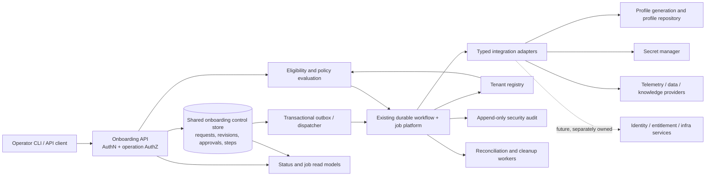

# Architecture Review: IAP Tenant Onboarding

**Review date:** 2026-10-22  
**Reviewed design:** `docs/IAP-TENANT-ONBOARDING-DESIGN.md`  
**Review type:** Document-led architecture and security review; proposed code examples were inspected as design evidence, not treated as deployed behavior.

## A. Executive Summary

**Original-draft verdict: Not ready for production as a multi-tenant enterprise tenant-onboarding control plane.** The original design contained several good foundations but conflated IAP profile/source onboarding with customer tenant provisioning and left tenant authority, lifecycle state, privilege roles, distributed recovery, and cleanup semantics under-specified. The revised design materially addresses many of those gaps; see the focused addendum for remaining findings. Its companion implementation plan now explicitly sequences an outbox dispatcher/reconciler and identifies a capability test matrix; these are sound plan decisions, not evidence that implementation is complete.

The revision adds typed secret references, constrained provider identifiers, capability authorization, immutable shared revisions, lifecycle states, cleanup approval intent, and durable workflow orchestration. The remaining focus is capability-to-lifecycle traceability, choosing and specifying outbox versus an equivalent dispatch protocol, and proving that deletion manifests cover each configured store/resource class. The supplied tenant-ID regex rejects literal `..` and slash characters; explicit path-containment checks remain a defense-in-depth recommendation.

The revised design is directionally coherent as **IAP tenant configuration onboarding**, with identity, subscriptions, infrastructure, networking, and customer-wide provisioning explicitly external. It remains a design proposal rather than implementation evidence, and the focused dispatch and deletion-manifest gaps must be closed before production readiness can be established.

No workload, availability, recovery, residency, or compliance targets are supplied. This review therefore does not claim compliance or certify a capacity posture. The report separates design flaws visible in the supplied document from risks requiring implementation and deployment evidence.

### Focused priorities for the revised design

1. **Complete the capability matrix:** map supported connector and lifecycle operations to owner, scope, permissions, required readiness checks, and cleanup behavior.
2. **Choose the dispatch protocol:** prefer a same-transaction outbox with deterministic Temporal workflow IDs and reconciliation; accept direct start only with equivalent durable guarantees.
3. **Make cleanup completeness provable:** define a versioned store registry and per-store/resource manifest outcomes, then compare every deletion plan against the deployment's complete data inventory.
4. **Fix the approval-token example:** its mint and validation paths hash different inputs, and the manifest hash omits expiry.
5. **Verify implementation, not just design intent:** test authorization, probes, dispatch crash windows, store enumeration, deletion residuals, and restore behavior before production approval.

## B. Design Understanding and Assumptions

### Understood proposal

The proposal introduces an operator intake YAML file and allowlist under operator-home, a Python adapter pipeline (`discover → normalize → bind → verify`), an `apply` composer reusing repository ingestion/profile generation/seeding, a repository `attach` merge flow, CLI and REST interfaces, asynchronous background jobs, and tiered tenant cleanup with confirmation. It prohibits secret values in intake, limits knowledge corpora to read-only, and proposes no new runtime dependency or database table. The scope explicitly excludes tenant migration, dedicated infrastructure/provider isolation, and frontend tooling. It does not include an enterprise customer registration/approval system, identity-provider provisioning, billing/subscription integration, or infrastructure/network provisioning.

The platform context documented separately describes a shared API/worker fleet serving many scopes, a durable Temporal workflow layer, PostgreSQL-backed job and tenant-scoped records with RLS, operator-home scope files organized by organization/application/environment, and existing profile revisions and job conventions. This context makes local operator-home files a useful operator input or cache, but not a reliable shared-fleet authority without a synchronization and concurrency contract.

### Missing information and assumptions

- No distinction is defined between a **customer tenant**, an IAP data-isolation tenant, an application, an environment, and an operator scope. This review assumes tenant identity is a stable, globally unique security boundary and application/environment are child scopes.
- No identity-provider contract, token audience/scope/role model, admin role, tenant-owner delegation model, or approval authority is specified. The existing verified tenant claim proves tenant context, not permission to onboard or delete it.
- No source-of-truth authority is named for tenant registration, subscriptions, entitlements, quotas, identity, DNS, certificates, infrastructure, or compliance policy. These are optional for an IAP profile-onboarding feature but mandatory boundaries if the module claims enterprise tenant provisioning.
- No production deployment topology for operator-home access, shared filesystem guarantees, file locking, replica consistency, backup, or restore is specified.
- No tenant/environment volume, concurrent request rate, workflow duration, dependency limits, SLO, RTO/RPO, data retention, legal hold, data residency, or regulatory scope is supplied. Capacity and compliance cannot be signed off.
- No complete state machine, durable onboarding aggregate, transactional outbox/dispatch contract, reconciliation design, workflow cancellation protocol, or external-resource compensation contract is specified.
- No exact semantics are supplied for `auto_promote`, `TBD`, partial service eligibility, optional integrations, failed probes, manual review, or whether post-onboarding profile activation equals tenant activation.
- No credential-reference grammar, secret-store authorization model, rotation/expiry contract, or allowed network destination policy is defined.
- The design examples are illustrative but contain placeholder behavior and discrepancies. They cannot be treated as implementation evidence.

## C. Architecture Strengths

1. **Fail-closed tenant identity intent:** the design proposes allowlist membership and a verified token tenant claim rather than trusting a raw header. The existing `api/tenant.py` also documents cryptographic JWT verification in production and treats `X-Tenant-ID` as a consistency check. This is a useful identity foundation, but not a complete authorization policy.
2. **Composition over generator replacement:** reusing the existing ingestion, generation, and seeding capabilities can reduce duplicated domain logic if they are callable through typed application interfaces rather than unsafe process/shell coupling.
3. **Immutable profile revision model:** versioned profile revisions and explicit promotion gates are appropriate for reproducibility and rollback of configuration changes.
4. **Read-only knowledge-source boundary:** separating retrieval permissions from future write permissions reduces authority and blast radius. The restriction must be enforced by downstream credentials and service policy, not just a `mode: read` field.
5. **Separation of request and response schemas:** avoiding reuse of intake input as an output model reduces mass-assignment and accidental exposure risk.
6. **Asynchronous job interface:** `202 Accepted` plus a job identity fits long-running work. The platform already has a durable background-job model whose documented execution authority is Temporal, so the design can build on this established pattern.
7. **Explicit cleanup preview and confirmation intent:** planning and confirmation are better than an unreviewed one-command purge, but the current proposed plan/approval binding is not strong enough for destructive multi-system cleanup.
8. **Known shared-fleet limitations are acknowledged:** the design does not claim per-tenant provider, Temporal namespace, or infrastructure isolation and flags residency/noisy-neighbor constraints. It should turn these limitations into eligibility policy and tenant placement decisions.

## D. Findings and Design Gaps

Severity uses **Critical** only for a documented path with direct potential for destructive cross-scope access or similarly unacceptable exposure. **High** denotes a likely security/correctness/recovery gap if implemented as designed. Missing implementation evidence is marked as a potential risk rather than a proven runtime vulnerability.

### F-01 — Tenant path safety relies on validation instead of explicit containment

- **Severity:** Medium
- **Category:** Security
- **Component/section:** D1 `normalize_tenant_id`; D2 `scopes/<tenant>/intake.yaml`; D6 cleanup scope paths.
- **Evidence:** The regex `^[A-Za-z0-9][A-Za-z0-9._-]*$` rejects a literal `..` path segment and slash characters, so direct traversal via the tenant ID is not established. However, the document relies on this validator while using tenant IDs in path construction and does not specify resolved-path containment, symlink handling, or consistent decoding/canonicalization at every filesystem boundary.
- **Impact/scenario:** A future path-construction or decoding change, or a pre-existing symlink under operator-home, could redirect an onboarding or cleanup operation outside its intended scope. This is a defense-in-depth gap, not a demonstrated traversal exploit in the shown validator.
- **Recommendation:** Prefer opaque server-generated immutable tenant identifiers (UUID/ULID) separate from display slugs. Retain strict validation and enforce resolved-path containment immediately before filesystem I/O, reject symlink escapes, and canonicalize once at the API/CLI boundary. Do not derive authorization from a display name.
- **Rationale:** Path safety should remain true across encoding, filesystem state, and later refactors rather than depend on one string regex.
- **Acceptance:** Property-based/adversarial tests show traversal, encoded separators, symlink, and absolute-path inputs cannot read/write/delete outside the intended scope; all filesystem operations use a validated canonical ID and resolved containment guard.

### F-02 — Tenant claim equality is not onboarding or administrative authorization

- **Severity:** High
- **Category:** Security
- **Component/section:** D1, D7 routes, D6 cleanup routes.
- **Evidence:** API examples depend on `require_tenant` and `require_principal`, then only compare the requested path tenant to the token tenant. `principal_id` is assigned to `_` and no role/capability/approval policy is checked. Allowlist membership is described as the operator's intent, but the API snippets do not show that allowlist authorization being enforced on every operation.
- **Impact/scenario:** Any valid principal with a token for a tenant can apply or request destructive cleanup for that tenant, even if the user should only investigate or read status. A compromised tenant administrator can self-approve deletion or change onboarding configuration. Tenant-scoped tokens also cannot distinguish customer self-service actions from platform-operator actions. A newly onboarded tenant may not yet have an identity-provider tenant claim, creating a bootstrap cycle unless an explicit platform-operator or invitation flow is defined.
- **Recommendation:** Separate authentication from function-level authorization. Define capabilities such as `tenant:onboard`, `tenant:configure`, `tenant:approve`, `tenant:cleanup`, and support-only operations, with issuer-backed roles or an authoritative policy service. Require an explicit platform onboarding/admin role for allowlist changes and cleanup; require customer ownership/delegation for self-service. Bind all authorization decisions to principal, tenant, operation, and environment and audit the decision.
- **Rationale:** A verified tenant claim establishes the caller's tenant context, not permission for sensitive business functions or another principal's approval.
- **Acceptance:** Route-level tests prove ordinary tenant users cannot apply privileged onboarding, alter authorization policy, approve their own regulated onboarding, or clean another tenant; explicit authorized roles can perform only their allowed operations; all denials are audited without leaking tenant existence unnecessarily.

### F-03 — Local files are specified as authoritative state in a shared fleet

- **Severity:** High
- **Category:** Architecture
- **Component/section:** D1/D2, Data Storage, Migrations, D9.
- **Evidence:** Allowlist and intake are stored in operator-home files, while the platform architecture documents one API/worker fleet serving many scopes. No shared filesystem, replication, locking, atomic update, version distribution, or API-worker visibility guarantee is defined. The documented operator-home structure is organization/environment/application-based, not a tenant-owned `scopes/<tenant>/` hierarchy.
- **Impact/scenario:** API replicas disagree on allowlist/intake or read stale content. A worker starts an apply job using a different local file revision than the API validated. Concurrent writes overwrite one another. A replica restart or host loss loses intake or authorization state. Local operator-home layout conflicts with the specified path layout.
- **Recommendation:** Make a durable shared control-plane store authoritative for tenant registration, intake revision/hash, lifecycle state, approvals, and job/resource references. Keep files as a CLI capture/export format or immutable artifact uploaded by content hash; record the exact artifact ID/hash in the durable request. If files must remain authoritative for a constrained single-host deployment, explicitly narrow the supported topology and add locking, atomic replace, replica pinning, backup, and recovery guarantees.
- **Rationale:** Shared stateless API/worker processes need a consistent source of truth and replayable immutable inputs.
- **Acceptance:** Multi-replica test demonstrates that all API and worker instances use the same approved intake revision; concurrent updates are version-checked; host loss and process restart do not lose request state; operator-home is never read as an unversioned worker-side authority.

### F-04 — Credential paths cross the API trust boundary

- **Severity:** High
- **Category:** Security
- **Component/section:** D2 `TenantIntake`; `IntakePutRequest.credential_paths`; D4; Implementation Detail.
- **Evidence:** The design says API intake accepts references only, yet `credential_paths` is described as containing server-side paths and the implementation detail says “the server-side intake path reads only pre-placed paths.” The CLI capture path, API intake, and worker apply path run in different trust and filesystem contexts; no path ownership or handoff contract is defined.
- **Impact/scenario:** A tenant-scoped caller supplies a path that the server or worker opens. If unrestricted, this can read arbitrary files accessible to the service account, follow a symlink, or cause credentials to be copied into generated profiles, logs, or job records. A valid `0600` mode alone does not prove that the path belongs to the tenant or is safe to open.
- **Recommendation:** Remove raw paths from REST schemas. Resolve secrets at execution time via an allowlisted secret-store reference scoped to tenant, source, and operation. For local CLI flows, read credentials locally and upload only through an authenticated secret-ingestion channel, or use an operator-host agent with a narrowly scoped protocol. Never pass secrets or local paths through jobs; persist secret IDs/version references only. Enforce no-follow/containment if local file ingestion remains supported.
- **Rationale:** API-provided filesystem paths are ambient authority and make server-side onboarding a confused deputy.
- **Acceptance:** API schema rejects path fields; secrets never appear in intake artifacts, job inputs, logs, or audit payloads; tests attempt `/etc`-style paths, symlinks, path traversal, unreadable files, and cross-tenant secret references and confirm rejection before any open or external side effect.

### F-05 — User-controlled URLs and repository metadata create SSRF and supply-chain exposure

- **Severity:** High
- **Category:** Security
- **Component/section:** D2 `RepoRef`, `KnowledgeSourceSpec`; D3 adapters; D4 clone/generation.
- **Evidence:** `KnowledgeSourceSpec.base_url` is an arbitrary string; `RepoRef.org`, `name`, and `branch` are operator-provided. The design proposes discovery/probing, clone, indexing, and live verification but does not define host allowlists, redirect behavior, DNS/IP validation, credential forwarding boundaries, content trust, or repository commit pinning.
- **Impact/scenario:** A tenant submits a URL resolving to loopback, link-local, cloud metadata, or an internal control-plane endpoint; a probe or fetcher accesses it. Repository names/branches may influence command construction or fetch untrusted code/configuration. A mutable branch can change between validation and execution, producing a profile that cannot be reproduced or reviewed.
- **Recommendation:** Accept structured provider/organization/repository identifiers rather than arbitrary URLs where possible. Enforce tenant- and environment-specific destination allowlists, block private/link-local/reserved IP ranges after DNS resolution, revalidate on redirects and connection, cap response sizes/timeouts, and never forward credentials across hosts. Pin repositories to immutable commit SHAs at approval and record content hash/tool version. Treat repository content as untrusted data; do not execute build scripts during profile generation.
- **Rationale:** Server-side fetch and clone operations turn onboarding into an outbound network and software-supply-chain boundary.
- **Acceptance:** Security tests cover DNS rebinding, redirect-to-private-IP, IPv6/local addresses, unusual URL encodings, oversized responses, branch movement, and shell metacharacters; fetches are denied before contact where policy disallows the destination; every generated profile records immutable source revisions.

### F-06 — Cleanup plan is not bound to an exact, atomic, authorized deletion

- **Severity:** High
- **Category:** Security
- **Component/section:** D6 cleanup; API confirmation models and `ConfirmationToken`.
- **Evidence:** The token stores tenant ID and `full` but not `app_id`, exact doomed resource set/counts, plan version/hash, actor, approval identity, or expiry clock source. `token_valid` only checks a mutable `used` boolean and the shown API confirmation schema includes `{confirmation_token, full}` without a request body in the route example. No atomic compare-and-consume operation or durable token store is specified. Default cleanup says it deletes all tenant rows, artifacts, and an operator scope directory even though `CleanupScope` has an `app_id` field.
- **Impact/scenario:** Between preview and confirmation, resources change or scope broadens; a token shown for app A is replayed against tenant-wide cleanup. Concurrent confirms both observe `used == False` and launch two purge jobs. A tenant-scoped user self-approves destructive cleanup. Cleanup deletes shared organization/environment configuration or other applications’ data. A “backup” may exist but be unusable, unencrypted, or inconsistent.
- **Recommendation:** Make cleanup a durable deletion request with a canonical immutable plan (tenant/app/environment, resource IDs, counts, retention/legal-hold status, data classification, plan version/hash, backup ID), short expiry, and requester identity. Recompute and require explicit reapproval if the plan changes. Atomically consume approval under database uniqueness/transaction semantics; require role separation/second approver where policy requires it. Use deletion tombstone and asynchronous per-system purge with progress, retry, and reconciliation. Verify encrypted backup creation and restore evidence before destructive steps. Define app-scoped vs tenant-scoped deletion precisely and never delete shared operator-home paths by tenant-name convention.
- **Rationale:** Confirmation is meaningful only when it approves the exact operation that will execute, and distributed deletion cannot be rolled back by a local database transaction.
- **Acceptance:** Concurrent confirmation produces at most one job; changing any plan field invalidates approval; app-scoped cleanup cannot affect sibling apps; legal hold blocks purge; every resource has a durable outcome; restore drill passes before data deletion; deletion is idempotent and replay/audit-safe.

### F-07 — Lifecycle, approvals, activation, and source of truth are not defined

- **Severity:** High
- **Category:** Architecture
- **Component/section:** D1–D4, D7, Data Storage, Interfaces.
- **Evidence:** No tenant/onboarding state machine or aggregate exists. `auto_promote` is captured in intake, while D4 says promotion follows that captured choice after “at least one service, zero TBD references.” D3 says any probe failure blocks `ACTIVE`; it does not define required vs optional source classes or distinguish tenant activation from profile activation. No approval, suspension, retry/resume, cancel, deprovision, or reconfiguration transition rules are given.
- **Impact/scenario:** A retry or attach changes input while a prior apply is active; a profile is promoted while an external security or identity prerequisite is incomplete; status disagrees with profile activation; duplicate onboarding requests create multiple tenants or profiles; operators cannot determine whether a failed step is safe to retry.
- **Recommendation:** Define a minimal state machine such as `REQUESTED → VALIDATING → AWAITING_APPROVAL (conditional) → PROVISIONING → VALIDATING_READINESS → ACTIVE`, with terminal/recoverable `FAILED`, `CANCEL_REQUESTED/CANCELED`, `SUSPENDED`, `DEPROVISIONING`, and `DEPROVISIONED`. Keep tenant lifecycle state distinct from profile lifecycle and job execution state. Specify transition guards, authorized actors, version/compare-and-swap, idempotent retry, immutable request revision, and which source system owns each status.
- **Rationale:** Long-running provisioning needs explicit state and guarded activation, not a single `apply` job plus profile revision state.
- **Acceptance:** A transition table and domain invariants exist; invalid transitions and stale version updates fail; activation cannot occur until all mandatory gates pass; retries resume or safely reconcile; cancel/deprovision races are deterministically resolved and audited.

### F-08 — Job dispatch, step idempotency, and partial provisioning recovery need implementation proof

- **Severity:** High
- **Category:** Reliability
- **Component/section:** D4 composer; D7 async job; Implementation Detail idempotency key.
- **Evidence:** The revised design now specifies same-revision request keys, same-payload replay vs conflict, a durable step ledger, external resource references, bounded retry, outbox-or-equivalent dispatch, and reconciliation. The remaining gap is implementation-level proof of outbox transaction contents, lease/claim/retry behavior, Temporal start deduplication, and step idempotency at every provider boundary. Existing platform architecture documents analogous cases where job/idempotency records can remain pending when workflow dispatch fails.
- **Impact/scenario:** The API persists a job but crashes before workflow start; a provider creates a resource and times out before IAP records success; a retry duplicates it; later step fails after earlier profile/database writes; the job reports failure while external resources remain active. Two apply requests with identical intake content but different intent collide under an underspecified key.
- **Recommendation:** Use the existing durable workflow engine for orchestration, with one stable workflow ID per onboarding request revision and durable job read model. Implement the outbox/dispatch contract described in focused finding F-21; make each adapter operation idempotent or discover-before-create; model compensation as a separate idempotent action, not rollback. Add a periodic reconciler for orphaned jobs and provider resources.
- **Rationale:** At-least-once delivery and provider timeouts are normal; retries alone do not provide exactly-once provisioning.
- **Acceptance:** Failure-injection tests cover crash before/after each side effect and workflow dispatch; replay does not duplicate external resources; uncertain outcomes reconcile by provider identity; stuck jobs alert and resume/terminate with explicit operator action; all operations remain tenant-scoped.

### F-09 — Adapter “verify” is not a real verification contract

- **Severity:** High
- **Category:** Reliability
- **Component/section:** D3 adapter contract and `TelemetryAdapter` example.
- **Evidence:** The telemetry example marks `verified=True` whenever `blocking` is false; it makes no probe. Its `discover` reads `log_indices` but not `service_names`, while `normalize` reads a service_names key that was never populated. The registry contains only telemetry despite datasource/config/knowledge adapter claims. `AdapterResult` is mutable and reused through the pipeline without typed per-stage errors, provenance, capability, or retry classification.
- **Impact/scenario:** `apply` declares readiness when the external telemetry source is unreachable or tenant scoping is not enforced; missing datasource adapters silently become an implementation gap; one adapter mutates state that a later step assumes immutable; retries classify permanent auth/config errors as transient.
- **Recommendation:** Define typed adapter input/output contracts with explicit `NOT_CONFIGURED`, `VERIFIED`, `DEGRADED`, `FAILED`, `UNSUPPORTED`, and `SKIPPED` outcomes; include probe identity, scope, timestamp, expiry/freshness, auth mode, and redacted diagnostic code. Implement actual read-only tenant-scope probes and distinguish optional from mandatory connectors in a versioned policy. Use request-scoped adapter instances or prove adapters immutable/thread-safe. Unknown kinds and omitted mandatory adapters must block readiness.
- **Rationale:** Readiness is only as reliable as the evidence and semantics emitted by each adapter.
- **Acceptance:** Each supported adapter has live-contract tests for healthy, wrong-tenant, unauthorized, timeout, stale credentials, partial response, and provider outage; no adapter can emit `verified=True` without a successful scoped probe recorded with provenance.

### F-10 — API examples are placeholders and contradict the advertised contract

- **Severity:** High
- **Category:** Maintainability
- **Component/section:** D7 router example, D8 CLI example, Interfaces, Accessibility.
- **Evidence:** Router examples return constant values such as `job-pending` and `token-pending`, status only echoes tenant ID, cleanup confirm does not declare/read the confirmation request body, and no idempotency or `If-Match`/revision contract appears. CLI `api_get` sends no Authorization header; `apply` and `attach` only print “accepted” instead of calling the API or polling; `cleanup` prompts before it fetches/prints a doomed plan. Yet surrounding text promises authenticated thin-client parity, job polling, two-step cleanup, and a closed response envelope. The job polling path contains a malformed bracket in the documented route string.
- **Impact/scenario:** A team copies the examples and ships endpoints that acknowledge work without creating it, fail production JWT authentication, omit confirmation tokens, or provide false cleanup assurance. CLI and REST validation diverge, undermining operator safety.
- **Recommendation:** Label snippets explicitly as pseudocode or replace with executable interfaces and contract tests. Define request/response models for every endpoint, including `Idempotency-Key`, expected intake revision, cleanup plan/confirmation payload, job status, typed error, pagination if needed, and cancellation/retry semantics. Make CLI authenticate through the approved credential mechanism, call the same application service/API, display the exact plan before confirmation, and poll actual job state.
- **Rationale:** An API parity claim needs a single executable contract, not separate aspirational behavior and nonfunctional examples.
- **Acceptance:** OpenAPI contract tests assert schemas/status codes/error envelope; CLI-vs-REST conformance tests run the same fixtures and produce equal decisions; example flows pass against a test server with JWT auth enabled and never acknowledge uncreated jobs.

### F-11 — Shared fleet isolation limitations are documented but not enforced as eligibility policy

- **Severity:** High
- **Category:** Security
- **Component/section:** D9 and Risks/Trade-offs.
- **Evidence:** D9 accepts shared model provider, Temporal namespace, message topics, and code root with prefixes “where isolation already exists”; the design excludes per-tenant infrastructure segregation and says residency-sensitive tenants are not a fit. It does not define which tenants are ineligible, how placement is selected, which shared stores support tenant filtering, or how tenant context is enforced in every message/cache/search/log/artifact/schedule. Current architecture documentation and the project ledger identify remaining RLS coverage/audit questions and pre-auth rate-limit identity concerns.
- **Impact/scenario:** A regulated/residency-constrained tenant is onboarded onto an unsupported shared region/provider; an asynchronous message or cache key omits tenant ID; a cross-tenant support/admin query bypasses ordinary RLS. A shared worker/provider receives noisy-neighbor load from another tenant.
- **Recommendation:** Create an explicit tenant placement/eligibility policy before intake approval: data region, allowed providers, isolation class, quotas, storage topology, encryption-key policy, and service capability. Propagate a signed/validated tenant context through jobs, events, scheduled tasks, cache/search keys, artifacts, and audit. Audit every tenant-bearing table/policy and app-role permission; use defense in depth (RLS plus repository predicates plus object-level authorization). Fix pre-auth rate limiting with a global/IP or verified-principal bucket before allowing tenant-derived quota keys.
- **Rationale:** Documentation of shared limitations does not prevent a tenant from being placed into an unsupported topology.
- **Acceptance:** Threat-model tests show tenant A cannot read/write tenant B data through REST, jobs, schedules, cache, search, artifacts, admin/support flows, or operator scopes; placement rejects unsupported residency/isolation requirements before any provisioning side effect; quotas are per tenant and globally bounded.

### F-12 — Secret-reference grammar and reference authorization are incomplete

- **Severity:** High
- **Category:** Security
- **Component/section:** D2 `DatasourceSpec.connection_ref`; D9 credential handling.
- **Evidence:** `connection_ref` accepts any string, including empty, `TBD`, `secret://`, or `env://`, and `secret-shaped values` are rejected only by a full-tree scan with no specified grammar. No policy binds a reference to tenant, source type, secret version, or read-only credential. Environment-variable references may resolve to process-wide secrets.
- **Impact/scenario:** A tenant supplies another tenant's secret identifier or an unrestricted environment variable name; a connector receives broader credentials than intended; secret rotation makes an in-flight job use an unexpected version; secret values are accidentally included in validation errors or profiles.
- **Recommendation:** Define a strict typed `SecretReference` (provider, opaque secret ID, version policy) and authorize resolution against tenant/source/environment. Disallow generic env-var names in remotely submitted intake. Enforce least-privilege, read-only connector accounts at the downstream system, short-lived retrieval, rotation/expiry behavior, and redaction at every log/error boundary.
- **Rationale:** A reference is a capability. Treating it as inert text does not prevent cross-tenant secret use.
- **Acceptance:** Cross-tenant, wrong-environment, wrong-source, expired, and write-capable secret references fail closed; rotation/version behavior is deterministic; secret values do not appear in profile revisions, job inputs, logs, backups, or API responses.

### F-13 — Tenant identity uniqueness, canonicalization, and lifecycle are unresolved

- **Severity:** Medium
- **Category:** Data
- **Component/section:** D1 `normalize_tenant_id`; D2 `TenantIntake`; AllowlistEntry.
- **Evidence:** The validator accepts case-sensitive values without normalization, but no global uniqueness store or immutable identity issuer is specified. Allowlist entries carry owner/date but no status, alias, reservation, environment, or creation provenance. Existing tenant migration is a non-goal, leaving collision and transition semantics unclear.
- **Impact/scenario:** `Acme`, `acme`, or alias reuse creates duplicate logical tenants or mismatches token claims, filesystem paths, profiles, and database tenant keys. Removing/reusing an ID may expose retained artifacts or make audit history ambiguous.
- **Recommendation:** Establish a globally unique immutable internal tenant ID from the tenant registry; keep names/slugs as mutable, normalized display attributes. Add explicit reservation, active/retired states, unique constraints, alias rules, migration/adoption behavior, and tombstone retention. Resolve all API paths to the canonical internal ID before access.
- **Rationale:** Identity immutability and uniqueness underpin every tenant partition, credential policy, and audit record.
- **Acceptance:** Concurrent tenant reservation has one winner; rename/alias/reuse cases preserve stable data ownership and audit continuity; canonical IDs match across database, JWT claims, jobs, artifacts, and provider metadata.

### F-14 — Intake revision and attach merge semantics lack concurrency control

- **Severity:** Medium
- **Category:** Data
- **Component/section:** D2 content hash; D5 attach merge/versioning.
- **Evidence:** Intake is “versioned by content hash,” but no immutable revision history or compare-and-swap update is defined. D5 says version bumps to latest plus one and overlays are byte-identical, without a transaction/lock across concurrent attaches, a base revision precondition, deterministic merge conflict contract, or policy version pinning.
- **Impact/scenario:** Two attaches read revision N and each write N+1, losing one repository. An apply validates intake A but executes after intake is changed to B. A policy/config change during provisioning alters what the job creates.
- **Recommendation:** Persist immutable intake/profile revisions and have apply/attach reference exact `revision_id`, `content_hash`, source commit SHAs, adapter/policy versions, and base profile revision. Use optimistic concurrency (`If-Match`/expected version) for mutations; serialize or reconcile conflicting merges. Snapshot the effective policy/config version at request acceptance and require revalidation/reapproval if critical inputs change.
- **Rationale:** Reproducibility and safe retries require the exact approved input to remain stable throughout execution.
- **Acceptance:** Concurrent attach tests cannot lose updates; stale revisions receive a conflict response; a job can be replayed against exactly the same intake, policy, and source revisions and yields a deterministic plan.

### F-15 — Operational readiness and service objectives are not measurable

- **Severity:** Medium
- **Category:** Operations
- **Component/section:** Status, jobs, Testing Philosophy, Documentation Plan.
- **Evidence:** Status fields expose revisions and blockers, but there are no specified workflow duration/failure/retry metrics, stuck-job detection, dependency health, audit retention, runbooks, RTO/RPO, queue capacity, backpressure, or onboarding SLI/SLO. The design proposes backups but does not define encryption, verification, retention, or restore owner.
- **Impact/scenario:** A workflow waits indefinitely on an unavailable integration; queue saturation delays every tenant; support cannot distinguish provider outage from tenant misconfiguration; restore is discovered to be invalid only after cleanup or regional outage.
- **Recommendation:** Add tenant-safe structured telemetry with correlation/request/job/step IDs and redacted tenant context; metrics for accepted/active/terminal counts, success rate, end-to-end and step duration, queue age, retry rate, stuck workflows, compensation/reconciliation backlog, and dependency outcomes. Define alert thresholds and an SLO with product/operations owners after workload expectations are supplied. Define runbooks, backup/restore cadence, recovery objectives, deployment rollback, schema compatibility, and support access controls.
- **Rationale:** Long-running workflows cannot be operated reliably from a tenant status endpoint alone.
- **Acceptance:** Dashboards and alerts detect stuck work and growing backlog; every job can be traced across workflow/step/provider without secrets; tested restore meets approved RTO/RPO; SLI/SLO and ownership are documented before production launch.

### F-16 — Noisy-neighbor controls and capacity policy are absent

- **Severity:** Medium
- **Category:** Scalability
- **Component/section:** D2 `budgets`; D4 apply and adapters; D9 shared worker/provider.
- **Evidence:** Budgets cover investigation evidence/iterations/tool calls but do not constrain onboarding requests, concurrent jobs, clone size, corpus size, adapter fan-out, per-tenant worker concurrency, provider spend, or queue fairness. No expected tenant count or throughput is given.
- **Impact/scenario:** A tenant submits many repositories or large corpora and monopolizes shared worker slots, database connections, LLM/provider quotas, or network bandwidth; retries amplify an outage into an onboarding storm.
- **Recommendation:** Define admission quotas per tenant and global fleet, size/count/time bounds per intake item, per-integration concurrency and timeout budgets, queue priorities/fair scheduling, circuit breakers, and backpressure responses. Apply exponential backoff with jitter and provider retry-after where supported; avoid synchronous fan-out at API request time. Load-test using measured tenant and resource distributions.
- **Rationale:** Enterprise multi-tenancy requires fairness and bounded resource use, especially when provider operations are expensive and long-running.
- **Acceptance:** Load tests at agreed peak/burst assumptions demonstrate per-tenant fairness, bounded queue age, bounded resource consumption, and graceful rejection/throttling without starving unrelated tenants.

### F-17 — Data retention, backup, tenant deletion, and external-resource ownership are incomplete

- **Severity:** High
- **Category:** Data
- **Component/section:** D6 cleanup; Data Storage; References and artifacts.
- **Evidence:** Cleanup proposes cascading database deletion and artifact/scope removal but does not define legal hold, retention schedules, backup retention, restore scope, search-index/document/vector deletion, cross-run shared/reference artifacts, audit-record retention, or resource owner mapping. “Automatic pre-cleanup backup” does not define consistency, encryption, key access, or verification.
- **Impact/scenario:** A deletion request removes records under legal hold or leaves copies in search/graph/backup systems; deletion of one tenant's shared repository evidence removes data still referenced by another tenant; backup restoration reintroduces deleted data; operator scope removal affects another application/environment.
- **Recommendation:** Define data inventory and ownership by store/provider, retention/legal-hold policy, per-tenant deletion semantics, shared-resource reference accounting, backup encryption/retention/key separation, and deletion propagation/verification. Treat audit trails and tombstones separately from customer content. Add a deletion manifest and reconcile every external system; report residual resources explicitly rather than claiming deletion complete.
- **Rationale:** Tenant deletion is a distributed data lifecycle operation, not a cascade plus filesystem removal.
- **Acceptance:** A tenant data inventory covers every store and backup; legal hold blocks affected deletion; reference-shared resources survive until no tenant needs them; deletion status distinguishes complete from residual/pending; backup and restore tests demonstrate policy-compliant behavior.

### F-18 — Compliance and regulated-tenant controls are statements, not enforceable gates

- **Severity:** Medium
- **Category:** Security
- **Component/section:** D3, D9, Risks/Trade-offs.
- **Evidence:** The design mentions residency-sensitive tenants as “explicit non-fit” but has no intake field, policy evaluation, approval evidence, control baseline, data classification, region decision, or policy evidence record. No compliance framework or obligations are supplied.
- **Impact/scenario:** Sales/operator intake accepts a regulated tenant despite a shared provider, data location, or retention limitation; onboarding status shows active without evidence that the required baseline was applied.
- **Recommendation:** Make regulatory and residency requirements explicit inputs to a policy/eligibility check owned by the platform governance/placement service. Persist policy version, decision, evidence, approver, and exceptions. Reject unsupported combinations before provisioning. Map applicable controls to evidence and owners using an actual scope assessment; do not state certification based on feature presence.
- **Rationale:** Compliance posture requires requirement-specific evidence and scope, not generic configuration fields.
- **Acceptance:** Unsupported data residency/compliance combinations are rejected before side effects; approved exceptions require authorized review and expiry; the control/evidence mapping is reviewed by security/compliance stakeholders and makes no unsupported certification claim.

### F-19 — State-changing onboarding APIs lack rate limits and abuse controls

- **Severity:** Medium
- **Category:** Security
- **Component/section:** D7 routes; D8 CLI; D9 rate limiter.
- **Evidence:** The design focuses on changing the identity key used by the pre-auth rate limiter, but does not specify authenticated rate limits, tenant/global quotas, creation reservation abuse controls, anti-automation policy, or cost limits for apply/attach/cleanup. The project architecture separately records that pre-auth limiter identity currently uses an unverified tenant header.
- **Impact/scenario:** A caller repeatedly starts clone/index/probe jobs or requests cleanup plans, exhausting workers, external APIs, or causing operational cost. An attacker can spoof a victim tenant's pre-auth key to consume or block its quota if the documented current gap remains at implementation time.
- **Recommendation:** Use layered rate limits: pre-auth IP/global limits independent of tenant claims; post-auth principal and tenant operation limits; global concurrency/cost budgets; abuse detection for repeated invalid onboarding. Do not key pre-auth throttling by unverified tenant header. Make expensive operations require an authorized capability and idempotency key.
- **Rationale:** Resource consumption and sensitive business-flow abuse are API security concerns even with valid authentication.
- **Acceptance:** Tests demonstrate spoofed headers cannot spend another tenant's quota; per-principal/tenant/global caps bound accepted work; throttling returns stable retry guidance; abusive repeated failures are observable and do not leak tenant membership.

## E. Architecture Decision Review

| Decision to document | Recommended decision | Alternatives and trade-offs |
|---|---|---|
| Module scope and ownership | Name this module **IAP tenant configuration onboarding** unless it will own coordination across customer identity, entitlement, and infrastructure provisioning. It owns request coordination and status, not identity/billing/provider resources. | A broad tenant control plane meets the prompt's enterprise lifecycle but requires more integrations and owner teams; a narrow module is deliverable but must not claim complete customer onboarding. |
| Tenant identity and registry | Use an authoritative tenant registry with immutable opaque IDs; display name/slug is mutable metadata. | Operator-maintained IDs are simple but introduce collision, lifecycle, and path safety risks. |
| Tenant data isolation | Continue defense in depth: tenant authorization, mandatory tenant context, RLS, repository predicates, provider-level scope, and adversarial cross-tenant tests. Choose shared DB/schema vs dedicated DB by isolation tier and data residency. | Shared schema lowers operations cost but depends heavily on verified RLS coverage and least-privilege app roles; schema/database-per-tenant improves blast-radius boundaries at higher cost and migration complexity. |
| Intake storage | Persist immutable, versioned intake metadata and exact source references in shared durable storage; allow file capture as an offline client artifact. | Local authoritative files only work with a constrained single-host deployment and explicit file locking/replication/backup semantics. |
| Workflow orchestration | Use the existing Temporal/job platform for durable multi-step apply/attach/cleanup workflows; use DB state as a query/read model, not a competing authority. | A database-backed custom state machine avoids a workflow dependency but duplicates established durable execution capabilities and increases recovery burden. |
| Reliable dispatch and events | Use an outbox or equivalent recoverable dispatcher from committed request/job state to workflow start; version events and make consumers idempotent. | Direct start after DB commit has a crash gap; direct start before commit can create orphan workflows. Exactly-once delivery is not assumed. |
| Idempotency | Request key identifies tenant + operation + immutable request revision + target app/environment; same key/same payload replays, same key/different payload conflicts. Give each provider step a stable operation key. | Content-hash-only keys can collapse distinct intents or fail to handle retry after a corrected request. |
| Provisioning compensation | Record external resource IDs and implement idempotent compensations/reconciliation per provider; classify non-compensable residual state. | “Rollback” across independent systems is not available; manual compensation is acceptable only as an explicit, observable exception path. |
| Activation | Gate active status on required policy, identity/authorization, mandatory adapter probes, profile validation, and recorded approval; keep profile `ACTIVE` separate from tenant `ACTIVE`. | Auto-promotion is convenient but must never bypass policy or readiness. Optional integrations require an explicit service package policy. |
| Cleanup and retention | Durable deletion manifest, exact-plan approval, authorization/dual control as policy requires, legal hold, verified backup, tombstone, per-system purge and reconciliation. | Immediate cascade is simpler but not recoverable or compliant across distributed stores. |
| Secret and outbound integration policy | References resolve through tenant-scoped secret authorization; outbound hosts and provider accounts are allowlisted; source commits are pinned. | Raw operator paths and arbitrary URLs are operationally convenient but grant ambient filesystem/network authority. |
| Shared vs dedicated hosting | Define placement/isolation classes and eligibility; reject requirements the shared fleet cannot enforce. | Shared-only is cheaper but unsuitable for residency/dedicated-network/key requirements unless separately supported. |

## F. Recommended Target Architecture

### Components and ownership

- **Tenant Registry / Identity Authority:** owns canonical tenant ID, display metadata, tenant status, aliases, ownership/delegation, and creation audit. It is the global uniqueness authority.
- **Onboarding API:** authenticates callers, performs operation-level authorization, validates request shape/policy, accepts idempotency and expected revision, and returns job/request identifiers. It does not open arbitrary caller-provided files or provision resources inline.
- **Onboarding Control Store:** owns immutable onboarding request revisions, state transition history, approvals, step ledger, external resource references, and deletion manifests. It is shared across API and worker processes. Existing Postgres/RLS is a candidate, subject to table-policy and app-role audit.
- **Onboarding Workflow:** coordinates bounded asynchronous steps in the existing durable Temporal/job system. It persists progress through activity/step records, respects budgets, and supports retry, cancellation, pause for approval, and recovery.
- **Policy/Eligibility Service:** resolves tenant tier, environment/region, permitted source classes, security baseline, residency, mandatory readiness checks, quotas, and approval requirements. Unknown or unsupported combinations fail before side effects.
- **Integration adapters:** typed provider-specific clients for source repositories, telemetry, datasources, knowledge systems, secret resolution, and any future identity/billing/infrastructure systems. Adapters own provider protocol and idempotency; source systems remain authoritative for their resources.
- **Profile generation/seeding:** remains in existing profile modules and owns profile content/revisions. Onboarding owns orchestration and readiness aggregation, not profile semantics.
- **Cleanup/reconciliation workers:** process a durable exact-scope deletion plan; independently enumerate and reconcile resources in each registered store/provider.
- **Audit/observability:** immutable security audit events are separate from high-cardinality metrics and application logs; sensitive payloads/secrets are excluded.

### Core API and events

Proposed REST shape (illustrative contract, not asserted as existing):

- `POST /v1/onboarding-requests` — submit intake; requires `Idempotency-Key`; returns `request_id`, immutable `revision`, `status`, and `job_id`.
- `GET /v1/onboarding-requests/{request_id}` — tenant-authorized status, blockers, step summaries, revision, and next permitted action.
- `POST /v1/onboarding-requests/{request_id}:approve` — privileged approval of a specific revision and policy decision.
- `POST /v1/onboarding-requests/{request_id}:retry` — retry/reconcile selected failed step; no new resource set unless a new request revision is created.
- `POST /v1/onboarding-requests/{request_id}:cancel` — request cancellation; workflow reports residual/compensation status.
- `POST /v1/tenants/{tenant_id}:deletion-request` then `POST /v1/deletion-requests/{id}:approve` — preview and approve immutable deletion manifest.
- `GET /v1/jobs/{job_id}` — tenant-scoped job read model with versioned progress.

Internal versioned events include `OnboardingRequested`, `OnboardingApproved`, `ProvisioningStepCompleted`, `TenantReadinessEvaluated`, `TenantActivated`, `DeletionRequested`, and `DeletionStepCompleted`. Events carry opaque tenant/request/job IDs, revision, event ID, schema version, timestamp, and bounded metadata—not credentials or raw intake payloads. Consumers deduplicate by event ID and business operation key; outbox publication is retried and observable.

### Authoritative state

| Data | Authority |
|---|---|
| Canonical tenant ID, display name, owner, tenant lifecycle | Tenant registry |
| Intake and request revision, policy snapshot, approvals, step state, workflow reference | Onboarding control store |
| Profile content and profile revision | Profile service/repository |
| User identities, groups, SSO configuration | Enterprise identity provider / IAM service |
| Subscription, license, entitlement, quotas | Billing/subscription/entitlement system |
| Infrastructure/network/DNS/certificates/resources | Respective provider/control-plane services |
| Credential material and secret versions | Secret manager; onboarding stores references only |
| Job execution history | Temporal; job row is queryable status projection |
| Audit events | Append-only audit store with defined retention and access policy |

### Onboarding state machine

Use separate but correlated state machines for tenant lifecycle, onboarding request, and background job. Suggested onboarding request states: `DRAFT`, `VALIDATING`, `AWAITING_APPROVAL`, `QUEUED`, `PROVISIONING`, `READINESS_CHECK`, `ACTIVE`, `FAILED_RETRYABLE`, `FAILED_TERMINAL`, `CANCEL_REQUESTED`, `CANCELED`, `DEPROVISIONING`, `DEPROVISIONED`. Not every tenant needs an approval or cleanup state; guards are policy-driven. `ACTIVE` is reached only after readiness evaluation succeeds and the activation transition is durably committed. Profile `ACTIVE` does not itself activate the tenant.

Every transition has expected revision/version, authorized actor, event/audit entry, and explicit side-effect boundary. A retry resumes/reconciles the same request revision; changed inputs create a new revision. Concurrent transitions use optimistic concurrency and only one terminal/activation path can win.

### Proposed component diagram



**Assumptions:** Shared durable Postgres and Temporal/job infrastructure remain available; identity, billing, and infrastructure services are external authorities if those capabilities enter scope. The diagram proposes service boundaries and does not claim these components currently exist for onboarding.

## G. Revised Onboarding Workflow

1. **Reserve identity:** authorized platform onboarding principal requests a tenant reservation or selects an existing canonical tenant. Registry enforces uniqueness and returns immutable internal ID. Existing tenant attachment is a separate operation from new tenant creation.
2. **Capture and validate intake:** CLI may create a local YAML artifact, but API validates a typed request, rejects secret values and local paths, verifies repository/provider references, and stores an immutable revision/hash. Validate ID/path safety, limits, schema version, source destinations, and application/environment ownership.
3. **Evaluate eligibility:** policy checks hosting/isolation class, residency, compliance policy, integration capability, quotas, subscription/entitlement eligibility if in scope, and required approvals. Ineligible requests stop before clone, credential resolution, or external writes.
4. **Approve exact revision:** approvals are bound to request ID, revision hash, tenant, scope, policy version, and approver. Require separation of duties for privileged/regulated tenants and deletion. Intake changes invalidate relevant approvals.
5. **Create durable job and dispatch:** commit request revision, audit event, idempotency reservation, initial state, and outbox record atomically. Dispatcher starts/restarts a deterministic workflow ID and reconciles dispatch failures.
6. **Provision in dependency order:** pin repository revisions; resolve only authorized secret references; run adapters with bounded timeouts/concurrency; write profile revisions as `DRAFT`; record each external resource identifier and step result. Steps are idempotent and emit sanitized status.
7. **Handle partial failure:** classify transient/permanent/unknown outcomes. Retry only bounded transient failures with backoff/jitter. For uncertain provider outcomes, query by stable idempotency/resource key before retry. Resume from the step ledger; compensate reversible resources in reverse dependency order; record non-compensable residuals for operator remediation.
8. **Readiness validation:** required security baseline, tenant context propagation, secret reference health, repository/profile validation, mandatory source probes, tenant-scoped read-only checks, entitlement/quota checks if applicable, residency/placement evidence, and no unresolved mandatory `TBD` items must all pass. Optional integrations may be skipped only when policy explicitly permits the service tier.
9. **Activate:** atomically mark onboarding request and tenant lifecycle state active (or send an idempotent activation command to tenant registry); profile activation is a separate recorded operation. A failed activation command is retried/reconciled, never represented as active based on job completion alone.
10. **Notify and hand off:** publish sanitized completion/failure notification, expose blockers and runbook action, record operational owner and next review/credential rotation checkpoints.
11. **Maintain and reconfigure:** every attach/configuration change creates a new immutable revision and workflow; no in-place mutation of the active request snapshot. Revalidate only affected gates but retain prior audit and profile lineage.
12. **Suspend/deprovision/delete:** suspension blocks access via authoritative policy and does not imply data deletion. Deletion creates a tombstone and exact plan, enforces retention/legal hold, confirms backup, purges each system, reconciles residuals, and only reports `DEPROVISIONED` when all required stores attest completion or an approved exception is recorded.

### Mandatory activation gates

- Authenticated and operation-authorized requester; valid canonical tenant ID and unique tenant reservation.
- Supported tenant tier, region, isolation class, data residency, and product eligibility.
- Required approval(s) recorded against exact request revision and policy version.
- No secret values in request/job/profile/audit; each required secret reference resolves to the correct tenant/source/environment and is least privilege.
- Every mandatory adapter performs an actual successful scoped probe; provider failure cannot be interpreted as empty/no data.
- Profile is valid, references pinned source revisions, has no unresolved mandatory `TBD`, and passed profile-specific promotion checks.
- RLS and provider scope are in effect for the new tenant and cross-tenant negative probes pass.
- Required identity/entitlement/infrastructure integrations, when in business scope, report authoritative success and resource references.
- Readiness decision and activation transition are durable, version-checked, auditable, and idempotent.

## H. Risk Register

Likelihood and impact are qualitative; ratings reflect the design as written, not a measured production incident rate.

| ID | Risk | Likelihood | Impact | Overall | Mitigation | Accountable component/role |
|---|---|---:|---:|---:|---|---|
| R1 | Path safety depends on validation without specified resolved-path containment | Low | High | Medium | Canonical IDs, resolved containment, symlink and encoded-input tests | API/security + filesystem adapter |
| R2 | Tenant claim grants privileged onboarding/cleanup without role authorization | High | High | High | Capability/role authorization, approval separation, adversarial route tests | IAM/API owner |
| R3 | Local allowlist/intake diverges across shared fleet replicas | High | High | High | Shared durable authority, immutable revision/hash | Onboarding control-plane owner |
| R4 | API-supplied paths or secret references expose credentials | Medium | Critical | High | Remove raw paths; scoped secret-store references; least-privilege credentials | Secrets/IAM owner |
| R5 | Arbitrary URL/fetch causes SSRF or untrusted source execution | Medium | High | High | Destination allowlists, DNS/redirect checks, no script execution, commit pinning | Integration/security owner |
| R6 | Cleanup approval is replayed or applies broader/stale scope | Medium | High | High | Immutable plan hash, atomic consumption, privileged approval, exact-scope tests | Data lifecycle/platform ops |
| R7 | Partial provisioning produces duplicate/orphan resources | High | High | High | Durable step ledger, idempotent adapters, outbox, reconciliation | Workflow/integration owners |
| R8 | Premature activation due to placeholder or incomplete adapter probe | High | High | High | Real probe contract and mandatory readiness policy | Adapter/profile owners |
| R9 | Cross-tenant leakage through RLS gaps or background context loss | Medium | Critical | High | Catalog/RLS audit, signed tenant context, end-to-end adversarial tests | Data/security owners |
| R10 | Unsupported residency/isolation tenant accepted into shared fleet | Medium | High | High | Eligibility/placement policy and pre-side-effect rejection | Platform architecture/compliance |
| R11 | Onboarding storm exhausts shared providers/workers | Medium | High | High | Per-tenant/global quotas, fair queueing, backpressure, load tests | SRE/platform ops |
| R12 | Deletion violates retention or leaves replicated data behind | Medium | High | High | Data inventory, legal hold, deletion manifest, per-store reconciliation | Data governance/ops |
| R13 | API/CLI examples copied with placeholder semantics | Medium | High | High | Executable contract tests and label/remove stubs before implementation | Onboarding API owner |
| R14 | No defined SLO/RTO/RPO prevents operational readiness judgment | High | Medium | High | Product-approved service objectives, runbooks, restore drills | Product/SRE owner |

## I. Prioritized Remediation Roadmap

### P0 — Critical

No Critical-severity finding is supported by the supplied design evidence. Do not promote a finding to Critical without confirming a direct, unacceptable exposure path in the actual implementation and deployment.

### P1 — High

| Item | Dependency | Expected outcome | Acceptance criteria |
|---|---|---|---|
| Define privileged authorization and separation of duties (F-02). | Identity provider claims/role policy and operator/customer ownership model. | Tenant equality no longer implies onboarding/cleanup permission; new-tenant bootstrap is possible through a defined authority. | Cross-tenant and role matrix tests pass for every route; approvals audited; bootstrap flow cannot claim an unreserved tenant. |
| Redesign cleanup plan/approval as exact-scope, atomic, privileged, recoverable workflow (F-06). | Tenant/app identity model; data inventory; authorization roles. | No broad or duplicate purge based on stale or replayed approval. | Plan-hash/version binding; atomic one-job max; retention/legal hold; recovery and restore drills pass. |
| Establish canonical tenant registry and durable shared onboarding control store/state model (F-03, F-07, F-13). | Tenant identity and data ownership decision. | Replicas/workers operate on one versioned authority; lifecycle is explicit. | Multi-replica consistency, uniqueness, OCC, transition and restart tests pass. |
| Remove API server-side file paths and constrain secret and outbound references (F-04, F-05, F-12). | Secret-store contract, provider allowlist, threat model. | Eliminate ambient filesystem/network authority and cross-tenant secret lookup. | Negative tests cover traversal, SSRF, redirects, reference scope, secret leakage. |
| Implement durable orchestration, step idempotency, dispatch recovery, and reconciliation (F-08). | State model, job/workflow contract, external provider capabilities. | Partial failure is resumable and does not duplicate resources. | Crash-injection at each side-effect boundary; orphan and timeout reconciler verified. |
| Replace adapter placeholder verification with typed real probes and readiness policy (F-09). | Required/optional source classification. | Activation follows actual scoped proof, not default boolean state. | Each mandatory adapter has healthy, wrong-tenant, outage, auth, timeout and stale cases. |
| Define isolation eligibility and audit tenant propagation, RLS coverage, and pre-auth rate limiting (F-11, F-19). | Tenant placement/isolation tiers and table/provider inventory. | Unsupported tenants are rejected; context and quotas are enforced end to end. | Adversarial REST/job/cache/search/artifact/admin tests; app-role RLS tests; spoofed-header rate test. |
| Define retention and distributed deletion semantics (F-17). | Data inventory, legal/compliance policy, provider APIs. | Deletion does not violate holds and residual copies are visible. | End-to-end deletion/restore drill and per-store manifest reconciliation. |
| Reconcile advertised API/CLI contract with executable behavior (F-10). | Stable state/job/request contract. | No placeholder behavior or auth/parity gap reaches implementation. | OpenAPI and CLI conformance suites pass against JWT-enabled test deployment. |

### P2 — Medium

| Item | Dependency | Expected outcome | Acceptance criteria |
|---|---|---|---|
| Add intake revision pinning and optimistic concurrency to apply/attach (F-14). | Durable request/profile revision storage. | Jobs consume exactly approved inputs and concurrent changes do not overwrite. | Stale writes conflict; replay produces same result from pinned inputs. |
| Define operational telemetry, runbooks, SLI/SLO, RTO/RPO, and tested backup/restore (F-15). | Workload data and service ownership. | On-call can detect, diagnose, and recover onboarding incidents. | Dashboard/alerts, failure runbooks, and restore test reviewed by SRE. |
| Add tenant/global quotas, fairness, backpressure, and load validation (F-16). | Workload estimates and provider limits. | One tenant cannot starve the fleet. | Agreed peak/burst load test meets approved fairness and queue-age objectives. |
| Establish eligibility/policy evidence and regulated-tenant approval path (F-18). | Compliance, residency, and product requirements. | Unsupported combinations fail before side effects; decisions are auditable. | Policy decision and evidence are versioned and reviewed by security/compliance owners. |

### P3 — Low / future enhancement

| Item | Dependency | Expected outcome | Acceptance criteria |
|---|---|---|---|
| Add tenant self-service onboarding, delegated ownership, and notification preferences. | Secure role model and durable state/API contract. | Lower operator load without weakening approval gates. | Self-service threat model and role-bound workflow tests pass. |
| Add tenant migration between hosting/isolation classes. | Placement model, data inventory, provider copy/verification APIs. | Controlled migration with source/destination reconciliation. | Repeatable migration rehearsal with rollback/forward-recovery plan. |
| Add dedicated/hybrid infrastructure onboarding tiers. | Product demand, cost model, dedicated resource owners. | Serve tenants that cannot use shared-fleet topology. | Isolation/residency evidence and capacity/cost SLO approved. |

## J. Architecture Review Verdict

### Initial-draft verdict: **Not ready for production**

This verdict applied to the earlier draft and is superseded as a design assessment by the focused addendum. The revised design addresses many of the original gaps, but remains a proposal and has not established implementation readiness. The cleanup manifest completeness gap and unresolved dispatch protocol remain significant design blockers. The shown tenant-ID regex rejects literal path traversal; path containment remains a defense-in-depth requirement, not a confirmed vulnerability.

### Evidence required to close the verdict

1. A reviewed scope statement distinguishing IAP profile/source onboarding from customer-wide tenant provisioning, with named owners for registry, identity, entitlement, infrastructure, and data lifecycle.
2. A canonical tenant identity and role/approval model, including cross-tenant and privileged support operation policy.
3. A durable control-store schema/state machine and workflow/event contract with immutable revisions, idempotency, outbox/dispatch recovery, compensation, reconciliation, and failure-injection evidence.
4. Security threat model and adversarial test results for path handling, server-side fetches, secrets, RLS/provider scoping, rate limits, cleanup replay/concurrency, and tenant context propagation.
5. Real adapter probe implementations and an activation policy proving mandatory readiness gates are enforced.
6. Exact cleanup/deletion plan and restore rehearsals covering legal hold, shared artifacts, all external stores, and residual-resource reporting.
7. Executable API/OpenAPI and CLI parity tests with production-style JWT authentication, plus operational dashboards/runbooks and approved SLI/SLO, RTO/RPO, and capacity assumptions.

## Review References

- `docs/IAP-TENANT-ONBOARDING-DESIGN.md` — primary evidence, especially D1–D9, Data Storage, Data Structures, Interfaces, Implementation Detail, Testing Philosophy, and Risks/Trade-offs.
- `docs/IAP-architecture-v1.0.md` §§47–49 — current operator scope and shared-fleet topology; §48 explicitly describes one API/worker fleet with many scopes.
- `src/investigation_agent_platform/api/tenant.py` — verified tenant identity behavior; identity is not a role/permission system.
- `src/investigation_agent_platform/domain/common/background_job.py` — existing durable job read-model contract and Temporal authority.
- `src/investigation_agent_platform/infrastructure/persistence/rls.py` — per-transaction tenant RLS context helper; the complete RLS catalog and app-role enforcement still require separate verification.
- OWASP API Security Top 10 (2023), particularly API1 BOLA, API4 resource consumption, API5 function-level authorization, API6 sensitive business flows, API7 SSRF, and API10 unsafe consumption: <https://owasp.org/API-Security/editions/2023/en/0x11-t10/>.
- NIST SP 800-207, Zero Trust Architecture: authenticate and authorize subjects/resources explicitly; network location or tenant ownership alone is not trust: <https://csrc.nist.gov/pubs/sp/800/207/final>.
- NIST SP 800-53 Rev. 5 (with 2025 Release 5.2.0 note), a control catalog rather than a compliance assertion: <https://csrc.nist.gov/pubs/sp/800/53/r5/upd1/final>.

These references inform review criteria only; their presence does not establish that IAP is compliant with any framework or regulation.

## Focused Addendum — Capability Completeness, Dispatch, and Deletion Manifest

**Review date:** 2026-10-22  
**Scope:** Focused reassessment of the revised design's capability set, outbox-versus-direct-start decision, and manifest coverage against the platform data inventory. This addendum supersedes conflicting earlier findings where the revised design has since addressed them; it does not imply implementation or runtime validation.

### Status of findings from the prior design revision

The primary review above evaluated the earlier draft. Against the current design, do not carry forward the following as unchanged findings: F-02 is materially addressed by the capability/bootstrap model (the full role matrix and separation-of-duties details remain open); F-03 is addressed by the control store and immutable revisions; F-04 and F-05 are materially addressed by removing API paths/arbitrary URLs and adding typed secrets/outbound policy; F-07 is addressed by explicit lifecycle states; F-09 is materially addressed by typed real-probe contracts (the complete adapter catalog and executable probes still need implementation); F-10 is improved by declared API/CLI contracts, but executable snippets/conformance remain implementation evidence; F-11 and F-19 are materially addressed by eligibility, tenant-context propagation, and layered limits (RLS/placement/abuse testing remains open); F-12 is materially addressed by typed secret references. F-06/F-17 remain open in the manifest/data-inventory areas described below. The companion implementation plan selects an outbox dispatcher/reconciler, so the architectural preference is settled at plan level; F-21 remains an implementation/schema/failure-proof gap because D7 still says “outbox or equivalent” and the control-store models shown do not include a dispatch record. F-01 remains a defense-in-depth path-containment recommendation, not a confirmed traversal flaw. Other prior findings should be reviewed against the revised text before being treated as current.

### 1. Capability-set completeness

The revision materially improves the boundary: it names customer identity, SSO, billing, subscriptions, DNS, certificates, networking, and infrastructure as external authorities/non-goals; defines IAP-specific goals; adds canonical tenant reservation and capability authorization; and adds lifecycle, adapter, cleanup, retry, status, and approval concepts. For a **narrow IAP tenant-configuration onboarding** module, the top-level scope is now coherent. It is not a complete customer-wide enterprise provisioning capability—and the design appropriately says so.

The capability list is still not complete as an executable product contract. The goals state desired outcomes but do not connect every capability to an actor, API/CLI operation, authoritative owner, state transition, adapter, required evidence, and failure/recovery behavior. In particular:

| Capability area | Design coverage | Remaining gap / decision |
|---|---|---|
| Tenant identity/reservation | Registry-issued immutable ID, mutable slug, reservation, tombstone, bootstrap flow | Define reservation expiry/abandonment, duplicate request behavior, ownership transfer, merge/alias collisions, and who may create/reserve in each environment. |
| Onboarding request/configuration | Immutable revisions, expected revision, policy snapshot, approval, apply/attach | Define edit/review/submit boundary, whether a request can contain multiple apps/environments, and whether attach is only repo extension or also source/policy changes. |
| Authorization | `tenant:onboard/configure/approve/cleanup/read` and operator role | No full role × lifecycle/action matrix. The example `check_capability` treats ONBOARD/CLEANUP/APPROVE as platform-operator-only and does not express tenant self-service configuration, delegated administrators, support access, break-glass, or separation-of-duties constraints. |
| Profile/repository | Generation, profile seeding, attach, immutable commits | Explicit source repositories and profile revisions are covered, but profile refresh/replacement, removal of a repository/service, rollback, and stale source credential handling need first-class operations and state semantics. |
| Telemetry/data/knowledge connectors | Intake fields and generic adapter pipeline; typed probe outcomes | The design does not present a complete supported adapter registry/capability matrix. It needs to distinguish log, trace, metrics, datasource, config server, and knowledge corpus integrations and list which are mandatory by product/tier, how tenant scope is established, and what deletion/retention means for each. |
| Subscription, identity, infrastructure | Explicitly external/non-goals | Correct for the narrowed module. If any become an onboarding gate, specify the owner API/event, correlation key, authority, timeout/failure behavior, and no duplicated authoritative state. |
| Readiness/activation | Mandatory gates and profile-vs-tenant lifecycle separation | Define minimum viable tenant configuration (e.g. code-only vs telemetry-enabled), optional connector policy, freshness/expiry of successful probes, and whether later credential/source failure suspends the tenant or only marks a capability degraded. |
| Lifecycle maintenance | retry/cancel/suspend/deprovision, attach/reconfigure concepts | The endpoint set does not expose suspend/resume or general reconfiguration/removal. Their absence can be valid for the first release, but must be declared as explicit deferred capability with an operator procedure and access effect. |
| Cleanup/deletion | Exact-plan request, approvals, backup, tombstone, per-system outcome, residual reporting | Manifest schema has no declared store/resource registry or completeness proof; scope of platform records beyond the handful of selected stores is unresolved (see below). |
| Operations | quotas, rate limits, telemetry, runbook and recovery testing goals | Define operator recovery/override actions, escalation owner, support visibility constraints, notification/ITSM handoff, and measurable SLO/retention targets once product assumptions exist. |

**Finding F-20 — Capability goals are not traceable to a complete lifecycle matrix**

- **Severity:** Medium
- **Category:** Architecture
- **Relevant sections:** Goals/Non-Goals; D1–D9; Interfaces; Implementation Detail.
- **Evidence:** The revised design names major goals and non-goals, but APIs enumerate intake/apply/attach/status/approve/retry/cancel/deletion/job operations without a matrix relating each connector class, tenant/app/environment scope, and lifecycle state to permissions, owner, readiness, and cleanup behavior. The adapter registry is shown as registration mechanics rather than a complete supported-capability inventory.
- **Impact:** An implementation can satisfy the headline workflow while leaving a connector unprobed, an optional connector accidentally blocking activation, a source unremovable, or a suspended tenant still reachable through one path. Operators cannot tell which product tiers are supportable.
- **Recommendation:** Add a capability catalog and lifecycle/action matrix. For each capability record: identifier/version; tenant/app/environment scope; source/system; owning authority; required/optional policy by service tier; required capability; API/CLI surface; state transition; probe/freshness semantics; retry/compensation; deletion/retention owner; and unsupported behavior. Make unsupported states fail closed before side effects.
- **Acceptance:** Every intake field and every named capability maps to one catalog entry and an owner; every externally visible lifecycle operation maps to a guarded transition; mandatory/optional behavior has tests for at least code-only, telemetry-enabled, and data-source-enabled profile classes; unsupported connectors cannot be silently treated as verified.

### 2. Outbox versus direct workflow start

The revised design correctly says “transactional outbox **or equivalent dispatcher**,” uses a deterministic workflow ID per onboarding request revision, and calls for reconciliation. The companion implementation plan selects an outbox dispatcher and reconciler; the design should now make that choice normative and define the dispatch record/transaction schema. Given the existing PostgreSQL outbox and Temporal runtime, the right default is a **same-database transactional outbox/dispatch record**, not an uncoordinated direct Temporal start.

Why: the request revision, idempotency reservation, audit event, initial job/read model, and dispatch intent need one durable commit. Starting Temporal before the database commit risks an orphan workflow for a rejected/rolled-back request. Committing the database and then directly calling Temporal risks a permanently queued job if the process crashes before start. An outbox closes that database-to-dispatch crash window by persisting intent in the same transaction as the request. A dispatcher can start Temporal at least once using a stable workflow ID; “already started” is a successful idempotent outcome. Temporal execution history remains authoritative for workflow execution, while the onboarding tables/job row are queryable business/read-model state.

The outbox is not itself exactly-once delivery, and it does not make external provisioning atomic. The design needs an explicit outbox state/lease/retry model, idempotent start, stuck-event alarm, workflow-to-job reconciliation, and business-step idempotency. Direct start can be acceptable only if it is backed by an equivalent durable dispatch state machine and reconciliation that proves the same guarantees; a synchronous `start_workflow()` call after commit without durable dispatch intent is not sufficient. Existing platform documentation records analogous start failures leaving RUNNING or PENDING job/idempotency state, so this is a known integration hazard rather than a theoretical preference.

```mermaid
sequenceDiagram
    participant API as Onboarding API
    participant DB as Control DB
    participant D as Outbox dispatcher
    participant T as Temporal
    participant W as Workflow worker
    API->>DB: Transaction: request revision + idempotency + job + audit + outbox
    DB-->>API: Commit
    D->>DB: Claim pending outbox event with lease
    D->>T: Start deterministic workflow ID (tenant/request/revision)
    T-->>D: Started or already exists
    D->>DB: Mark dispatch accepted; retain attempt metadata
    T->>W: Execute workflow activities
    W->>DB: Idempotent step ledger / external resource refs
    Note over D,DB: Reconciler reclaims expired leases and finds queued jobs without workflow
    Note over W,DB: Provider outcomes are reconciled; outbox does not provide exactly-once side effects
```

**Finding F-21 — Dispatch pattern remains an unresolved alternative**

- **Severity:** High
- **Category:** Reliability
- **Relevant sections:** D7 durable orchestration; Data Storage; implementation plan's dispatch steps.
- **Evidence:** D7 leaves “transactional outbox or equivalent dispatcher” open without defining the equivalence conditions, transaction contents, lease/claim semantics, start retry behavior, workflow ID reuse behavior, or the source of truth for an accepted-but-not-started job. The companion implementation plan selects an outbox dispatcher/reconciler, but the design’s control-store model excerpt lists registry, requests, steps, and deletion manifests without a dispatch entity/schema. Existing architecture has a cross-process event outbox and documented workflow start failure cases that can leave rows pending.
- **Impact:** Crash after database commit but before Temporal start strands work; crash after Temporal start but before dispatch acknowledgement causes duplicate start attempts; start-before-commit creates orphan execution. Operators may see `QUEUED`/`PENDING` indefinitely or retry into duplicate resources.
- **Recommendation:** Choose same-transaction outbox insertion as the default. Define a durable dispatch record with event ID, tenant/request/revision, deterministic workflow ID, schema/version, state, attempts, next-attempt time, lease owner/expiry, last error class, and accepted run ID. Dispatcher uses bounded retry/backoff and treats Temporal `AlreadyStarted` for the same workflow ID as idempotent success. A reconciler compares queued request/job state with Temporal execution and repairs gaps. Keep direct start only as a documented equivalent backed by failure-injection proof of these exact invariants.
- **Acceptance:** Failure-injection tests crash at pre-commit, post-commit/pre-start, post-start/pre-ack, lease expiry, and Temporal outage. They prove no workflow starts for rolled-back requests, every committed dispatch is eventually started or terminally escalated, duplicate starts reuse the same execution identity, and provisioning side effects are not duplicated.

### 3. Does the deletion manifest cover every store?

**No—not yet, based on the documented schema.** The design’s D6 prose is strong about exact scope and per-system outcomes, but `DeletionManifest` itself has only `resource_ids: tuple[str, ...]` and `counts: tuple[tuple[str, int], ...]`; the ORM stores the whole manifest as untyped `JSONB` and `systems_outcome` as a dictionary. Neither schema identifies a registered system/store, resource type, tenant/app/environment scope, enumerator/version, ownership/reference-sharing behavior, deletion method, retention/hold result, backup/restore evidence, completion proof, or residual status per resource. A flat `resource_ids` list is ambiguous when IDs collide across stores, and aggregate counts cannot prove every store was queried.

The platform architecture documents a broader set of persistence and execution systems than the design’s cleanup examples enumerate. The data-inventory checklist must consider, at minimum:

| Store/domain to inventory | Examples of tenant-owned or tenant-referenced data | Manifest/reconciliation requirement |
|---|---|---|
| PostgreSQL relational data | Tenant registry, profiles/revisions, investigations and children, evidence and evidence-interest links, topology/analyzer rows, reference chunks/generations, jobs/idempotency, outbox, schedules, contradictions, audit/control rows | Enumerate tables and RLS/foreign-key/cascade behavior; distinguish tenant rows from shared/reference rows and retained audit/tombstones. Verify deletes/reassignments transactionally and report rows held or shared. |
| Object/artifact storage | S3/MinIO objects, report/export artifacts, tenant prefixes and objects referenced from jobs | Use a versioned object inventory, include versions/multipart/replicas, hold/retention state, exact bucket/key/version, and deletion receipt. Prefix-only deletion is insufficient where keys are shared or versioned. |
| Search/runtime evidence | Elasticsearch indices/documents or tenant partitions, provider-side caches/materialized views | Identify exact index/partition/query scope, delete-by-query completion/refresh/replica semantics, retryable failures, and independent verification count. |
| Graph/topology | Neo4j tenant/repository graph projections and optional enrichment datasets | Enumerate tenant-owned nodes/edges and revision projections; account for shared repository/reference nodes and tenant ownership/refcounts; capture projection-drop result. |
| Messaging and workflow | Kafka job/event topics, retained messages, Temporal workflows/history, schedules/timers, retry queues | Define whether tenant-specific messages/history are retained, terminated, archived, or expired; stop schedules and workflows before data purge; record retention limits and completion evidence. |
| Cache and ephemeral stores | Redis knowledge-context cache and other provider caches | Purge by canonical tenant prefix; invalidate all key generations; define expiry fallback and verify no stale sensitive response can be served. |
| Operator-home/configuration artifacts | Scope leaves, app seed/config files, intake exports, credential references and local backups | Do not infer paths from slug; enumerate exact scope/app/environment artifact IDs. Remove credential references safely without deleting shared org/environment levers or sibling apps. |
| Secret manager | Secret versions, grants, aliases, connector credentials | Decide whether secrets are tenant-owned or externally customer-owned; revoke IAP grants and delete only platform-created secrets. Preserve external customer secrets; record revocation/deletion evidence. |
| Backups and replicas | Database snapshots, object versioning, search snapshots, graph backups, disaster-recovery replicas | Specify retention, encryption/key destruction, deletion tombstone propagation, restore suppression/re-delete behavior, and when policy permits “deletion complete” despite expiring immutable backups. |
| Audit and security records | Approval, onboarding, access, deletion, incident/audit records | Separate regulated audit retention from tenant content; retain minimum evidence under access/retention policy, with explicit legal hold and privacy treatment. |
| External customer systems | Source repos, telemetry, databases, knowledge systems, identity provider | Usually references/connectors are detached and grants revoked, not customer data deleted. Record ownership and whether any platform-created indexing/cache copy must be purged. |

This inventory is scoped to the repository’s documented architecture, not a claim that every listed provider is active in every deployment. The catalog should classify each store as **tenant-owned**, **tenant-referenced/shared**, **derived/cache**, **external customer-owned**, or **platform audit/retention**. Cleanup must not blindly delete shared code/repository evidence or customer-owned source data; it should remove tenant membership/interest and delete the underlying object only when no authorized references remain and policy allows.

**Finding F-22 — Manifest schema does not prove complete store coverage**

- **Severity:** High
- **Category:** Data
- **Relevant sections:** D6 `DeletionManifest`; `DeletionManifestORM`; D9 retention; Testing Philosophy “Recovery and deletion.”
- **Evidence:** Manifest fields identify tenant/app/environment, generic resource IDs/counts, plan version/hash, backup/requester/approver/expiry. The ORM has `manifest: JSONB` and `systems_outcome: JSONB`, but no schema or registry enumerates stores, resource types, scope, enumerator version, ownership class, hold/retention result, or per-resource outcome. D9 says deletion reconciles “every registered store including indices, graph data, backups, and shared-reference artifacts,” while the manifest contract does not define what “registered store” means or require each registry entry to report. The architecture lists PostgreSQL, Neo4j, S3/MinIO, Kafka, Elasticsearch/runtime evidence, Temporal, Redis cache, operator-home files, secret store, and audit/control records.
- **Impact:** A successful purge can leave vectors/search documents, graph projections, object versions, messages/workflow history, cached content, shared-reference links, or local artifacts behind while the workflow claims deletion complete. Conversely, broad tenant-prefix cleanup can delete shared resources or organization/environment configuration used by other apps.
- **Recommendation:** Define a versioned `StoreResourcePlan[]` within the manifest. Each entry should contain stable store ID/type, adapter/version, resource class, exact opaque resource references (not just bare IDs), tenant/app/environment scope, ownership class, enumerated count and completeness marker, retention/legal-hold decision, backup/retention disposition, action (`DELETE`, `DETACH`, `REVOKE`, `RETAIN`, `EXPIRE`), per-resource idempotency key, attempt/state, completion evidence, and residual reason. A registry should declare required stores for a deployment and each adapter must implement enumerate/plan/apply/verify. Reject approval if any required store is unregistered, enumeration incomplete, or inventory generation stale. Keep the manifest immutable; persist execution outcomes separately or as append-only state keyed by plan entry.
- **Rationale:** Exact-plan hashing only protects fields actually represented in the plan. A generic list/hash can be exact and still incomplete.
- **Acceptance:** A deployment’s configured store registry is compared with the manifest at preview and execution; every required store has one plan outcome; missing adapter, partial enumeration, provider timeout, and stale inventory block completion; tests verify app-scoped deletion preserves sibling/shared records, reference counts are handled correctly, and residuals prevent a false `DEPROVISIONED` result. Restore-from-backup tests prove deletion tombstones are reapplied or retained backups are excluded from customer access according to policy.

**Finding F-23 — Approval token example hashes incompatible payloads and omits expiry from the manifest hash**

- **Severity:** Medium
- **Category:** Security
- **Relevant sections:** D6 `manifest_hash`, `mint_approval`, and `approval_valid`.
- **Evidence:** `mint_approval` stores `SHA256(raw_token + manifest_hash + ":" + expiry)`. `approval_valid` reconstructs `SHA256(presented_token + approved_hash)` without the expiry suffix, while also requiring `approved_hash == manifest_hash(manifest)`. Under the documented interpretation that `approved_hash` is the manifest hash, the derived values cannot match, so valid confirmation is rejected. Separately, `manifest_hash()` omits `expires_at` even though its docstring says any field change changes the hash. The validation separately checks current expiry, but approval binding is not a hash of every manifest field.
- **Impact:** The shown cleanup approval flow is nonfunctional as written (fail-closed denial), and the claimed invariant that the hash binds the complete immutable manifest is false. A future attempt to “fix” token validation without a single canonical binding definition risks weakening expiry or scope checks.
- **Recommendation:** Define one canonical approval payload containing manifest ID/hash, expiry, requester, approver, and policy-required approval context. Either compute and store a keyed/token digest over exactly that payload and recompute the same payload during verification, or sign a canonical payload using a vetted token mechanism. Keep approval consumption atomic and use server-side authoritative expiry; do not treat this illustrative digest as a substitute for stored plan state.
- **Rationale:** Confirmation logic must be both usable and cryptographically bound to the exact plan and validity window.
- **Acceptance:** Golden tests prove valid tokens verify; any token, plan, scope, expiry, requester/approver, or approval-context mutation fails; expired, reused, concurrent, and wrong-tenant approvals fail; only one purge job is created.

### Focused conclusion

The revised design’s **scope-level capability set is directionally complete for IAP configuration onboarding**, but needs a traceability matrix before it is implementation-complete. The implementation plan chooses a transactional outbox dispatcher and reconciler; carry this choice into normative D7 and the control-store schema, with deterministic Temporal workflow IDs and failure-injection proof. The deletion manifest is **not demonstrably complete**: add a deployment store registry and typed per-store/resource plan/outcome entries, then reconcile it against the full platform data inventory before treating cleanup as complete. Fix the approval-token hash mismatch and cover token scope/expiry/replay with tests. **Focused verdict: directionally sound design, not yet implementation-ready; production cleanup and dispatch remain blocked pending the stated acceptance evidence.**
