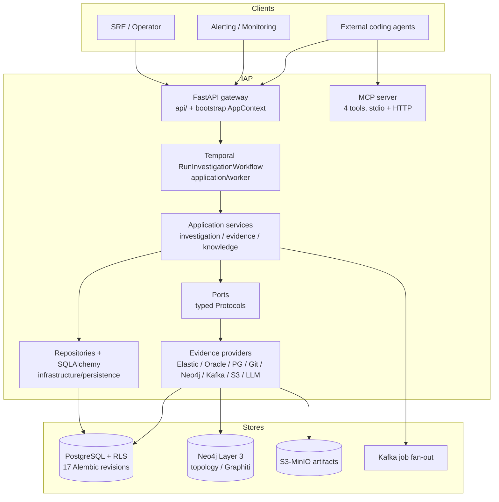
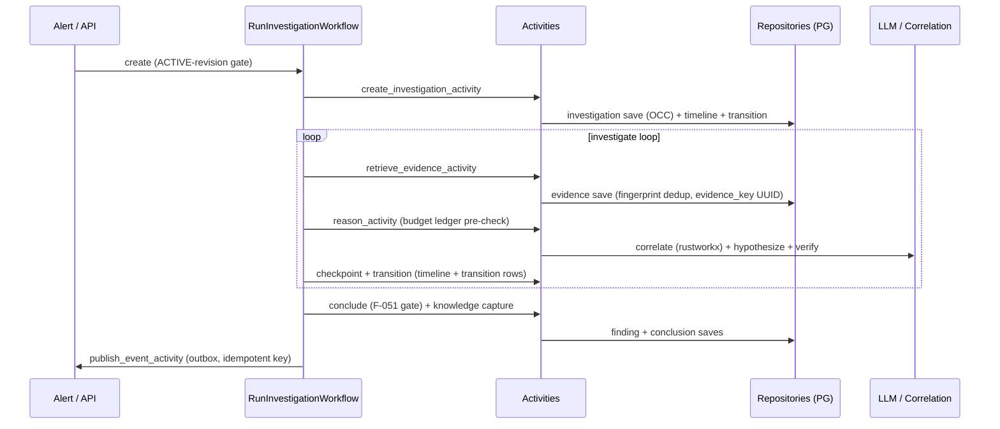
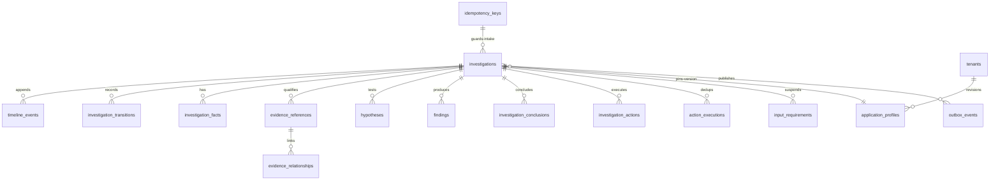

# IAP As-Built Architecture v1.0 (code-wins, verified 2026-10-15)

This document records the Investigation Agent Platform as implemented in code, superseding stale architecture claims in `docs/IAP-implementation-part*-knowledge-v1.0.md` wherever they differ. Method: `docs/COMP_REVIEW.md` bidirectional loop (Doc→Code, Code→Doc) across C1–C13 with file:line evidence; confidence High unless noted. Secrets below are key names only, never values.

## 1. System overview

IAP is a multi-tenant, durable-workflow incident-investigation platform: alert intake creates an investigation, Temporal orchestrates evidence gathering plus deterministic correlation plus LLM reasoning under budget and safety gates, and the platform persists timeline, transitions, hypotheses, findings, and conclusions with tenant isolation. Clients are SREs/operators, alerting systems, and external coding agents via REST and MCP.

## 2. Runtime composition (C1/C2 as-built)

One typed `AppContext` is built by `build_app_context` (`bootstrap/__init__.py:770-851`) from `load_application_config_from_env` (`infrastructure/configuration/config.py:783-846`) and preserved across API and worker lifecycles (`main.py:54-61`, `api/app.py:146`, `api/dependencies.py:2160-2176` fail-closed `TypeError` on non-`AppContext`). Lifespan order is Temporal client → buffered-dev (+evidence-gateway re-wire) → dev seed → job messaging (`main.py:196-212`); shutdown is idempotent (`dependencies.py:2179-2212`). Production never takes dev paths (guards at `main.py:74-75,122-123,180-181`, `buffered_dev.py:171-179` raises in prod); dev degrades explicitly with 503s (investigations router, health router) and bounded retries (API Temporal 8 attempts `main.py:90-101`, worker 10 attempts `worker.py:198-215`). Worker topology is three queues (investigation/indexing/analytics) with explicit concurrency bounds (`bootstrap/worker.py:62-125,266-316`) plus a schedule reconciler driven by `IAP_SCHEDULING_TENANTS` (`:139-173`).

Configuration is frozen Pydantic (`extra="forbid"`) with ~90 `IAP_*` env reads and `SecretStr` for all secrets (`config.py:20-577`); fail-closed production guards cover database URI, per-provider LLM keys, cursor signing key, and Azure/Muse required fields (`config.py:131-154,456-467,783-798`). Secrets arrive only via runtime env injection or secret-manager lookup through the `SecretStore` port (`ports/secrets/store.py`): the OpenBao adapter is the reference implementation with AWS/Azure/GCP extension adapters sharing the protocol, selected by `IAP_SECRET_STORE_PROVIDER` (`infrastructure/secrets/stores/factory.py`) and wired into the resolver chain at composition (`bootstrap/__init__.py`); file layers (`.env*`, then allowlisted YAML scalars in `infrastructure/configuration/layers.py`) never override runtime values and never carry secrets. Known gaps are tracked in `tmp/TO_DO_001.md` (leave-tracked `.env.local` decision recorded 2026-10-15, env-matrix landed, YAML hierarchy landed, `IAP_ENVIRONMENT` default mismatch).

## 3. Investigation lifecycle sequence (C6 as-built)

The domain graph (`domain/investigation/models.py:290-376`) includes `PAUSED`, `AWAITING_INPUT`, and `COMPLETED/FAILED→INVESTIGATING` reopen edges; `AWAITING_INPUT` is fully implemented with expiry-to-FAILED (`workflows.py:260-365`, `input_requirement_repository.py:109-160`); reopen has a real caller for recurring code-issue fingerprints (`application/knowledge/intake.py:188-197`); budget ledger denies before fan-out (`activities.py:583-653`); conclusion gate F-051 denies silent completion (`activities.py:~1250-1332`). Known gaps are tracked in `tmp/TO_DO_003.md` (idempotency-key claim vs deterministic-action/fingerprint reality, best-effort audit writes with dropped actor, duplicated activity graph missing pause/input edges).

## 4. Data model (C7 as-built, ER essentials)

PostgreSQL with async SQLAlchemy 2.0, 17 Alembic revisions (not 7), 30+ ORM models (`infrastructure/persistence/models.py:30-1198`), RLS on `tenant_id` with deliberate carve-outs (knowledge-artifact visibility policy, tenant-free redacted `code_issue_index` per v0.2 Ambiguity-5), OCC on investigations/jobs/input-requirements, outbox for cross-process domain events only (timeline/transitions are the per-mutation audit, see `infrastructure/messaging/outbox.py:27-103`), immutable application-profile revisions (`profile_repository.py:4-11`), `evidence_key` UUID mapping (never raw Elastic `_id`), and existing `save_batch`/`append_batch` bulk paths (`evidence_repository.py:81-115`, `timeline_repository.py:65-70`). Known gaps are tracked in `tmp/TO_DO_003.md` (timeline reads without `tenant_id` predicate, `save_batch` N+1) and `tmp/TO_DO_005.md` (core-table retention, Fact OCC).

## 5. API, MCP, providers, knowledge (C8–C11 as-built)

REST exposes 56 path operations across 15 router modules with typed `response_model` on all JSON routes (open contract guard `tests/unit/test_openapi_contract.py` has an empty untyped allowlist plus one SSE exemption); request bodies are router-local (deviation from the one-module-per-router input plan); tenant scoping plus admin auth plus quota 429 with `Retry-After` are enforced; pagination cursors are HMAC-signed and fail-closed; the error envelope is `{"error":{code,message,correlation_id}}` with `X-Correlation-ID` middleware. MCP exposes 4 tools (`search_runtime_evidence`, `get_evidence`, `investigate_trace`, `search_reference_docs`) over stdio (single-investigation scope from env, fail-closed UUID) and HTTP (per-request JWT plus investigation header via pure-ASGI middleware; the SDK standalone runner is banned because it bypasses auth, `mcp/server.py:221-223`); contract plus adversarial tests pin catalog parity. Providers register fail-closed and optional (Elasticsearch, Oracle/SQLcl MCP with per-server tenant allowlists, Postgres state backend as `postgres-primary`, PyGit2 ingest, Neo4j Layer 3, Kafka per-replica fan-out, S3/MinIO artifacts with local-dev adapter, LLM gateway plus streaming adapters); dynamic mapping resolves `NONE_REQUIRED` vs `FIELD` tenant scope per source (`domain/observability/mapping.py`). Knowledge uses write-once envelopes as source of truth with Mem0/Graphiti/Cognee default-off and envelopes-only degradation; all nine Part 11 gaps (input suspension, bulk intake, clustering, reference search, aggregate reports, chat SSE, jobs, credential providers, JSON recovery) are implemented behind registries with tenant scoping and quotas. Remaining items are tracked in `tmp/TO_DO_004.md` (router-local bodies, logger/typing residuals), `tmp/TO_DO_005.md` (operation count arithmetic, batch shape, chat-guard fallback), and `tmp/TO_DO_006.md` (artifact key scoping, MCP token typing, Oracle/Mem0 runbooks).

## 6. Telemetry and coding standards (C3/C13 as-built)

Live telemetry is programmatic `structlog` (`api/app.py:24-41`, `JSONRenderer`) with `sanitize_extra` redaction (`api/errors.py:106`) enforced at the API layer; `config/logging.yaml` is unloaded dead config (console-only, `ConsoleRenderer`). Worker terminal paths use `logger.exception` consistently (exemplar discipline), shutdown logging is `%`-style with a names-only redaction contract (`dependencies.py:2215-2237`), and no secret values appear in sampled log calls. Against the required record shape the platform is partially sufficient: stage plus exception plus stack are present, but `function`/`line` keys, top-level `tenant_id`/`investigation_id` on worker failure extras, stable `event` keys outside startup/shutdown/composition, and `error_type`/`data` attributes are systematically missing, and worker extras can be dropped by the formatter split. Coding standards verified: per-file `getLogger(__name__)`, `X | None` typing with zero `Optional[`, no suppression, frozen Pydantic config/MCP/API schemas; violations to fix are raw-dict activity inputs, intelligence-port tenant scope, router-local bodies, f-string logger calls, and outbox/MCP logger gaps (see `tmp/TO_DO_002.md`, `tmp/TO_DO_004.md`).

## 7. Delta appendix (where code beat, met, or missed the docs)

Code exceeded docs: fail-closed `AppContext` coercion; three-queue worker with retry budgets and schedule reconciler; Postgres state provider (closes appl-profile gap note); immutable profile revisions with ACTIVE gate and pinned version; evidence model (`observed_at` nullability, `data_quality`, `LargeEvidencePointer`, `evidence_key` mapping, fingerprint dedup); conclusion gate F-051, budget ledger F-054, deterministic `action_id` F-057, durable outbox F-058 with atomic idempotency store F-013/F-014; 56-operation typed API rollout complete; 4 MCP tools with adversarial contract tests; all Part 10 mapping and all nine Part 11 gaps implemented. Docs met by code: tenant-first port shape (modulo TO_DO-017), runtime/checkpoint/resume/cancel services, cursor security, error envelope, provider fail-closed registration, envelopes-source-of-truth knowledge posture, domain purity (zero infra imports). Docs missed by code (all filed): TO_DO-001–005 config/startup, TO_DO-006–010 telemetry, TO_DO-011–015 workflows/persistence, TO_DO-016–020 contracts/standards, TO_DO-021–030 tenancy/retention/API minors. Stale doc lines to stop quoting: 7 Alembic revisions (actual 17), single `profile_json` (actual revision rows), no Postgres provider, 55 operations (actual 56), 3 MCP tools (actual 4), and any `logging.yaml`-as-authority snippet.
