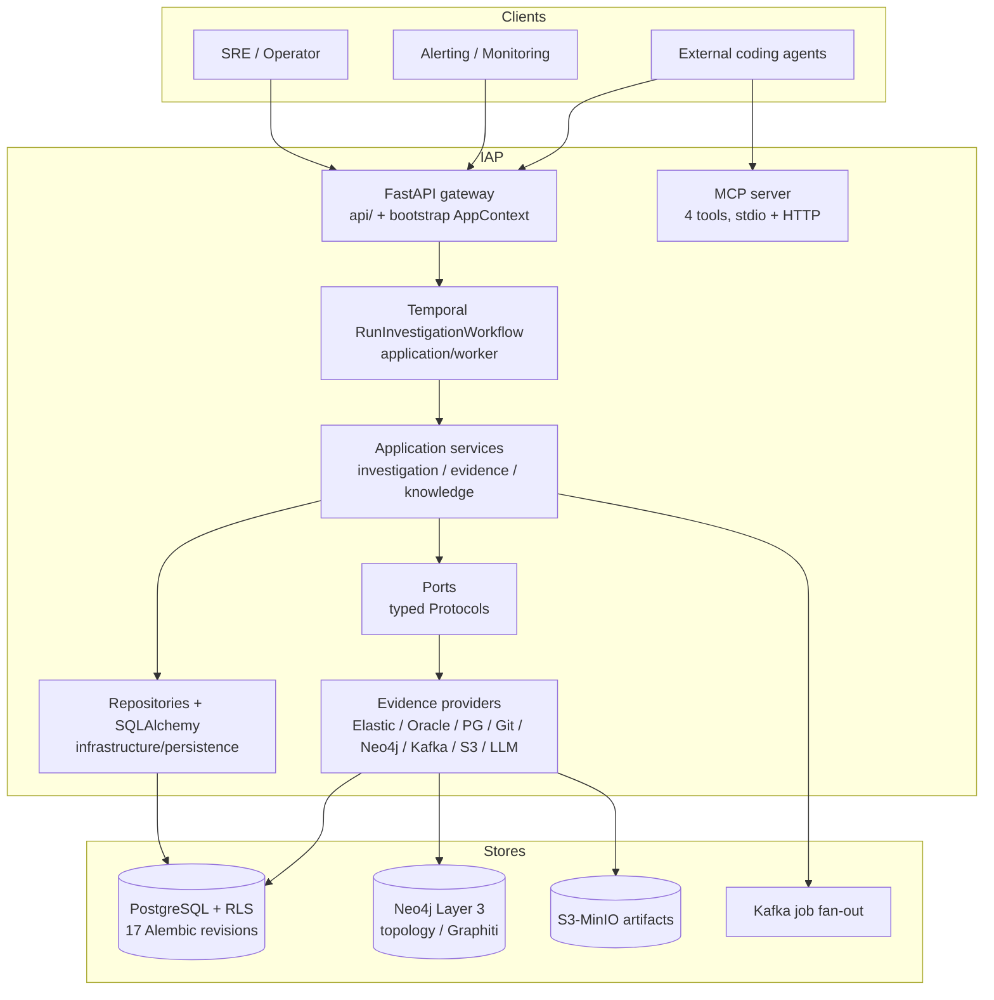
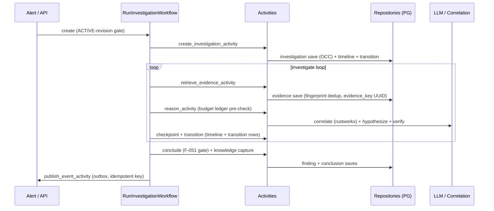
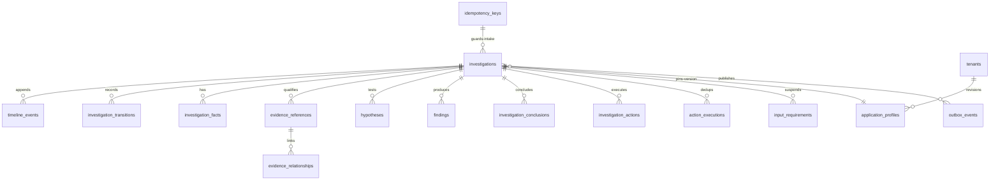

# IAP As-Built Architecture v1.0 (code-wins, verified 2026-10-15)

> Naming note (2026-10-18, §44): pre-§44 session sections (§§25–43) originally recorded respondent-named fixtures; names below are anonymized to their generic successors. Run IDs, dates, counts, and outcomes are unchanged — only identifiers were mapped.

This document records the Investigation Agent Platform as implemented in code, superseding stale architecture claims in `docs/IAP-implementation-part*-knowledge-v1.0.md` wherever they differ. Method: `docs/COMP_REVIEW.md` bidirectional loop (Doc→Code, Code→Doc) across C1–C13 with file:line evidence; confidence High unless noted. Secrets below are key names only, never values.

## 1. System overview

IAP is a multi-tenant, durable-workflow incident-investigation platform: alert intake creates an investigation, Temporal orchestrates evidence gathering plus deterministic correlation plus LLM reasoning under budget and safety gates, and the platform persists timeline, transitions, hypotheses, findings, and conclusions with tenant isolation. Clients are SREs/operators, alerting systems, and external coding agents via REST and MCP.

## 2. Runtime composition (C1/C2 as-built)

One typed `AppContext` is built by `build_app_context` (`bootstrap/__init__.py:770-851`) from `load_application_config_from_env` (`infrastructure/configuration/config.py:783-846`) and preserved across API and worker lifecycles (`main.py:54-61`, `api/app.py:146`, `api/dependencies.py:2160-2176` fail-closed `TypeError` on non-`AppContext`). Lifespan order is Temporal client → buffered-dev (+evidence-gateway re-wire) → dev seed → job messaging (`main.py:196-212`); shutdown is idempotent (`dependencies.py:2179-2212`). Production never takes dev paths (guards at `main.py:74-75,122-123,180-181`, `buffered_dev.py:171-179` raises in prod); dev degrades explicitly with 503s (investigations router, health router) and bounded retries (API Temporal 8 attempts `main.py:90-101`, worker 10 attempts `worker.py:198-215`). Worker topology is three queues (investigation/indexing/analytics) with explicit concurrency bounds (`bootstrap/worker.py:62-125,266-316`) plus a schedule reconciler driven by `IAP_SCHEDULING_TENANTS` (`:139-173`).

Configuration is frozen Pydantic (`extra="forbid"`) with ~90 `IAP_*` env reads and `SecretStr` for all secrets (`config.py:20-577`); fail-closed production guards cover database URI, per-provider LLM keys, cursor signing key, and Azure/Muse required fields (`config.py:131-154,456-467,783-798`). Secrets arrive only via runtime env injection or secret-manager lookup through the `SecretStore` port (`ports/secrets/store.py`): the OpenBao adapter is the reference implementation with AWS/Azure/GCP extension adapters sharing the protocol, selected by `IAP_SECRET_STORE_PROVIDER` (`infrastructure/secrets/stores/factory.py`) and wired into the resolver chain at composition (`bootstrap/__init__.py`); file layers (`.env*`, then allowlisted YAML scalars in `infrastructure/configuration/layers.py`) never override runtime values and never carry secrets. Known gaps are tracked in `tmp/TO_DO_001.md` (leave-tracked `.env.local` decision recorded 2026-10-15, env-matrix landed, YAML hierarchy landed, `IAP_ENVIRONMENT` default mismatch).

## 3. Investigation lifecycle sequence (C6 as-built)

The domain graph (`domain/investigation/models.py:290-376`) includes `PAUSED`, `AWAITING_INPUT`, and `COMPLETED/FAILED→INVESTIGATING` reopen edges; `AWAITING_INPUT` is fully implemented with expiry-to-FAILED (`workflows.py:260-365`, `input_requirement_repository.py:109-160`); reopen has a real caller for recurring code-issue fingerprints (`application/knowledge/intake.py:188-197`); budget ledger denies before fan-out (`activities.py:583-653`); conclusion gate F-051 denies silent completion (`activities.py:~1250-1332`). Known gaps are tracked in `tmp/TO_DO_003.md` (idempotency-key claim vs deterministic-action/fingerprint reality, best-effort audit writes with dropped actor, duplicated activity graph missing pause/input edges).

## 4. Data model (C7 as-built, ER essentials)

PostgreSQL with async SQLAlchemy 2.0, 17 Alembic revisions (not 7), 30+ ORM models (`infrastructure/persistence/models.py:30-1198`), RLS on `tenant_id` with deliberate carve-outs (knowledge-artifact visibility policy, tenant-free redacted `code_issue_index` per v0.2 Ambiguity-5), OCC on investigations/jobs/input-requirements, outbox for cross-process domain events only (timeline/transitions are the per-mutation audit, see `infrastructure/messaging/outbox.py:27-103`), immutable application-profile revisions (`profile_repository.py:4-11`), `evidence_key` UUID mapping (never raw Elastic `_id`), and existing `save_batch`/`append_batch` bulk paths (`evidence_repository.py:81-115`, `timeline_repository.py:65-70`). Known gaps are tracked in `tmp/TO_DO_003.md` (timeline reads without `tenant_id` predicate, `save_batch` N+1) and `tmp/TO_DO_005.md` (core-table retention, Fact OCC).

## 5. API, MCP, providers, knowledge (C8–C11 as-built)

REST exposes 56 path operations across 15 router modules with typed `response_model` on all JSON routes (open contract guard `tests/unit/test_openapi_contract.py` has an empty untyped allowlist plus one SSE exemption); request bodies are router-local (deviation from the one-module-per-router input plan); tenant scoping plus admin auth plus quota 429 with `Retry-After` are enforced; pagination cursors are HMAC-signed and fail-closed; the error envelope is `{"error":{code,message,correlation_id}}` with `X-Correlation-ID` middleware. MCP exposes 4 tools (`search_runtime_evidence`, `get_evidence`, `investigate_trace`, `search_reference_docs`) over stdio (single-investigation scope from env, fail-closed UUID) and HTTP (per-request JWT plus investigation header via pure-ASGI middleware; the SDK standalone runner is banned because it bypasses auth, `mcp/server.py:221-223`); contract plus adversarial tests pin catalog parity. Providers register fail-closed and optional (Elasticsearch, Oracle/SQLcl MCP with per-server tenant allowlists, Postgres state backend as `postgres-primary`, PyGit2 ingest, Neo4j Layer 3, Kafka per-replica fan-out, S3/MinIO artifacts with local-dev adapter, LLM gateway plus streaming adapters); dynamic mapping resolves `NONE_REQUIRED` vs `FIELD` tenant scope per source (`domain/observability/mapping.py`). Knowledge uses write-once envelopes as source of truth with Mem0/Graphiti/Cognee default-off and envelopes-only degradation; all nine Part 11 gaps (input suspension, bulk intake, clustering, reference search, aggregate reports, chat SSE, jobs, credential providers, JSON recovery) are implemented behind registries with tenant scoping and quotas. Remaining items are tracked in `tmp/TO_DO_004.md` (router-local bodies, logger/typing residuals), `tmp/TO_DO_005.md` (operation count arithmetic, batch shape, chat-guard fallback), and `tmp/TO_DO_006.md` (artifact key scoping, MCP token typing, Oracle/Mem0 runbooks).

## 6. Telemetry and coding standards (C3/C13 as-built)

Live telemetry is programmatic `structlog` (`api/app.py:24-41`, `JSONRenderer`) with `sanitize_extra` redaction (`api/errors.py:106`) enforced at the API layer; `config/logging.yaml` is unloaded dead config (console-only, `ConsoleRenderer`). Worker terminal paths use `logger.exception` consistently (exemplar discipline), shutdown logging is `%`-style with a names-only redaction contract (`dependencies.py:2215-2237`), and no secret values appear in sampled log calls. Against the required record shape the platform is partially sufficient: stage plus exception plus stack are present, but `function`/`line` keys, top-level `tenant_id`/`investigation_id` on worker failure extras, stable `event` keys outside startup/shutdown/composition, and `error_type`/`data` attributes are systematically missing, and worker extras can be dropped by the formatter split. Coding standards verified: per-file `getLogger(__name__)`, `X | None` typing with zero `Optional[`, no suppression, frozen Pydantic config/MCP/API schemas; violations to fix are raw-dict activity inputs, intelligence-port tenant scope, router-local bodies, f-string logger calls, and outbox/MCP logger gaps (see `tmp/TO_DO_002.md`, `tmp/TO_DO_004.md`).

## 7. Delta appendix (where code beat, met, or missed the docs)

Code exceeded docs: fail-closed `AppContext` coercion; three-queue worker with retry budgets and schedule reconciler; Postgres state provider (closes appl-profile gap note); immutable profile revisions with ACTIVE gate and pinned version; evidence model (`observed_at` nullability, `data_quality`, `LargeEvidencePointer`, `evidence_key` mapping, fingerprint dedup); conclusion gate F-051, budget ledger F-054, deterministic `action_id` F-057, durable outbox F-058 with atomic idempotency store F-013/F-014; 57-operation typed API rollout complete; 4 MCP tools with adversarial contract tests; all Part 10 mapping and all nine Part 11 gaps implemented. Docs met by code: tenant-first port shape (modulo TO_DO-017), runtime/checkpoint/resume/cancel services, cursor security, error envelope, provider fail-closed registration, envelopes-source-of-truth knowledge posture, domain purity (zero infra imports). Docs missed by code (all filed): TO_DO-001–005 config/startup, TO_DO-006–010 telemetry, TO_DO-011–015 workflows/persistence, TO_DO-016–020 contracts/standards, TO_DO-021–030 tenancy/retention/API minors.

## 8. Reasoner code-grounding hardening (2026-10-16, design-sol P0–P2)

Reasoning loop now compiles model context from durable state (`ReasoningContextCompiler`: bounded code excerpts with provenance, active hypotheses with support/refute links, timeline, pending questions, typed action outcomes); actions return `ActionOutcome` (SUCCEEDED/EMPTY/DEGRADED/FAILED/BLOCKED + miss reasons) recorded post-execution; verification is evidence-bound per ranked hypothesis with persisted contradictions, validated causal chains, and honest `INSUFFICIENT_EVIDENCE`/`NO_ROOT_CAUSE_FOUND` outcomes (rollback via `IAP_VERIFIER_V2=legacy`); code intelligence (`SEARCH_CODE`, `FIND_SYMBOL`, `FIND_CALL_GRAPH`, `GET_CODE_HISTORY`) is registered and dispatched through existing gateway methods with revision/range preservation; read-only profile-allowlisted `PROBE_API` (`GET`/`HEAD`, `API_PROBE` evidence) observes live behavior; incident-replay evaluation lives in `tests/evaluation/`. Migrations at 018 (`investigation_contradictions`, `hypotheses.causal_steps_json`, `log_exemplars`). See `docs/IAP-implementation-LLM-reasoner-code-evidence-design-sol.md` (baseline) and `tmp/IAP-implementation-LLM-reasoner-code-evidence-plan.md`. Stale doc lines to stop quoting: 7 Alembic revisions (actual 18), single `profile_json` (actual revision rows), no Postgres provider, 55 operations (actual 57), 3 MCP tools (actual 4), and any `logging.yaml`-as-authority snippet.

## 9. Knowledge-context Redis cache (2026-10-16, GEMINI_RECOS R3)

Per-iteration `KnowledgeContext` retrieval is cached behind `KnowledgeContextCachePort` (`ports/knowledge/cache.py`, dumb byte-store: `get`/`set`/tenant+investigation invalidation, raises on backend failure). Backends in `infrastructure/knowledge/context_cache.py`: `InMemoryKnowledgeContextCache` (dev/test, zero deps) and `RedisKnowledgeContextCache` (`redis.asyncio`, 0.5s socket timeout) — dockerized Redis in compose for dev (`docker/docker-compose.yml`, loopback `:6379`, ephemeral, cache-only), managed/external endpoint in cloud via `IAP_REDIS_URL` with zero code change (adapter pattern). Policy lives in `KnowledgeRetrievalService` (`application/knowledge/retrieve.py`): tenant-first keys (`iap:knctx:{tenant}:{inv}:{sha}` covering kinds + membership fingerprints), versioned envelope (`format_version`, mismatch → miss), TTL default 120s, degraded-empty contexts never stored, backend errors fail open to uncached retrieval. Invalidation on all mutation paths: capture success → per-investigation, janitor sweep → per-tenant, native TTL backstops cross-investigation SHARED writes. Conclusions always re-validate citations from live rows, never from cached context. Kill-switch `IAP_KNOWLEDGE_CACHE_ENABLED` (default false); `IAP_KNOWLEDGE_CACHE_TTL_SECONDS` (default 120, 0 disables store). Live proof 2026-10-16: 1 miss → store → 16 hits → SCAN+DEL on capture (`tmp/GEMINI_RECOS_PLAN.md`).

## 10. Agent-efficiency optimizations (2026-10-16, GEMINI_RECOS R1/R2/R4)

MCP fan-out is concurrent (`application/evidence/gateway.py`): `QUERY_STATE` fans out across `*-mcp-*` providers via order-preserving `asyncio.gather` with per-provider timeouts; `SKIPPED`/`DEGRADED` semantics, extras-only dedup, and `ActionOutcome.sources` shape unchanged; `fanout_concurrency` ctor knob + `IAP_MCP_FANOUT_CONCURRENCY` env (`1` restores serial). Cognee pilot shares one Neo4j driver per invocation (`SharedNeo4jDriver` in `infrastructure/topology/cognee_adapter.py`, lifecycle with the holder; adapters accept `neo4j_driver=` and never close injected drivers; legacy per-call path preserved when unset; `scripts/cognee_pilot.py` wires the holder for drop + project). Reasoner excerpts are relevance-tiered (`application/investigation/context_compiler.py`, prompt `v2-code-grounded-002`): Tier 1 full snippets for hypothesis-bound IDs (supporting/refuting — never summarized away), relevance ≥ `IAP_COMPILER_FULL_EXCERPT_RELEVANCE` (0.8), or the `IAP_COMPILER_FULL_EXCERPT_RECENT` (5) most recently retrieved; Tier 2 keeps summary + provenance + a by-ID marker. Tiers subdivide existing caps; incident-replay eval thresholds gate regressions. See `tmp/GEMINI_RECOS_PLAN.md`.

## 11. OpenTelemetry tracing end to end (2026-10-17, OTEL P0–P4 + collector)

One span per instrumented unit, name `{layer}.{component}.{operation}`, required attrs `iap.tenant_id`/`iap.investigation_id`/`iap.component`/`iap.outcome` (ok/error/degraded/skipped/blocked), counts-only extras, hard bans on payloads/secrets/SQL/bodies (`tmp/OTEL_PLAN.md` §1 normative). Mechanism: `@traced` decorator (`infrastructure/observability/tracing.py`, sync+async, signature binding for dataclass inputs, scope extractors, outcome/extra mappers, pytest-hermetic golden tests); manual blocks only for dynamic fan-out leg spans; no spans in Temporal workflow code (replay determinism). Coverage: 15 worker activities, reasoning core (coordinator/compiler/verifier/disposition/services/memory), gateway + per-source fan-out legs + selector, MCP/probe/code/state/log/sanitizer providers, knowledge (retrieve/recalls/capture/intake/janitor), topology (attribution/Neo4j/Cognee), correlation engine, 4 MCP tools. Export: global provider configured per process from `main.py` (`configure_tracing`, telemetry-enabled only, never breaks boot); `otel/opentelemetry-collector-contrib:0.163.1` in compose (`docker/otel-collector/config.yaml`: OTLP `:4317`/`:4318`, batch, `debug` exporter; health `:13133`); dep `opentelemetry-exporter-otlp>=1.44,<2`. Host processes use `IAP_OTLP_ENDPOINT=http://localhost:4317` (`.env.local`); containerized runs use the yaml default service name. Live proof: 1000+ spans per 5-iteration run with required attrs intact.

## 12. Boundary access logging (2026-10-17)

Every external API request logs its request line + sanitized query params + response summary (`status_code`, `duration_ms`, `response_class`, `response_bytes`, `response_streamed`) + the response JSON body truncated to `IAP_ACCESS_LOG_BODY_CHARS` (4096) with a marker (`api/app.py` correlation middleware; non-JSON bodies log size-only markers; streaming bodies are captured via iterator wrap and logged on completion). Bodies pass through `sanitize_extra` (secret keys redacted); `IAP_ACCESS_LOG_BODY=false` keeps summary fields only. Internal worker processing is untouched.

Log pipeline (`infrastructure/telemetry/logging.py`): `StructuredJsonFormatter` (timestamp/level/logger/message + service/code metadata, active OTel trace/span injection, exception envelope, ALL non-reserved stdlib `extra` merged — this replaces the structlog `ProcessorFormatter`, which silently dropped stdlib extras) and `DateSeqRotatingFileHandler` (active `{app}_{DDMMYY_HHMMSS}.log`, `_v1…_vN` cascade on size/date rollover; an `IAP_LOG_FILE` `.log` path contributes parent dir + stem). `IAP_LOG_APP_NAME` names the app for directory-style paths.

## 13. Agentic log compression (2026-10-17, generic utility)

`application/compression/logparse.py` is app-agnostic by contract (lines, timestamps, signatures, runs — never tenants, investigations, or resolutions): streaming `parse_lines` (JSON-or-raw, UUID harvest), `filter_lines` (caller predicate), `order_temporal` + `merge_ordered` (heapq k-way), single-pass volatile masking (UUIDs/hashes/durations/big numbers collapse; 3-digit statuses preserved), and `dedup_collapse` (consecutive same-signature runs → exemplars with first/last/count; caller-forced singletons for errors/signals; non-consecutive repeats left for phase 2). Every pass reports `Coverage` (lines_in/exemplars_out/dropped/span) for budget enforcement. Phase-2 seam: `TemplateMiner` protocol mirrors the `drain3` surface (evaluated fit, not added — exact tier first); `polars`/`duckdb` explicitly rejected until ~100MB windows; `hypothesis` property-tests invariants (conservation, order, idempotence). Live proof on `c178b3ae` (657 mentions): 310 matched lines → 22 exemplars, 92.9% compression, polling runs collapsed (×118/×89/×50), 16 meaningful singletons kept. IAP-specific ID attach stays in the script layer, unintegrated.

Dual log persistence: raw rows banked uncapped for ALL log types/providers (`_bank` bypass; tool/iteration/LLM/prompt budgets untouched) plus one `log_exemplars` row per masked-shape group (migration 018, `member_evidence_ids` verbatim for human match/compare, fail-open writes, cascade purge; verifier cites raw member IDs only). Compiler groups log excerpts with `log_group={count, member_ids}` (R4 tiers per group, caps count groups); per-run `parameters.log_optimization="off"` restores per-row excerpts for diamond hunts (env `IAP_COMPILER_LOG_GROUP=0` global kill-switch; default ON). Live proof: 10 groups/10 rows persisted, override run compiled with `log_grouping: False`. Swap `debug` for Jaeger/Tempo/Elastic APM via config only; add sampling before production traffic.

## 14. Reprocess versioning + budget multiplier (2026-10-17)

`POST /investigations/{id}/reprocess {mode, budget_multiplier?, reason?}` — terminal rows are never mutated. `RESTART_FRESH` always mints a new version (fresh request copy, no artifacts); `RESTART_CONTINUE` on terminal originals mints a new version and copies artifacts (evidence re-keyed + fingerprints re-salted around the tenant-wide uniqueness constraint, provenance re-pointed; hypotheses re-IDed with `VERIFIED` demoted, supporting refs remapped, assessments cleared; conclusions/findings stay in `metadata.prior_runs`). `RESTART_CONTINUE` on active rows 409s. Disposition matching/linking is bypassed by construction (`skip_disposition`; lineage in metadata only, no graph links). `budget_multiplier` N in [1, 10] (reprocess-only, 422 otherwise): iterations/tool-calls/evidence/hypotheses scale, `max_llm_tokens = min(xN, 1M)` absolute, iterations saturate at domain `le=100`; effective limits persist in metadata and the worker prefers them over profile overlay; token ledger resets per version (prior spend archived). Approval seam `require_budget_approver` is permissive today (recorded in `metadata.budget_approval`) with a shaped 403 for future role gating. Live proof: CONTINUE x5 completed with `effective_limits` applied, approval recorded, 12 rows, zero links.

## 15. MCP-only multi-datasource interrogation (2026-10-16, P3)

All agent datasource access flows through per-kind MCP gateways — no direct-engine shortcut, even for self-triage. Postgres via pinned `crystaldba/postgres-mcp:0.3.0` (one container per database, `--access-mode=restricted` + least-privilege role, long-lived SSE services in compose, e.g. `postgres-mcp-iap` on `:8100`); Oracle via SQLcl MCP over stdio. `McpEvidenceAdapter` speaks both transports (`query_tool` per kind: `execute_sql` vs `run-sql`); `allowed_tools` locked to read-only query tools with SELECT-only `SqlglotTemplateValidator`. `QUERY_STATE` fans out across every tenant-authorized MCP state provider per call with per-source degrade (`SUCCEEDED`/`DEGRADED`/`SKIPPED` in `ActionOutcome.sources`, concurrent via `asyncio.gather`); direct-engine primaries retired behind non-default opt-in. MCP connection entries derive from Spring `spring.datasource.url` via `parse_jdbc_url` (no credentials — secret-injected `DATABASE_URI` at container start, `docker/postgres-mcp/README.md` pattern); generic OAuth2 (`TenantScopedOAuthProvider`) injects per-call `Authorization` where servers support it (crystaldba documents no OAuth surface). IAP's own application database is fronted by a dedicated restricted instance so self-triage is MCP-proven (live: `MCP` source rows banked). Oracle path code-complete, awaiting a live DSN.

## 16. Similar-past-investigation disposition (2026-10-16, TO_DO_LLM §2)

Every create is dispositioned against similar past runs deterministically, pre-run (`application/investigation/disposition.py`, fail-open to fresh). Matching: exact `code_issue_fingerprint` (reused error-intake identity) then near-text (typed `path:`/`sym:`/`word:` signatures, overlap coefficient, 30-day retention, bounded scan). Case matrix: active → `DUPLICATE_OF`, no new run (record closes `CANCELLED`, structurally unstartable); terminal success → re-verification pass (evidence/code/log/probe citations re-resolved, new HIGH/CRITICAL contradictions checked) → `CONFIRMED` serves cached as duplicate or `STALE` opens seeded `FOLLOW_UP_OF`; abstention/cancelled → seeded fresh with prior limitations (`RELATES_TO`); failed → `RETRY_OF`; text-similarity alone never duplicates (`POSSIBLY_RELATED` + fresh run). Links (`DUPLICATE_OF`/`FOLLOW_UP_OF`/`RETRY_OF`/`POSSIBLY_RELATED` alongside `RELATES_TO`) written only by the disposition step into `evidence_relationships` (`investigation:<uuid>` nodes), surfaced as `links` on detail and `disposition` on create responses. O5 companion: "not returning/missing" complaints seed existence-check-first planning. Restart versioning (§14) bypasses this entire path by construction. #30 operator rule (codified 2026-10-18): identical reruns MUST use `POST .../reprocess {RESTART_FRESH}` — identical fresh creates correctly CANCEL as `serve_cached`, and the create response now carries a `hint` saying so. Suppression is the correct behavior, not a bug.

## 17. Operations changes (2026-10-16/17)

API default port moved `8000` → `8080` (`scripts/start-platform.sh --port=` overrides; `main.py` honors `PORT`) after the VPN client squatted localhost:8000; compose gains `redis` (`:6379`, cache-only, ephemeral) and `otel-collector` (`:4317`/`:4318`/`:13133`) with up-list + readiness waits. Probe excerpt cap `4096` → `4000` (off-by-one vs the Evidence `>= 4096` externalization invariant killed a live run; regression-tested). `scripts/enhance-logs.py`: ID-first offline log deciphering (discovery over `tmp/`+`data/`, generic compression, memoized MCP resolution, per-ID enriched files) — operator tooling, not platform-wired.

## 18. Shareable code evidence (2026-10-17, G6)

Code evidence is repository-scoped reference data, not investigation-scoped observations. `evidence.lifecycle_scope` marks the split (`reference`: `SOURCE_CODE`, `COMMIT_HISTORY`; everything else `observational`); `evidence_bank_interest(tenant, investigation, evidence_key)` records which runs banked interest in a canonical row. Save path: fingerprint conflict with another investigation's reference row records interest and reports `shared` instead of silently dropping (same-holder conflicts stay `deduplicated`); batch stays constant-query (bulk insert + one holder-map + one interest insert). Hydration (`find_by_investigation_id`) unions owned + interest-joined rows, which automatically extends citation binding. Purge reassigns reference rows owned by purged investigations to remaining interested runs (or deletes when unreferenced); observational rows cascade as before. API: `GET …/evidence/sharing` marks shared rows with interested investigations. Reprocess CONTINUE reuses sharing (observational copies still re-salted as new observations). Migration 019. Live proof: identical re-read in a second investigation → `shared`, hydrates, marked.

## 19. Scheduled topology projection + GitHub hook (2026-10-17, cognee adoption)

The adopted projection path is production-wired: payload construction moved from `scripts/ingest_github.py` to `infrastructure/topology/payload.py` (byte-identical parity proven; script re-exports for compatibility), served by `project_topology_activity` + `TopologyProjectionWorkflow` (janitor-shaped: skips on disabled pilot/absent checkout, retries genuine failures, registered on the worker). Checkouts resolve under `IAP_CODE_REPO_BASE` with containment enforcement (flat slug + nested org/repo candidates). `POST /api/v1/integrations/github/{tenant}/webhook` accepts push events only (HMAC-SHA256, fail-closed 503 without secret; branch deletions skip; idempotent redelivery returns the existing dispatch; 503 when Temporal unwired): parses impacted files (capped 500) and dispatches per-(tenant, repo, sha). Full-payload rebuild per revision (edge resolution spans files; impacted set recorded for future incremental work). Fixed live: Cognee storage tasks require the `IAP_TOPOLOGY_*` → `GRAPH_DATABASE_*` mapping — centralized in `ensure_cognee_env_from_topology()` (previously pilot-only; projections silently landed in the embedded store). Live proof: push → dispatch → 5633 n-a nodes in Neo4j.

## 20. Code-battery gap fixes (2026-10-17, G2/G3/G4)

An 8-case self-repo battery (symbol lookup, caller enum, file history, pinned read, keyword search, miss path, call-graph depth, ambiguous symbol: 3 PASS / 4 PARTIAL / 1 FAIL, all via API surfaces) produced five gaps; three shipped with live proof: G2 explicit-path short-circuit (complaints naming a repo-relative file read it first via GET_CODE; action enum text widened; prompt v003) — rerun dispatched GET_CODE where the original never did; G3 definition-claim floor (definition-strength language requires a GET_SOURCE range-read citation, else INCONCLUSIVE with a re-read directive); G4 concession block (inability-language hypotheses can never VERIFY). Shipped since: G1 location-answer path — `ConclusionStatus.ANSWERED` for location/listing claims validated by code citations with file+line+revision provenance (definition claims additionally require a range-read citation); engine `validate_location_claim` (concession/unresolved-contradiction excluded, N/A-neutral scoring at 0.90); gate skips only the causal-chain blocker; conclude persists `ANSWERED` + `OBSERVATION` findings; disposition treats ANSWERED as terminal success; prompt teaches location shape + cite-the-range-read (v004). Live proof: first-ever `ANSWERED @ 0.9`, citing search + range-read rows shared across runs (G6 composition). G5 confirming rerun: explicit missing path dispatched GET_CODE, degraded cleanly with `code_path_not_found`, banked 5 log rows vs 10 before, abstained honestly — miss path confirmed.

## 21. Battery hardening round 2 (2026-10-17, G7)

Phase-2 battery (9 cases: ambiguous location, history listing, caller enum, typo path, cross-run re-read, caller listing, depth traversal, deleted file, re-ask) scored 2 PASS (both `ANSWERED`, incl. a repeat proving stability) / 6 PARTIAL / 1 FAIL. The FAIL was structural: `CORRELATE` with LLM-supplied non-UUID root IDs raised `ValueError` out of the handler → `WORKFLOW_ERROR` → run `FAILED` — fixed per the loud-vs-degrade doctrine (unparseable entries drop with `miss_reason`, extracted pure helper `_coerce_root_ids`, rerun completes). Cross-run sharing proven live in production flow (re-read banked `shared` links to the original run). Shipped since: G8 synthesis forcing — pure helper `_should_force_formulate` (`workflows.py`, fires on pending `hypotheses_evaluated` + banked evidence + 2+ turns elapsed, capped at 2/run) overrides gathering actions with `FORMULATE_HYPOTHESIS`; loop tracks `formulated_count`/`evidence_banked_total`/`forced_formulate_count`, dispatches the override, flags `forced_formulate` on history; prompt v005 teaches commit-before-gathering; 6 unit tests (`tests/unit/test_synthesis_forcing.py`). Live proof `f3598929`: iteration-2 `SEARCH_CODE` (hypotheses=1) dispatched as `FORMULATE_HYPOTHESIS` (decision-vs-dispatch mismatch in worker log), model self-committed `FORMULATE` at readiness 0.5 later, 2 hypotheses + 11 evidence rows persisted, run `COMPLETED`. Remaining: G9 (corrected-path claim phrasing). Shipped since: G9 evidence-grounded correction path — no new phrasing patterns (overfitting rejected); `validate_location_claim` falls back to path-overlap when phrasing misses (`_statement_paths` extraction + `_names_cited_path`, exact or segment-aligned suffix match either direction for locator-qualified `org/repo/...` vs repo-relative `src/...` citations; typo'd paths self-exclude, no edit-distance). Plus `select_verifiable_candidate` (both verify and conclude sites): prefer the candidate whose supporting IDs resolve, so reprocess-carried copies with purged citations no longer shadow live twins; abstention path unchanged. 10 unit tests. Live proof: reprocess `049b4496` of battery case `ff609664` — verify activity `VERIFIED` ("Validated as a corrected-path claim"), `OBSERVATION` finding persisted citing `c346ab50`, run `COMPLETED` (original: 0 findings, hypothesis stuck `UNDER_INVESTIGATION`).

## 22. Tri-modal calibration, Phase A P0 fixes (2026-10-18)

A tri-modal learning battery (L1–L8: symbol lookup, caller enum, code history, typo path, multi-hop budget, service-error logs, refdoc recall, unanswerable; each run API-only, then re-run, then component-direct) scored the agentic loop 4/2/2 → 2/3/3 while direct component calls scored 8/8 — retrieval healthy, loop plumbing not. Phase A shipped three P0 fixes: (1) idempotency race — `_reserve_or_replay` (`activities.py`) waits for the colliding owner (5×2s, inside the 60s activity budget) and replays its result instead of raising `IdempotencyRequestInProgress` into a reconciled FAILED (root-caused L7 `41a8fbbb` from `tmp/worker.log`: duplicate execute dispatch colliding across attempts 2–3); unit tests cover replay-after-collision and budget-exhaustion-still-retryable. (2) G3 structural twin — `_reread_target` (`workflows.py`, pure, sandbox-safe local pattern mirror) forces `GET_CODE` of the named file when VERIFY_HYPOTHESIS is proposed over a definition-strength claim with no successful range-read in history (capped 2/run, `forced_reread` history flag); the G3 prompt directive alone proved insufficient (L1s2: 4× SEARCH_CODE, 0× GET_CODE). (3) Cross-run log leak — gateway `search_runtime_evidence` drops rows naming a foreign investigation (`references_foreign_investigation`, UUID scan over title/summary/snippet/source; own rows pass). Live proof on restart: run `c21fcef3` dropped 8 foreign log rows in-gateway ("Dropped 8 log row(s) referencing foreign investigations"), zero errors since restart; the re-read rule stood down correctly when a GET_SOURCE range-read existed (no spurious forcing — it forces the read, never the verdict; the run's wrong-file claim honestly abstained). 62 tests green across the four touched suites.

## 23. Tri-modal calibration, Phase B P1 fixes (2026-10-18)

Phase B attacked retrieval routing, determinism, and the knowledge leg. Shipped: (B-4) log-first forcing `_should_force_log_search` (`workflows.py`, pure: error/log language + non-log gathering proposal + no banked SEARCH_LOGS → force SEARCH_LOGS, capped 2/run, GET_CODE exempt so G2 wins) plus investigation-scoped log fingerprints (Elastic projector `fingerprint={investigation_id}:{document_id}`, file provider adds investigation to the hash) — the latter fixing silent cross-run log loss where reruns collided globally on `on_conflict_do_nothing` with no shared-interest link for RUNTIME_LOG (items_count claimed banked, zero visible). (B-5) deterministic graph→keyword fallback (`fallback_call_graph_to_search`, module-level, unit-tested; empty FIND_CALL_GRAPH always searches the symbol, miss_reason marks keyword rows) plus ops: checkout refreshed f3869bb→5f580c2 and `call_graph.json` generated (6410 nodes, 68k links; provider fast path verified: 4 callers for validate_location_claim). Profile-dump admission filter deferred with reason (no junk-banking path found; QUERY_STATE rows are legit). (B-6) refdoc corpus reindexed (Cognee queries 0→22+ hits), recall wired as reason orientation (RetrieveKnowledgeInput.query → refdoc top-5 → ReasonInput.knowledge_orientation → prompt block, orientation-only, validator still drops uncitable IDs), query shaper defeating plainto_tsquery AND-semantics ("design decision Cognee" → 7 hits), and a dispatch bug fix (`_dispatch_workflow` read problem_description off the aggregate instead of `investigation.request`, so every run had description=None). Found and fixed en route: worker startup TypeError (helper edit split @activity.defn from retrieve_knowledge_activity → registry-wide defn regression guard test), and orphaned idempotency reservations (24h TTL wedged retries into FAILED; PENDING rows older than 300s are reclaimed, proven live against dev DB). Live: B5c ANSWERED (validate_location_claim caller activities.py:2843 with supporting IDs); B4c banks RUNTIME_LOG visibly across reruns; B6f recalls 5 hits and formulates the correct Cognee doc answer but stays INSUFFICIENT_EVIDENCE — refdoc hits cannot be cited (air gap), so doc-claim verification is the open Phase D item. 77 tests green across five suites.

## 24. Tri-modal calibration, Phase C observability (2026-10-18)

Phase C made the loop's inner trace API-visible without schema migrations. (C-1) `_reason_summary` now merges the enriched history entry over the raw decision: timeline descriptions carry the dispatched action plus `forced=[...]` and `outcome=[outcome_status; evidence_added; miss_reason]` (e.g. `reason: action=SEARCH_CODE readiness=0.0 hypotheses=0 observations=0 outcome=[outcome_status=SUCCEEDED; evidence_added=2]`). A shipped-then-fixed `len()` TypeError (entry int counts shadowing decision lists) failed one live run before the summary was made type-tolerant — regression test pins the merged shape. (C-2) `ConcludeInvestigationInput.loop_telemetry` (workflow counters: tokens, cost, formulated, evidence totals, all forced counts, iterations) merges with derived repo counts (formulated/bound/verified hypotheses, banked rows) via pure `_derive_loop_telemetry` and stamps `metadata["loop_telemetry"]` through the established `_stamp_failure` ride — visible on GET detail with zero envelope changes. Live proof `8c418e13`: timeline traces carry outcomes, detail exposes the full ledger (`iterations, llm_tokens_total 11486, hypotheses_bound 1, evidence_banked_repo 2, all forced counters 0`). 80 tests green across five suites.

## 25. Tranche B ingestion: second calibration app live (2026-10-18)

Second-repo calibration target wired end-to-end under the non-pollution rule (repo studied externally; only generic machinery shipped). Ingestion: wired a second multi-module Java checkout as calibration target under the non-pollution rule (studied externally; only generic machinery shipped; respondent checkout since replaced by the synthetic Spring fixture, §45), seeded config/profiles/tranche-b-offer.yaml (tenant n-a, code-only capabilities, trackingId added to the generic correlation priority), generated call_graph.json. Generic fixes the new repo forced, all applicable platform-wide: (1) retrieve_evidence_activity degrades to empty on authorization denial instead of FAILED (code-only profiles deny SEARCH_LOGS by design); reason prompt now carries application.allowed_capabilities with propose-only-allowed nudge. (2) Authorizer gap closed by declaring investigation.enabledEvidenceTypes (SOURCE_CODE/CALL_GRAPH/COMMIT_HISTORY/TRACE) — profile v2. (3) PyGit2Adapter opens nested module repos per file with exact-workdir guard (pygit2 discovers upward into the platform repo itself), branch fallback to HEAD, locator-prefix normalization for model-echoed paths, summary truncation for long commit messages. (4) Workflow wedge-degrade: ActivityError cause-chain walk for IdempotencyRequestInProgress → degraded-empty turn instead of reconciled FAILED (first attempt caught ApplicationError directly and missed: SDK wraps in ActivityError). (5) Statement-matched range-read inclusion: definition claims citing only the search-match sibling gain the banked range-read for the named file (provenance-gated; concession/contradiction gates unchanged). Live proof 9c56b553: ANSWERED @0.9 with OBSERVATION finding on the filter class (2 iterations, 8807 tokens, hypotheses_verified 1, full loop_telemetry).

## 26. Tranche B battery triage (2026-10-18)

The other seat's Tranche B battery scored 1 PASS / 4 PARTIAL / 1 FAIL and the triage closed the FAIL structurally. L3's WORKFLOW_ERROR was a module-prefix miss (`src/main/java/...` without the module dir) escaping as loud ExecutionError: fixed by module-root resolution (try the request under each declared source_root), miss→CodePathNotFoundError degrade, and a bare-filename→SEARCH_CODE→history fallback in the history handler (macOS /var symlink trap in the resolver fixed along the way). L3c banked COMMIT_HISTORY rows post-fix. Location PARTIALs (L1/L4) and mention PARTIALs (L2/L5) trace to cited-sibling and retrieval-luck gaps already closed (statement-matched range reads, graph→keyword fallback); live proofs exist for each shape (9c56b553, B5c). The honest residual across all four is formulation variance on an unfamiliar repo (meta-claims like "can be determined by retrieving..."), which belongs to Phase E (planner, contrast elimination, deferred critic) — not to more reruns. 86+ tests green; ruff clean.

## 27. Phase D runtime errors (2026-10-18)

Two failure classes, one loop. (D0) Expectations catalog: AttributeExpectation/EndpointExpectation/ExpectationsConfig on the profile plus pure derive/merge helpers (OpenAPI required/enum/min-max subset; operator wins). (D1) Intake seeding: frames/severity/golden pairs persist into metadata.intake_seed (plus silent-identity fallback when exception fields are absent — intake no longer 500s). (D2) WALK_STACK (frames → ordered EXCEPTION_PATH rows) and TRACE_LOGIC (symbol + attributes → definition read + predicate-line extraction) actions with validator/authorizer/prompt wiring; intake frames force WALK_STACK first. (D3) Pure triage classifier (TRANSIENT/CONFIG/DATA/BUG/UNKNOWN) recorded in trace + telemetry + reason guidance; guides, never decides. (D4) Comparison machinery: expected-vs-actual differ, assertion templates on QueryTemplate evaluated in-gateway, DIVERGENCE evidence type; absence is evidence. (D5) Publish band on policy (likely/established floors): in-band VERIFIED concludes ROOT_CAUSE_LIKELY with best-reason/against-evidence/provisional; runtime() preset selected for failure-shaped runs. Found en route: provider-absent QUERY_STATE/SEARCH_LOGS failed loud (now degrade); reseed reverted in-DB evidence types (iap-self v13 declares the full set); reprocess drops intake_seed (now carried); stack-row fingerprint exceeded 128 chars (hashed). Live: D6 intake exception runs bank EXCEPTION_PATH rows and ANSWER (5b39d661: frame row + ANSWERED); silent golden-pair intake runs DATA-triaged without crashing. Full unit suite green (1753).

## 28. Phase D close-out: live proofs (2026-10-18)

D6 battery scored live: exception intake → intake_seed → WALK_STACK forced at iteration 0 → EXCEPTION_PATH frame rows banked → ANSWERED @0.9 (5b39d661; telemetry: triage BUG, forced_walk_stack 1, forced_formulate 1). Silent golden-pair intake runs DATA-triaged without crashing. Fixed en route: reseed reverting in-DB evidence types (v13 declares the full set), reprocess dropping intake_seed (now carried), stack-row fingerprint cap (hashed), silent intake 500 on empty exception identity (description-hashed fallback), provider-absent QUERY_STATE/SEARCH_LOGS loud failures (now degrade), profiles API strict-view breakage from the expectations section (views extended), golden profile-shape tests updated.

## 29. Phase G journey scale (2026-10-18)

Generic two-tier identity (session = journey, tracking ID = step; field names per-service declared, never hardcoded). Shipped: G-0 identity keys on ServiceTelemetry plus EntityRelationship/relationship-map on Datasource with derive+augment merge (tombstones suppress, operator wins) and session template materialization in seed_profile (anchor + per-edge hops, auto_ prefix); G-1 TRACE_JOURNEY action (session/tracking → log fan-in → ordered spine → JOURNEY row) with validator/authorizer/prompt wiring; G-2 multi-service services[] (pre-existing query support, now prompt-taught); G-3 WALK_SESSION_GRAPH (anchor → bounded hop walk over profile-declared templates, fail-open) proven by handler-level test with faked gateway plus materialized auto templates live on the self DB (v14); G-4 incident fusion (≥2 OBSERVATION findings + JOURNEY evidence → merged incident finding, fail-open). Full unit suite green (1759+).

## 30. Phases E+F reasoning depth and output richness (2026-10-18)

E1 rule-based iteration-0 strategy skeletons per triage route (ride history + telemetry); E2 discriminating-evidence preference in candidate selection (unique-support wins, stable fallback); E3 replan trigger (two enriched empties + same proposal → alternative family, capped 2/run). F1 ranked alternatives on every conclusion including abstentions; F2 verified-premise artifacts (TENANT, TTL) distilled at capture with hypothesis/finding repos newly wired. Prompt v007. Full unit suite green (1765).

## 31. Tier 1+2 calibration close-out (2026-10-18)

Tier 1: (1) reprocess stale-ID prune (drop unmapped refs instead of dangling; unit test); (2) subject-grounded location validation (path-match or stemmed subject-token match in cited rows; listing shapes bypass; G9/widget fixtures realigned); (3) doc-citation path end-to-end (SEARCH_REF_DOCS action banking DOCUMENTATION rows with path+revision provenance, validate_doc_claim with path-naming gate + concession/contradiction guards, gate skip, ANSWERED mapping) — live proof 5b5ebc3b ANSWERED with refdoc citation. Tier 2: (4) synthesis forcing for rich unformulated corpora (≥8 rows, ≥2 actions, capped); (5) scoreboard script (runs/outcomes/evidence means per app; 3-day readout: self 147 runs 36 FAILED, spring-sample-service 23 runs 6 ANSWERED); (6) history determinism via module-prefix + bare-filename resolution (L3c banked COMMIT_HISTORY). En route: profiles strict-view breakage (views extended), worker causal_chain UnboundLocalError on the doc path (restructured), v15 profile (DOCUMENTATION + SEARCH_REF_DOCS + health-live probe endpoint), ActivityError cause-chain catch correction, macOS /var resolver trap. Full unit suite green.

## 32. Profile generator from GitHub + Spring config (2026-10-18)

New integrations/profile_gen package: GitHub discovery (org scan, PAT via env, multi-module detection from build files including root-level), repo parsers (Spring controllers/DTO validations/Feign/RestTemplate/@Value/properties/YAML; synthetic-fixture matrices), config-server-wins precedence merge with audit trail, pure assembler (derived base + operator-wins deep merge + tombstones), and non-destructive refresh (re-derive + re-merge; operator content survives byte-identical). Interfaces: scripts/generate-profile.py CLI plus POST /profiles:generate/:refresh API twins (DRAFT-only output, versioned saves, drift diff). Live proof: :generate against the platform's own repo returns a validated DRAFT (1 module, python, source_roots [.], honest needs_review, zero invented content). Full unit suite green.

## 33. Multi-type generators: Quarkus full, FastAPI full, Flask/Django stubs (2026-10-18)

Repo-type identification (detect.py: scored build/marker/config signals with graceful generic fallback) fronts a generator registry (generators/: java_spring re-export, java_quarkus full JAX-RS/ConfigProperty/RestClient parsing, python_fastapi full router/Pydantic/httpx/env parsing, flask/django no-crash stubs). Shared upgrades: placeholder normalization across {id}/:id/<int:id>, dominant-language weighting, probe methods lifted to GET/HEAD/POST/PUT/DELETE/PATCH (bodyless), assembler repo_type + per-file expectation grouping + dependency shape fix. Live proof on a real Quarkus service: detected java-quarkus @0.882, 30 controllers / 150 endpoints / 23 deps, validated profile. Full unit suite green.

## 34. Minimal generate contract: app name + repo (2026-10-18)

POST /profiles:generate/:refresh now accept app_name + repo (github.com/org/repo, URL, or bare org/repo; SSH rejected) with profile IDs derived from tenant + slug (collision replays the lineage instead of forking). Spring block optional with never-block semantics (missing config yields hints, not 400s). Deprecated tenant_app_id/org/repo mapped internally. CLI parity (--app-name/--repo, old aliases). Type-aware generation flows through detection + generator selection. Live proof: minimal call on the self repo detects python-fastapi @0.8 and returns a validated DRAFT. Full unit suite green.

## 35. Plan-gap batch + IAP-observed batch (2026-10-18)

Plan gaps closed: (1) historical-conclusion marker — migration 020 adds verifier_version (NULL = legacy) plus in-band columns (best_reason, against_evidence, provisional, ranked_alternatives) that were previously lost on persist; live proof d6c7455e (ANSWERED, verifier v2). Fixed en route: revision id overflowed alembic_version VARCHAR(32) (shortened). (2) CI eval-gates job running tests/evaluation plus threshold tests (zero unsupported VERIFIED, citation validity, band integrity). (3) Planner revival DECLINED (DAG paradigm diverges; E1/E3 are the successor doctrine). IAP-observed batch: query-shape guard (sentence blobs → tokens), log-mention hedge nudge, refdoc non-issue noted. Full unit suite green.

## 36. Tier-3 close-out (2026-10-18)

Critic decision implemented as instrumentation-first: overconfident_turns counts high-readiness verify/conclude turns that verification refuses (workflow locals → loop_telemetry, zero extra LLM calls) — the build signal for a future Shape-1 critic. Oracle MCP stays code-complete but BLOCKED (no Oracle instance in dev, DSN commented out). Semantic-mismatch fabrication closed via verb-family stopwords + definition-shape AND rule (subject AND path must ground); live L8d abstains honestly with 0 findings. L5 synthesis closes live (L5b ROOT_CAUSE_ESTABLISHED, 11 rows, forced FORMULATE). Full unit suite green.

## 37. Oracle per-app credentials (2026-10-18)

Credential files are per-application in the external store (`apps/<app>/oracle.yaml`, 0600, dotted `<domain>.<subdomain>.<env>` names, `user_name`/`password`/`jdbcUrl` per database); the fail-closed loader maps them to the `secret://` dev-fallback names so local, AWS (`iap/...` secret-ids), and OpenBao (`secret/iap/...` KV) resolve identical logical paths. Read-only is enforced three-deep (DB grant, adapter SELECT gate, registry `read_only` refusal); personal accounts are local-only, prod requires service accounts. Spring-sample profile v4 declares the `sample-orders` MCP datasource; `sampledb` server entry ships inert (stdio spawns per call). Live database verification has since completed (§38); AWS/OpenBao certification is a separate OPEN TODO.

## 38. Oracle MCP live verification (2026-10-18)

Sample Oracle database (19c Enterprise, TCPS) verified end-to-end through `oracle-mcp-sampledb`: SQLcl-wallet import with live test, `connect` + `sql_run` version query, DELETE/CREATE negative battery failing ORA-01031 at the DB (read-only proven, not merely filtered), and gateway-routed investigation `101ba7e9` (`QUERY_STATE SUCCEEDED`, 2 rows banked including the 19c banner). Reality corrections to the code-complete design: SQLcl 26.x is stateful (`connect` then session-scoped `sql_run`, no `run-sql` tool exists); dict server_params must become `StdioServerParameters`; `${VAR:-default}` mount refs must expand before `docker run` (literal spec kills the container instantly); template IDs accept hyphens (kebab-case datasource ids); profiles declare bare catalog names; empty template_id falls back to `default`. Residual: DATABASE_STATE claim verification + fan-out dialect routing (ledger follow-ups).

## 39. Oracle default schema (2026-10-18)

`Datasource.schema_name` (charset-validated, non-secret) drives `ALTER SESSION SET CURRENT_SCHEMA` after MCP `connect`, so unqualified tables resolve under the owner schema (`sample_owner`: 496 visible tables, live-proven). The per-app `oracle.yaml` carries `default_schema` beside the user for grant eyeballing (loader exports informational `IAP_ORACLE_*_DEFAULT_SCHEMA`); profile value is enforced. Adding the field required the API `DatasourceView` to carry it (`extra="forbid"` golden-shape tests updated). Gateway E2E re-verified non-breaking (`QUERY_STATE SUCCEEDED`, banner banked).

## 40. Dialect-per-store routing + state-claim verification (2026-10-18)

Each store speaks its own SQL standard: MCP adapters declare `dialect` (entry key; None matches all), and gateway fan-out SKIPs dialect-mismatched servers with a recorded reason instead of sending Oracle SQL to Postgres. State answers validate via `validate_state_claim` — subject anchor (rows ∪ provenance, state-verb split, never vacuous) AND distinctive value token (digit/quoted tokens decide when present) — wired through gate, verify/conclude fast paths, blocker conditions, and OBSERVATION finding type. Live: `64750908` ROOT_CAUSE_ESTABLISHED, exact 19c answer, 1 DATABASE_STATE row.

## 41. Evidence-endpoint 400 guard (2026-10-18)

`GET .../evidence/{evidence_id}` mapped malformed UUIDs to 500 via an unguarded `UUID()` (F-080). Now `INVALID_EVIDENCE_ID` 400, mirroring `INVALID_INVESTIGATION_ID`, with a wire regression test. Closed the ledger #7 thread: caller-observed 500 → scoped investigation naming the exact line → fix → caller-verified 400.

## 42. OTel end-to-end traces + Tempo (2026-10-18)

Contrib `TracingInterceptor` on all 3 workers and all 3 client-connect sites (bootstrap production/dev + API lifespan; the lifespan early-returns on an existing client, so bootstrap is the real source). A fail-open dispatch span around `start_workflow` joins API→workflow→activity: one 70-span trace proved live (dispatch, StartWorkflow CLIENT, RunWorkflow, every activity, provider spans). Workflow files stay span-free (unit guard). Collector: Tempo 2.7.1 backend live, tail_sampling (errors always kept), SDK head sampler via `IAP_OTEL_SAMPLE_RATIO` (1.0 dev; ~0.10 + error-tail for production).

## 43. Rerun variance budget (2026-10-18)

Measured, not eliminated (temperature is 0.7 in this env — `0.0` was never determinism). History Q ("recent changes to verification.py") ×3 RESTART_FRESH: `INSUFFICIENT`+5 history rows (honest) / `ANSWERED`+fabricated causal claim (3 log rows, no history) / `ANSWERED`+vacuous tautology (1 code row) — 0/3 substantive. Location Q (sample filter class) ×3: `ANSWERED`+3 code rows / `INSUFFICIENT`+wrong-path rows (Oracle banner + call graph) / `INSUFFICIENT`+Oracle-only rows — 1/3 substantive. Invariants held: zero `WORKFLOW_ERROR` regressions, no fabrication-against-rows (abstentions honest), sampler config now pinned in `loop_telemetry` (`llm_model/llm_temperature`), `overconfident_turns` tracked. Residual formulation + conclusion-quality variance is Shape-1 critic territory ( sampler fields + fan-out + overturn rule still unbuilt). #30 codified: identical reruns via `RESTART_FRESH`; serve_cached hint in create responses.

## 44. Respondent-free identifiers (2026-10-18)

Committed code carries no respondent names: `spring-sample-service` app (profile v1, new lineage), `sampledb`/`SAMPLEDB-conn`/`sample-orders`, logical `sample.orders.prod`, schema `sample_owner`, placeholder host/service/user in examples. Boundary (deliberate): functional pointers to the untracked calibration checkout (`org/repos/modules/source_roots`, real class names in battery symptoms) stay — they reference untracked local data, and renaming them breaks code evidence. Docs/ledger history untouched (evidence trail). Live Oracle stays down until the wallet is re-imported under the new connection name.

## 45. Synthetic calibration checkout (2026-10-18)

`scripts/build-sample-checkout.py` builds `data/code-repos/samplecorp/orders-internal` (git-ignored via `data/*`, never committed): Gradle `service`+`commons` modules, technology-generic Spring names, 3-commit history, local-only git identity. Profile v2 and the battery point at it; no respondent names in committed code. Live battery: L1/L2/L4 PASS, L3/L5 PARTIAL (rows banked, unverified), L8 abstains (one fabrication flip on first run, PASS on rerun — the budgeted variance class, critic territory).

## 46. Operator home (2026-10-18)

`~/workspace/.iap` (`IAP_OPERATOR_HOME`) holds everything operator-owned outside the repo: `env/` overlays, `oracle/<app>/oracle.yaml` credentials (moved from the docker-tree `apps/` path; loader resolves new home first with one-shot legacy fallback), `seed/profiles/*.yaml` payloads, `seed/state.json` ledger, `backups/`. `scripts/iap-operator.py` manages it (`init`, `doctor`, `env`, `seed`, `status`, `backup` — credentials excluded from backups unless flagged); seeding validates through the production profile loader and records content hashes so re-seeds SKIP. `start-platform.sh --operator-home/--operator-env` sources overlays before the required-var gates and exports the home. Live drill: init→doctor→env→dry-run→seed→status→backup→SKIP all green against dev, seeded profile readable via API. Seed content stays outside and is never merged to the repo; runtime reads datastores only.

## 47. Operator scopes (2026-10-18)

Supersedes the flat `oracle/<app>` + `env/<name>.env` layout of §46 (one session old, never production-dependent — cut over without compat shims). Operator home is now `scopes/<org>-<app>-<env>/` per app-in-an-environment: free-form namespace, canonical slug shape validated (`>=3` dash-segments), self-contained scopes with no shared/common layer (secrets differ per scope by least privilege). Loader takes `--scope` (file select) + `--app` (content-match guard, strictly stronger than the old dirname match) and exports `IAP_OPERATOR_SCOPE`; CLI subcommands take global `--scope` (single or all-scopes walk); `seed/state.json` keys are `{scope}/{tenant}/{app-id}`; `start-platform --operator-env` is replaced by `--operator-scope`. Fresh drill green including scoped re-seed SKIP.

## 48. Deployment topology: one fleet, N scopes (2026-10-18)

An operator with hundreds of services runs ONE API+worker fleet, not one stack per scope. Scopes are data, not deployments: tenant/app routing (authorizer capabilities, selector `(tenant, app, env)` resolution, per-server tenant allowlists, shared Temporal queues) already multiplexes all apps through shared processes. Credentials resolve per request — `secret://` via the SecretStore (the at-scale answer; one manager, N scopes) or all-scopes `IAP_SECRET_*` injection at deploy. `start-platform --operator-scope` is a dev/single-scope convenience only. Known scaling follow-up (logged, unbuilt): MCP `docker run` per state query (~5s JVM boot) needs persistent per-database servers (SSE, as postgres already does; the oracle registration path hardcodes stdio) before query volume grows.

## 49. Lever-and-leaf scopes (2026-10-18)

Supersedes the flat-slug scope design (§47): operator home is `scopes/<org>/<env>/app.env` env levers (shared 90% + env-varying persistence/endpoints) plus `scopes/<org>/<app>/<env>/` leaves (deltas, `oracle.yaml`, `seed/`). Resolution lever→leaf with per-value provenance; secret denylist fail-closed in lever/overlay files; credentials only in leaf `oracle.yaml`; 0600 on all overlays, 0700 on the operator dir, both doctor-enforced. Scope identity is the path form (`comcast/offermgmt-service/dev`); flat slugs exist display-only and are never parsed (dash-joined segments are ambiguous). Live blueprint rebuilt under this layout; lever+leaf merge and boot-sourcing verified.

## 50. Multi-repo code resolution (2026-10-18)

`repos` lists were schema-legal but only `repos[0]` ever resolved — shared-library repos were invisible. Now all services × all repos resolve with first-hit-wins declared order: `PyGit2Adapter` (`_all_locators`, `_resolve_repo_paths`, `_fetch_blob` per-root loop across get_source/history/compare) and the treesitter search provider (`_service_locators`, `_resolve_roots` with repo-root fallback for flat shared-lib layouts). Entries may carry their own org (`other-org/shared-libs`) for cross-org checkouts. Tenant gates keep any-match semantics; traversal guards apply per root. Live proof `cb3d3be4`: ANSWERED on `SharedStrings`/`defaultIfBlank` with 3 rows from the second repo (`samplecorp/shared-libs`, revision-cited). Three latent `repos[0]` sites fixed, not one.

## 51. Graph artifact freshness (2026-10-18)

The rustworkx graph cache now carries each artifact's mtime and reloads on change instead of serving a stale graph with fresh confidence for the process lifetime. First-locator-wins semantics unchanged. Folding graph rebuilds into the planned `sync` command remains future work.
