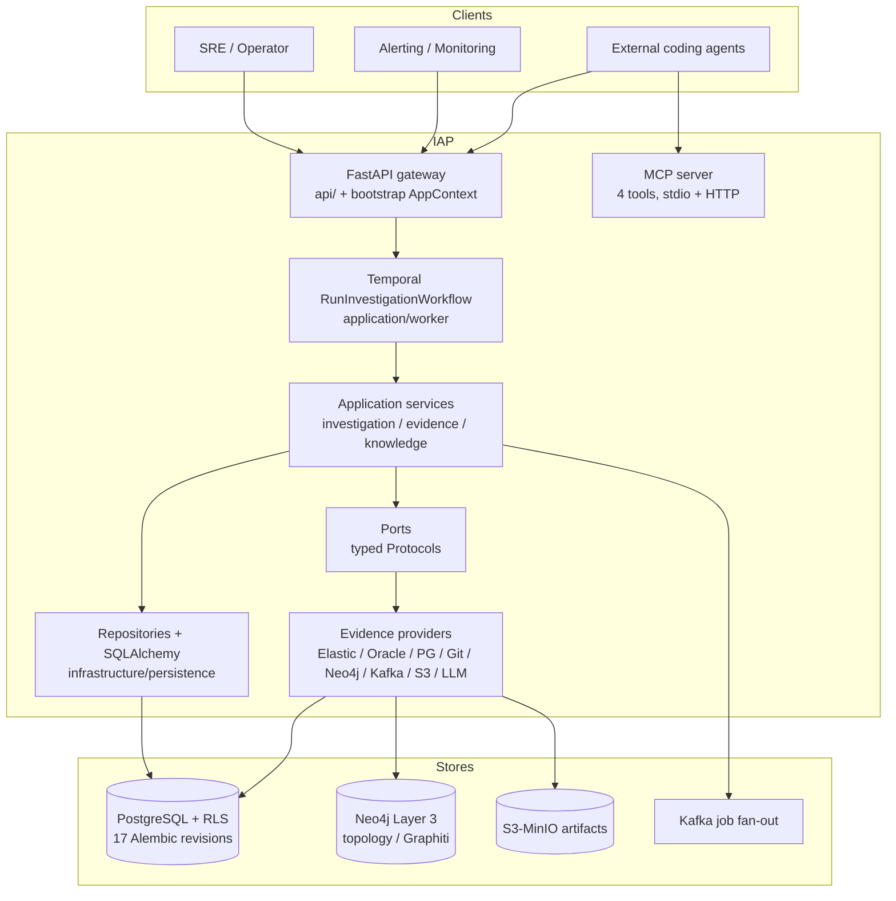
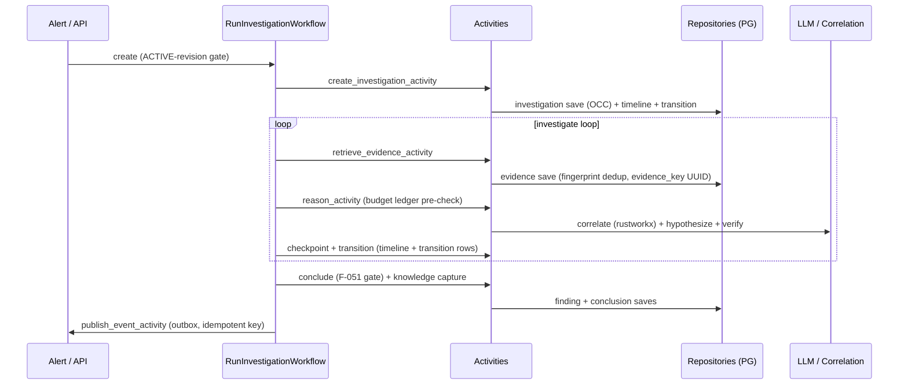
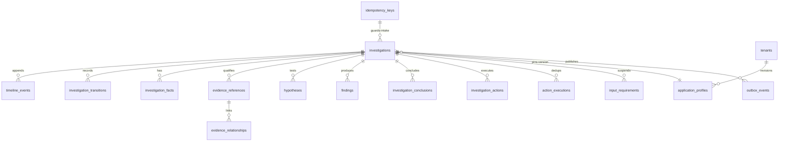

# IAP As-Built Architecture v1.0 (code-wins, verified 2026-10-15)

> Naming note (2026-10-18, §44): pre-§44 session sections (§§25–43) originally recorded respondent-named fixtures; names below are anonymized to their generic successors. Run IDs, dates, counts, and outcomes are unchanged — only identifiers were mapped.

This document records the Investigation Agent Platform as implemented in code, superseding stale architecture claims in `docs/IAP-implementation-part*-knowledge-v1.0.md` wherever they differ. Method: `docs/COMP_REVIEW.md` bidirectional loop (Doc→Code, Code→Doc) across C1–C13 with file:line evidence; confidence High unless noted. Secrets below are key names only, never values.

## 1. System overview

IAP is a multi-tenant, durable-workflow incident-investigation platform: alert intake creates an investigation, Temporal orchestrates evidence gathering plus deterministic correlation plus LLM reasoning under budget and safety gates, and the platform persists timeline, transitions, hypotheses, findings, and conclusions with tenant isolation. Clients are SREs/operators, alerting systems, and external coding agents via REST and MCP.

## 2. Runtime composition (C1/C2 as-built)

One typed `AppContext` is built by `build_app_context` (`bootstrap/__init__.py:770-851`) from `load_application_config_from_env` (`infrastructure/configuration/config.py:783-846`) and preserved across API and worker lifecycles (`main.py:54-61`, `api/app.py:146`, `api/dependencies.py:2160-2176` fail-closed `TypeError` on non-`AppContext`). Lifespan order is Temporal client → buffered-dev (+evidence-gateway re-wire) → dev seed → job messaging (`main.py:196-212`); shutdown is idempotent (`dependencies.py:2179-2212`). Production never takes dev paths (guards at `main.py:74-75,122-123,180-181`, `buffered_dev.py:171-179` raises in prod); dev degrades explicitly with 503s (investigations router, health router) and bounded retries (API Temporal 8 attempts `main.py:90-101`, worker 10 attempts `worker.py:198-215`). Worker topology is three queues (investigation/indexing/analytics) with explicit concurrency bounds (`bootstrap/worker.py:62-125,266-316`) plus a schedule reconciler driven by `IAP_SCHEDULING_TENANTS` (`:139-173`).

Configuration is frozen Pydantic (`extra="forbid"`) with ~90 `IAP_*` env reads and `SecretStr` for all secrets (`config.py:20-577`); fail-closed production guards cover database URI, per-provider LLM keys, cursor signing key, and Azure/Muse required fields (`config.py:131-154,456-467,783-798`). Secrets arrive only via runtime env injection or secret-manager lookup through the `SecretStore` port (`ports/secrets/store.py`): the OpenBao adapter is the reference implementation with AWS/Azure/GCP extension adapters sharing the protocol, selected by `IAP_SECRET_STORE_PROVIDER` (`infrastructure/secrets/stores/factory.py`) and wired into the resolver chain at composition (`bootstrap/__init__.py`); file layers (`.env*`, then allowlisted YAML scalars in `infrastructure/configuration/layers.py`) never override runtime values and never carry secrets. Known gaps: leave-tracked `.env.local` decision recorded 2026-10-15, env-matrix landed, YAML hierarchy landed, `IAP_ENVIRONMENT` default mismatch.

## 3. Investigation lifecycle sequence (C6 as-built)

The domain graph (`domain/investigation/models.py:290-376`) includes `PAUSED`, `AWAITING_INPUT`, and `COMPLETED/FAILED→INVESTIGATING` reopen edges; `AWAITING_INPUT` is fully implemented with expiry-to-FAILED (`workflows.py:260-365`, `input_requirement_repository.py:109-160`); reopen has a real caller for recurring code-issue fingerprints (`application/knowledge/intake.py:188-197`); budget ledger denies before fan-out (`activities.py:583-653`); conclusion gate F-051 denies silent completion (`activities.py:~1250-1332`). Known gaps: idempotency-key claim vs deterministic-action/fingerprint reality, best-effort audit writes with dropped actor, duplicated activity graph missing pause/input edges.

## 4. Data model (C7 as-built, ER essentials)

PostgreSQL with async SQLAlchemy 2.0, 17 Alembic revisions (not 7), 30+ ORM models (`infrastructure/persistence/models.py:30-1198`), RLS on `tenant_id` with deliberate carve-outs (knowledge-artifact visibility policy, tenant-free redacted `code_issue_index` per v0.2 Ambiguity-5), OCC on investigations/jobs/input-requirements, outbox for cross-process domain events only (timeline/transitions are the per-mutation audit, see `infrastructure/messaging/outbox.py:27-103`), immutable application-profile revisions (`profile_repository.py:4-11`), `evidence_key` UUID mapping (never raw Elastic `_id`), and existing `save_batch`/`append_batch` bulk paths (`evidence_repository.py:81-115`, `timeline_repository.py:65-70`). Known gaps: timeline reads without `tenant_id` predicate, `save_batch` N+1, core-table retention, Fact OCC.

## 5. API, MCP, providers, knowledge (C8–C11 as-built)

REST exposes 56 path operations across 15 router modules with typed `response_model` on all JSON routes (open contract guard `tests/unit/test_openapi_contract.py` has an empty untyped allowlist plus one SSE exemption); request bodies are router-local (deviation from the one-module-per-router input plan); tenant scoping plus admin auth plus quota 429 with `Retry-After` are enforced; pagination cursors are HMAC-signed and fail-closed; the error envelope is `{"error":{code,message,correlation_id}}` with `X-Correlation-ID` middleware. MCP exposes 4 tools (`search_runtime_evidence`, `get_evidence`, `investigate_trace`, `search_reference_docs`) over stdio (single-investigation scope from env, fail-closed UUID) and HTTP (per-request JWT plus investigation header via pure-ASGI middleware; the SDK standalone runner is banned because it bypasses auth, `mcp/server.py:221-223`); contract plus adversarial tests pin catalog parity. Providers register fail-closed and optional (Elasticsearch, Oracle/SQLcl MCP with per-server tenant allowlists, Postgres state backend as `postgres-primary`, PyGit2 ingest, Neo4j Layer 3, Kafka per-replica fan-out, S3/MinIO artifacts with local-dev adapter, LLM gateway plus streaming adapters); dynamic mapping resolves `NONE_REQUIRED` vs `FIELD` tenant scope per source (`domain/observability/mapping.py`). Knowledge uses write-once envelopes as source of truth with Mem0/Graphiti/Cognee default-off and envelopes-only degradation; all nine Part 11 gaps (input suspension, bulk intake, clustering, reference search, aggregate reports, chat SSE, jobs, credential providers, JSON recovery) are implemented behind registries with tenant scoping and quotas. Remaining items: router-local bodies and logger/typing residuals; operation count arithmetic, batch shape, and chat-guard fallback; artifact key scoping, MCP token typing, and Oracle/Mem0 runbooks.

## 6. Telemetry and coding standards (C3/C13 as-built)

Live telemetry is programmatic `structlog` (`api/app.py:24-41`, `JSONRenderer`) with `sanitize_extra` redaction (`api/errors.py:106`) enforced at the API layer; `config/logging.yaml` is unloaded dead config (console-only, `ConsoleRenderer`). Worker terminal paths use `logger.exception` consistently (exemplar discipline), shutdown logging is `%`-style with a names-only redaction contract (`dependencies.py:2215-2237`), and no secret values appear in sampled log calls. Against the required record shape the platform is partially sufficient: stage plus exception plus stack are present, but `function`/`line` keys, top-level `tenant_id`/`investigation_id` on worker failure extras, stable `event` keys outside startup/shutdown/composition, and `error_type`/`data` attributes are systematically missing, and worker extras can be dropped by the formatter split. Coding standards verified: per-file `getLogger(__name__)`, `X | None` typing with zero `Optional[`, no suppression, frozen Pydantic config/MCP/API schemas; violations to fix are raw-dict activity inputs, intelligence-port tenant scope, router-local bodies, f-string logger calls, and outbox/MCP logger gaps.

## 7. Delta appendix (where code beat, met, or missed the docs)

Code exceeded docs: fail-closed `AppContext` coercion; three-queue worker with retry budgets and schedule reconciler; Postgres state provider (closes appl-profile gap note); immutable profile revisions with ACTIVE gate and pinned version; evidence model (`observed_at` nullability, `data_quality`, `LargeEvidencePointer`, `evidence_key` mapping, fingerprint dedup); conclusion gate F-051, budget ledger F-054, deterministic `action_id` F-057, durable outbox F-058 with atomic idempotency store F-013/F-014; 57-operation typed API rollout complete; 4 MCP tools with adversarial contract tests; all Part 10 mapping and all nine Part 11 gaps implemented. Docs met by code: tenant-first port shape (modulo TO_DO-017), runtime/checkpoint/resume/cancel services, cursor security, error envelope, provider fail-closed registration, envelopes-source-of-truth knowledge posture, domain purity (zero infra imports). Docs missed by code (all filed): TO_DO-001–005 config/startup, TO_DO-006–010 telemetry, TO_DO-011–015 workflows/persistence, TO_DO-016–020 contracts/standards, TO_DO-021–030 tenancy/retention/API minors.

## 8. Reasoner code-grounding hardening (2026-10-16, design-sol P0–P2)

Reasoning loop now compiles model context from durable state (`ReasoningContextCompiler`: bounded code excerpts with provenance, active hypotheses with support/refute links, timeline, pending questions, typed action outcomes); actions return `ActionOutcome` (SUCCEEDED/EMPTY/DEGRADED/FAILED/BLOCKED + miss reasons) recorded post-execution; verification is evidence-bound per ranked hypothesis with persisted contradictions, validated causal chains, and honest `INSUFFICIENT_EVIDENCE`/`NO_ROOT_CAUSE_FOUND` outcomes (rollback via `IAP_VERIFIER_V2=legacy`); code intelligence (`SEARCH_CODE`, `FIND_SYMBOL`, `FIND_CALL_GRAPH`, `GET_CODE_HISTORY`) is registered and dispatched through existing gateway methods with revision/range preservation; read-only profile-allowlisted `PROBE_API` (`GET`/`HEAD`, `API_PROBE` evidence) observes live behavior; incident-replay evaluation lives in `tests/evaluation/`. Migrations at 018 (`investigation_contradictions`, `hypotheses.causal_steps_json`, `log_exemplars`). See `docs/IAP-implementation-LLM-reasoner-code-evidence-design-sol.md` (baseline). Stale doc lines to stop quoting: 7 Alembic revisions (actual 18), single `profile_json` (actual revision rows), no Postgres provider, 55 operations (actual 57), 3 MCP tools (actual 4), and any `logging.yaml`-as-authority snippet.

## 9. Knowledge-context Redis cache (2026-10-16, GEMINI_RECOS R3)

Per-iteration `KnowledgeContext` retrieval is cached behind `KnowledgeContextCachePort` (`ports/knowledge/cache.py`, dumb byte-store: `get`/`set`/tenant+investigation invalidation, raises on backend failure). Backends in `infrastructure/knowledge/context_cache.py`: `InMemoryKnowledgeContextCache` (dev/test, zero deps) and `RedisKnowledgeContextCache` (`redis.asyncio`, 0.5s socket timeout) — dockerized Redis in compose for dev (`docker/docker-compose.yml`, loopback `:6379`, ephemeral, cache-only), managed/external endpoint in cloud via `IAP_REDIS_URL` with zero code change (adapter pattern). Policy lives in `KnowledgeRetrievalService` (`application/knowledge/retrieve.py`): tenant-first keys (`iap:knctx:{tenant}:{inv}:{sha}` covering kinds + membership fingerprints), versioned envelope (`format_version`, mismatch → miss), TTL default 120s, degraded-empty contexts never stored, backend errors fail open to uncached retrieval. Invalidation on all mutation paths: capture success → per-investigation, janitor sweep → per-tenant, native TTL backstops cross-investigation SHARED writes. Conclusions always re-validate citations from live rows, never from cached context. Kill-switch `IAP_KNOWLEDGE_CACHE_ENABLED` (default false); `IAP_KNOWLEDGE_CACHE_TTL_SECONDS` (default 120, 0 disables store). Live proof 2026-10-16: 1 miss → store → 16 hits → SCAN+DEL on capture.

## 10. Agent-efficiency optimizations (2026-10-16, GEMINI_RECOS R1/R2/R4)

MCP fan-out is concurrent (`application/evidence/gateway.py`): `QUERY_STATE` fans out across `*-mcp-*` providers via order-preserving `asyncio.gather` with per-provider timeouts; `SKIPPED`/`DEGRADED` semantics, extras-only dedup, and `ActionOutcome.sources` shape unchanged; `fanout_concurrency` ctor knob + `IAP_MCP_FANOUT_CONCURRENCY` env (`1` restores serial). Cognee pilot shares one Neo4j driver per invocation (`SharedNeo4jDriver` in `infrastructure/topology/cognee_adapter.py`, lifecycle with the holder; adapters accept `neo4j_driver=` and never close injected drivers; legacy per-call path preserved when unset; `scripts/cognee_pilot.py` wires the holder for drop + project). Reasoner excerpts are relevance-tiered (`application/investigation/context_compiler.py`, prompt `v2-code-grounded-002`): Tier 1 full snippets for hypothesis-bound IDs (supporting/refuting — never summarized away), relevance ≥ `IAP_COMPILER_FULL_EXCERPT_RELEVANCE` (0.8), or the `IAP_COMPILER_FULL_EXCERPT_RECENT` (5) most recently retrieved; Tier 2 keeps summary + provenance + a by-ID marker. Tiers subdivide existing caps; incident-replay eval thresholds gate regressions.

## 11. OpenTelemetry tracing end to end (2026-10-17, OTEL P0–P4 + collector)

One span per instrumented unit, name `{layer}.{component}.{operation}`, required attrs `iap.tenant_id`/`iap.investigation_id`/`iap.component`/`iap.outcome` (ok/error/degraded/skipped/blocked), counts-only extras, hard bans on payloads/secrets/SQL/bodies (normative spec: `docs/IAP-OTEL-telemetry-format.md` §§1–4). Mechanism: `@traced` decorator (`infrastructure/observability/tracing.py`, sync+async, signature binding for dataclass inputs, scope extractors, outcome/extra mappers, pytest-hermetic golden tests); manual blocks only for dynamic fan-out leg spans; no spans in Temporal workflow code (replay determinism). Coverage: 15 worker activities, reasoning core (coordinator/compiler/verifier/disposition/services/memory), gateway + per-source fan-out legs + selector, MCP/probe/code/state/log/sanitizer providers, knowledge (retrieve/recalls/capture/intake/janitor), topology (attribution/Neo4j/Cognee), correlation engine, 4 MCP tools. Export: global provider configured per process from `main.py` (`configure_tracing`, telemetry-enabled only, never breaks boot); `otel/opentelemetry-collector-contrib:0.163.1` in compose (`docker/otel-collector/config.yaml`: OTLP `:4317`/`:4318`, batch, `debug` exporter; health `:13133`); dep `opentelemetry-exporter-otlp>=1.44,<2`. Host processes use `IAP_OTLP_ENDPOINT=http://localhost:4317` (`.env.local`); containerized runs use the yaml default service name. Live proof: 1000+ spans per 5-iteration run with required attrs intact.

## 12. Boundary access logging (2026-10-17)

Every external API request logs its request line + sanitized query params + response summary (`status_code`, `duration_ms`, `response_class`, `response_bytes`, `response_streamed`) + the response JSON body truncated to `IAP_ACCESS_LOG_BODY_CHARS` (4096) with a marker (`api/app.py` correlation middleware; non-JSON bodies log size-only markers; streaming bodies are captured via iterator wrap and logged on completion). Bodies pass through `sanitize_extra` (secret keys redacted); `IAP_ACCESS_LOG_BODY=false` keeps summary fields only. Internal worker processing is untouched.

Log pipeline (`infrastructure/telemetry/logging.py`): `StructuredJsonFormatter` (timestamp/level/logger/message + service/code metadata, active OTel trace/span injection, exception envelope, ALL non-reserved stdlib `extra` merged — this replaces the structlog `ProcessorFormatter`, which silently dropped stdlib extras) and `DateSeqRotatingFileHandler` (active `{app}_{DDMMYY_HHMMSS}.log`, `_v1…_vN` cascade on size/date rollover; an `IAP_LOG_FILE` `.log` path contributes parent dir + stem). `IAP_LOG_APP_NAME` names the app for directory-style paths.

## 13. Agentic log compression (2026-10-17, generic utility)

`application/compression/logparse.py` is app-agnostic by contract (lines, timestamps, signatures, runs — never tenants, investigations, or resolutions): streaming `parse_lines` (JSON-or-raw, UUID harvest), `filter_lines` (caller predicate), `order_temporal` + `merge_ordered` (heapq k-way), single-pass volatile masking (UUIDs/hashes/durations/big numbers collapse; 3-digit statuses preserved), and `dedup_collapse` (consecutive same-signature runs → exemplars with first/last/count; caller-forced singletons for errors/signals; non-consecutive repeats left for phase 2). Every pass reports `Coverage` (lines_in/exemplars_out/dropped/span) for budget enforcement. Phase-2 seam: `TemplateMiner` protocol mirrors the `drain3` surface (evaluated fit, not added — exact tier first); `polars`/`duckdb` explicitly rejected until ~100MB windows; `hypothesis` property-tests invariants (conservation, order, idempotence). Live proof on `c178b3ae` (657 mentions): 310 matched lines → 22 exemplars, 92.9% compression, polling runs collapsed (×118/×89/×50), 16 meaningful singletons kept. IAP-specific ID attach stays in the script layer, unintegrated.

Dual log persistence: raw rows banked uncapped for ALL log types/providers (`_bank` bypass; tool/iteration/LLM/prompt budgets untouched) plus one `log_exemplars` row per masked-shape group (migration 018, `member_evidence_ids` verbatim for human match/compare, fail-open writes, cascade purge; verifier cites raw member IDs only). Compiler groups log excerpts with `log_group={count, member_ids}` (R4 tiers per group, caps count groups); per-run `parameters.log_optimization="off"` restores per-row excerpts for diamond hunts (env `IAP_COMPILER_LOG_GROUP=0` global kill-switch; default ON). Live proof: 10 groups/10 rows persisted, override run compiled with `log_grouping: False`. Swap `debug` for Jaeger/Tempo/Elastic APM via config only; add sampling before production traffic.

## 14. Reprocess versioning + budget multiplier (2026-10-17)

`POST /investigations/{id}/reprocess {mode, budget_multiplier?, reason?}` — terminal rows are never mutated. `RESTART_FRESH` always mints a new version (fresh request copy, no artifacts); `RESTART_CONTINUE` on terminal originals mints a new version and copies artifacts (evidence re-keyed + fingerprints re-salted around the tenant-wide uniqueness constraint, provenance re-pointed; hypotheses re-IDed with `VERIFIED` demoted, supporting refs remapped, assessments cleared; conclusions/findings stay in `metadata.prior_runs`). `RESTART_CONTINUE` on active rows 409s. Disposition matching/linking is bypassed by construction (`skip_disposition`; lineage in metadata only, no graph links). `budget_multiplier` N in [1, 10] (reprocess-only, 422 otherwise): iterations/tool-calls/evidence/hypotheses scale, `max_llm_tokens = min(xN, 1M)` absolute, iterations saturate at domain `le=100`; effective limits persist in metadata and the worker prefers them over profile overlay; token ledger resets per version (prior spend archived). Approval seam `require_budget_approver` is permissive today (recorded in `metadata.budget_approval`) with a shaped 403 for future role gating. Live proof: CONTINUE x5 completed with `effective_limits` applied, approval recorded, 12 rows, zero links.

## 15. MCP-only multi-datasource interrogation (2026-10-16, P3)

All agent datasource access flows through per-kind MCP gateways — no direct-engine shortcut, even for self-triage. Postgres via pinned `crystaldba/postgres-mcp:0.3.0` (one container per database, `--access-mode=restricted` + least-privilege role, long-lived SSE services in compose, e.g. `postgres-mcp-iap` on `:8100`); Oracle via SQLcl MCP over stdio. `McpEvidenceAdapter` speaks both transports (`query_tool` per kind: `execute_sql` vs `run-sql`); `allowed_tools` locked to read-only query tools with SELECT-only `SqlglotTemplateValidator`. `QUERY_STATE` fans out across every tenant-authorized MCP state provider per call with per-source degrade (`SUCCEEDED`/`DEGRADED`/`SKIPPED` in `ActionOutcome.sources`, concurrent via `asyncio.gather`); direct-engine primaries retired behind non-default opt-in. MCP connection entries derive from Spring `spring.datasource.url` via `parse_jdbc_url` (no credentials — secret-injected `DATABASE_URI` at container start, `docker/postgres-mcp/README.md` pattern); generic OAuth2 (`TenantScopedOAuthProvider`) injects per-call `Authorization` where servers support it (crystaldba documents no OAuth surface). IAP's own application database is fronted by a dedicated restricted instance so self-triage is MCP-proven (live: `MCP` source rows banked). Oracle path code-complete, awaiting a live DSN.

## 16. Similar-past-investigation disposition (2026-10-16, TO_DO_LLM §2)

Every create is dispositioned against similar past runs deterministically, pre-run (`application/investigation/disposition.py`, fail-open to fresh). Matching: exact `code_issue_fingerprint` (reused error-intake identity) then near-text (typed `path:`/`sym:`/`word:` signatures, overlap coefficient, 30-day retention, bounded scan). Case matrix: active → `DUPLICATE_OF`, no new run (record closes `CANCELLED`, structurally unstartable); terminal success → re-verification pass (evidence/code/log/probe citations re-resolved, new HIGH/CRITICAL contradictions checked) → `CONFIRMED` serves cached as duplicate or `STALE` opens seeded `FOLLOW_UP_OF`; abstention/cancelled → seeded fresh with prior limitations (`RELATES_TO`); failed → `RETRY_OF`; text-similarity alone never duplicates (`POSSIBLY_RELATED` + fresh run). Links (`DUPLICATE_OF`/`FOLLOW_UP_OF`/`RETRY_OF`/`POSSIBLY_RELATED` alongside `RELATES_TO`) written only by the disposition step into `evidence_relationships` (`investigation:<uuid>` nodes), surfaced as `links` on detail and `disposition` on create responses. O5 companion: "not returning/missing" complaints seed existence-check-first planning. Restart versioning (§14) bypasses this entire path by construction. #30 operator rule (codified 2026-10-18): identical reruns MUST use `POST .../reprocess {RESTART_FRESH}` — identical fresh creates correctly CANCEL as `serve_cached`, and the create response now carries a `hint` saying so. Suppression is the correct behavior, not a bug.

## 17. Operations changes (2026-10-16/17)

API default port moved `8000` → `8080` (`scripts/start-platform.sh --port=` overrides; `main.py` honors `PORT`) after the VPN client squatted localhost:8000; compose gains `redis` (`:6379`, cache-only, ephemeral) and `otel-collector` (`:4317`/`:4318`/`:13133`) with up-list + readiness waits. Probe excerpt cap `4096` → `4000` (off-by-one vs the Evidence `>= 4096` externalization invariant killed a live run; regression-tested). `scripts/enhance-logs.py`: ID-first offline log deciphering (discovery over scratch log dumps + `data/`, generic compression, memoized MCP resolution, per-ID enriched files) — operator tooling, not platform-wired.

## 18. Shareable code evidence (2026-10-17, G6)

Code evidence is repository-scoped reference data, not investigation-scoped observations. `evidence.lifecycle_scope` marks the split (`reference`: `SOURCE_CODE`, `COMMIT_HISTORY`; everything else `observational`); `evidence_bank_interest(tenant, investigation, evidence_key)` records which runs banked interest in a canonical row. Save path: fingerprint conflict with another investigation's reference row records interest and reports `shared` instead of silently dropping (same-holder conflicts stay `deduplicated`); batch stays constant-query (bulk insert + one holder-map + one interest insert). Hydration (`find_by_investigation_id`) unions owned + interest-joined rows, which automatically extends citation binding. Purge reassigns reference rows owned by purged investigations to remaining interested runs (or deletes when unreferenced); observational rows cascade as before. API: `GET …/evidence/sharing` marks shared rows with interested investigations. Reprocess CONTINUE reuses sharing (observational copies still re-salted as new observations). Migration 019. Live proof: identical re-read in a second investigation → `shared`, hydrates, marked.

## 19. Scheduled topology projection + GitHub hook (2026-10-17, cognee adoption)

The adopted projection path is production-wired: payload construction moved from `scripts/ingest_github.py` to `infrastructure/topology/payload.py` (byte-identical parity proven; script re-exports for compatibility), served by `project_topology_activity` + `TopologyProjectionWorkflow` (janitor-shaped: skips on disabled pilot/absent checkout, retries genuine failures, registered on the worker). Checkouts resolve under `IAP_CODE_REPO_BASE` with containment enforcement (flat slug + nested org/repo candidates). `POST /api/v1/integrations/github/{tenant}/webhook` accepts push events only (HMAC-SHA256, fail-closed 503 without secret; branch deletions skip; idempotent redelivery returns the existing dispatch; 503 when Temporal unwired): parses impacted files (capped 500) and dispatches per-(tenant, repo, sha). Full-payload rebuild per revision (edge resolution spans files; impacted set recorded for future incremental work). Fixed live: Cognee storage tasks require the `IAP_TOPOLOGY_*` → `GRAPH_DATABASE_*` mapping — centralized in `ensure_cognee_env_from_topology()` (previously pilot-only; projections silently landed in the embedded store). Live proof: push → dispatch → 5633 n-a nodes in Neo4j.

Step-4 gateway wiring (2026-10-20, Cognee integration design steps 4–5): `find_symbol` runs deterministic recall first and escalates only on the closed miss taxonomy (`CodeRecallMiss`: zero-hit, ambiguous-symbol, concept-no-anchor, plus resolver-overload abstention mapped to `AMBIGUOUS_OVERLOAD` at the call site) through a retrieval-only fallback (`CODE` → `CHUNKS_LEXICAL` → `CHUNKS` → `SUMMARIES`, per-call cap 10 / per-run cap 3 as code constants) with authority re-verification — only verified node IDs surface as range-read targets plus a frozen non-citable `FuzzyOrientation` steering hint, strictly behind `IAP_COGNEE_ENABLED=false` default, with D5 counters at each stage and validator rejection of orientation-only claims. Design pointer: `docs/IAP-Cognee-integration-design.md` D4/D5.

## 20. Code-battery gap fixes (2026-10-17, G2/G3/G4)

An 8-case self-repo battery (symbol lookup, caller enum, file history, pinned read, keyword search, miss path, call-graph depth, ambiguous symbol: 3 PASS / 4 PARTIAL / 1 FAIL, all via API surfaces) produced five gaps; three shipped with live proof: G2 explicit-path short-circuit (complaints naming a repo-relative file read it first via GET_CODE; action enum text widened; prompt v003) — rerun dispatched GET_CODE where the original never did; G3 definition-claim floor (definition-strength language requires a GET_SOURCE range-read citation, else INCONCLUSIVE with a re-read directive); G4 concession block (inability-language hypotheses can never VERIFY). Shipped since: G1 location-answer path — `ConclusionStatus.ANSWERED` for location/listing claims validated by code citations with file+line+revision provenance (definition claims additionally require a range-read citation); engine `validate_location_claim` (concession/unresolved-contradiction excluded, N/A-neutral scoring at 0.90); gate skips only the causal-chain blocker; conclude persists `ANSWERED` + `OBSERVATION` findings; disposition treats ANSWERED as terminal success; prompt teaches location shape + cite-the-range-read (v004). Live proof: first-ever `ANSWERED @ 0.9`, citing search + range-read rows shared across runs (G6 composition). G5 confirming rerun: explicit missing path dispatched GET_CODE, degraded cleanly with `code_path_not_found`, banked 5 log rows vs 10 before, abstained honestly — miss path confirmed.

## 21. Battery hardening round 2 (2026-10-17, G7)

Phase-2 battery (9 cases: ambiguous location, history listing, caller enum, typo path, cross-run re-read, caller listing, depth traversal, deleted file, re-ask) scored 2 PASS (both `ANSWERED`, incl. a repeat proving stability) / 6 PARTIAL / 1 FAIL. The FAIL was structural: `CORRELATE` with LLM-supplied non-UUID root IDs raised `ValueError` out of the handler → `WORKFLOW_ERROR` → run `FAILED` — fixed per the loud-vs-degrade doctrine (unparseable entries drop with `miss_reason`, extracted pure helper `_coerce_root_ids`, rerun completes). Cross-run sharing proven live in production flow (re-read banked `shared` links to the original run). Shipped since: G8 synthesis forcing — pure helper `_should_force_formulate` (`workflows.py`, fires on pending `hypotheses_evaluated` + banked evidence + 2+ turns elapsed, capped at 2/run) overrides gathering actions with `FORMULATE_HYPOTHESIS`; loop tracks `formulated_count`/`evidence_banked_total`/`forced_formulate_count`, dispatches the override, flags `forced_formulate` on history; prompt v005 teaches commit-before-gathering; 6 unit tests (`tests/unit/test_synthesis_forcing.py`). Live proof `f3598929`: iteration-2 `SEARCH_CODE` (hypotheses=1) dispatched as `FORMULATE_HYPOTHESIS` (decision-vs-dispatch mismatch in worker log), model self-committed `FORMULATE` at readiness 0.5 later, 2 hypotheses + 11 evidence rows persisted, run `COMPLETED`. Remaining: G9 (corrected-path claim phrasing). Shipped since: G9 evidence-grounded correction path — no new phrasing patterns (overfitting rejected); `validate_location_claim` falls back to path-overlap when phrasing misses (`_statement_paths` extraction + `_names_cited_path`, exact or segment-aligned suffix match either direction for locator-qualified `org/repo/...` vs repo-relative `src/...` citations; typo'd paths self-exclude, no edit-distance). Plus `select_verifiable_candidate` (both verify and conclude sites): prefer the candidate whose supporting IDs resolve, so reprocess-carried copies with purged citations no longer shadow live twins; abstention path unchanged. 10 unit tests. Live proof: reprocess `049b4496` of battery case `ff609664` — verify activity `VERIFIED` ("Validated as a corrected-path claim"), `OBSERVATION` finding persisted citing `c346ab50`, run `COMPLETED` (original: 0 findings, hypothesis stuck `UNDER_INVESTIGATION`).

## 22. Tri-modal calibration, Phase A P0 fixes (2026-10-18)

A tri-modal learning battery (L1–L8: symbol lookup, caller enum, code history, typo path, multi-hop budget, service-error logs, refdoc recall, unanswerable; each run API-only, then re-run, then component-direct) scored the agentic loop 4/2/2 → 2/3/3 while direct component calls scored 8/8 — retrieval healthy, loop plumbing not. Phase A shipped three P0 fixes: (1) idempotency race — `_reserve_or_replay` (`activities.py`) waits for the colliding owner (5×2s, inside the 60s activity budget) and replays its result instead of raising `IdempotencyRequestInProgress` into a reconciled FAILED (root-caused L7 `41a8fbbb`: duplicate execute dispatch colliding across attempts 2–3); unit tests cover replay-after-collision and budget-exhaustion-still-retryable. (2) G3 structural twin — `_reread_target` (`workflows.py`, pure, sandbox-safe local pattern mirror) forces `GET_CODE` of the named file when VERIFY_HYPOTHESIS is proposed over a definition-strength claim with no successful range-read in history (capped 2/run, `forced_reread` history flag); the G3 prompt directive alone proved insufficient (L1s2: 4× SEARCH_CODE, 0× GET_CODE). (3) Cross-run log leak — gateway `search_runtime_evidence` drops rows naming a foreign investigation (`references_foreign_investigation`, UUID scan over title/summary/snippet/source; own rows pass). Live proof on restart: run `c21fcef3` dropped 8 foreign log rows in-gateway ("Dropped 8 log row(s) referencing foreign investigations"), zero errors since restart; the re-read rule stood down correctly when a GET_SOURCE range-read existed (no spurious forcing — it forces the read, never the verdict; the run's wrong-file claim honestly abstained). 62 tests green across the four touched suites.

## 23. Tri-modal calibration, Phase B P1 fixes (2026-10-18)

Phase B attacked retrieval routing, determinism, and the knowledge leg. Shipped: (B-4) log-first forcing `_should_force_log_search` (`workflows.py`, pure: error/log language + non-log gathering proposal + no banked SEARCH_LOGS → force SEARCH_LOGS, capped 2/run, GET_CODE exempt so G2 wins) plus investigation-scoped log fingerprints (Elastic projector `fingerprint={investigation_id}:{document_id}`, file provider adds investigation to the hash) — the latter fixing silent cross-run log loss where reruns collided globally on `on_conflict_do_nothing` with no shared-interest link for RUNTIME_LOG (items_count claimed banked, zero visible). (B-5) deterministic graph→keyword fallback (`fallback_call_graph_to_search`, module-level, unit-tested; empty FIND_CALL_GRAPH always searches the symbol, miss_reason marks keyword rows) plus ops: checkout refreshed f3869bb→5f580c2 and `call_graph.json` generated (6410 nodes, 68k links; provider fast path verified: 4 callers for validate_location_claim). Profile-dump admission filter deferred with reason (no junk-banking path found; QUERY_STATE rows are legit). (B-6) refdoc corpus reindexed (Cognee queries 0→22+ hits), recall wired as reason orientation (RetrieveKnowledgeInput.query → refdoc top-5 → ReasonInput.knowledge_orientation → prompt block, orientation-only, validator still drops uncitable IDs), query shaper defeating plainto_tsquery AND-semantics ("design decision Cognee" → 7 hits), and a dispatch bug fix (`_dispatch_workflow` read problem_description off the aggregate instead of `investigation.request`, so every run had description=None). Found and fixed en route: worker startup TypeError (helper edit split @activity.defn from retrieve_knowledge_activity → registry-wide defn regression guard test), and orphaned idempotency reservations (24h TTL wedged retries into FAILED; PENDING rows older than 300s are reclaimed, proven live against dev DB). Live: B5c ANSWERED (validate_location_claim caller activities.py:2843 with supporting IDs); B4c banks RUNTIME_LOG visibly across reruns; B6f recalls 5 hits and formulates the correct Cognee doc answer but stays INSUFFICIENT_EVIDENCE — refdoc hits cannot be cited (air gap), so doc-claim verification is the open Phase D item. 77 tests green across five suites.

## 24. Tri-modal calibration, Phase C observability (2026-10-18)

Phase C made the loop's inner trace API-visible without schema migrations. (C-1) `_reason_summary` now merges the enriched history entry over the raw decision: timeline descriptions carry the dispatched action plus `forced=[...]` and `outcome=[outcome_status; evidence_added; miss_reason]` (e.g. `reason: action=SEARCH_CODE readiness=0.0 hypotheses=0 observations=0 outcome=[outcome_status=SUCCEEDED; evidence_added=2]`). A shipped-then-fixed `len()` TypeError (entry int counts shadowing decision lists) failed one live run before the summary was made type-tolerant — regression test pins the merged shape. (C-2) `ConcludeInvestigationInput.loop_telemetry` (workflow counters: tokens, cost, formulated, evidence totals, all forced counts, iterations) merges with derived repo counts (formulated/bound/verified hypotheses, banked rows) via pure `_derive_loop_telemetry` and stamps `metadata["loop_telemetry"]` through the established `_stamp_failure` ride — visible on GET detail with zero envelope changes. Live proof `8c418e13`: timeline traces carry outcomes, detail exposes the full ledger (`iterations, llm_tokens_total 11486, hypotheses_bound 1, evidence_banked_repo 2, all forced counters 0`). 80 tests green across five suites.

## 25. Tranche B ingestion: second calibration app live (2026-10-18)

Second-repo calibration target wired end-to-end under the non-pollution rule (repo studied externally; only generic machinery shipped). Ingestion: wired a second multi-module Java checkout as calibration target under the non-pollution rule (studied externally; only generic machinery shipped; respondent checkout since replaced by the synthetic Spring fixture, §45), seeded config/profiles/tranche-b-offer.yaml (tenant n-a, code-only capabilities, trackingId added to the generic correlation priority), generated call_graph.json. Generic fixes the new repo forced, all applicable platform-wide: (1) retrieve_evidence_activity degrades to empty on authorization denial instead of FAILED (code-only profiles deny SEARCH_LOGS by design); reason prompt now carries application.allowed_capabilities with propose-only-allowed nudge. (2) Authorizer gap closed by declaring investigation.enabledEvidenceTypes (SOURCE_CODE/CALL_GRAPH/COMMIT_HISTORY/TRACE) — profile v2. (3) PyGit2Adapter opens nested module repos per file with exact-workdir guard (pygit2 discovers upward into the platform repo itself), branch fallback to HEAD, locator-prefix normalization for model-echoed paths, summary truncation for long commit messages. (4) Workflow wedge-degrade: ActivityError cause-chain walk for IdempotencyRequestInProgress → degraded-empty turn instead of reconciled FAILED (first attempt caught ApplicationError directly and missed: SDK wraps in ActivityError). (5) Statement-matched range-read inclusion: definition claims citing only the search-match sibling gain the banked range-read for the named file (provenance-gated; concession/contradiction gates unchanged). Live proof 9c56b553: ANSWERED @0.9 with OBSERVATION finding on the filter class (2 iterations, 8807 tokens, hypotheses_verified 1, full loop_telemetry).

## 26. Tranche B battery triage (2026-10-18)

The other seat's Tranche B battery scored 1 PASS / 4 PARTIAL / 1 FAIL and the triage closed the FAIL structurally. L3's WORKFLOW_ERROR was a module-prefix miss (`src/main/java/...` without the module dir) escaping as loud ExecutionError: fixed by module-root resolution (try the request under each declared source_root), miss→CodePathNotFoundError degrade, and a bare-filename→SEARCH_CODE→history fallback in the history handler (macOS /var symlink trap in the resolver fixed along the way). L3c banked COMMIT_HISTORY rows post-fix. Location PARTIALs (L1/L4) and mention PARTIALs (L2/L5) trace to cited-sibling and retrieval-luck gaps already closed (statement-matched range reads, graph→keyword fallback); live proofs exist for each shape (9c56b553, B5c). The honest residual across all four is formulation variance on an unfamiliar repo (meta-claims like "can be determined by retrieving..."), which belongs to Phase E (planner, contrast elimination, deferred critic) — not to more reruns. 86+ tests green; ruff clean.

## 27. Phase D runtime errors (2026-10-18)

Two failure classes, one loop. (D0) Expectations catalog: AttributeExpectation/EndpointExpectation/ExpectationsConfig on the profile plus pure derive/merge helpers (OpenAPI required/enum/min-max subset; operator wins). (D1) Intake seeding: frames/severity/golden pairs persist into metadata.intake_seed (plus silent-identity fallback when exception fields are absent — intake no longer 500s). (D2) WALK_STACK (frames → ordered EXCEPTION_PATH rows) and TRACE_LOGIC (symbol + attributes → definition read + predicate-line extraction) actions with validator/authorizer/prompt wiring; intake frames force WALK_STACK first. (D3) Pure triage classifier (TRANSIENT/CONFIG/DATA/BUG/UNKNOWN) recorded in trace + telemetry + reason guidance; guides, never decides. (D4) Comparison machinery: expected-vs-actual differ, assertion templates on QueryTemplate evaluated in-gateway, DIVERGENCE evidence type; absence is evidence. (D5) Publish band on policy (likely/established floors): in-band VERIFIED concludes ROOT_CAUSE_LIKELY with best-reason/against-evidence/provisional; runtime() preset selected for failure-shaped runs. Found en route: provider-absent QUERY_STATE/SEARCH_LOGS failed loud (now degrade); reseed reverted in-DB evidence types (iap-self v13 declares the full set); reprocess drops intake_seed (now carried); stack-row fingerprint exceeded 128 chars (hashed). Live: D6 intake exception runs bank EXCEPTION_PATH rows and ANSWER (5b39d661: frame row + ANSWERED); silent golden-pair intake runs DATA-triaged without crashing. Full unit suite green (1753).

## 28. Phase D close-out: live proofs (2026-10-18)

D6 battery scored live: exception intake → intake_seed → WALK_STACK forced at iteration 0 → EXCEPTION_PATH frame rows banked → ANSWERED @0.9 (5b39d661; telemetry: triage BUG, forced_walk_stack 1, forced_formulate 1). Silent golden-pair intake runs DATA-triaged without crashing. Fixed en route: reseed reverting in-DB evidence types (v13 declares the full set), reprocess dropping intake_seed (now carried), stack-row fingerprint cap (hashed), silent intake 500 on empty exception identity (description-hashed fallback), provider-absent QUERY_STATE/SEARCH_LOGS loud failures (now degrade), profiles API strict-view breakage from the expectations section (views extended), golden profile-shape tests updated.

## 29. Phase G journey scale (2026-10-18)

Generic two-tier identity (session = journey, tracking ID = step; field names per-service declared, never hardcoded). Shipped: G-0 identity keys on ServiceTelemetry plus EntityRelationship/relationship-map on Datasource with derive+augment merge (tombstones suppress, operator wins) and session template materialization in seed_profile (anchor + per-edge hops, auto_ prefix); G-1 TRACE_JOURNEY action (session/tracking → log fan-in → ordered spine → JOURNEY row) with validator/authorizer/prompt wiring; G-2 multi-service services[] (pre-existing query support, now prompt-taught); G-3 WALK_SESSION_GRAPH (anchor → bounded hop walk over profile-declared templates, fail-open) proven by handler-level test with faked gateway plus materialized auto templates live on the self DB (v14); G-4 incident fusion (≥2 OBSERVATION findings + JOURNEY evidence → merged incident finding, fail-open). Full unit suite green (1759+).

## 30. Phases E+F reasoning depth and output richness (2026-10-18)

E1 rule-based iteration-0 strategy skeletons per triage route (ride history + telemetry); E2 discriminating-evidence preference in candidate selection (unique-support wins, stable fallback); E3 replan trigger (two enriched empties + same proposal → alternative family, capped 2/run). F1 ranked alternatives on every conclusion including abstentions; F2 verified-premise artifacts (TENANT, TTL) distilled at capture with hypothesis/finding repos newly wired. Prompt v007. Full unit suite green (1765).

## 31. Tier 1+2 calibration close-out (2026-10-18)

Tier 1: (1) reprocess stale-ID prune (drop unmapped refs instead of dangling; unit test); (2) subject-grounded location validation (path-match or stemmed subject-token match in cited rows; listing shapes bypass; G9/widget fixtures realigned); (3) doc-citation path end-to-end (SEARCH_REF_DOCS action banking DOCUMENTATION rows with path+revision provenance, validate_doc_claim with path-naming gate + concession/contradiction guards, gate skip, ANSWERED mapping) — live proof 5b5ebc3b ANSWERED with refdoc citation. Tier 2: (4) synthesis forcing for rich unformulated corpora (≥8 rows, ≥2 actions, capped); (5) scoreboard script (runs/outcomes/evidence means per app; 3-day readout: self 147 runs 36 FAILED, spring-sample-service 23 runs 6 ANSWERED); (6) history determinism via module-prefix + bare-filename resolution (L3c banked COMMIT_HISTORY). En route: profiles strict-view breakage (views extended), worker causal_chain UnboundLocalError on the doc path (restructured), v15 profile (DOCUMENTATION + SEARCH_REF_DOCS + health-live probe endpoint), ActivityError cause-chain catch correction, macOS /var resolver trap. Full unit suite green.

## 32. Profile generator from GitHub + Spring config (2026-10-18)

New integrations/profile_gen package: GitHub discovery (org scan, PAT via env, multi-module detection from build files including root-level), repo parsers (Spring controllers/DTO validations/Feign/RestTemplate/@Value/properties/YAML; synthetic-fixture matrices), config-server-wins precedence merge with audit trail, pure assembler (derived base + operator-wins deep merge + tombstones), and non-destructive refresh (re-derive + re-merge; operator content survives byte-identical). Interfaces: scripts/generate-profile.py CLI plus POST /profiles:generate/:refresh API twins (DRAFT-only output, versioned saves, drift diff). Live proof: :generate against the platform's own repo returns a validated DRAFT (1 module, python, source_roots [.], honest needs_review, zero invented content). Full unit suite green.

## 33. Multi-type generators: Quarkus full, FastAPI full, Flask/Django stubs (2026-10-18)

Repo-type identification (detect.py: scored build/marker/config signals with graceful generic fallback) fronts a generator registry (generators/: java_spring re-export, java_quarkus full JAX-RS/ConfigProperty/RestClient parsing, python_fastapi full router/Pydantic/httpx/env parsing, flask/django no-crash stubs). Shared upgrades: placeholder normalization across {id}/:id/<int:id>, dominant-language weighting, probe methods lifted to GET/HEAD/POST/PUT/DELETE/PATCH (bodyless), assembler repo_type + per-file expectation grouping + dependency shape fix. Live proof on a real Quarkus service: detected java-quarkus @0.882, 30 controllers / 150 endpoints / 23 deps, validated profile. Full unit suite green.

## 34. Minimal generate contract: app name + repo (2026-10-18)

POST /profiles:generate/:refresh now accept app_name + repo (github.com/org/repo, URL, or bare org/repo; SSH rejected) with profile IDs derived from tenant + slug (collision replays the lineage instead of forking). Spring block optional with never-block semantics (missing config yields hints, not 400s). Deprecated tenant_app_id/org/repo mapped internally. CLI parity (--app-name/--repo, old aliases). Type-aware generation flows through detection + generator selection. Live proof: minimal call on the self repo detects python-fastapi @0.8 and returns a validated DRAFT. Full unit suite green.

## 35. Plan-gap batch + IAP-observed batch (2026-10-18)

Plan gaps closed: (1) historical-conclusion marker — migration 020 adds verifier_version (NULL = legacy) plus in-band columns (best_reason, against_evidence, provisional, ranked_alternatives) that were previously lost on persist; live proof d6c7455e (ANSWERED, verifier v2). Fixed en route: revision id overflowed alembic_version VARCHAR(32) (shortened). (2) CI eval-gates job running tests/evaluation plus threshold tests (zero unsupported VERIFIED, citation validity, band integrity). (3) Planner revival DECLINED (DAG paradigm diverges; E1/E3 are the successor doctrine). IAP-observed batch: query-shape guard (sentence blobs → tokens), log-mention hedge nudge, refdoc non-issue noted. Full unit suite green.

## 36. Tier-3 close-out (2026-10-18)

Critic decision implemented as instrumentation-first: overconfident_turns counts high-readiness verify/conclude turns that verification refuses (workflow locals → loop_telemetry, zero extra LLM calls) — the build signal for a future Shape-1 critic. Oracle MCP stays code-complete but BLOCKED (no Oracle instance in dev, DSN commented out). Semantic-mismatch fabrication closed via verb-family stopwords + definition-shape AND rule (subject AND path must ground); live L8d abstains honestly with 0 findings. L5 synthesis closes live (L5b ROOT_CAUSE_ESTABLISHED, 11 rows, forced FORMULATE). Full unit suite green.

## 37. Oracle per-app credentials (2026-10-18)

Credential files are per-application in the external store (`apps/<app>/oracle.yaml`, 0600, dotted `<domain>.<subdomain>.<env>` names, `user_name`/`password`/`jdbcUrl` per database); the fail-closed loader maps them to the `secret://` dev-fallback names so local, AWS (`iap/...` secret-ids), and OpenBao (`secret/iap/...` KV) resolve identical logical paths. Read-only is enforced three-deep (DB grant, adapter SELECT gate, registry `read_only` refusal); personal accounts are local-only, prod requires service accounts. Spring-sample profile v4 declares the `sample-orders` MCP datasource; `sampledb` server entry ships inert (stdio spawns per call). Live database verification has since completed (§38); AWS/OpenBao certification is a separate OPEN TODO.

## 38. Oracle MCP live verification (2026-10-18)

Sample Oracle database (19c Enterprise, TCPS) verified end-to-end through `oracle-mcp-sampledb`: SQLcl-wallet import with live test, `connect` + `sql_run` version query, DELETE/CREATE negative battery failing ORA-01031 at the DB (read-only proven, not merely filtered), and gateway-routed investigation `101ba7e9` (`QUERY_STATE SUCCEEDED`, 2 rows banked including the 19c banner). Reality corrections to the code-complete design: SQLcl 26.x is stateful (`connect` then session-scoped `sql_run`, no `run-sql` tool exists); dict server_params must become `StdioServerParameters`; `${VAR:-default}` mount refs must expand before `docker run` (literal spec kills the container instantly); template IDs accept hyphens (kebab-case datasource ids); profiles declare bare catalog names; empty template_id falls back to `default`. Residual: DATABASE_STATE claim verification + fan-out dialect routing (ledger follow-ups).

## 39. Oracle default schema (2026-10-18)

`Datasource.schema_name` (charset-validated, non-secret) drives `ALTER SESSION SET CURRENT_SCHEMA` after MCP `connect`, so unqualified tables resolve under the owner schema (`sample_owner`: 496 visible tables, live-proven). The per-app `oracle.yaml` carries `default_schema` beside the user for grant eyeballing (loader exports informational `IAP_ORACLE_*_DEFAULT_SCHEMA`); profile value is enforced. Adding the field required the API `DatasourceView` to carry it (`extra="forbid"` golden-shape tests updated). Gateway E2E re-verified non-breaking (`QUERY_STATE SUCCEEDED`, banner banked).

## 40. Dialect-per-store routing + state-claim verification (2026-10-18)

Each store speaks its own SQL standard: MCP adapters declare `dialect` (entry key; None matches all), and gateway fan-out SKIPs dialect-mismatched servers with a recorded reason instead of sending Oracle SQL to Postgres. State answers validate via `validate_state_claim` — subject anchor (rows ∪ provenance, state-verb split, never vacuous) AND distinctive value token (digit/quoted tokens decide when present) — wired through gate, verify/conclude fast paths, blocker conditions, and OBSERVATION finding type. Live: `64750908` ROOT_CAUSE_ESTABLISHED, exact 19c answer, 1 DATABASE_STATE row.

## 41. Evidence-endpoint 400 guard (2026-10-18)

`GET .../evidence/{evidence_id}` mapped malformed UUIDs to 500 via an unguarded `UUID()` (F-080). Now `INVALID_EVIDENCE_ID` 400, mirroring `INVALID_INVESTIGATION_ID`, with a wire regression test. Closed the ledger #7 thread: caller-observed 500 → scoped investigation naming the exact line → fix → caller-verified 400.

## 42. OTel end-to-end traces + Tempo (2026-10-18)

Contrib `TracingInterceptor` on all 3 workers and all 3 client-connect sites (bootstrap production/dev + API lifespan; the lifespan early-returns on an existing client, so bootstrap is the real source). A fail-open dispatch span around `start_workflow` joins API→workflow→activity: one 70-span trace proved live (dispatch, StartWorkflow CLIENT, RunWorkflow, every activity, provider spans). Workflow files stay span-free (unit guard). Collector: Tempo 2.7.1 backend live, tail_sampling (errors always kept), SDK head sampler via `IAP_OTEL_SAMPLE_RATIO` (1.0 dev; ~0.10 + error-tail for production).

## 43. Rerun variance budget (2026-10-18)

Measured, not eliminated (temperature is 0.7 in this env — `0.0` was never determinism). History Q ("recent changes to verification.py") ×3 RESTART_FRESH: `INSUFFICIENT`+5 history rows (honest) / `ANSWERED`+fabricated causal claim (3 log rows, no history) / `ANSWERED`+vacuous tautology (1 code row) — 0/3 substantive. Location Q (sample filter class) ×3: `ANSWERED`+3 code rows / `INSUFFICIENT`+wrong-path rows (Oracle banner + call graph) / `INSUFFICIENT`+Oracle-only rows — 1/3 substantive. Invariants held: zero `WORKFLOW_ERROR` regressions, no fabrication-against-rows (abstentions honest), sampler config now pinned in `loop_telemetry` (`llm_model/llm_temperature`), `overconfident_turns` tracked. Residual formulation + conclusion-quality variance is Shape-1 critic territory ( sampler fields + fan-out + overturn rule still unbuilt). #30 codified: identical reruns via `RESTART_FRESH`; serve_cached hint in create responses.

## 44. Respondent-free identifiers (2026-10-18)

Committed code carries no respondent names: `spring-sample-service` app (profile v1, new lineage), `sampledb`/`SAMPLEDB-conn`/`sample-orders`, logical `sample.orders.prod`, schema `sample_owner`, placeholder host/service/user in examples. Boundary (deliberate): functional pointers to the untracked calibration checkout (`org/repos/modules/source_roots`, real class names in battery symptoms) stay — they reference untracked local data, and renaming them breaks code evidence. Docs/ledger history scrubbed of respondent names (run IDs/dates/counts/outcomes preserved as evidence trail). Live Oracle stays down until the wallet is re-imported under the new connection name.

## 45. Synthetic calibration checkout (2026-10-18)

`scripts/build-sample-checkout.py` builds `data/code-repos/samplecorp/orders-internal` (git-ignored via `data/*`, never committed): Gradle `service`+`commons` modules, technology-generic Spring names, 3-commit history, local-only git identity. Profile v2 and the battery point at it; no respondent names in committed code. Live battery: L1/L2/L4 PASS, L3/L5 PARTIAL (rows banked, unverified), L8 abstains (one fabrication flip on first run, PASS on rerun — the budgeted variance class, critic territory).

## 46. Operator home (2026-10-18)

`~/workspace/.iap` (`IAP_OPERATOR_HOME`) holds everything operator-owned outside the repo: `env/` overlays, `oracle/<app>/oracle.yaml` credentials (moved from the docker-tree `apps/` path; loader resolves new home first with one-shot legacy fallback), `seed/profiles/*.yaml` payloads, `seed/state.json` ledger, `backups/`. `scripts/iap-operator.py` manages it (`init`, `doctor`, `env`, `seed`, `status`, `backup` — credentials excluded from backups unless flagged); seeding validates through the production profile loader and records content hashes so re-seeds SKIP. `start-platform.sh --operator-home/--operator-env` sources overlays before the required-var gates and exports the home. Live drill: init→doctor→env→dry-run→seed→status→backup→SKIP all green against dev, seeded profile readable via API. Seed content stays outside and is never merged to the repo; runtime reads datastores only.

## 47. Operator scopes (2026-10-18)

Supersedes the flat `oracle/<app>` + `env/<name>.env` layout of §46 (one session old, never production-dependent — cut over without compat shims). Operator home is now `scopes/<org>-<app>-<env>/` per app-in-an-environment: free-form namespace, canonical slug shape validated (`>=3` dash-segments), self-contained scopes with no shared/common layer (secrets differ per scope by least privilege). Loader takes `--scope` (file select) + `--app` (content-match guard, strictly stronger than the old dirname match) and exports `IAP_OPERATOR_SCOPE`; CLI subcommands take global `--scope` (single or all-scopes walk); `seed/state.json` keys are `{scope}/{tenant}/{app-id}`; `start-platform --operator-env` is replaced by `--operator-scope`. Fresh drill green including scoped re-seed SKIP.

## 48. Deployment topology: one fleet, N scopes (2026-10-18)

An operator with hundreds of services runs ONE API+worker fleet, not one stack per scope. Scopes are data, not deployments: tenant/app routing (authorizer capabilities, selector `(tenant, app, env)` resolution, per-server tenant allowlists, shared Temporal queues) already multiplexes all apps through shared processes. Credentials resolve per request — `secret://` via the SecretStore (the at-scale answer; one manager, N scopes) or all-scopes `IAP_SECRET_*` injection at deploy. `start-platform --operator-scope` is a dev/single-scope convenience only. Known scaling follow-up (logged, unbuilt): MCP `docker run` per state query (~5s JVM boot) needs persistent per-database servers (SSE, as postgres already does; the oracle registration path hardcodes stdio) before query volume grows.

## 49. Lever-and-leaf scopes (2026-10-18)

Supersedes the flat-slug scope design (§47): operator home is `scopes/<org>/<env>/app.env` env levers (shared 90% + env-varying persistence/endpoints) plus `scopes/<org>/<app>/<env>/` leaves (deltas, `oracle.yaml`, `seed/`). Resolution lever→leaf with per-value provenance; secret denylist fail-closed in lever/overlay files; credentials only in leaf `oracle.yaml`; 0600 on all overlays, 0700 on the operator dir, both doctor-enforced. Scope identity is the path form (`samplecorp/spring-sample-service/dev`); flat slugs exist display-only and are never parsed (dash-joined segments are ambiguous). Live blueprint rebuilt under this layout; lever+leaf merge and boot-sourcing verified.

## 50. Multi-repo code resolution (2026-10-18)

`repos` lists were schema-legal but only `repos[0]` ever resolved — shared-library repos were invisible. Now all services × all repos resolve with first-hit-wins declared order: `PyGit2Adapter` (`_all_locators`, `_resolve_repo_paths`, `_fetch_blob` per-root loop across get_source/history/compare) and the treesitter search provider (`_service_locators`, `_resolve_roots` with repo-root fallback for flat shared-lib layouts). Entries may carry their own org (`other-org/shared-libs`) for cross-org checkouts. Tenant gates keep any-match semantics; traversal guards apply per root. Live proof `cb3d3be4`: ANSWERED on `SharedStrings`/`defaultIfBlank` with 3 rows from the second repo (`samplecorp/shared-libs`, revision-cited). Three latent `repos[0]` sites fixed, not one.

## 51. Graph artifact freshness (2026-10-18)

The rustworkx graph cache now carries each artifact's mtime and reloads on change instead of serving a stale graph with fresh confidence for the process lifetime. First-locator-wins semantics unchanged. Folding graph rebuilds into the planned `sync` command remains future work.

## 52. Context-window shrink (2026-10-18)

Compiled context now enforces a token ceiling (`IAP_COMPILER_MAX_TOKENS`, default 12000, chars/4 estimator): newest-first evidence ordering (bound Tier-1, then retrieved-desc — caps shed oldest first instead of first-N), terminal-hypothesis compaction (REJECTED/CONTRADICTED slim to claim+verdict; VERIFIED stays full), and priority purge (unbound Tier-1→marker oldest-first, timeline/pending/findings tails) with a `purged` ledger + `estimated_tokens` on every compiled context. Bound citations never shed (exact-ID protection). Prompt version v009. Live proof: loop ANSWERED under the new contract.

## 53. Acquired judgement built (2026-10-19)

Phases 0–7 landed per `docs/ACQUIRED_JUDGEMENT_Implementation_plan.md`: Phase 0 content keys (`domain/analysis/content_keys`), `analyzer/v1` contracts (`domain/analysis/sidecar_v1`), FK/edge goldens in `scripts/build-sample-checkout.py`; Phase 1 `analyzer_*` tables (migration `021_analyzer_tables`) + `RepositoryAnalyzer` ingest/merge + generated-code heuristics; Phase 2 DB extractor SQL builders + fingerprint (`domain/analysis/db_extractor`), hub ranking (`hub_ranking`), `DomainHub` profile slot + lookup/orientation/verify helpers (`hub_memory`); Phase 3 association store with capture/reinforce/recall/janitor + jump-start packet + mid-loop fact banking (`associations`); Phase 4 per-investigation customer context + mismatch detector (`customer_context`); Phase 5 Spoon-grade edge queries — blast radius, dependency depth, shared-lib fan-out, env diffs, platform single-point (`cross_repo`); Phase 6 deterministic `sync_merge` + `iap-operator.py sync` (fingerprint-gated rebuilds, closing the §51 future-work thread); Phase 7 runbook (operator `sync --dry-run` before `seed`), `poc/` scratch deleted after productization. Conventions hold: respondent-free content, sorted/pinned/normalized deterministic outputs, fail-closed ingestion, idempotent `(repo, SHA, stage)` writes, per-tenant memory. V1 exclusions kept: no new ActionType, no live per-run extraction, no critic coupling, mem0 lane behind flag (Postgres-only until real human-context content is identified).

## 54. Memory wired live (2026-10-19)

Follow-through on §53: `reason_activity` supplies `hub_orientation` from profile `domain_hubs` (characteristic token walk, top-5; best-effort, never raises), `DomainHubView` added to the wire `ProfileView` (v4 reseeded, 4 hubs live), git falls back to unambiguous case-insensitive basenames, and empty state fan-out reports `no-state-mcp-servers-registered` DEGRADED instead of silent zero rows. Live reruns: L4 FAIL→ANSWERED (`35b37deb`), L8 fabrication→INSUFFICIENT (`527755ca`), S9 hub probe ANSWERED (`12eed256`), corrected-frames intake banks EXCEPTION_PATH rows (`d5ce2b0a`). Residual: L2/L3/L5 banked-but-unverified is closed by §55; live Oracle wallet restored (see §56).

## 55. Cited-stem validation (2026-10-19)

Caller-enumeration answers ("X and Y call Z") name bare class stems with no slash-path, so the G9 path-token gate rejected fully cited hypotheses. `VerificationEngine._names_cited_stem` accepts a claim token only on exact case-insensitive basename-stem equality with a cited file (no edit-distance fuzz; corpus-foreign subjects still fail). Live: L2/L3/L5 PARTIAL→ANSWERED (`082e98eb`, `fd34beda`, `ff3c5e78`). Full unit suite 1912 passed.

## 58. Revision-pinned Java field facts (2026-10-20)

The initial Java field-fact path reuses `GET_CODE` source evidence and Git SHA provenance, then attaches a bounded `CodeFactResolution` to the evidence attributes. `resolve_java_field_fact` handles unambiguous ordinary-class field declarations, a conservative literal subset, and Java initial field defaults; Tree-Sitter discovery results remain discovery-only and never provide the proof revision. Typed definition claims can carry `value_semantics` and `claimed_value`; the verifier only accepts value assertions when the resolution, source evidence ID, declaration path/range, target, and immutable revision agree. Missing or unsupported results remain inconclusive/partial. Constructor writes, later mutation, inherited/shadowed declarations, framework configuration/DI, and runtime-effective values are outside the first implementation scope and must not be inferred from an initializer. See `tests/unit/test_java_field_facts.py` for supported fixtures and boundaries.

## 56. Live Oracle restored (2026-10-19)

The `SAMPLEDB-conn` wallet was re-imported from the operator-home credential file (documented runbook path; credentials never enter the repo), restoring the state leg that had been down since the respondent-free rename. Probe `fa842c44` returned `ROOT_CAUSE_ESTABLISHED` with the exact 19c banner banked as one `DATABASE_STATE` row. The empty-fan-out DEGRADED signal from the prior session stays as the fail-closed guard for future wallet outages.

## 57. Datasource-choice scoping (2026-10-19)

With Oracle live again, code questions drifting into `QUERY_STATE` cost real queries (banner rows for code-location questions). Two guards: `classify_question_shape` labels code/state/log/unknown from the complaint and threads `question_shape` into reason context with prompt steering (code-shaped leads with code capabilities, never state/log first); and the call-graph path now banks a keyword union when one graph side is empty (0 callers or 0 callees is graph incompleteness, not proof of absence — the model had concluded "no callers" from a 0-caller row while the filter truly calls the service). Live probe `f22af1c9` (callers of OrderServiceImpl): zero Oracle legs, union rows banked, ANSWERED naming SampleOrderFilter. Full unit suite 1915 passed.

## 59. Revision-pinned Python value facts (2026-10-21)

The Python fact path mirrors §58 on the same `GET_CODE` evidence plumbing: `application/analysis/python/` resolvers run only against range-pinned `SOURCE_CODE` evidence at an immutable SHA and emit `CodeFactResolutionV2` directly (no Java field-shaped legacy key; shared `CodeFactCategory` alias, plus `PARAMETER_DEFAULT_EXPRESSION`/`FRAMEWORK_DEFAULT` semantics). Covered: literal/chained/unpacked assignments with explicit-`None`-vs-absent distinction, parameter defaults (never call-site args, mutable defaults flagged), class constants, `__init__` writes, later writes as `PARTIAL` with write-site spans, property/descriptor/dunder boundaries as `PARTIAL` (backing store is not lookup proof), dataclass `default` vs `default_factory` (factory classified, never executed), Pydantic `Field(default=…)` declarations, import alias resolution (conditional/star/dynamic imports stay `PARTIAL`), in-window C3 MRO plus first-defining-class method ownership (unknown bases and the runtime receiver stay explicit caveats), function control-flow inventories (possible returns/branches/raises; async/generator marked; never reachability), write-site enumeration, and `os.getenv`/`os.environ` config declarations (declared default plus env-key precedence chain; effective values always require runtime evidence, secrets never read). The worker `GET_CODE` hook branches on `.py` provenance (module chain config → value → import; scoped chain framework → class → value; `method_name` with a class scope answers override ownership, without a scope inventories control flow) with tiered chaining so an informative `PARTIAL` is never clobbered by a later `UNRESOLVED`; a resolved config fact also sets `configuration_source` for the verifier's `CONFIGURATION_SOURCE` family. `_source_value_target` forcing covers `.py` as well as `.java`. Rebinding is modeled: augmented assignment, loop targets, and `except`/`with` bindings count as writes (`rebinding_without_baseline` alone, `multiple_write_sites` combined); source-order deletion analysis reports `name_deleted` for an unconditional `del` after the last write and `possible_deletion` otherwise. `InitVar` members are never reported as values or attributes; `ClassVar` falls through to plain class-constant semantics instead of framework defaults; relative `from . import x` binds correctly. Unsupported calls, lookups, comprehensions/f-strings, syntax errors, ambiguous targets, and unpinned revisions fail closed with stable limitation codes. The shared v2 verifier gate from Phase 0 (structured value required, statement literal reconciled) applies unchanged. Language version: the worker hook reads `.python-version` / `pyproject.toml` (`requires-python` lower bound) / `setup.cfg` (`python_requires`) at the analyzed SHA via the gateway (same authorization, never banked); otherwise the resolvers default to the running interpreter's version (the grammar the parser implements) and record `assumed_default_language_version` on resolved results. The `.py` GET_CODE dispatch lives in `application/analysis/python/dispatch.py` (extracted verbatim from the worker so the offline E2E drives the production path). See `tests/unit/test_python_facts.py`, `tests/unit/test_python_advanced.py`, `tests/unit/test_python_repo_version.py`, `tests/unit/test_python_fixture_battery.py`, and `tests/fixtures/python/` (46 manifest cases). Full unit suite 2490 passed.

## 60. Offline Python end-to-end gate (2026-10-21)

Phase 5 runs without a live environment: `tests/unit/test_python_e2e_offline.py` builds a temp git repo, reads it through the real `PyGit2Adapter` at a pinned SHA, dispatches via the production `dispatch.py` path (including repo-declared `.python-version` discovery), and judges typed claims with the shared verifier. Proven: a correct value claim verifies at the pinned SHA with the repo-declared version; wrong values, post-commit values cited against old-SHA evidence, cross-revision evidence substitution, and path-only (discovery) reads all fail closed; config claims verify at `likely` with the `configuration_source` family and fail without it; override-ownership claims verify. Live-investigation evaluation stays gated on an approved test environment. Full unit suite 2490 passed.

## 61. Agent-loop hardening: hidden requery, one-action gate, range cap, case state (2026-10-21)

A design review of opencode/SWE-agent patterns mapped onto IAP; the highest-value slices ship here. Reason path (`application/investigation/reasoning.py`): validation failures that qualify as sampling noise — pydantic `ValidationError` plus one-action cardinality violations (`"LLM decision proposes ..."` prefix, covering plural-`actions`, list-`action`, and conflicting `action` vs `next_action`) — get up to two hidden same-request resamples (three attempts total) instead of one; misses are recorded in decision metadata (`resample_count`, `resample_reasons`), never fed back as observations. Disallowed `action_type` and non-validation errors still fail closed immediately to typed `REASONING_UNAVAILABLE`, preserving the existing fail-fast contract. One-action cardinality is enforced at the parser layer: zero-or-two proposals are a resamplable format error, never a silent pick-first. Evidence acquisition (`domain/evidence/requests.py`): `SourceRequest` rejects explicit ranges wider than 501 lines at the boundary with a paging fix-hint; path-only reads stay allowed as discovery, and the internal ±120-line windows are unaffected. Context (`application/investigation/context_compiler.py`): compiled context gains a pinned `case_state` block (lifecycle, banked counts by type, known-fact/entity counts, tool-history depth, plan length) rendered from already-persisted state — no new storage, no agent memory — counted in the budget but never shed; prompt version bumped to `v3-claim-grounded-015` (system-prompt sections version stays 014, unchanged). See `tests/unit/test_reason_requery.py` (requery budget, cardinality, exhaustion), `tests/unit/test_context_compiler.py::test_case_state_pinned_block_from_persisted_fields`, and the updated `test_phase3_failure_typing.py` persistent-invalid contract (3 attempts). Full unit suite 2515 passed, ruff clean, mypy at the 2-error pre-existing baseline.

## 62. VERIFY verdict persistence + fuzzy orientation reachability (2026-10-21)

Phase 1 of the agent-verification work: two dead signals wired up. First,
`apply_verification_outcome(candidate, result)` (`application/investigation/verification.py`, pure):
unions corroborating IDs into `supporting_evidence_ids`, parses `against_evidence` into
`refuting_evidence_ids`, sets `support_score = coverage_score` / `confidence_score = overall_confidence`,
and advances lifecycle with valid-transition guards (verified `PROPOSED→UNDER_INVESTIGATION→SUPPORTED`,
contradicted `→CONTRADICTED`, evaluated-but-unproven `PROPOSED→UNDER_INVESTIGATION`; terminal rows never
resurrected). `verify_root_cause_activity` calls it instead of the inline transition block — which, on
inspection, attempted the invalid direct edge `PROPOSED→SUPPORTED` inside a blanket except and silently
never fired. `rank_hypotheses` now sorts on maintained fields instead of 0.5 defaults. Second, D4 fuzzy
orientation is reachable: code-navigation results carrying `provider_metadata.fuzzy_orientation` flow into
`ActionOutcome.fuzzy_orientation` (new optional field), merge into workflow history when present, and are
harvested newest-first (`_latest_fuzzy_orientation`) in `reason_activity` and passed to `reason()`, whose
renderer already gates the hint as non-citable steering. See `tests/unit/test_verify_outcome.py` (8 cases:
promotion chains, refutation parsing, terminal-row safety, orientation harvest). Full unit suite 2523
passed, ruff clean on touched files, mypy at the 26-error pre-existing baseline.

## 63. Rival-shared evidence + conclusion entailment (2026-10-21)

Phase 2 of the agent-verification work: two determinism upgrades, both pure and
fail-open. First, `VerificationEngine.rival_evidence_overlap` (Phase 2a): the fraction of a
candidate's corroborating rows also supporting a verifier-touched rival
(`UNDER_INVESTIGATION`/`SUPPORTED`/`VERIFIED`) feeds `contradiction_penalty`, and any share
demotes the conclusion to likely with a `RIVAL_SHARED_EVIDENCE` limitation. Formulate-time
`SUPPORTS` citations are claims, not proof, so `PROPOSED` rivals sharing rows are priced by
the existing `RIVAL_UNTESTED` demote instead — this distinction was forced by a golden that
caught the first (over-strict) version. Second, `causal_sentence_entailed` (Phase 2b): a
conclusion sentence asserting causation maps only when one bound row (or validated chain
link) contains cause-side AND effect-side stems; cause in row 3 + effect in row 7 is
consistency, not proof, and now lands `CONCLUSION_UNMAPPED`. Non-causal sentences, vague
effects, and analysis errors keep the existing mapping path. See
`tests/unit/test_rival_overlap.py` (9 cases) and `tests/unit/test_conclusion_entailment.py`
(9 cases). Full unit suite 2545 passed, ruff clean, mypy at the 26-error pre-existing baseline.

## 64. Tenant onboarding v0.1 scope and capability authorization

Tenant onboarding is scoped to IAP configuration intake and coordination; customer identity, billing, subscriptions, DNS, certificates, networking, and infrastructure remain external authorities. The planned capability vocabulary is implemented in `application/onboarding/authorization.py`: tenant read/configure, platform onboarding/approval/cleanup, suspension/resume, and support. The pure authorization decision requires an upstream verified principal and policy-derived grants. Onboarding, approval, and cleanup require platform-operator authorization; approval and cleanup also fail closed if requester identity is missing or matches the authenticated principal. The authorization matrix is covered by `tests/unit/test_tenant_onboarding_authorization.py`. This v0.1 Phase 0 is policy foundation only: it does not add API routes, registry/control-store persistence, role claim parsing, or production identity-provider wiring. Those are gated by the subsequent Phase 1 implementation plan and must preserve these checks at every route and privileged workflow boundary.

## 65. Tenant onboarding implementation, end to end (2026-10-23)

The onboarding program is implemented through Phase 6 with review deferred to the end. Authority boundaries: the tenant registry issues canonical identity; the shared control store (`onboarding_requests`, `onboarding_dispatches`, audit tables) is authoritative for immutable revisions and dispatch intent; Temporal owns workflow execution; PostgreSQL job rows are read models; the agent reasons, the workflow files artifacts under its own authority.

Request lifecycle (`application/onboarding/service.py`, routes in `api/v1/routers/onboarding.py`, thin `cli/onboard.py`): intake validation against the versioned capability catalog (`catalog.py`, sample-only provider set) → durable DRAFT persistence → single-transaction acceptance to QUEUED (request + job + dispatch outbox + ACCEPT audit) → dispatcher claim with fencing-token CAS and reconciler repair → Temporal workflow (verify → deterministic coverage analysis from stored probe evidence → heartbeat/cancel) → readiness evaluation over fresh, pinned probe evidence (`readiness.py`, advisory by default per AG-07) → approval-gated activation (RESERVED → ACTIVE with ACTIVATE audit) → suspend/resume with lifecycle-epoch fencing. Cancellation is durable and never implies external side effects were undone.

Cleanup (Phase 5, `application/onboarding/cleanup.py` + `deletion.py` + `store_adapters.py`): versioned store registry from attested deployment inventory → manifest preview enumerating every required store (missing/stale/partial/legal-hold blocks approval) → canonical plan hash (domain-separated JCS) → one-time approval token bound to the exact payload with separation of duties → atomic single-winner consumption creating the purge job → idempotent per-entry purge with append-only outcomes → honest terminal states (COMPLETE / WITH_RETENTION / WITH_APPROVED_RESIDUALS / INCOMPLETE / BLOCKED / CANCELED). External customer data is never deleted; shared references detach while referenced.

Fresh-install migration compatibility is repaired in place: the `000` baseline emits current models, so later revisions (009-022, 025-026, plus 010's downgrade and `background_jobs` server defaults) carry idempotent existence guards verified by full base-to-head upgrades and downgrade round-trips on disposable PostgreSQL. Actual-role isolation (tenant RLS, worker fencing, cross-tenant denial, no-grant denial) is covered by opt-in integration suites gated to disposable databases only. Load targets, SLO acceptance, and production enablement remain owner/SRE decisions; see the dispatch runbook for operations and draft objectives.

## 66. Reasoning failures degrade, they do not fail (review H7/T7, 2026-10-30)

A reasoning step that cannot complete used to return `success=True, reasoning_unavailable`, which Temporal never retried and the workflow turned into `FAILED/UNKNOWN` with no conclusion, even after many good turns. The review's transient/dead line is now enforced, with one classifier: `classify_provider_failure`. `activities/common.classify_reasoning_failure` only maps its result onto four reasoning outcomes, and the coordinator (`application/investigation/reasoning.py`) stamps the kind on the unavailable decision (`metadata.failure_kind`, plus `retry_after` for a throttle).

| Kind | Source | Behavior |
|---|---|---|
| `transient` | timeout, outage, rate limit (`ProviderTimeout`, `ProviderUnavailable`, `ConnectionError`, `RateLimitException`, sniffed 429/timeout text) | `reason_activity` raises a retryable `ReasoningProviderTransient` so Temporal retries; a throttle's `retry_after` becomes the retry delay, clamped to 60 s. If retries exhaust the workflow catches the `ActivityError` and ends with `reasoning_provider_unavailable:*`. |
| `blocked` | first-party `CredentialProviderError`, `ProviderNotConfiguredError`, no gateway configured | typed result; terminal reason `provider_blocked:*`, which concludes through the existing deferred handoff. |
| `model_output` | schema-invalid or empty output after the bounded hidden resample | typed result; terminal reason `reasoning_model_output_invalid:*`. A transport error during a resample is classified as transient, not blamed on the model. |
| `other` | anything unclassified | typed result; terminal reason `reasoning_unavailable:*`. |

`conclude_investigation_activity` degrades every one of these (and `defer_gathering_invalid`, which had the same FAILED/UNKNOWN ending as its sibling `defer_repair_budget_exhausted`) to an `INSUFFICIENT_EVIDENCE` conclusion with `root_cause=None`, zero confidence, a limitation that names the reasoning failure rather than a verification miss "within budget", and a reason-specific next check (a different model or prompt for bad output, restore the provider for an outage). The banked evidence is untouched. The one case that stays `FAILED` is a transient outage that exhausted its retries with nothing banked: no evidence judgement is possible, and the run is stamped with the stable code `REASONING_UNAVAILABLE` instead of `UNKNOWN`. The terminal reasons and kinds are named in `application/worker/reasoning_failure.py`, a stdlib-only module so the workflow sandbox can import it.

The hidden resample is still the existing bounded, byte-identical one; varying it (H6) is a separate item. The shared classifier cannot tell a sniffed third-party 401 from an outage, so such a message is retried a bounded number of times and then degrades.

## 67. Reasoning quality: varied resample, checkability floor, failed-group re-fetch, D6 evidence cap (review H5/H6/H8, 2026-10-30)

**Loop versions lv3 and lv4.** `domain/investigation/loop_version.py` gains `lv3` (H5 floor, H8 re-fetch) and then `lv4` (current, the D6 evidence cap below); each includes everything earlier. Both are routed with `loop_version_at_least(metadata, "lv3")` on the entity's recorded pin: a run pinned lv2 keeps the old behavior, a new or unmarked run follows the current version. The lv3 rules and the lv4 cap only add retrieval (or withhold an early abstention); none can publish a verdict.

**H6 - the hidden resample varies, covers every malformed class, and sums usage** (`application/investigation/reasoning.py`). The two hidden resamples used to re-send a byte-identical request. Each now appends a corrective hint that names the failed schema fields (or the allowed action vocabulary, or the defer_gathering shape) and never a value the model emitted. Coverage widened from schema and one-action errors to every decision-validation class: defer_gathering shape, non-object, disallowed `action_type`, non-object `action.parameters` (`is_resamplable_decision_error`). A transport error is still not model noise and fails immediately. The call budget is unchanged (one call plus two resamples). `llm_usage` is now the sum over every attempt, including when the decision ends unavailable, and the typed unavailable result carries it. Not version-pinned: it changes only the request text of a single reason step and no stored shape.

**H5 - checkability floor** (`checkability_floor_reason`, `ReasoningCoordinator._apply_checkability_floor`, lv3). After claim coverage, a claim the model labelled NOT_CHECKABLE is re-typed CAUSAL when its statement asserts a causal mechanism or observable failure (cause, because, leads to, results in, throws, times out, exhausts, deadlock and similar) or when the model bound evidence to it (an opinion-only claim cites none). Re-typing errs toward checkable: a wrongly re-typed opinion costs a retrieval and faces the normal gates. The effect is that D6 (`_should_force_conclude_not_checkable`) no longer forces a zero-evidence CONCLUDE because of a mislabelled causal claim. The count by reason is recorded in `decision.metadata["checkability_floor"]`. Decided, not implemented: a floor on code identifiers or paths. A symbol or path in a claim does not make it falsifiable ("OrderServiceHandler is the best-designed handler" names real code and is still pure taste), so forcing it checkable produces an expensive INCONCLUSIVE (fetch, fail to verify, withdraw) where an honest abstention costs nothing, with the same terminal honesty at a higher price. The two floor triggers already cover the verdict-relevant cases: the causal-mechanism trigger catches would-be verdict claims and the cites-evidence trigger catches mislabeled grounded claims. This exclusion is deliberate. Reopen condition: if `metadata["checkability_floor"]` and the not-checkable rate ever show NC-with-identifier claims at high volume where verification would have succeeded (the exclusion costs correct verdicts, not just turns), revisit. An opinion that ships inside `root_cause` (L15) is not a floor problem: re-typing the taste claim only routes it to a verification it will fail. That hole is downstream, in the verdict assembly (H4 follow-up in the ledger).

**H8 - a failed cited group has a re-fetch route** (`VerificationEngine.failed_cited_group_ids`, `build_claim_gaps(..., failed_cited_group_ids)`, verify activity, lv3). A cited claim group used to be repair territory only, so a DEFINITION that cited a range read whose window missed the symbol ended INCONCLUSIVE with nowhere to go. When the taken verdict is not VERIFIED, the verify activity now re-verifies each cited, checkable, targeted group over the rows it cites (the same per-group gate `enforce_group_conjunction` uses; a cited DEFINITION or CALL_EDGE group with no bound row counts as failed) and passes the failures to the gap builder, which emits them as gaps tagged `reason="cited_gate_failed"`. The existing smallest-fetch carrier, builders, coverage stamps and per-kind caps consume them unchanged. The gap feed exists only under claim-binding cbv2 and cbv3, so under the default cbv1 this is dormant until H1's default is revisited.

**H5 remainder - D6 may not abstain before evidence was attempted** (`_d6_decision`, `_d6_cap_enabled`, `_should_force_conclude_not_checkable(..., cap_enabled=)`, `_is_gathering_action`, lv4). Loop version `lv4` (current; includes lv3 and lv2) adds one rule: the opinion-only fast path (D6) does not force CONCLUDE while the run has banked zero rows AND dispatched no gathering fetch. The invariant is "no abstention-for-lack-of-evidence before attempting evidence", so it covers turn 0 and any pathological never-banked later turn without special-casing either. Once the loop has tried (any gathering action dispatched, or any row banked) an all-NOT_CHECKABLE turn abstains as before, so L13's retrieval-light honest abstention stays reachable after one attempt. A blocked turn does not conclude; the cascade proceeds to gather. The two decisions stay separate: the existing not-checkable match is computed first and unchanged, then the cap is a distinct `if matched and no evidence attempted: do not force`. The workflow routes the call site through `_d6_decision`, which returns `(fire, blocked_by_cap)`. Gathering actions are every `ActionType` except FORMULATE_HYPOTHESIS, VERIFY_HYPOTHESIS and CONCLUDE (a unit test pins the literal set to the enum); the fetch counter increments when an action is dispatched, whether or not it banks rows. Routing is `loop_version_at_least` on the pin the workflow input carries: lv2 and lv3 pins keep the old behavior and an unmarked run follows lv4. Fail-open: any fault, an invalid counter (None, negative, boolean, NaN, non-integer) or an unrecognized pin leaves the cap inert, which is today's behavior. Telemetry: `metadata["loop_telemetry"]` gains `d6_blocked_no_evidence_count` (how often the cap withheld an abstention) and `fetches_dispatched`, so the gate's firing rate is measurable. Future T3 work must be written against capped behavior: the cap changes when the D6 path fires, so a T3 test that pins turn-0 firing will conflict. Unit-proven only (40 tests in `tests/unit/test_h5_d6_evidence_cap.py`, including a replay of the workflow bookkeeping showing D6 blocked pre-fetch and firing post-fetch); no live or Temporal-harness proof, because the D6 path is workflow-level and live-test-hostile (T3).

## 68. Verdict hygiene: bounded findings, answer statuses, contradiction severity (review H11/H13/H14, 2026-10-31)

**Loop version lv5.** `domain/investigation/loop_version.py` gains `lv5` (current; includes lv4, lv3, lv2). It carries two behavior changes, both routed with `loop_version_at_least` on the entity's recorded pin: a run pinned lv4 or older keeps the old behavior, a new or unmarked run follows lv5. H14 is not version-pinned because it only converts a crash into a fail-closed abstention.

**H14 - a Finding is validated and bounded before anything is persisted** (`dedupe_and_cap_ids`, `FINDING_MAX_*`/`CONCLUSION_MAX_*` in `domain/finding/models.py`, `conclude` path in `activities/lifecycle.py`). The conclude path used to save the hypothesis as VERIFIED and then build `Finding(...)` from an unbounded, undeduplicated causal chain (one step may cite 20 ids, a hypothesis may carry 20 steps). A chain over the model's 50-id cap raised after the hypothesis write, which left a VERIFIED hypothesis with no finding and re-crashed on retry. Now the causal ids, the finding's evidence ids and the conclusion's supporting and contradicting ids are deduplicated (order preserved) and capped to the model limits first (50, 100, 200, 200; a unit test pins the constants to the field limits). The Finding is built before any write; if it still fails validation the run persists an honest `insufficient` abstention naming the failing fields (never a value) and writes no VERIFIED hypothesis. Residual: the hypothesis save and the finding save are still two separate writes with no shared transaction, and a conclude retry after a successful finding save can still duplicate the finding (T12).

**H13 - every answer shape publishes ANSWERED** (`_answered_shape`, lv5). The `ConclusionStatus` contract documents ANSWERED as covering where-defined answers, caller listings and histories. The conclude path honored it only for location, code-value and doc answers, so a verified history answer published ROOT_CAUSE_ESTABLISHED (reproduced end to end on a verified history-absence claim). From lv5 history, state and caller-edge answers publish ANSWERED too; the rival bar already excluded them, so their provisional marker is unchanged. `InvestigationConclusion` also gains the same evidence invariant for ROOT_CAUSE_LIKELY that ESTABLISHED and ANSWERED already had (a statement and at least one supporting evidence id); a read-only check of the dev database found zero stored LIKELY rows that violate it, so rehydration is safe. Old rows are not rewritten.

**H11 - a stray model-reported contradiction no longer poisons general verification** (`RootCauseVerificationPolicy.blocking_contradictions_only`, `_policy_for_loop_version` in `activities/inputs.py`, lv5). The reason activity persists every model-reported contradiction as MEDIUM with no evidence or hypothesis link, and nothing resolves it (`resolve()` and `accept_risk()` have no caller). `evaluate_hypothesis` counted every unresolved contradiction against a limit of zero, so one stray prose contradiction forced CONTRADICTED on the general path, while ConclusionGate and the specialized validators already blocked only HIGH/CRITICAL. From lv5 the general path counts only unresolved HIGH and CRITICAL contradictions against the limit; lower severities stay recorded and still appear as against-evidence on a verified verdict. Both the verify and the conclude activity route the policy by the recorded pin; an unreadable pin keeps the old counting. Not done: typed contradictions with evidence links and a resolution lifecycle (filed as a follow-up).

**H12 - probed, not implemented; the rival bar cannot be met by the production data flow.** The only production writer of `refuting_evidence_ids` is `apply_verification_outcome`, which parses `against_evidence` entries as UUIDs; the verifier fills `against_evidence` with unresolved contradiction statements (prose), only on a VERIFIED result, so every entry is skipped. Nothing writes a `CONTRADICTS` assessment and nothing moves a sibling to REJECTED outside tests and seeds. `elimination_record` therefore never finds a ruled-out rival. Read-only dev database check: 940 hypotheses, none REJECTED or CONTRADICTED, none with refuting ids; no conclusion row of any status carries an eliminated rival. The demotion is real wherever a causal verdict reaches the bar (`RIVAL_UNBEATEN`, LIKELY), but the review's wording needs qualifying: location, code-value, doc, history, state and caller-edge answers are excluded from the bar, so it governs causal verdicts only. Converting contradiction prose into ids would be wrong; the fix needs a producer that binds real evidence rows to a rival, which is a design decision. Owner decision 2026-10-31: leave as is; a causal verdict that reaches the bar demotes to LIKELY by design, and the item is revisited only if causal ESTABLISHED verdicts become a goal.

Unit-proven only: 41 tests across `test_h14_finding_persist_order.py`, `test_h13_answer_status_mapping.py` and `test_h11_contradiction_severity.py`, written first and watched fail; a negative control on the H11 filter fails the lower-severity tests. No live run.

## 69. Work-order carriers are not turns (review F2, 2026-10-31)

**Loop version lv6.** `domain/investigation/loop_version.py` gains `lv6` (current; includes lv5 and earlier). The change is routed with `loop_version_at_least` on the pin the workflow input carries (`_carriers_separated`); a run pinned lv5 or older keeps the old reads, a new or unmarked run follows lv6. An unrecognized pin keeps the old behavior.

**The defect.** The verify turn appends work-order carriers to `action_history` beside the real turn entries: a REQUERY order (`kind: "work_order"`) and a GAP_FILL feed (`kind: "work_order_feed"`). Carriers have no `action`, `evidence_added` or `parameters`. Readers that scan by key skip them harmlessly, but readers that index the list positionally ("the last N turns") read a carrier as a turn. Confirmed by reading and reproduced in unit tests: the two-empty replan trigger (`_should_force_replan`, prior two entries) read `[turn, carrier]` after any verify turn that carried an order, so it never fired; the pivot damping window (`_recent_collection_surfaces`, trailing 10) lost real turns to carriers, so a collected surface fell out of the window early and could re-pivot; the reasoner prompt and the verify activity received `action_history[-10:]` with carriers as blank turn rows; `actions_used` in the shadow snapshot counted carriers; and the shadow `prev_outcome` read a carrier.

**The fix** (`CARRIER_KINDS`, `is_carrier_entry`, `turn_entries`, `_carriers_separated` in `workflows/forcing.py`; `_turn_view` in `workflows/run_investigation.py`). The ledger offered two options, a separate list or a filter by kind everywhere. I chose a filtered turn view over a second list: the carrier readers (`_should_force_order_requery`, the consumed stamps through `order_index`, the smallest-fetch gap carrier) index into the full history and stamp entries in place, so splitting the storage would change every one of them and the checkpoint shape. The turn-oriented readers now call `turn_entries(history)`: the replan trigger and the pivot damping window (through the cascade, from `state.loop_version`), the reasoner and verify `recent_actions` views, `actions_used`, and the shadow `prev_outcome`. Carrier appends and in-place stamps still use the full list. A unit test pins that a real turn entry never carries a `kind` key, so the view cannot drop a turn.

**What this does not change.** Scan-by-key readers (walk-stack, call-site, log-search, re-read, synthesis, absence and the coverage stamps) already skip carriers and are untouched. The lv5-and-older reads are intentionally preserved for in-flight runs. The forced-flag observability gaps and the bool-versus-dict shape of `forced_requery` (F8-F10) are separate consider-tier items.

Unit-proven only: 30 tests in `tests/unit/test_f2_carrier_separation.py`, including a negative control (disabling the cascade routing fails the lv6 replan test) and a cascade-level check that a carried REQUERY order still dispatches and stamps. No live run and no Temporal replay.

## 70. The pivot recollect is bounded, non-destructive and anchored on the model (review F4, 2026-10-31)

**Loop version lv7.** `domain/investigation/loop_version.py` gains `lv7` (current; includes lv6 and earlier). The change is routed with `loop_version_at_least` on the pin the workflow input carries (`_pivot_hardened`); a run pinned lv6 or older keeps the old pivot, a new or unmarked run follows lv7, and an unrecognized pin keeps the old pivot. The rule only withholds or narrows a forced override; it cannot publish a verdict.

**What the pivot does.** When the reasoner's proposed fetch names a different surface than the previous focus (a file, or a bare symbol), `_should_force_pivot_recollect` overrides the dispatch with a collection fetch on the new surface and stamps `forced_pivot_recollect`, which makes the later gathering rules (requery, floor, smallest-fetch and the rest) stand down for that turn. All three defects below were reproduced offline against the real cascade before the fix.

**A - no per-run cap.** Twelve proposals on twelve distinct files produced eleven pivots; every other forcing rule caps at two. From lv7 the pivot caps at `PIVOT_RECOLLECT_CAP = 2` per run. The count lives in the cascade counters (`pivot`) and in `metadata["loop_telemetry"]` as `forced_pivot_count`. A pivot that walk-stack then cancels (F5) never dispatched, so its count is returned. A malformed counter leaves the cap inert.

**B - the rewrite was destructive.** A `SEARCH_CODE` proposal carrying a query and a pinned revision was dispatched as a whole-file `GET_CODE` at `HEAD`: the query was dropped and the revision pin, which for an incident is the incident revision, was replaced. From lv7 the pivot keeps the model's own parameters (read mode, repository, line window and so on) and its pinned revision; `HEAD` is only the default when no revision was proposed. A `SEARCH_CODE` that already carries a query is left as proposed, because the model's scoped search already targets the new surface, so the rule returns nothing and the later rules (including a waiting requery order) are not starved. A query-less file-scoped search is still turned into a read, keeping its revision. Minimal proposals produce the same parameters as before.

**C - the shift was measured against the dispatched focus.** The focus recorded for the next turn's comparison was read after the cascade, so a fetch another rule forced (absence disconfirmation, floor, re-read, call-site, smallest-fetch) became the anchor. The model's next, unrelated proposal then looked like a pivot, and the pivot suppressed the carried requery order; proposing the original file again let the order fire. From lv7 the anchor is the model's own proposal, read at cascade entry before any rule rewrites the dispatch. A turn whose dispatch was forced before the cascade (absence disconfirmation) carries no model focus and leaves the anchor unchanged, and a pivot cancelled by walk-stack leaves the anchor so it can refire. Damping is unaffected: it reads collected surfaces from the history. This reverses the original P6 2b-i note that the post-cascade read was deliberate; two tests that pinned it (`test_focus_tracks_dispatched_fetch_not_proposal`, `test_pivot_beats_replan`) now pin the lv6 behavior and have lv7 counterparts.

**Observation: a pivot still outranks a waiting requery order (decided, left as is).** Probed offline on the real cascade after the fix: with a carried REQUERY order pending and the model proposing a different file, the pivot fires and the order waits unconsumed. The order is not lost; the cap bounds the cost to at most two turns per run. The review suggested letting a pending order win, which would reverse the documented precedence (a pivot outranks the later gathering rules). The owner decided on 2026-10-31 to leave it; revisit if live runs show requery orders expiring or starving behind pivots.

**Not changed.** The liveness gate, the damping rule, the symbol pivot shape and the stand-down of later rules after a pivot are unchanged. The pivot is still absent from the forced-flag observability tuple (F9). Whether a cap of two suits a long multi-file investigation is unmeasured.

Unit-proven only: 34 tests in `tests/unit/test_f4_pivot_bounds.py`, written first and watched fail on import, with a negative control (disabling the hardening fails the four cap and anchor tests), plus an lv7 test for the scoped search in `test_cascade_seam.py`. No live run and no Temporal replay.

## 71. Typed forcing flags, an ordered rule table and the stand-down contract (review F8, 2026-10-31)

**No loop version.** F8 is a behavior-preserving refactor plus a shape rename of workflow-local scratch state, so it carries no `lv` pin (see "The `forced_requery` split" for why).

**The defect.** The cascade's `forced_*` flags were string keys, and each of the eleven rules carried a hand-written list of `not _reason_data.get("forced_x")` lines saying what it yields to. No live typo existed (every guard key was also a written key), but nothing failed when a new rule was added with no guards, and the guard lists were copies of each other that could drift. Two structural tests pinned the guard *line counts* in the source, which is a weak, text-shaped contract.

**What changed** (`Force`, `Rule`, `RULES`, `check_rule_contract`, `_fired_forces`, `_stands_down` in `workflows/forcing.py`):

- **`Force` is a StrEnum whose values are the existing flag keys**, so history entries, the shadow trace and telemetry are byte-for-byte unchanged. `ABSENCE_DISCONFIRMATION` and `NOT_CHECKABLE` (D6) are decided before the cascade and arrive as turn state; the other ten are written by the cascade.
- **`RULES` is the ordered table** (pivot, walk_stack, requery, floor, formulate, synthesis, reread, callsite, log_search, replan, smallest_fetch). Each `Rule` carries the earlier forces it stands down on and, separately, the earlier forces it deliberately does not, each with a recorded reason. `synthesis` shares the FORMULATE force with `formulate`.
- **The cascade asks the table.** Every override site calls `_down("<rule>")`, which is `_stands_down`: true on a defer, absence-disconfirmation or D6 turn, or when any force in the rule's set already fired; an unknown rule or a fault stands down (no forcing is the safe outcome).
- **The contract is executable.** `check_rule_contract` requires every rule to either stand down on or exempt every force an earlier rule writes, forbids doing both, forbids exemptions without a reason or for a non-earlier force, forbids standing down on a force no earlier rule writes (other than the pre-cascade ones) and duplicate names. The checker is itself tested against bad tables, so it can fail.
- **Equivalence is pinned.** The legacy inline guards are copied into the test as the expected sets, one per rule, so any drift in the table fails. The three recorded exemptions are exactly the documented ones: walk-stack over pivot (F5, intake frames outrank everything), and floor and re-read versus pivot (disjoint by construction: they fire only on committal or VERIFY proposals while a pivot needs a fetch proposal).
- **Structural pins now read the table.** The two tests that counted guard lines (`test_d6_fast_path_cascade_guards`, `test_pivot_precedence_guards`) were rewritten to assert the table and the one-call-per-rule order, with the same intent. A new test requires that the cascade holds no raw `_reason_data.get("forced_...")` guard and no raw flag write beyond two named payload keys (`forced_smallest_fetch_kind`, `forced_smallest_fetch_gap_id`, which carry data, not a force). My own F4 anchor code tripped this check and was fixed.

**One unification.** D6 used to be two facts: every rule read the cascade's `d6_fired` state, while smallest-fetch alone read the `forced_not_checkable` flag. The cascade now treats either as D6 for every rule. Production sets both together (`run_investigation.py` sets the flag when it computes the state), so no production decision changes; only a hand-built state with exactly one of the two differs.

**A trigger-evaluation order change.** The formulate rule evaluated `_should_force_formulate` before checking whether an earlier force had already fired; it now checks the stand-down first. The triggers are pure, so decisions are identical, but a trigger that raises is no longer reached on a turn where the rule yields. One fault-injection test (`test_exception_leaves_counters_and_carrier_untouched`) injected its fault there; it now injects behind a fired pivot, a case a later rule can still reach, and also asserts the proposal comes back unrewritten.

**The `forced_requery` split.** `forced_requery` meant two things: a bool "fired this turn" flag in the reason data (read by every stand-down guard) and, in the history entry, `False` until the order was consumed and then a dict stamp (`claim_ref`, `query`, `scope`, `turn`, `outcome_status`) that `directive_consumed` matched on. The history entry now keeps `forced_requery` as a bool flag like every other forced flag, and the consumption stamp lives in its own `requery_consumed` dict key (absent when nothing was consumed). `directive_consumed` reads only `requery_consumed`; a bool or the old dict under `forced_requery` is ignored. No `lv` pin and no dual-shape reader, by the repo rule to migrate direct rather than branch: the history is workflow-local, rebuilt on replay, never persisted, and the stamp has exactly one writer and one reader.

**Not done, deliberately.** The table is the source of the stand-down logic, but the cascade is not yet one loop over `RULES`. Each rule's trigger has its own signature and side effects (counters, the requery consume stamp, smallest-fetch's multi-kind pick), so a single loop would need a trigger/apply protocol for eleven heterogeneous rules and is a larger behavior-risk change than the defect warrants. The contract already closes the failure the review named (a rule added without guards); a loop remains an option. The observability lists (`_reason_summary`, the workflow's `_forced_flags` tuple and its history key list, the shadow `forced` list, telemetry counters) still hand-list the flags; deriving them from `Force` is F9.

Unit-proven only: 83 tests in `tests/unit/test_f8_forcing_rules.py` (written first, red on import), two negative controls (a rule forgetting an earlier force fails the contract and the equivalence test; a table rule with no cascade site fails the order test), and a full-suite pass with the five older tests that pinned the old shapes updated. No live run and no Temporal replay.

## 72. Advisory layer deleted, dispatch unchanged (review W1-A, 2026-10-31)

**No loop version.** Deletion removes outputs nobody reads; dispatch identical every pin (parity corpus).

**The defect.** `apply_post_reason_cascade` ran `orders_from_cascade_signals` + `rank_advisory_orders` every turn into `state.advisory_orders`/`advisory_ranking`. `run_investigation.py` never read them; only `test_advisory_ranking.py`/`test_work_order_emission.py` did. The sole emitter produced at most one FETCH_SEED on a pivot turn; `cost_estimate` was literal 1 so ranking collapsed to novelty plus a uuid5 hash; `order_candidates` read wall-clock `seeded_at` via `FrontierCandidate` in workflow context.

**What changed** (`workflows/forcing.py`): deleted `_order_id`, `orders_from_cascade_signals`, `rank_advisory_orders`, the two state fields (replaced by `order_events: list` per W2 D3), the step 3/4 blocks, frontier-ranking imports, `import json`, three empty `imports_passed_through` blocks. Kept `_flat_scalar_params` (carriers use it), `FailureCharacter`/`WorkOrder`/`WorkOrderKind`/`WorkOrderStatus`, `frontier.py`/`work_orders.py` library. `DES-reason-workorders`/`DES-collect-frontier` gained rebuild notes before deletion.

**Tests.** `test_w1_advisory_removal.py`: parity (pivot dispatch, formulate passthrough, `order_events==[]`), removal pins (no advisory fields, symbols gone, workflow never reads advisory, no frontier import), migrated requery-over-gap precedence. Deleted `test_advisory_ranking.py` + `test_work_order_emission.py` after migration (overlap with `test_f4_pivot_bounds.py` verified). One self-caught negative: range deletion also removed `_flat_scalar_params`, breaking 3 `test_g3_retrieval_benefit.py` tests; restored, 5016 passed.

Unit-proven only: 176 focused tests green, full unit 5016 passed / 4 skipped / 12 xfailed, ruff clean. No live run.

## 73. Forcing observability: one counter map, lossless telemetry, pin latch (review F9, F10-A, 2026-10-31)

**Loop version lv8** (shadow per-rule counting only; compute-only).

**The defect.** `_derive_loop_telemetry` kept a 12-key whitelist, dropping `d6_blocked_no_evidence_count`, `fetches_dispatched`, `forced_pivot_count`, the five smallest-fetch counters, `forced_floor`/`forced_callsite`/`forced_absence`/`forced_requery`; sections 67/70 claimed they were measurable. The workflow kept 17 hand-copied counter locals, the cascade took/returned hand-copied dicts, and four observability lists hand-listed flags. Unmarked pins floated to CURRENT on replay; bulk-intake children passed no pin.

**What changed.** New leaf `domain/investigation/forcing_rules.py`: `Force`, `ForcePayload`, `HistoryKey`, `Rule`, `RULES` (moved verbatim, smallest-fetch gains `counters`), `check_rule_contract`, `COUNTER_KEYS`, `new_counters`, `telemetry_key`, `counter_telemetry`, `merge_counts`, `LOOP_TELEMETRY_SCALARS`, `TELEMETRY_HANDLED_ELSEWHERE`, `TELEMETRY_DECLARED_NOT_STAMPED`, `telemetry_allowlist`, `fired_labels`, `forced_stamp`, `payload_stamp`, `shadow_forced`, `shadow_forcing_used`. Workflow uses one `counters` dict (`merge_counts` fail-open per key), `counter_telemetry` in conclude payload, lossless stamp with dropped-key log + literal contract test, `fired_labels`/`forced_stamp`/`payload_stamp`/`shadow_forced`, `shadow_forcing_used` with `synthesis_separate` under lv8 (mirror before). `CreateInvestigationOutput.loop_version` latched as `input.pin or create_res.pin`, fail-closed; three `or CURRENT` sites replaced; no `patched()` before go-live (posture test). Determinism lint with three ACCEPTED latents.

**Tests.** `test_f9_observability.py` (allowlist, round-trip, lossless stamp, typed lists, lv8 shadow split), `test_f10_pin_latch.py` (posture, latch, create pin), `test_workflow_determinism_lint.py`. Updated `test_f8_forcing_rules.py` imports to leaf, `test_f4_pivot_bounds.py`/`test_tranche2_cascade_guards.py` to lv8 current, F4 counter pin rewritten to behavior. Full unit green, ruff clean. Unit-proven only; no live run; replay harness (F10-B) still open.

## 74. Bounded work-order carriers and honest coverage (review W, LV_W/lv9, 2026-10-31)

**Loop version lv9.** Newest-carrier-only requery, age expiry, outcome-aware gap coverage, reason-scoped H8 identity, gap-feed expiry, canonical file identity and sanitized windows route on the recorded pin. Older pins keep scan-all history, stamp-only coverage, raw identity and unsanitized windows byte for byte.

**The defects.** A stale REQUERY carrier fired turns later (probe: issued turn 3, dispatched turn 9); an invalid order was mislabeled `"budget-exhausted"` (and a wrong-kind order dispatched); gap coverage was stamp-only and outcome-blind (a FAILED fetch covered forever); an H8 re-fetch shared its gap id with the earlier uncited fetch so the slot returned None; a stale feed carrier lingered when verify stopped emitting gaps; file surfaces compared raw spellings (`./src/A.java` vs `src/A.java` pivoted); `OverflowError` on infinite lines lost the whole focus.

**What changed** (`workflows/forcing.py`, `domain/collection/focus.py`, `domain/collection/work_orders.py`):
- `WorkOrderPolicy{hardened, iteration}` built once per cascade (F4/F2 precedent); `ConsumeReason` closed vocabulary (`budget_exhausted`, expired, invalid_order; workflow stamps `dispatched`); `order_events` retirements committed at F7 with reason/detail/claim/turn/age; invalid carriers log one warning naming the code only.
- `_should_force_order_requery(history, summaries, policy)`: hardened reads the newest carrier only (a consumed newest never resurrects an older one), retires unreadable-age as invalid (fail closed), expires past `ttl_rounds` (`REQUERY_ORDER_TTL_TURNS = PIVOT_RECOLLECT_CAP + 1 = 3`, carried in the payload).
- `_pick_gap_order(..., policy, carrier_turn, allow_retry)`: hardened uses `_gap_coverage` on the (gap id, reason) identity — SUCCEEDED/EMPTY/BLOCKED/unknown cover, FAILED and transient DEGRADED retry once (`GAP_MAX_ATTEMPTS = 2`), deterministic misses cover — per-order ttl, two passes (first fires before retries), per-kind cap unchanged; unhardened keeps stamp-only coverage.
- `WorkOrder.gap_reason` (None or `cited_gate_failed`); the H8 gap is reachable after the uncited fetch and covered by its own success. The hypothesis stays out of the identity (decision, pinned); reads by other slots do not cover (decision, pinned); feed older than `GAP_ORDER_TTL_TURNS = 3` is ignored with a `gap_feed_stale` event.
- `FocusPoint.identity` canonicalizes file surfaces (separator/`.`/duplicate-slash folding; case and absolute paths distinct); inverted windows drop the end and oversized lines are absent under hardened; `OverflowError` can no longer lose a focus (unpinned contract repair).
- `work_order_id` is required (uuid4 default removed); parameters must be strictly JSON-safe (NaN/infinity rejected); unknown order versions are invalid orders; frontier docstrings describe the retained-library contract and a guard test fences it from workflow code; stale chunk/marker prose rewritten.

**Tests.** `test_w2_requery_carriers.py` (17: ttl, newest-only, supersede, pivot-suppressed survival, expiry, unreadable age, zero ttl, stand-down ageing, degraded empties, lv7 routing, wiring, run-length bound), `test_winv_invalid_orders.py` (11: five invalid shapes, budget label, retire/stamp/report/log, closed vocabulary, fail-open, telemetry), `test_w3_gap_coverage.py` (22: outcome table, attempt limit, first-fires-first, cap, H8 reachability/coverage, reason stamp, stale feed, tombstone, lv7 routing, other-reads, hypothesis, fail-open), `test_w5_focus_semantics.py` (17), `test_w6_domain_hygiene.py` (12), `test_w4_wpiv_closure.py` (6: W4 one-representation, pivot order-free, parity, no-wait, decided precedence). W1 deletion verified by `test_w1_advisory_removal.py`. Full unit green, ruff clean. Unit-proven only (cbv1 default; no live run).

## 75. Hypothesis identity, verdict hygiene and conclude atomicity (review H, LV_H/lv10, 2026-10-31)

**Loop version lv10.** Canonical claim-target identity with overload signatures; tolerant score band with an explicit two-step ESTABLISHED rule and a no-step CAUSAL rule; cross-claim conflict checks; fail-closed inspection; the verified candidate is handed to conclude; targetless BEHAVIOR/CAUSAL gaps; typed contradiction reports with deterministic reconcile; caller-edge OBSERVATION findings; one-transaction conclude commit; typed 401/403 blocks with a reasoning handoff; INPUT_DEFERRED for expired inputs with banked evidence; NC-with-identifier and resample-outcome measurement.

**What changed.**
- `application/investigation/claim_identity.py` (new, pure): whitespace/separator/signature canonicalization, case kept, ranges as locators with a symbol and as identity without; `identity_key` (16-hex, `NO_TARGET` when empty). `ClaimTarget` gains `signature` and `identity_key`; the sanitizer and prompt schema carry the signature; `target_group_key` honors a stamped key; FORMULATE stamps under LV_H (older pins keep legacy fingerprints).
- `verification.py`: `band_at_least` (1e-9) at the three comparison sites; `established_requires_steps = 2` for CAUSAL (owner decision); zero-step CAUSAL claims are INCONCLUSIVE with a next-step explanation; `_policy_for_loop_version` sets the three flags under LV_H. `cites_only_orientation` and the conclude binding-block computation fail closed. `cross_claim.py` (new): REVISION_MIXED demotes to likely, ABSENCE-vs-present and conflicting-values withdraw; wired in `enforce_group_conjunction` under a policy flag. `select_verifiable_candidate(..., prefer_id)`; the workflow latches the judged id into `ConcludeInvestigationInput.preferred_candidate_id` and the gate honors it under LV_H.
- H8: NO_TARGET BEHAVIOR/CAUSAL gaps (`KIND|NO_TARGET|claim_ref`, keyword SEARCH_LOGS fetch), activity-level characterization of the lv3 re-fetch route (dormant under cbv1; keyless verifies keep no feed).
- H11: `ContradictionReport` (statement + evidence ids; bare strings parse as unlinked notes); LV_H persistence validates links (MEDIUM linked, LOW note); `reconcile_contradictions` re-saves fully-rejected link sets; `against_evidence` keeps only unresolved linked rows.
- H13: caller-edge answers write an OBSERVATION Finding under LV_H (history/state already did on every pin); `agent_metrics` counts ANSWERED as established.
- H14: `ConclusionUnitOfWork` (protocol + Postgres + in-memory + test double): hypothesis, Finding and conclusion commit in one session; the gate builds everything then commits once; Finding ids are deterministic (`finding:{investigation}:{hypothesis}`) so a retried commit is a no-op.
- H7: typed 401/403 blocks; `REASONING_DEFERRED` handoff for reasoning failures (execution keeps `provider_blocked`); expired input with banked evidence completes as INSUFFICIENT_EVIDENCE with an `INPUT_DEFERRED` handoff, without banked evidence stays FAILED; WORKFLOW_ERROR failures name the banked-evidence count.
- H5/H6: floor counts (`nc_kept`, `nc_kept_with_identifier`) and resample outcomes ride `loop_telemetry`; reopen-threshold script is owner-approved-only.
- H12 declined (rival bar unsatisfiable; pinned); H1 confirmed (default stays `cbv1`; all three writers stamp the `CLAIM_BINDING_CURRENT` constant).

**Tests.** H15 (8), H16 (14), H17 pure (13) + gate (4), H8 (13), H11 (12), H13 (8), H14 (8+1 skip), H7 (21+1 skip), H5 (10+1 skip), H6 (4+2 skip), H12/H1 (4). Full unit green, ruff clean, mypy ratchet at baseline. Unit-proven only; live battery, test-server harness and DB reads remain owner-gated.

## 76. Java window model v2, typed enumeration and failure honesty (review J5, no loop version, 2026-10-31)

**No loop version** (analyzer data + verifier explanation, D4): new `window_analysis` verify-time attribute, new limitation codes, `iap/java-model/v2` (in-memory only), correctly nested declaring-type subjects. No persisted shape changes, no migration.

**The defects.** Enum constants silently skipped; interface constants never visited (`constant_declaration`); switch returns (expression and statement) yielded nothing; nested-type methods misattributed by a class-only `nearest_class` (an enum method verified as the outer class; a nested-class method lost its outer class while its field kept it); else-if/nested guards lacked enclosing conditions; a 1,200-char literal crashed the whole window (`ValidationError` swallowed as `[]`); every resolver failure mislabeled `java_parser_unavailable:<Exc>`; the `analysis_failed` execution stamp was not a valid resolution yet added the ANALYZER_RESOLUTION family.

**What changed** (`analysis/java/model.py`, `window_facts.py`, `subjects.py`, `failure.py`, `verification.py`, `worker/activities/execution.py`, 16 resolvers + `python/dispatch.py`):
- Model: `PathCondition{text, holds}` per guard (enclosing ifs, outermost first, else-if records the negated outer guard); `SkippedConstruct{code, owner, name, span}` + `JavaModel.skipped`; `nearest_class` tracks every named type kind (class/interface/enum/record); interface `constant_declaration` builds static fields; enum constants and switch-methods (expression or statement, scope-walk bounded, lambda switches excluded) record typed skips; the four long-literal positions (field/local raw_initializer, return value_text, argument text) rise to the 4,096 evidence cap so a long literal is a value, never a crash.
- Enumerator returns `WindowAnalysis` (OK/DEGRADED/REFUSED/FAILED + records + limitations + failure_type + omitted); per-declaration containment turns an over-cap record into a `literal_too_long` marker for that subject only; guard records carry `structured_fact{guard_text, path_conditions}`; markers carry the skipped code with `<owner>.<name>` subjects; subject-first budget (`_allocate`, claims-first then field/guard/marker round-robin, cap 100, omitted reported); `subject_hint` threads from the verify-time backfill.
- Failures: `failure_code` (`grammar_unavailable` only for `GrammarUnavailable`, else `analysis_failed`; the exception name rides in `assumptions`, never the message); `analysis_failed_resolution` builds a valid UNRESOLVED payload per selector category; execution stamps it for selector, window, python-field/method and java-method paths (no more silent `except: pass`); python dispatch collects chain failures instead of `continue`-ing; provenance refusals stay REFUSED, never FAILED.
- Verifier: `_with_window_backfill(evidence, subject)` stamps non-ok analyses and orders by the claim subject; `java_fact_proof` reports `window analysis <status>: <codes>` when nothing is bound; `java_partial_result` returns INCONCLUSIVE on failed/refused analyses; `_java_partial_limitation` reads the registry class (RUNTIME vs rest), not substrings; the `code_fact_java.*` family requires a valid RESOLVED payload (a failure-only row no longer looks analyzed).
- `subjects.py` (new): the dot-boundary matcher moved verbatim for analyzer-side ordering. `IAP-java-query-vocabulary-v1.0.md` documents `skipped` + path conditions (contract test). Registry-completeness test + dynamic-`parser_unavailable` sweep pin the vocabulary.

**Tests.** `test_j5_newer_constructs.py` (22: else-if/nested guards, enum/nested attribution, interface constants, enum marker + INCONCLUSIVE, switch markers + lambda boundary, long-literal containment ×3, typed FAILED/grammar/refused, verifier reason, per-category payload validity, failure-only family, python chain, multi-guard pin, lambda/anon silence, schema v2, registry), `test_j_registry_completeness.py` (2). Pre-existing failures (4: `parser_version` identity format) confirmed at HEAD — J6 scope. Full unit 5294 passed, ruff clean, mypy at baseline. Unit-proven only; no restart or live run.

## 77. One splitter, fair budgets, named owners, named columns (review J8, no loop version, 2026-10-31)

**No loop version** (provider numbering, analyzer data, subject identity; D4): one line-splitting rule, subject-first fair-share budget, no bare subjects, byte columns renamed with code-point conversion. No persisted shape changes, no migration. Previously banked rows keep their numbering; each record binds its own row.

**The defects.** `splitlines()` disagreed with git/tree-sitter on form feed, U+2028/2029, `x85` and lone CR (provider cited line 7, git line 5); a 25-record cap starved later fields silently; the file-stem fallback misattributed secondary/nested classes (a bare leading method verified claims naming any class); spans carried byte columns under `col_*` names.

**What changed:** `git.py` (`get_source`), both `_provenance.py` modules, three `verification.py` snippet readers, `templates.py` (2), `context_compiler.py` (2), the execution attribute scan, `topology/payload.py` and `evidence/code/pipeline.py` use `split_source_lines` (newline-only, CR folding, no phantom lines); a guard test pins the nine-module list. `VerificationEngine._subject_identifies` delegates to `analysis/subjects.py` (verbatim move; budget and live flow agree). `_owner_of`: enclosing (trusted), else package-qualified stem (inferred, stamped), else `declaring_type_not_in_window` marker — no bare subjects anywhere. Inferred records carry the file-name assumption and `structured_fact.class_attribution = "file_stem_inferred"`. `Span` columns renamed `byte_col_*`; dataflow emits code-point columns with `structured_fact.column_unit = "code_point"` (ordering preserved; comparison keys switched in the same change).

**Tests.** `test_j8_window_edges.py` (14: splitter table, provider-vs-git numbering on a synthetic pygit2 repo, exotic separators in both analyzers, topology line indexing, stray-splitlines guard, subject-first budget, fair share without hint, no bare subjects with labeled inference, wrong-class rejection with stem-class verification, ownerless marker, nested-only labeling, byte-vs-code-point columns with conversion values, git line-number agreement with glued form feed, CRLF/LF equality). Budget pins use 12 methods/cap 4 (omitted 9) to fit the 4,096 snippet cap; the mechanism is identical at 30/cap 10. `test_java_window_facts.py` updated to the labeled stem subject. Full unit 5308 passed (4 pre-existing parser_version failures, J6 scope), ruff clean, mypy at baseline. Unit-proven only; no restart or live run.

## 78. Grammar identity, recovery, query parity, fault distinction (review J6 code-only, 2026-10-31)

**No loop version** (audit-only stamp; nothing branches on it). The loader, identity, negative cache, per-thread parsers, cached queries and preflight landed with shared infra; this tranche closes the code-only remainder. Pins, seeding and the live cold-cache check stay owner-gated (T12 xfail-strict, T13 not run).

**What changed.** `TreeSitterParser` and `payload._parser_version()` deliberately keep their current strings: the payload is multi-language (one per-language identity cannot stamp it) and the pack version it records already agrees with the identity's `pack=` field; changing loaders would alter documented thread behavior out of scope. Recorded here as an explicit scoping decision, not an omission.
- Recovery (T06): a failed load records `_failed_at`; after the 60 s window the next call reloads, clears the stamp and parses — a seeded cache heals without restart.
- Query parity (T09): 12 in-use patterns return byte-identical captures freshly built vs thread-local cached — caching is behavior-preserving.
- Fault distinction (T10): java method-return and python config resolvers report `grammar_unavailable` for `GrammarUnavailable` and `analysis_failed` for code bugs; neither equals the retired `*_parser_unavailable:*` strings.
- The four constant pins (`test_java_query`, `test_java_query_substrate`, `test_java_phase1_verifier`, `test_python_facts`) now assert the identity string dynamically (`startswith("tree-sitter-<lang>;pack=")`), so the next pack bump does not need test edits.

**Tests.** `test_j6_grammar_ops.py` (3) + 4 updated pins. Full unit 5315 passed, ruff clean (one pre-existing models.py import-sort nit, confirmed at HEAD), mypy clean on grammar. Unit-proven only; no restart or live run.

## 79. Three-state repo-qualified boundary classification (review J9, no loop version, 2026-10-31)

**No loop version** (prompt steering, not a verdict path): `REASONER_PROMPT_VERSION` takes the next suffix (`v3-claim-grounded-020`) for the `roots_status` block key and per-template `boundary`. D18 validator alignment stays owner-gated (strict xfail).

**The defects.** Empty roots marked every site external (test name, comment and behavior disagreed); a transient profile-store error handed off every template with no discriminating fetch; roots were not repo-qualified (a path under another repo with the same prefix counted as in-tenant); `cross_module_scope` conflated other-file with other-window; a whole-repository `"."` root matched nothing (`"/."` literal prefix) — security-adjacent for the validator half.

**What changed** (`domain/profile/scope.py` new; `models.py`; `git.py`; `templates.py`; `context_compiler.py`; `reasoning.py`; `method_facts.py`): `BoundaryClass` (IN_TENANT/EXTERNAL/UNKNOWN), `SourceScope{repos, roots}`, `normalize_source_root` (`.`,`./`,`""`,`/` → whole-repo; `..`/NUL invalid), `classify` (repo-qualified prefix test; UNKNOWN when nothing declared; roots-only services fall back to roots), `repo_locator` moved from the git adapter (adapter delegates, one spelling). `ApplicationProfile.source_scopes()/classify_source()`. `compile_dormant_templates` takes `classify` + `roots_status`; only EXTERNAL handoffs, UNKNOWN keeps the fetch and sets `boundary_unknown` (renderer exposes `"boundary"`); the block carries `roots_status`. `reasoning.py` loads via `_load_boundary_profile` (type-only warning, never the message). `cross_module_scope` split into `declaring_type_mismatch_in_window` / `declaring_type_not_in_window` (both WINDOW-class, already registered). `external_classifier_for_roots` deleted; unit + integration call sites migrated to the new classifier.

**Tests.** `test_j9_scope.py` (12 + strict xfail): unknown-keeps-fetch, store-error surfacing, declared-external, repo-qualification with negative control, rootless repos, `"."` root, normalization table, unknown-repo fallback, honest codes, prompt stamp, gated validator. `test_s2_wiring.py` updated (renamed unknown test, mirrored roots, handoff still external under a rooted profile). Full unit green. Unit-proven only; no restart or live run.

## 80. Dataflow stopping points and analyzer-status evidence state (review J10, LV_J, 2026-10-31)

**Version pinning.** D19/D20/D21 are data-only (new events, summary counts, pure derivation). Only `_evidence_state_for` is loop-gated (`lv11+` derives from analyzer status; older pins keep the row count byte for byte; unmarked rows resolve to current). W1-A deleted the advisory ranker D22 named, so the pin lives on a pure `_evidence_state_for(history, banked_total, loop_version)` helper in `forcing.py` (returns state + `gave_up`) until a consumer arrives; no rule reads it today. No migration (history JSON gains the optional `analysis` key; old entries parse to `None`).

**The defects.** Receiver mutation, member/field/array stores, alias stores and lambda captures were invisible (bare `return x` VERIFIED through a mutating call); analyzer refusals and clean unrelated rows conflated into one spread character; the cascade never saw analyzer status.

**What changed** (`model.py`, `dataflow.py`, `summary.py` new, `models.py`, `execution.py`, `run_investigation.py`, `evidence_state.py` new, `frontier.py`, `forcing.py`): model records `receiver_call` (call object), `member_store` (access-chain base on the lvalue), `alias_store` (right side of a non-plain lvalue), `lambda_capture` (outer binding read through a lambda/anon scope; lambda params/locals and unbound names keep old shapes). Binding carries `var_type` (`unknown` for `var`). Resolver abstains PARTIAL: `receiver_mutation_possible` (mutable receivers; 15 immutable types exempt), `alias_escape`, `lambda_capture_not_modeled` (all UNSUPPORTED-class, registered). `summarize_analysis` reduces payloads to status/class counts; `ActionOutcome.analysis` carries them; the workflow history stamps `analysis` beside `evidence_added`. `AnalysisStamp`/`derive_evidence_state` (last-two-turns window; a clean turn supersedes earlier refusals; producers stay `None` in production) and `EvidenceState.ANALYSIS_INCOMPLETE/BLOCKED` mapped to ASSUMPTION_SPREAD/LAYER_SPREAD (rival still wins).

**Tests.** `test_j10_frontier.py` (18: derivation table incl. supersede edge, dimension mapping, summarizer shape/totality, pre-LV_J pin, LV_J derivation + `gave_up`, history round-trip, four stopping-point probes + immutable negative control, registry classes). Full unit 5344 passed, ruff clean (one pre-existing models.py nit), mypy at baseline. Unit-proven only; wiring `gave_up` into dispatch and the claim/onset producers stay owner decisions.

## 81. One capability policy, typed deny reasons (review R6, no loop version, 2026-10-31)

**Version pinning.** None. Authorization semantics apply to every request from deploy time; there is no stored-data migration. The `GET_CODE` effect on stored profiles is reported by the R4/R5 audit and remediated by profile owners.

**The defects.** Four places each held their own idea of "may this application run this action" — `_ACTION_REQUIRED_EVIDENCE_TYPE` plus an inline dict in the authorizer, the registry's name-only check, the prompt's raw `allowed_capabilities` list, and `_ACTION_REQUIRED_EVIDENCE_TYPE_LOCAL` in `activities/common.py` — and they had already drifted: `GET_CODE` was gated on `COMMIT_HISTORY` though it reads source, and the registry reported every known action name enabled for any tenant.

**What changed** (`domain/profile/capability_policy.py` new, `profile_authorizer.py`, `redactor.py`, `gateway.py`, `services.py`, `validator.py`, `dependencies.py`, `execution.py`): one pure policy module owns `ACTION_POLICY` (every external `ActionType` has exactly one row; `GET_CODE` now needs `SOURCE_CODE`) and `PLATFORM_POLICY` (gateway-internal `QUERY_CODE_TOPOLOGY`/`RESOLVE_DOMAIN_ATTRIBUTION`, evidence-gated, no capability declaration — ops owns the two proposed rows). `capability_available` is the one decision function (capability gate first so a missing declaration denies with `CAPABILITY_NOT_DECLARED` even when the evidence type is also off; internal reasoning actions never gated; unknown names, missing application context, non-ACTIVE profiles and malformed gates all deny fail-closed). `capability_available_by_name` denies platform-operation names to model-facing callers (`UNKNOWN_ACTION`) and serves them only with `allow_platform=True`, which only the registry passes. The authorizer gains `decide()` (`authorize_action` stays a thin boolean wrapper; internal actions allowed before any context check, as before); the registry gains `decide()` + optional application id and derives `list_allowed_capabilities` from the same table. Gateway and action service attach `details={"deny_reason": <value>}` on every policy denial (decide-if-declared: a `decide` method is consulted only to name the reason, so stubbed test doubles keep the legacy `authorization_denied` value); the service threads `application_id` into the registry call, the validator accepts an optional one (no production callers). `execute_action_activity` copies the deny reason into `ActionOutcome.error_code` (`miss_reason` stays `authorization_denied` so the S3 log-force rule keeps working). The dev fixture gains `SOURCE_CODE` (repo code, not a tenant profile). The prompt's raw allowlist and the gateway-wiring set in `activities/common.py` (which answers provider wiring, not tenant permission) are untouched — R8 owns the prompt.

**Tests.** `test_r6_policy.py` (6: table completeness + deletion negative control, every-row both-gates, model-cannot-propose-platform-operations, malformed inputs, newest-ACTIVE-skips-DRAFT) and `test_r6_enforcement.py` (9: GET_CODE remap, live second reason, registry context/DRAFT rules, gateway defense-in-depth, platform operations, typed reason on exception, profile-derived effective list, dev-default fixture). Full unit 5358 passed, ruff clean, mypy at baseline (8 pre-existing services.py errors outside the touched hunks). Unit-proven only; R8/R9 consume this mapping next.

## 82. Authorization-aware gathering surface (review R8, LV_R/lv12, 2026-10-31)

**Version pinning.** `LV_R` (`LOOP_VERSION_LVR = "lv12"`, now `CURRENT`; doc bullet + order table extended). Pinned at creation; routed with `loop_version_at_least` at four places: the prompt block, the cascade (`_authz_aware`), the execute denial stamp, and the verify requery filter. Runs pinned lv11 or older keep every old behavior byte for byte; unmarked rows resolve to current. No env switch, no migration (attempts ride the existing timeline table).

**The defects.** A denial left no attempt and no marker (visible only as the history entry's `miss_reason`), so the loop could not learn and the requery path could re-dispatch a denied search (the generic markers mapped `authorization_denied` to `SEARCH_FAILED`); the prompt offered the raw declared allowlist read off the newest revision of any status; the cascade forced and burned caps on actions the application may not run.

**What changed** (`application/security/capability_steering.py` new, `reasoning.py`, `activities/reasoning.py`, `forcing.py`, `run_investigation.py`, `retrieval_ledger.py`, `verification.py` x2, `execution.py`): the reason activity computes `steering_snapshot` (unavailable set from the newest ACTIVE revision, fail-open `known=False`) and merges it into its result data only when known and LV_R; the workflow carries it as plain data into `PostReasonCascadeState.unavailable_actions`. The prompt block at LV_R offers `effective_capabilities` plus `unavailable_actions` with typed reasons from the authorizer's revision (legacy pins keep the raw list byte for byte; `REASONER_PROMPT_VERSION` 020→021; action-authority rule gains the unavailable sentence). The cascade builds one denied set per turn and drops denied dispatches before they burn a counter or rewrite the dispatch — carrier effects still commit (retirements stamp; a carried order that would have dispatched stamps `consumed`/`denied_by_policy` so it cannot resurrect); `_should_force_replan` and `_investigation_plan` take `unavailable` (replan no longer forces a denied family; plans drop unavailable external steps but keep internal ones); smallest-fetch skips denied orders so a later kind can fire. `RetrievalOutcome.AUTH_DENIED` is appended (frozen vocabulary); classification puts it first so a denial is never a retryable failure and `failed_retry` (still `SEARCH_FAILED`-only) can never trigger a requery. The execute denial branch at LV_R records the attempt and appends the marker through the one shared `_append_attempt_marker` writer the success path now also uses (the success-path marker block was extracted verbatim; outcome `error_code` already carries the deny reason from R6); older pins write nothing. The verify requery passes the snapshot set for LV_R runs. The benefit battery needs no functional change: `AUTH_DENIED` matches neither the failure nor the banking outcomes by construction (documented at the tally).

**Tests.** `test_r8_denied_surface.py` (23: prompt gate/revision/legacy pin, steering fail-open, per-rule honors-the-set over 8 rules, carried-order consumption over two turns, plan drops, replan alternative, pre-LV_R cascade parity over six turns, activity denial/activity stamp/pre-LV_R silence, denial-never-requeries incl. SEARCH_FAILED negative control). `test_wp_a3_retrieval_ledger.py` updated to the new contract (vocabulary + AUTH_DENIED-first). Full unit 5394 passed, ruff clean, mypy at baseline (remaining errors pre-existing outside the touched hunks; two new ones fixed during review). Unit-proven only.

## 83. Capability-denied terminal handoff (review R9, LV_R/lv12, 2026-10-31)

**Version pinning.** Same `LV_R` as R8 (one tranche). The new state and its limitation line emit only for LV_R runs; the `"telemetry"` substring removal ships unpinned (terminal-label correctness fix, no downstream consumer branches on the state). `S7Handoff.version` stays `handoff-v1` (additive enum, same JSONB shape, no migration).

**The defects.** `HandoffState` had no authorization member, so a denial read as `FRONTIER_EXHAUSTED` ("we looked and found nothing"); `authorization_denied` lived only on history entries and never reached a limitation; and a limitation merely mentioning telemetry misfired `TELEMETRY_DEFERRED` with a wrong resume pointer.

**What changed** (`domain/finding/models.py`, `activities/lifecycle.py`, `domain/profile/capability_lint.py` new, `DES-S7-handoff-v1.0.md`, `scripts/retrieval_benefit.py` comment): `HandoffState.CAPABILITY_DENIED` appended with `CLAIM_ACQUIRING_ACTIONS` (which actions can acquire each claim kind, pinned to `derive_gap_fetch` by test) and `capability_denied_for` (non-empty only when EVERY acquiring action is unavailable). `classify_terminal_handoff` gains `gap_claim_kind`/`unavailable_actions`/`deny_reasons`/`application_id` and branches after `CROSS_BOUNDARY`, before telemetry and budget (more budget cannot fix a denial): names both actions with reasons, prices the concrete blocked fetch, resume pointer addresses the profile owner. `gap_fetch_for_hypotheses` was refactored behind `_strongest_open_claim` so `gap_claim_for_hypotheses` reads the same claim (selection behavior preserved). The lifecycle builds `_denial_context` (snapshot union observed-denied timeline actions; reasons from the resolved profile else `denied_by_policy`; never raises) and `_denial_handoff_inputs` ({} pre-LV_R) at the abstention, verdict and epistemic call sites; conclusions gain `Capability {action} unavailable for application {app}: {reason}.` only when the state fires. The lint lists un-investigable claim kinds as non-blocking warnings.

**Tests.** `test_r9_capability_handoff.py` (12: state production + deletion negative control, available-alternative guard, table-to-derivation pin, precedence, no-kind fallthrough, telemetry tightening, lifecycle wiring at LV_R, pre-LV_R silence, fail-open context, lint, round-trip + G1 contract). `test_conclusion_rewrite.py` untouched and green (its telemetry cases carry `provider_blocked`). Full unit 5394 passed, ruff clean, mypy clean on the new/edited domain modules. Unit-proven only.

## 84. Attempt-accounting edges (review R10, LV_R/lv12, 2026-10-31)

**Version pinning.** `LV_R` for (a), (b), (c), (d), (g) — routed at the verify activity keywords, the workflow's history writer, and the ledger builder. Pre-LV_R runs keep the ledger key, stringified params, summary fallback, oldest-10 linkage and shared counts byte for byte. None for (e), (f), (h): (e) only alters failure paths, (f) deletes a no-legacy branch, (h) is configuration plus documentation. No env switch, no migration (attempts ride the existing timeline table).

**The defects.** The requery budget counted the ledger key while dispatches recorded under the executed key, so a scope-less stored query re-fired unboundedly (probe: 8 directives against a budget of 3); history stringified parameters (`False` → `"False"`, queries cut at 200); a failed timeline read fell back to the last-10-turn summaries and overspent the budget; linkage kept the oldest 10 linked attempts so a newer `SEARCH_FAILED` went invisible; dedup marks landed before banking so a failed save (or evidence-room truncation) manufactured absence on retry; id-less attempts always joined the count/merge; one action's attempts spent another's budget; the directive ignored the environment budget; and the process-local ledger's diagnostic-only contract was implicit.

**What changed** (`retrieval_ledger.py`, `verification.py` x2, `forcing.py`, `run_investigation.py`, `gateway.py`, `execution.py`): (a) `select_ledger_requery` counts the executed key with the action type and the directive stamps it, so key, stamp and marker agree; (b) `history_params(params, typed)` keeps JSON scalars at LV_R and flags lossy entries, which `_match_recent_action` skips fail-closed (shadow-turn params stay stringified; `params_lossy` rides the history entry); (c) a failed read or missing timeline repo yields no recorded attempts at LV_R; (d) `build_claim_ledger(keep_newest=True)` keeps the newest 10 linked; (e) `EvidenceDeduplicator.scope()` rolls marks back on failure and `release()` forgets truncated rows, exposed as `gateway.dedup_scope()/dedup_release()` and wired in `_bank` and around the dispatch (guarded for stub gateways); (f) id-less attempts are skipped with the `_IDLESS_ATTEMPTS_SKIPPED` counter and the producer stamps `act-{action_id}` when no iteration is carried; (g) `count_persisted_attempts(..., action_type=None)` filters when given, the readers stamp the type, the order carrier carries it top-level, and `directive_consumed` counts the same key (a typeless marker keeps the legacy untyped count); (h) the verify activity passes `max_attempts=_max_attempts_from_env()`, and the `RetrievalAttempt` docstring states the process-local ledger is diagnostics-only (pinned by an import-graph test). Deviations recorded: (g) keeps a legacy fallback for typeless markers instead of rejecting them (rejecting would change old-pin budget behavior; the builder already rejects typeless directives, pinned by test); (e) facades are guarded with `getattr` so existing stub gateways keep working.

**Tests.** `test_r10_ledger_keys.py` (12: bounded requery loops, stamp/marker/budget agreement, legacy pin, typed params, lossy flag, newest-linkage, action-type budgets, marker type, no process-local reads), `test_r10_verify_failclosed.py` (3: read failure, healthy merge, env budget), `test_r10_dedup_identity.py` (5: retry re-banks, truncation released, repeat dedupes, id-less skip, deterministic fallback id). Amended: fallback test (now None at LV_R + new pre-LV_R pin), merge skip, budget ids, two id-less budget fixtures, shared recent-actions params. Full unit 5415 passed, ruff clean, mypy at baseline (remaining errors pre-existing outside the touched hunks). Unit-proven only.

## 85. Knowledge transition and idempotency reclaim (review R12A, R12C, no loop version, 2026-10-31)

**Version pinning.** None for both: R12A fixes a write that never worked (no behavior to preserve); R12C keeps the unique constraint as the arbiter in a single transaction.

**The defects.** `KnowledgeRetrievalService._transition` re-saved the envelope, so every status change raised an integrity error on the existing primary key (and failed `WITH CHECK` for foreign SHARED rows) — expiry never persisted, and the janitor sweep never took effect. `SqlAlchemyIdempotencyStore.reserve_or_get` deleted an expired row then raised inside `rls_session`, whose exception branch rolled the delete back, so expired keys wedged forever.

**What changed** (`ports/knowledge/ports.py`, `knowledge_repository.py`, `retrieve.py`, `dependencies.py`, `idempotency_repository.py`): the port and both envelope repos gain `update_status(tenant_id, artifact_id, status) -> bool` (SQL: `UPDATE ... WHERE id AND tenant_id`, rowcount bool; memory: replace by key, foreign/missing → False); `_transition` skips foreign SHARED rows outright (never written by the reader) and calls `update_status`, failing open with a warning; `save` stays insert-only (negative control pinned). Idempotency expiry and orphan paths share one `_reclaim_and_reserve` (delete, flush, re-insert, loser sees an empty insert and reports in-progress); an expired key is reusable regardless of the old request hash. Reconciles and removes the three 2026-10-20 idempotency ledger entries.

**Tests.** `test_r12a_knowledge_transition.py` (3: counting-fake foreign exclusion, disposable-Postgres transition persists + save-stays-insert-only control, disposable-Postgres janitor sweep) and `test_r12c_idempotency_reclaim.py` (3: reclaim + replace, other-payload reuse, 8-way race) on a session-scoped disposable postgres:16 container (non-protected loopback port, pg-guard dogfooded, per-test databases). Full unit green, ruff clean, mypy clean on touched modules. Unit-proven only.

## 86. Session-number race (review R12I, no loop version, 2026-10-31)

**Version pinning.** None (data-layer race).

**The defect.** `next_session_number` committed before `record_session` inserted, releasing the advisory lock in between; concurrent intakes read the same `max`, took the same number, and the loser's row was silently discarded by `ON CONFLICT DO NOTHING`.

**What changed** (`ports/knowledge/ports.py`, `knowledge_repository.py`, `dependencies.py`, `intake.py`, `buffered.py`): one method, one transaction — `allocate_session(fingerprint, investigation_id, occurred_at) -> int` holds the advisory lock until the row commits; the split pair is removed from the port and both stores (in-memory takes it under its lock). Intake calls it once. The buffered-dev proxy no longer WAL-buffers the index (replay would double-allocate); the op falls back to read-style primary/fallback, and the entity-id helper follows the new arg shape.

**Tests.** `test_r12i_session_allocation.py` (2: 8-way concurrent allocation yields 1..8 with 8 rows on disposable Postgres; intake makes exactly one call through a port-shaped fake that rejects the old API). Red verified by stash (old tree lacks the method). Full unit green, ruff clean, mypy clean on touched modules (3 remaining dependencies.py errors are pre-existing signature mismatches in untouched repos). Unit-proven only.

## 86. Reference retrieval scoping and recall (review R12B, no loop version, 2026-10-31)

**Version pinning.** None (retrieval quality only, no disclosure change: rows stay tenant-filtered).

**The defects.** `ReferenceService.search` fetched 30 lexical + 30 vector candidates per tenant and only then filtered `application_id`, so a busy application crowded the other out of the candidate set; the global HNSW index served fixed `ef_search` candidate pools, so a small tenant competed with every other tenant's vectors and lost recall.

**What changed** (`reference_doc_repository.py`, `reference_service.py`, `ports/reference/documents.py`, `dependencies.py`): both candidate branches take an optional `application_id` pushed into SQL (port, SQL and in-memory repos; the in-memory mirrors honor the filter); the vector query sets `hnsw.iterative_scan = relaxed_order` + `hnsw.max_scan_tuples = 20000`; `search` passes the id down and drops the post-fusion app filter (the kinds filter stays — source metadata, not row data). Deviation: no partial per-tenant HNSW index (rejected per design — index count scales with tenants).

**Tests.** `test_r12b_refdoc_scoping.py` (3: statement shape with/without the predicate on both branches; busy-sibling isolation via a honoring fake; crowded-index battery on disposable pgvector — iterative scan returns the requested count while a fixed `ef_search=4` pool filtered post-hoc sees none of the app's rows). Existing refdoc suites updated for the honoring in-memory filter. Full unit green, ruff clean, mypy clean on touched modules (3 remaining dependencies.py errors are pre-existing signature mismatches in untouched repos). Retrieval-quality only; unit-proven (db legs on disposable containers).

## 87. Datasource registry eviction (review R12H, no loop version, 2026-10-31)

**Version pinning.** None (lifecycle hygiene of cached engines).

**The defect.** The cache key includes the profile version, but only an exact-key re-lookup ever disposed — a new revision orphaned the old engine (and pool) until process exit, and expired entries for keys never re-resolved were never reaped.

**What changed** (`datasources/registry.py`): resolving a key evicts superseded keys with the same `(tenant, app, datasource)` and a lower version, and a bounded sweep (at most 8 dispositions per resolve) reaps expired entries. Disposal faults stay contained in `_dispose_engine` (fail-open for cleanup). `allocate`-style caution applies: the eviction never touches fresher or unrelated keys.

**Tests.** `test_r12h_registry_eviction.py` (3: new version disposes the old engine once and the cache holds v2 only; expired entries swept on another key's resolve; disposal fault still resolves). Full unit green, ruff clean, mypy clean. Unit-proven only.

## 88. Provider profile scoping and file-log tenant roots (review R12G, R12F, no loop version, 2026-10-31)

**Version pinning.** None for both (authorization/configuration correctness).

**The defects.** `AsyncEvidenceGateway._effective_profile` returned any attached provider profile for any tenant — a future caller passing a profile would silently apply it to every tenant and application (latent; no production caller passes one today). `FileLogAdapter` resolved every tenant against the same global roots, so a tenant whose profile declared a `file_log` datasource could glob another tenant's files under a shared root; and the symlink guard called `resolved.is_symlink()` after `resolve()` had already followed the link, so it never fired.

**What changed** (`gateway.py`, `file_provider.py`, `config.py`, `bootstrap/__init__.py`, `ports/reference/documents.py` untouched): the gateway accepts the attached profile only when its `tenant_id` and `id` match the request, otherwise falling through to the repository lookup; file-log settings gain `tenant_roots` (env `IAP_FILE_LOG_TENANT_ROOTS`, JSON, lenient parse) and `allow_global_roots` (bootstrap sets it only in `DEV_ENVIRONMENTS`); `_resolve_files` scopes roots by the profile's tenant and fails closed without a mapping, and the link check inspects `candidate.is_symlink()` before the resolved file check (link entries are never read). Existing file-log and code-recall suites opt into the dev-global behavior explicitly or attach identified profiles.

**Tests.** `test_r12g_provider_profile.py` (3: foreign profile ignored with repo fallthrough, matching profile accepted without repo read, application mismatch falls through; red verified by stash) and `test_r12f_file_roots.py` (3: cross-tenant isolation, fail-closed vs dev allowlist, escaping vs in-root links). Full unit green, ruff clean, mypy clean on touched modules. Owner decisions outstanding: approver role contract (D), colon charset (E). Unit-proven only (file tests on tmp_path).

## 88. Scoped evidence reads and the approve-action gate (review R12D, no loop version, 2026-10-31)

**Version pinning.** None (API authorization).

**The defects.** `GET /investigations/{id}/evidence/{eid}` verified the investigation belonged to the tenant, then fetched the row by tenant alone — any evidence id in the tenant was readable under any owned investigation id. `POST .../approve-action` signaled the workflow with whatever `action_id` arrived, never checking the action was awaiting approval or the principal's authority (the verified identity carried no role claim at all).

**What changed** (`ports/persistence/repositories.py`, `evidence_repository.py` x2, `routers/evidence.py`, `tenant.py`, `routers/events.py`): `EvidenceRepository.get_for_investigation` returns only rows the investigation owns or holds bank interest in (G6 union on both backends); the route uses it (cross-tenant ids stay 404 with no existence signal). `VerifiedIdentity` gains `roles` from the token's `roles`/`groups`/`role` claims; a new `require_approver_role` dependency allows dev header identities as today but otherwise requires the configured `IAP_AUTH_APPROVER_ROLE` to be present on the token (unset role fails closed). Approve-action queries the workflow for `pending_approvals` after the CREATED check (unknown query type reads as empty — a workflow without the query cannot have anything pending) and 404s unknown ids without signaling; transport failures stay 502/503.

**Tests.** `test_r12d_scoped_evidence.py` (7: cross-investigation 404, shared-interest 200, cross-tenant 404 without signal, unknown-id 404 without signal, dev allowance end-to-end, missing role 403 outside dev, matching role allowed). Red verified by stash; legacy approve-ack test updated to the pending contract. Full unit green, ruff clean, mypy clean on touched modules (one pre-existing evidence.py return-type nit). Owner decision outstanding: the approver role contract. Unit-proven only.

## 89. Cache-key injectivity pin and join helper (review R12E, no loop version, 2026-10-31)

**Version pinning.** None (latent; no behavior change — the current key is already injective).

**The defects.** None reproducible as a collision: the tenant is recoverable from the right-hand side (fixed 36-char UUID plus fixed 32-hex digest), so no two distinct tuples alias today. The hazard is future key builders reusing naive `:` joins with colon-capable tenant ids, plus the stale review wording that "carriers shrink the window" (already corrected under R10).

**What changed** (`domain/common/keys.py` new): `join_key_parts` length-prefixes every part so no delimiter in a part can shift a boundary. Whether tenant ids keep `:` is an ops-owned identity decision (raised, not designed).

**Tests.** `test_r12e_cache_keys.py` (2: injectivity over colon-bearing tenants/apps plus the investigation-participation guard; join unambiguity). Full unit green, ruff clean, mypy clean. Unit-proven only.

## 90. Rate-limit identity: peer pre-auth, verified post-auth (review AD1, no loop version, 2026-10-31)

**Version pinning.** None (API layer).

**The defect.** The middleware keyed the limiter from the caller-supplied `X-Tenant-ID` header with a `None` principal and nothing downstream re-checked, so any caller could spend another tenant's quota (targeted denial of service). The limiter is production-on by default.

**What changed** (`rate_limit.py`, `app.py`, `tenant.py`): the middleware now keys pre-auth buckets by transport peer (`ip:{client.host}`) under generous `PRE_AUTH_QUOTAS` (forwarded headers deliberately untrusted — no trusted-proxy setting added); `get_verified_identity` enforces the per-tenant + per-principal bucket from the verified identity after verification succeeds (429 `RATE_LIMITED` + `Retry-After`), gated on the same enabled flag (off by default outside production) and failing open on store errors at both stages. The store rides `app.state.rate_limit_store`.

**Tests.** `test_ad1_rate_limit_identity.py` (6: shared peer bucket across headers, verified per-tenant counting with 429 shape, pre-auth flood ceiling, fail-open on store errors, env default matrix, key unit test). Red verified by stash. Full unit green, ruff clean, mypy clean. Owner decision: the pre-auth ceiling. Risk noted: many clients behind one NAT share the peer bucket (mitigation: generous ceiling).

## 91. Kafka consumer log envelope (review AD2, no loop version, 2026-10-31)

**Version pinning.** None (observability only).

**The defect.** The FastStream consumer logged the full event model, so payload values (secrets, tokens, nested content) rode the log line.

**What changed** (`infrastructure/messaging/faststream.py`): `_LOGGABLE_FIELDS` allowlist (ids, event type, schema version, timestamp, correlation id) plus `envelope_for_log` (allowlisted keys stringified and capped at 128 chars, `payload_keys` count only, `sanitize_extra` redaction, `{"unreadable": True}` on missing/raising/non-dict dumps, never raises) and `log_received` wrapper (never raises); `handle_investigation_event` logs the envelope only. The publisher's existing publish log stays identifier-only.

**Tests.** `test_ad2_kafka_log_envelope.py` (4: T01 payload values never logged with negative control, T02 allowlist shape minus event_type plus count, T03 never-fails-consumer over four shapes, T04 Bearer redaction). Full unit green, ruff clean, mypy clean. Unit-proven only.

## 92. Cross-tenant SHARED disclosure closes without opt-in (review R1 code half, no loop version, 2026-10-31)

**Version pinning.** None (security and data layer).

**The defect.** Every investigation with a fingerprint shared per-evidence statements (source + summary) to any tenant that guessed the unkeyed SHA-256; the flag was never read, the proof was caller-supplied, and the router exposed a presence oracle.

**What changed** (`fingerprint.py`, `models.py`, `sharing.py` new, `capture.py`, `intake.py`, `services.py`, `knowledge.py` activity, `routers/knowledge.py`, `rls.py`, `knowledge_repository.py`, `dependencies.py`, `config.py`): HMAC `hk1:` fingerprint with deployment key (`IAP_KNOWLEDGE_FINGERPRINT_KEY`, dev fallback, boot halt outside dev); model allows only `error_signature` SHARED with no refs and statements <=600; per-evidence signatures stay TENANT, at most one SHARED TTL projection from the server-stamped seed when the newest ACTIVE profile opted in (faults fail closed); `SHARED_KINDS` reduced; caller fingerprints accepted only when the tenant owns a row with it; reader proofs and router oracle gated on opt-in; `rls_session` carries a validated `shared_fingerprints` proof GUC (20 max, `hk1:` hex only); SQL and in-memory `list_shared_for_fingerprint` filter ACTIVE + valid; `demote_shared` flips a tenant/app's SHARED rows to TENANT.

**Tests.** `test_r1_shared_removal.py` (12: key dependence, empty key, boot gate, no-opt-in-no-share, projection-only, no-seed-no-share, fault-closed, model rejects, reader gate, caller distrust, router gate, unsafe proof). Existing suites updated to the keyed shape (knowledge, intake, r12a, topology duplicate → dropped-fingerprint). Full unit green, ruff clean, mypy at baseline (one new attr fixed via getattr). Migration `039` + db-suite proofs follow separately. Unit-proven only.

## 93. Reserved `--` index delimiter and mapping pin (review R2-ops code half, no loop version, 2026-10-31)

**Version pinning.** Pinned on `mapping_source_id` (entity-recorded), not the loop version and not an env switch.

**The defect.** `logs-{tenant}-*-{env}-*` collides at the dash boundary (`acme` matches `logs-acme-eu-svc-prod-1`); the strict xfail pinned it.

**What changed** (`mapping.py`, `validation.py`, `mapping_registry.py`, `elastic.py`, `trace_telemetry.py`): `IndexSynthesis` enum (`none`/`dash`/`delimited`) + `generic-ecs-delimited` id; `INDEX_DELIM="--"` with token rule (no `--`, no edge `-`, lowercase); `build_delimited_pattern` and `resolve_index_pattern` dispatch (DASH legacy unchanged, DELIMITED needs no registry lookup, unknown ids fail closed); resolvers honor the delimited id; `_sibling_scope_ids` skips the lookup for DELIMITED. The strict xfail is converted to the delimited assertion; the legacy collision probe is kept while DASH exists. Ops runbook (audit, alias bridge, per-tenant cutover, decommission) stays ops-owned.

**Tests.** `test_r2ops_delimited.py` (7: flipped exclusion, own-match, reverse, exhaustive no-collision, token validation, pin routing, no-lookup) + converted tranche5 tests. Full unit green, ruff/mypy clean. Cutover itself pending ops. Unit-proven only.

## 94. Least-privilege role check and directory grant path (review R11 code half + migrations 039/040, no loop version, 2026-10-31)

**Version pinning.** None (data layer).

**The defect.** The app connected as a superuser that bypasses RLS; seven tenant tables had no RLS at all; the registry union read ran without a grant path and would go silently empty under least-privilege roles.

**What changed** (`role_guard.py` new, `config.py`, `bootstrap/__init__.py`, `health.py`, `onboarding_registry_repository.py`, `elastic.py`, migrations `039_knowledge_shared_split` + `040_rls_remaining_tenant_tables`): `RoleReport`/`evaluate_role` (`off|warn|enforce`, unknown-is-privileged, `IAP_DB_RLS_ROLE_CHECK` default `warn`), startup check (warn logs CRITICAL + gauge detail, enforce halts boot like the cursor-key check); health `db_role` detail (`ok|privileged|unknown`, never the DSN); `list_known_tenant_ids` prefers the narrow `iap_known_tenant_ids()` SECURITY DEFINER lookup with union fallback; sibling-scope invariant (tenant absent from directory → fail closed without naming others); DELIMITED skips the lookup. Migration 039 demotes legacy SHARED rows, splits the policy (tenant-only FOR ALL + proof-gated FOR SELECT on fingerprint ANY + shared-projection constraint) with downgrade restoring the old policy; 040 covers the seven tables (ENABLE+FORCE+tenant_isolation) and ships the directory role/function/grants with full downgrade. Grants matrix (S0) and role switch (S3/S4) stay ops-owned.

**Tests.** `test_r11_role_guard.py` (5: clean ok, privileged warn/refuse, gaps warn, directory invariant, delimited skip) + `_Session` fallback update; `test_r1_r11_db.py` (3, disposable: T14 proof-gated SELECT as non-bypass role, T15 cross-tenant DELETE/UPDATE blocked + owner delete works, T13 inspection sees privilege as a non-vacuous control); migration-chain pins updated to the 040 head (id-length fix: 039 shortened to `039_knowledge_shared_split`). Full unit green, ruff clean, mypy clean on new modules. Staged rollout S0-S4 per design; enforce default pending owner. Db-proven for the proof gate; full least-privilege run pending ops.

## 95. Fingerprint key wiring: validator call + intake threading (review R1 follow-up, no loop version, 2026-10-31)

**Version pinning.** None (deployment secret, not loop semantics).

**The gap.** R1 shipped the key plumbing (`IAP_KNOWLEDGE_FINGERPRINT_KEY`, `hk1:` HMAC, dev fallback) but setting the env var changed nothing: bootstrap never called the validator and intake always used the hardcoded dev key.

**What changed** (`bootstrap/__init__.py`, `dependencies.py`): `_build_production_context` calls `_validate_knowledge_secrets` (boot halts outside dev when empty, naming the variable only) and stores `resolve_fingerprint_key(...)` on the context; `AppContext` gains `fingerprint_key` (default `None` = dev fallback); `error_intake_service()` uses the context key when present. Production bootstrap tests now pin a test key.

**Tests.** `test_r1_t18_ctx_key_flows_to_intake` (default dev fallback, set key flows through); existing T03 validator pins stand; two production-bootstrap tests updated to carry a test key (their prior failure without it proves the halt fires). Full unit green, ruff clean, mypy at baseline. Operator action unchanged: set the secret in the environment and restart; same value on API + worker + intake jobs.

## 96. S0 least-privilege grants matrix + provision dry-run (review R11 stage S0, no loop version, 2026-10-31)

**Version pinning.** None (operator provisioning, outside Alembic).

**What changed** (`IAP-TENANT-ONBOARDING-DB-ROLES.md` §S0, `scripts/provision-onboarding-db-roles.sql` S0 section): per-table verb matrix derived from the repository survey (worker shares the API verbs except chat, which is API-only, and profiles, where the worker reads); no `TRUNCATE`/`REFERENCES`/DDL for runtime roles, `USAGE` on sequences only; tables with no repository access path get no grants; onboarding tables keep their 024 grants; `iap_migrator` takes core-table ownership `IF EXISTS`; `iap_tenant_directory` ensured `NOLOGIN`. The dry-run itself caught a real bug (`to_regclass(cstring)` → text concatenation) before any shared database saw it.

**Tests.** `test_s0_grants_matrix.py` (4, static: exact matrix coverage, no extra runtime grants, no dangerous verbs, no PUBLIC grants/passwords/privileged flags) + `test_s0_provision_dryrun.py` (1, disposable pgvector: full schema create, script executes clean, `has_table_privilege` spot checks both directions, role-attribute check). Full unit green, ruff clean. Exit criterion met: matrix reviewed (in §S0), script dry-run clean on disposable. Credentials remain an approved-secret-procedure item; S2/S3/S4 unchanged.

## 97. R2-ops cutover: alias bridge + delimited pins on n-a (item 4, no loop version, 2026-10-31)

**Version pinning.** None (observability naming, outside loop semantics).

**What changed** (`docker/logging/filebeat.yml`, `api/v1/routers/profiles.py`): dev filebeat index moves to the delimited name (`logs-n-a--iap-development-%{+yyyy.MM.dd}`); no running shipper in this checkout picks it up until the next `up`, so it takes effect on fresh data only. The profiles router allowlist admits `generic-ecs-delimited` next to `generic-ecs` (additive; unknown IDs still 422) — the registry resolved the id but the router rejected it, which the first cutover PUT exposed.

**Ops execution.** Step 1 audit: 40 known tenants, 10 dash-boundary pairs (g6-baseline/runset2 × r2/r3/r4, iap-probe-2026-10-24-r2, phase3-spot-l3, proof-gaps-parity l2/r2). Step 2: ES holds 14 data streams, all `logs-n-a-*`. Step 4: one `--` alias per stream (`logs-n-a--{svc}-{env}`). Step 5: old vs new pattern counts identical (302969 dev, 104 prod) — bridge lossless. Step 6: all 5 latest-ACTIVE n-a profiles pinned to `generic-ecs-delimited` via stored-body PUT (sanitized GET view is not round-trippable: 400 on connection_ref/templates; `example-app` v1 ACTIVE has no mapping and `probe-app2` v1 is DRAFT, both left alone). offermgmt-service needed its DRAFT v9 as base (409 on stale v8 — version guard working as designed) and landed v10 ACTIVE.

**Tests.** `test_r2ops_delimited.py` T08 (router accepts the delimited id). Full unit 5489 passed, ruff clean. Step 7 (registry-row rule for future apps) and step 8 (DASH/lifecycle decommission of legacy `n-a` streams) remain ops-owned; S3/S4 next.

## 98. S3 dev-stack least-privilege switch (item 5 S3, no loop version, 2026-10-31)

**Version pinning.** None (operator provisioning + launcher env, outside loop semantics).

**What changed** (`scripts/provision-onboarding-db-roles.sql`, `scripts/start-platform.sh`): provision script ownership loop gains `alembic_version` (migrator must stamp its own version row — first 040 attempt failed on it) and the four `analyzer_*` tables (DDL only: no repository reads or writes them, so no runtime grants per the matrix rule; 040 still FORCEs `tenant_isolation` on them). `GRANT iap_tenant_directory TO iap_migrator` (NOINHERIT: no automatic privilege, permits the 040 function-owner handoff) plus `GRANT USAGE, CREATE ON SCHEMA public TO iap_tenant_directory` (a new function owner must hold schema CREATE — second 040 failure). `start-platform.sh` resolves per-process DSNs (`IAP_API_DATABASE_URI`/`IAP_WORKER_DATABASE_URI`/`IAP_MIGRATION_DATABASE_URI`, each defaulting to `IAP_DATABASE_URI`) and prefixes the alembic/API/worker invocations; the alembic line carries an inline, non-exported `IAP_PG_GUARD_OVERRIDE` with reason (sanctioned dev-stack use). Secrets live in the operator file (`~/bin/.iap.env.local`), never the repo.

**Ops execution.** Roles provisioned + passwords set + logins verified; 040 applied on dev **as `iap_migrator`** (039→040, migrator path proven: version 040, function owned by `iap_tenant_directory`, 7 tables forced, app EXECUTE). Full platform start under least-privilege DSNs: API READY, worker Temporal CONNECTED. Direct guard evaluation as `iap_app`: not superuser, no bypass, zero unprotected tables — `warn` verdict **ok** (and `enforce` ok). End-to-end smoke: investigation created (INSERT as `iap_app`) + workflow dispatched + worker turns to COMPLETED with zero permission errors. S0 dry-run test extended with the migrator-path prerequisites (ownership/membership/schema-CREATE). Full unit 5489 green, ruff clean.

**S4 gated, not flipped.** Default-`enforce` + deleting `off` is a separate owner gate: the test harness boots contexts as superuser (disposable), so a global enforce default would halt the suite without harness updates. `warn` remains the default; S4 needs its own tranche.

## 99. First live battery + dev conclude split-brain fix (no loop version, 2026-11-01)

**Version pinning.** None (dev wiring bug + first live measurement at `f644ad8`, model azure gpt-4.1, temp 0.7, loop lv12).

**The defect.** `AppContext.__init__` builds `conclusion_uow` around the raw in-memory repos; dev buffered wiring later swaps `ctx.hypothesis_repo`/`ctx.finding_repo` for write-through proxies but left the UoW pointing at the empty fallbacks. Every dev conclude with a banked hypothesis (version >= 1 on Postgres, empty store) died on `Hypothesis version mismatch` — deterministic on first attempt and unrecoverable on retry. Production never hit it (durable repos injected before construction). First live battery (10-run plan, tenant `n-batt`, cleanup-prior, report `reports/live_battery_20261031T235206.md`) measured 1/10: 6 FAILED runs from this crash, 3 INSUFFICIENT_EVIDENCE, 1 honest-abstention PASS.

**What changed** (`bootstrap/buffered_dev.py`): rebuild `ctx.conclusion_uow` around the installed proxies in the existing "rebuild services" section, mirroring the constructor.

**Tests.** `test_conclusion_uow_rebuilt_around_proxies` (offline-primary path: identity pins + commit_verdict round-trip through the UoW; verified to fail without the fix). Full unit 5490 green, ruff clean.

**Live outcome.** Re-run after `--restart` (report `reports/live_battery_20261101T001028.md`): **7/10 PASS** (L1x2, L2x2, L4x2 incl. one serve-cached, L8 honest abstention), 0 platform errors. Remaining 3 FAILs are genuine verification-bar gaps, all INSUFFICIENT_EVIDENCE: L3 (recent-change history needs multi-commit fixtures the checkout cannot produce — same reason it is `live:false`-adjacent) and L5x2 (BEHAVIOR claim with code only, no runtime observation — policy bucket, by design). No baseline exists to claim improvement against; this is the post-tranche reference measurement for T-group paired comparisons (same cases, same model, same temperature).

## 100. S4 enforce-by-default + off deleted (2026-11-01)

**Version pinning.** None (configuration default + guard semantics).

**What changed** (`config.py`, `role_guard.py`, `health.py`, 3 test files): `DatabaseConfig.rls_role_check` is now `Literal["warn", "enforce"]` defaulting to `"enforce"`; both env readers (`load_application_config_from_yaml`, `load_application_config_from_env`) and the health fallback default to `enforce`; `evaluate_role` raises `ValueError` on any unknown mode (the `"off"` value is deleted — a stale `off` now fails closed at config validation via Literal, and loudly at the guard). Test harness opts out explicitly where it boots production configs on mocked engines (`test_gateway_composition._production_config`, `test_infra_coverage.test_build_app_context_production` pin `rls_role_check="warn"`); `test_r11_role_guard` gains T00 (unknown mode raises) replacing the old off-passes line.

**Verification.** Full unit 5491 green, ruff/mypy clean. Direct proof on dev: default is `enforce`; superuser `iap` evaluates REFUSE with zero coverage gaps (040 complete); `iap_app` evaluates ok. Dev `--restart` under least-privilege DSNs boots READY with no privileged-role CRITICALs.

**Observation (open).** The check runs in `_build_production_context` only; dev (`IAP_ENVIRONMENT=development`) never executes it, so "boot refuses a privileged role" holds wherever the check runs, not literally everywhere. Wiring the guard into the dev buffered path is a separate tranche if the owner wants it.

## 101. T3 opinion-only abstention routing + T8 abstention honesty (LV_T=lv13, 2026-11-01)

**Version pinning.** `LOOP_VERSION_LVT="lv13"`, `LOOP_VERSION_CURRENT` bumped lv12→lv13. The activity routes on the recorded pin (`loop_version_at_least(meta, LV_T)`); lv2-lv7 rows keep the old gate exactly, unmarked rows resolve to current. Owner decisions 1/2 (promote to blocker; delete the pin check) left at the design default: should-fix with the pin check in.

**What changed** (`application/worker/opinion_only.py` new, `workflows/run_investigation.py`, `activities/lifecycle.py`, `activities/inputs.py`, `domain/finding/models.py`, `domain/investigation/loop_version.py`): the D6 turn's evaluated statements ride to conclude (`ConcludeInvestigationInput.opinion_only_statements`, bounded/capped, replay-safe scalars); the gate honors D6's decision — persisted NC match wins over a stale checkable one, no match abstains with `NOT_CHECKABLE_SKIPPED` instead of FAILED, no statements keeps the fail-closed denial. T8 code half lands in the same function: abstentions never link a hypothesis (`supporting_hypothesis_ids=[]`, parameter removed), alternatives carry `UNVERIFIED (STATUS):` labels, the handoff line reads `Ranked alternatives (unverified, not evidence-backed)`; the verdict path keeps plain labels (T8.03 pins the builder). D6 sub-item: the synthetic `conclusion_readiness = 1.0` assignment deleted (pinned by source test T3.18; the harness cannot observe post-break history). D4: the workflow's 30 telemetry keys were empirically all stamped — only the parity test (`GAP.07`) plus the T3.20 rate-key assertion were missing, now added.

**Tests.** Unit `test_t3_opinion_only.py` (18: T3.01-T3.09 gate+helpers, T3.14 opt-in disposable-pgvector end-to-end through the real conclude activity, T3.15 offline L13 grading, T3.18 source pin, T8.01-T8.05/T8.10). D3 harness layer `tests/workflow_harness/` (conftest/stubs/runner per design) + T3.10-T3.13 and GAP.03 (lv13-explicit vs unmarked equivalence); all 5 skip without the Temporal test-server binary. Negative controls run, not kept: T3.17 (restore early return → T3.01 fails), T3.19 (rank-only select → T3.03 fails), T8.08 (re-pass candidate.id → TypeError, link can no longer be passed), T8.09 (restore bare label → T8.02+T8.03 fail). CURRENT-pin tests (`test_f4_pivot_bounds`, `test_tranche2_cascade_guards`) advanced lv12→lv13. Gated, not run: T3.16 live injected rerun, T8.06/T8.07 grader half (held for T9). Full unit 5511 green, ruff/mypy clean on touched files (one pre-existing ruff I001 in untouched `domain/code/models.py` left alone).

## 102. T4 stall exit on confident empty loops (LV_T=lv13, 2026-11-01)

**Version pinning.** Exit `LV_T`-gated in the workflow (`_lv_t` on the latched pin; lv7 and older run to the bound). Counter fix + new telemetry keys unpinned; `overconfident_turns` is documented pre-override from now on (old rows keep the old under-count; no dual readers).

**What changed** (`workflows/forcing.py`, `workflows/run_investigation.py`, `reasoning_failure.py`, `activities/lifecycle.py`, `activities/inputs.py`, `domain/investigation/forcing_rules.py`, `scripts/agent_metrics.py`): pure `overconfident_turn` (frozen pre-cascade proposal + raw readiness; unreadable readiness is 0.0, action still counts), `dispatch_fingerprint` (action + bounded sorted params, sha1-16; non-dict is `""`), `stall_step` (extends only on overconfident + zero banked rows + repeated-or-degraded; unknown counts never extend; trips at 2). The workflow tracks per-turn banked rows/outcome, reads the counter pre-override (the old post-cascade read hid CONCLUDE/VERIFY proposals behind forced SEARCH/FORMULATE), and breaks with `overconfident_no_progress` under LV_T only; defer/absence turns stay neutral but a banking turn resets. Terminal vocabulary gains the stall + T5 budget reasons with one `EPISTEMIC_BUDGET_REASONS` home; conclude maps the stall to an INSUFFICIENT_EVIDENCE abstention with the approach-change directive (FRONTIER_EXHAUSTED, never the budget branch); `_failure_code_for` maps it to UNVERIFIED; the workflow's terminal set names it explicitly. D8: `stall_streak_max`/`stall_exits` ride the D4 whitelist; `agent_metrics` gains `summarize_loop_telemetry` with the `overconfident turns (pre-override): a/b; stall exits: c` line.

**Tests.** Unit `test_t4_stall_exit.py` (10: T4.01 cascade probes — floor-forced CONCLUDE and formulate-forced VERIFY at 0.5, helper True / shipped False; T4.02-T4.06 pure tables; T4.12 conclude mapping incl. FRONTIER_EXHAUSTED; T4.13 stamped keys; T4.14 metrics helper; T4.17 exit-contract pin). Harness `test_t4_harness.py` (5, all pass live: T4.07 exit after 2nd turn with stall reason; T4.08 continuous banking never trips; T4.09 lv7 runs to bound with the old reason; T4.10 high readiness + banking never trips; T4.11 defer neutral vs banking-defer reset). Negatives run, not kept: T4.15 (post-cascade read + 0.5 readiness → T4.07 fails; 0.9 masks it, recorded), T4.16 (drop rows term → T4.08 fails; T4.05 alone cannot distinguish). Gated: none for T4 (T5 owns the remaining budget reasons' producers). Full unit 5521 green, ruff/mypy clean.

## 103. T5 priced iteration bound (LV_T=lv13, 2026-11-01)

**Version pinning.** All budget behavior `LV_T`-gated in the workflow (`_budget_on` from the latched pin; lv7 and older keep the byte-identical unbounded pause, no schedule-to-close, old post-execution usage sum, old conclude mapping). The pure arithmetic (`loop_budget.py` clamps) and the `investigation_plan` zero-iteration init are unpinned; `overconfident_turns` stays documented pre-override.

**What changed** (`application/worker/loop_budget.py` new, `workflows/run_investigation.py`, `api/v1/routers/investigations.py`, `activities/lifecycle.py`, `activities/inputs.py`, `domain/investigation/forcing_rules.py`, `tests/workflow_harness/runner.py`): pure `make_budget` (None/malformed fall back to local guards 1800 s / 1M tokens, duration clamped to `MAX_DURATION_SECONDS = 7200 - 3600 - 300 = 3300`), `budget_verdict` (loop-top exit on active time with pauses excluded, then tokens; never raises), `bounded_schedule_to_close` (per-activity retry ceiling cut to time left: reason 400 / execute 200 / verify 200, floor 10 s), `is_schedule_to_close_timeout` (duck-typed cause-chain walk for SCHEDULE_TO_CLOSE), `reason_usage` (flat tokens/cost or nested usage shape, never raises). `RunInvestigationInput` gains `max_duration_seconds`/`max_llm_tokens`; dispatch resolves both from the profile `evidence_budget` overlay the same way as iterations (plus explicit overrides, reprocess included) and plumbs them into the workflow input, with `execution_timeout`/`run_timeout` read from the single `EXECUTION_TIMEOUT_SECONDS = 7200` definition. The workflow resolves the budget once, breaks at the first loop top past it, accumulates usage immediately on every reason path (the old post-execution block is deleted so no turn is double-counted), bounds reason/execute/verify with schedule-to-close (an expiry maps to `duration_budget_exceeded` only when the budget is spent, otherwise the old behavior stands — verify re-raises bare), waits out pauses cancel-aware and bounded (`PAUSE_MAX_SECONDS = 3600`, timeout breaks with `pause_timeout`, paused deltas accrue via workflow clock), and names the three priced reasons in the terminal set; conclude converts duration/tokens to INSUFFICIENT_EVIDENCE with the raise-the-budget directive (BUDGET_DEFERRED handoff) and pause-timeout to the resume-after-pause directive (FRONTIER_EXHAUSTED), `_failure_code_for` maps all three to BUDGET_EXCEEDED, `active_seconds`/`paused_seconds` ride the D4 whitelist, and `investigation_plan` initializes to `[]` so zero-iteration runs never hit an unbound name. The harness runner mirrors production outer bounds (execution 7200 / run 7100 / task 600, overridable per test).

**Tests.** Unit `test_t5_priced_bound.py` (11: T5.01 verdict table incl. pause exclusion, T5.02 clamp/default table, T5.03 schedule-to-close table, T5.04 timeout-kind detector, T5.05 usage shapes, T5.13 stamped keys, T5.14 arithmetic pin + router constant, T5.16 dispatch plumbing, T5.18 cancel-aware pause source pin, T5.19 terminal mapping incl. handoff states, T4.17 exit-contract re-pin). Harness `test_t5_harness.py` (9, all pass live: T5.00 spike pinning real-sleep active time, T5.06 duration exit, T5.07 token exit, T5.08 schedule-to-close-past-budget exit, T5.08b negative timeout-with-budget-left re-raises, T5.09 cancel-while-paused, T5.10 pause-past-bound abstention, T5.11 lv7 old unbounded pause, T5.12 usage banked on budget break). Full unit 5532 passed, 11 skipped, 13 xfailed; ruff clean on all touched files (4 remaining src/tests notes pre-existing on HEAD); mypy zero new (one `list[Any]` annotation fixed during the tranche, file back to the 31 pre-existing). Gated: paired live-battery comparison after T-group; T3.16 live rerun still open.

## 104. T6-kernel mode-aware gate, deny at the approval point (no loop pin, 2026-11-01)

**Version pinning.** None. The kernel is an operator mode flag (`IAP_KERNEL_WIRING`, default off), not a loop-semantics version: no run's loop control flow changes, and with the flag off nothing in this item executes. Older rows keep byte-identical behavior through the same code (off allows, shadow allows + logs).

**What changed** (`application/proof/kernel_conclude_wiring.py`, `application/worker/activities/lifecycle.py`, `application/worker/activities/inputs.py`): the wiring gains the blocker vocabulary (`KERNEL_DENIED_PREFIX`, `kernel-denied:` verdict vs `kernel-gate-failure:` / `kernel-evidence-unavailable:` / `kernel-no-policy` infrastructure) plus the pure `kernel_blockers_are_infrastructure` classifier, and the gate's outer `except` is mode-aware (enforcing fails closed, off/shadow allow — "shadow never blocks" now holds including on an internal fault). The conclude call site imports the gate at module top (the in-function import and its `kernel-gate-import-failed` branch are deleted, so a broken kernel module fails worker start loudly instead of at first conclude); an enforcing infrastructure fault fails FAILED with `kernel_gate_unavailable:` (mapped to the new `KERNEL_GATE_ERROR` code ahead of the CONCLUSION_DENIED precedence), while an evaluated deny rides into `_gate_conclusion_or_fail` as `kernel_blockers` and is applied only where the gate approved — `_persist_abstention("insufficient", ["KERNEL_DENIED: ..."])`, COMPLETED, no finding, no hypothesis link — so a deny can never hide the gate's own abstention reasons.

**Tests.** Unit `test_t6k_kernel_gate.py` (10: T6K.01 shadow fault allows, T6K.02 off fault allows, T6K.03 enforcing fault fails closed, T6K.04 evidence-load failure classified infrastructure, T6K.05 classifier table, T6K.06 enforcing deny becomes an abstention with KERNEL_DENIED and no finding, T6K.07 deny does not hide gate reasons, T6K.08 infrastructure fault fails with KERNEL_GATE_ERROR and no conclusion, T6K.09 shadow evaluates and logs, T6K.12 no in-function import remains). Negatives run, not kept: T6K.10 (restore the unconditional fail-closed return → T6K.01 fails), T6K.11 (deny before the gate → T6K.07 fails, proving the ordering). Full unit 5542 passed, 11 skipped, 13 xfailed; ruff clean on all touched files (4 remaining src/tests notes pre-existing on HEAD); mypy zero new (wiring file holds its 2 pre-existing, activity files hold their 7 pre-existing). Gated: none for T6-kernel (small, local, default-off; no live run needed). Owner decision recorded: infrastructure faults in enforcing mode land FAILED/`KERNEL_GATE_ERROR` (recommended) rather than abstaining.

## 105. T8 code half: adversarial review finds it landed — pins exist, negatives run (2026-11-01)

**Version pinning.** None (data shape, same as the original D15 ruling; no loop-version change).

**Adversarial review (before any test or code).** The design table still reads "Open (code half)", but HEAD contradicts it: `c3125c0` (T3 tranche) landed the full D15 code half — `_ranked_alternative_statements` emits `UNVERIFIED (STATUS):`, `_persist_abstention(kind, limitations)` takes no hypothesis and saves `supporting_hypothesis_ids=[]`, and `classify_terminal_handoff` prints `Ranked alternatives (unverified, ...)`. The pins also already exist as `t801`–`t805`, `t810` in `test_t3_opinion_only.py` (T8.01/02/03/04/05/10 respectively), and all 6 pass. The verdict path (`[hyp.id]` beside a published verdict, plain `STATUS:` runner-ups) is correctly out of scope and pinned by `t803`. The T6K deny path composes: it saves `[]` with `KERNEL_DENIED:` limitations and labeled (possibly empty) alternatives. Conclusion of the review: no production change needed; the missing piece is the two hand-run negatives, which were never recorded. Both were run now: T8.08 (restore a link at `_persist_abstention`'s save → `t801` fails; first attempt hit the wrong site, the epistemic-path save, which already passes `[]` — corrected to the `_persist_abstention` save), T8.09 (revert the f-string → `t802` and `t803` fail, the latter on its source-count pin). Both reverted; worktree holds no production change for this tranche. Remaining T8: T8.06/T8.07 grader half, GATED for T-E.
