# System Functional Specification: Investigation Agent Platform (IAP)

**Document Context:** Functional View of the System (Topic 1 of 12)

---

## Document Analysis Summary

| Dimension | Details / Findings |
| --- | --- |
| **Documents Analyzed** | **13 formal engineering architecture, implementation, operations, and design specifications** (Parts 1–11, including Part 11 Operations Runbook and Implementation Plan).

 |
| **Major System Capabilities** | Autonomous root-cause investigation, multi-source telemetry evidence normalization, deterministic graph correlation, LLM reasoning orchestration with safety/budget backstops, dynamic field mapping, execution knowledge capture & recall (Mem0/Graphiti), AST code topology & domain attribution (Layer 3/Neo4j), external reference document retrieval, cross-investigation finding clustering, aggregate report generation, bulk investigation intake, interactive chat with token streaming, background job management, and outbound credential governance.

 |
| **Major Actors Identified** | On-Call Engineer / SRE, System Administrator / Operator, Automated Alerting / Monitoring Systems, Investigation Reasoning Agent (LLM), External MCP Clients / Coding Agents, Temporal Workflow Engine, Evidence Source Systems.

 |
| **Major Integrations Identified** | Elasticsearch runtime logs/traces, Oracle Database (SELECT-only via SQLcl MCP / Sqlglot templates), GitHub / PyGit2 repository ingest, Neo4j Graph DB (Layer 3 topology & Graphiti temporal graphs), PostgreSQL + pgvector (Mem0, platform storage, vector search), Apache Kafka (job progress fan-out), S3 / MinIO (artifact storage), Temporal (durable workflow execution), OpenAI / Anthropic LLM providers.

 |
| **Major Data Domains Identified** | Investigation & Lifecycle, Evidence & Telemetry, Hypothesis, Finding & Conclusion, Application Profile & Code Topology (Layer 3), Execution Knowledge & Memory, Reference Documents, Background Jobs & Batches, Outbound Credentials & Governance.

 |
| **Major Ambiguities & Conflicts Discovered** | **1. Elastic Index & Schema Assumptions:** Parts 4 and 9 assumed standard Elastic Common Schema (ECS) and index pattern `logs-{tenant}-*-{environment}-*`. Part 10 mapping revealed actual production logs use stream families (`logz-{app}-{stream}-*`), non-ECS fields, and no index-level tenant segment. **Resolution:** Part 10 introduced external per-source mapping configuration (`ObservabilitySourceMapping`) with explicit `tenant_scope` strategies (`NONE_REQUIRED` vs `FIELD`).

<br>

<br>**2. Evidence ID vs. Elasticsearch Hit ID:** Part 9 identified a round-trip break where raw Elasticsearch `_id` values were treated as platform evidence IDs. **Resolution:** Platform mints UUIDs upon evidence qualification and persists rows with `evidence_key` mapping.

<br>

<br>**3. Cognee Enrichment Role:** Part 8 analyzed Cognee for AST parsing. **Resolution:** Kept IAP parsers as the AST authority, placing Cognee strictly behind `IAP_COGNEE_ENABLED=false` as an optional enrichment path.

<br>

<br>**4. Composition Root & Finding Persistence:** Part 11 identified that FastAPI lifespan replaced bootstrapped `AppContext` in memory and finding/conclusion persistence was incomplete. **Resolution:** Standardized strict `AppContext` preservation and concrete repository implementations.

<br>

<br>**5. Cross-Tenant Memory:** Part 6 explored issue fingerprint sharing. **Resolution:** Restricted cross-tenant issue visibility strictly to redacted static code issue fingerprints (`SHARED_CODE_ISSUE` / `TENANT_ONLY_KINDS`).

 |
| **Overall Confidence Level** | **High (95%)**. Code-verified architecture across 13 engineering parts provides explicit domain models, state transitions, security boundaries, and operational runbooks.

 |

---

## Executive Summary

### Purpose of the System

The Investigation Agent Platform (IAP) is an enterprise-grade, multi-tenant automated incident investigation platform designed to perform autonomous root-cause analysis (RCA), fault attribution, and telemetry correlation across complex microservice and monolithic software systems. It acts as an intelligent SRE collaborator that ingests alerts, gathers multi-modal telemetry evidence (logs, metrics, traces, database states, git code history, and AST topology), formulates and tests hypotheses, and produces confidence-scored findings and conclusions.

### Business Problem Being Solved

Modern software outages suffer from high Mean Time to Resolution (MTTR) due to:

1. **Telemetry & Context Fragmentation:** Observability data is scattered across Elasticsearch, relational databases, code repositories, and tribal knowledge.


2. **Manual Ownership Attribution:** Tracing an error stack back to the exact code repository, AST node, and owning engineering team requires extensive manual effort.


3. **LLM Operational Risks:** Unbounded LLM usage in naive AI tools causes hallucinations, unvalidated SQL/shell executions against production, excessive LLM token spend, and data leaks across tenants.


4. **Context Loss Between Incidents:** Recurrent production incidents are investigated from scratch, ignoring historical incident resolutions and past reasoning contexts.


### Primary Business Outcomes

* **MTTR Reduction:** Automates context gathering and hypothesis validation, reducing incident investigation times from hours to minutes.


* **Guaranteed Operational Safety:** Zero production side effects—all database access is strictly read-only SELECT via pre-validated SQL templates, with zero shell or dynamic SQL execution.


* **Verifiable Attribution & Determinism:** Fault attribution uses deterministic AST dependency graphs (`rustworkx`/Neo4j) and calculated confidence formulas rather than speculative LLM assertions.


* **Cost & Execution Control:** Enforces per-investigation and per-tenant tool budgets, reasoning iteration caps, and streaming token quotas.


* **Continuous Knowledge Accumulation:** Persists validated execution knowledge and temporal graph episodes to prevent repetitive analysis of known recurring issues.


### High-Level Operation

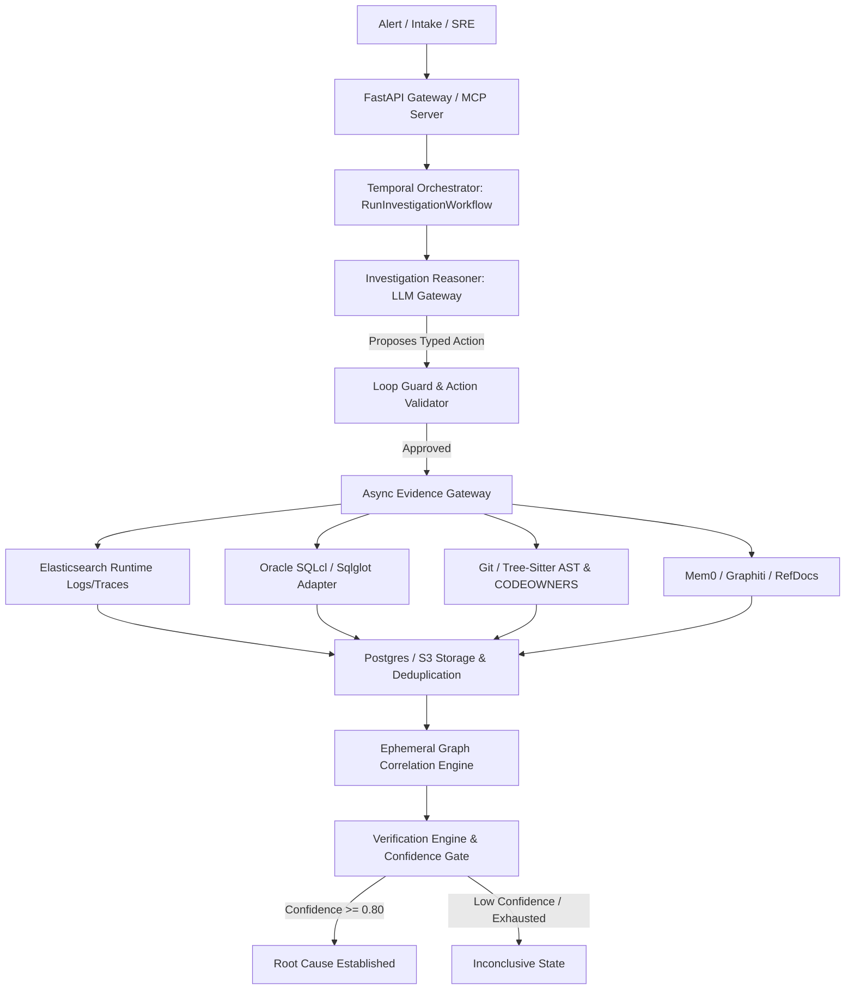

---

## Scope and System Boundaries

### In-Scope Functionality

1. **Investigation Lifecycle Management:** Creation, pause, resume, input-required suspension, cancellation, retry, and terminal reopening of automated investigations.


2. **Multi-Source Telemetry & Evidence Processing:** Bounded fetching, sanitization (Presidio PII scrubbing), deduplication, SHA-256 fingerprinting, two-tier storage (Postgres snippets, S3 bodies), and provenance tracking across Elastic, Oracle DB, Git, and Neo4j.


3. **Dynamic Field Mapping:** Configurable external schema translation (`ObservabilitySourceMapping`) for non-ECS Elasticsearch logs.


4. **Deterministic Graph Correlation:** Building ephemeral `rustworkx` graphs linking logs, traces, AST nodes (`DEFINES`, `CALLS`, `REFERENCES`), and database tables (`ACCESSES_TABLE`).


5. **Context & Execution Knowledge Layers:** Long-term memory storage/retrieval via pgvector (Mem0) and temporal knowledge graphs (Graphiti on Neo4j) with explicit validity controls (`IMMUTABLE`, `CONDITIONAL`, `TTL`).


6. **Code Ingestion & Domain Attribution:** GitHub repository batch ingestion into Neo4j (Layer 3 AST topology) with two-frame fail-closed failure attribution and CODEOWNERS resolution.


7. **Extended Capabilities:** External reference document retrieval, LLM-assisted finding clustering, HTML/JSON aggregate reports, streaming chat, generic background job queues, and OAuth2 outbound credential governance.


### Out-of-Scope Functionality

1. **Automated Production Remediation:** System strictly investigates and reports; it never executes write, update, restart, or deployment actions against infrastructure.


2. **Dynamic / Unsanctioned Code Loading:** Platform executes only trusted, pre-installed Python adapters; arbitrary user code loading is prohibited.


3. **Bundled Frontend User Interface:** Platform provides headless REST, SSE, WebSocket, and MCP endpoints; UI applications are external.


4. **Distributed Microservice Decomposition:** Deployed as a modular monolith sharing single deployment boundaries.


### System Boundaries and Integrations

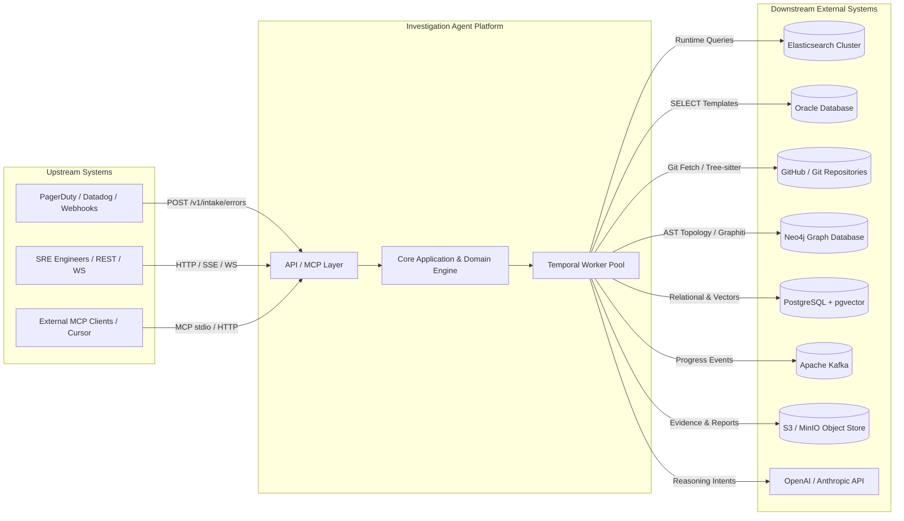

---

## Business Context

### Supported Business Capabilities

* **Autonomous Incident Triage & Investigation:** Ingesting production errors, assembling contextual profiles, executing tool loops, and generating findings.


* **System Topology & Failure Attribution:** Mapping microservice execution traces to exact repository code structures, AST symbols, database tables, and engineering owner groups.


* **Multi-Source Telemetry Correlation:** Connecting disparate log records, distributed traces, and database states through graph dependency algorithms.


* **Organizational Execution Memory:** Storing and recalling verified incident findings across past investigations.


* **Integration & Credential Governance:** Securing outbound credentials and external reference documents across enterprise boundaries.


### Supported Business Processes

1. **On-Call Outage Diagnosis:** Triggered automatically upon alert or manually by SREs to isolate root causes without manual telemetry stitching.


2. **Post-Mortem Analysis & Clustering:** Grouping findings across past incidents into clusters to identify systemic architectural weaknesses.


3. **Code Ownership Verification:** Determining responsible teams when failure traces traverse shared platform libraries or ambiguous service boundaries.


4. **Bulk Incident Processing:** Analyzing batches of historical error tickets or synthetic test failures concurrently.


### Key Business Objectives

* **Lower MTTR:** Minimize downtime costs by rapidly reaching root-cause confidence thresholds.


* **Zero Operational Risk:** Ensure zero automated write side effects on operational infrastructure.


* **Strict Tenant Isolation:** Guarantee complete data isolation between tenants in multi-tenant deployments.


* **Predictable Operational Costs:** Enforce strict budget controls on LLM tokens and external tool calls.


---

## Core Business Rules

| Rule ID | Rule Name | Business Rule Description | Source Document |
| --- | --- | --- | --- |
| **BR-001** | **Read-Only Infrastructure Safety** | Platform executes zero dynamic SQL, zero direct shell commands, zero filesystem access outside designated roots, and zero direct Elastic/vendor calls. Database interactions must use pre-validated static SQL templates checked via `sqlglot`.

 | Part 1 §Fact, Part 3 §Fact |
| **BR-002** | **Reasoning vs. Execution Boundary** | LLMs are restricted to proposing typed action intents. The platform validates, authorizes, executes, and persists all actions. LLMs never assert confidence directly; confidence is calculated mathematically by the Verification Engine.

 | Part 2 §Fact, §Decisions |
| **BR-003** | **Strict Server-Derived Tenancy** | Every domain port signature, repository query, cache key, and database write must include a server-derived `tenant_id`. Client-supplied tenant overrides in payloads are strictly rejected.

 | Part 1 §Fact, Part 3 §Decisions, Part 11 §4.1 |
| **BR-004** | **Decisive Inconclusiveness** | An `INCONCLUSIVE` verdict is strictly preferred over a confident false culprit. If evidence fails the confidence threshold (default 0.80) or contains unresolved contradictions, the investigation concludes as `INCONCLUSIVE`.

 | Part 2 §Fact, Part 5 §Decisions |
| **BR-005** | **Hard Budget & Iteration Backstops** | Investigations are bounded by operator-defined limits (`IAP_MAX_TOOL_CALLS`=50, `IAP_MAX_REASONING_CALLS`=20, `IAP_MAX_DURATION_SECONDS`=1800, workflow local guard=10). Exceeding budget yields `PAUSED` or terminal evaluation.

 | Part 1 §Fact, Part 2 §Fact |
| **BR-006** | **Deterministic Graph Correlation** | Telemetry and topology correlation must rely on deterministic graph traversal rules (`rustworkx`/Neo4j), never LLM inference.

 | Part 3 §Decisions, Part 5 §Decisions |
| **BR-007** | **Immutable Revision Pinning** | Layer 3 code topology, application profiles, and execution knowledge must be pinned to immutable Git commit SHAs or versioned revision IDs.

 | Part 5 §Decisions, Part 7 §Decisions, Part 11 §5.3 |
| **BR-008** | **Staleness Unignorable Policy** | Knowledge retrieval must evaluate validity semantics (`IMMUTABLE`, `CONDITIONAL`, `TTL`). Stale knowledge is re-verified or explicitly excluded, and excluded stale item counts must be returned in outputs.

 | Part 6 §Fact, §Decisions |
| **BR-009** | **Fail-Closed Production Boot** | Missing required external infrastructure dependencies (Postgres, Temporal, Neo4j, Kafka) during production startup causes an immediate process abort; production never degrades to in-memory fallbacks.

 | Part 4 §Decisions, Part 7 §Fact |
| **BR-010** | **Non-Destructive Background Failures** | Failures in knowledge capture, telemetry derivation, progress event publishing, or background indexing must log errors and preserve diagnostic state, but must never cause an active investigation to fail.

 | Part 2 §Decisions, Part 6 §Decisions, Part 11 §7.4 |

---

# System Functional Specification: Investigation Agent Platform (IAP)

**Document Context:** Functional View of the System (Topic 2 of 12)

---

## Actors and Stakeholders

The platform interacts with a diverse set of human users, automated system actors, external systems, and operational processes. Each actor plays a distinct role in triggering, executing, governing, or consuming system capabilities.

### Primary Actors & Stakeholders Breakdown

| Actor Name | Role Category | Role & Responsibilities | Interaction with System | Key Objectives / Needs |
| --- | --- | --- | --- | --- |
| **On-Call SRE / Incident Commander**<br> | Human User | Manages active incident triage, triggers investigations, fulfills pending input requirements, reviews confidence scores, and consumes findings.

 | REST API (`/v1/investigations`), Interactive Streaming Chat, Input Fulfillment API.

 | Rapid MTTR, accurate root-cause analysis, verifiable evidence, zero false positives.

 |
| **System Administrator / Operator**<br> | Human Operational Role | Manages system configuration, application profiles, dynamic field mappings, GitHub batch ingestion, task queue sizing, and schedule reconciliation.

 | CLI scripts (`scripts/ingest_github.py`), Admin REST APIs, YAML configuration profiles.

 | Platform stability, schema flexibility, strict tenant isolation, resource/cost control.

 |
| **Alerting / Monitoring Systems**<br> | External Automated System | PagerDuty, Datadog, or custom webhooks that detect production anomalies and trigger platform investigations.

 | Intake REST API (`POST /v1/intake/errors`).

 | Automated incident intake, immediate investigation startup, deduplication of recurring errors.

 |
| **Investigation Reasoning Agent (LLM)**<br> | Automated System Actor | Generates step-by-step reasoning plans, evaluates evidence context, and proposes typed tool execution intents.

 | Internal `InvestigationReasoner` port / `LLMGateway`.

 | Context-rich evidence summaries, structured tool response envelopes, clear evaluation boundaries.

 |
| **External Coding Agent / MCP Client**<br> | External System Actor | Third-party IDE extensions (e.g., Cursor, Claude Desktop) or automated software engineering agents seeking evidence.

 | MCP Protocol via stdio or Streamable HTTP (`/mcp`).

 | Standardized tool access (`search_runtime_evidence`, `get_evidence`, `investigate_trace`, `search_reference_docs`).

 |
| **Temporal Workflow Engine**<br> | Automated System Actor | Guarantees durable execution, manages state transitions, enforces activity retries, and handles background job queues.

 | gRPC interface to Temporal cluster via workers.

 | Deterministic workflow histories, idempotent activities, state persistence.

 |
| **Telemetry & Data Providers**<br> | Downstream Systems | Elasticsearch (logs/traces), Oracle DB (state), GitHub/PyGit2 (source code), Neo4j (Layer 3 topology & Graphiti).

 | Read-only queries routed through `AsyncEvidenceGateway`.

 | Bounded query execution, zero production side effects, static SQL template compliance.

 |

---

## Functional Capabilities Model

The functional capabilities of the Investigation Agent Platform are structured into six major capability groups.

```mermaid
flowchart TD
    IAP[IAP System Capabilities]
    
    IAP --> FC1[FC-1.0: Investigation Lifecycle & Orchestration]
    IAP --> FC2[FC-2.0: Multi-Source Evidence Gateway]
    IAP --> FC3[FC-3.0: Deterministic Graph Correlation & Topology]
    IAP --> FC4[FC-4.0: LLM Reasoning & Confidence Verification]
    IAP --> FC5[FC-5.0: Execution Knowledge & Memory]
    IAP --> FC6[FC-6.0: Platform Extensions & Operations]

    FC1 --> FC1_1[FC-1.1 Investigation Intake & Triggering]
    FC1 --> FC1_2[FC-1.2 Workflow Execution & Holding States]
    FC1 --> FC1_3[FC-1.3 Input-Required Suspension & Fulfillment]
    FC1 --> FC1_4[FC-1.4 Bulk Investigation Fan-Out]

    FC2 --> FC2_1[FC-2.1 Gateway Enforcement & Sanitization]
    FC2 --> FC2_2[FC-2.2 Dynamic Field & Schema Translation]
    FC2 --> FC2_3[FC-2.3 Read-Only Oracle Database Querying]
    FC2 --> FC2_4[FC-2.4 Git Code & AST Symbol Extraction]

    FC3 --> FC3_1[FC-3.1 Ephemeral Graph Correlation]
    FC3 --> FC3_2[FC-3.2 Static Code Topology Management]
    FC3 --> FC3_3[FC-3.3 Dual-Frame Failure Attribution]

    FC4 --> FC4_1[FC-4.1 Intent Proposal & Action Validation]
    FC4 --> FC4_2[FC-4.2 Mathematical Confidence Calculation]
    FC4 --> FC4_3[FC-4.3 Budget & Iteration Backstop Enforcement]

    FC5 --> FC5_1[FC-5.1 Semantic Vector Memory]
    FC5 --> FC5_2[FC-5.2 Temporal Knowledge Graph]
    FC5 --> FC5_3[FC-5.3 Validity Gating & Staleness Control]

    FC6 --> FC6_1[FC-6.1 Reference Document Search]
    FC6 --> FC6_2[FC-6.2 Cross-Investigation Finding Clustering]
    FC6 --> FC6_3[FC-6.3 Aggregate Reporting & Artifact Storage]
    FC6 --> FC6_4[FC-6.4 Interactive Streaming Chat]
    FC6 --> FC6_5[FC-6.5 Background Job & Progress Stream]
    FC6 --> FC6_6[FC-6.6 Outbound Credential Governance]

```

---

### FC-1.0: Investigation Lifecycle & Orchestration Management

#### FC-1.1: Investigation Intake & Triggering

* **Purpose:** Ingest incident error payloads from external systems or SRE operators and initialize a durable investigation instance.


* **Description:** Receives structured incident triggers containing tenant context, application context, issue fingerprints, and initial error parameters. Evaluates code issue fingerprints to merge recurring issues or instantiate new investigations.


* **Actors Involved:** On-Call SRE, Alerting Systems, Temporal Orchestrator.


* **Inputs:** `tenant_id`, `application_id`, `error_message`, `trace_id`, `code_issue_fingerprint`.


* **Outputs:** Investigation Record (UUID), Initialized Application Context, Temporal Workflow Execution ID.


* **Business Rules:** BR-003 (Server-Derived Tenancy); code issue fingerprints determine cross-tenant intake vs. tenant fork behavior.


* **Dependencies:** PostgreSQL persistence, Temporal cluster connection.


* **Related Processes:** Automated Incident Intake Workflow.


#### FC-1.2: Workflow Execution & Holding States

* **Purpose:** Orchestrate the durable state transitions of an investigation through its complete analysis lifecycle.


* **Description:** Manages transitions across `CREATED`, `CONTEXTUALIZING`, `INVESTIGATING`, `CONCLUDING`, `COMPLETED`, `FAILED`, `CANCELLED`, and `PAUSED`. Supports explicit reopen transitions (`COMPLETED/FAILED -> INVESTIGATING`) for recurring incidents.


* **Actors Involved:** Temporal Orchestrator, On-Call SRE.


* **Inputs:** Investigation ID, Transition Trigger Signal/Command.


* **Outputs:** Persisted `TimelineEvent` records, updated `InvestigationStatus`, transition audit events.


* **Business Rules:** BR-005 (Budget & Iteration Backstops); terminal states are immutable except via explicit reopen edges.


* **Dependencies:** Temporal `RunInvestigationWorkflow`, PostgreSQL `investigation_transitions` table.


* **Related Processes:** Investigation State Transition Lifecycle.


#### FC-1.3: Structured Input-Required Suspension & Fulfillment

* **Purpose:** Suspend an investigation safely when mandatory contextual information is missing and resume execution upon receiving validated user input.


* **Description:** Transitions workflow to `AWAITING_INPUT`, persists a durable `InputRequirement` containing a JSON Schema specification, and waits for a validated `InputFulfillment` payload.


* **Actors Involved:** Investigation Reasoning Agent, On-Call SRE, Temporal Orchestrator.


* **Inputs:** Requirement ID, Requirement Version, Target JSON Schema, User Fulfillment JSON payload.


* **Outputs:** Validation verdict, updated `InputFulfillment` record, workflow resume signal.


* **Business Rules:** Identical fulfillment retries are no-ops; modified fulfillments for an already fulfilled version return HTTP 409 Conflict.


* **Dependencies:** Temporal Workflow Update mechanism, Pydantic/JSON Schema validation.


* **Related Processes:** Human-in-the-Loop Investigation Resume.


#### FC-1.4: Bulk Investigation Fan-Out

* **Purpose:** Process batch imports of incident records concurrently using bounded child workflow execution.


* **Description:** Ingests CSV or structured JSON batch manifests, validates individual record parameters against application profiles, and spawns child investigation workflows bounded by active concurrency permits.


* **Actors Involved:** System Administrator, Temporal Orchestrator.


* **Inputs:** Batch manifest (JSON/CSV), Application Profile ID, Idempotency Key.


* **Outputs:** `BatchIntakeRecord`, child workflow execution IDs, aggregate execution status cursor.


* **Business Rules:** Hard limit of 500 records per parent batch execution; active child workflow permits are held from start through completion.


* **Dependencies:** `BulkIntakeWorkflow`, `investigation-tasks` queue.


* **Related Processes:** Batch Incident Processing Workflow.


---

### FC-2.0: Multi-Source Evidence Gateway & Telemetry Management

#### FC-2.1: Unified Gateway Enforcement & Sanitization

* **Purpose:** Provide a mandatory, security-enforced boundary for all external telemetry access.


* **Description:** Intercepts evidence requests across all providers, applying tenant authorization, PII sanitization (Presidio scrubbing), payload truncation, SHA-256 deduplication fingerprinting, and two-tier offload (Postgres metadata snippets, S3 bodies).


* **Actors Involved:** `AsyncEvidenceGateway`, Telemetry Providers.


* **Inputs:** `tenant_id`, `investigation_id`, Provider Query Request, Bounded Limits.


* **Outputs:** `EvidenceQueryResult` envelope, persisted `Evidence` aggregate, SHA-256 fingerprint.


* **Business Rules:** BR-001 (Read-Only Safety); BR-003 (Server-Derived Tenancy); raw provider IDs are never exposed externally; platform mints UUID evidence IDs.


* **Dependencies:** Presidio, S3/MinIO Storage Adapter, PostgreSQL Evidence Repositories.


* **Related Processes:** Telemetry Evidence Retrieval Workflow.


#### FC-2.2: Dynamic Field & Schema Translation

* **Purpose:** Resolve physical Elasticsearch indices and field names dynamically for non-ECS telemetry clusters.


* **Description:** Translates logical evidence query requests (`trace_id`, `service_name`, severity filters) into physical index patterns and field paths based on an operator-authored YAML `ObservabilitySourceMapping`.


* **Actors Involved:** System Administrator, `AsyncElasticAdapter`, `FieldResolver`.


* **Inputs:** Logical request filters, target `source_id`, `ObservabilitySourceMapping` registry.


* **Outputs:** Translated physical Elasticsearch query DSL, physical timestamp/severity/field projections.


* **Business Rules:** If `tenant_scope.strategy = FIELD`, query builder appends a mandatory, non-overridable tenant term clause. Unsupported severity models reject filters explicitly rather than broadening queries.


* **Dependencies:** `MappingProfileRegistry`, `ObservabilitySourceMapping` configuration.


* **Related Processes:** Non-ECS Log Search Execution.


#### FC-2.3: Read-Only Oracle Database Querying

* **Purpose:** Extract relevant database application state safely without risk of SQL injection or database modification.


* **Description:** Executes read-only database queries against designated Oracle databases using pre-configured static SQL templates. Validates all SQL templates at boot using `sqlglot` to verify SELECT-only AST structure.


* **Actors Involved:** `AsyncOracleStateAdapter`, SQLcl MCP Server.


* **Inputs:** `ApplicationStateRequest`, Template ID, Template Parameters.


* **Outputs:** Structured state evidence records, column/value projections.


* **Business Rules:** BR-001 (Read-Only Infrastructure Safety); zero dynamic SQL allowed; template validation fails closed at boot on any non-SELECT keyword.


* **Dependencies:** `SqlglotTemplateValidator`, Oracle SQLcl connection pool.


* **Related Processes:** Application State Investigation Process.


#### FC-2.4: Git Code & AST Symbol Extraction

* **Purpose:** Extract source code snippets, revision history, and AST symbol signatures for analysis.


* **Description:** Clones or fetches blobless Git repository revisions, parses code files using `tree-sitter` parsers, and resolves macro symbols, functions, callers, callees, and database access statements.


* **Actors Involved:** `PyGit2Adapter`, `TreeSitterParser`, `MicroSymbolResolver`.


* **Inputs:** Repository ID, Commit SHA, Source Path, Symbol Name.


* **Outputs:** `CodeSymbol`, `CallGraphNode`, `CodeLocation` domain models.


* **Business Rules:** Path-traversal guards enforce strict directory containment; file reads are capped at 512 KB.


* **Dependencies:** `pygit2`, C C-extension `tree-sitter`.


* **Related Processes:** Code Telemetry Extraction Process.


---

### FC-3.0: Deterministic Graph Correlation & Topology Engine

#### FC-3.1: Ephemeral Graph Correlation

* **Purpose:** Construct deterministic relationships between logs, traces, code symbols, and database tables.


* **Description:** Hydrates an in-memory `rustworkx` directed graph per activity invocation. Evaluates rule-based edge conditions to link telemetry events via `CALLS`, `DEFINES`, `REFERENCES`, and `ACCESSES_TABLE` relationship types.


* **Actors Involved:** `EphemeralCorrelationEngine`, PostgreSQL Relationship Repository.


* **Inputs:** Evidence ID set, `PostgresRelationshipRepository` edge records.


* **Outputs:** `CorrelationResult`, updated `EvidenceRelationship` domain graph.


* **Business Rules:** BR-006 (Deterministic Graph Correlation); correlation is computed via deterministic algorithms, never LLM guesswork.


* **Dependencies:** `rustworkx` C-library, PostgreSQL `investigation_entities` & relationships tables.


* **Related Processes:** Evidence Correlation Analysis.


#### FC-3.2: Static Code Topology Management (Layer 3)

* **Purpose:** Maintain an authoritative, revision-pinned AST topology graph of code repositories across tenant applications.


* **Description:** Ingests GitHub orgs/repos via `scripts/ingest_github.py`, parses working tree ASTs into macro nodes, builds CALLS/REFERENCES/ACCESSES_TABLE edges, and persists them into Neo4j under strict tenant namespaces.


* **Actors Involved:** System Administrator, `GitHubIngestScript`, `Neo4jTopologyAdapter`.


* **Inputs:** GitHub Org/Repo credentials, Commit SHA, `--repo-types` classification.


* **Outputs:** Neo4j AST node/edge graph, `ASTTopologyPayload`, `IngestManifestRow` JSONL audit trail.


* **Business Rules:** Single-process execution; revision SHAs are the absolute revision truth; manifest JSONL provides offline audit trails.


* **Dependencies:** Neo4j 5.26 Community Database, `tree-sitter`.


* **Related Processes:** Repository AST Ingestion Pipeline.


#### FC-3.3: Failure Attribution & CODEOWNERS Resolution

* **Purpose:** Trace stack frames and error telemetry back to responsible source code repositories and engineering owner groups.


* **Description:** Performs dual-frame attribution matching runtime stack traces against Layer 3 AST nodes in Neo4j. Evaluates CODEOWNERS files to determine team ownership, capping confidence based on resolution tier (e.g., CODEOWNERS tier capped at 0.30 vs 0.80 gate).


* **Actors Involved:** `FailureAttributionService`, `CodeownersResolver`.


* **Inputs:** Telemetry trace stack frames, commit SHA, tenant ID.


* **Outputs:** `DomainAttributionResult`, `StaticOwnershipResult`.


* **Business Rules:** BR-004 (Decisive Inconclusiveness); attribution fails closed to `INCONCLUSIVE` if confidence does not meet required gates.


* **Dependencies:** Neo4j Layer 3 Graph, CODEOWNERS file index.


* **Related Processes:** Incident Fault Attribution Process.


---

### FC-4.0: Autonomous LLM Reasoning, Verification & Budget Control

#### FC-4.1: LLM Reasoning Orchestration & Action Intent Validation

* **Purpose:** Generate targeted investigation plans and propose executable evidence-gathering actions.


* **Description:** Formulates investigation hypotheses and steps using provider-agnostic `LLMGateway` (OpenAI/Anthropic). Sanitizes LLM outputs and validates proposed tool execution intents against strict platform action schemas.


* **Actors Involved:** `ReasoningCoordinator`, `InvestigationPlanner`, `ActionValidator`.


* **Inputs:** `ReasoningContext`, formatted evidence context, hypothesis history.


* **Outputs:** `InvestigationPlan`, proposed `InvestigationAction` intents.


* **Business Rules:** BR-002 (Reasoning vs. Execution Boundary); LLM proposes intents only; platform validates and executes.


* **Dependencies:** `LLMGateway`, OpenAI/Anthropic SDKs, Presidio sanitization.


* **Related Processes:** Autonomous Reasoning Loop.


#### FC-4.2: Mathematical Verification & Confidence Calculation

* **Purpose:** Determine whether evidence definitively proves or disproves an incident hypothesis.


* **Description:** Evaluates evidence assessments using a non-LLM, mathematical confidence formula (`VerificationEngine`). Enforces a strict terminal threshold (default 0.80 confidence gate) before allowing a conclusion.


* **Actors Involved:** `VerificationEngine`, `ConclusionGate`.


* **Inputs:** Hypothesis evidence assessments, contradicting evidence IDs, causal relationships.


* **Outputs:** Calculated `InvestigationConfidence` score, `InvestigationConclusion` status (`ROOT_CAUSE_ESTABLISHED`, `INCONCLUSIVE`, `NO_FAULT_FOUND`, `EXCLUDED`).


* **Business Rules:** BR-004 (Decisive Inconclusiveness); `INCONCLUSIVE` beats a confident wrong answer.


* **Dependencies:** `RootCauseVerificationPolicy`, domain finding models.


* **Related Processes:** Hypothesis Verification & Conclusion Process.


#### FC-4.3: Action Fingerprinting & Budget Policy Enforcement

* **Purpose:** Prevent redundant tool executions, infinite loops, and cost overruns during reasoning loops.


* **Description:** Computes canonical SHA-256 fingerprints of proposed action parameters to deduplicate tool executions. Tracks cumulative tool calls, reasoning calls, and investigation duration against operator limits.


* **Actors Involved:** `InvestigationLoopGuard`, `InvestigationBudget`.


* **Inputs:** Proposed `InvestigationAction`, active `InvestigationBudget` state.


* **Outputs:** Action approval verdict, updated budget counters.


* **Business Rules:** BR-005 (Hard Budget & Iteration Backstops); halts execution when limits (`IAP_MAX_TOOL_CALLS`=50, `IAP_MAX_REASONING_CALLS`=20) are reached.


* **Dependencies:** Operator infrastructure `BudgetConfig`.


* **Related Processes:** Reasoning Guardrail Enforcement.


---

### FC-5.0: Execution Knowledge & Memory Management

#### FC-5.1: Semantic Vector Memory

* **Purpose:** Persist and recall unstructured text facts and incident context across investigations.


* **Description:** Stores mechanical facts and semantic summaries in PostgreSQL `pgvector` using `Mem0KnowledgeStore`. Enforces tenant metadata filters on all similarity queries.


* **Actors Involved:** `Mem0KnowledgeStore`, PostgreSQL + `pgvector`.


* **Inputs:** Knowledge facts, embedding vectors, tenant metadata filters.


* **Outputs:** Relevant semantic facts, similarity distance scores.


* **Business Rules:** Self-hosted storage only; verbatim path enforced for mechanical facts.


* **Dependencies:** `pgvector` extension, PostgreSQL database.


* **Related Processes:** Semantic Memory Recall.


#### FC-5.2: Temporal Knowledge Graph

* **Purpose:** Maintain valid-time relationships and causal episodes derived during past investigations.


* **Description:** Stores temporal entity-relationship graph episodes in Neo4j using `GraphitiTemporalKnowledge`. Enforces server-derived group IDs and valid-time window filters.


* **Actors Involved:** `GraphitiTemporalKnowledge`, Shared Neo4j Graph DB.


* **Inputs:** Graphiti episodes, valid-time filters, byte-capped payloads.


* **Outputs:** Temporal knowledge subgraphs, valid-time entity relationships.


* **Business Rules:** Shared Neo4j database must enforce separate Graphiti namespace labels.


* **Dependencies:** Neo4j 5.26 Community DB, `graphiti-core`.


* **Related Processes:** Temporal Knowledge Graph Retrieval.


#### FC-5.3: Validity Gating & Staleness Control

* **Purpose:** Prevent invalid, expired, or stale historical knowledge from corrupting active investigations.


* **Description:** Wraps all knowledge artifacts in a Postgres `KnowledgeArtifact` envelope declaring validity semantics (`IMMUTABLE`, `CONDITIONAL`, `TTL`). Excludes stale items during retrieval and surfaces `excluded_stale_count` metrics.


* **Actors Involved:** `KnowledgeService`, TTL Janitor Workflow.


* **Inputs:** Knowledge Envelope, current system timestamp, `ReverifySpec`.


* **Outputs:** Filtered valid knowledge items, `excluded_stale_count` tally.


* **Business Rules:** BR-008 (Staleness Unignorable Policy); staleness must be structurally unignorable.


* **Dependencies:** PostgreSQL `knowledge_artifacts` table, Temporal Janitor Workflow.


* **Related Processes:** Knowledge Retention & Janitor Cleanup.


---

### FC-6.0: Platform Extensions & Advanced Capabilities

#### FC-6.1: External Reference Document Search

* **Purpose:** Search technical documentation, architectural guides, and runbooks to assist analysis.


* **Description:** Fetches documentation via Git, local files, or S3, generates text chunks, embeds chunks into platform-owned pgvector tables, and executes hybrid lexical/vector searches.


* **Actors Involved:** `ReferenceDocumentPort`, `ReferenceFetcherRegistry`.


* **Inputs:** Document source URL/path, search query text, scope filters.


* **Outputs:** `ReferenceDocumentPage`, chunk excerpts, hybrid search relevance scores.


* **Business Rules:** SSRF controls and host allowlists enforced on all external fetches; path traversal strictly prohibited.


* **Dependencies:** `pgvector`, `pygit2`, `ArtifactStorePort`.


* **Related Processes:** Reference Document Indexing & Search.


#### FC-6.2: Cross-Investigation Finding Clustering

* **Purpose:** Group similar findings across historical investigations to identify systemic production issues.


* **Description:** Queries unassigned findings, generates finding embeddings, retrieves candidate clusters using reciprocal-rank fusion, and assigns findings to normalized cluster rows via strict-schema LLM calls.


* **Actors Involved:** `FindingClusteringWorkflow`, `FindingRepository`.


* **Inputs:** Unassigned findings corpus, taxonomy revision ID.


* **Outputs:** `FindingCluster` aggregates, versioned `FindingClusterAssignment` rows.


* **Business Rules:** Incremental execution; malformed LLM cluster outputs default to explicit `UNASSIGNED` state without dropping findings.


* **Dependencies:** PostgreSQL finding tables, pgvector, Temporal analytics queue.


* **Related Processes:** Systemic Finding Clustering Workflow.


#### FC-6.3: Aggregate Reporting & Artifact Storage

* **Purpose:** Generate executive and technical summary reports combining investigation findings and cluster taxonomies.


* **Description:** Compiles investigation conclusions and cluster assignments into versioned HTML/JSON reports. Stores rendered report artifacts in S3/MinIO and generates short-lived signed download URLs.


* **Actors Involved:** `ReportRendererRegistry`, `ArtifactStorePort`.


* **Inputs:** Scope ID, Cluster taxonomy generation, Report format specification.


* **Outputs:** Rendered HTML/JSON report artifacts, 3600s signed download URL.


* **Business Rules:** Rendered HTML must enforce Content Security Policy (CSP) headers and autoescaping to eliminate stored XSS risks.


* **Dependencies:** Jinja2 autoescaping, S3/MinIO object store.


* **Related Processes:** Executive Report Generation Process.


#### FC-6.4: Interactive Streaming Chat & Advisory Actions

* **Purpose:** Enable real-time conversational analysis of active or past investigations with SRE engineers.


* **Description:** Establishes durable, tenant-scoped chat sessions. Streams response tokens via SSE using `StreamingLLMGateway` and proposes typed advisory actions.


* **Actors Involved:** On-Call SRE, `StreamingLLMGateway`.


* **Inputs:** Chat session ID, User message prompt, Context attachments.


* **Outputs:** SSE Token stream, metadata events, validated final message, suggested actions.


* **Business Rules:** LLM suggested actions are strictly advisory; execution requires explicit client invocation through authorized API endpoints.


* **Dependencies:** SSE stream infrastructure, tiktoken token accounting.


* **Related Processes:** Real-Time Incident Chat Session.


#### FC-6.5: Generic Background Job Queue & Event Progress Stream

* **Purpose:** Execute asynchronous long-running tasks with real-time WebSocket progress updates.


* **Description:** Enqueues background jobs (clustering, reindexing, report generation) in PostgreSQL and executes them via Temporal task queues. Publishes state events to Kafka, which API replicas consume to stream progress over local WebSockets.


* **Actors Involved:** API Replicas, Kafka Subscriber, WebSocket Clients.


* **Inputs:** Job kind, Job payload, Scope, Client WebSocket connection.


* **Outputs:** `BackgroundJob` state, Kafka progress events, WebSocket JSON status stream.


* **Business Rules:** PostgreSQL is the authoritative job read model; Kafka carries transient progress events. Each API replica uses a unique consumer group to prevent partition starvation on local sockets.


* **Dependencies:** PostgreSQL `background_jobs` table, Apache Kafka, Temporal worker pools.


* **Related Processes:** Background Job Execution & Progress Streaming.


#### FC-6.6: Outbound Credential Governance

* **Purpose:** Securely resolve and refresh OAuth2 tokens and secret references for outbound integrations.


* **Description:** Manages outbound API credentials using an extensible registry (`CredentialProviderRegistry`). Handles RFC 6749 OAuth2 client credentials flows with proactive pre-expiry token refresh under per-key locks.


* **Actors Involved:** `CredentialProviderRegistry`, External Identity Providers.


* **Inputs:** Scope, Provider ID, Secret Reference.


* **Outputs:** Short-lived `AccessToken`.


* **Business Rules:** Secret references resolve only against explicit environment allowlists; arbitrary environment variables cannot be accessed. Raw secrets and tokens are never logged.


* **Dependencies:** Identity Provider token endpoints, Secret Manager.


* **Related Processes:** Outbound Service Authentication Process.


---

# System Functional Specification: Investigation Agent Platform (IAP)

**Document Context:** Functional View of the System (Topic 3 of 12)

---

## End-to-End Business Processes

The Investigation Agent Platform (IAP) executes five primary end-to-end workflows that span across its API, application orchestration, evidence gateway, domain reasoning, and persistent storage layers.

---

### E2E-PROC-1: Autonomous Incident Investigation & Root Cause Analysis

* **Purpose:** Process an incoming production incident alert autonomously, gather multi-modal telemetry, test hypotheses, and determine the root cause with mathematical confidence.


* **Actors / Systems Involved:** On-Call SRE / Alerting System, FastAPI Gateway, Temporal Orchestrator (`RunInvestigationWorkflow`), `ReasoningCoordinator`, `AsyncEvidenceGateway`, `EphemeralCorrelationEngine`, `VerificationEngine`, PostgreSQL, S3 Artifact Store.


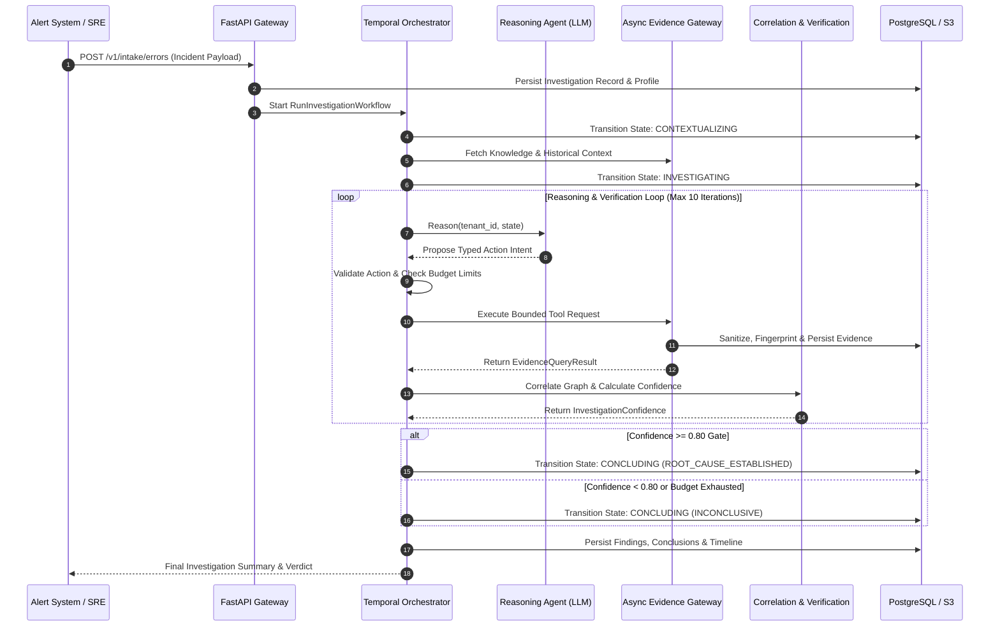

#### Steps and Workflow Logic

| Step # | Step Name | Description | Business Rules / Decisions |
| --- | --- | --- | --- |
| **1** | **Incident Trigger** | Incident alert payload is submitted via `POST /v1/intake/errors` or `POST /v1/investigations`.

 | BR-003: Server derives `tenant_id`. Evaluates `code_issue_fingerprint` to link recurring issues.

 |
| **2** | **Workflow Initiation** | FastAPI initializes application context and triggers Temporal `RunInvestigationWorkflow`.

 | Fails loud (HTTP 503) if Temporal connection is unavailable.

 |
| **3** | **Contextualization** | Workflow transitions to `CONTEXTUALIZING`, loads the `ApplicationProfile`, and retrieves relevant execution knowledge.

 | Ignores stale knowledge per BR-008.

 |
| **4** | **Reasoning Loop** | Workflow enters `INVESTIGATING` status and invokes `ReasoningCoordinator.reason()`.

 | Reasoning Agent proposes typed `InvestigationAction` intents.

 |
| **5** | **Action Guardrails** | `InvestigationActionValidator` and `LoopGuard` validate proposed actions against safety rules and budget limits.

 | BR-001 & BR-005: Halts loop if tool call count exceeds 50 or reasoning calls exceed 20.

 |
| **6** | **Evidence Fetch** | Approved actions execute via `AsyncEvidenceGateway` across Elastic, Oracle, Git, or Neo4j adapters.

 | Gateway performs PII scrubbing, SHA-256 fingerprinting, and two-tier offload.

 |
| **7** | **Graph Correlation** | Evidence results hydrate the `EphemeralCorrelationEngine` to construct deterministic dependency edges.

 | BR-006: Graph construction follows strict AST/trace rules, never LLM guesswork.

 |
| **8** | **Verification Gate** | `VerificationEngine` computes mathematical `InvestigationConfidence` over active hypotheses.

 | BR-004: Terminal state requires $\ge 0.80$ confidence score.

 |
| **9** | **Conclusion** | Workflow transitions to `CONCLUDING`, writes findings/conclusions to PostgreSQL, and completes execution.

 | If confidence $< 0.80$, status is set to `INCONCLUSIVE`.

 |

* **Preconditions:** Valid tenant credentials, active target application profile, operational external infrastructure (Postgres, Temporal).


* **Postconditions:** Investigation aggregate, timeline events, evidence records, findings, and conclusions are persisted in PostgreSQL with events published to Kafka.


* **Alternate Flows:**
* *A1 (Recurring Issue Match):* Incident fingerprint matches a closed code issue; workflow forks or reopens prior context.


* *A2 (Input Requirement):* Reasoner identifies missing critical information; workflow invokes E2E-PROC-2.


* **Exception Flows:**
* *E1 (Provider Timeout):* Evidence gateway catches adapter failure, logs data-quality signal, and continues loop with partial evidence.


* *E2 (Budget Exhaustion):* Reasoning loop breaches duration or tool limit; forces immediate transition to `CONCLUDING` with status `INCONCLUSIVE`.


---

### E2E-PROC-2: Human-In-The-Loop Input Requirement & Resume

* **Purpose:** Suspend an active investigation safely when mandatory human input is needed and resume automatically upon receiving a validated response.


* **Actors / Systems Involved:** Investigation Reasoning Agent, Temporal Orchestrator, On-Call SRE, FastAPI Gateway, PostgreSQL.


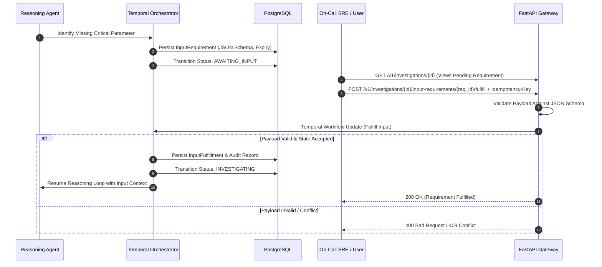

#### Steps and Workflow Logic

| Step # | Step Name | Description | Business Rules / Decisions |
| --- | --- | --- | --- |
| **1** | **Requirement Detection** | Reasoning agent identifies an unresolvable context gap and requests missing data.

 | System creates a formal `InputRequirement` object with a target JSON Schema.

 |
| **2** | **Workflow Suspension** | Temporal workflow transitions investigation status to `AWAITING_INPUT` and enters a waiting state.

 | Workflow history retains pending requirement version and expiration timer.

 |
| **3** | **Requirement Retrieval** | On-Call SRE queries active investigation state and views the pending input requirement details.

 | Payload schemas are sanitized to exclude internal system details.

 |
| **4** | **Fulfillment Submission** | SRE submits fulfillment JSON payload via `POST /v1/investigations/{id}/input-requirements/{req_id}/fulfill`.

 | Request must include an `Idempotency-Key`.

 |
| **5** | **Schema Validation** | FastAPI validates submission against requirement's JSON Schema before executing workflow update.

 | Rejects invalid payloads immediately (HTTP 400).

 |
| **6** | **State Update & Resume** | Temporal Workflow Update validates state, persists `InputFulfillment`, transitions status to `INVESTIGATING`, and resumes.

 | Identical retries return prior result; modified payloads for fulfilled versions return HTTP 409.

 |

* **Preconditions:** Investigation is actively running in `INVESTIGATING` status.


* **Postconditions:** Validated fulfillment data is bound to investigation context, promoted to evidence if configured, and recorded in audit logs.


* **Exception Flows:**
* *E1 (Requirement Expiration):* Expiry timer triggers before fulfillment; workflow transitions to `PAUSED` or resumes with partial context based on application profile policy.


---

### E2E-PROC-3: GitHub AST Topology Ingestion & Code Attribution

* **Purpose:** Batch ingest GitHub repositories, extract AST structure and dependencies, build a Layer 3 topology graph in Neo4j, and resolve failure attribution.


* **Actors / Systems Involved:** System Administrator, `scripts/ingest_github.py`, GitHub REST API, Tree-Sitter Parsers, `Neo4jTopologyAdapter`, Neo4j Graph DB.


#### Steps and Workflow Logic

```text
[Operator / CLI Script]
       │
       ▼
1. Fetch Repo Metadata & Commit SHA Pin (GitHub REST API)
       │
       ▼
2. Blobless Single-Branch C-Git Fetch (Local Tree)
       │
       ▼
3. Working Tree Walk & Tree-Sitter AST Parse (Max 512 KB/file)
       │
       ▼
4. Build ASTTopologyPayload (Macro Nodes, CALLS, REFERENCES, ACCESSES_TABLE)
       │
       ▼
5. Execute TopologyIngestionPort.ingest() ──► Write to Neo4j Graph DB
       │
       ▼
6. Index CODEOWNERS Rules & Persist JSONL Manifest Audit Row

```

1. **Repository Discovery & Pinning:** The CLI loader queries GitHub REST API, filters repository flags (skips archived/forks), and pins the exact HEAD commit SHA.


2. **Code Fetch:** Performs a blobless single-branch git fetch into local workspace, scrubbing tokens from remote URLs.


3. **AST Parsing:** Traverses source tree, skipping files $> 512\text{ KB}$, and executes C-based `tree-sitter` parsers to extract macro symbols.


4. **Payload Construction:** Generates deterministic UUIDv5 node IDs and constructs `ASTTopologyPayload` containing macro nodes and dependency edges (`CALLS`, `REFERENCES`, `ACCESSES_TABLE`).


5. **Neo4j Ingestion:** Submits payload to `Neo4jTopologyAdapter`, executing transactional UNWIND queries to write nodes and edges under tenant-qualified namespaces.


6. **CODEOWNERS & Manifest Log:** Parses CODEOWNERS file into static ownership indices and appends execution results to `IngestManifestRow` JSONL audit trail.


* **Preconditions:** Active Neo4j 5.26 Community database with tenant uniqueness constraints installed.


* **Postconditions:** Layer 3 topology graph is queryable for dual-frame failure attribution.


---

### E2E-PROC-4: Cross-Investigation Finding Clustering & Aggregate Reporting

* **Purpose:** Aggregate unassigned incident findings across investigations, cluster them using hybrid vector search and strict LLM schemas, and render HTML/JSON report artifacts.


* **Actors / Systems Involved:** Temporal Analytics Worker, `FindingRepository`, pgvector, OpenAI/Anthropic LLM, `ReportRendererRegistry`, `ArtifactStorePort` (S3).


#### Steps and Workflow Logic

| Step # | Step Name | Description | Business Rules / Decisions |
| --- | --- | --- | --- |
| **1** | **Trigger & Fetch** | Analytics worker triggers `FindingClusteringWorkflow`, fetching unassigned findings for the scope.

 | Queries findings via `SqlAlchemyFindingConclusionRepository`.

 |
| **2** | **Hybrid Search** | Computes finding embeddings and executes hybrid vector (HNSW cosine) + lexical (GIN `tsvector`) candidate retrieval.

 | Excludes tombstones and enforces embedding dimension validation (1536).

 |
| **3** | **LLM Clustering** | Submits candidate clusters and unassigned findings to strict-schema LLM for assignment.

 | LLM output must strictly match assignment schema; malformed outputs default findings to `UNASSIGNED`.

 |
| **4** | **Assignment Persistence** | Writes `FindingCluster` aggregates and `FindingClusterAssignment` rows to PostgreSQL transactionally.

 | Retains assignment history with confidence scores and provenance.

 |
| **5** | **Report Rendering** | `ReportRendererRegistry` compiles cluster assignments into HTML/JSON report formats.

 | Enforces Jinja2 autoescaping and strict Content Security Policy (CSP) headers.

 |
| **6** | **Artifact Offload** | Stores rendered report in S3/MinIO via `ArtifactStorePort` and generates a short-lived signed URL.

 | Signed URLs default to 3600-second expiration.

 |

* **Preconditions:** Findings written to PostgreSQL during prior investigation conclusions.


* **Postconditions:** Systemic incident clusters updated; aggregate report artifact available in S3.


---

### E2E-PROC-5: Real-time Background Job Processing & Progress Streaming

* **Purpose:** Dispatch asynchronous tasks (reindexing, clustering, reports) and stream real-time progress events to connected WebSocket clients.


* **Actors / Systems Involved:** REST Client, FastAPI Replica, PostgreSQL, Temporal Task Queues, Apache Kafka, WebSocket Clients.


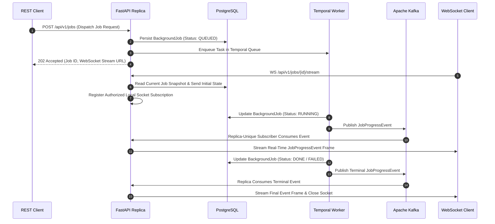

#### Steps and Workflow Logic

1. **Job Dispatch:** Client submits job request to REST API; API validates scope, creates a `QUEUED` row in `background_jobs`, and triggers a Temporal workflow.


2. **WebSocket Subscription:** WS client connects to `/api/v1/jobs/{id}/stream`; API sends an initial DB snapshot frame before subscribing to live replica events.


3. **Execution & Event Publish:** Temporal worker picks up activity, updates job status to `RUNNING` in PostgreSQL, and publishes versioned `JobProgressEvent` frames to Kafka.


4. **Replica Fan-Out:** Each API replica consumes Kafka events via its unique consumer group (`{base}-{hostname}`) and fans out matching events to locally connected, authorized WebSockets.


5. **Completion:** Upon task completion, worker updates PostgreSQL job record to `DONE` or `FAILED`, stores result artifact references, and publishes the terminal progress frame.


* **Preconditions:** Active Kafka cluster, running Temporal workers on designated task queues (`investigation-tasks`, `analytics-tasks`, `indexing-tasks`).


* **Postconditions:** Job result persisted in PostgreSQL/S3, audit log written, WebSocket connection gracefully closed.


---

## Functional Requirements

The functional requirements below define the verifiable behavior of the Investigation Agent Platform.

### Group 1: Investigation Lifecycle & Orchestration

| Requirement ID | Requirement Statement | Rationale / Business Value | Source Document(s) | Priority | Dependencies | Notes / Assumptions |
| --- | --- | --- | --- | --- | --- | --- |
| **FR-001** | The system shall ingest incident error payloads via REST API and instantiate a durable investigation aggregate identified by a unique UUID. | Provides standardized automated entry for alerts and manual triggers.

 | Part 1 §Fact, Part 4 §Fact

 | High | PostgreSQL persistence

 | `tenant_id` must be server-derived.

 |
| **FR-002** | The system shall orchestrate investigation state transitions across `CREATED`, `CONTEXTUALIZING`, `INVESTIGATING`, `CONCLUDING`, `COMPLETED`, `FAILED`, `CANCELLED`, `PAUSED`, and `AWAITING_INPUT`. | Guarantees auditability and deterministic lifecycle state tracking.

 | Part 1 §Fact, Part 4 §Fact, Part 11 §8.1

 | High | Temporal Orchestrator

 | Transitions persisted in `investigation_transitions`.

 |
| **FR-003** | The system shall allow terminal states (`COMPLETED`, `FAILED`) to be reopened to `INVESTIGATING` if a recurring code issue fingerprint is detected. | Prevents redundant analysis and links related incident occurrences.

 | Part 1 §Fact, Part 4 §Fact

 | Medium | `code_issue_fingerprint` logic

 | Reopen edges documented in state engine.

 |
| **FR-004** | The system shall support suspending an active investigation into an `AWAITING_INPUT` state, persisting a durable `InputRequirement` record with an explicit JSON Schema. | Enables structured human-in-the-loop interaction when critical context is missing.

 | Part 11 §8.1, §8.2

 | Medium | Temporal Update mechanism

 | Replaces unserialized metadata.

 |
| **FR-005** | The system shall validate submitted user fulfillments against the `InputRequirement` JSON Schema prior to executing a Temporal Workflow Update to resume execution. | Ensures data integrity and prevents corrupt payloads from resuming workflows.

 | Part 11 §8.3, §8.4

 | Medium | Pydantic / JSON Schema

 | Returns HTTP 400 on invalid schema.

 |
| **FR-006** | The system shall reject duplicate fulfillment submissions with modified payloads for an already-fulfilled requirement version by returning HTTP 409 Conflict. | Guarantees compare-and-set idempotency for input fulfillment.

 | Part 11 §6.1, §8.3

 | High | Idempotency store

 | Identical fulfillment retries return prior result.

 |
| **FR-007** | The system shall support bulk investigation intake via structured JSON or CSV manifests, spawning child workflows bounded by concurrent worker permits. | Enables processing large batches of historical error tickets efficiently.

 | Part 11 §9.1, §9.2

 | Medium | `BulkIntakeWorkflow`<br> | Hard cap of 500 records per parent execution.

 |
| **FR-008** | The system shall fail loud during startup (HTTP 503) if the Temporal workflow orchestrator is unreachable. | Prevents accepting investigations that cannot be durably executed.

 | Part 4 §Decisions

 | High | Temporal gRPC client

 | Production never falls back to in-memory.

 |

---

### Group 2: Evidence Gateway & Multi-Source Telemetry

| Requirement ID | Requirement Statement | Rationale / Business Value | Source Document(s) | Priority | Dependencies | Notes / Assumptions |
| --- | --- | --- | --- | --- | --- | --- |
| **FR-009** | The system shall enforce all telemetry fetching through `AsyncEvidenceGateway`, applying authorization, PII sanitization, deduplication, and provenance tracking. | Ensures security compliance and prevents leaking sensitive PII.

 | Part 3 §Fact, Part 9 §Fact

 | High | Presidio, S3 Storage

 | Gateway is mandatory enforcement boundary.

 |
| **FR-010** | The system shall calculate SHA-256 fingerprints over canonical JSON payloads to deduplicate evidence before persistence. | Reduces storage redundancy and speeds up graph correlation.

 | Part 2 §Fact, Part 3 §Fact

 | High | SHA-256 digest engine

 | Stored in `evidence_references`.

 |
| **FR-011** | The system shall offload large evidence payloads using a two-tier strategy: metadata snippets in PostgreSQL and complete raw bodies in S3/MinIO. | Prevents database bloat while maintaining full evidence auditing.

 | Part 2 §Fact, Part 9 §Fact

 | High | PostgreSQL, S3/MinIO

 | Snippets used for fast context assembly.

 |
| **FR-012** | The system shall translate logical query parameters to physical Elasticsearch indices and field paths using an externally configured `ObservabilitySourceMapping`. | Supports non-ECS Elasticsearch clusters without hardcoding field names.

 | Part 10 §3.1, §3.2

 | High | `MappingProfileRegistry`<br> | Configuration loaded at boot.

 |
| **FR-013** | The system shall automatically append a non-overridable tenant filter clause to Elasticsearch queries when the source mapping strategy is set to `FIELD`. | Guarantees strict multi-tenant isolation in shared Elasticsearch indices.

 | Part 10 §3.6

 | High | `AsyncElasticAdapter`<br> | Enforced at query builder tier.

 |
| **FR-014** | The system shall reject query filters referencing unsupported field concepts (e.g., severity filters on sources lacking severity fields) with an explicit `INVALID_REQUEST` error. | Prevents silent query broadening that produces misleading empty results.

 | Part 10 §1.2, §3.5

 | High | `FieldResolver`<br> | Never drops restrictive filters silently.

 |
| **FR-015** | The system shall execute application state queries against Oracle databases strictly using pre-validated, read-only static SQL templates checked via `sqlglot`. | Eliminates SQL injection risks and guarantees zero write side-effects.

 | Part 1 §Fact, Part 3 §Fact

 | High | `SqlglotTemplateValidator`<br> | Non-SELECT queries fail startup validation.

 |
| **FR-016** | The system shall fetch source code snippets from Git repositories using `pygit2`, capping file reads at 512 KB and enforcing strict path containment. | Protects infrastructure against directory traversal and memory exhaustion.

 | Part 3 §Fact, Part 7 §Fact

 | High | `pygit2`, Tree-Sitter

 | Rejects symlink escapes.

 |
| **FR-017** | The system shall mint platform UUIDs for fetched evidence items and resolve all evidence access requests strictly through platform UUIDs. | Prevents disclosing raw external provider IDs and fixes round-trip mapping breaks.

 | Part 9 §Decisions

 | High | `SqlAlchemyEvidenceRepository`<br> | Direct vendor `_id` lookup is rejected.

 |

---

### Group 3: Graph Correlation & Code Topology

| Requirement ID | Requirement Statement | Rationale / Business Value | Source Document(s) | Priority | Dependencies | Notes / Assumptions |
| --- | --- | --- | --- | --- | --- | --- |
| **FR-018** | The system shall construct ephemeral `rustworkx` directed graphs to evaluate correlation relationships (`DEFINES`, `CALLS`, `REFERENCES`, `ACCESSES_TABLE`) across evidence. | Provides deterministic, mathematically verifiable relationship tracking.

 | Part 3 §Fact, Part 5 §Fact

 | High | `rustworkx` C-extension

 | Authoritative edges stored in Postgres.

 |
| **FR-019** | The system shall ingest GitHub repositories into a shared Neo4j database to build a tenant-partitioned Layer 3 AST code topology graph. | Maps code structure across repos to enable precise error location tracing.

 | Part 5 §Fact, Part 7 §Fact

 | High | Neo4j 5.26, Tree-Sitter

 | Executed via single-process CLI script.

 |
| **FR-020** | The system shall pin repository AST topology snapshots to exact Git commit SHAs, marking older snapshots as `SUPERSEDED` upon new ingestion. | Guarantees historical reproducibility of code structure analysis.

 | Part 5 §Fact, Part 7 §Decisions

 | High | Git revision tracking

 | Revision SHAs are absolute truth.

 |
| **FR-021** | The system shall perform dual-frame failure attribution, matching stack trace frames against Layer 3 AST nodes in Neo4j to identify culprit code. | Automates finding the specific function and repository responsible for errors.

 | Part 5 §Fact

 | High | `FailureAttributionService`<br> | Fails closed if attribution is ambiguous.

 |
| **FR-022** | The system shall map CODEOWNERS rules to AST topology nodes, capping CODEOWNERS attribution confidence at 0.30 versus the 0.80 verification gate. | Prevents organizational ownership rules from falsely overriding technical proof.

 | Part 5 §Fact

 | High | `CodeownersResolver`<br> | Confidence capped by rule v2.

 |
| **FR-023** | The system shall execute GitHub ingestion with blobless single-branch git fetches and token-scrubbed remote URLs. | Minimizes bandwidth usage and eliminates credential leakage in logs.

 | Part 7 §Fact

 | Medium | `scripts/ingest_github.py`<br> | Audit log stored in JSONL manifest.

 |
| **FR-024** | The system shall keep optional Cognee enrichment behind `IAP_COGNEE_ENABLED=false` by default, retaining IAP parsers as the primary AST authority. | Ensures platform stability and prevents unauthorized AST re-parsing.

 | Part 8 §Fact, §Decisions

 | Medium | `cognee[neo4j]` package

 | Enrichment path only; no vectors.

 |

---

### Group 4: Reasoning Engine, Verification & Guardrails

| Requirement ID | Requirement Statement | Rationale / Business Value | Source Document(s) | Priority | Dependencies | Notes / Assumptions |
| --- | --- | --- | --- | --- | --- | --- |
| **FR-025** | The system shall restrict LLM reasoning outputs to proposed typed action intents, delegating validation, authorization, and execution strictly to the platform. | Eliminates arbitrary LLM execution risks and enforces safety policies.

 | Part 2 §Fact, §Decisions

 | High | `InvestigationActionValidator`<br> | LLM never executes tools directly.

 |
| **FR-026** | The system shall validate proposed tool calls against `IAP_MAX_TOOL_CALLS` (50), `IAP_MAX_REASONING_CALLS` (20), and `IAP_MAX_DURATION_SECONDS` (1800). | Controls operational expenses and prevents infinite reasoning loops.

 | Part 2 §Fact

 | High | `InvestigationBudget`<br> | Configured via environment knobs.

 |
| **FR-027** | The system shall compute action parameter SHA-256 fingerprints to detect and reject duplicate tool call proposals during reasoning loops. | Avoids redundant telemetry queries and saves provider costs.

 | Part 2 §Fact

 | Medium | `InvestigationLoopGuard`<br> | Canonical JSON normalization.

 |
| **FR-028** | The system shall calculate hypothesis confidence mathematically using `VerificationEngine` rather than accepting confidence assertions from the LLM. | Ensures objective, reproducible verdict evaluation.

 | Part 2 §Fact, §Decisions

 | High | `RootCauseVerificationPolicy`<br> | Confidence computed by formula.

 |
| **FR-029** | The system shall enforce a minimum 0.80 confidence threshold (`ConclusionGate`) to establish a `ROOT_CAUSE_ESTABLISHED` conclusion status. | Eliminates false-positive incident attributions.

 | Part 2 §Fact

 | High | `ConclusionGate`<br> | Scores $< 0.80$ default to `INCONCLUSIVE`.

 |
| **FR-030** | The system shall wrap untrusted evidence payloads in XML isolation envelopes and scrub PII via Presidio before feeding context to the LLM. | Prevents prompt injection attacks and privacy breaches.

 | Part 2 §Fact, Part 3 §Fact

 | High | Presidio, XML Envelopes

 | Executed at ingress.

 |

---

### Group 5: Execution Knowledge & Memory

| Requirement ID | Requirement Statement | Rationale / Business Value | Source Document(s) | Priority | Dependencies | Notes / Assumptions |
| --- | --- | --- | --- | --- | --- | --- |
| **FR-031** | The system shall store mechanical facts and semantic summaries in PostgreSQL `pgvector` using `Mem0KnowledgeStore`, enforcing mandatory tenant metadata filters. | Enables semantic search over historical incident knowledge.

 | Part 6 §Fact

 | High | `pgvector` extension

 | Verbatim path for mechanical facts.

 |
| **FR-032** | The system shall store entity-relationship graph episodes in Neo4j using `GraphitiTemporalKnowledge`, filtering reads by valid-time windows. | Maintains causal history of incident relationships across time.

 | Part 6 §Fact

 | High | Neo4j 5.26, Graphiti

 | Enforces server-derived group IDs.

 |
| **FR-033** | The system shall enclose knowledge artifacts in a `KnowledgeArtifact` envelope declaring validity semantics (`IMMUTABLE`, `CONDITIONAL`, `TTL`). | Prevents expired or invalid context from corrupting active investigations.

 | Part 6 §Fact, §Decisions

 | High | `KnowledgeArtifact` model

 | Stores never invent truth.

 |
| **FR-034** | The system shall evaluate knowledge validity during retrieval, excluding stale items and returning the `excluded_stale_count` tally in outputs. | Makes staleness structurally unignorable to the reasoner.

 | Part 6 §Fact, §Decisions

 | High | `KnowledgeService`<br> | Re-verify or exclude + count.

 |
| **FR-035** | The system shall restrict cross-tenant knowledge sharing strictly to redacted static code issue fingerprints (`SHARED_CODE_ISSUE`). | Prevents cross-tenant data leakage while allowing shared bug recognition.

 | Part 6 §Fact

 | High | Intake fingerprinting

 | Enforced via `TENANT_ONLY_KINDS`.

 |

---

### Group 6: Platform Extensions & Advanced Capabilities

| Requirement ID | Requirement Statement | Rationale / Business Value | Source Document(s) | Priority | Dependencies | Notes / Assumptions |
| --- | --- | --- | --- | --- | --- | --- |
| **FR-036** | The system shall provide an authenticated `GET /api/v1/capabilities` endpoint returning registered plugin capabilities, contract versions, and safe limits. | Enables dynamic capability discovery without exposing secrets or internal paths.

 | Part 11 §4.4, Part 12 §1

 | Medium | `CapabilityRegistry`<br> | Consumed by REST and MCP.

 |
| **FR-037** | The system shall fetch, chunk, embed, and search external reference documents via Git, S3, or local paths, enforcing strict SSRF allowlists. | Provides architectural context to investigations safely.

 | Part 11 §11.1, §11.2

 | Medium | `ReferenceFetcherRegistry`<br> | Dedicated service boundary.

 |
| **FR-038** | The system shall incrementally cluster unassigned findings across investigations using hybrid vector search and strict-schema LLM assignment. | Identifies systemic architectural defects across incidents.

 | Part 11 §10.1, §10.3

 | Medium | `FindingRepository`, pgvector

 | Malformed results default to `UNASSIGNED`.

 |
| **FR-039** | The system shall compile investigation conclusions and finding clusters into HTML/JSON aggregate reports, enforcing CSP headers and autoescaping. | Delivers executive incident summaries safely without XSS risk.

 | Part 11 §12, §18.2

 | Medium | `ReportRendererRegistry`, Jinja2

 | HTML autoescape mandatory.

 |
| **FR-040** | The system shall offload generated report artifacts to S3/MinIO using `ArtifactStorePort` and issue 3600-second signed download URLs to clients. | Prevents API server memory overload during large report downloads.

 | Part 11 §7.3, Part 12 §5

 | High | `ArtifactStorePort`<br> | Keys generated inside adapter.

 |
| **FR-041** | The system shall stream real-time chat tokens, safe metadata, and suggested actions over Server-Sent Events (SSE) using `StreamingLLMGateway`. | Enables interactive, responsive incident analysis for SREs.

 | Part 11 §13.1, §13.2

 | Medium | `StreamingLLMGateway`<br> | LLM actions are advisory only.

 |
| **FR-042** | The system shall execute asynchronous background jobs via Temporal task queues, recording state transitions in PostgreSQL as the authoritative read model. | Provides reliable background execution with queryable status.

 | Part 11 §14.1, §14.2

 | High | `background_jobs` table

 | Temporal owns execution.

 |
| **FR-043** | The system shall publish job progress events to Apache Kafka and fan out updates over WebSockets using replica-unique consumer groups. | Delivers real-time job progress to browser clients across API replicas.

 | Part 11 §7.4, Part 12 §4

 | Medium | Kafka, WebSocket hub

 | Socket receives DB snapshot first.

 |
| **FR-044** | The system shall manage outbound RFC 6749 OAuth2 tokens with proactive pre-expiry refresh and per-key locks, caching tokens by tenant scope. | Secures outbound API integrations and prevents token expiration failures.

 | Part 11 §15, Part 12 §9

 | High | `CredentialProviderRegistry`<br> | Secret references use allowlists.

 |
| **FR-045** | The system shall permit LLM JSON repair only when provider metadata indicates truncation and the repaired output passes complete schema validation. | Recovers truncated LLM outputs safely without introducing invalid state.

 | Part 11 §16

 | Low | JSON recovery utility

 | Never used for credential/action calls.

 |

---

# System Functional Specification: Investigation Agent Platform (IAP)

**Document Context:** Functional View of the System (Topic 4 of 12)

---

## Information / Data View

The Information View models the primary business entities, data concepts, relationships, ownership rules, lifecycles, and validations managed by the Investigation Agent Platform (IAP) at a functional level.

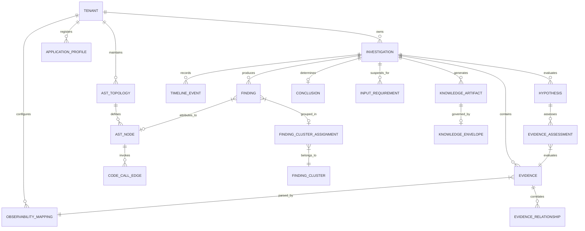

---

### Major Business Entities & Concepts

#### 1. Investigation Aggregate

* **Description:** The root entity representing an individual, end-to-end automated incident investigation instance.


* **Key Attributes:** `investigation_id` (UUID), `tenant_id` (String), `application_id` (String), `status` (`InvestigationStatus` Enum), `version` (Integer, OCC), `code_issue_fingerprint` (SHA-256 Digest), `created_at` (Timestamp), `updated_at` (Timestamp).


* **Relationships:** Belongs to a single Tenant; contains multiple Evidence items, Hypotheses, Timeline Events, Findings, and an optional Input Requirement or final Conclusion.


* **Ownership & Lifecycle:** Owned by the tenant; transitions through `CREATED -> CONTEXTUALIZING -> INVESTIGATING -> CONCLUDING -> COMPLETED / FAILED / CANCELLED / PAUSED / AWAITING_INPUT`. Terminal states can be reopened to `INVESTIGATING` if matching recurring issue fingerprints are detected.


* **Important Validations:** `tenant_id` and `investigation_id` are strictly immutable once created; `version` must increment monotonically on updates to enforce optimistic concurrency control (OCC).


#### 2. Telemetry Evidence & Reference

* **Description:** Standardized, PII-sanitized telemetry records (logs, traces, metric events, database state snippets) fetched from observability providers.


* **Key Attributes:** `evidence_id` (Platform UUID), `tenant_id` (String), `investigation_id` (UUID), `provider_type` (Enum), `fingerprint` (SHA-256 Digest), `observed_at` (Timestamp | Null), `retrieved_at` (Timestamp), `data_classification` (Enum), `payload_json` (JSON snippet), `s3_body_ref` (URI).


* **Relationships:** Bound to one Investigation; linked to other Evidence records via `EvidenceRelationship` (`CALLS`, `DEFINES`, `REFERENCES`, `ACCESSES_TABLE`).


* **Ownership & Lifecycle:** Tenant-owned, immutable once persisted. Large bodies offload to S3 while metadata snippets persist in PostgreSQL.


* **Important Validations:** Raw provider record IDs (e.g., Elasticsearch `_id`) are converted to platform-minted UUIDs. Payload body hash must match the SHA-256 fingerprint.


#### 3. Hypothesis, Finding & Conclusion

* **Description:** Analytical domain concepts capturing reasoning claims, verified evidence findings, and the final mathematical verdict of an investigation.


* **Key Attributes:**
* *Hypothesis:* `hypothesis_id` (UUID), `statement` (Text), `status` (Enum), `confidence_score` (Float).


* *Finding:* `finding_id` (UUID), `title` (Text), `description` (Text), `source_evidence_ids` (List[UUID]), `ast_node_id` (UUID | Null).


* *Conclusion:* `conclusion_id` (UUID), `status` (`ROOT_CAUSE_ESTABLISHED`, `INCONCLUSIVE`, `NO_FAULT_FOUND`, `EXCLUDED`), `overall_confidence` (Float), `summary` (Text).


* **Relationships:** Hypotheses evaluate Evidence via `EvidenceAssessment`; Findings refer to verified Evidence and optional Layer 3 AST nodes; Conclusion binds to one Investigation.


* **Ownership & Lifecycle:** Owned by the tenant investigation aggregate. Conclusions are written during the `CONCLUDING` phase and remain read-only.


* **Important Validations:** `overall_confidence` must be computed mathematically by `VerificationEngine` and must reach $\ge 0.80$ to establish a root-cause status.


#### 4. Application Profile & Observability Source Mapping

* **Description:** Operational and field schema configurations defining how a tenant application's telemetry streams and code repositories are structured.


* **Key Attributes:**
* *ApplicationProfile:* `tenant_id`, `application_id`, `version` (Integer), `profile_json` (Observability, State, Code, and Correlation sub-profiles).


* *ObservabilitySourceMapping:* `source_id`, `index_patterns` (List[String]), `tenant_scope` (`TenantScopeStrategy`), `timestamp` (`FieldMapping`), `severity` (`SeverityDerivation`), `identifiers` (Map[String, FieldMapping]), `top_level_allowlist` (Set[String]).


* **Relationships:** Configures evidence interpretation for a tenant's Application Profile.


* **Ownership & Lifecycle:** Managed by System Administrators as immutable revisions `(tenant_id, application_id, version)`.


* **Important Validations:** Malformed mappings or overlapping `index_patterns` across profiles fail closed during startup loading.


#### 5. AST Topology & Code Identity (Layer 3)

* **Description:** Authoritative graph representation of code repository structures, AST symbols, function call trees, and database table accesses.


* **Key Attributes:** `ast_node_id` (UUIDv5 over tenant/repo/revision/path/symbol), `tenant_id`, `repository_id`, `commit_sha` (Git SHA), `file_path`, `symbol_name`, `macro_node_type` (Enum), `snapshot_status` (`PENDING`, `INGESTING`, `READY`, `FAILED`, `SUPERSEDED`).


* **Relationships:** Nodes link via `CALLS`, `REFERENCES`, and `ACCESSES_TABLE` edges to `DatabaseTable` entities in Neo4j.


* **Ownership & Lifecycle:** Tenant-scoped static graph; created during batch GitHub ingestion and pinned to exact Git commit SHAs.


* **Important Validations:** Hard payload caps enforce a maximum of 20,000 files and 200,000 nodes/edges per repository snapshot.


#### 6. Execution Knowledge & Validity Envelopes

* **Description:** Long-term memory records storing verified incident facts, semantic summaries, and temporal graph episodes across historical investigations.


* **Key Attributes:** `artifact_id` (UUID), `tenant_id`, `validity_kind` (`IMMUTABLE`, `CONDITIONAL`, `TTL`), `valid_to` (Timestamp | Null), `reverify_spec` (JSON | Null), `code_issue_fingerprint` (String | Null), `payload` (JSON).


* **Relationships:** Stored in PostgreSQL `pgvector` (Mem0 text facts) and Neo4j (Graphiti temporal subgraphs).


* **Ownership & Lifecycle:** Governed by `KnowledgeArtifact` validity envelopes. A background TTL janitor workflow purges or marks expired items for re-verification.


* **Important Validations:** Retrieval queries MUST evaluate validity constraints and return an explicit `excluded_stale_count` tally.


#### 7. Finding Cluster & Assignment

* **Description:** Normalized entity structure grouping semantically similar incident findings across multiple historical investigations.


* **Key Attributes:** `cluster_id` (UUID), `tenant_id`, `taxonomy_revision_id` (UUID), `cluster_title` (String), `summary` (Text), `assignment_confidence` (Float), `valid_from` (Timestamp), `valid_to` (Timestamp | Null).


* **Relationships:** Contains multiple Findings via versioned `FindingClusterAssignment` rows.


* **Ownership & Lifecycle:** Managed by `FindingClusteringWorkflow` on the analytics queue; assignments maintain historical validity intervals.


* **Important Validations:** Assignment must evaluate to exactly one cluster per input finding; unassigned or ambiguous findings fall back to an explicit `UNASSIGNED` state.


#### 8. Background Job & Input Requirement

* **Description:** Operational execution state entities tracking asynchronous tasks and human-in-the-loop input requests.


* **Key Attributes:**
* *BackgroundJob:* `job_id` (UUID), `tenant_id`, `kind` (Enum), `status` (`QUEUED`, `PENDING`, `RUNNING`, `CANCEL_REQUESTED`, `CANCELED`, `DONE`, `FAILED`), `stage` (String), `workflow_id` (String), `result_ref` (URI | Null).


* *InputRequirement:* `requirement_id` (UUID), `requirement_version` (Integer), `reason` (Text), `target_json_schema` (JSON), `expires_at` (Timestamp | Null).


* **Relationships:** Jobs track long-running analytics/reindexing; Requirements suspend an active Investigation.


* **Ownership & Lifecycle:** Tenant-scoped; state updates are managed idempotently through PostgreSQL read models and Temporal execution descriptions.


* **Important Validations:** Fulfillment submissions are schema-validated and executed via compare-and-set Temporal Updates.


---

## External System Integrations

The Investigation Agent Platform integrates with nine primary external software systems and infrastructure tiers.

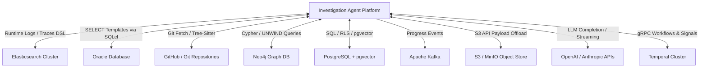

---

### External Integration Catalog

| System Name | Integration Purpose | Why the Platform Interacts | Information Exchanged | Direction | Trigger / Frequency | Business Significance |
| --- | --- | --- | --- | --- | --- | --- |
| **Elasticsearch Cluster**<br> | Primary runtime observability store (logs, HTTP transactions, distributed traces).

 | To gather runtime error evidence, trace propagation keys, transaction timings, and service logs.

 | *Outbound:* Translated Query DSL, HMAC pagination cursors.

<br>

<br>*Inbound:* Document hits, trace spans, error logs.

 | Bidirectional | Triggered on-demand during reasoning evidence gathering loops.

 | Essential for identifying runtime failure manifestations and error timestamps.

 |
| **Oracle Database**<br> | Operational application database state verification.

 | To verify application state (orders, user accounts, flag tables) related to failures.

 | *Outbound:* Parameterized SELECT SQL templates via SQLcl MCP.

<br>

<br>*Inbound:* Column/value result rows.

 | Bidirectional | Triggered when hypotheses require database state verification.

 | Replaces manual DB inspection with zero-write-risk static SQL templates.

 |
| **GitHub / Git Repositories**<br> | Source code, revision history, and CODEOWNERS acquisition.

 | To fetch source files for AST parsing, trace commit SHAs, and resolve code ownership.

 | *Outbound:* Git fetch commands, REST metadata queries.

<br>

<br>*Inbound:* Blobless code trees, commit SHAs, CODEOWNERS text.

 | Bidirectional | Triggered during batch topology ingestion or code evidence inspection.

 | Connects runtime stack traces directly to source code and engineering teams.

 |
| **Neo4j Graph Database**<br> | Layer 3 static code topology graph and Graphiti temporal knowledge graph.

 | To perform multi-hop graph queries linking code symbols, files, and DB tables.

 | *Outbound:* Cypher UNWIND batches, Graphiti episode writes.

<br>

<br>*Inbound:* Call graphs, AST paths, temporal knowledge subgraphs.

 | Bidirectional | High-frequency queries during failure attribution and graph correlation.

 | Drives deterministic, mathematically verifiable code fault attribution.

 |
| **PostgreSQL + pgvector**<br> | Core relational persistence, Mem0 vector memory, background jobs.

 | To persist domain aggregates, evidence metadata, vector embeddings, and jobs.

 | *Outbound:* SQL queries, RLS scope parameters, 1536-dim vectors.

<br>

<br>*Inbound:* Hydrated domain entities, vector nearest neighbors.

 | Bidirectional | Continuous transactional interaction across all application activities.

 | Authoritative relational state and local semantic vector store for memory.

 |
| **Apache Kafka**<br> | Event messaging backbone for job progress fan-out.

 | To stream asynchronous job execution progress to API replicas for WebSockets.

 | *Outbound:* Versioned `JobProgressEvent` JSON envelopes.

<br>

<br>*Inbound:* Replica progress stream events.

 | Bidirectional | Event-driven publication during background job execution.

 | Decouples job execution from real-time browser user updates.

 |
| **S3 / MinIO Object Storage**<br> | High-capacity blob and report artifact storage.

 | To store complete raw evidence payloads and rendered aggregate HTML/JSON reports.

 | *Outbound:* Raw JSON payloads, rendered HTML report files.

<br>

<br>*Inbound:* Artifact objects, 3600s signed URLs.

 | Bidirectional | Triggered on evidence offload or report rendering completion.

 | Prevents database bloat and delivers secure report download links.

 |
| **LLM Providers (OpenAI / Anthropic)**<br> | Natural language reasoning, intent proposal, and chat generation.

 | To formulate reasoning steps, analyze unstructured text, and cluster findings.

 | *Outbound:* Prompt messages, strict JSON schemas, XML envelopes.

<br>

<br>*Inbound:* Proposed tool intents, completion tokens, SSE streams.

 | Bidirectional | Triggered during reasoning iterations, chat sessions, or clustering runs.

 | Powers intelligent plan generation and natural language interaction.

 |
| **Temporal Cluster**<br> | Durable workflow execution and activity scheduling engine.

 | To guarantee durable workflow completion, retry handling, and schedule execution.

 | *Outbound:* Workflow state updates, activity task executions, signals.

<br>

<br>*Inbound:* Workflow execution commands, schedule triggers.

 | Bidirectional | Continuous execution of investigation, janitor, and analytics queues.

 | Ensures zero lost investigation state across process crashes or restarts.

 |

---
# System Functional Specification: Investigation Agent Platform (IAP)

**Document Context:** Functional View of the System (Topic 5 of 12)

---

## User / System Interactions (Use Cases)

The interactions between human actors, external automated systems, platform components, and downstream infrastructure are formalized below as structured use cases.

---

### UC-001: Trigger Automated Incident Investigation

* **Use Case ID:** UC-001
* **Name:** Trigger Automated Incident Investigation
* **Primary Actor:** Alerting System / On-Call SRE


* **Trigger:** An automated alert webhook fires from PagerDuty/Datadog or an SRE submits an error intake request.


* **Preconditions:**
1. Valid tenant identity credentials provided.


2. Active target `ApplicationProfile` exists in the system.


3. External orchestrator (Temporal) and database (PostgreSQL) are operational.


```mermaid
sequenceDiagram
    autonumber
    actor Actor as Alert System / SRE
    participant API as FastAPI Gateway
    participant DB as PostgreSQL
    participant Temp as Temporal Engine

    Actor->>API: POST /v1/intake/errors (Payload + Headers)
    API->>API: Verify Tenant Identity & Sanitize Input
    API->>DB: Query Recurring Issue Fingerprint
    alt Recurring Code Issue Match
        DB-->>API: Match Found (Closed Issue)
        API->>DB: Fork Context / Reopen Prior Investigation
    else New Issue
        API->>DB: Create Investigation Aggregate (Status: CREATED)
    end
    API->>Temp: Start RunInvestigationWorkflow Execution
    Temp-->>API: Return Workflow Execution ID
    API-->>Actor: 201 Created (Investigation ID, Status, Links)

```

#### Main Flow

1. The actor submits an error payload via `POST /v1/intake/errors` or `POST /v1/investigations`.


2. The FastAPI gateway derives the `tenant_id` from verified auth context and validates the request payload.


3. The system generates a canonical SHA-256 `code_issue_fingerprint` from the error message and stack trace.


4. The system checks PostgreSQL for matching closed code issues to determine if context should be forked or reopened.


5. The system creates a new `Investigation` aggregate record in PostgreSQL with status `CREATED`.


6. The system initializes the application context and triggers Temporal `RunInvestigationWorkflow`.


7. The system returns HTTP 201 Created containing the generated `investigation_id` and initial state.


#### Alternate / Exception Flows

* **A1 (Recurring Issue Reopen):** If the code issue fingerprint matches a previously closed investigation, the system reopens the prior investigation aggregate (`COMPLETED -> INVESTIGATING`) and attaches the new event to the existing timeline.


* **E1 (Unreachable Temporal Orchestrator):** If the Temporal cluster is unreachable, the system aborts execution immediately and returns HTTP 503 Service Unavailable.


* **E2 (Missing Application Profile):** If no matching `ApplicationProfile` exists for the application ID, the system returns HTTP 400 Bad Request.


* **Postconditions:** A durable investigation record is persisted in PostgreSQL, and a Temporal workflow execution is active on the `investigation-tasks` queue.


---

### UC-002: Fulfill Missing Context Input Requirement

* **Use Case ID:** UC-002
* **Name:** Fulfill Missing Context Input Requirement
* **Primary Actor:** On-Call SRE


* **Trigger:** An active investigation transitions to `AWAITING_INPUT` and requests missing operational context.


* **Preconditions:**
1. Investigation is suspended in status `AWAITING_INPUT`.


2. Unexpired `InputRequirement` record exists with an active JSON Schema.


#### Main Flow

1. SRE inspects investigation status via `GET /v1/investigations/{id}` and retrieves the pending requirement ID, reason, and target JSON Schema.


2. SRE prepares a fulfillment JSON payload matching the target schema.


3. SRE submits fulfillment via `POST /v1/investigations/{id}/input-requirements/{req_id}/fulfill` including an `Idempotency-Key` header.


4. FastAPI validates the JSON payload against the requirement's target JSON Schema.


5. System invokes a Temporal Workflow Update (`fulfill_input`) on the running workflow.


6. Temporal workflow executes compare-and-set validation, records the `InputFulfillment`, transitions status to `INVESTIGATING`, and resumes the reasoning loop.


7. API returns HTTP 200 OK with the updated investigation summary.


#### Alternate / Exception Flows

* **E1 (Schema Validation Failure):** If the fulfillment payload violates the target JSON Schema, API rejects the request immediately with HTTP 400 Bad Request.


* **E2 (Conflicting Duplicate Fulfillment):** If a fulfillment submission uses an existing idempotency key with a modified payload for an already fulfilled requirement version, system returns HTTP 409 Conflict.


* **E3 (Requirement Expired):** If the requirement expired before submission, workflow transitions to `PAUSED` or resumes with default context per policy.


* **Postconditions:** Input fulfillment is persisted, audited, and bound to the investigation context; workflow continues execution.


---

### UC-003: Query Telemetry Evidence via External MCP Client

* **Use Case ID:** UC-003
* **Name:** Query Telemetry Evidence via External MCP Client
* **Primary Actor:** External Coding Agent / MCP Client (e.g., Cursor, Claude Desktop)


* **Trigger:** An external coding agent invokes a Model Context Protocol tool (e.g., `search_runtime_evidence`, `investigate_trace`).


* **Preconditions:**
1. Active MCP server transport established (stdio or Streamable HTTP).


2. Client identity and target investigation header (`X-Investigation-ID`) validated.


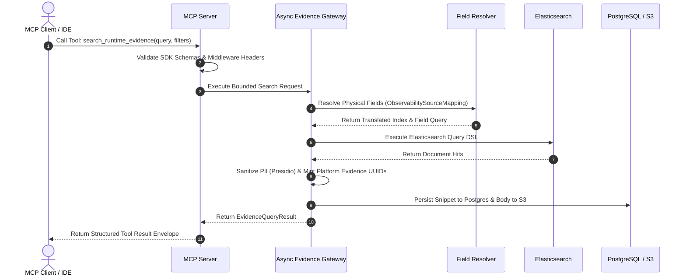

#### Main Flow

1. MCP client invokes tool `search_runtime_evidence` passing search keywords, timeframe, and identifier filters.


2. MCP server middleware validates argument types against strict 2020-12 JSON schemas and verifies caller authorization.


3. Request is routed to `AsyncEvidenceGateway`.


4. Gateway invokes `FieldResolver` to map logical concepts (`trace_id`, severity) to physical fields using the target `ObservabilitySourceMapping`.


5. Gateway executes translated query against Elasticsearch, applying provider bounds and HMAC cursors.


6. Gateway scrubs PII via Presidio, computes SHA-256 fingerprints, and mints platform UUIDs for fetched hits.


7. Gateway persists evidence metadata in PostgreSQL and offloads raw bodies to S3.


8. MCP server formats result into a standardized JSON response envelope and returns it to the client.


#### Alternate / Exception Flows

* **E1 (Unsupported Field Filter):** If client supplies a severity filter for an `UNSUPPORTED` severity source, system returns JSON-RPC error `-32602` (`INVALID_REQUEST`).


* **E2 (Cross-Scope Access):** If client requests an evidence ID outside its authorized investigation, system returns `EVIDENCE_NOT_FOUND` without disclosing existence.


* **Postconditions:** Platform evidence rows are persisted in PostgreSQL/S3, and clean query results are returned to the MCP agent.


---

### UC-004: Ingest GitHub AST Code Topology (Layer 3)

* **Use Case ID:** UC-004
* **Name:** Ingest GitHub AST Code Topology (Layer 3)
* **Primary Actor:** System Administrator / CLI Loader (`scripts/ingest_github.py`)


* **Trigger:** Operator executes batch ingestion script or scheduled topology update fires.


* **Preconditions:**
1. Neo4j database operational with tenant uniqueness constraints installed.


2. GitHub organization credentials / API tokens configured.


#### Main Flow

1. Operator launches `scripts/ingest_github.py` specifying tenant ID, repository target, and repository type mappings.


2. Script queries GitHub REST API, follows pagination links, filters archived/fork repositories, and pins exact HEAD commit SHAs.


3. Script executes a blobless single-branch git fetch into local workspace, scrubbing tokens from URLs.


4. Script walks working tree, skipping files $> 512\text{ KB}$, and executes C-based `tree-sitter` parsers.


5. Script constructs `ASTTopologyPayload` containing macro AST nodes and CALLS/REFERENCES/ACCESSES_TABLE edges.


6. Script submits payload to `Neo4jTopologyAdapter`, executing UNWIND batches to populate Neo4j.


7. Script indexes CODEOWNERS file and appends execution results to `IngestManifestRow` JSONL audit trail.


#### Alternate / Exception Flows

* **E1 (Payload Cap Exceeded):** If a repository exceeds 20,000 files or 200,000 nodes/edges, ingestion fails closed for that repository and marks manifest row as `FAILED`.


* **E2 (Transient Network Error):** Script retries transient API failures with backoff; persistent failures update JSONL manifest for resume.


* **Postconditions:** Layer 3 AST code topology graph is available in Neo4j; audit trail recorded in JSONL manifest.


---

### UC-005: Generate & Download Aggregate Incident Report

* **Use Case ID:** UC-005
* **Name:** Generate & Download Aggregate Incident Report
* **Primary Actor:** On-Call SRE / System Administrator


* **Trigger:** Operator submits an aggregate report generation request via REST API.


* **Preconditions:**
1. Completed finding clustering runs exist for target scope.


2. S3 artifact storage adapter configured.


#### Main Flow

1. Actor submits request to `POST /api/v1/aggregate-reports` providing scope ID and target format.


2. System creates a `QUEUED` background job in PostgreSQL and dispatches `aggregate_report` workflow to Temporal `analytics-tasks` queue.


3. Analytics worker invokes `ReportRendererRegistry` to compile findings and cluster assignments using Jinja2 templates.


4. Renderer enforces HTML autoescaping and Content Security Policy (CSP) headers.


5. Worker offloads rendered HTML/JSON artifact to S3/MinIO via `ArtifactStorePort`.


6. System updates job status to `DONE`, records artifact reference, and generates a 3600-second signed URL.


7. Actor retrieves report metadata and downloads artifact via signed URL.


#### Alternate / Exception Flows

* **E1 (Legal Hold Deletion Conflict):** If an operator attempts to purge report artifacts under legal hold, system rejects request with HTTP 409 Conflict.


* **Postconditions:** Report artifact securely stored in S3; temporary signed URL issued.


---

### UC-006: Interactive Real-Time Incident Chat Session

* **Use Case ID:** UC-006
* **Name:** Interactive Real-Time Incident Chat Session
* **Primary Actor:** On-Call SRE


* **Trigger:** SRE opens an interactive chat session to query active investigation context.


* **Preconditions:**
1. Valid investigation ID and tenant authorization.


2. `StreamingLLMGateway` initialized.


#### Main Flow

1. SRE creates chat session via `POST /api/v1/chat/sessions`.


2. SRE submits prompt message via `POST /api/v1/chat/sessions/{id}/messages`.


3. System builds context via `ChatContextBuilderPort` and invokes `StreamingLLMGateway`.


4. Gateway streams `token` event frames over Server-Sent Events (SSE) to the client.


5. Upon completion, gateway emits `final` event containing validated message and advisory suggested actions.


6. Message and token usage metrics are persisted in PostgreSQL.


#### Alternate / Exception Flows

* **A1 (Advisory Action Execution):** SRE clicks a suggested action in UI; client explicitly invokes normal authorized REST API endpoint.


* **E1 (Client Disconnect):** If client disconnects mid-stream, system immediately cancels provider stream and halts generation.


* **Postconditions:** Chat turn recorded in session history; LLM tokens accounted.


---

## Functional Dependencies Matrix

The functional architecture exhibits strict structural dependencies across capabilities, end-to-end processes, external systems, and data domains.

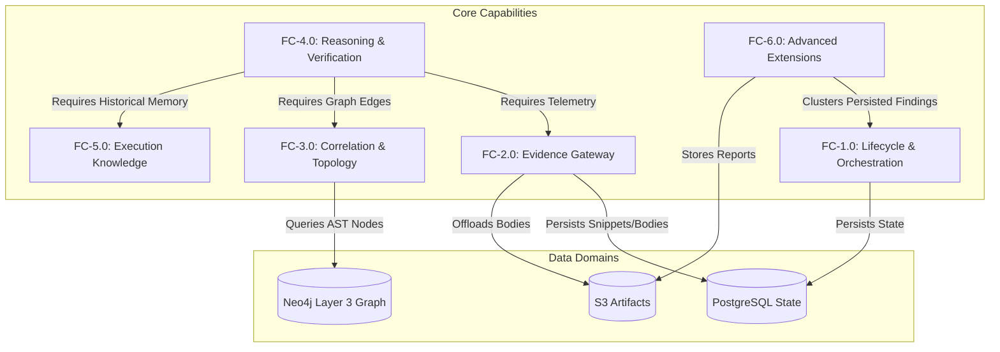

---

### Comprehensive Capability & System Dependency Reference

| Dependent Capability / Process | Required Prerequisite Capability / System | Nature of Dependency | Business Impact if Prerequisite Fails |
| --- | --- | --- | --- |
| **FC-4.2 Verification & Confidence Calculation**<br> | **FC-2.1 Evidence Gateway**<br><br>

<br>**FC-3.1 Ephemeral Graph Correlation**<br> | Mathematical confidence formula requires sanitized evidence and deterministic graph edges.

 | Investigation cannot reach `ROOT_CAUSE_ESTABLISHED`; defaults to `INCONCLUSIVE`.

 |
| **FC-3.3 Failure Attribution**<br> | **FC-3.2 Static Code Topology (Layer 3)**<br><br>

<br>**FC-2.4 Git & AST Symbol Extraction**<br> | Stack frame attribution requires AST nodes and CODEOWNERS index in Neo4j.

 | Failure attribution fails closed to `INCONCLUSIVE`.

 |
| **FC-6.2 Cross-Investigation Finding Clustering**<br> | **FC-1.2 Finding Persistence**<br><br>

<br>**PostgreSQL `findings` Table**<br> | Clustering workflow queries unassigned findings written during prior investigation conclusions.

 | Clustering workflow finds zero findings; no clusters generated.

 |
| **FC-6.3 Aggregate Reporting**<br> | **FC-6.2 Finding Clustering**<br><br>

<br>**FC-11.3A Artifact Store Adapter**<br> | Reports aggregate cluster taxonomy generations and store rendered HTML in S3.

 | Report generation fails or signed download URLs cannot be issued.

 |
| **FC-6.5 Background Job Stream**<br> | **Apache Kafka Messaging**<br><br>

<br>**Temporal Worker Queues**<br> | Requires Kafka for progress event fan-out and Temporal task queues for execution.

 | Real-time WebSocket updates fail; clients must poll PostgreSQL read model.

 |
| **E2E-PROC-1 Incident Investigation**<br> | **Temporal `RunInvestigationWorkflow**`<br><br>

<br>**PostgreSQL Database**<br> | Workflow orchestrator drives state engine; PostgreSQL stores aggregate state.

 | Platform fails loud (HTTP 503); cannot accept new investigations.

 |
| **E2E-PROC-2 Input Requirement & Resume**<br> | **Temporal Workflow Update Mechanism**<br> | Resume requires atomic compare-and-set Temporal Update validation.

 | Workflow remains suspended in `AWAITING_INPUT`.

 |
| **E2E-PROC-3 GitHub AST Ingestion**<br> | **Neo4j 5.26 Community Database**<br><br>

<br>**C-extension Tree-Sitter Parser**<br> | Macro node UNWIND writes require Neo4j; code parsing requires Tree-Sitter.

 | Repository topology cannot be updated; attribution uses stale snapshots.

 |

---

# System Functional Specification: Investigation Agent Platform (IAP)

**Document Context:** Functional View of the System (Topic 6 of 12)

---

## Non-Functional Requirements

The non-functional requirements (NFRs) capture the quality attributes, operational limits, security constraints, and performance benchmarks explicitly specified across the platform documents.

---

### 1. Performance & Execution Boundaries

| Requirement ID | Performance Requirement Statement | Quantitative Limit / Benchmark | Source Document(s) |
| --- | --- | --- | --- |
| **NFR-PERF-01** | **Investigation Execution Timeout** | Maximum continuous duration of a single investigation workflow execution is capped at **1,800 seconds (30 minutes)**.

 | Part 2 §Fact

 |
| **NFR-PERF-02** | **Reasoning & Tool Call Caps** | Investigations are strictly bounded to a maximum of **50 tool calls** (`IAP_MAX_TOOL_CALLS`) and **20 reasoning iterations** (`IAP_MAX_REASONING_CALLS`).

 | Part 2 §Fact

 |
| **NFR-PERF-03** | **Tree-Sitter Parsing File Size Cap** | Source code file parsing using `tree-sitter` is capped at **512 KB per file**; larger files are skipped fail-closed.

 | Part 3 §Fact, Part 7 §Fact

 |
| **NFR-PERF-04** | **Layer 3 Topology Ingestion Caps** | AST code topology ingestion for a single repository is capped at **20,000 files** and **200,000 total nodes/edges**.

 | Part 5 §Fact, Part 7 §Fact

 |
| **NFR-PERF-05** | **Bulk Import Batch Limit** | Parent batch intake workflows are restricted to a maximum of **500 records per parent execution**.

 | Part 11 §9.2

 |
| **NFR-PERF-06** | **Signed URL Expiration** | S3/MinIO signed download URLs issued for report artifacts and evidence bodies default to a **3,600-second (1-hour)** expiration TTL.

 | Part 11 §7.3, Part 12 §5

 |
| **NFR-PERF-07** | **Elasticsearch Provider Bounds** | Elasticsearch runtime query executions are capped at **200 max hits** (`ELASTIC_MAX_HITS`), a **7-day window**, **20 keyword terms**, and **10 service names**.

 | Part 9 §Fact

 |

---

### 2. Availability, Resilience & Fault Tolerance

| Requirement ID | Availability & Resilience Requirement Statement | Implementation Mechanism | Source Document(s) |
| --- | --- | --- | --- |
| **NFR-AVL-01** | **Fail-Hard Boot Stance** | Production system boot must fail hard (HTTP 503) if mandatory dependencies (PostgreSQL, Temporal) are unreachable; production never degrades silently to in-memory fallbacks.

 | Part 4 §Decisions

 |
| **NFR-AVL-02** | **Non-Destructive Background Failures** | Failures in non-critical background activities (knowledge capture, telemetry derivation, progress event fan-out, background indexing) must log diagnostic errors but must **never cause an active investigation to fail**.

 | Part 2 §Decisions, Part 6 §Decisions, Part 11 §7.4

 |
| **NFR-AVL-03** | **Non-Fatal Schedule Reconciliation** | Temporal schedule reconciliation runs during worker boot with per-descriptor error collection; an error in a single schedule descriptor must never crash worker execution.

 | Part 12 §3

 |
| **NFR-AVL-04** | **Replica-Unique Event Consumer Groups** | Kafka subscribers on API replicas must use replica-unique consumer groups (`{base}-{hostname}`) to ensure every API replica receives every progress event for its local WebSockets.

 | Part 11 §7.4, Part 12 §4

 |

---

### 3. Security, Isolation & Safety

| Requirement ID | Security & Isolation Requirement Statement | Enforcement Point | Source Document(s) |
| --- | --- | --- | --- |
| **NFR-SEC-01** | **Strict Server-Derived Multi-Tenancy** | Every domain port, SQL repository query, cache key, vector namespace, and Neo4j Cypher clause must enforce a server-derived `tenant_id`; client payload tenant overrides are rejected.

 | Part 1 §Fact, Part 3 §Decisions, Part 5 §Decisions, Part 11 §4.1

 |
| **NFR-SEC-02** | **Zero-Write Read-Only Infrastructure** | The platform executes zero dynamic SQL, zero direct shell commands, and zero direct filesystem writes outside designated temporary directories. Oracle DB interactions use pre-validated static SELECT templates checked via `sqlglot`.

 | Part 1 §Fact, Part 3 §Fact

 |
| **NFR-SEC-03** | **PII Scrubbing & Prompt Injection Defense** | All untrusted evidence payloads must undergo PII sanitization via Microsoft Presidio and be enclosed in XML isolation envelopes before being passed to LLM reasoning prompts.

 | Part 2 §Fact, Part 3 §Fact

 |
| **NFR-SEC-04** | **Outbound Fetch SSRF & Containment Controls** | All external HTTP/Git fetches must enforce host allowlists, block private/loopback IP ranges, and prevent symlink directory escapes.

 | Part 3 §Fact, Part 11 §11.2, §11.4

 |
| **NFR-SEC-05** | **Secret Reference Governance** | Outbound credentials must resolve using explicit environment allowlists (`allowed_env_names`); accessing arbitrary environment variables or logging raw tokens is strictly prohibited.

 | Part 11 §4.4, Part 12 §9

 |

---

### 4. Auditability, Provenance & Transparency

| Requirement ID | Auditability Requirement Statement | Operational Artifact | Source Document(s) |
| --- | --- | --- | --- |
| **NFR-AUD-01** | **SHA-256 Fingerprinting & Provenance** | All evidence payloads, action intents, and reasoning outputs must record SHA-256 canonical fingerprints and structured `ProvenanceRecord` metadata linking model IDs, prompt versions, and source commit SHAs.

 | Part 2 §Fact, Part 3 §Fact, Part 11 §6.4

 |
| **NFR-AUD-02** | **GitHub Ingestion Manifest Audit Trail** | Every GitHub AST repository ingestion run must output a frozen `IngestManifestRow` JSONL audit trail recording SHA pins, node counts, and repository status (`READY`, `FAILED`, `SKIPPED`).

 | Part 7 §Fact, §Decisions

 |
| **NFR-AUD-03** | **Immutable Security Audit Events** | Security-sensitive operational events (credential acquisition, artifact deletion, input fulfillment, advisory action execution) must generate immutable audit events distinct from diagnostic logs.

 | Part 11 §6.6, Part 12 §7

 |

---

### 5. Scalability & Data Retention

| Requirement ID | Scalability & Retention Requirement Statement | Storage Strategy | Source Document(s) |
| --- | --- | --- | --- |
| **NFR-SCL-01** | **Two-Tier Evidence Payload Offload** | Evidence snippets persist in PostgreSQL for fast indexing, while raw heavy bodies are offloaded to S3/MinIO object storage.

 | Part 2 §Fact, Part 9 §Fact

 |
| **NFR-SCL-02** | **Fixed Dimension Vector Embeddings** | Vector memory tables (`pgvector`) are hard-pinned to **1,536 dimensions** (`FINDING_EMBEDDING_DIMS`, `REFERENCE_EMBEDDING_DIMS`) with HNSW cosine indexes.

 | Part 6 §Fact, Part 12 §6

 |
| **NFR-RET-01** | **Default Data Retention & Legal Hold** | Historical reports, chat sessions, batch records, and evidence records enforce a **90-day retention default**; purge requests against records marked with active legal holds must return HTTP 409 Conflict.

 | Part 6 §Fact, Part 12 §7

 |

---

## Requirements Traceability Matrix (RTM)

The Requirements Traceability Matrix maps all functional requirements (FR-001 through FR-045) and non-functional requirements (NFRs) to their supporting business capabilities, end-to-end processes, use cases, external integration systems, and source documents.

---

### Comprehensive Traceability Table

| Requirement ID | Brief Requirement Description | Source Document(s) | Business Capability | Business Process | Actor / Use Case | Target External System |
| --- | --- | --- | --- | --- | --- | --- |
| **FR-001** | Ingest error payload & create investigation UUID

 | Part 1, Part 4

 | FC-1.1

 | E2E-PROC-1

 | SRE / UC-001

 | PostgreSQL

 |
| **FR-002** | Orchestrate lifecycle state transitions

 | Part 1, Part 4, Part 11

 | FC-1.2

 | E2E-PROC-1

 | Temporal / UC-001

 | Temporal Cluster

 |
| **FR-003** | Reopen terminal states for recurring issues

 | Part 1, Part 4

 | FC-1.2

 | E2E-PROC-1

 | Alert System / UC-001

 | PostgreSQL

 |
| **FR-004** | Suspend workflow into `AWAITING_INPUT`<br> | Part 11

 | FC-1.3

 | E2E-PROC-2

 | Reasoner / UC-002

 | PostgreSQL, Temporal

 |
| **FR-005** | Validate input fulfillment against JSON Schema

 | Part 11

 | FC-1.3

 | E2E-PROC-2

 | SRE / UC-002

 | Temporal Cluster

 |
| **FR-006** | Reject duplicate fulfillment payload changes (409)

 | Part 11

 | FC-1.3

 | E2E-PROC-2

 | SRE / UC-002

 | PostgreSQL

 |
| **FR-007** | Bulk investigation intake with concurrency permit

 | Part 11

 | FC-1.4

 | E2E-PROC-5

 | System Admin

 | Temporal Tasks

 |
| **FR-008** | Fail hard (503) if Temporal unwired at boot

 | Part 4

 | FC-1.2

 | E2E-PROC-1

 | System Operator

 | Temporal Cluster

 |
| **FR-009** | Enforce Evidence Gateway sanitization/dedup

 | Part 3, Part 9

 | FC-2.1

 | E2E-PROC-1

 | Gateway / UC-003

 | S3, PostgreSQL

 |
| **FR-010** | Deduplicate evidence using SHA-256 fingerprint

 | Part 2, Part 3

 | FC-2.1

 | E2E-PROC-1

 | Gateway / UC-003

 | PostgreSQL

 |
| **FR-011** | Offload raw heavy bodies to S3/MinIO

 | Part 2, Part 9

 | FC-2.1

 | E2E-PROC-1

 | Gateway / UC-003

 | S3 / MinIO

 |
| **FR-012** | Dynamic field mapping via config profile

 | Part 10

 | FC-2.2

 | E2E-PROC-1

 | System Admin / UC-003

 | Elasticsearch

 |
| **FR-013** | Mandatory `FIELD` strategy tenant filter clause

 | Part 10

 | FC-2.2

 | E2E-PROC-1

 | Elastic Adapter

 | Elasticsearch

 |
| **FR-014** | Reject unsupported field filters explicitly

 | Part 10

 | FC-2.2

 | E2E-PROC-1

 | FieldResolver

 | Elasticsearch

 |
| **FR-015** | Read-only Oracle queries via static SQL templates

 | Part 1, Part 3

 | FC-2.3

 | E2E-PROC-1

 | Oracle Adapter

 | Oracle DB via SQLcl

 |
| **FR-016** | Fetch Git code capped at 512 KB per file

 | Part 3, Part 7

 | FC-2.4

 | E2E-PROC-3

 | PyGit2 / Tree-Sitter

 | GitHub / Git Repos

 |
| **FR-017** | Mint platform UUIDs for evidence items

 | Part 9

 | FC-2.1

 | E2E-PROC-1

 | Gateway / UC-003

 | PostgreSQL

 |
| **FR-018** | Construct `rustworkx` ephemeral correlation graph

 | Part 3, Part 5

 | FC-3.1

 | E2E-PROC-1

 | Correlation Engine

 | PostgreSQL

 |
| **FR-019** | Ingest GitHub repositories into Neo4j Layer 3

 | Part 5, Part 7

 | FC-3.2

 | E2E-PROC-3

 | CLI / UC-004

 | Neo4j Graph DB

 |
| **FR-020** | Pin Layer 3 AST topology to Git commit SHA

 | Part 5, Part 7

 | FC-3.2

 | E2E-PROC-3

 | System Admin / UC-004

 | Neo4j Graph DB

 |
| **FR-021** | Execute dual-frame stack trace attribution

 | Part 5

 | FC-3.3

 | E2E-PROC-1

 | FailureAttribution

 | Neo4j Graph DB

 |
| **FR-022** | Map CODEOWNERS rules capped at 0.30 confidence

 | Part 5

 | FC-3.3

 | E2E-PROC-1

 | CodeownersResolver

 | Neo4j Graph DB

 |
| **FR-023** | Execute blobless single-branch Git fetch

 | Part 7

 | FC-3.2

 | E2E-PROC-3

 | CLI Loader / UC-004

 | GitHub REST / Git

 |
| **FR-024** | Keep Cognee optional behind feature flag

 | Part 8

 | FC-3.2

 | E2E-PROC-3

 | System Operator

 | Neo4j Graph DB

 |
| **FR-025** | Restrict LLM output to typed action proposals

 | Part 2

 | FC-4.1

 | E2E-PROC-1

 | Reasoning Agent

 | OpenAI / Anthropic

 |
| **FR-026** | Enforce tool call and reasoning duration budgets

 | Part 2

 | FC-4.3

 | E2E-PROC-1

 | Loop Guard

 | System Runtime

 |
| **FR-027** | Detect duplicate tool calls via SHA-256 fingerprint

 | Part 2

 | FC-4.3

 | E2E-PROC-1

 | Action Validator

 | System Runtime

 |
| **FR-028** | Compute hypothesis confidence mathematically

 | Part 2

 | FC-4.2

 | E2E-PROC-1

 | VerificationEngine

 | System Runtime

 |
| **FR-029** | Enforce 0.80 confidence threshold gate

 | Part 2

 | FC-4.2

 | E2E-PROC-1

 | ConclusionGate

 | PostgreSQL

 |
| **FR-030** | XML isolation envelopes & Presidio scrubbing

 | Part 2, Part 3

 | FC-4.1

 | E2E-PROC-1

 | Reasoning Coordinator

 | OpenAI / Anthropic

 |
| **FR-031** | Store Mem0 text facts in pgvector

 | Part 6

 | FC-5.1

 | E2E-PROC-1

 | Mem0 Store

 | PostgreSQL + pgvector

 |
| **FR-032** | Store Graphiti temporal subgraphs in Neo4j

 | Part 6

 | FC-5.2

 | E2E-PROC-1

 | Graphiti Store

 | Neo4j Graph DB

 |
| **FR-033** | Enclose knowledge in validity envelopes

 | Part 6

 | FC-5.3

 | E2E-PROC-1

 | Knowledge Service

 | PostgreSQL

 |
| **FR-034** | Evaluate staleness & return excluded count

 | Part 6

 | FC-5.3

 | E2E-PROC-1

 | Knowledge Service

 | System Runtime

 |
| **FR-035** | Limit cross-tenant sharing to code fingerprints

 | Part 6

 | FC-5.3

 | E2E-PROC-1

 | Intake Engine

 | PostgreSQL

 |
| **FR-036** | Authenticated capability discovery endpoint

 | Part 11, Part 12

 | FC-6.1

 | E2E-PROC-5

 | API / MCP Client

 | REST API

 |
| **FR-037** | Hybrid search over external reference docs

 | Part 11

 | FC-6.1

 | E2E-PROC-1

 | RefDoc Service

 | PostgreSQL + pgvector

 |
| **FR-038** | Incremental finding clustering via LLM

 | Part 11

 | FC-6.2

 | E2E-PROC-4

 | Analytics Worker

 | PostgreSQL, OpenAI

 |
| **FR-039** | Render HTML/JSON reports with autoescaping/CSP

 | Part 11

 | FC-6.3

 | E2E-PROC-4

 | Report Renderer

 | Jinja2 Engine

 |
| **FR-040** | Offload report artifacts to S3 with 3600s URL

 | Part 11, Part 12

 | FC-6.3

 | E2E-PROC-4 / UC-005

 | SRE / UC-005

 | S3 / MinIO

 |
| **FR-041** | Real-time chat streaming over SSE

 | Part 11

 | FC-6.4

 | E2E-PROC-1 / UC-006

 | SRE / UC-006

 | Streaming LLM API

 |
| **FR-042** | Execute background jobs via Temporal & Postgres

 | Part 11, Part 12

 | FC-6.5

 | E2E-PROC-5

 | Background Worker

 | PostgreSQL, Temporal

 |
| **FR-043** | Stream job events via Kafka & WebSocket

 | Part 11, Part 12

 | FC-6.5

 | E2E-PROC-5

 | WS Client / UC-005

 | Apache Kafka

 |
| **FR-044** | Manage OAuth2 tokens with proactive refresh

 | Part 11, Part 12

 | FC-6.6

 | E2E-PROC-1

 | Credential Provider

 | Identity Provider

 |
| **FR-045** | Defensive LLM JSON recovery on truncation

 | Part 11

 | FC-4.1

 | E2E-PROC-1

 | Reasoning Coordinator

 | System Runtime

 |
| **NFR-PERF-01** | Max 1,800s continuous workflow duration

 | Part 2

 | FC-1.2

 | E2E-PROC-1

 | Temporal Engine

 | Temporal Cluster

 |
| **NFR-SEC-01** | Mandatory server-derived tenant isolation

 | Part 1, Part 3, Part 11

 | All Capabilities | All Processes | All Actors / Systems | All Storage Stores

 |
| **NFR-SEC-02** | Zero dynamic SQL; SELECT-only templates

 | Part 1, Part 3

 | FC-2.3

 | E2E-PROC-1

 | Oracle Adapter

 | Oracle DB via SQLcl

 |
| **NFR-SCL-02** | 1536-dimension pgvector embeddings

 | Part 6, Part 12

 | FC-5.1, FC-6.1

 | E2E-PROC-1, PROC-4

 | Vector Stores

 | PostgreSQL + pgvector

 |

---

# System Functional Specification: Investigation Agent Platform (IAP)

**Document Context:** Functional View of the System (Topic 7 of 12)

---

## Assumptions, Gaps, and Open Questions

A rigorous analysis of the 13 architectural, implementation, operations, and design documents reveals a clear distinction between confirmed functional facts, foundational engineering assumptions, reconciled ambiguities, and open items requiring stakeholder alignment.

---

### 1. Confirmed Facts

* **Core Platform & State Engine Architecture:** The platform is implemented as a Hexagonal Architecture modular monolith under `src/investigation_agent_platform/`. State transitions are durably orchestrated by Temporal `RunInvestigationWorkflow`, with all side effects executed inside idempotent activities.


* **Persistence & Tenant Scoping:** PostgreSQL (via SQLAlchemy 2.0 async and Alembic) is authoritative for relational state, findings, conclusions, and job read models. Row-Level Security (RLS) on `tenant_id` and Optimistic Concurrency Control (OCC) via `version` are strictly enforced on all repository accesses.


* **Zero-Write Read-Only Infrastructure Boundary:** The platform enforces zero dynamic SQL, zero direct shell commands, zero filesystem access outside designated roots, and zero direct vendor API bypasses. Oracle Database state access uses `sqlglot`-validated SELECT-only static templates.


* **Reasoning vs. Execution Separation:** LLM providers (OpenAI / Anthropic via `LLMGateway`) are restricted to proposing typed action intents. Platform components validate (`InvestigationActionValidator`), execute (`AsyncEvidenceGateway`), and persist all side effects. Hypothesis confidence is computed mathematically via `VerificationEngine` with a strict $0.80$ gate, rather than accepting LLM assertions.


* **Telemetry Gateway & Dynamic Field Mapping:** All telemetry access flows through `AsyncEvidenceGateway`, which applies Presidio PII scrubbing, SHA-256 deduplication fingerprinting, and two-tier offload (Postgres metadata snippets, S3 bodies). Elasticsearch log queries are translated dynamically via operator-authored `ObservabilitySourceMapping` YAML configurations to support non-ECS schemas.


* **Code Topology & Failure Attribution (Layer 3):** GitHub repositories are ingested into Neo4j using C-based `tree-sitter` parsers, producing macro AST nodes and dependency edges (`CALLS`, `REFERENCES`, `ACCESSES_TABLE`) pinned to exact commit SHAs. Failure attribution matches runtime stack frames against Layer 3 AST nodes, capping CODEOWNERS confidence at $0.30$ versus the $0.80$ verification gate.


* **Execution Knowledge & Memory:** Verified incident facts and semantic summaries are stored in `pgvector` (Mem0), while temporal subgraphs reside in Neo4j (Graphiti). Knowledge artifacts are enclosed in validity envelopes (`IMMUTABLE`, `CONDITIONAL`, `TTL`); stale items are excluded during retrieval, returning an explicit `excluded_stale_count` tally.


---

### 2. Foundational Assumptions

* **Modular Monolith Sizing:** It is assumed that maintaining a single deployable modular monolith sharing single deployment boundaries provides sufficient performance and operational simplicity. Task queues (`investigation-tasks`, `analytics-tasks`, `indexing-tasks`) isolate resource-intensive workloads without requiring microservice decomposition until measured scale demands it.


* **Operational Isolation Model for Current Logs:** It is assumed that current production Elasticsearch streams (`logz-gen-*`) operate under an application/profile isolation boundary (`tenant_scope.strategy = NONE_REQUIRED`), because tenant identity is not explicitly embedded in physical index names today. The system assumes future multi-tenant streams will onboard with `strategy = FIELD` without requiring code modifications.


* **Storage Parity Across Environments:** It is assumed that local development environments utilizing MinIO or confined local filesystem paths behave identically to AWS S3 and managed vector databases, preserving exact domain contract parity.


---

### 3. Reconciled Ambiguities & Conflicting Information

* **Elastic Common Schema (ECS) vs. Custom Mapping (Resolved in Part 10):**
* *Conflict:* Early specifications (Parts 4 and 9) assumed standard ECS index naming (`logs-{tenant}-*-{environment}-*`) and field schemas (`service.name`, `log.level`, `labels.*`). Real cluster analysis in Part 10 demonstrated non-ECS stream families (`logz-{app}-{stream}-*`), missing severity fields, and snake_case/camelCase variations.


* *Resolution:* Hardcoded ECS field literals were replaced with an external `ObservabilitySourceMapping` configuration registry. A fallback `generic-ecs` profile was retained to ensure full backward compatibility with existing unit tests.


* **Elasticsearch Hit ID vs. Platform Evidence ID (Resolved in Part 9):**
* *Conflict:* Early adapter implementations passed raw Elasticsearch `_id` values to evidence lookup endpoints, causing round-trip breaks because platform evidence lookups require internal UUID keys.


* *Resolution:* The platform mints internal UUIDs upon evidence qualification, persists rows linking `evidence_key` to provider metadata, and resolves lookups strictly through platform UUIDs.


* **Role of Cognee in Code Topology (Resolved in Part 8):**
* *Conflict:* Proposal analysis evaluated Cognee for parsing and storing AST code topologies.


* *Resolution:* Cognee was designated strictly as an optional enrichment path behind `IAP_COGNEE_ENABLED=false`. IAP's native `tree-sitter` parsers and `Neo4jTopologyAdapter` remain the absolute AST authority.


* **Composition Root Persistence & Repository Completeness (Resolved in Part 11):**
* *Conflict:* Part 11 analysis revealed that the FastAPI lifespan previously replaced the bootstrapped production `AppContext` with an in-memory context, and concrete finding/conclusion repositories were unpersisted in certain read paths.


* *Resolution:* Composition roots were standardized to preserve the bootstrapped `AppContext` across API and worker lifecycles, and concrete `SqlAlchemyFindingConclusionRepository` implementations were wired into the conclusion workflow.


---

### 4. Missing Requirements & Open Stakeholder Questions

* **Per-Tenant Concurrency Quotas:** `InvestigationLimits` currently bound individual investigation instances (`IAP_MAX_TOOL_CALLS`, `IAP_MAX_REASONING_CALLS`). Per-tenant multi-tenant rate limits and concurrency quotas at the trigger port boundary are currently deferred and require definition before multi-tenant production load.


* **Unified UI Streaming Strategy:** Part 4 struck Server-Sent Events (SSE) updates due to lack of immediate UI demand, whereas Part 11 introduced SSE for interactive chat and Kafka/WebSocket fan-out for background job progress. Stakeholder clarification is needed on whether a single unified WebSocket/SSE protocol should be established for live investigation updates when a frontend UI is onboarded.


* **Additional Non-ECS Stream Mapping Coverage:** Part 10 mapped five core production streams (`gen-verbose`, `fault-alerts`, `gen-root-cause`, `ui-buyflow-err-grp`, `buyflow-order-details`). Stakeholder review is required to catalog and author YAML mapping profiles for remaining operational log streams prior to expanding investigation coverage.


---

## Architectural Diagrams

The diagrams below communicate the structural architecture, capability hierarchy, system decomposition, process flows, and integration boundaries of the Investigation Agent Platform using Mermaid syntax.

---

### Diagram 1: System Context Diagram

The System Context diagram illustrates the system boundary, primary human and automated actors, upstream alert sources, and downstream external systems.

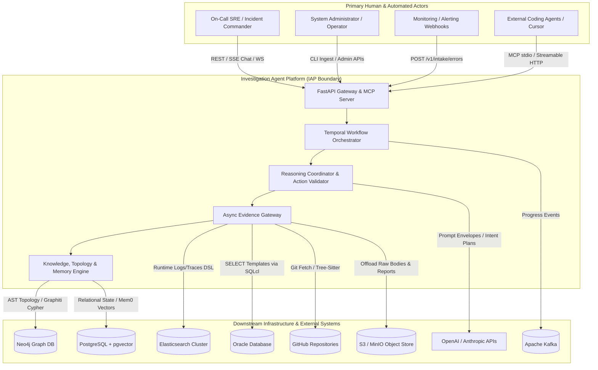

---

### Diagram 2: Business Capability Map

The Business Capability Map presents a hierarchical view of all major platform capabilities.

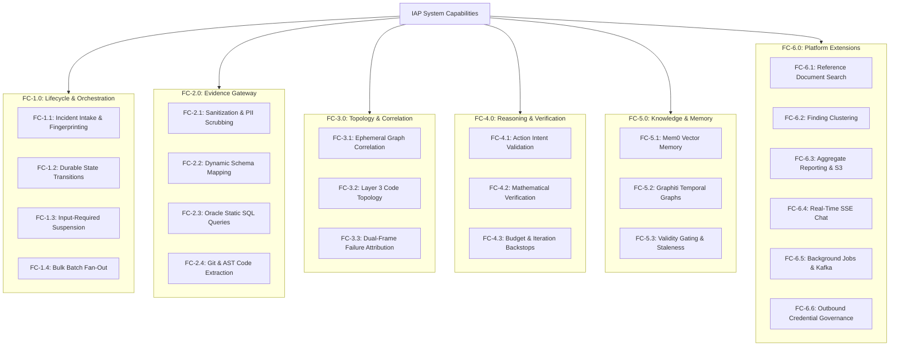

---

### Diagram 3: High-Level Functional Decomposition

This diagram decomposes the internal software layers, showing how API handlers, application services, ports, domain aggregates, and infrastructure adapters interact.

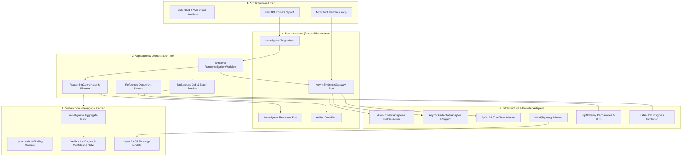

---

### Diagram 4: Major Business Process Flow (End-to-End Incident Analysis)

This diagram details the primary control flow for automated incident investigation from intake to verdict conclusion.

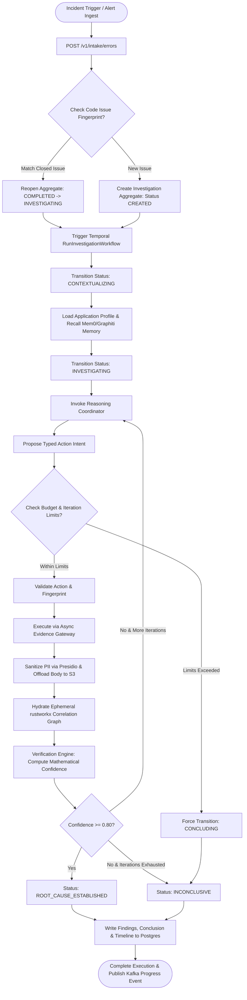

---

### Diagram 5: External System Interaction & Security View

This diagram highlights the protocol types, security boundaries, and data exchanges across external system boundaries.

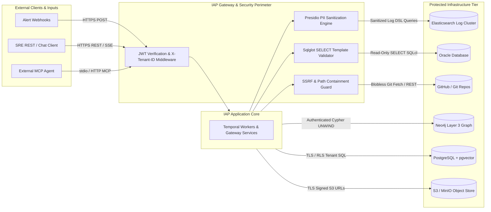

---


# System Functional Specification: Investigation Agent Platform (IAP)

**Document Context:** Functional View of the System (Topic 8 of 8 — Document Analysis Summary & Source Evidence Index)

---

## Document Analysis Summary

The System Functional Specification for the Investigation Agent Platform (IAP) is derived from a systematic synthesis of 13 primary engineering specifications, architectural decision records (ADRs), operational runbooks, and implementation analyses. These source documents collectively establish the complete functional, structural, and behavioral baseline for the platform.

The document corpus spans five structural themes:

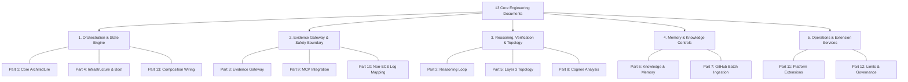

### Synthesis of Core Architectural Themes

1. **Durable Orchestration & State Enforcement (Parts 1, 4, 11, 13):** Establishes the Temporal-driven workflow execution engine, PostgreSQL transactional persistence with optimistic concurrency control (OCC), Row-Level Security (RLS) tenant isolation, and composition root wiring that preserves application state across worker and API lifecycles.
2. **Read-Only Infrastructure Safety & Telemetry Isolation (Parts 1, 3, 9, 10):** Enforces strict zero-write safety guarantees across production systems, static SQL template validation via `sqlglot`, Presidio PII scrubbing, platform evidence UUID minting, and dynamic field resolution for non-ECS Elasticsearch log schemas.
3. **Deterministic Reasoning & Mathematical Verification (Parts 2, 5, 8):** Separates LLM intent proposals from execution, employing an independent mathematical `VerificationEngine` ($0.80$ confidence gate), ephemeral `rustworkx` graph correlation, and C-based `tree-sitter` AST code topology parsing in Neo4j.
4. **Long-Term Memory & Staleness Controls (Parts 6, 7):** Enforces temporal validity envelopes (`IMMUTABLE`, `CONDITIONAL`, `TTL`) over `pgvector` (Mem0) and Neo4j (Graphiti) knowledge stores, supported by blobless Git batch repository ingestion with JSONL audit logging.
5. **Enterprise Extension & Operational Controls (Parts 11, 12):** Provides structured human-in-the-loop input requirement suspension, Kafka-backed background job progress fan-out, Server-Sent Events (SSE) chat streaming, S3 report artifact offload, and RFC 6749 OAuth2 outbound credential governance.

---

## Source Evidence Index

The table below catalogs the 13 engineering documents that constitute the authoritative source evidence for this functional specification, detailing their specific focus, domain coverage, key specification artifacts, and authority level.

| Document Ref | Document Focus / Title | Core Architectural Domains Addressed | Key Functional Artifacts & Specifications Defined | Specification Authority Level |
| --- | --- | --- | --- | --- |
| **Part 1** | **Core System Architecture & Business Rules** | Domain boundaries, Hexagonal Architecture, Business Rules (BR-001 through BR-009), state lifecycle. | `Investigation` aggregate, `InvestigationStatus` engine, `ApplicationProfile` domain model, core business rules. | **Primary Baseline** |
| **Part 2** | **Autonomous Reasoning Loop & Verification** | Reasoning orchestration, LLM guardrails, mathematical confidence calculation, budget backstops. | `ReasoningCoordinator`, `VerificationEngine`, `ConclusionGate`, `InvestigationLoopGuard`, `InvestigationBudget`. | **Primary Baseline** |
| **Part 3** | **Telemetry Evidence Gateway & Read Safety** | Multi-source evidence gateway, PII scrubbing, Oracle SELECT safety, Git AST extraction. | `AsyncEvidenceGateway`, `SqlglotTemplateValidator`, `AsyncOracleStateAdapter`, `PyGit2Adapter`. | **Primary Baseline** |
| **Part 4** | **Infrastructure, Boot & Persistence** | Production boot sequence, Temporal orchestrator integration, PostgreSQL schema, RLS policies. | Fail-hard boot stance, `investigations` & `evidence_references` DDL, Temporal task queues. | **Primary Baseline** |
| **Part 5** | **Graph Correlation & Layer 3 AST Topology** | Ephemeral graph correlation, Neo4j AST topology graph, dual-frame failure attribution, CODEOWNERS. | `EphemeralCorrelationEngine`, `Neo4jTopologyAdapter`, `FailureAttributionService`, `CodeownersResolver`. | **Primary Baseline** |
| **Part 6** | **Execution Knowledge & Long-Term Memory** | Mem0 vector memory, Graphiti temporal knowledge graph, validity envelopes, staleness controls. | `Mem0KnowledgeStore`, `GraphitiTemporalKnowledge`, `KnowledgeArtifact` envelope, `KnowledgeService`. | **Primary Baseline** |
| **Part 7** | **GitHub AST Ingestion Pipeline** | Batch repository ingestion CLI, blobless Git fetch, Tree-Sitter AST parsing, manifest logging. | `scripts/ingest_github.py`, `ASTTopologyPayload`, `IngestManifestRow` JSONL audit trail. | **Implementation Authority** |
| **Part 8** | **Cognee Integration Evaluation & ADR** | AST parser evaluation, architectural trade-offs, optional feature flagging. | Architectural Decision Record (ADR): `IAP_COGNEE_ENABLED=false` flag, IAP native parser retention. | **Architectural Decision** |
| **Part 9** | **Model Context Protocol (MCP) Integration** | External MCP client tooling, platform UUID minting, provider lookup resolution. | MCP tool schemas (`search_runtime_evidence`, `get_evidence`), `EvidenceQueryResult` envelope, provider mapping. | **Integration Authority** |
| **Part 10** | **Non-ECS Elasticsearch Source Mapping** | Dynamic field resolution, non-standard log schemas, configuration-driven query DSL translation. | `ObservabilitySourceMapping` YAML registry, `FieldResolver`, non-ECS stream mapping profiles. | **Integration Authority** |
| **Part 11** | **Platform Extensions & Advanced Services** | Input requirement suspension, finding clustering, report rendering, SSE chat, background jobs. | `InputRequirement`, `FindingClusteringWorkflow`, `ReportRendererRegistry`, `StreamingLLMGateway`. | **Extension Baseline** |
| **Part 12** | **Operational Limits & Credential Governance** | System limits, data retention policies, Kafka progress streaming, OAuth2 token governance. | `CredentialProviderRegistry`, Kafka subscriber consumer group strategy, retention/legal hold policies. | **Operational Authority** |
| **Part 13** | **System Composition Root & Wiring Verification** | Lifespan context preservation, repository concrete resolution, end-to-end component wiring. | `AppContext` composition root preservation, `SqlAlchemyFindingConclusionRepository` wiring. | **Implementation Authority** |

---

## Specification Traceability & Final Summary

This document completes the System Functional Specification for the Investigation Agent Platform (IAP). Across all 8 topics, the specification provides full functional traceability:

1. **Executive Context & Business Rules (Topic 1):** Established core read-only safety, server-derived tenancy, and decision gates.
2. **Actors & Functional Capabilities (Topic 2):** Mapped 6 major capability groups and 22 sub-capabilities to primary system actors.
3. **End-to-End Processes & Functional Requirements (Topic 3):** Defined 5 core business workflows and 45 verifiable functional requirements (FR-001 through FR-045).
4. **Information / Data View & Integration Catalog (Topic 4):** Modelled 8 major domain entity aggregates and 9 external infrastructure integrations.
5. **Use Cases & Functional Dependencies (Topic 5):** Detailed 6 structured interaction use cases (UC-001 through UC-006) and the system dependency matrix.
6. **Non-Functional Requirements & RTM (Topic 6):** Bounded performance, resilience, security, and traceability across all system components.
7. **Assumptions, Gaps & Architectural Diagrams (Topic 7):** Resolved document ambiguities and provided 5 comprehensive Mermaid diagrams.
8. **Document Analysis Summary & Source Index (Topic 8):** Synthesized the 13 engineering documents and established the authoritative evidence index.

