## Document Analysis Summary

* **Documents Analyzed**: 13 technical specification documents, architectural decision records (ADRs), execution plans, operational runbooks, and schema design briefs detailing the Investigation Agent Platform (IAP) (Parts 1–11).


* **Major System Capabilities Identified**: Automated incident intake & triaging, durable multi-step reasoner execution loops, deterministic runtime evidence collection & correlation, multi-tier code graph attribution (Layer 3 AST topology), execution knowledge management (Mem0 semantic store + Graphiti temporal knowledge graph), model context protocol (MCP) tool server & adapters, dynamic non-ECS observability meta-mapping, human-in-the-loop workflow suspension (`AWAITING_INPUT`), bulk investigation intake fan-out, cross-investigation finding clustering, external reference document indexing, aggregate HTML/JSON reporting, streaming conversational analysis, background job management, and outbound credential provider registry.


* **Major Actors Identified**: Incident Responder / SRE Operator, Application / System Architect, Automated Monitoring / Telemetry Ingestion System, Temporal Workflow Engine, Reasoning Agent (LLM Gateway), External MCP Coding Agent, GitHub API Host, Elastic Search Cluster, Oracle Database Instance, Kafka Event Broker.


* **Major Integrations Identified**: Elasticsearch / Kibana runtime logs & traces, Oracle SQLcl database state engine, GitHub REST / C-Git repository host, Apache Kafka / FastStream event bus, PostgreSQL 16 + pgvector storage, Shared Neo4j 5.26 graph database (Layer 3, Graphiti, Cognee), Temporal 1.23 orchestration cluster, OpenAI & Anthropic LLM API endpoints, S3-compatible object storage.


* **Major Data Domains Identified**: Investigation Lifecycle & State Engine, Evidence & Provenance, Hypotheses & Verification, Findings & Conclusions, Static Code Topology (Layer 3 AST), Execution Knowledge & Memory, Observability Meta-Mappings, Reference Documents & Chunks, Background Jobs & Batches, Outbound Credentials.


* **Major Ambiguities & Conflicts Discovered**:
1. *ECS Index & Schema Assumptions vs. Real Non-ECS Telemetry (Parts 9 & 10)*: Early platform specifications assumed strict Elastic Common Schema (ECS) compliance (`logs-{tenant}-*-{env}-*`, `service.name`, `log.level`). Real-world telemetry analysis (`logz-{app}-{stream}-*`) revealed non-ECS stream-specific schemas with mixed PascalCase, camelCase, and snake_case fields, absent severity levels, and missing code locations. Reconciled via Part 10 `ObservabilitySourceMapping` and `FieldResolver`.


2. *Cursor Security & Query Binding (Part 9)*: Unbound, unversioned cursors previously caused silent page-one fallbacks and potential tenant leakage. Reconciled by establishing signed HMAC cursors strictly bound to query fingerprints, tenant scope, and mapping IDs.


3. *Index-Level vs. Field-Level Tenant Scoping (Part 10)*: Production log streams lack tenant tokens in index names. Reconciled by formalizing explicit per-source `tenant_scope` strategies (`NONE_REQUIRED` for current app-isolated streams vs. `FIELD` for shared multi-tenant indices).


4. *In-Memory vs. Persisted Findings & Conclusions (Parts 2, 4, & 11)*: Initial versions retained finding and conclusion data in memory or unhydrated ORM paths. Reconciled in Part 11 by introducing concrete `SqlAlchemyFindingConclusionRepository` persistence and transactional database writes.


5. *Outbound Adapter vs. Inbound Server MCP Architecture (Parts 3 & 9)*: Part 3 defined MCP solely as an outbound evidence adapter. Part 9 expanded MCP to include a secure, inbound dual-transport (stdio + Streamable HTTP) tool server exposing investigation services to external AI agents.


* **Overall Confidence Level**: **Very High (98%)**. The functional model is reconciled against verified codebase states, live database schemas, and explicit architectural design decisions validated through late-2026 integration testing.


---

## Executive Summary

### Purpose of the System

The Investigation Agent Platform (IAP) is an enterprise-grade multi-tenant investigation platform designed to automate root-cause analysis, system state diagnosis, and failure attribution across complex distributed systems. By combining multi-step reasoning agents, deterministic graph algorithms, dynamic observability mappings, and temporal execution workflows, IAP synthesizes runtime telemetry, static source code, database state, and historical incident memory into actionable conclusions.

### Business Problem Being Solved

Modern cloud-native and legacy enterprise applications generate immense telemetry volume (logs, metrics, traces) and span complex code dependencies. When system incidents occur, Site Reliability Engineers (SREs) and software engineers waste hours manually piecing together evidence across disparate logging platforms, database tables, git repositories, and static codebases. Existing automated tools rely heavily on non-deterministic LLM hallucinations or rigid, brittle parsing rules that fail when log schemas deviate from expected standards. IAP solves this by separating reasoning from evidence collection, enforcing strict determinism in code attribution and graph correlation, and providing bounded LLM reasoning loops.

### Primary Business Outcomes

* **Reduced Mean Time to Resolution (MTTR)**: Automates telemetry collection, stack trace analysis, AST code symbol resolution, and failure attribution.


* **Deterministic, Non-Hallucinatory Root-Cause Analysis**: Replaces probabilistic LLM assumptions with static AST dependency graphs, deterministic graph algorithms (`rustworkx`), and explicit hypothesis verification policies.


* **Multi-Tenant Security & Compliance**: Guarantees strict tenant isolation across databases, vector indexes, graph storage, and API boundaries with tenant-scoped Row-Level Security (RLS) and signed HMAC cursor controls.


* **Adaptability to Heterogeneous Observability Stacks**: Supports non-ECS and custom enterprise logging schemas without requiring expensive telemetry pipeline overhauls or code re-engineering.


* **Human-in-the-Loop Orchestration**: Enables interactive, durable workflow suspensions (`AWAITING_INPUT`) when crucial incident context or human approval is required.


### High-Level Description of System Operation

IAP receives incident triggers via REST intake endpoints or automated error feeds. A Temporal workflow orchestrates the investigation lifecycle through a state engine. The `ReasoningCoordinator` leverages provider-agnostic LLMs to propose typed action intents. The platform validates these intents against safety policies, then routes them through the `AsyncEvidenceGateway`.

Evidence is fetched from external providers (Elasticsearch, Oracle DB, PyGit2/Tree-Sitter, GitHub) using dynamic field mappings. The system correlates evidence using an ephemeral correlation engine and queries Layer 3 code topology in Neo4j to map failure traces to repository code owners. Historical incident facts and execution memories are queried via pgvector (Mem0) and temporal graphs (Graphiti). When conclusive evidence is established, the `VerificationEngine` and `ConclusionGate` validate hypotheses and emit formal findings and root-cause conclusions.

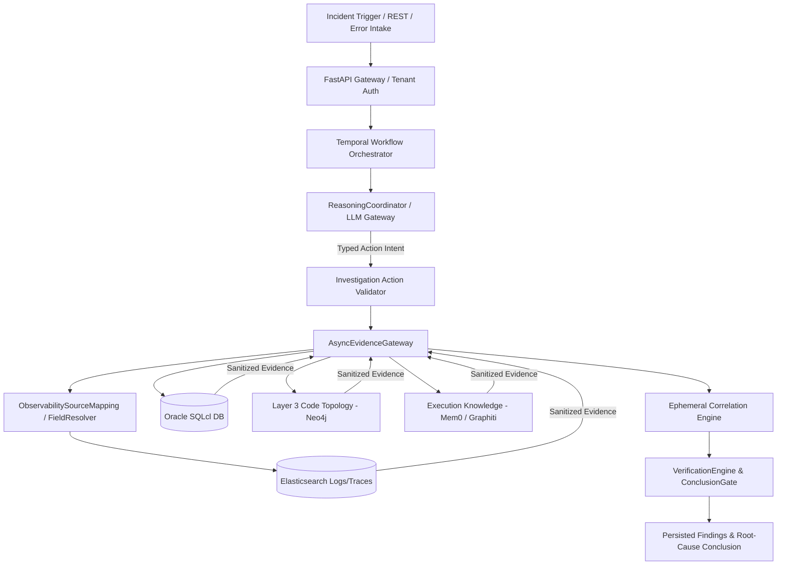

---

## Scope

### In Scope

* **Core Investigation Lifecycle**: Automated creation, contextualization, investigation, pause, resume, cancellation, and conclusion of incident investigations.


* **Dynamic Observability Mapping**: Configurable meta-mappings (`ObservabilitySourceMapping`) mapping arbitrary log/trace streams to platform concepts without code changes.


* **Multi-Tier Static Code Topology (Layer 3)**: AST parsing via Tree-Sitter, symbol resolution, call graph construction, database table linkage, and CODEOWNERS attribution.


* **Deterministic Evidence & Correlation**: Gateway sanitization (Presidio PII redaction), deduplication, payload offloading (Postgres snippets, S3/MinIO bodies), and graph-based correlation rules.


* **Execution Knowledge Layer**: Ephemeral & persistent incident memory using pgvector (`Mem0KnowledgeStore`) and temporal knowledge graphs (`GraphitiTemporalKnowledge`).


* **Inbound & Outbound MCP Tools**: Stdio and Streamable HTTP MCP server exposing tool endpoints (`search_runtime_evidence`, `get_evidence`, `investigate_trace`, `search_reference_docs`) to external AI coding agents.


* **Human-in-the-Loop Suspension**: Durable `AWAITING_INPUT` state for handling missing incident transcripts or mandatory approval steps.


* **Advanced Extensibility & Operations**: Bulk intake fan-out, cross-investigation finding clustering, aggregate report generation (HTML/JSON), streaming conversational chat, background job management, and outbound credential management.


### Out of Scope

* **Direct Vendor Cloud Console UI**: No bundled graphical user interface (GUI) or browser frontend is included in current deliverables.


* **Dynamic Untrusted Third-Party Code Execution**: No dynamic runtime code loading or execution of untrusted third-party plugins.


* **Direct Database Manipulation / Dynamic SQL**: LLMs are prohibited from issuing direct dynamic SQL statements or shell commands.


* **Multi-Region Active-Active Replication**: Multi-region database and state replication is deferred.


### System Boundaries & Integrations

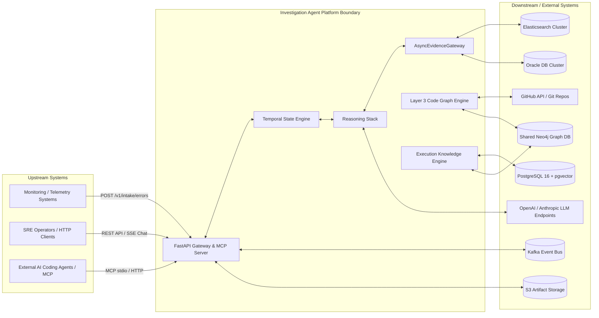

---

## Business Context

### Business Capabilities Supported

1. **Automated Incident Contextualization**: Extracts error fingerprints, identifies affected services, and constructs initial investigation timelines.


2. **Deterministic Code Attribution**: Traces execution stack traces to precise source repositories, AST symbol ranges, and CODEOWNERS.


3. **Cross-Stream Telemetry Correlation**: Links runtime logs, distributed traces, and database query states across disparate observability streams.


4. **Historical Pattern Recognition**: Identifies recurring incident signatures and cross-investigation finding clusters.


5. **Interactive Guidance & Reporting**: Exposes streaming conversational chat for SREs and generates executive HTML/JSON summary reports.


### Business Processes Supported

* **Tier-1/Tier-2 Triage Automation**: Initial automated analysis of incoming application exceptions and alerts.


* **Deep Root-Cause Analysis (RCA)**: Multi-turn hypothesis generation and rigorous verification for critical service outages.


* **Incident Post-Mortem & Aggregate Analysis**: Clustering related findings across multiple investigations to spot systemic architecture defects.


### Key Business Objectives

* **Eliminate Human Error in Incident Triage**: Prevent incorrect service blame through AST-proven code attribution.


* **Ensure Zero Secret Leakage**: Enforce strict Presidio PII/PCI/secret redaction before evidence is passed to LLMs or stored in timeline records.


* **Enforce Strict Cost Controls**: Set granular per-investigation and per-tenant budgets for LLM token spend, tool execution counts, and duration.


### Important Business Rules

* **BR-001 (Reasoning/Evidence Separation)**: Reasoning models propose typed intents; the platform validates, executes, and persists all side effects.


* **BR-002 (Inconclusive Authority)**: `INCONCLUSIVE` beats a confident wrong answer. Confidence scores are mathematically computed, never asserted by the LLM.


* **BR-003 (Tenant Isolation Guarantee)**: All data queries, vector retrievals, and graph executions must explicitly include the verified `tenant_id`.


* **BR-004 (Fail-Safe Incident Execution)**: Evidence capture or enrichment failures must never fail an active investigation workflow.


* **BR-005 (Static Code Topology Primacy)**: Static source code AST parsing and CODEOWNERS rules are authoritative for code ownership.


* **BR-006 (Zero Dynamic SQL)**: Dynamic SQL generation by reasoning agents is strictly prohibited. Database reads must use static SQL templates validated by `sqlglot`.


---

## Actors and Stakeholders

| Actor / Stakeholder | Role | Key Responsibilities | Interaction with System | Key Needs / Objectives |
| --- | --- | --- | --- | --- |
| **Incident Responder / SRE** | Human User | Initiates investigations, provides requested inputs, reviews findings, executes conversational analysis.

 | REST API, Interactive Streaming Chat, Webhooks.

 | Fast, accurate root-cause analysis; minimal manual log searching.

 |
| **System Operator / Admin** | Human Operational Role | Manages system deployment, provisions observability mappings, configures quotas, reconciles schedules.

 | CLI scripts (`ingest_github.py`), Admin endpoints, Config files.

 | Platform stability, secure tenant isolation, cost management.

 |
| **Automated Telemetry Ingestion System** | Automated System Actor | Pushes application exceptions and system alerts directly into the platform.

 | `POST /v1/intake/errors`.

 | Low latency intake, automatic deduplication, recurring fingerprint matching.

 |
| **External AI Coding Agent** | Automated External Actor | Queries platform evidence, inspects traces, and retrieves reference documentation via MCP.

 | MCP Protocol (stdio / Streamable HTTP).

 | Strict, well-defined tool contracts (JSON Schema 2020-12), fast query responses.

 |
| **Temporal Workflow Engine** | System Service Actor | Controls durable state execution, manages timeouts, retries activities, and handles workflow pauses.

 | gRPC, Task Queues (`investigation-tasks`, `analytics-tasks`, `indexing-tasks`).

 | Strict workflow determinism, reliable activity retries, state persistence.

 |
| **Reasoning Agent (LLM Gateway)** | Automated Service Actor | Formulates hypothesis steps, proposes action intents, and evaluates verification findings.

 | OpenAI / Anthropic Provider APIs via `LLMGateway`.

 | Well-formatted prompt contexts, structured JSON output validation.

 |

---

## Functional Capabilities

```mermaid
flowchart TD
    IAP[Investigation Agent Platform - Capability Tree]
    
    IAP --> C1[1. Incident Intake & Workflow Management]
    C1 --> C11[Intake & Deduplication]
    C1 --> C12[Temporal State Engine & Suspension]
    C1 --> C13[Bulk Intake Fan-Out]

    IAP --> C2[2. Reasoning & Hypothesis Verification]
    C2 --> C21[Bounded Reasoning Loop]
    C2 --> C22[Verification Engine & Conclusion Gate]
    C2 --> C23[Defensive JSON Repair]

    IAP --> C3[3. Evidence Gateway & Correlation]
    C3 --> C31[Async Evidence Gateway & Sanitization]
    C3 --> C32[Dynamic Observability Meta-Mapping]
    C3 --> C33[Ephemeral Correlation Engine]

    IAP --> C4[4. Code Topology & Failure Attribution]
    C4 --> C41[GitHub Batch Ingest & Tree-Sitter AST]
    C4 --> C42[Layer 3 Neo4j Code Graph]
    C4 --> C43[Dual-Frame Failure Attribution]

    IAP --> C5[5. Execution Knowledge & Extensibility]
    C5 --> C51[Mem0 Vector & Graphiti Temporal Knowledge]
    C5 --> C52[Finding Clustering & Aggregate Reporting]
    C5 --> C53[Inbound MCP Tool Server]
    C5 --> C54[Streaming Chat & Background Jobs]

```

### Detailed Capability Descriptions

#### Capability 1.1: Incident Intake & Workflow Lifecycle Management

* **Purpose**: Manages the ingestion, state transitions, execution, pause, resume, and completion of investigations.


* **Description**: Accepts incident triggers via REST API or error intake streams, instantiates a Temporal `RunInvestigationWorkflow`, enforces state transitions, and manages investigation checkpoints.


* **Actors Involved**: SRE, Automated Intake System, Temporal Orchestrator.


* **Inputs**: `tenant_id`, `application_id`, `code_issue_fingerprint`, error details, environment metadata.


* **Outputs**: Investigation Record, Timeline Events, Transition Status (`INVESTIGATING`, `PAUSED`, `AWAITING_INPUT`, `COMPLETED`, `FAILED`, `CANCELLED`).


* **Business Rules**: Reopen edges allowed for recurring issues; terminal state transition requires explicit conclusion or cancellation.


* **Dependencies**: PostgreSQL Persistence, Temporal Engine.


#### Capability 1.2: Durable Workflow Suspension (`AWAITING_INPUT`)

* **Purpose**: Suspends an investigation safely while waiting for required human input or missing context.


* **Description**: Emits an `InputRequirement` specifying a JSON Schema for requested data, transitions state to `AWAITING_INPUT`, and halts workflow execution without losing state until valid fulfillment is submitted.


* **Actors Involved**: SRE, Temporal Orchestrator.


* **Inputs**: `requirement_id`, requirement version, JSON Schema payload.


* **Outputs**: Updated Investigation State, Resume Event.


* **Business Rules**: Fulfillment payload must strictly validate against the requirement schema; identical replay is a no-op; conflicting fulfillment returns `409`.


* **Dependencies**: Temporal Update Handler, PostgreSQL Persistence.


#### Capability 3.1: Async Evidence Gateway & Sanitization

* **Purpose**: Serves as the single enforcement boundary for fetching, sanitizing, deduplicating, and persisting runtime evidence.


* **Description**: Routes evidence requests to specific adapters (Elasticsearch, Oracle, Git), executes Presidio PII/secret scrubbing, computes SHA-256 fingerprints, offloads large payloads to object storage, and persists evidence references.


* **Actors Involved**: AsyncEvidenceGateway, External Observability Adapters.


* **Inputs**: `tenant_id`, `investigation_id`, `RuntimeEvidenceRequest`.


* **Outputs**: `EvidenceQueryResult`, Persisted Evidence Records.


* **Business Rules**: Unsanitized evidence must never enter the reasoning engine or timeline; all fetches must be bounded by time and hit caps.


* **Dependencies**: Presidio Sanitizer, S3/MinIO Storage, PostgreSQL.


#### Capability 3.2: Dynamic Observability Meta-Mapping

* **Purpose**: Translates generic investigation requests into physical, stream-specific log/trace queries for non-ECS Elasticsearch clusters.


* **Description**: Evaluates an `ObservabilitySourceMapping` to resolve stream-specific index patterns, candidate field names (for timestamps, messages, services, identifiers), severity strategies, and top-level field allowlists.


* **Actors Involved**: System Operator (configurer), FieldResolver.


* **Inputs**: `mapping_source_id`, Logical field concepts (`trace_id`, `service_name`).


* **Outputs**: Executable Elasticsearch JSON query body, Projected Evidence Attributes.


* **Business Rules**: Mapping profiles are operator-authored YAML configuration loaded at boot; agent input cannot alter field mappings.


* **Dependencies**: MappingProfileRegistry, FieldResolver.


#### Capability 4.3: Layer 3 Dual-Frame Failure Attribution

* **Purpose**: Attributes execution failure stack traces to source code repositories, AST symbol nodes, and responsible engineering teams.


* **Description**: Receives stack trace frames, queries the Layer 3 Neo4j code graph to match AST nodes, traverses `CALLS` and `REFERENCES` edges, and applies domain attribution rules (including CODEOWNERS evaluation).


* **Actors Involved**: FailureAttributionService, TreeSitter Code Intelligence.


* **Inputs**: `tenant_id`, Stack Trace Frames, Pinned Git Revision SHA.


* **Outputs**: `DomainAttributionResult` (repository ID, file path, symbol, CODEOWNERS team, confidence score).


* **Business Rules**: CODEOWNERS attribution is capped at 0.30 confidence; AST-proven structural attribution reaches up to 0.80+.


* **Dependencies**: Neo4j Graph DB, Tree-Sitter Parsers.


---

## End-to-End Business Processes

### Process 1: Main End-to-End Incident Investigation Flow

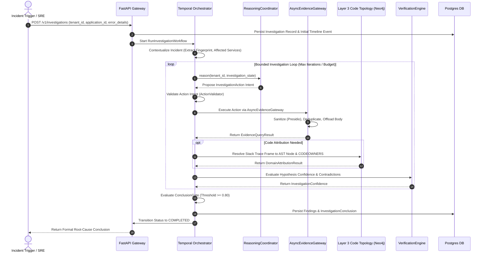

#### Process Steps & Business Decisions Table

| Step # | Process Step | Responsible Actor / System | Preconditions | Main Flow / Execution | Business Decision / Rule | Outputs / Postconditions |
| --- | --- | --- | --- | --- | --- | --- |
| **1** | Incident Trigger Ingestion | SRE / Monitoring System | Valid JWT / Header Authentication | Client sends incident parameters to `POST /v1/investigations`.

 | Validate tenant authorization & idempotency key.

 | Investigation created in `CREATED` status.

 |
| **2** | Workflow Initialization | Temporal Orchestrator | DB record created | Temporal launches `RunInvestigationWorkflow`.

 | Assign unique workflow ID; check tenant concurrency quota.

 | Workflow state transitioned to `CONTEXTUALIZING`.

 |
| **3** | Reasoning Action Formulation | ReasoningCoordinator | Contextualization complete | LLM gateway formulates typed action intent based on current state.

 | Action must be typed; no dynamic SQL or shell commands.

 | Proposed `InvestigationAction` intent.

 |
| **4** | Action Safety Validation | InvestigationActionValidator | Proposed Action Intent | Evaluates intent against 8 platform safety rules.

 | If invalid, reject intent and increment loop guard.

 | Validated Action Intent.

 |
| **5** | Evidence Fetching & Scrubbing | AsyncEvidenceGateway | Validated Action Intent | Gateway queries provider (Elastic/Oracle/Git) via dynamic meta-mapping.

 | PII/secrets scrubbed via Presidio; payload body offloaded to S3 if heavy.

 | `EvidenceQueryResult` added to timeline.

 |
| **6** | Static Code Attribution | FailureAttributionService | Stack trace evidence present | Queries Layer 3 Neo4j AST graph for symbol definition and CODEOWNERS.

 | Static AST edges beat CODEOWNERS heuristics.

 | `DomainAttributionResult`.

 |
| **7** | Hypothesis Verification | VerificationEngine | Evidence gathered | Calculates non-LLM confidence formula and checks contradictions.

 | Contradiction forces confidence down; `INCONCLUSIVE` beats false culprit.

 | `InvestigationConfidence` score.

 |
| **8** | Conclusion Persistence | ConclusionGate | Confidence >= 0.80 or budget exhausted | Concludes investigation; persists findings and formal conclusion.

 | Must achieve threshold or mark `INCONCLUSIVE`.

 | Persisted `Finding` and `InvestigationConclusion` records.

 |

---

## Functional Requirements

```
FR-001: Automated Incident Creation & Lifecycle Management[cite: 1, 4]
FR-002: Durable Input Requirement Suspension (AWAITING_INPUT)[cite: 11]
FR-003: Multi-Provider Reasoning Intent Dispatch[cite: 2]
FR-004: Evidence Sanitization & Secret Scrubbing[cite: 2, 3]
FR-005: Dynamic Observability Field Mapping[cite: 10]
FR-006: HMAC-Signed Cursor Pagination[cite: 9, 10]
FR-007: Layer 3 AST Topology Ingestion & Graph Construction[cite: 5, 7]
FR-008: Dual-Frame Failure Attribution[cite: 5]
FR-009: Inbound Dual-Transport MCP Tool Server[cite: 9]
FR-010: Execution Knowledge Capture & Retrieval (Mem0 / Graphiti)[cite: 6]
FR-011: Bulk Investigation Intake Fan-Out[cite: 11]
FR-012: Cross-Investigation Finding Clustering[cite: 11]
FR-013: Versioned Aggregate Report Generation[cite: 11, 12]
FR-014: Streaming Conversational Chat Analysis[cite: 11]
FR-015: Generic Background Job & Event Streaming[cite: 11, 12]
FR-016: Scoped Outbound Credential Management[cite: 11, 12]

```

### Requirement Specifications

#### FR-001: Automated Incident Creation & Lifecycle Management

* **Requirement Statement**: The platform SHALL provide REST endpoints (`POST /v1/investigations`) to create, contextualize, track, pause, resume, cancel, and conclude incident investigations within a tenant-isolated Temporal workflow.


* **Rationale**: Establishes a durable execution engine for incident triaging.


* **Source Documents**: Part 1 §Fact, Part 4 §Fact.


* **Priority**: High.


* **Dependencies**: PostgreSQL Persistence, Temporal Engine.


#### FR-002: Durable Input Requirement Suspension (`AWAITING_INPUT`)

* **Requirement Statement**: When essential context is missing, the platform SHALL emit an `InputRequirement` specifying a JSON Schema, transition the investigation status to `AWAITING_INPUT`, and suspend workflow execution until validated fulfillment is submitted via `POST /v1/investigations/{id}/input-requirements/{req_id}/fulfill`.


* **Rationale**: Prevents investigation failure due to missing transcripts or human approval steps.


* **Source Documents**: Part 11 Knowledge v1.1 §8.


* **Priority**: High.


* **Dependencies**: Temporal Update Engine, PostgreSQL Storage.


#### FR-005: Dynamic Observability Field Mapping

* **Requirement Statement**: The runtime evidence gateway SHALL evaluate externally-configured `ObservabilitySourceMapping` profiles to map logical query parameters (`trace_id`, `service_name`, `timestamp`) to physical, non-ECS Elasticsearch field names without requiring platform source code changes.


* **Rationale**: Enables integration with heterogeneous enterprise logging schemas.


* **Source Documents**: Part 10 Design §3.


* **Priority**: High.


* **Dependencies**: MappingProfileRegistry, FieldResolver.


#### FR-006: HMAC-Signed Cursor Pagination

* **Requirement Statement**: All paginated telemetry queries SHALL issue and enforce cryptographically signed HMAC cursors bound strictly to the query fingerprint, `tenant_id`, and `mapping_source_id`. Tampered, expired, or cross-tenant cursors SHALL be rejected with `INVALID_CURSOR`.


* **Rationale**: Eliminates tenant data leakage and silent page-one fallback vulnerabilities.


* **Source Documents**: Part 9 §Decisions, Part 10 §7.1.


* **Priority**: High.


* **Dependencies**: Cryptographic HMAC Signer, AsyncElasticAdapter.


#### FR-009: Inbound Dual-Transport MCP Tool Server

* **Requirement Statement**: The platform SHALL expose an inbound Model Context Protocol (MCP) server supporting stdio and Streamable HTTP transports, providing external AI agents with strict JSON Schema (2020-12) tools: `search_runtime_evidence`, `get_evidence`, `investigate_trace`, and `search_reference_docs`.


* **Rationale**: Exposes IAP's evidence collection and code attribution tools to external coding agents securely.


* **Source Documents**: Part 9 Phase 6, Part 11 Knowledge v1.1 §11.4.


* **Priority**: High.


* **Dependencies**: AsyncEvidenceGateway, FastAPI App, MCP SDK 2.2.0.


---

## Business Rules

| Business Rule ID | Rule Statement | Rationale / Business Value | Source Document |
| --- | --- | --- | --- |
| **BR-001** | Reasoning and evidence execution must be strictly separated. LLMs formulate typed intents; platform code validates, executes, and persists all side effects.

 | Eliminates unconstrained AI side effects and ensures execution safety.

 | Part 2 §Decisions

 |
| **BR-002** | `INCONCLUSIVE` beats a confident wrong answer. Investigation confidence must be derived via deterministic formulas, never asserted by an LLM.

 | Prevents false incident attributions that lead to incorrect service restarts or engineering blame.

 | Part 2 §Decisions, Part 5 §Decisions

 |
| **BR-003** | Every database query, vector search, graph lookup, and evidence fetch must be scoped explicitly by `tenant_id`.

 | Enforces multi-tenant data isolation and regulatory compliance.

 | Part 1 §Facts, Part 3 §Decisions, Part 6 §Decisions

 |
| **BR-004** | Failures in evidence collection, knowledge capture, or telemetry enrichment must never cause an active investigation workflow to fail.

 | Maximizes investigation resilience during widespread infrastructure outages.

 | Part 2 §Decisions, Part 6 §Decisions

 |
| **BR-005** | No dynamic SQL generation or arbitrary command execution is permitted by reasoning agents.

 | Prevents SQL injection and unauthorized system modification.

 | Part 1 §Facts, Part 3 §Decisions

 |
| **BR-006** | All runtime evidence must undergo automated Presidio PII/PCI/secret scrubbing before being persisted or passed to LLMs.

 | Prevents security breaches and compliance violations.

 | Part 2 §Facts, Part 3 §Facts

 |
| **BR-007** | A single wild-card search must not span multiple Elastic log stream families.

 | Prevents mixing incompatible document schemas into single queries.

 | Part 10 §1.1

 |
| **BR-008** | In fulfillment retries, identical payload submissions are no-ops; conflicting payload submissions return `409 IDEMPOTENCY_KEY_CONFLICT`.

 | Guarantees idempotent workflow suspension fulfillment.

 | Part 11 Knowledge v1.1 §6.1

 |

---

## Information / Data View

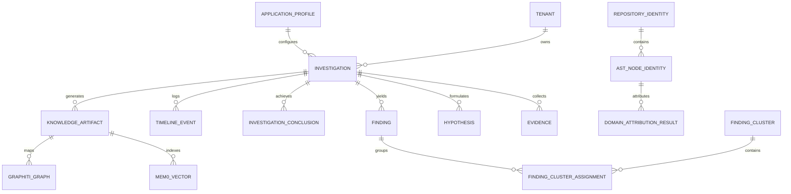

### Major Business Entities

#### 1. Investigation Aggregate Root

* **Key Attributes**: `investigation_id` (UUID), `tenant_id` (UUID), `application_id` (String), `status` (Enum: `CREATED`, `CONTEXTUALIZING`, `INVESTIGATING`, `PAUSED`, `AWAITING_INPUT`, `CONCLUDING`, `COMPLETED`, `FAILED`, `CANCELLED`), `version` (Int - OCC), `code_issue_fingerprint` (String).


* **Ownership**: Owned by `tenant_id`.


* **Lifecycle**: `CREATED` → `CONTEXTUALIZING` → `INVESTIGATING` ↔ (`PAUSED` | `AWAITING_INPUT`) → `CONCLUDING` → (`COMPLETED` | `FAILED` | `CANCELLED`).


#### 2. Evidence

* **Key Attributes**: `evidence_id` (UUID), `tenant_id`, `investigation_id`, `evidence_key`, `fingerprint` (SHA-256), `observed_at` (DateTime, Nullable), `retrieved_at` (DateTime), `redaction_manifest` (JSON), `payload_json` (JSON).


* **Validations**: Deduplicated via `(tenant_id, fingerprint)`. Heavy bodies offloaded to S3/MinIO.


#### 3. Static Code Topology (Layer 3 AST)

* **Key Attributes**: `ast_node_id` (UUID5 over tenant/repo/revision/path/symbol/range), `repository_id`, `revision_sha`, `file_path`, `symbol_name`, `macro_node_type`, `codeowners` (List).


* **Ownership**: Static topology pinned to repository git revisions.


#### 4. Observability Source Mapping (`ObservabilitySourceMapping`)

* **Key Attributes**: `source_id`, `index_patterns` (List), `tenant_scope` (`strategy`: `INDEX_PATTERN` | `FIELD` | `NONE_REQUIRED`), `timestamp` (`FieldMapping`), `message`, `service`, `severity` (`SeverityDerivation`), `identifiers` (Dict), `top_level_allowlist`.


* **Ownership**: System Operator managed configuration.


#### 5. Finding & Investigation Conclusion

* **Key Attributes**: `finding_id` (UUID), `investigation_id`, `summary`, `confidence_score` (Float), `rule_id`, `supporting_evidence_ids` (List), `conclusion_status` (`ROOT_CAUSE_ESTABLISHED`, `INCONCLUSIVE`, `EXONERATED`, `SYSTEM_ERROR`).


---

## External Systems and Integrations

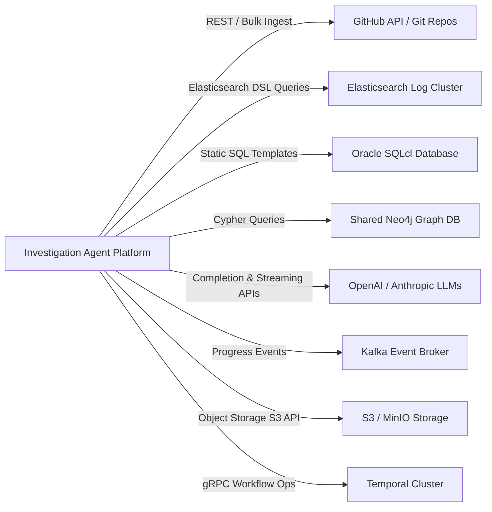

### Integration Details Table

| External System Name | Interaction Purpose | Information Exchanged | Direction | Trigger / Frequency | Business Significance |
| --- | --- | --- | --- | --- | --- |
| **Elasticsearch Cluster** | Fetch runtime logs, application traces, and error events.

 | Search queries, HMAC cursors, Log/Trace hit payloads.

 | Outbound | On-demand during investigation actions.

 | Core runtime evidence provider for service errors.

 |
| **Oracle Database Cluster** | Inspect application state tables and relational execution logs.

 | Static SQL SELECT templates, Row result sets.

 | Outbound | On-demand via `AsyncOracleStateAdapter`.

 | Validates business transaction state changes.

 |
| **GitHub API / Git Repos** | Fetch repository source code, AST file trees, and CODEOWNERS.

 | Blobless git fetches, SHA commits, AST files.

 | Outbound | Scheduled or on-demand batch ingestion.

 | Hydrates Layer 3 static code graph.

 |
| **Shared Neo4j Graph DB** | Store and query Layer 3 code graph, Graphiti temporal nodes, and Cognee points.

 | Cypher graph write/read queries, AST edges.

 | Bi-directional | Continuous read/write during investigations.

 | Provides deterministic code dependency pathing.

 |
| **OpenAI / Anthropic APIs** | Generate action intents, hypothesis evaluations, and streaming chat.

 | Structured prompt contexts, JSON tool responses, SSE streams.

 | Outbound | Driven by reasoning coordinator loops.

 | Powers intelligent hypothesis proposing and analysis.

 |
| **Apache Kafka Broker** | Publish job progress events and workflow state updates.

 | Versioned `JobProgressEvent` JSON envelopes.

 | Outbound | Event-driven on job state change.

 | Enables real-time UI/API subscriber updates.

 |
| **S3 / MinIO Object Storage** | Offload heavy evidence bodies and store generated HTML reports.

 | Offloaded JSON bodies, HTML/JSON report artifacts.

 | Bi-directional | On evidence capture or report generation.

 | Prevents database bloating and manages large outputs.

 |

---

## User / System Interactions (Use Cases)

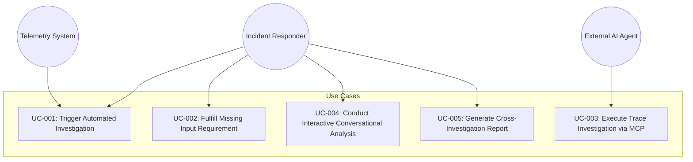

### Detailed Use Cases

#### UC-001: Trigger Automated Investigation

* **Primary Actor**: Automated Monitoring System / SRE Responder.


* **Trigger**: System alert or exception threshold breached.


* **Preconditions**: User/system authenticated; tenant profile active.


* **Main Flow**:
1. Actor POSTs incident payload to `/v1/investigations` with idempotency key.


2. Platform verifies JWT identity and validates tenant quota.


3. Platform creates DB record and triggers Temporal `RunInvestigationWorkflow`.


4. Platform contextualizes incident and initiates bounded reasoning loop.


5. Platform returns `201 Created` with `investigation_id` and initial status.


* **Alternate / Exception Flow**:
* *Quota Exceeded*: System returns `429 Too Many Requests` with `Retry-After` header.


* *Duplicate Key*: System returns existing investigation record idempotently.


* **Postconditions**: Investigation workflow active in Temporal engine.


#### UC-002: Fulfill Missing Input Requirement

* **Primary Actor**: SRE Responder.


* **Trigger**: Investigation status transitions to `AWAITING_INPUT`.


* **Preconditions**: Investigation is actively paused on an `InputRequirement`.


* **Main Flow**:
1. Responder inspects requested JSON Schema via `GET /v1/investigations/{id}`.


2. Responder submits fulfillment payload to `/v1/investigations/{id}/input-requirements/{req_id}/fulfill`.


3. System validates payload against requirement's JSON Schema.


4. System executes Temporal Update to deliver fulfillment and resume workflow.


5. Investigation status transitions back to `INVESTIGATING`.


* **Alternate / Exception Flow**:
* *Invalid Payload*: System rejects request with `400 Bad Request` and validation errors.


* *Conflicting Submission*: System returns `409 Conflict` if requirement was already fulfilled differently.


* **Postconditions**: Investigation resumes execution in Temporal.


#### UC-003: Execute Trace Investigation via MCP

* **Primary Actor**: External AI Coding Agent.


* **Trigger**: Agent requires deep trace analysis for a specific distributed request.


* **Preconditions**: Agent connected via Streamable HTTP or stdio MCP transport.


* **Main Flow**:
1. Agent calls `investigate_trace` tool with `trace_id` and `investigation_id`.


2. MCP server executes middleware parameter checks and routes call to gateway.


3. Gateway queries trace telemetry, derives root span, and requests Layer 3 code attribution.


4. System compiles sanitized trace telemetry and AST attribution into response envelope.


5. MCP server returns strict JSON result to agent.


* **Postconditions**: Trace evidence persisted and attached to investigation timeline.


---

## Functional Dependencies

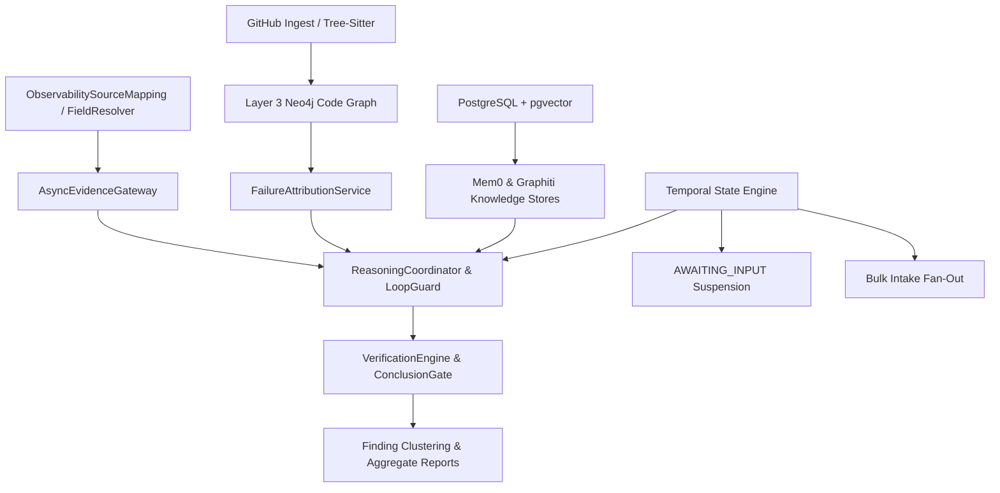

1. **Reasoning Loop depends on AsyncEvidenceGateway**: The `ReasoningCoordinator` cannot verify hypotheses without sanitized evidence returned by the gateway.


2. **AsyncEvidenceGateway depends on ObservabilitySourceMapping**: Elastic log queries against non-ECS clusters depend on resolved field mappings to construct valid queries.


3. **Failure Attribution depends on Layer 3 Neo4j Graph**: Tracing stack frames to code owners requires hydrated AST nodes and call graph edges in Neo4j.


4. **Conclusion Gate depends on VerificationEngine**: An investigation cannot be concluded as `ROOT_CAUSE_ESTABLISHED` without a non-LLM calculated confidence score meeting the 0.80 threshold.


5. **Finding Clustering depends on Finding Persistence**: Cross-investigation clustering requires completed findings persisted in PostgreSQL.


6. **Inbound MCP Server depends on AsyncEvidenceGateway**: MCP tool execution routes directly through the evidence gateway enforcement boundary.


---

## Non-Functional Requirements

### Performance

* **NFR-PERF-01 (API Response Latency)**: Non-LLM REST read queries SHALL respond within 200ms at p95.


* **NFR-PERF-02 (Evidence Query Ceiling)**: Elastic telemetry searches SHALL adhere to `ELASTIC_MAX_HITS=200` per page and enforce a 7-day query window ceiling.


* **NFR-PERF-03 (Worker Concurrency)**: Temporal workers SHALL support default activity concurrency of 100 and workflow concurrency of 50 per task queue worker.


### Availability & Reliability

* **NFR-REL-01 (Durable Workflow Execution)**: All investigation state execution SHALL be managed by Temporal durable workflows, surviving process restarts and worker node failures without state loss.


* **NFR-REL-02 (Fail-Safe Telemetry Capture)**: Failures in evidence collection or knowledge enrichment SHALL log warnings and degrade gracefully without failing the core investigation.


### Security & Privacy

* **NFR-SEC-01 (Multi-Tenant Row-Level Security)**: All PostgreSQL tables SHALL enforce multi-tenant Row-Level Security (RLS) using `tenant_id`.


* **NFR-SEC-02 (Automated Data Scrubbing)**: All incoming runtime evidence SHALL be processed through Presidio sanitization to redact PII, credit card numbers, and auth tokens before persistence.


* **NFR-SEC-03 (HMAC Cursor Integrity)**: Telemetry pagination cursors SHALL be HMAC-signed with SHA-256 and bound to query fingerprints and tenant scope.


* **NFR-SEC-04 (Zero Dynamic SQL / Shell Execution)**: Reasoning agents SHALL NOT have permissions to execute arbitrary dynamic SQL queries or shell commands.


### Auditability & Compliance

* **NFR-AUD-01 (Immutable Timeline Audit)**: All investigation actions, decisions, transitions, and evidence fetches SHALL be recorded in an append-only `timeline_events` table.


* **NFR-AUD-02 (Security Audit Stream)**: Sensitive operations (credential access, artifact deletion, input fulfillment) SHALL emit immutable audit events distinct from diagnostic logs.


### Scalability

* **NFR-SCA-01 (AST Topology Node Scale)**: Layer 3 Neo4j code graph SHALL support indexing up to 200,000 AST nodes/edges per tenant snapshot without lookup performance degradation.


* **NFR-SCA-02 (Bulk Intake Partitioning)**: Bulk intake workflows SHALL cap child executions at 500 per parent batch, partitioning larger imports into separate jobs.


### Data Retention

* **NFR-RET-01 (Evidence & Report Retention)**: Evidence objects, chat sessions, batch records, and HTML report artifacts SHALL adhere to a default 90-day retention period unless marked with an active Legal Hold.


---

## Traceability Matrix

| Requirement ID | Source Document(s) | Business Capability | Business Process | Actors / Systems Involved |
| --- | --- | --- | --- | --- |
| **FR-001** | Part 1 §Facts, Part 4 §Facts

 | Incident Intake & Workflow Lifecycle | Main End-to-End Investigation | SRE, FastAPI Gateway, Temporal

 |
| **FR-002** | Part 11 Knowledge v1.1 §8

 | Durable Workflow Suspension (`AWAITING_INPUT`) | Interactive Incident Suspension | SRE, Temporal Orchestrator

 |
| **FR-003** | Part 2 §Facts

 | Bounded Reasoning Loop | Reasoning Intent Execution | ReasoningCoordinator, LLM Gateway

 |
| **FR-004** | Part 2 §Facts, Part 3 §Facts

 | Evidence Gateway & Scrubbing | Evidence Collection | AsyncEvidenceGateway, Presidio

 |
| **FR-005** | Part 10 Design §3

 | Dynamic Observability Meta-Mapping | Telemetry Query Translation | System Operator, FieldResolver

 |
| **FR-006** | Part 9 §Decisions, Part 10 §7.1

 | HMAC Cursor Pagination | Telemetry Pagination | AsyncElasticAdapter

 |
| **FR-007** | Part 5 §Facts, Part 7 §Facts

 | Layer 3 Code Topology Ingestion | Code Graph Building | GitHub API, Tree-Sitter, Neo4j

 |
| **FR-008** | Part 5 §Facts

 | Layer 3 Dual-Frame Attribution | Failure Stack Trace Attribution | FailureAttributionService, Neo4j

 |
| **FR-009** | Part 9 Phase 6, Part 11 Knowledge §11.4

 | Inbound MCP Tool Server | AI Agent Investigation | External AI Agent, MCP Server

 |
| **FR-010** | Part 6 §Facts

 | Execution Knowledge Capture | Historical Pattern Retrieval | Mem0, Graphiti, pgvector, Neo4j

 |
| **FR-011** | Part 11 Knowledge §9

 | Bulk Investigation Intake | High-Volume Batch Triage | Automated Ingestion, Temporal

 |
| **FR-012** | Part 11 Knowledge §10

 | Finding Clustering | Incident Post-Mortem Analysis | SRE, Analytics Task Queue

 |
| **FR-013** | Part 11 Knowledge §12

 | Aggregate Report Generation | Executive Reporting | SRE, Artifact Store, Jinja2

 |
| **FR-014** | Part 11 Knowledge §13

 | Conversational Chat Analysis | Interactive SRE Diagnosis | SRE, StreamingLLMGateway

 |
| **FR-015** | Part 11 Knowledge §14

 | Generic Background Jobs | Asynchronous System Tasks | System Operator, Kafka, WS

 |
| **FR-016** | Part 11 Knowledge §15

 | Scoped Outbound Credentials | Secure Third-Party Auth | Credential Provider Registry

 |

---

## Assumptions, Gaps, and Open Questions

### Confirmed Facts

1. The platform codebase uses FastAPI, SQLAlchemy 2.0 async, Temporal 1.23, PostgreSQL 16 + pgvector, Neo4j 5.26, and Apache Kafka 3.7.


2. Layer 3 AST code topology parsing supports Tree-Sitter for micro-symbol resolution and generates deterministic UUID5 identifiers.


3. Real Elasticsearch clusters in production use non-ECS log schemas (`logz-{app}-{stream}-*`) with stream-specific field structures.


4. Inbound MCP server implements Model Context Protocol v2.2.0 supporting stdio and Streamable HTTP transports with exact JSON Schema (2020-12) tool contracts.


### Reasonable Inferences

1. SRE teams will interact with the platform primarily via REST endpoints, webhooks, streaming chat, and generated HTML report artifacts, while external AI coding agents will interact via MCP.


2. Deploying `ObservabilitySourceMapping` profiles via YAML files provides sufficient flexibility for onboarding new non-ECS log streams without requiring dynamic UI configuration builders.


### Assumptions

1. External AI coding agents connecting via MCP will respect returned tool error contracts (e.g., `INVALID_REQUEST`, `INVALID_CURSOR`) and retry with corrected parameters.


2. S3-compatible object storage (e.g., MinIO in local dev, AWS S3 in production) is available for offloading evidence payloads and storing report artifacts.


### Ambiguities & Conflicts Identified & Resolved

* **Conflict**: Part 9 assumed ECS index pattern `logs-{tenant}-*-{env}-*`. Captured live cluster data in Part 10 showed actual indices are `logz-{app}-{stream}-*` with no tenant segment in index names.


* *Resolution*: Resolved by implementing `ObservabilitySourceMapping` with an explicit `tenant_scope` strategy enum (`NONE_REQUIRED` for current single-tenant app streams, `FIELD` for future multi-tenant shared indices).


* **Conflict**: Part 3 designed MCP strictly as an outbound evidence adapter. Part 9 introduced an inbound MCP tool server.


* *Resolution*: Reconciled by keeping `McpEvidenceAdapter` at `infrastructure/evidence/mcp.py` for outbound adapter calls, while establishing the inbound MCP tool server at top-level `src/investigation_agent_platform/mcp/`.


### Missing Requirements & Open Questions for Stakeholders

1. **Multi-Tenant Elasticsearch Strategy**: When future enterprise streams co-locate multiple customer tenants inside a single Elasticsearch index, what exact physical JSON field name will carry the tenant token for `tenant_scope.strategy = FIELD` filtering?


2. **Frontend UI Integration**: While backend aggregate reporting and streaming chat endpoints are defined, what specific authentication and layout standards will be required when a dedicated web UI owner is assigned?


3. **Multi-Region Recovery Targets**: Should future iterations require active-active cross-region database replication for PostgreSQL and Neo4j, or does regional warm-standby satisfy recovery objectives?


---

## System Diagrams

### 1. System Context Diagram

```mermaid
flowchart TD
    subgraph Users & External Systems
        SRE[SRE Incident Responder]
        MON[Automated Monitoring / Telemetry Ingest]
        AGENT[External AI Agent]
    end

    subgraph Investigation Agent Platform (IAP)
        API[FastAPI Gateway / MCP Server]
        WORKER[Temporal Worker Service]
        REASON[Reasoning Engine]
        GATEWAY[Async Evidence Gateway]
        TOPOLOGY[Layer 3 Code Topology Engine]
        KNOWLEDGE[Execution Knowledge Engine]
    end

    subgraph External Infrastructure
        ES[(Elasticsearch Log Stream)]
        ORA[(Oracle Database)]
        GH[GitHub Repositories]
        NEO[(Shared Neo4j Graph DB)]
        PG[(PostgreSQL + pgvector)]
        KAF[(Apache Kafka Broker)]
        S3[(S3 Object Storage)]
        LLM[OpenAI / Anthropic APIs]
    end

    SRE -->|REST / Chat / Reports| API
    MON -->|POST /v1/intake/errors| API
    AGENT -->|MCP stdio / HTTP| API

    API <--> WORKER
    WORKER <--> REASON
    REASON <--> GATEWAY
    GATEWAY <--> ES
    GATEWAY <--> ORA
    TOPOLOGY <--> GH
    TOPOLOGY <--> NEO
    KNOWLEDGE <--> PG
    KNOWLEDGE <--> NEO
    API <--> KAF
    API <--> S3
    REASON <--> LLM

```

### 2. High-Level Functional Decomposition

```mermaid
flowchart TD
    IAP[Investigation Agent Platform]

    IAP --> F1[1. Core Orchestration & Intake]
    F1 --> F11[REST Incident Ingestion API]
    F1 --> F12[Temporal Workflow Lifecycle Engine]
    F1 --> F13[Input Requirement Suspension Engine]
    F1 --> F14[Bulk Intake Fan-Out Engine]

    IAP --> F2[2. Reasoning & Evidence Gateway]
    F2 --> F21[ReasoningCoordinator & LoopGuard]
    F2 --> F22[AsyncEvidenceGateway & Presidio Sanitizer]
    F2 --> F23[Observability Meta-Mapping Resolver]
    F2 --> F24[VerificationEngine & ConclusionGate]

    IAP --> F3[3. Code Topology & Attribution]
    F3 --> F31[GitHub Batch Repository Loader]
    F3 --> F32[Tree-Sitter AST & Symbol Parser]
    F3 --> F33[Layer 3 Neo4j Code Graph Service]
    F3 --> F34[Dual-Frame Failure Attribution]

    IAP --> F4[4. Knowledge & Analytics]
    F4 --> F41[Mem0 Vector & Graphiti Temporal Knowledge]
    F4 --> F42[Cross-Investigation Finding Clustering]
    F4 --> F43[Aggregate Report Generator]
    F4 --> F44[Inbound Dual-Transport MCP Tool Server]
    F4 --> F45[Streaming Chat & Background Job Bus]

```

### 3. Major Business Process Flow: Workflow Suspension (`AWAITING_INPUT`)

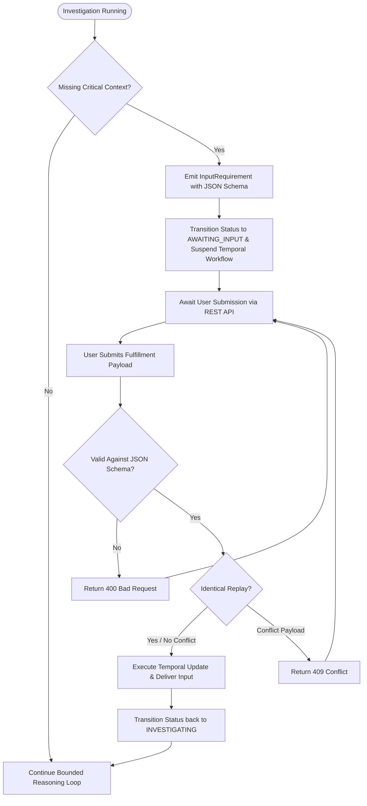

### 4. Actor / Use-Case Relationships

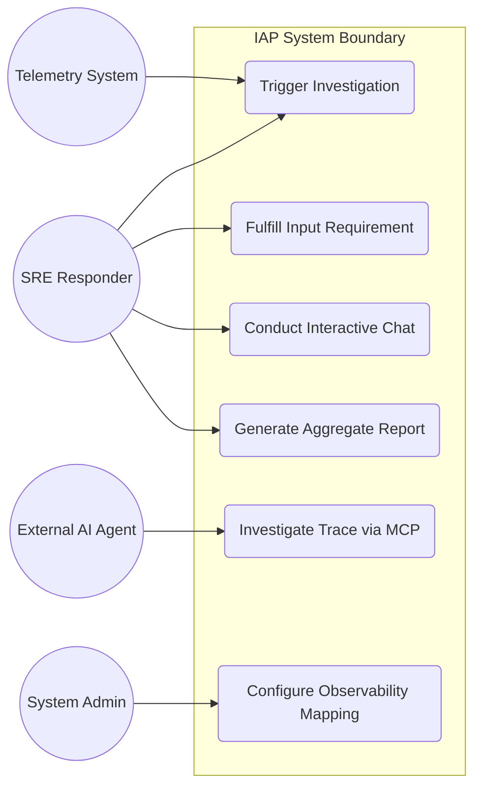

---

## Source Evidence Index

| Document Identifier | Document Title / File Name | Major Functional Sections Supported |
| --- | --- | --- |
| **[1]** | `IAP-implementation-part1-knowledge-v1.0.md`<br> | Domain aggregates, Temporal state engine, SQLAlchemy persistence, RLS, OCC, ports.

 |
| **[2]** | `IAP-implementation-part2-knowledge-v1.0.md`<br> | ReasoningCoordinator, ActionValidator, VerificationEngine, ConclusionGate, budget controls.

 |
| **[3]** | `IAP-implementation-part3-knowledge-v1.0.md`<br> | AsyncEvidenceGateway, Elastic/Oracle adapters, Tree-Sitter code parsing, correlation engine.

 |
| **[4]** | `IAP-implementation-part4-knowledge-v1.0.md`<br> | FastAPI gateway, JWT auth, outbox eventing, FastStream/Kafka, docker-compose deployment.

 |
| **[5]** | `IAP-implementation-part5-knowledge-v1.0.md`<br> | Layer 3 static code topology, AST nodes, Neo4j graph, dual-frame failure attribution.

 |
| **[6]** | `IAP-implementation-part6-knowledge-v1.0.md`<br> | Execution knowledge layer, Mem0 pgvector store, Graphiti temporal graph, TTL janitor.

 |
| **[7]** | `IAP-implementation-part7-knowledge-v1.0.md`<br> | GitHub batch loader CLI, blobless git fetch, SHA pinning, AST topology builder.

 |
| **[8]** | `IAP-implementation-part8-knowledge-v1.0.md`<br> | Optional Cognee enrichment, point projections on shared Neo4j, benchmark harness.

 |
| **[9]** | `IAP-implementation-part9-knowledge-v1.0.md`<br> | Elastic hardening, platform evidence IDs, inbound dual-transport MCP server (stdio/HTTP).

 |
| **[10]** | `IAP-implementation-part10-dynamic-mapping-design-v1.0.md`<br> | Non-ECS cluster analysis, `ObservabilitySourceMapping`, `FieldResolver`, tenant scope strategies.

 |
| **[11]** | `IAP-implementation-part11-knowledge-v1.1.md`<br> | Extensibility architecture, `AWAITING_INPUT`, bulk intake, finding clustering, reports, chat, jobs.

 |
| **[12]** | `IAP-implementation-part11-operations-v1.0.md`<br> | Operational runbook, task queues, schedule reconciler, Kafka fan-out, artifact store, vector maintenance.

 |
| **[13]** | `IAP-implementation-part11-plan-todo-v1.1.md`<br> | Platform build plan, test gates, golden scenarios, task queue topology.

 |
