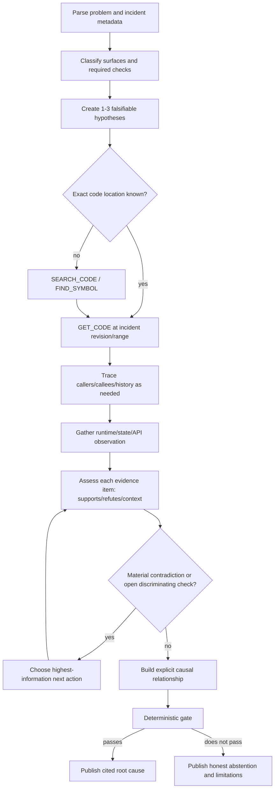

# Design: Code-Grounded LLM Investigation Reasoner

Implementation-ready design for improving source-code retrieval, prompt/context fidelity, hypothesis verification, and conclusion quality while preserving IAP's existing Temporal workflow and provider architecture.

## Executive Summary and Primary Diagnosis

IAP's primary problem is not that the LLM needs a longer prompt or a different model. The platform breaks the evidence chain between retrieval and conclusion: source code is fetched but omitted from model context; implemented code-search capabilities are unreachable; investigation state is hydrated then discarded; action failures are hidden; and verification rewards evidence quantity/provider diversity without establishing that evidence supports the selected hypothesis. The result is an agent that can appear evidence-rich while making generic, unsupported conclusions.

The recommended target preserves the current Temporal loop and repairs that chain in priority order: compile high-fidelity context, expose existing code navigation, preserve immutable source identity/ranges, persist falsifiable hypotheses and contradictions, bind evidence to claims, enforce real causality, and evaluate quality with incident replays. A new read-only API probe is useful, but only after verification is corrected so another evidence type cannot merely inflate the same broken confidence heuristic.

```mermaid
flowchart LR
    Issue[Issue and runtime symptoms] --> Classify[Classify investigation surfaces]
    Classify --> Plan[Hypothesis and evidence plan]
    Plan --> Navigate[Existing code navigation tools]
    Navigate --> Read[Revision-pinned range reads]
    Read --> Context[Token-budgeted evidence context]
    Context --> Reason[LLM selects discriminating action]
    Reason --> Execute[Deterministic action execution]
    Execute --> Assess[Bind result to hypothesis]
    Assess -->|information gap| Plan
    Assess --> Verify[Deterministic verification]
    Verify -->|unsupported or contradicted| Plan
    Verify --> Gate[Conclusion gate]
    Gate --> Report[Claim-level citations or honest abstention]
```



## Context

IAP already has the correct high-level shape: FastAPI creates a tenant-scoped investigation, Temporal runs a bounded one-action-per-iteration loop, activities retrieve evidence and execute tools, an LLM chooses the next action through a structured decision schema, and deterministic services verify and publish conclusions. Replacing the workflow engine, LLM providers, or evidence stores is unnecessary.

The failure is at the seams. The platform retrieves richer data than it gives the model, exposes less code capability than it has implemented, and verifies the shape of the evidence corpus rather than whether evidence supports a specific claim. Self-investigation `a301ece4-e580-457d-bbb4-4cfa2cb9e28e` demonstrated the combined effect: IAP declared a generic repository/API filtering root cause at confidence 0.80 without reading source code or reproducing API behavior. Direct inspection then showed the profile-version APIs returning all versions.

### Current-state architecture

```mermaid
sequenceDiagram
    participant API as FastAPI
    participant WF as Temporal workflow
    participant RA as reason_activity
    participant LLM as ReasoningCoordinator
    participant EA as execute_action_activity
    participant GW as Evidence gateway
    participant DB as PostgreSQL
    participant VE as Verification engine

    API->>WF: investigation ID, problem, app, limits
    loop bounded iterations
        WF->>RA: reason(state, recent action names/counts)
        RA->>DB: load evidence, hypotheses, findings, timeline
        Note over RA,LLM: Hypotheses/findings/timeline loaded but omitted<br/>Evidence code bodies also omitted
        RA->>LLM: problem + profile subset + evidence summaries
        LLM-->>WF: one action + observations + hypotheses
        WF->>EA: execute typed action
        EA->>GW: logs/state/exact-file/correlation
        GW-->>EA: evidence or metadata
        EA->>DB: persist evidence/action
        WF->>VE: hypotheses[0] + all evidence + no contradictions + no causal chain
        VE-->>WF: heuristic VERIFIED/INCONCLUSIVE
    end
    WF->>VE: conclusion gate with causal requirement disabled
    VE->>DB: all evidence cited; first ID used as causal chain
```

### Verified end-to-end gaps

The following are implementation facts, not architectural speculation:

1. `ReasoningCoordinator.reason()` serializes only `evidence_id`, `evidence_type`, `source`, and `summary` (`application/investigation/reasoning.py:239-247`). Actual source is stored in `Evidence.content_snippet` by `PyGit2Adapter` (`infrastructure/evidence/code/git.py:207-216`) and never reaches the model.
2. Existing code-intelligence operations already exist: `search_code`, `find_symbol`, `find_call_graph`, and `get_code_history` (`application/evidence/gateway.py:402-595`), with request schemas and provider protocols. They are absent from `ActionType`, absent from the dispatcher, and the `TreeSitterCodeIntelligenceProvider` is not registered in bootstrap.
3. `SourceRequest` supports repository, revision, and line bounds (`domain/evidence/requests.py:163-179`), but the activity and gateway discard them. Git reads the primary service's default branch and the head of one exact file (`activities.py:1514-1543`, `gateway.py:494-517`, `git.py:127-172`).
4. Reason-state hydration loads evidence, hypotheses, findings, and timeline (`activities.py:945-975`); prompt assembly discards all but evidence and facts (`reasoning.py:248-293`).
5. Action history records proposed action names and counts before execution, without parameters, result status, evidence IDs, item count, or miss reason (`workflows.py:490-529`; `reasoning.py:278-293`).
6. Verification selects an unordered `hypotheses[0]`, supplies all investigation evidence as corroboration, and supplies empty contradictions and causal chain (`activities.py:1832-1887,2508-2543`). `VerificationEngine` never compares evidence to the hypothesis statement (`verification.py:115-196`).
7. Production conclusion explicitly disables the causal relationship requirement; the confidence formula can reach exactly 0.80 with four provenanced items, two providers/types, no contradiction, and no causal chain (`verification.py:80-101,148-184`; `activities.py:2533-2543`).
8. Persisted findings cite the entire evidence corpus and set `causal_chain=evidence_ids[:1]`, which satisfies a data-model invariant but is not a causal chain (`activities.py:2561-2587`).
9. Correlation returns `items=[]` and places the graph in provider metadata; the worker persists only items. The correlation engine also omits root nodes and root-adjacent edges from output (`gateway.py:603-625`; `activities.py:1578-1589`; `application/correlation/engine.py:93-191`).
10. Existing token-aware `InvestigationMemory`, structured evidence formatting, and code-intelligence implementations are largely unwired. The solution should integrate them before creating parallel replacements.

### Ranked Root Causes

1. **Critical — model-visible context excludes the evidence needed to reason about code.** `content_snippet`, source ranges, revision metadata, active hypotheses, contradictions, and timeline are absent even when loaded or persisted.
2. **Critical — deterministic verification is semantically disconnected from the hypothesis.** It verifies an arbitrary first hypothesis against the whole corpus, discards contradictions/causality, and can pass at exactly 0.80 on corpus shape alone.
3. **High — implemented navigation capabilities are not available to the agent.** Existing code search, symbols, call graph, history, and attribution are unwired or return useful data only as transient metadata.
4. **High — source retrieval silently analyzes the wrong scope.** Repository, revision, and line-range intent are dropped, so `GET_CODE` reads the primary repository's default-branch file head.
5. **High — orchestration feedback is lossy.** The next reasoning turn cannot distinguish success, empty result, unavailable provider, invalid path, authorization block, or execution failure.
6. **High — publication corrupts epistemic provenance.** All evidence is cited as support and one arbitrary ID becomes the causal chain; conclusion persistence is not a required part of completion.
7. **Medium — quality is not evaluated end to end.** Tests cover schemas and local heuristics but not root-cause accuracy, citation entailment, abstention, contradiction recall, or retrieval relevance.

## References

- [Anthropic, Building effective agents](https://www.anthropic.com/engineering/building-effective-agents) — Supports simple bounded observe-reason-act loops and environmental feedback rather than unnecessary agent-framework complexity.
- [Anthropic, Effective context engineering for AI agents](https://www.anthropic.com/engineering/effective-context-engineering-for-ai-agents) — Supports treating context as a selected projection over durable state and preserving artifacts outside the prompt window.
- [Anthropic, Writing effective tools for agents](https://www.anthropic.com/engineering/writing-tools-for-agents) — Supports strict, non-overlapping tools with actionable errors and realistic tool-use evaluations.
- [OpenAI, The instruction hierarchy](https://openai.com/index/the-instruction-hierarchy/) — Supports structural separation of authoritative policy from untrusted retrieved evidence.
- [Temporal agentic-loop cookbook](https://docs.temporal.io/ai/cookbook/agentic-loop-tool-call-claude-python) — Supports keeping model and tool calls in activities outside deterministic workflow logic, with centralized retry/idempotency controls.
- `docs/IAP-architecture-v1.0.md` — Current as-built platform reference; its investigation sequence and provider description require updates after implementation.
- `docs/archive/IAP-implementation-LLM-reasoner-code-evidence-analysis.md` — Independently produced reference reviewed only after the code investigation; archived as the non-baseline input. Comparison and resolved disagreements appear below; where the two documents conflict, this document (design-sol) is the baseline.

## Goals / Non-Goals

**Goals:**

- Make retrieved source code, revision, line range, and provenance available to the reasoner under a model-aware token budget.
- Expose and repair IAP's existing code search, symbol, call-graph, history, and ranged-read capabilities instead of creating a parallel search subsystem.
- Maintain a structured investigation ledger: hypotheses, predicted observations, supporting/refuting evidence, contradictions, information gaps, and next discriminating checks.
- Prevent a conclusion unless a selected hypothesis is explicitly supported by relevant evidence and unresolved material contradictions are absent.
- Produce claim-level citations with exact repository/revision/path/range or runtime source identifiers.
- Add a strictly read-only, profile-allowlisted API probe only after evidence binding and conclusion correctness are fixed.
- Establish reproducible evaluation for retrieval relevance, conclusion accuracy, citation correctness, abstention, cost, and latency.

**Non-Goals:**

- No workflow-engine, model-provider, database, or broad framework replacement.
- No autonomous code modification or execution in this phase.
- No arbitrary shell, raw URL, or unrestricted filesystem tool.
- No semantic vector index for source code until existing text/symbol retrieval is measured and shown insufficient.
- No mutating HTTP probes. Initial API probing is limited to `GET` and `HEAD`.
- No requirement that every investigation read code; required evidence surfaces are derived from the issue and remain deterministic planning constraints, not proof by themselves.

## Decisions

### D1: Compile model context from durable investigation state

**Decision:** Replace ad hoc first-N prompt assembly with a `ReasoningContextCompiler`. It consumes persisted state and produces named, independently budgeted sections: objective, profile/repository map, investigation plan, hypotheses, contradictions, recent action outcomes, selected evidence, and conclusion constraints. Wire the existing `InvestigationMemory` selection logic rather than creating another memory store.

```text
ReasoningContext
  objective:
    problem_description
    investigation_id
    application_id
    incident_time_window
    reported_revision/repository/symbols when available
  application:
    services, repositories, default branches, source roots, languages
    state templates and probeable endpoints
  plan:
    required_surfaces[]
    open_questions[]
    completed_checks[]
  hypotheses[]:
    id, statement, status, predicted_observations, required_checks
    supporting_evidence_ids, refuting_evidence_ids, unresolved_gaps
  contradictions[]:
    id, statement, severity, evidence_ids, resolution_status
  recent_actions[]:
    action_id, type, redacted_parameters, status, evidence_ids
    item_count, error_code/miss_reason, duration_ms
  evidence[]:
    id, type, source, observed/retrieved timestamps, relevance
    provenance, excerpt, excerpt_truncated, content_handle
  constraints:
    budgets, allowed_actions, required_verification, blocked_actions
```

Evidence selection is deterministic and diversity-aware: reserve slots for direct runtime observations, source code, state, contradiction/refutation evidence, and the selected hypothesis's citations before filling remaining capacity by relevance and recency. Full artifacts remain durable; context contains bounded excerpts and handles.

**Alternative considered:** Add more fields directly to `facts_block` while retaining first-100 ordering. Rejected because it preserves the underlying context-budget and relevance problem.

**Trade-off:** The compiler adds a module boundary and selection policy. This cost is justified because model-visible context becomes inspectable, testable, and versioned rather than hidden inside prompt string assembly.

---

### D2: Expose existing code-intelligence operations as typed actions

**Decision:** Register `TreeSitterCodeIntelligenceProvider` in bootstrap and expose existing gateway methods through the action loop. Extend `ActionType` with `SEARCH_CODE`, `FIND_SYMBOL`, `FIND_CALL_GRAPH`, and `GET_CODE_HISTORY`; retain `GET_CODE` as the ranged content read.

Authorization follows the existing mechanism with no new capability-string scheme: `api/v1/routers/profiles.py:77,121` validates every `allowed_capabilities` entry against `ActionType` values, and `ProfileBasedActionAuthorizer` (`infrastructure/security/profile_authorizer.py:25-95`) maps each `ActionType` through `_ACTION_REQUIRED_EVIDENCE_TYPE` to an evidence-type gate plus a same-name capability check — the gateway's `_enforce_authorization(tenant_id, "SEARCH_CODE"/"GET_CODE", ...)` strings must therefore equal `ActionType` values. Concretely, each new action requires: (1) the `ActionType` member itself, (2) an entry in `_ACTION_REQUIRED_EVIDENCE_TYPE` pointing at its evidence type, and (3) coverage in `profile.investigation.enabled_evidence_types`. Dotted capability strings outside `ActionType` (e.g. `code.search`) are rejected at profile validation and must not be introduced; likewise no validation-time auto-grant — authorization stays explicit and deny-by-default.

Do not add the separate `CodeSearchPort` proposed by the prior design. Existing request models and provider protocols are the source of truth:

| Action | Existing request/gateway | Required repair |
| --- | --- | --- |
| `SEARCH_CODE` | `CodeSearchRequest`; `gateway.search_code` | Register provider; honor repository/revision/language/path/symbol/limit; deterministic relevance ranking |
| `FIND_SYMBOL` | `SymbolRequest`; `gateway.find_symbol` | Convert metadata result into persisted evidence/context; qualified identity |
| `FIND_CALL_GRAPH` | `CallGraphRequest`; `gateway.find_call_graph` | Honor direction/depth; preserve edge types; persist graph artifact |
| `GET_CODE` | `SourceRequest`; `gateway.get_source` | Pass repository/revision/start/end lines; return exact requested range with accurate truncation metadata |
| `GET_CODE_HISTORY` | `CodeHistoryRequest`; `gateway.get_code_history` | Replace invalid `profile.repository`; filter commits by path/symbol changes |

Each action returns a typed `ActionOutcome`, not an integer:

```text
ActionOutcome
  action_id: UUID
  action_type: ActionType
  status: SUCCEEDED | EMPTY | DEGRADED | FAILED | BLOCKED
  evidence_ids: UUID[]
  item_count: int
  error_code: string|null
  miss_reason: string|null
  provider_metadata_summary: object
  duration_ms: int
```

**Alternative considered:** Build a new graph-search adapter around `CodebaseGraphPipeline`. Rejected because it duplicates the existing `TreeSitterCodeIntelligenceProvider` and gateway surface. The pipeline may later feed persisted graph artifacts, but it is not the shortest path to usable investigation-time search.

**Trade-off:** Existing code intelligence has correctness gaps—weak ranking, ignored request fields, and incomplete graph semantics. Exposing it and repairing it together is more work than adding a shallow text-search action, but avoids institutionalizing two competing implementations.

---

### D3: Preserve source identity and range end to end

**Decision:** Source evidence must be immutable and citeable. The activity, gateway, provider protocol, and Git adapter must preserve `repository`, `revision`, `file_path`, `start_line`, and `end_line`. Incident intake repository/revision/top-frame data is copied into the investigation objective and used as defaults, never silently replaced by the profile's primary repository/default branch.

`GET_CODE` behavior:

- Resolve the requested repository against profile-declared repositories; reject unknown repositories.
- Resolve the requested immutable revision; if absent, resolve the configured branch once and record its commit SHA.
- Require a bounded line range after discovery; default to a small window around a matched symbol/frame, not file head.
- Return numbered lines and exact actual range.
- Set `excerpt_truncated=true` when character/token caps shorten the requested range.
- Fingerprint the immutable repository + commit + path + actual range + content hash.
- Set `observed_at` to commit/source time where available and `retrieved_at` to fetch time.

**Alternative considered:** Continue reading the first 4,000 characters and expose that snippet. Rejected because it fails for handlers later in large files and produces inaccurate line provenance.

**Trade-off:** Revision-pinned reads fail more often when checkouts lack the requested commit. That failure is preferable to silently analyzing the wrong version; the typed outcome tells the reasoner to seek an available revision or report the limitation.

---

### D4: Separate policy, task, trusted configuration, and untrusted evidence

**Decision:** Replace the monolithic hardcoded prompt with a versioned prompt package and structured messages:

1. **System policy:** role, safety, epistemic rules, stopping criteria.
2. **Developer/tool contract:** typed action catalog generated from `ActionType` plus existing Pydantic request schemas.
3. **User objective:** the reported problem, unchanged and clearly labeled.
4. **Trusted configuration:** profile-derived repository/service/tool availability.
5. **Untrusted evidence:** typed records enclosed as data, never promoted into policy.

The unused structured evidence formatter is wired into the active path. Prompt text is versioned (`reasoner_prompt_version`) and its hash is persisted with each decision for replay/evaluation.

The core investigation instruction is:

```text
You are controlling a bounded investigation. Choose the next action that most reduces
uncertainty among the active hypotheses.

Rules:
1. Distinguish direct observation, code-derived inference, and speculation.
2. Never claim code behavior unless the relevant source range was retrieved at the
   incident revision and is cited.
3. Never claim live API behavior unless it was directly observed by an allowed probe
   or the conclusion explicitly states that behavior was not reproduced.
4. For each hypothesis, state one predicted observation that would support it and one
   result that would refute it. Prefer the next action that discriminates between candidates.
5. Empty/degraded tool results are information. Read action outcomes before retrying.
6. CONCLUDE is allowed only when the selected hypothesis has explicit supporting
   assessments, required checks are complete, and no unresolved material contradiction exists.
7. If proof is unavailable within budget, conclude INSUFFICIENT_EVIDENCE with limitations;
   do not convert uncertainty into a generic root cause.
```

**Alternative considered:** A large typed `ActionCatalog` duplicating summaries, parameters, profile capabilities, and dispatcher knowledge. Rejected in that form because existing request models already define parameter schemas. Use a small registry for descriptions/capability class, generated schemas for parameters, and a completeness test against `ActionType`.

**Trade-off:** Generated prompts are less obvious in a single source file. Snapshot tests and persisted prompt version/hash make the effective prompt more observable than today's literal string.

---

### D5: Maintain a falsifiable hypothesis ledger

**Decision:** Make `Hypothesis` the investigation's unit of reasoning rather than persisting free-form strings and then verifying the first row. Every hypothesis must carry predicted observations, required checks, and explicit evidence assessments.

```text
EvidenceAssessment
  hypothesis_id
  evidence_id
  role: SUPPORTS | REFUTES | CONTEXT_ONLY
  claim: bounded statement the evidence addresses
  rationale: bounded explanation
  directness: DIRECT | INFERRED
  strength: 0.0..1.0
  created_by: AGENT | SYSTEM
  created_at
```

The LLM proposes assessments; deterministic validation confirms that IDs belong to the same tenant/investigation, citations resolve, code ranges/revisions exist for code claims, and assessment fields are complete. Contradictions and information gaps from `InvestigationDecision` are persisted instead of discarded — closing the exact drop site at `activities.py:1077-1091`, where `reason_activity` currently returns readiness/observations/parameters/hypotheses/usage but not `contradictions_found`, `information_gaps`, or `reasoning_chain`. Hypotheses are ranked deterministically by status, verified support, unresolved contradictions, and required-check completion — replacing the current `hypotheses[0]` selection over a query with no `ORDER BY` (`hypothesis_repository.py:157-167`).

**Alternative considered:** Capability-class coverage inferred from action history as the primary conclusion gate. Rejected as proof: reading unrelated code would satisfy a code requirement without supporting the hypothesis. Capability class remains useful planning telemetry — and should additionally be recorded per investigation as blocker-frequency analytics (which required surfaces most often go unexercised) — but evidence assessments establish claim support.

**Trade-off:** LLM evidence assessments can still be wrong. They are auditable claims, not automatic truth; deterministic citation and contradiction checks plus evaluation measure their quality.

---

### D6: Replace corpus-shape scoring with evidence-bound verification

**Decision:** Verification evaluates each eligible hypothesis separately using only its validated supporting/refuting assessments. Provider/type diversity is a secondary coverage signal, not proof. Causality is represented by explicit relationships, never a non-empty list of arbitrary IDs. This also retires the temporary override at `activities.py:2533-2543`, whose own comment marks disabling `require_causal_relationship` as a stopgap "until the agentic loop produces causal chains end-to-end" — D5's ledger is that loop, so the stopgap is removed rather than carried forward.

Verification prerequisites for `ROOT_CAUSE_ESTABLISHED`:

- At least one direct supporting assessment tied to the root-cause mechanism.
- Every supporting citation resolves and belongs to this investigation.
- All profile/problem-derived required checks are complete or explicitly waived with a recorded limitation.
- No unresolved HIGH/CRITICAL contradiction.
- A causal relationship contains `cause`, `mechanism`, `effect`, and supporting evidence IDs.
- For API-behavior claims, live probe evidence exists; otherwise the claim must be phrased as code-path inference and the conclusion cannot state that behavior was reproduced.
- The selected hypothesis has transitioned through `UNDER_INVESTIGATION` and `SUPPORTED` to `VERIFIED`.

If these conditions are not met at budget exhaustion, persist `INSUFFICIENT_EVIDENCE` or `NO_ROOT_CAUSE_FOUND`; do not mark the investigation as workflow `FAILED` solely for honest abstention.

Finding persistence and aggregate terminal transition are one correctness boundary: if the finding/conclusion cannot be persisted, the investigation does not become `COMPLETED`.

**Alternative considered:** Retune the existing 0.80 weights. Rejected because no numeric weights can repair absent evidence-to-claim linkage, discarded contradictions, or fabricated causality.

**Trade-off:** Root-cause establishment becomes harder, and abstention rates will initially rise. That is an intentional correction: the present false-positive path is more damaging than an explicit insufficient-evidence outcome.

---

### D7: Add a strictly read-only profile-allowlisted API probe after verification repair

**Decision:** Add `PROBE_API` only in the second implementation slice, after D1-D6. It uses an endpoint ID declared in the active profile; the model cannot supply a raw URL. Initial methods are `GET` and `HEAD` only. The adapter enforces host/path/query allowlists, tenant header injection, no cross-host redirects, response-size/time limits, and secret/header redaction.

The result is `API_PROBE` evidence with request method, resolved endpoint ID, status, bounded response excerpt, schema/shape summary, latency, and truncation flag. It is still not automatically supporting evidence; it must be assessed against a hypothesis.

**Alternative considered:** Optional profile-authorized mutating probes. Rejected for this phase because they are unnecessary to reproduce read-path complaints and materially expand operational risk.

**Trade-off:** Some behaviors require authentication or mutation to reproduce. Those remain explicit limitations or operator-assisted checks rather than autonomous actions.

---

### D8: Make agent decisions and quality reproducible

**Decision:** Persist one bounded decision trace per iteration: prompt version/hash, model/provider identity, selected context evidence IDs, action proposal, full typed outcome, hypotheses/assessments/contradictions changed, gate blockers, tokens, cost, and latency. Do not persist hidden chain-of-thought; persist concise decision rationale and evidence references.

Add an evaluation harness built around fixed incident fixtures and recorded provider/tool responses. The self-profile version complaint becomes the first regression case: expected result is `NO_ROOT_CAUSE_FOUND` or `INSUFFICIENT_EVIDENCE` when all versions are returned, and a root cause only when a fixture deliberately drops versions.

**Alternative considered:** Rely on unit coverage and production logs. Rejected because line coverage cannot measure retrieval relevance, citation support, or false-positive conclusions.

**Trade-off:** Trace storage adds bounded data volume. Retention follows investigation retention, and sensitive excerpts remain referenced as evidence rather than duplicated into traces.

## Data Storage

Use existing `hypotheses`, evidence, findings, and timeline structures where fields already exist. Add only what is required for missing durable semantics:

### Evidence assessments

Add a tenant-scoped `hypothesis_evidence_assessments` table keyed by `(tenant_id, hypothesis_id, evidence_id, role)`. Fields: assessment ID, investigation ID, bounded claim/rationale, directness, strength, actor, timestamps. Foreign keys cascade with the investigation/hypothesis; evidence association must support the same evidence artifact being attached to multiple investigations rather than relying on tenant-global ownership of one evidence row.

### Contradictions

Persist the existing `Contradiction` model in `investigation_contradictions`: statement, severity, evidence/hypothesis references, resolution status, actor/rationale/time, and supersession. Do not store evidence ID arrays as unverifiable opaque text if relational associations are already available.

### Decision traces

Use or complete the existing action/agent-action persistence rather than introducing another generic audit table. Store hashes and IDs, not full prompts or duplicated evidence payloads. Add prompt/schema version, model revision where supplied, selected context IDs, typed action outcome, and gate blockers.

### Probeable endpoints

Add a backward-compatible profile field containing endpoint ID, description, base URL, path template, allowed path/query parameters, and method restricted to `GET|HEAD`. Existing profiles default to no probe endpoints.

## Data Structures

The key changed contracts are `ReasoningContext`, `ActionOutcome`, and `EvidenceAssessment` described in D1, D2, and D5. Additional contracts:

```text
InvestigationPlan
  issue_class: API_BEHAVIOR | DATA_STATE | EXCEPTION | PERFORMANCE | CODE_CHANGE | UNKNOWN
  required_surfaces: surface[]
  open_questions: question[]
  completed_checks: check[]
  blocked_checks: check + reason[]

Citation
  evidence_id
  claim
  source_kind
  repository/revision/path/start_line/end_line when code
  source URI/document ID/time window when runtime
  excerpt_hash

VerificationResult
  hypothesis_id
  status
  supporting_assessment_ids
  refuting_assessment_ids
  causal_relationships
  blockers
  coverage telemetry
  confidence_label: HIGH | MEDIUM | LOW
```

Do not present the current heuristic float as calibrated probability. Preserve a score only as internal telemetry until calibration against a labeled incident set exists.

## Interfaces

No external REST contract is required for the immediate code-reasoning fixes. Internal actions change as specified in D2. The eventual profile interface adds read-only probe declarations; profile versioning makes that additive and backward compatible.

The investigation conclusion API should distinguish terminal epistemic outcomes:

| Outcome | Workflow success | Meaning |
| --- | --- | --- |
| `ROOT_CAUSE_ESTABLISHED` | yes | Evidence-bound causal hypothesis verified |
| `NO_ROOT_CAUSE_FOUND` | yes | Checks completed; candidates refuted or none supported |
| `INSUFFICIENT_EVIDENCE` | yes | Budget/provider/coverage limits prevented proof; limitations persisted |
| `FAILED` | no | Platform/workflow execution failure, not an epistemic result |

## Accessibility

No new visual, CLI, or TUI interface is introduced. API outcomes and errors remain machine-readable and must use descriptive text labels rather than relying on color or presentation-specific state.

## Implementation Detail

### Target Architecture

The target remains a single durable investigation workflow, not a multi-agent rewrite. Temporal owns lifecycle and replay-safe control flow; activities perform nondeterministic model/provider calls; PostgreSQL remains the durable state/evidence authority; and the LLM remains a bounded next-action selector. The architectural change is the contract between those existing components: a context compiler feeds complete, relevant evidence; typed tool outcomes feed learning across iterations; hypothesis assessments connect claims to evidence; and the conclusion gate evaluates those durable relationships rather than corpus counts.

### Target investigation methodology



For exception investigations: parse structured stack frames; resolve repository/revision/path/line; read a bounded range around the failure frame; identify enclosing symbol; inspect direct caller/callee path; compare runtime values/state with code preconditions; then assess competing hypotheses.

For API-behavior investigations: identify route from profile/OpenAPI/code search; read route and repository query path; directly probe the declared endpoint when allowed; compare returned shape/count with persistence state; explicitly distinguish “code appears correct” from “behavior reproduced.”

### File-level implementation plan

#### P0 — Restore evidence fidelity and conclusion correctness

1. `application/investigation/reasoning.py`: replace direct `facts_block` assembly with `ReasoningContextCompiler`; include bounded source snippets/provenance, active hypotheses, contradictions, plan, and typed outcomes.
2. `application/worker/workflows.py` and `activities.py`: return `ActionOutcome`; append/update history after execution; propagate/persist contradictions, information gaps, assessments, and rationale.
3. `application/investigation/verification.py`: verify one ranked hypothesis against bound assessments; require real causal relationships; return blockers; remove corpus-wide automatic corroboration.
4. `activities.py:_gate_conclusion_or_fail`: remove causal-policy override, remove `causal_chain=evidence_ids[:1]`, cite only validated supporting assessments, and make conclusion persistence required before `COMPLETED`.
5. `hypothesis_repository.py`: deterministic ordering/ranking and lifecycle persistence.

Estimated complexity: high, but localized to the existing reason/verify/conclude path. Dependency order: context/outcome contracts → persistence → verification → conclusion.

#### P1 — Wire and repair existing code intelligence

1. `bootstrap/__init__.py`: register `TreeSitterCodeIntelligenceProvider` when code repository base is configured.
2. `domain/investigation/models.py`: add existing code operations to `ActionType`.
3. `infrastructure/security/profile_authorizer.py`: add one `_ACTION_REQUIRED_EVIDENCE_TYPE` entry per new action (evidence-type gate); gateway `_enforce_authorization` call sites use the `ActionType` value verbatim as the capability name. No dotted capability strings, no validation-time auto-grant.
4. `application/worker/activities.py`: handlers calling existing gateway operations; persist typed evidence/graph artifacts.
5. `application/evidence/gateway.py`, `ports/evidence/code.py`: preserve all request fields and return typed evidence, not useful data only in provider metadata.
6. `infrastructure/evidence/code/git.py`: honor repository/revision/range; repair history profile resolution and path filtering.
7. `infrastructure/evidence/code/intelligence.py`: deterministic sorting/ranking, request filters, real Git revision, per-file symlink containment, Unicode-safe tree-sitter byte slicing.
8. `application/correlation/engine.py`: retain roots/root edges and correct per-node depth; persist graph results for reasoning.

Estimated complexity: medium-high. Most interfaces exist; work is repair and wiring rather than new architecture.

#### P2 — Planning, read-only API observation, and quality harness

1. Add issue-surface classifier and `InvestigationPlan` compiler as deterministic guidance; do not use keyword class as proof.
2. Add profile-allowlisted `PROBE_API` (`GET|HEAD` only), evidence projection, and policy tests.
3. Add incident replay fixtures, model/tool stubs, quality metrics, and CI thresholds.
4. Persist prompt/model/schema versions and selected context IDs for reproducibility.

Estimated complexity: medium. Depends on P0 evidence binding so new probe evidence cannot inflate confidence merely by existing.

### Migrations

1. Add contradiction and evidence-assessment tables/constraints.
2. Add or adapt decision-trace fields in the existing agent-action/action-execution persistence model.
3. Add any evidence-to-investigation association needed to stop tenant-global dedup from preventing the same artifact from being cited by multiple investigations.
4. Deploy readers that tolerate absent new rows/fields.
5. Deploy writers behind a feature flag.
6. Backfill nothing: historical conclusions lack enough information to infer trustworthy assessments or contradictions.
7. Enable the new verifier in shadow mode, compare old/new decisions, then make it authoritative.

## Independent Review vs. Prior Design

### Agreements

- Action history needs parameters, evidence counts, outcomes, and miss reasons.
- Provider count is not semantic corroboration.
- A read-only, allowlisted API probe is useful for API-behavior complaints.
- Action/tool descriptions should be structured and testable rather than maintained solely in prompt prose.
- The conclusion gate must enforce that the relevant investigation surface was actually examined.

### Prior-design-only findings retained

- Profile-declared API probe endpoints and no raw-URL calling mode.
- Explicit truncation disclosure in context.
- Capability classes as planning/coverage telemetry.

### Independent findings missing from the prior design

- Actual code snippets never reach the model.
- Existing code search/symbol/call-graph/history operations already exist but are unwired.
- Source repository/revision/line-range request fields are silently discarded.
- Code history is broken and semantically unfiltered.
- Active hypotheses/findings/timeline are hydrated then omitted.
- Verification uses all evidence against an arbitrary first hypothesis.
- Contradictions and causal chains are discarded; production disables causality.
- Finding citations include unrelated evidence and fabricate a causal chain.
- Correlation output disappears and traversal omits root structure.
- No end-to-end conclusion-quality evaluation or calibrated confidence exists.

### Resolved disagreements

**New code-search subsystem:** Rejected. The prior design proposed `CodeSearchPort` and an adapter around `CodebaseGraphPipeline`; existing gateway/provider/request implementations should be repaired and wired instead.

**Capability class as proof:** Narrowed. Capability coverage is useful to plan and measure investigation breadth, but does not establish support. Explicit evidence assessments and causal relationships are authoritative.

**Truncated summary flag as source-code fix:** Rejected as insufficient. Git source lives in `content_snippet`, not summary; bounded content and exact provenance must enter context.

**Mutating API probes:** Rejected for initial implementation. They contradict the read-only objective and add unnecessary blast radius.

**Automatic capability grants:** Rejected. Profile authorization changes remain explicit; profile validation must not silently broaden repository/API permissions. Strengthened by code inspection during conflict review: `allowed_capabilities` entries are validated against `ActionType` values (`api/v1/routers/profiles.py:77,121`), so dotted strings like `code.search` would be rejected at the profile boundary — new actions must be `ActionType` members with `_ACTION_REQUIRED_EVIDENCE_TYPE` entries (see D2).

## Testing Philosophy

### Context fidelity

Capture the exact `LLMGatewayRequest` and assert that selected source evidence includes a bounded code excerpt, immutable revision, path, actual line range, truncation marker, and evidence ID. Assert active hypotheses, contradictions, plan, and prior typed outcomes are present. Assert untrusted source/log text remains in the data channel and cannot change the allowed action schema.

### Code navigation correctness

Use fixture repositories containing duplicate symbol names, routes, Unicode before symbols, symlinks, multiple repositories, and functions beyond line 1,000. Verify deterministic ranking, repository/revision/range preservation, qualified symbols, call direction/depth, path-filtered history, and exact citation ranges. Run one end-to-end test: issue text names an endpoint but no file; search finds route; range read returns implementation; the next reason call contains it.

### Hypothesis and conclusion integrity

Create competing hypotheses with supporting, refuting, and unrelated evidence. Verify that unrelated evidence contributes no support; a contradicted first hypothesis cannot block evaluation of a supported second hypothesis; unresolved critical contradictions block publication; causal relationships cannot be replaced by arbitrary evidence IDs; and persisted citations equal validated supporting assessments only.

### Honest abstention

Verify that budget exhaustion, unavailable code checkout, unavailable probe, insufficient support, and unresolved contradictions produce `INSUFFICIENT_EVIDENCE` with limitations rather than a generic root cause or platform `FAILED` state.

### Incident replay and measurable acceptance

Create a private fixture suite with true root cause, no defect, insufficient evidence, contradictory evidence, wrong revision, misleading logs, and prompt-injection content. Initial release gates:

- Code retrieval: top-5 file recall ≥ 90% and correct-range recall ≥ 85% on labeled fixtures.
- Context: 100% of selected source citations resolvable to repository/revision/path/range; zero evidence payloads in policy/system instructions.
- Conclusion accuracy: zero unsupported `ROOT_CAUSE_ESTABLISHED` results on no-defect/insufficient-evidence fixtures; ≥ 80% correct root cause on deterministic fixtures.
- Citation precision: ≥ 95% of cited items judged supportive; citation validity 100%.
- Contradiction safety: 100% of unresolved HIGH/CRITICAL contradictions block root-cause publication.
- Abstention: ≥ 90% correct epistemic outcome on insufficient-evidence fixtures.
- Efficiency: p95 tool calls, latency, and token cost no more than 25% above current baseline for fixtures of equal complexity; investigate any regression before raising the threshold.
- Stability: multiple model samples where nondeterminism remains; no critical-behavior regression across prompt/model changes.

## Documentation Plan

### `docs/IAP-architecture-v1.0.md`

**Audience:** Platform engineers and operators

Update the investigation sequence to show context compilation, typed action outcomes, hypothesis-bound evidence assessments, contradiction persistence, and evidence-bound conclusion gating. Correct the current implication that correlation/hypothesis/verification are one fully connected activity. Document existing code-intelligence registration and the eventual read-only API probe.

### `config/profiles/iap-self.yaml`

**Audience:** Self-investigation profile maintainers

After P2, document explicit probeable endpoints and code capabilities. Do not auto-grant them during validation. Include the profile-version list/detail endpoints as the reference read-only probe configuration.

### Evaluation fixtures and runbook

**Audience:** Agent engineers and release reviewers

Document fixture authoring, expected epistemic outcomes, citation annotations, replay mode, model/tool stub mode, threshold interpretation, and how to inspect a failing decision trace without exposing secrets or hidden chain-of-thought.

## Risks / Trade-offs

### More abstentions after verifier hardening

**Risk:** Removing corpus-shape verification and requiring evidence-bound causality will increase `INSUFFICIENT_EVIDENCE` outcomes.

**Mitigation:** Treat abstention as a valid product outcome, instrument blocker frequencies, and improve retrieval where blockers reveal real supply gaps. Do not lower the gate merely to restore historical completion rates.

### Larger model context

**Risk:** Adding code excerpts, hypotheses, contradictions, and outcomes can increase latency and cost or exceed model context limits.

**Mitigation:** Compile context under model-specific input budgets, reserve response capacity, use handles for full artifacts, and evaluate selection recall before increasing caps. Never dump full repositories or entire histories.

### Existing code intelligence may underperform

**Risk:** Once exposed, current text search and call analysis may show poor relevance, duplicate-name ambiguity, or graph errors.

**Mitigation:** Gate rollout on retrieval metrics, repair deterministic ranking and symbol qualification first, and introduce semantic indexing only if measured recall remains insufficient.

### LLM-generated evidence assessments can be persuasive but wrong

**Risk:** Structured support/refutation rationales can still hallucinate entailment.

**Mitigation:** Resolve every citation deterministically, require directness labels, keep contradiction/refutation visible, use claim-level evaluation, and prohibit numeric confidence from overriding missing prerequisites.

### API probe security and operational impact

**Risk:** Even read-only probes can create load or trigger poorly designed side effects.

**Mitigation:** Require explicit profile allowlisting, `GET|HEAD` only, strict egress/path/query validation, no cross-host redirects, low per-investigation limits, short timeouts, and complete audit.

### Migration compatibility

**Risk:** Existing hypotheses and conclusions have no assessments or persisted contradictions.

**Mitigation:** Do not synthesize history. New verifier applies to new/reopened runs; old conclusions remain readable with a legacy-verification marker.

## Assumptions and Unresolved Questions

- The first target remains the current single-worker/self-profile deployment; shared code-index infrastructure is deferred until multi-worker scale or measured graph-build cost requires it.
- Whether to use the existing `InvestigationMemory` unchanged or extract its selector into the new compiler depends on detailed tests; its current priority ordering is useful, but its token estimator and evidence shape require validation.
- Source evidence currently has tenant-global uniqueness semantics that can prevent the same artifact from attaching to multiple investigations. The migration design must choose between shared immutable artifacts plus an association table (preferred) and investigation-scoped copies.
- The exact confidence presentation should remain qualitative until a labeled corpus supports calibration.

## Traceability Matrix

| Problem | Code evidence | Solution | Implementation location | Validation |
| --- | --- | --- | --- | --- |
| Source retrieved but invisible to LLM | `reasoning.py:239-247`; `git.py:207-216` | Bounded code excerpts + provenance in compiled context | reasoning/context compiler | Wire-request content test |
| Code discovery unavailable to agent | `gateway.py:402-595`; `models.py:63-70`; `activities.py:1666-1674` | Register/expose existing operations | bootstrap, ActionType, dispatcher | Endpoint-without-path E2E fixture |
| Wrong repo/revision/range | `requests.py:163-179`; `activities.py:1514-1543`; `git.py:127-172` | Preserve source identity/range | activity, gateway, protocol, Git adapter | Multi-repo/revision/range tests |
| Rich state omitted from prompt | `activities.py:945-975`; `reasoning.py:248-293` | Context compiler using durable state | reasoning + memory selector | Prompt snapshot test |
| Action failures invisible | `workflows.py:490-529` | Typed post-execution outcome | workflow/activity contracts | Miss/recovery loop test |
| Arbitrary hypothesis/all evidence verification | `activities.py:1832-1887`; `verification.py:115-196` | Evidence assessments + ranked hypotheses | hypothesis persistence/verifier | Competing-hypothesis test |
| Contradictions discarded | `reasoner.py:14-26`; `activities.py:1077-1091,2531-2543` | Persist and gate contradictions | activities/repository/gate | Critical contradiction E2E test |
| Causal requirement bypassed | `activities.py:2533-2543`; `verification.py:80-101` | Explicit causal relationship prerequisite | verifier/conclusion gate | No-causal-chain rejection test |
| Fabricated citations/causal chain | `activities.py:2561-2587` | Cite only validated assessments | conclusion persistence | Citation precision test |
| Correlation result disappears | `gateway.py:603-625`; `activities.py:1578-1589` | Persist graph evidence; retain roots/edges | gateway/engine/handler | Depth-1 root-edge test |
| API behavior not directly observable | Action enum/dispatcher lacks probe | Read-only profile-allowlisted probe | profile + new adapter/handler | SSRF/method/response tests |
| No quality regression gate | Current unit tests/CI cover structure, not truth | Private incident replay harness | tests/evaluation + CI | Accuracy/citation/abstention thresholds |
