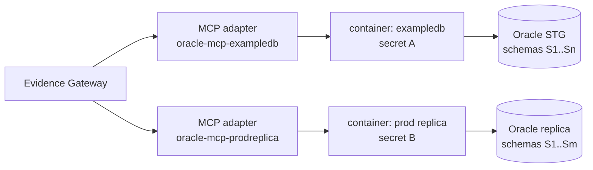

# Addendum to Part 3 v1.0: Oracle SQLcl MCP Registration (Multi-DB, Multi-Schema)

Status: design approved for implementation. Parent: `docs/IAP-implementation-part3-knowledge-v1.0.md` (pointer added there). Source requirements: `docs/scratchpad/oracle-mcpserver.txt` (single-DB POC). This addendum extends that POC to the mandatory scope: **multiple databases, multiple schemas per database**, registered as first-class IAP evidence providers.

## Mandatory scope (beyond the POC)

The POC covers one database (one example connection) and one implicit schema. Production requires: N databases (dev/stage/prod investigation replicas plus distinct application databases), each with M application schemas, all queryable through one gateway with tenant isolation. Single-DB assumptions (one connection file, one secret mount, one provider key) must not leak into the implementation.

## Topology: one image, one running instance per database

Build one container image (Temurin 17 + pinned SQLcl, non-root, no secrets in layers — per POC). Run **one container instance per database**, each mounting its own `connections/<db>.json` files and its own secret, each with its own resource limits and restart lifecycle:



One instance per DB (not one container switching connections) because: credentials never co-reside in one mount namespace; a hung query or restart affects one database only; per-DB timeout/row budgets differ; audit attribution is per-connection by construction. The cost (one small Java process per DB) is negligible next to the isolation gain. A single `docker-compose.yml` with one service per database (or compose profiles per environment) keeps the topology declarative.

## Multi-schema within a database

The read account (`MCP_INVESTIGATION_READ` pattern per DB) holds `SELECT`-only grants on each required application schema — granted schema by schema, never `SELECT ANY TABLE`, never DBA. Discovery is parameterized by `OWNER` (per POC §17: `ALL_TABLES`/`ALL_TAB_COLUMNS`/`ALL_CONSTRAINTS` filtered by bind, never hard-coded schema lists). On the IAP side, one `StateProfile` covers one `(connection, schema)` pair: `provider: oracle-mcp-<dbname>`, `schema_name` the primary schema, `tables` optionally schema-qualified for cross-schema joins the grants permit. An application spanning schemas gets one profile per schema sharing the connection key — explicit and auditable, never implicit search-path tricks.

## IAP adapter work (`McpEvidenceAdapter`)

Today the adapter only speaks a `search_logs` tool (runtime shape). Oracle SQLcl MCP exposes native tools (`run-sql` plus metadata/connection tools). Required:

1. New state-query method (e.g. `search_application_state` via `connect` + `sql_run`): takes tenant/investigation/request/profile, resolves connection key from `profile.provider` and schema from `profile.schema_name`, calls `connect` with `{connection_name}` then `sql_run` with `{sql}` in the same session (SQLcl 26.x is stateful: the query tool takes bare SQL, no connection/max_rows args — row caps enforced client-side), maps rows to `Evidence` with provenance (connection key, sanitized SQL hash, row counts).
2. `allowed_tools` per instance: `["run-sql", <metadata tools actually advertised>]` — allow-listed at construction, enforced by the existing `_validate_tool_call` (shape + 8 KB arg cap already present).
3. **Sanctioned dynamic-SQL exception**: IAP Rule 1 (static templates only) cannot hold for agentic investigation — the POC's design goal (§34) is dynamic discovery without a pre-authored catalog. Compensating controls, in order: (a) `QuerySafetyPolicy` sqlglot gate allowing `SELECT`/`WITH ... SELECT` only, applied to every generated statement before dispatch; (b) database read-only grants as the backstop (DB rejects the rest — negative tests prove it); (c) timeout 30 s + 1,000-row cap, configurable; (d) full SQL audit in evidence provenance. No LLM prompt is a security boundary anywhere in this chain.

## Registration wiring (bootstrap)

New config (no secrets — mounts carry those): `config/oracle-mcp-servers.yaml` listing `{name, command, args, connection, allowed_tools, timeout_seconds, max_rows, tenants}` plus optional `query_tool`/`connection_tool`/`connection_arg` (stateful SQLcl 26.x servers: `connect` then session-scoped `sql_run`; single-shot servers take the connection inline). This YAML file is the only source (no env-JSON override exists). At boot, for each entry construct `McpEvidenceAdapter(server_params=StdioServerParameters(command, args), ...)` and register under key `oracle-mcp-<name>`, then `freeze()` with the rest. Tenant scoping mirrors the git adapter: a tenant→connection-key allowlist (default deny); a tenant may only query databases its profiles name. MCP registers only with explicit entries — same absent-means-unregistered rule as the gateway addendum.

## Security posture (extends POC §§20/26)

Read-only account per database; grants per schema; no `SYS`/`SYSTEM`/DBA/developer credentials; non-root containers; connections + keys mounted read-only, never in image/config/Git/logs (the adapter's 8 KB arg cap and redaction apply to tool arguments; result bodies are sanitized at the gateway like all evidence). Investigation replica preferred over production-direct (POC §27); production-direct only with explicit approval. Negative tests are mandatory per database: `INSERT`/`UPDATE`/`DELETE`/`MERGE`/DDL/PL/SQL must fail **at the database**, never merely filtered in Python.

## Tests

- Container acceptance per database (POC §29 adapted): build, non-root, version checks, connection import + `CONNMGR TEST`, version query, metadata + data reads, MCP tool discovery, iterative queries.
- Negative tests per database per §30 (must fail at the DB).
- Multi-schema: discovery across two schemas with grants on both; revoke one grant → queries against it fail closed with a named error, the other unaffected.
- IAP side (mocked stdio session): allow-list enforcement, arg caps, timeout, tenant-mismatch denial, SELECT-only gate rejection of DML, provenance completeness on mapped evidence.
- Gateway-routed: one end-to-end query through the composed gateway once §1.1 lands (shares its integration test).

## Rollout

Database-by-database: STG first (connection file + secret + grants + compose service + adapter registration), negative tests, then replica/prod connections. Each database is independently shippable; no flag day. Triggers unchanged: DBA views/AWR/ASH stay out (POC §28) until their own threat review.

## Per-app credential management (2026-10-18)

One YAML file per application in the external store — never in this repo:

```text
${IAP_ORACLE_MCP_HOME:-~/workspace/docker/iap/oracle-mcp}/
  scopes/<org>-<app>-<env>/oracle.yaml   # chmod 0600
```

Schema: `oracle-mcp/per-app-oracle.yaml.example`. Logical database names are
dotted `<domain>.<subdomain>.<env>` (e.g. `sample.orders.prod`); exactly three
keys per database: `user_name`, `password`, `jdbcUrl`. Loader
`oracle-mcp/load-oracle-env.sh --scope <scope> --app <app> --db <d.sd.e>` emits `export
IAP_SECRET_ORACLE_<D>_<SD>_<E>_{USER_NAME,PASSWORD,JDBC_URL}` lines for `eval`
(the same names the `secret://` dev-fallback reads — one mapping, no drift).
Fail-closed: non-0600 file, `app:`/directory mismatch, unknown db, empty
fields, and `environment: prod` with `account_kind: personal` (personal
accounts are local-only; prod requires a service account) all refuse with no
exports. Enforcement is three-deep: file scoping (what exists) → server-entry
`tenants` (`config/oracle-mcp-servers.yaml`, default-deny) → profile
`Datasource.tenants` + `read_only` (registry refuses `read_only: false`).
Profiles carry `connection_ref` only on direct-engine datasources; MCP-path
datasources omit it (credentials live in the wallet, selected by connection
name — there is no DSN to resolve). `IAP_ORACLE_DSN` additionally accepts
`secret://`/`env://` refs for the direct path (resolved at bootstrap;
unresolvable stays unregistered, production plain-DSN fails closed).

## Secret-manager paths (built; live certification TODO)

Same logical names in both managers, one single-value entry per key:

- AWS Secrets Manager (`IAP_SECRET_STORE_PROVIDER=aws`, auth via SDK chain):
  secret-ids `<prefix>oracle/<d>/<sd>/<e>/{user_name,password,jdbc_url}`
  (e.g. prefix `iap/prod/` → `iap/prod/oracle/sample/orders/prod/password`;
  `SecretString` is the raw value). IAM: `secretsmanager:GetSecretValue` on
  exactly those ids, nothing wider.
- OpenBao (`IAP_SECRET_STORE_PROVIDER=openbao`): KV v2 at
  `<mount>/iap/oracle/<d>/<sd>/<e>/{user_name,password,jdbc_url}` with
  `{"value": "..."}` docs (`IAP_OPENBAO_ADDR/TOKEN/MOUNT/...` from runtime
  env only). Policy: read on exactly those paths.

`IAP_SECRET_STORE_PROVIDER` unset keeps current behavior (dev
`IAP_SECRET_*` fallback, production fail-closed); unknown provider halts boot.
Live AWS/OpenBao certification (resolve sample-DB refs against real instances) is an
OPEN ledger TODO — code paths are implemented and unit-tested, not yet proven
against live managers.

## Operator runbook: onboarding one database

1. DBA: read-only account + schema grants (or `_RO` service); confirm the
   password avoids `/ @ "` and whitespace (SQLcl limitation).
2. Author `scopes/<scope>/oracle.yaml` (0600) from the example; loader self-check:
   `load-oracle-env.sh --scope <scope> --app <app> --db <d.sd.e>` prints exports.
3. Import: `eval` the loader output, then `add-datasource.sh --name <CONN>
   --user ... --jdbc ... --password-env ...` (needs `sql` on PATH + DB
   reachability). Verify `CONNMGR TEST` + version query inside SQLcl.
4. Register: entry in `config/oracle-mcp-servers.yaml` (`connection:
   <CONN>`, explicit `tenants`); profile datasource (`kind: oracle`,
   `role: state`, `mcp_server: oracle-mcp-<name>`, `read_only: true`,
   `tenants`); `seed_profile.py --dry-run`, then seed (bump profile version).
5. Acceptance (§Tests above): container checks, MCP tool discovery, one
   gateway-routed end-to-end query, then the negative battery (DML/DDL must
   fail AT THE DB). Any failure keeps the database item BLOCKED with the
   reason named — no silent skips.

Rotation: new password in `oracle.yaml` (or manager) → re-run step 3 with
`--replace` → restart API/worker. Nothing in the repo changes. Revocation:
delete the server entry + profile datasource, re-seed, drop the wallet
connection. Compromise of one app's file exposes at most that app's databases.

## Default schema (2026-10-18)

Tables live under owner schemas, not the login user. Two coordinated
declarations, one enforced:

- Profile (enforced source of truth): `Datasource.schema_name`
  (identifier-charset validated at parse; non-secret, versioned). After
  `connect`, the MCP adapter issues `ALTER SESSION SET CURRENT_SCHEMA =
  <schema>` inside the same session, before the query — adapter-issued
  session control, so the agent SELECT-only gate does not apply; failure
  fails the action closed rather than querying the wrong schema.
  Undeclared (`None`) keeps the login default; single-shot (non-stateful)
  servers ignore it.
- Operator file (eyeball companion): per-app `oracle.yaml`
  `default_schema` next to `user_name`, exported by the loader as
  informational `IAP_ORACLE_<D>_<SD>_<E>_DEFAULT_SCHEMA` (never an
  `IAP_SECRET_*` name). Keep identical to the profile's `schema_name`;
  the runbook's grant-check step compares them.
