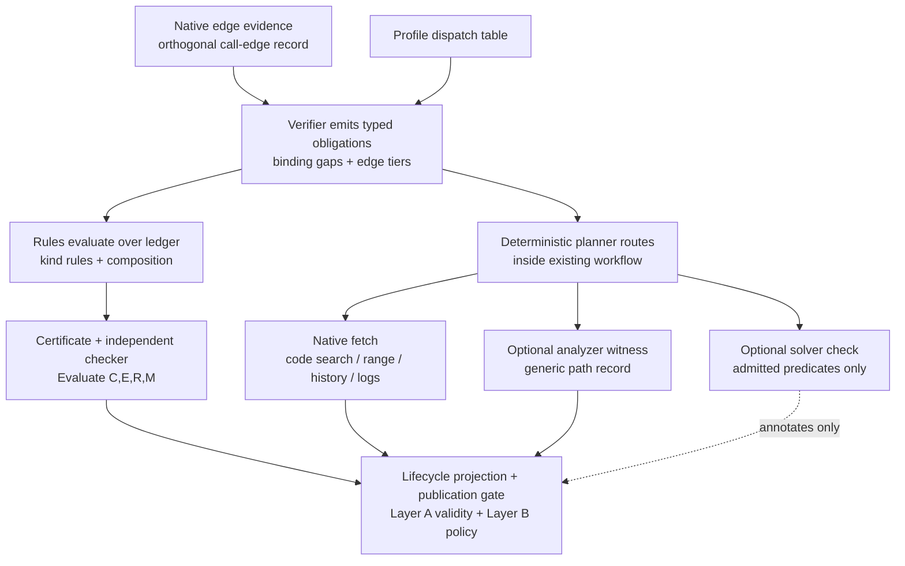

# IAP Proof-Kernel Architecture and Detailed Design v1.0

> Status: design artifact, not implementation authorization. Code changes require separate explicit approval.
> Relationship: builds on `docs/IAP-architecture-v1.0.md` (current system), `docs/IAP-QUERY-TO-VERIFY-IMPROVED-DESIGN.md` Rev 2 (native proof core), `docs/DS_REVIEW_v0.1.md` (code-grounding contracts), `docs/REV_BATTERY_CLOSE_PLAN.md` (failure buckets), `docs/BATTERY_LIVE_PROTOCOL.md` (grading). Where this document conflicts with an earlier draft on proof authority, this document governs for kernel scope only; the current architecture doc governs shipped behavior until a gated rollout amends it.
> Non-goals restated: no second durable runtime, no central graph store, no solver/analyzer authority, no threshold change to `VERIFIED` to improve answer rate.

## 0. Source coverage ledger (Part 0)

The v6 synthesis and the sixth review were read line by line. Coverage below is by semantic section, not by file name.

### 0.1 v6 synthesis sections accounted for

| Section | Subject | Disposition in this design |
|---|---|---|
| 0 | Four questions; `VERIFIED` means obligations discharged under stated model | Preserved as REQ-KERNEL-001; enforced in §2/§5 |
| 0.1 | Invariants I1–I12 | Preserved verbatim in §1.4; each mapped to a gate |
| 0.2 | Three results: obligation / verification / publication; Layer A/B; `*_validated` as reference | Preserved; §1.5 + §5 |
| 0.3 | Versioned `PROOF_RULES` per `ClaimKind` | Preserved; §3.2; HISTORY row explicit |
| 0.4 | Reconciliation table + proposition-level contradiction | Preserved; §4.2 |
| 0.5 | Normative ProofRule: premises + inference + soundness label | Preserved; §3.2 |
| 0.6 | Composition: conjunction / alternatives / dependency / contradiction / shared evidence | Preserved; §4.1 |
| 0.7 | Canonical proposition: scope, quantifiers, schema | Preserved; §1.2 |
| 0.8 | Snapshot-consistent verification/publication | Preserved; §5.1 |
| 0.9 | Certificates + independent checker; `P = Evaluate(C,E,R,M)` | Preserved; §3.3–§3.4 |
| 0.10 | TCB, closed registry, semantic premise validation, label enforcement, artifact digest | Preserved; §2.3 + §3.2 |
| 0.11 | Coverage as premise; typing; lineage/cycles; retention vs `PREMISE_UNAVAILABLE` | Preserved; §4.3 |
| 0.12 | Route / proposition / reconciliation split + transition table | Preserved; §4.2 |
| 0.13 | Single authoritative path to `VERIFIED` | Preserved; §2.4 + §5.2 |
| 0.14 | Atomic publication, linearization, dependency classes, `P = Evaluate` freshness rule | Preserved; §5.1 |
| 0.15 | Outcome taxonomy + `Deps(R_i)` invalidation closure | Preserved; §4.4 |
| 0.16 | Hidden assumptions table | Preserved; §7.1 |
| 0.17 | Canonical identity contract + four IDs + fixtures | Preserved; §1.2–§1.3 |
| 1 | Baseline: typed claims, deterministic engine, battery signature | Verified against repo; §6 |
| 2 P1–P5 | Edge tiers; witness packet; per-claim ledger; solver pilot; obligations + policy | Decisions preserved; §2.2 + §8 |
| 3 | Dependency map | Preserved; §2.1 diagram |
| 4 | Target architecture, legacy handling, freshness, lineage, assurance | Preserved; §2 + §5.3 |
| 5 Steps 1–7 + Stages A–E | Phased plan | Preserved; see companion plan doc |
| 6–6.8 | Regression, A–T, metamorphic, M–T, protocol, property/mutation, oracles, cost, K1–K16 | Preserved; see companion verification doc |
| 6b | Acceptance C1–C6, gates, go/no-go | Preserved; see companion plan doc |
| 7 | Do-not-do list (28 items) | Preserved; §7.2 |
| 8 | Evidence symbols | Re-verified; §6 (only IAP paths cited) |
| App A/B/C | A–L fixtures, tension resolutions, proof-contract C1–C6 | Preserved; verification + §3 |

### 0.2 Sixth-review sections accounted for

Executive assessment + readiness (Stage A GO, B/C GATED, D CONDITIONAL, E DEFERRED); gaps G1–G12 with required solutions; minimal kernel slice (§2.1); two assurance dimensions (§2.2); failure taxonomy (§2.3); ownership table (§3); Steps 1–7 with entry/exit criteria; workstreams A1–E1/F1 with dependency gates; master gate matrix G1–G8 + stop conditions; five test suites A–E; delivery controls; final bar (no new false accepts, no stale satisfaction, no bypass, honest abstention). All mapped: G1–G12 → traceability doc; Steps/G1–G8 → plan doc; suites A–E → verification doc.

## 1. Domain model, semantics, invariants (Part 1)

### 1.1 Glossary (normative terms)

- **Proposition**: canonical claim + quantifier + scope + assumptions. Display text is never identity.
- **Obligation**: the exact versioned proof contract for one proposition (OPEN / SATISFIED / CONFLICTED / UNSUPPORTED / INVALIDATED). Set only by the claim-kind discharge rule over admissible evidence.
- **Derivation**: one complete proof attempt: rule instance + premises + inference steps. Has its own ID.
- **Evaluation context**: frozen inputs `P = Evaluate(C,E,R,M)`: canonical claim+scope `C`, frozen evidence-set manifest `E`, versioned rule bundle `R`, analyzer/model/solver-encoding config `M`.
- **Certificate**: immutable artifact asserting a derivation; validated by the independent checker, never by its producer.
- **Publication decision**: Layer A (valid derivation in current context) + Layer B (policy for that kind) committed atomically; has its own ID.

### 1.2 Canonical proposition and identity

```text
CanonicalProposition {
  predicate: string            # normalized predicate, e.g. calls(caller,callee)
  target: { symbol, counterpart, file_path, lines, declaring_type }
  form: EXISTENCE | UNIVERSAL | ABSENCE | HISTORICAL | CAUSAL | OBSERVATION
  quantifier: EXISTENTIAL | UNIVERSAL | OBSERVATIONAL | CONDITIONAL | STRUCTURAL
  scope: { revision, locations, configuration, execution, environment, time_window }
  modality: STATIC | RUNTIME | HISTORY | SOLVER_DERIVED | DOCUMENTATION
  relation: CALL_EDGE | DATA_FLOW | CONTROL_DEPENDENCE | RUNTIME_OBSERVATION | CAUSAL_SUPPORT
  completeness: PARTIAL_OK | COMPLETE_PATH | CLOSED_WORLD
  assumptions: [string]        # explicit, versioned
  canon_version: string        # e.g. canon/v1
}
PropositionID = H(Canonicalize(C))   # H = SHA-256, Canonicalize = RFC-8785-style JSON, sorted keys, UTF-8
```

Identity rules (frozen fixtures required before Stage B):

- Predicate strengthening (`reject expired` → `reject before any database write`) changes proposition ID.
- Line move with unchanged semantic target keeps proposition ID, changes context ID; source-dependent premises revalidate.
- Rename/move preserves ID only via validated normalization op; merging two distinct claims is an identity migration requiring adjudication (reject silent transfer).
- Universal vs observational vs existential never collapse. Broadening scope (build B1 → all production) creates new obligations.

Current repo anchor: `ClaimKind` + `ClaimTarget` in `domain/hypothesis/models.py:35-76` is the routing taxonomy, not the full canonical schema. Target design extends it with the fields above; `ClaimKind` stays the router, never the quantifier.

Canonicalization open items (WP-B1 entry criteria — decide before Stage B identifier stabilization): RFC 8785 conformance of the canonical JSON; Unicode normalization; path normalization; null/omission treatment; array-order semantics. Each needs a golden vector pinning the byte-exact canonical form; proposition IDs computed before the vectors are accepted are provisional. Float rejection (no floats in hashed preimages) is already decided.

### 1.3 Four identities (four IDs, one serialization)

| ID | Computed over | Changes when |
|---|---|---|
| `proposition_id` | Canonical proposition only (§1.2) | Asserted meaning changes |
| `context_id` | proposition_id + evidence-manifest digest + rule-bundle version + model/encoding config + reconciliation state version | Any proof-relevant input changes; never on unrelated workflow events |
| `derivation_id` | context_id + rule id/version + ordered premise IDs + inference instance | Route, premise, or rule identity changes |
| `decision_id` | derivation_id + certificate ID + gate-policy version + freshness evaluation + reconciliation state | Referenced proof or policy input changes |

Persisted derived statuses carry `context_id`; a mismatched read is rejected. `*_validated` flags are certificate references (`derivation_id` + `context_id`), never independent authority.

### 1.4 Invariants I1–I12 (non-negotiable)

I1 no unbound proof; I2 no silent evaporation; I3 no proof by presence; I4 no speculative promotion; I5 no incomplete-path promotion; I6 no contradiction laundering; I7 no stale satisfaction; I8 no solver authority; I9 no workflow-as-proof; I10 no confidence substitution; I11 no claim conflation; I12 no scope inflation. Enforcement column: I1/I3/I4/I5 in premise validators + kind rules; I2/I6 in ledger + reconciliation; I7 in lifecycle + invalidation; I8/I9/I10 in gate + taxonomy; I11 in obligation identity; I12 in scope checks. Full mapping in the traceability companion.

### 1.5 Three-result semantics + state tables

```text
obligation_status: OPEN | SATISFIED | CONFLICTED | UNSUPPORTED | INVALIDATED   # rule evaluator only
verification_status: PROPOSED | UNDER_INVESTIGATION | SUPPORTED | VERIFIED | INCONCLUSIVE | CONTRADICTED
publication_eligible: ELIGIBLE | DENIED(reason)                                   # gate only
```

Transition rules: proof rules write obligation only; lifecycle derives verification from obligations + existing confidence policy (threshold stays, never substitutes); gate derives eligibility and rewrites neither input. Denial records the denying gate and leaves proof intact.

Forbidden transitions: `OPEN → SATISFIED` without a checker-accepted current derivation; `CONFLICTED → SATISFIED` by dropping a refutation without recomputation; `UNSUPPORTED → SATISFIED` on provider recovery without reevaluation; any `→ VERIFIED` via confidence, workflow completion, budget exit, or fast-path flag alone.

## 2. Target architecture and trust boundaries (Part 2)

### 2.1 Component map



Planner never feeds the derivation; it only routes acquisition. The checker is the primary boundary between proof production and consumption.

### 2.2 Components, ownership, forbidden acts

| Component | Sole responsibility | Forbidden responsibility |
|---|---|---|
| Evidence ledger | Record artifacts, provenance, dispositions | Declare a claim proven |
| Rule evaluator | Apply registered rules to immutable inputs | Publish or mutate certificates |
| Independent checker | Accept/reject certificate under registered contract | Trust producer-supplied soundness labels |
| Obligation projection | Derive current obligation state from one evaluation | Preserve stale satisfaction |
| Hypothesis lifecycle | Project status from obligations + confidence policy | Promote open obligation on confidence |
| Publication gate | Apply validity + policy to one consistent context | Repair failures or waive premises |
| Workflow planner | Select admissible investigation actions | Treat action success as proof |
| Analyzer/solver adapters | Produce contract-bound optional evidence | Change conclusions directly |

### 2.3 Trusted computing base

Checker + closed rule registry + primitive evidence validators. Guarantee is conditional and testable: if validators satisfy declared contracts, the checker implements versioned rules correctly, and the context is current, an accepted certificate establishes its proposition within declared scope/assumptions — not arbitrary program behavior.

### 2.4 Authoritative path (closes bypasses)

Each result has one owner: derivation validity → checker; current obligation → evaluator over immutable context; lifecycle → projection; publication → gate over valid evaluation + policy; history → append-only audit. The authoritative transition API accepts a checker-accepted current derivation only — never arbitrary status + confidence. Inventory every writer of `VERIFIED`, validated flags, cached outcomes, migrations, and fast-path results (see §6 gaps) and route them through this API before the kernel becomes authoritative.

### 2.5 Persistence and concurrency (as built + target delta)

- As built (verified): investigations have optimistic CAS (`expected_version`, `infrastructure/persistence/investigation_repository.py:149-183`); hypotheses have no CAS (last-write-wins, `hypothesis_repository.py:97-130`); conclusions upsert last-writer-wins (`finding_repository.py:214-249`); evidence upserts `ON CONFLICT DO NOTHING`.
- Target delta (required before atomic publication): carry `context_id` on every persisted derived status; publication commits via one linearization point — single-statement conditional update on `(investigation_id, context_id, version)`, equivalent CAS, or another explicitly reviewed atomic mechanism; unguarded status writes prohibited. If the context changed, reevaluate or deny; never mutate the old certificate. Hypothesis CAS is a Stage C entry criterion (see plan doc). WP-C2 entry criteria additionally require a migration/role review of the commit path plus a controlled interleaving test against the actual database/RLS path (concurrent premise change vs publication commit must deny or reevaluate, never publish a mixed snapshot).
