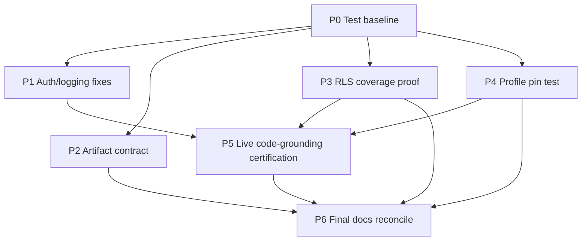

# IAP Implementation Roadmap

**Status:** Proposed, repository-specific and evidence-led  
**Prepared:** 2026-10-19  
**Evidence base:** `IAP_REPOSITORY_ARCHITECTURE_AND_PART11_READINESS.md`, with critical source rechecks noted below.  
**Constraint:** This roadmap does not authorize implementation, deployment, database migration, live-data cleanup, commit, or release. Those actions require their normal approvals and phase gates.

## 1. Executive recommendation

IAP does not need a second implementation of Part 11. The requested Part 11 feature surfaces already exist in the repository and are wired through current API, worker, persistence, and migration paths. The next work should establish a trustworthy current baseline, correct concrete cross-cutting defects, and prove tenant, artifact, configuration, and code-grounding contracts. Do not expand the plugin framework, add infrastructure, or revive a DAG planner unless a measured consumer requires it.

Recommended sequence:

1. **P0 — Restore an attributable test baseline**: align MCP fan-out test mocks with the current deduplicator contract and separate unit gates from tests requiring a live API. Run the full expected suite with the approved local environment loaded silently.
2. **P1 — Security and privacy fixes**: stop allowing unverified `X-Tenant-ID` to select a shared rate-limit bucket; remove full payload logging from the unused/generic Kafka event subscriber.
3. **P2 — Artifact-store contract**: make list cursor semantics real and bounded for both adapters, and prevent `file://` from being presented as a signed URL outside local-only use.
4. **P3 — Tenant/RLS proof**: inventory all tenant-bound ORM tables, migrations, repository filters, exceptions and DB-backed tests; close demonstrated gaps only.
5. **P4 — Investigation profile revision enforcement**: investigation creation already persists `metadata.profile_version`; verify every runtime consumer resolves that exact version. Add a correction only if the invariant fails in source/tests.
6. **P5 — Code-grounding correctness and measured live evaluation**: verify current source against the Phase 0–4 design and tests; run a versioned repeated battery only after the worker is confirmed on the tested code. Keep answer quality distinct from run completion.
7. **P6 — Part 11 status/contract reconciliation**: update stale plan/tracker and operations claims against verified source and current gates.

P0 is the gate for code changes because a deterministic test baseline is necessary to distinguish regressions from existing failures. P1, P2, P3, and P4 are independent technical workstreams after P0 and can be planned in parallel, but each requires its own separate source/test gate. P5 depends on a trustworthy baseline and verified scope contracts. P6 can be drafted independently but should be published after phases P0–P5 decisions are known so historical “DONE” language is accurate.

## 2. Evidence and decision ledger

| Observed repository fact | Evidence | Architectural conclusion | Recommended change | Remaining uncertainty |
|---|---|---|---|---|
| Five MCP fan-out tests fail because test helper callback takes two arguments while production calls deduplicator with tenant, rows, and investigation ID. | `src/investigation_agent_platform/application/evidence/gateway.py` near `get_application_state`; `tests/evaluation/test_mcp_fanout.py`; current pytest result in Phase 1 report. | Current broad test command is not a green baseline; test failure appears to be contract drift, but test intent must be preserved. | Update only the stale test mock/expectation after checking deduplicator semantics; rerun focused module and broad command. | Whether other failures become visible after this is repaired; API probe still needs service startup. |
| Broad pytest command ends after live probe cannot reach `127.0.0.1:8000`. | Phase 1 command transcript; test runner output. | Unit/integration suite and live API/golden suite need separately reportable execution environments. | Establish exact CI/local command groups without suppressing tests; use requested `.env.local` files silently and start only approved local dependencies. | Which tests intentionally require the API or DB; no CI workflow files were found in this checkout. |
| Rate-limit middleware instantiates `InMemoryRateLimitStore` and passes the raw `X-Tenant-ID` header with `principal=None` before auth dependency runs. | `src/investigation_agent_platform/api/app.py:318-353`; `api/tenant.py:125-195`; `api/rate_limit.py:23-84`. | Route authorization remains JWT-enforced, but rate-limit identity is untrusted and limiter is process-local. | Use verified identity for authenticated requests or isolated pre-auth key; inject shared store only when a concrete deployment requires cross-replica quotas. | Whether production currently enables the middleware and whether another upstream limiter exists. |
| Generic FastStream subscriber logs `msg.model_dump()` wholesale. | `src/investigation_agent_platform/infrastructure/messaging/faststream.py:93-105`. | This is avoidable payload exposure; not required for the current job fanout path. | Replace full payload with allowlisted envelope metadata and test no payload content is logged. | Whether `build_faststream_app` has a runtime consumer; this is the generic helper. |
| Artifact port promises cursor pages and signed URLs; both adapters ignore list cursor and return no next page. Local signed URL is `file://`. | `ports/artifacts/store.py:41-78`; `infrastructure/artifacts/local_store.py:69-120`; `s3_store.py:102-152`; `aggregate_reports.py:205-229`. | Current adapters do not satisfy the full declared port semantics for large histories; local URL cannot be used as an HTTP signed URL. | Implement opaque continuation cursor/pagination in S3/local listing, or narrow the port contract only if every consumer agrees; prevent local file URL from crossing the report API boundary. | Artifact list scale and local-store URL consumers. |
| RLS policies are installed over a staged series of migrations, with initial policy list incomplete by design and later coverage migration. | Migrations `001`, `002`, `005`, `010`–`015`, `3354e515779a`; current Alembic head 022. | Security assurance needs a schema-to-policy completeness test, not assumptions from one migration or docs. | Build an inventory/test of tenant-bound ORM tables versus RLS and repository scope; fix only proven mismatches. | DB role/BYPASSRLS deployment privileges and exact live schema. |
| Investigation creation persists `metadata.profile_version`, but `/start` independently reads latest revisions for limits and activity/gateway consumers call `get_by_application_id` without that stored version in several paths. | `application/investigation/services.py:139-165,237-240`; `api/v1/routers/investigations.py:210-219,311-320`; `application/worker/activities.py:2867-2869,3544-3546`; `infrastructure/persistence/profile_repository.py:58-78`. | A version marker exists, but consumption consistency is not demonstrated; this is now an enforcement/test question, not a missing-field claim. | Test with active revision N and N+1; verify budgets, capabilities, mapping, datasource and repository resolution for an N investigation; use exact-version resolver only for consumers that currently violate intended run semantics. | Whether profile changes are intended to be dynamic for any profile sections and what legacy investigations should use. |
| Current code-grounding source contains typed claims, range-aware packets, failure typing, and verifier gates, but live battery ledger describes mixed/partial outcomes and worker restart requirements. | `DS_REVIEW_v0.1.md`; `verification.py`; workflows/activities; `docs/IAP_Arch_Eng_Recommendations.log:149-164`; uncommitted battery edits. | Existing code should be measured and corrected, not replaced with a second reasoner/critic. Live accuracy remains unproven. | Run exact repeated evaluation after establishing code version, current API/worker, clean test scope, and conclusion/citation rubric. | Current processes, LLM configuration, external provider availability, and representative case set. |
| Part 11 APIs, workflows, adapters, repositories, migrations and tests are present; task plan/checklists conflict with source and each other. | `api/app.py`, `bootstrap/worker.py`, Part 11 routers/modules, migration head, `docs/IAP-implementation-part11-plan-todo-v1.1.md`, `docs/IAP-implementation-part11-tasks-todo.md`. | Do not rebuild planned features. Reconcile status documentation after verifying tests and deployment conditions. | Mark implemented/partial/unknown against concrete evidence and record current (not historical) test results. | Live golden results and exact counts after current suite fixes. |
| API and worker both have production composition paths using `AppContext`, but it still uses dynamic attributes and has legacy bare-config worker path. | `bootstrap/__init__.py`; `bootstrap/worker.py`; `api/dependencies.py`; app lifespan. | A general new plugin/lifecycle framework is not justified. First prove current required clients close and contexts match. | Add a narrow parity/lifecycle test only where a concrete missing resource is shown. Avoid mass `AppContext` typing migration in this roadmap. | Whether every configured adapter owns a closeable resource and current shutdown behavior. |

## 3. Work classification

### 3.1 Existing capability that needs no changes absent a demonstrated defect

| Capability | Evidence and decision | Dependency / deferral consequence |
|---|---|---|
| Temporal-backed investigation lifecycle, signals, Update-based input fulfillment, checkpoints, retries, bounded iteration loop | `application/worker/workflows.py`; API dispatch and input fulfillment routes. Preserve current authority split; do not introduce another workflow framework. | No prerequisite for current cleanup; altering it without a reproduced lifecycle defect risks replay compatibility. |
| Tenant-aware JWT identity, repository tenant predicates, RLS sessions, idempotency, profile revisions, evidence provenance | `api/tenant.py`, persistence repos, `rls.py`, profile/idempotency repos. Existing contract is the baseline. | RLS completeness still needs proof; do not replace RLS or tenant signatures. |
| Evidence gateway and provider registrations | `application/evidence/gateway.py`, bootstrap `_wire_evidence_gateway`. Keep one gateway boundary. | Code evaluation depends on this boundary; duplicate provider clients would bypass policy and provenance. |
| Background jobs, DB read model, Kafka event fanout and WebSocket snapshot/reconcile | `domain/common/background_job.py`, jobs router, `job_fanout.py`, worker activities. Preserve Temporal execution and Postgres authority. | Auth/privacy fixes and baseline gates precede claims of operational completeness. |
| Structured input suspension | Durable repositories, workflow Update and wait condition, API schema validation. No rebuild. | Only add cases if restart, expiry, cancellation, concurrency or replay test fails. |
| Outbound credential provider | OAuth2/static adapters, scope key, bridge and registry are present. No new credential framework. | Cloud secret manager certification is a deployment-specific open item, not a reason to rewrite local contracts. |
| Defensive JSON extraction | Existing utility and Part 11 phase test; strict provider schema remains primary. No broader repair behavior. | If a production parse failure is found, add a narrow regression test and call-site fix; never relax schema/tool authorization. |
| Reference document indexing/search | Dedicated app service, fetchers, repository, workflow, API/MCP integration exist. Preserve separation from runtime evidence. | Current recall and indexing deployment require measured/live evidence. |
| Cross-investigation finding clustering | Repository, embeddings, analytics workflow and API exist. Preserve tenant/application boundaries and assignment history. | Do not create a second taxonomy/index; fix only measured scope, query or lifecycle gaps. |
| Bulk intake | Record repo, child workflow, deterministic IDs, bounded concurrency and batch API exist. | Test actual restart/cancel/partial retry/Continue-As-New against Temporal before changing the model. |
| Durable chat and streaming | Session/message repo, streaming gateway and API paths exist. | Live disconnect, backpressure and provider shutdown are operational tests, not missing feature design. |
| Profile generation / mappings / topology / optional Mem0, Graphiti, Cognee | Existing modules and operator configuration. | Optional features stay optional; do not make them boot prerequisites absent operator requirement. |

### 3.2 Existing capability needing wiring or correction

1. **MCP fan-out test mock contract (P0).** Update mock to match deduplicator’s currently inspected three-argument interface. Preserve assertions for source ordering, timeout degradation, concurrency, and outcomes.
2. **Rate limiting (P1).** Fix trusted identity selection and production shared-store wiring only after determining the intended pre-auth behavior. Do not add Redis or another service merely to satisfy a plan statement. A process-local limiter may remain for development.
3. **Event logging (P1).** Replace complete message serialization in generic FastStream subscriber logging with safe metadata. The event should still deserialize and dispatch normally.
4. **Artifact pagination and URL behavior (P2).** Implement actual cursor/has-more semantics in both adapters or formally narrow the port and every consumer. Report APIs must not return local filesystem URLs as signed web links. Reuse existing S3/local adapters and scope-derived key functions.
5. **Tenant/RLS coverage (P3).** Build evidence-backed inventory, table policies, and DB tests. Implement only gaps found, maintaining migration chain and shared-reference exceptions.
6. **Profile revision consistency (P4).** Test first. If profile revision is demonstrably re-read/changeable across one run, add a minimal investigation/job revision or digest pin, API/workflow propagation, and backward-compatible legacy behavior. Do not make this a mandatory schema migration based only on absence of a field in one workflow input.
7. **Current Part 11 status documents (P6).** Reconcile source/test status and current migration head; keep historical result numbers time-stamped.

### 3.3 Missing foundational capability

No repository-wide missing Part 11 foundation was established. Remaining foundational work is **assurance**, not a proposed new subsystem:

- Current dependable test grouping and environment prerequisite documentation.
- A complete tenant-bound ORM/RLS/predicate coverage assertion.
- A tested profile snapshot binding decision.
- A reusable artifact pagination contract actually implemented by adapters.
- Live evaluation provenance proving current code and worker versions.

These should be treated as capabilities only after they have concrete consumers and acceptance tests. A general plugin marketplace, new broker, new database, microservices, new workflow engine, or separate artifact service is out of scope.

### 3.4 Required shared contracts or abstractions

- **Keep** `CapabilityScope`, plugin manifests/registries, `ArtifactStorePort`, `BackgroundJob`, `ActionOutcome`, typed claim/target, evidence provenance, and `Capability` allowlists already in the repository.
- **Repair** `ArtifactStorePort.list` implementation semantics; do not introduce a parallel artifact listing API.
- **Do not add** another `AppContext`/DI container abstraction. Extend typed composition only for a confirmed missing field/resource in a small, independently reviewable change.
- **Do not add** a cross-cutting HTTP identity abstraction unless tests demonstrate that current FastAPI and MCP authentication are inconsistent; reuse `resolve_identity_from_headers`.
- **Do not add** a new generic plugin framework: registries already have concrete feature consumers.

### 3.5 Missing investigation feature

No Part 11 feature in the requested list is missing from source inventory. The investigation product’s next user-visible enhancement should be selected only after live evaluation shows a repeatable unmet question shape. In particular, do not implement a new critic or restore a DAG planner before validating code reads, final citations, and current repeated-run quality.

### 3.6 Optional optimization deferred

- Outbound MCP connection pooling: explicitly defer until connection churn is measured; token refresh and connection caching are distinct concerns.
- Dynamic third-party runtime plugins, microservices, separate vector database, multi-region design, bundled UI: preserve existing adoption triggers in Part 11 docs.
- Broader OTel collector/backend or sampling changes: live infrastructure claims require deployment needs; code instrumentation exists.
- Rewrite giant worker modules or convert all dynamic context attributes to a new container: no performance/maintenance acceptance bar established for a broad rewrite.
- Add new query, temporal, graph, or LLM critic capability: defer until a versioned battery isolates a residual error the current capability set cannot address.

## 4. Decisions and unresolved questions

### Decision D1 — Do not rebuild Part 11 features

**Observed facts:** API router inclusion, worker workflow/activity lists, Part 11 repositories/migrations and test files exist.  
**Conclusion:** Part 11 is an as-built implementation requiring correction and validation; the old phase checklist is not an implementation backlog.  
**Recommendation:** Maintain a source-backed status matrix and perform operational certification where needed.  
**Uncertainty:** Full Part 11 golden/live tests have not been rerun in this audit.

### Decision D2 — Restore baseline before source changes

**Observed facts:** Five MCP fan-out tests fail on a stale mock; broad command exits later on unavailable API probe; five code-grounding focused modules passed.  
**Conclusion:** The repository currently has a reproducible test-harness failure plus an environment-dependent stop, not a verified clean release gate.  
**Recommendation:** Repair test contract without weakening assertions, rerun focused module, identify test groups/service prerequisites, and rerun all gates with secret env loaded silently.  
**Uncertainty:** Other hidden test failures may appear after the initial five are repaired.

### Decision D3 — Security fixes are narrow and precede live evaluation

**Observed facts:** limiter keys from unverified header and constructs in-memory store; generic subscriber logs whole event payload.  
**Conclusion:** Correct identity and data-minimizing logs before relying on quota controls or broad live diagnostics.  
**Recommendation:** Add narrow tests, keep route-level JWT behavior, use existing identity resolver and configured stores.  
**Uncertainty:** Production flags/upstream gateway may change exposure but do not make the in-code contract correct.

### Decision D4 — Artifact contract repair should be bounded

**Observed facts:** Port promises cursor pages; adapters ignore cursor and always report terminal page; local URL is `file://`; report API returns adapter URL as `signed_url`.  
**Conclusion:** Current behavior does not meet declared semantics for large report histories and local URLs are not portable client links.  
**Recommendation:** Implement adapter-consistent page semantics using stable opaque keys and scope binding; for local mode use authorized API proxy or decline URL delivery, not a filesystem URL.  
**Uncertainty:** Whether a production deployment can ever select local storage under currently enabled reports.

### Decision D5 — Verify stored profile revision enforcement before adding schema

**Observed facts:** `CreateInvestigationService.execute` writes `metadata.profile_version`; `/start` separately loads latest revisions for limits; workflow input omits profile version; several activity/gateway readers resolve latest profile.  
**Conclusion:** A profile version marker exists, but enforcement across run consumers is uncertain.  
**Recommendation:** First add a focused revision-switch test. Propagate the existing version only to consumers shown to violate intended run semantics; do not presume a new DB column.  
**Uncertainty:** Product semantics may allow some settings to be dynamic while other profile sections remain fixed.

### Decision D6 — Live reasoning quality is an evaluation task, not a framework rewrite

**Observed facts:** typed claims/range/verification changes and tests are present; historical live batteries showed variance and partial outcomes; current API/worker versions are unknown.  
**Conclusion:** No conclusion about current live accuracy can be made from historical results or unit gates.  
**Recommendation:** Run current versioned repeat cases on a known code/worker revision after baseline/security prerequisites; report exact citation correctness and abstention.  
**Uncertainty:** External provider availability, data scope, and case representativeness.

### Questions requiring stakeholder/operator input

1. Which full-suite test partitions require an API server, database, Temporal, or third-party service, and what exact command is intended for the normal CI gate?
2. Should production rate limiting be enforced at the app layer with a shared backend, or delegated to an upstream API gateway? Which principal should factor into the key?
3. Is local artifact storage permitted in any API environment where report latest/history endpoints are enabled?
4. Is exact profile revision pinning a product guarantee for every long-running investigation? If yes, what should legacy investigations do when no revision is recorded?
5. Which battery cases are approved for live execution, and which scope/tenant can be used without destructive cleanup or cross-run contamination?
6. Which operator owns AWS/OpenBao credential certification, persistent Oracle MCP deployment, and current worker restart verification?

## 5. Dependency-aware implementation sequence

### Global quality gates

Run the following after each source phase, plus relevant targeted tests before the full gate:

```bash
uv run pytest tests -q -p no:cacheprovider
uv run ruff check src tests scripts
uv run ruff format --check src tests scripts
uv run mypy src
```

The full pytest command must be run in the approved environment with `.env.local` and `~/bin/.iap.env.local` sourced silently where required. Never print, serialize, add to the command line, or persist secret environment values. Record only command, exit status, aggregate counts, skip reasons, and redacted service availability. If the full suite intentionally includes live probes, identify its partitions; do not mark failures as skipped or claim success because a live endpoint was not started. Mypy’s existing baseline must be measured on the current tree before setting an allowed error ceiling; historical error counts are not the current baseline.

Ruff format command path set follows the Part 11 project gate. If the repository’s currently approved CI command differs, verify and record the actual one rather than silently substituting it.

### Phase P0 — Test baseline and deterministic harness repair

**Objective:** Establish an attributable green unit/evaluation baseline and an explicit live-test prerequisite boundary.

**Prerequisites:** Phase 1 audit; current working-tree modifications identified and left untouched.

**Dependencies:** First phase; P1–P5 source changes wait for its focused and broad gate.

**Reuse / expected files:** `tests/evaluation/test_mcp_fanout.py`; deduplicator port/adapter and `application/evidence/gateway.py`; test command docs (`docs/BATTERY_LIVE_PROTOCOL.md`, Part 11 operations guide) only if exact prerequisite clarification is necessary. File paths are verified.

**Scope:**

- Inspect exact mock and production signatures; update mock to accept/reflect investigation ID, preserving tenant separation semantics.
- Run only `tests/evaluation/test_mcp_fanout.py` first and preserve all ordering/concurrency/timeout/degrade assertions.
- Determine why normal `pytest tests` performs an API probe. Keep that test; establish explicit required server lifecycle or split existing test execution targets only if the current project test design supports it.
- Source env files silently in the shell. Do not display environment or pass secret values as command arguments.
- Establish current Ruff, format and mypy status; do not copy historical baselines.

**Tenant/security/durability:** No production logic change; tests must continue to prove investigation-scoped dedup.

**Acceptance:**

- Focused fan-out module passes; no weakened assertions or new broad skips.
- Full suite reaches a deterministic completed result with explicitly accounted live-test prerequisites; failures are fixed or recorded as blockers, never described as pass.
- Ruff check, Ruff format check and mypy complete; baseline and any pre-existing issues are reported.

**Failure recovery:** Revert only the phase’s targeted mock/document changes if they violate the current provider contract; preserve original failure report and stop for review rather than changing production behavior to fit tests without evidence.

**Definition of done:** Test baseline and required gates are reproducible from exact commands; no implementation or migration changes.

### Phase P1 — Rate-limit trust boundary and event-log minimization

**Objective:** Avoid untrusted tenant headers controlling another tenant’s rate-limit bucket and avoid logging whole Kafka payloads.

**Prerequisites:** P0 gate.

**Dependencies:** Independent of P2–P4; should precede P5 live battery if live calls use app rate limiting or event logs.

**Reuse / expected files:** Verified `api/app.py`, `api/tenant.py`, `api/rate_limit.py`, `infrastructure/messaging/faststream.py`, existing API/auth/messaging tests. Provisional test filenames must be discovered before creation.

**Implementation choices:**

- For authenticated route quota, consume identity already resolved by shared auth dependency/request state without creating duplicate JWT verification paths. If middleware ordering makes this unavailable, separate pre-auth global/IP bucket from post-auth tenant/principal bucket and document exact semantics.
- Inject a shared `RateLimitStore` only if deployment config/owner confirms app-level cross-replica limiting is required. Do not add Redis dependency/service solely by assumption; current Redis cache does not prove limiter wiring.
- Log a strict allowlist of generic event metadata, never `msg.model_dump()`. Do not drop or alter event processing.

**Security/testing:** Spoofed tenant header must not consume or exhaust another verified tenant’s quota; valid tenant/principal identity yields expected classes; unauthenticated traffic remains bounded according to selected contract. Captured logs must not contain arbitrary payload marker, secret-like values, or unapproved PII; safe event type/IDs remain observable.

**Migration/compatibility:** No DB migration expected. Preserve HTTP status/error contract and Kafka event schema.

**Acceptance:** Targeted auth/rate-limit and messaging tests, full gates, no new mypy errors. Add tests for authentication not bypassed, rate-limit storage failure behavior, and log projection.

**Rollback:** Keep changes in limiter identity selection/store injection and event projection isolated. Restore prior behavior only if a test demonstrates an undocumented contract, while retaining a safe pre-auth limiter and no full-payload log.

**Definition of done:** Correct tenant cannot be throttled by spoofed header; production rate-limit store expectations explicit; no full Kafka payload logged.

### Phase P2 — Artifact pagination and local URL contract

**Objective:** Align artifact adapter behavior with `ArtifactPage` and keep development filesystem URLs from being presented as client-signed links.

**Prerequisites:** P0 gate. P1 can proceed independently.

**Dependencies:** Independent of P3/P4. Report history correctness depends on this phase.

**Reuse / expected files:** `ports/artifacts/store.py`, `infrastructure/artifacts/local_store.py`, `infrastructure/artifacts/s3_store.py`, `application/reporting/artifacts.py`, `api/v1/routers/aggregate_reports.py`, existing artifact/report tests. All paths verified.

**Implementation:**

- Define page continuation as stable ordered object-key marker bound to scope and prefix, with validation and bounded limit (do not add external cursor library unless existing signed cursor helper is reusable and appropriate).
- Implement lazy S3 object iteration and local key enumeration/page slicing; set `next_cursor` and `has_more` correctly. Preserve path confinement, S3 scope prefix and object key construction.
- Ensure report `signed_url` output is HTTP(S) only. In local mode, use an authorized API proxy/download route if one already exists and can be extended safely; otherwise return a clear unavailable/unsupported response. Do not create routes until API ownership/contract is reviewed.
- Preserve report metadata, content digest, legal-hold, and retention behavior.

**Security/durability:** Cursor must not permit cross-tenant, cross-application, or cross-prefix use; keys remain adapter-generated. Delete/purge must remain scope-bound and idempotent.

**Compatibility/versioning:** No schema migration expected. Cursor format should be versioned or explicitly invalidate any previously issued list cursors; currently adapters ignore cursor, so there may be none, but verify callers first.

**Acceptance:** Adapter conformance tests for empty/exact/next pages, ordering, tampered/mismatched cursor, maximum limit, object mutation between pages (document consistency), local root traversal, signed URL type; report endpoint test proving `file://` never appears. Full gates.

**Failure recovery:** Keep old report read behavior for S3 if cursor changes are additive. Do not delete objects or change retention while fixing list operations.

**Definition of done:** All implemented adapters satisfy the `ArtifactPage` contract; local URLs are not exposed as signed HTTP URLs.

### Phase P3 — Tenant/RLS coverage proof and narrow fixes

**Objective:** Demonstrate that every tenant-bound relational model has the required RLS protection, repository tenant scope, and real database coverage.

**Prerequisites:** P0 gate; P1 auth semantics documented.

**Dependencies:** Independent of P2 and P4. P5 live test scope requires this phase’s security findings to be resolved or explicitly accepted.

**Reuse / expected files:** ORM metadata `infrastructure/persistence/models.py`, `migrations/versions/*`, `infrastructure/persistence/rls.py`, repository modules, integration RLS tests and Alembic chain tests. Provisional: add inventory test under existing security/integration test grouping after inspecting conventions.

**Implementation:**

- Produce an automated inventory of tables containing tenant-owned data, expected policy, and deliberate exceptions/carve-outs. Avoid brittle filename-based assumptions; use ORM metadata plus migration/policy registry as practical.
- Confirm all relevant queries include tenant filters and all write predicates validate tenant identity.
- Run DB-backed tests under non-superuser / production-equivalent role where available; verify `FORCE ROW LEVEL SECURITY` behavior and `SET LOCAL` reset across pooled connections.
- Implement migrations only for demonstrable missing policies/columns; no bulk data rewrite or policy broadening.

**Security:** Prove tenant-A cannot read/write tenant-B across core and Part 11 tables; prove approved same-tenant shared reference evidence behavior without cross-tenant disclosure. Verify policies do not depend on owner/superuser bypass.

**Migration/rollout:** Each migration must have forward and downgrade behavior, upgrade from current head’s parent and tests, and rolling compatibility notes. Production migration execution is operator-approved and not part of coding phase.

**Acceptance:** ORM-to-policy inventory test passes; focused PostgreSQL RLS tests pass or clearly report environment unavailable; migration chain has a single head and upgrade/downgrade tests; full gates.

**Failure recovery:** No production DB migration without explicit approval. If deployment DB role is unknown or privileged, stop and record blocker; do not weaken policy to make tests pass.

**Definition of done:** Every in-scope table has a verified policy/predicate/test disposition, including explicit documented exceptions.

### Phase P4 — Profile snapshot consistency investigation and conditional implementation

**Objective:** Determine whether one investigation can resolve different application-profile revisions over its lifetime; enforce immutable run configuration only if demonstrated necessary.

**Prerequisites:** P0 gate; P3 tenant semantics for persistence changes.

**Dependencies:** The test is independent of P2. Any new persistence field depends on P3 and migration compatibility review.

**Reuse / expected files:** profile repository/ORM, `/start` dispatch in `api/v1/routers/investigations.py`, `RunInvestigationInput`, investigation metadata/context models, gateway profile resolution and `ProfileBackedRepositoryRegistry`. Provisional path list after re-reading actual resolver methods.

**Test first:** Create immutable profile revision N; dispatch investigation; activate N+1 before a subsequent worker activity; assert investigation uses the intended same revision for capability checks, source mapping, budgets, datasource and repository locators.

**Implementation only if test fails:** Add the smallest internal run pin (profile version or canonical digest) to an existing durable investigation field/metadata or a narrow column if needed; propagate through workflow/activity/gateway; resolve exact version rather than latest; define legacy missing-pin behavior. Avoid changing public REST/MCP contracts unless unavoidable.

**Security/durability:** Tenant+application composite scope; never accept profile revision as an untrusted caller authority without authorization; maintain immutable profiles and replay determinism.

**Migration/compatibility:** If schema change is necessary, nullable/backward-compatible migration, read legacy as explicit unpinned/current policy, test old rows and rolling workers. No migration if metadata is sufficient and contract supports it.

**Acceptance:** Revision-switch test proves stable resolution; tests for missing/retired version and cross-tenant collision; migration chain if changed; full gates.

**Failure recovery:** If source shows an existing guaranteed snapshot path or operator says latest-at-each-action is intended, close the phase as documented with no source change.

**Definition of done:** Evidence proves either run immutability is already guaranteed or the smallest correction enforces it.

### Phase P5 — Current code-grounding quality certification and targeted fixes

**Objective:** Establish a reproducible current-source/current-worker code-grounding quality result and fix only repeatable defects.

**Prerequisites:** P0 green baseline; P1 security controls; P3 tenant scope findings resolved or approved; P4 run identity semantics settled; environment and case set approved by operator.

**Dependencies:** Serialized after P0–P4 gates for live runs; synthetic offline code-grounding tests can proceed independently after P0 but do not certify live quality.

**Reuse / expected files:** `docs/DS_REVIEW_v0.1.md`, `docs/BATTERY_LIVE_PROTOCOL.md`, `scripts/live_battery.py`, `scripts/clean_battery.py`, `scripts/run_battery.sh`, `tests/fixtures/battery_cases/*.json`, code gateway, claim verification, context compiler, workflow, and ledger. Do not change pre-existing operator edits without attribution.

**Execution:**

- Re-read all battery script changes and verify they are from the current owner; do not overwrite or reset them.
- Verify API/worker build SHA/revision and restart state before each live batch; use the approved local secrets silently and do not disclose environment contents.
- Run only pre-approved tenant/scope; review cleanup preview and any destructive cleanup action before execution. Do not clean or reset external/live data without direct approval.
- Repeat relevant cases at least three times per protocol, including successful supported location/call edge, wrong revision or unresolved target, behavior needing runtime evidence, provider failure, cache/disposition, and abstention quality.
- Grade final claim and citations, exact revision/range, runtime support, failure type, rival/limitations and repeat variance. “Answer exists,” retrieval hit, or status alone is not pass.
- Address findings through narrow test-backed changes. Do not add critic model, DAG planner, or new source provider unless the residual is isolated and current abstractions cannot address it.

**Migration/public contracts:** Prefer no migration. Any prompt schema/prompt version changes retain old decision parsing and deterministic workflow replay.

**Acceptance:** Versioned report records code SHA, worker/API status, case/run IDs, exact commands, each verdict/citation audit, provider failure and repeat variance. No unsupported claim can be promoted by merely relaxing a threshold. Full required gates and approved live protocol.

**Failure recovery:** Keep raw run data according to the existing protocol; stop on tenant leakage, worker mismatch, missing evidence scope, or unexpected cleanup. Restore only previously verified application code/config through normal operator process.

**Definition of done:** Current-code evaluation is attributable and reproducible, with repeat variance and residual limitations visible. No accuracy claim from historical runs alone.

### Phase P6 — Part 11 and operations document reconciliation

**Objective:** Make feature status, migration head, quality gates, outstanding work and operations guidance reflect the current repository.

**Prerequisites:** P0–P5 results; may be drafted in parallel, final status depends on their outcomes.

**Dependencies:** Only documentation publication is serialized after implementation/test status decisions. No source-code dependency.

**Reuse / expected files:** `docs/IAP-implementation-part11-plan-todo-v1.1.md`, `docs/IAP-implementation-part11-tasks-todo.md`, `docs/IAP-implementation-part11-operations-v1.0.md`, `docs/IAP-architecture-v1.0.md`, `docs/BATTERY_LIVE_PROTOCOL.md`, recommendation ledger. No new paths assumed.

**Scope:** Correct stale phase boxes and migration head. Distinguish code present, wired, unit-tested, DB-tested, golden-tested and live-certified. Preserve dated historic counts but do not present them as current. Document rate-limit backend decision, artifact local URL semantics, RLS audit evidence, profile pin policy, and known test prerequisites. Mark unresolved entries OPEN; do not close ledger items without proof.

**Acceptance:** Every changed claim has source/test/command reference and date; docs agree on current migration head and gate; no implementation status overstated; docs are reviewed for naming/privacy constraints. Full gates need not be rerun for pure docs changes, but markdown link/format checks should run if available and be reported exactly.

**Rollback:** Revert only inaccurate documentation changes; preserve historical dated records and ledger history.

**Definition of done:** Part 11 plan and task tracker contain one coherent, source-backed current status plus remaining work.

**Current verification note (2026-10-20):** After the operator identified the live server at `http://localhost:8080`, the full test command was rerun with `.env.local` and `~/bin/.iap.env.local` sourced silently and `IAP_LIVE_BASE_URL`/`TEST_TARGET_URL` set to that URL. The API was reachable. Result: **11 failed, 2,201 passed, 32 skipped, 56 errors, 50 subtests passed**. The five MCP fan-out failures remain. Other observed failures include missing route scenarios for five newer API operations, live system API setup failing because the default application profile `example` is absent for tenant `system-api-suite`, two config tests affected by sourced config defaults, and a health response test affected by runtime health detail config. Schemathesis contract probes then errored during setup after profile creation failure. Secrets were not printed or recorded. P0 remains blocked; before code changes, define non-secret test URL/profile/tenant overrides and isolate environment-sensitive suites without suppressing coverage.

## 6. Part 11 proposal disposition

| Capability proposal | Current repository disposition | Next action |
|---|---|---|
| Durable jobs/progress | Implemented: Temporal workflows, Postgres job read model, Kafka per-replica fanout, WebSocket snapshot/reconciliation. | Preserve. Validate P0, P1 and live/DB-backed recovery semantics; no new queue. |
| Structured input suspension | Implemented: durable input requirement/fulfillment, Temporal Update, schema validation, expiry/cancel. | Preserve. Add tests only for reproduced restart/CAS/cancel gaps. |
| Outbound credential providers | Implemented OAuth2/static adapters, scope-aware bridge, secret resolution. | Preserve. Cloud-provider certification is operator/deployment lane; no new auth framework. |
| Defensive JSON extraction | Utility and tests exist; strict native schema is primary. | Preserve restrictions. Inspect consumer gates if a concrete schema failure remains. |
| Reference retrieval/indexing | Dedicated capability and worker/API/MCP paths exist. | Preserve separate from runtime evidence. Measure recall/security/live indexing; fix defects found. |
| Finding clustering | Implemented with tenant persistence, assignment history, pgvector, analytics worker/API. | Preserve. Validate RLS, model generations and job recovery. |
| Aggregate reports/artifacts | Implemented; adapter contract defects noted in P2. | Repair existing artifact page and local URL behavior; do not rebuild report feature. |
| Bulk intake/fanout | Implemented in Temporal with bounded child execution. | Preserve; run restart/cancel/partial-failure/Continue-As-New tests under P0 and approved integration environment. |
| Durable chat/streaming | Implemented with durable sessions and separate streaming contract. | Preserve; verify disconnect, backpressure and token/error semantics with focused tests. |
| Optional connection pooling | Existing pooling was deferred, no measured need found. | Defer until connection churn is measured; keep token caching separate. |

## 7. Dependency graph and independent lanes



P1–P4 may be developed concurrently after P0, but changes must remain separated into reviewable phases and each gate must pass before dependent live work. P6 documentation can be drafted earlier; do not mark final readiness until results are known. No dependency is imposed between P2, P3 and P4 beyond the shared P0 baseline.

## 8. Global implementation constraints for future phases

- Preserve modular monolith, Temporal workflows, Postgres/RLS repositories, existing gateway, public API/MCP contracts, config conventions, and provider error taxonomy.
- Re-read `IAP_IMPLEMENTATION_ROADMAP.md` plus source before every phase. Verify that dependencies still hold against current HEAD and dirty-tree state.
- Implement one eligible phase at a time. Do not begin dependent work while its gate is failing.
- Add tests for every security-, tenant-, persistence-, idempotency-, concurrency-, or workflow-sensitive change.
- Do not make unreviewed/destructive schema changes; provide upgrade/downgrade tests and stop for deployment approval before executing migrations against a live database.
- Never source/print secret files in output. Load locally only where approved; never show values in logs, reports, command traces, docs, prompts, fixtures or tool results.
- Do not alter existing user changes without attribution and approval. Do not commit, push, deploy, clean live data, or run migration commands against live systems without direct approval.
- Do not weaken or skip tests to make a gate pass. Explain environmental blockers and exact partial results.
- Keep recommendation ledger current: record valuable finding before accepting implementation; update docs before removing implemented ledger item.

## 9. Current roadmap status

- P0 **Blocked** — API reachable on `:8080`; broad test run still fails (11 failed, 56 setup errors, 2,201 passed, 32 skipped, 50 subtests). Must resolve stale mocks, route registry, profile seed and env-sensitive tests without weakening assertions.
- P1 **Pending** — rate-limit identity/storage and Kafka payload logging.
- P2 **Pending** — artifact cursor and local signed-URL behavior.
- P3 **Pending** — complete tenant/RLS audit.
- P4 **Pending** — profile revision stability test.
- P5 **Pending** — current repeated live battery; depends on P0/P1/P3/P4 and operator-approved scope.
- P6 **Pending** — reconcile Part 11 documentation after verified phase results.

This status is distinct from Part 11 feature implementation presence and from historical test reports.
