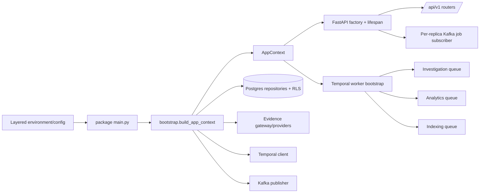
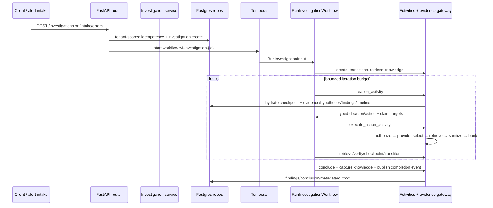
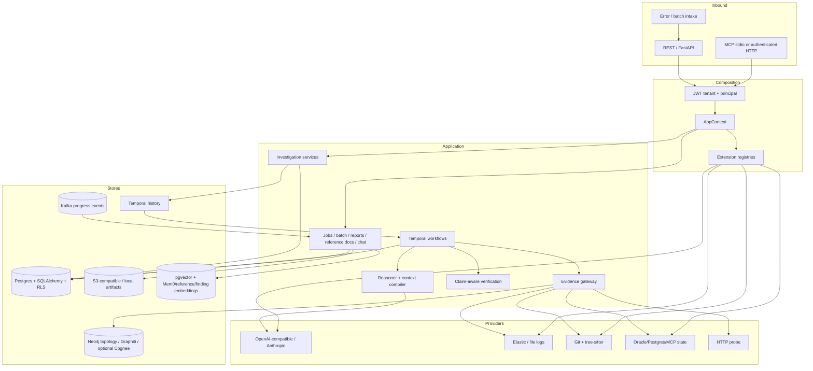
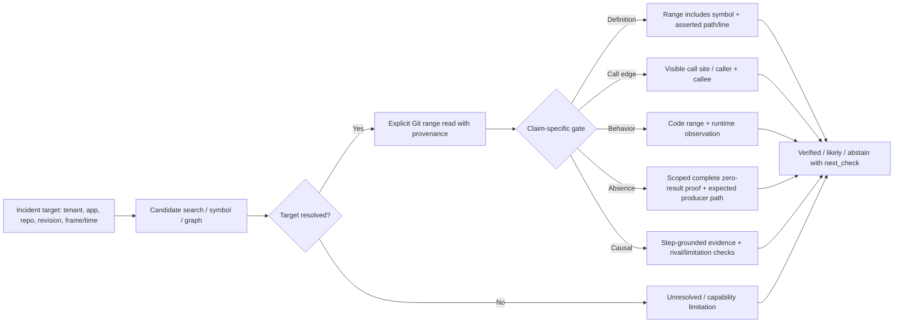

# IAP Repository Architecture and Part 11 Readiness Audit

**Audit date:** 2026-10-19  
**Repository state:** `main`, one commit ahead of `origin/main`; pre-existing modified files are `scripts/live_battery.py` and `tests/unit/test_battery_scoring.py`.  
**Scope:** Repository implementation and documentation inspected for this task, including the principal source layers, workflow/API composition, persistence/migrations, Parts 1–10, Part 11 specifications and tracker, operational documents, architecture reviews, configuration, and selected tests.  
**Implementation changes:** None. This report and entries in `docs/IAP_Arch_Eng_Recommendations.log` are documentation-only task artifacts.

## 1. Executive assessment

IAP is a Python 3.13 modular monolith with a FastAPI API process, Temporal-backed execution workers, PostgreSQL/SQLAlchemy persistence, a gateway-mediated evidence layer, MCP interfaces, Kafka progress transport, and optional external persistence/knowledge adapters. The core design is recognizable as domain/application/ports/infrastructure, but the operational composition object (`AppContext`) still receives many dynamic `Any` attachments rather than a completely declared dependency graph.

Part 11 features are materially implemented: the current API composes routers for capabilities, jobs, clusters, reports, bulk intake, chat, and reference documents; the worker registers investigation, analytics, and indexing workflows; durable repositories, migrations, and phase tests exist. The Part 11 plan is consequently stale: the plan header claims DONE but its phase checklist remains unchecked, and the tracker describes completed test modules while marking much of their source work as pending. Treat current source/tests as primary evidence and the Part 11 documents as a design and historical execution record until reconciled.

Code-grounding reliability has received substantial follow-up work since Parts 1–10. Source range reads, revision capability markers, typed claim targets, code packets, claim-specific gates, action outcomes, replay handling, and conclusion mapping are present in code. Five focused DS_REVIEW phase test files passed in this audit (126 passed). Current end-to-end/live quality is not established by that test run. The full requested test command produced five MCP fan-out failures and then terminated when a live API check could not connect to `127.0.0.1:8000`; that is an observed invocation result, not a verified full-suite baseline.

### Evidence labels used below

- **VERIFIED IN CODE** — directly observed in source, migration, test, or a command executed for this audit.
- **DOCUMENTED ONLY** — stated in project documentation or task records but not independently verified in the current runtime.
- **INFERRED** — a likely consequence of directly inspected wiring/control flow, not demonstrated by an end-to-end run here.
- **UNKNOWN** — the audited evidence does not answer the question.

Code presence, composition into runtime paths, test coverage, and live correctness are separate claims. “Implemented” below does not automatically mean “live certified.”

## 2. Repository baseline and audit method

### 2.1 Baseline state

- **VERIFIED IN CODE:** `git status --short --branch` reported `## main...origin/main [ahead 1]`, with modifications to `scripts/live_battery.py` and `tests/unit/test_battery_scoring.py`. Those diffs were inspected and left intact. They alter cached-primary lookup/report diagnostics and its unit expectations; they were not authored for this audit.
- **VERIFIED IN CODE:** Recent history starts with `7d4f623` and contains earlier code-grounding phases and a committed implementation checkpoint. The local HEAD is ahead of its upstream by one commit; no commit, reset, checkout, or push was performed.
- **VERIFIED IN CODE:** `.gitignore` ignores `tmp/`, `reports/`, local data, runtime secrets, and environment files except `.env.example`. The requested prompt exists under ignored `tmp/`; the final report is written at repository root as requested.
- **VERIFIED IN CODE:** `pyproject.toml` targets Python `>=3.13`, declares runtime dependencies including FastAPI, SQLAlchemy async, asyncpg, Alembic, Temporal, FastStream/Kafka, Pydantic, Elasticsearch, Neo4j, Mem0, Cognee, pgvector, MinIO, OpenTelemetry, Git, and tree-sitter; development dependencies include pytest, Ruff, mypy, Bandit, pip-audit, and Schemathesis.
- **VERIFIED IN CODE:** No `.github/workflows/*` or root Makefile was found by scoped globs in this checkout. This does not establish that no external CI system exists.
- **VERIFIED IN CODE:** Repository README is empty. Operational and architecture material is under `docs/`, `config/`, `docker/`, `scripts/`, and component directories.

### 2.2 Commands executed

| Command | Result | Classification |
|---|---|---|
| `snip git status --short --branch` | `main` ahead 1; two pre-existing modified files | VERIFIED IN CODE |
| `snip git log -5 --oneline` | Recent implementation history observed | VERIFIED IN CODE |
| `snip uv run pytest tests -q -p no:cacheprovider` | 5 failed, 97 passed, 85 skipped; run then exited because a live API probe could not connect at `127.0.0.1:8000` | VERIFIED IN CODE |
| `snip uv run pytest tests/unit/test_phase0_contract_repair.py tests/unit/test_phase1_context.py tests/unit/test_phase2_completion.py tests/unit/test_phase3_failure_typing.py tests/unit/test_phase4_observability.py -q -p no:cacheprovider` | 126 passed | VERIFIED IN CODE |
| `snip uv run alembic heads` | `022_conclusion_next_check (head)` | VERIFIED IN CODE |

The five test failures all name `tests/evaluation/test_mcp_fanout.py`. Their trace shows a mock lambda in the test helper accepts two arguments while `AsyncEvidenceGateway.get_application_state` now calls the deduplicator with tenant, items, and investigation ID. The run’s subsequent live probe failure is separate from those five test failures. No attempt was made to alter tests or bring up services.

### 2.3 Inspection coverage limitations

- Inspected source includes the application/module inventories, root and package entrypoints, FastAPI factory, configuration/bootstrap, Temporal worker and core workflow, investigation API routes, evidence/reasoning/persistence/verification paths, MCP server, job messaging, selected provider adapters, Part 11 routers, migrations, and focused tests.
- Read Parts 1–10 knowledge/design documents and Part 11 architecture, plan, tracker, and operations files. Older Part 1–10 documents explicitly say they are superseded by the as-built architecture document where they disagree.
- Did not run PostgreSQL, Kafka, Temporal, Elasticsearch, Neo4j, object-storage, Oracle, external LLM, or full golden scenario services in this task. Live claims in the ledger and docs remain attributed to their prior records, not reproduced evidence.
- Did not inspect every individual router, repository method, migration body, test fixture, or infrastructure config entry. Completeness claims in the security/data/RLS area are intentionally bounded.

## 3. Structural and dependency inventory

### 3.1 Actual source layers

**VERIFIED IN CODE:** Package root is `src/investigation_agent_platform/`.

| Layer | Representative modules | Responsibility and observed dependency direction |
|---|---|---|
| `domain/` | `investigation/models.py`, `evidence/models.py`, `profile/models.py`, `hypothesis/models.py`, `finding/models.py`, `common/extension.py` | Pydantic domain types, lifecycle/status, action/result contracts, scoped extension contracts. Core domain models import standard library/Pydantic and other domain modules. |
| `ports/` | evidence, persistence, reasoning, messaging, artifacts, knowledge, security, observability | Protocol interfaces that application services and infrastructure adapters implement. |
| `application/` | `worker/workflows.py`, `worker/activities.py`, `investigation/*`, `evidence/gateway.py`, `extensions/registries.py`, `knowledge/*`, `reference/*`, `finding/*`, `intake/*`, `chat/*`, `reporting/*` | Use cases, workflow orchestration, evidence coordination, verification, extension selection, background feature services. |
| `infrastructure/` | `persistence/*`, `evidence/*`, `reasoning/*`, `messaging/*`, `artifacts/*`, `security/*`, `knowledge/*`, `topology/*`, `configuration/*`, `scheduling/*`, `observability/*` | SQLAlchemy/Alembic adapters, provider-specific clients, external stores, config loading and tracing. |
| `api/` | `api/app.py`, `api/tenant.py`, `api/v1/routers/*`, schemas | FastAPI factory, authentication dependencies, HTTP contracts and routers. |
| `mcp/` | `server.py`, `middleware.py`, `registry.py`, `tools/*`, `schemas/*` | Inbound MCP server over stdio and authenticated Streamable HTTP; distinct from outbound MCP evidence client at `infrastructure/evidence/mcp.py`. |
| `bootstrap/` | `__init__.py`, `worker.py`, `buffered_dev.py` | Context composition and worker registration/startup. |
| `scripts/` | profile generation, ingestion, batteries, operator CLI, golden scenarios | Operator and validation tools, not all part of runtime. |

**VERIFIED IN CODE:** Dependencies in `pyproject.toml` confirm provider and framework substrate but do not prove each optional backend is activated. Bootstrap toggles external features with config and registers providers conditionally.

### 3.2 Structural caveats

- **VERIFIED IN CODE:** `api/dependencies.py` declares `AppContext` and extensive in-memory adapters for tests/development; the file’s opening description still reads “In-memory dependency wiring.” Production bootstrap dynamically attaches fields such as `finding_repo`, `input_repo`, `background_job_repo`, `broker`, `temporal_client`, `artifact_store`, `knowledge_store`, `temporal_port`, and registries. `TYPE_CHECKING` imports describe some but not all dynamic attributes. This is consistent with the original modular monolith, but weaker than the Part 11 plan’s desired typed ownership surface.
- **VERIFIED IN CODE:** `main.py` at repository root is a deprecated “Hello” placeholder. Canonical API entrypoint is `src/investigation_agent_platform/main.py`; canonical Temporal bootstrap is `bootstrap/worker.py`.
- **VERIFIED IN CODE:** `application/worker/activities.py` is a large module (9,942 lines in the inspected read metadata), and `workflows.py` contains the investigation workflow plus batch/analytics/indexing workflow definitions. This increases local change/review coupling; no conclusion about runtime performance follows from file size alone.
- **VERIFIED IN CODE:** No frontend source was identified in the sampled inventories; the API-first documentation says there is no bundled UI.

## 4. Runtime composition roots and lifecycle

### 4.1 Entrypoints

**VERIFIED IN CODE:**

1. `src/investigation_agent_platform/main.py` loads layered config near import time, configures tracing where enabled, constructs `AppContext` through `bootstrap.build_app_context` (fail-hard in production), then creates the FastAPI app with `Container(context=get_app_context())`.
2. Its lifespan wires dev Temporal (bounded retries), buffered dev stores and evidence-gateway re-composition, optional dev seeds, then job messaging. Production guards skip the dev-specific wiring path.
3. `bootstrap/worker.py::run_temporal_worker` accepts the full `ApplicationConfig` (preferred), obtains the same `build_app_context`, connects Temporal with bounded retries, may install buffered dev stores, rewires evidence gateway after proxy installation, starts broker best-effort, reconciles schedules, and starts investigation, analytics, and indexing workers.
4. `api/app.py::create_app` initializes the passed container, installs `container.context`, logs composition details, starts the outbox listener if present, and shuts down through `shutdown_app_context` then `container.shutdown`.

### 4.2 Composition claims and qualifications

- **VERIFIED IN CODE:** The previously documented context replacement defect has a direct fix: `api/app.py` calls `set_app_context(app_container.context)` and package `main.py` passes the already-bootstrapped context to `Container`. `api/dependencies.py::Container.initialize` returns immediately when context already exists.
- **VERIFIED IN CODE:** Production bootstrap constructs SQL repositories, Kafka publisher/broker, Temporal client, evidence gateway, topology/knowledge adapters as configured, and artifact store. Missing required database/persistence/Kafka/Temporal/evidence wiring raises `PlatformConfigurationError` in production composition paths.
- **VERIFIED IN CODE:** Non-production paths can continue with in-memory dependencies and optionally buffered persistence; failures in optional dev boot tasks are often logged and degraded.
- **INFERRED:** Composition parity is improved but not absolute. The worker can still be invoked with bare `TemporalConfig`, which constructs an in-memory `AppContext` (the source warns this is never production); the preferred `ApplicationConfig` path is shared. API/dev starts may independently wire Temporal and buffered persistence. A production launch wrapper and every alternate entrypoint were not executed in this audit.
- **VERIFIED IN CODE:** Shutdown comments describe order and idempotence, but the complete lifecycle of every attached adapter/client was not proven by one integration test or by this audit. Whether every adapter has explicit `close()` invoked is **UNKNOWN** here.

### 4.3 Configuration and secret flow

- **VERIFIED IN CODE:** `infrastructure/configuration/config.py` uses frozen Pydantic configuration models with `extra="forbid"`, `SecretStr` for secret values, and environment-derived `ApplicationConfig`; `main.py` applies `.env*` and YAML scalar layers before environment values, and secret-store resolution is wired in bootstrap.
- **VERIFIED IN CODE:** `infrastructure/reasoning/factory.py` uses an explicit model-policy registry and rejects unknown models/provider mismatches or missing provider-required endpoint settings.
- **VERIFIED IN CODE:** `bootstrap/__init__.py` wires Elastic, file logs, Oracle/Postgres state providers, local Git/tree-sitter, OAuth bridge, Oracle/Postgres MCP, profile-backed datasource registry, Neo4j, Mem0, Graphiti, Kafka, Temporal, and S3/local artifact storage conditionally.
- **INFERRED:** Runtime capability depends on environment/profile and registration. Installed dependency or configuration model presence alone is not proof a provider was actually enabled or reachable.
- **UNKNOWN:** Current deployment secret source/rotation posture and live selected adapter inventory were not exercised.

## 5. Investigation lifecycle: creation to completion

### 5.1 Creation and dispatch

**VERIFIED IN CODE:** `api/v1/routers/investigations.py` implements create, start, error intake, get/list, conclusion/findings, retry, reprocess, cancel, input fulfillment, etc.

1. Create authenticates tenant/principal, canonicalizes request JSON, hashes it, and uses the context idempotency store when `X-Idempotency-Key` is supplied. Reuse with a different hash maps to conflict; identical result replays cached response.
2. The create service constructs/persists the investigation and applies disposition logic. Identical prior requests can be served from a cached primary rather than starting another run.
3. `/start` checks the investigation and tenant, profile retirement, lifecycle, shared/worker-visible persistence, Temporal presence, computes effective iteration budget from the latest profile revision, builds `RunInvestigationInput`, and starts `RunInvestigationWorkflow` under `wf-investigation-{id}` with 7,200-second execution/run timeouts.
4. Error intake requires the principal to be configured in `IAP_INTAKE_SERVICE_PRINCIPALS`, captures frames/error refs/repository/revision/severity/expected/actual, merges or forks through `ErrorIntakeService`, then dispatches.

### 5.2 Orchestration loop and completion semantics

- **VERIFIED IN CODE:** `RunInvestigationWorkflow.run` reconciles unhandled failures to `FAILED`, propagating cancellation. It calls activity functions through Temporal, applies retry policy (`maximum_attempts=3` for the main investigation activity policy with listed non-retryable types), executes a bounded loop (default 10, maximum 50 in `_resolve_max_iterations`; dispatch can cap profile override separately), records action history, forces select gathers/re-reads/formulation/replan under deterministic capped rules, checkpoints, verifies, concludes, captures knowledge, and publishes a finish event.
- **VERIFIED IN CODE:** Signals support pause/resume/cancel; the `fulfill_input` Temporal Update validates requirement ID/version in workflow memory and waits for fulfillment. Input requirements/fulfillment rows are separately persisted and validated by API before Update delivery.
- **VERIFIED IN CODE:** Batch workflow bounds active children with windowed dispatch and can Continue-As-New under its predicate. Report/clustering and reindex workflows have separate worker registrations.
- **VERIFIED IN CODE:** Provider outcomes include action outcome status (`SUCCEEDED`, `EMPTY`, `DEGRADED`, `FAILED`, `BLOCKED`), error/miss reason, IDs, and per-source data. `REASONING_UNAVAILABLE` is passed to workflow to stop instead of defaulting to a state query.
- **VERIFIED IN CODE:** Conclusion endpoint falls back to persisted `finding_repo` conclusion when the aggregate has no embedded conclusion; findings are separately listable/paginated.
- **INFERRED:** Workflow persistence is durable across worker restart because orchestration state is Temporal history and activities reload investigation data/evidence/hypotheses from repositories. This is architecture-level inference; not exercised end-to-end here.
- **UNKNOWN:** Current production terminal state distribution and model-driven answer correctness.

### 5.3 Profile revision binding is a critical open verification point

- **VERIFIED IN CODE:** `/start` loads `profile_repo.list_revisions(tenant, application_id)` and uses the latest revision for effective limits. `RunInvestigationInput` contains `application_id`, but no explicit profile revision or profile snapshot digest field. The bootstrap/gateway repository registry resolves profile data separately.
- **INFERRED:** A profile update between API dispatch and a later worker activity may allow one run’s budget and provider/profile resolution to observe different profile revisions unless an additional persisted pin exists elsewhere in the aggregate/context. The full profile serialization/pinning path was not exhaustively audited.
- **UNKNOWN:** Whether every production investigation stores and enforces one immutable profile revision for all subsequent actions. This must be tested at dispatch/read boundaries, not inferred from Part 11 design text.

## 6. Temporal task queues, retries, signals, schedules

- **VERIFIED IN CODE:** `bootstrap/worker.py` maintains explicit registries: `WORKFLOWS`/`ACTIVITIES`, `ANALYTICS_WORKFLOWS`/`ANALYTICS_ACTIVITIES`, `INDEXING_WORKFLOWS`/`INDEXING_ACTIVITIES`. `run_temporal_worker` runs three workers with queue names and concurrency bounds from `TemporalConfig`.
- **VERIFIED IN CODE:** Worker connection retries at most 10 times with increasing sleep capped at 30 seconds; API dev Temporal retries at most 8 times. Main workflow activities have start-to-close timeouts and retry policies; workflow code uses deterministic data in histories and does not issue I/O directly in normal logic.
- **VERIFIED IN CODE:** Workflow control uses signals; input fulfillment uses a Temporal Update. Error intake and certain API events are correlated through workflow IDs. Schedule reconciliation constructs clustering schedules from `IAP_SCHEDULING_TENANTS` and is non-fatal when unavailable.
- **VERIFIED IN CODE:** Bulk intake holds a concurrency slot until child completion, uses deterministic child workflow IDs and `ParentClosePolicy.ABANDON` in child execution call sites, and uses a Continue-As-New predicate/implementation. Exact cancellation and parent-close semantics are implemented in the workflow code but were not exhaustively scenario-run here.
- **DOCUMENTED ONLY:** `docs/IAP-implementation-part11-operations-v1.0.md` reports 38 Part 11 golden checks all passing and outlines schedule semantics, concurrency defaults, and live job progress. Not reproduced in this task.
- **UNKNOWN:** General history-size/Continue-As-New policy for every long-lived workflow; the batch path contains Continue-As-New logic, but no repository-wide history-threshold completeness audit was done.

## 7. Domain, persistence, migrations, transactions, RLS

### 7.1 Model and repository surface

**VERIFIED IN CODE:** SQLAlchemy ORM models in `infrastructure/persistence/models.py` include investigation, evidence, timeline, hypothesis, findings/conclusions, profiles, action executions, outbox, knowledge, background jobs/quotas, input requirements/fulfillments, chat, cluster taxonomies/assignments/embeddings, reference-document chunks/generations, and batch records. Repositories include tenant predicates, use `rls_session`, and use optimistic concurrency on core mutable entities where observed.

- `InvestigationORM` records tenant/application/status/request/context/metadata/version and code issue fingerprint.
- `EvidenceORM` has tenant+evidence key and tenant+fingerprint uniqueness; it distinguishes reference versus observational evidence and supports cross-investigation bank interest.
- `ApplicationProfileORM` uses `(tenant_id, id, version)` uniqueness and retains immutable revisions.
- `FindingORM` and `InvestigationConclusionORM` are persisted by `SqlAlchemyFindingConclusionRepository`; the activity conclusion path writes them and API reads are wired.
- `rls_session(factory, tenant_id)` validates tenant ID against a restricted character pattern, uses `SET LOCAL app.tenant_id`, commits on success, and rolls back on exceptions.

### 7.2 Migration chain

- **VERIFIED IN CODE:** `alembic heads` returned a single head `022_conclusion_next_check`. The migration chain includes revisions 000–022 plus `3354e515779a` between 016 and 017; there are 24 migration revisions in the linear chain, not the 7/15/17 counts quoted by older documents.
- **VERIFIED IN CODE:** `001_add_rls.py` initially enables/forces RLS on seven core tables; `002_add_phase2_tables.py` adds policies for further tables; later per-feature migrations add RLS policies for input, clusters, chat, reference docs, jobs, batch intake; `3354e515779a` adds RLS for several older tables and retention columns. Therefore “all tables automatically have RLS” must not be assumed from the first migration alone.
- **VERIFIED IN CODE:** Most feature migrations provide `upgrade()` and `downgrade()` functions. This audit did not execute migration upgrade/downgrade against a database.
- **UNKNOWN:** Current deployed database revision and production schema compatibility.

### 7.3 Transaction boundaries and persistence consistency

- **VERIFIED IN CODE:** Each repository operation commonly opens its own RLS-scoped transaction. Finding and conclusion persistence are separate repository calls in the activity; they are not one evident cross-object transaction by default. Domain events use outbox facilities; Kafka is not the state authority.
- **VERIFIED IN CODE:** Investigation ORM save uses tenant ID and expected version in the update predicate; returns concurrency conflict on zero-row update. Profiles preserve immutable revisions. Idempotency store is durable in production and scoped by tenant/operation/application semantics.
- **INFERRED:** Partial persistence is possible if one conclusion-related write succeeds and a subsequent write fails, unless the activity has a surrounding transaction/completion retry strategy not visible in the inspected snippets. Idempotent activity behavior and replay repair should be verified against failure injection.

## 8. Tenant scope and authorization boundaries

### 8.1 Inbound REST and MCP

- **VERIFIED IN CODE:** Production HTTP tenant identity comes from JWT validation (JWKS, issuer, configured algorithm allowlist, signature, expiry, `sub`, optional audience), and the `X-Tenant-ID` header is only a consistency assertion. Header-only tenant identity is allowed in non-production only.
- **VERIFIED IN CODE:** REST route dependencies use `require_tenant`; many mutation routes also use `require_principal`. MCP Streamable HTTP wraps tool dispatch in pure-ASGI auth middleware that calls shared identity resolution, validates investigation UUID and binds tenant/investigation context. stdio is explicitly bound to one tenant/investigation from env at launch.
- **VERIFIED IN CODE:** MCP strict-argument middleware rejects unknown tool properties before dispatch. MCP tool handlers call application services rather than providers directly.

### 8.2 Persistence and provider scopes

- **VERIFIED IN CODE:** SQL repositories generally pair explicit `tenant_id` predicates with RLS session; auth-derived tenant scope is passed through services/gateway. Several documented carve-outs exist, such as redacted cross-tenant code-issue fingerprints and reference evidence shared within a tenant. Those should not be conflated with unrestricted cross-tenant data access.
- **VERIFIED IN CODE:** Datasource registry and MCP evidence adapters have tenant allowlists; profile-based authorizer/capability registry gate action capability. Observability mappings distinguish `FIELD`, `INDEX_PATTERN`, and explicitly `NONE_REQUIRED`; the `NONE_REQUIRED` choice is source-specific, not global.
- **VERIFIED IN CODE:** Git adapter uses tenant/profile ownership checks and path/root containment. Local artifact store resolves under configured root and rejects escape paths. S3 artifact keys are adapter-built from scope; signed URL TTL is clamped.
- **VERIFIED IN CODE:** Knowledge Mem0 IDs/metadata are tenant-scoped; shared Neo4j consumers use tenant-associated identities/namespaces. Cognee is default-disabled by config according to code comments/docs; live state not checked.
- **VERIFIED IN CODE:** Kafka event payloads carry tenant/job identifiers and API subscriber groups are replica-unique; WebSocket flow authenticates tenant before job snapshot/subscription.

### 8.3 Security findings and unresolved boundaries

- **VERIFIED IN CODE:** `api/app.py` rate-limit middleware runs before route dependency authentication and keys from raw `X-Tenant-ID`, passing principal `None`; it uses a process-local `InMemoryRateLimitStore` even in production. The module documents the need for a shared Redis-backed store, but the middleware instantiates the in-memory implementation directly. This creates a quota correctness/availability gap across replicas and a possible cross-tenant quota-key interference using a spoofed header. Authentication remains enforced later; this observation does not imply bypass of route authorization.
- **VERIFIED IN CODE:** `infrastructure/messaging/faststream.py::build_faststream_app` logs `msg.model_dump()` for generic investigation events. The payload may contain more than safe identifiers. No subscriber-specific payload scrubbing was observed in this function. The current app composition’s job-progress consumer separately logs malformed payload errors, not whole valid payloads.
- **VERIFIED IN CODE:** `migrations/versions/001_add_rls.py` declares its initial RLS table set but is not itself a complete all-model security proof. Follow-up migration 3354 and per-feature migrations expand coverage. A complete ORM-table-to-RLS-policy test/audit is **UNKNOWN** from this task.
- **VERIFIED IN CODE:** `/api/v1/capabilities` is tenant-authenticated but public plugin manifest/availability data is intentionally safe metadata. Admin authorization requirements for all profile mutation APIs were not exhaustively inspected.
- **UNKNOWN:** Whether every persistent table has an RLS policy and whether policies are exercised under the actual production DB role; the currently inspected RLS integration file includes an in-memory tenant test and a migration-exists test, while integration tests may add other DB-backed coverage under env gates.

## 9. Evidence system, LLM reasoning, code proof, knowledge stores

### 9.1 Evidence gateway and providers

**VERIFIED IN CODE:** `AsyncEvidenceGateway` is composed as a central boundary around provider selection, tenant/app/investigation scope, action authorization, sanitization, query safety, result deduplication, evidence provenance, persistence, and telemetry. Providers include Elastic runtime logs/traces with operator-defined mapping profiles, file logs, Git source/history and tree-sitter code intelligence, Oracle/Postgres state adapters, external MCP clients, API probes, and correlation services.

**VERIFIED IN CODE:** Most registered provider capabilities are conditional. Oracle/Postgres direct-engine registrations are disabled unless explicit config permits them; the documented default is MCP-only state interrogation. Elastic/Git providers only register when configuration is supplied. Unconfigured provider paths should not be confused with a provider returning an empty search.

### 9.2 LLM completion and output handling

- **VERIFIED IN CODE:** `ReasoningCoordinator` uses an `LLMGateway`; provider factory selects OpenAI-compatible/Azure/Muse or Anthropic adapters. Model names/providers are checked against explicit registry policy. Provider adapters implement bounded tenacity retry, Retry-After handling, and native response-schema request paths.
- **VERIFIED IN CODE:** `reasoning.py` retries once after Pydantic schema validation failure (Phase 156 in ledger; inspect source around lines 726 onward) and redacts content from some diagnostics. This is a bounded retry/re-sample, not general malformed JSON repair.
- **VERIFIED IN CODE:** Defensive JSON extraction is present under `infrastructure/reasoning/json_extraction.py` and tests; Part 11’s operations/design says recovery is strictly limited by schema, truncation/permission, sensitivity, and non-destructive use. Detailed call-site coverage was not fully inspected here.
- **VERIFIED IN CODE:** Separate streaming adapter(s) exist at `infrastructure/reasoning/streaming_adapters.py`; chat has a separate streaming contract/route, rather than mutating the completion protocol.
- **UNKNOWN:** Live model/provider reliability, response-schema support under currently deployed API versions, and actual cost/latency distributions.

### 9.3 Reasoning state and verification

- **VERIFIED IN CODE:** Each reasoning turn hydrates current investigation, latest checkpoint if readable, hypotheses, prioritized evidence (cited rows first, code rows next, then recent), findings, and timeline; it passes recent action history, knowledge orientation, and domain-hub orientation to the coordinator. This is not “stateless,” though observations/gaps/working theory are only partially maintained as described by DS_REVIEW.
- **VERIFIED IN CODE:** The workflow and activities now support `ClaimKind`, `ClaimTarget`, per-claim evidence bindings, code packets, range-aware source provenance, discovery-only path reads, symbol packets, unresolved frame packets, call-site proof, code+runtime behavior proof, scoped absence proof, competing-hypothesis/rival limitations, conclusion sentence mapping, and `next_check` persistence (migration 022).
- **VERIFIED IN CODE:** Git `GET_CODE` allows bounded explicit line windows, numbers lines, records actual returned range in provenance, truncation and next-window metadata. A path-only read is labeled discovery-only. The verifier’s `_is_range_read` requires operation and actual recorded line window and rejects discovery-only evidence.
- **VERIFIED IN CODE:** The code-intelligence provider’s discovery results may be marked `revision_supported=false`; the Git range-read is the revision-aware primitive. Strict `require_revision` can surface a typed unsupported capability rather than silently treating current-checkout discovery as pinned proof.
- **INFERRED:** Static code and runtime evidence still require correct correspondence to incident identity/time; the current audit did not validate code proof against live incident data. The source model is stricter than earlier review documents, but success-rate and false-positive rates remain unestablished.

### 9.4 Knowledge and embeddings

- **VERIFIED IN CODE:** Postgres knowledge artifacts and sessions are the durable envelope/source-of-truth layer; Mem0 and Graphiti are optional projection/recall backends. Cognee supports topology enrichment as a separate optional adapter/pilot path. Staleness/validity is governed in the envelope layer, not delegated as truth to vector/graph stores.
- **VERIFIED IN CODE:** Reference documents have separate repository/service and indexing workflows, not simply folded into runtime Elastic evidence. Cluster and reference embeddings are platform-owned Postgres/pgvector data with model/version and generation controls.
- **DOCUMENTED ONLY:** `docs/IAP-implementation-part11-operations-v1.0.md` reports recall@1 = 1.0 for a golden query set and 38/38 golden scenarios; not reproduced here.

## 10. Kafka publication, consumption, and progress reconciliation

- **VERIFIED IN CODE:** Event publisher in `infrastructure/messaging/faststream.py` serializes `EventEnvelope` and publishes to Kafka topic(s); outbox repository supports durable event handoff for domain events.
- **VERIFIED IN CODE:** Worker job update activities and API dispatch routes best-effort publish job progress. API lifespan registers one pattern consumer per replica with replica-unique consumer group and routes events into local `JobProgressHub`. Local WebSocket sends DB snapshot first, streams events, and periodically reconciles from DB.
- **VERIFIED IN CODE:** Postgres job rows, not Kafka, are treated as current state; Kafka failure degrades live progress and does not prevent job records from being read.
- **VERIFIED IN CODE:** `JobProgressHub` deduplicates recent event IDs and bounds subscriber queue size; on queue full it logs and drops event. Snapshot/reconnect is the repair mechanism.
- **INFERRED:** If Kafka events are dropped or subscriber disconnects, clients recover current state from DB snapshot/reconciliation; this does not necessarily replay every intermediate progress event.
- **UNKNOWN:** Kafka topic retention, delivery guarantees, offset commit policy and broker ACL configuration in a live deployment.

## 11. API and MCP inventory

- **VERIFIED IN CODE:** `api/app.py` includes routers for health, investigations, evidence, hypotheses, timeline, profiles, events, knowledge, capabilities, jobs, clusters, aggregate reports, batch intake, chat, reference docs, and integrations under `/api/v1`.
- **VERIFIED IN CODE:** The MCP server offers application-service-backed tools with strict argument validation. HTTP path `/mcp` is protected by per-request tenant/JWT and investigation header middleware. stdio takes a single configured scope. Package `main.py` bans standalone SDK server execution that would skip auth; it runs through the middleware-aware path.
- **DOCUMENTED ONLY:** As-built docs claim 56 operations across 15 routers and four MCP tools; the present task did not recompute OpenAPI route count or validate every MCP tool schema fixture.
- **VERIFIED IN CODE:** API error handling centralizes domain errors, validation envelopes, sanitization, correlation IDs, response body caps, host/CORS/security headers, and production docs opt-in.
- **INFERRED:** API access logs can include a truncated JSON response body by default (`IAP_ACCESS_LOG_BODY=true` default at code); `sanitize_extra` redacts secret-named fields, but response payloads may still contain non-secret sensitive operational data. Operators should validate body logging policy against data classification.

## 12. Parts 1–10 conformance and documentation drift

The current as-built source/architecture doc supersedes older facts where they conflict. The table summarizes the principal gap between historical implementation notes and current code, not a line-by-line revalidation of every legacy assertion.

| Part | Intended scope | Current code evidence | Audit result |
|---|---|---|---|
| 1 | Core domain, ports, state engine | `domain/investigation/models.py`, `ports/*`, `application/investigation/services.py`, Temporal workflow; lifecycle includes RUNNING/PAUSED/AWAITING_INPUT | **VERIFIED IN CODE:** Core architecture remains. **DOCUMENTED ONLY/stale:** Part 1’s old table/revision counts and “future” items are superseded by current as-built docs. |
| 2 | Reasoning and verification | `application/investigation/reasoning.py`, `context_compiler.py`, `verification.py`, workflow action loop | **VERIFIED IN CODE:** Coordinator, schema outputs, compiled context, action outcomes, typed claims, verification gates, budgets exist. Planner’s production role and live reasoning quality are distinct. |
| 3 | Evidence gateway/adapters/MCP client | `application/evidence/gateway.py`, `infrastructure/evidence/*`, `mcp/*` | **VERIFIED IN CODE:** Gateway path is bootstrap-wired; inbound MCP server exists separately from outbound MCP client. Docs that said no composed gateway are stale. |
| 4 | API/persistence/eventing/security | `api/app.py`, `api/tenant.py`, repositories, outbox, worker | **VERIFIED IN CODE:** Versioned REST API, JWT identity, SQLAlchemy/RLS, idempotency, Kafka and Temporal composition exist. RLS completeness and live role enforcement require separate tests. |
| 5 | Static topology/domain attribution | `application/topology/*`, `infrastructure/topology/*`, code resolution | **VERIFIED IN CODE:** In-memory/Neo4j adapters and retention/projection paths exist. Whether every optional topology capability is currently enabled is config-specific. |
| 6 | Execution knowledge Mem0/Graphiti | `application/knowledge/*`, adapters, bootstrap | **VERIFIED IN CODE:** Durable envelopes plus optional Mem0/Graphiti wiring. Live retrieval quality is not proven by code presence. |
| 7 | GitHub topology ingest | `scripts/ingest_github.py`, topology payload/activities/workflows | **VERIFIED IN CODE:** Operator ingest and workflow projection path exist. Historical run metrics are **DOCUMENTED ONLY** here. |
| 8 | Cognee enrichment | `infrastructure/topology/cognee_adapter.py`, bootstrap config, pilot script | **VERIFIED IN CODE:** Optional code path exists. Live state and production activation are **UNKNOWN** for this task. |
| 9 | Elastic hardening and MCP investigation service | `infrastructure/evidence/runtime/*`, `mcp/*`, routers/services | **VERIFIED IN CODE:** Dynamic mapping, cursor/projection contracts, MCP server and HTTP middleware present. Older Part 9 docs describe earlier three-tool set and counts; the current architecture doc reports four MCP tools. |
| 10 | Dynamic observability field mapping | `domain/observability/mapping.py`, `mapping_registry.py`, runtime query/projection | **VERIFIED IN CODE:** Mapping-driven index/field resolution and tenant-scope strategies exist. Part 10 plan says DONE; current live mappings were not exercised. |

## 13. Part 11 phase audit

### 13.1 Feature-surface status

The Part 11 plan v1.1 header states “DONE (2026-10-01)” and describes a historical 1,260-passed gate, but its sections still contain unchecked source, tests, and final gates. The task tracker similarly lists completed phase test modules while leaving source checklist items unchecked. These documents conflict with current source and with one another.

| Planned phase | Current observed implementation | Evidence / confidence |
|---|---|---|
| 11.0 composition correctness | Shared context builder, API lifespan preservation, production fail-closed wiring, worker contexts, shutdown hooks | `api/app.py:202-245`; `main.py:92-131`; `bootstrap/worker.py:135-143`; **VERIFIED IN CODE**. Complete owned-client lifecycle parity not certified. |
| 11.1 extension contracts/capabilities | Typed manifests and registries, compatibility range, secret references, capability endpoint, strict config | `domain/common/extension.py`; `application/extensions/registries.py`; `/api/v1/capabilities`; **VERIFIED IN CODE**. Existing LLM factory remains its authority behind manifest adaptation, not a unified runtime implementation registry. |
| 11.2 findings/conclusions/profiles | SQL + in-memory repositories; persistence/read endpoints; tenant-versioned immutable profiles | `finding_repository.py`; bootstrap; `investigations.py`; profile repository and migration chain; **VERIFIED IN CODE**. Profile revision pin across each run needs focused confirmation. |
| 11.3A artifacts | S3-compatible and confined local artifact stores, scope-derived keys, size checks, signed URL | `infrastructure/artifacts/{local_store,s3_store}.py`; **VERIFIED IN CODE**. Local `signed_url` returns `file://`; production selection and authorization surface must be confirmed before treating it as safe for clients. |
| 11.3B jobs/quotas | BackgroundJob model/repository, OCC, quota enforcer, job routes, job updates | `domain/common/background_job.py`; persistence repo; `api/v1/routers/jobs.py`; **VERIFIED IN CODE**. |
| 11.3C Kafka/streaming | Topic-aware publish, unique consumer group, local fanout, DB snapshot and WebSocket | `faststream.py`; `job_fanout.py`; `jobs.py`; **VERIFIED IN CODE**. Valid payload generic event logger is a security/privacy review follow-up. |
| 11.3D idempotency/provenance/retention | Durable store, request hashes/replay, quotas, signed cursor utilities, retention helpers, audit records | Multiple repos/services and Part 11 operations docs; **VERIFIED IN CODE** for representative paths. Full route-wide mutating endpoint idempotency and immutable audit coverage not exhaustively proven. |
| 11.3E queues/schedules | Three queues, concurrency controls, Temporal schedule reconciler | `bootstrap/worker.py`; `infrastructure/scheduling/reconciler.py`; **VERIFIED IN CODE**. Only clustering schedule descriptors were observed. |
| 11.3F telemetry | OTel spans/interceptors, job metrics, observability port methods and counters | `infrastructure/observability/*`, focused Phase 4 test file; **VERIFIED IN CODE**. Historical collector queryable/live claims are **DOCUMENTED ONLY**. |
| 11.4 credentials | OAuth2 client credentials, static provider, tenant-scoped bridge/cache, secret resolver | `infrastructure/security/*`, bootstrap, registry; **VERIFIED IN CODE**. Secret-store cloud certification is recorded OPEN. |
| 11.5 input suspension | Durable requirement/fulfillment, API JSON schema validation, Temporal Update + wait condition, expiry/cancel | `workflows.py:950-1189`; `investigations.py:560-739`; input repo/migration 011; **VERIFIED IN CODE**. |
| 11.6 reference documents | Dedicated fetchers/service/repository, indexing workflow, API/MCP integration, hybrid retrieval | `application/reference/*`, `infrastructure/reference/*`, `reference_doc_repository.py`, worker registry, router; **VERIFIED IN CODE**. |
| 11.7 clustering | Findings, tenant-scoped cluster/assignment/embedding repositories, analytics workflow/API | `application/finding/clustering_service.py`, `finding_cluster_repository.py`, migration 012, worker lists; **VERIFIED IN CODE**. |
| 11.8 aggregate reports | Service, HTML renderer, artifact references, async job and analytics workflow/API | `application/reporting/*`, renderer, report router, artifact adapter, worker; **VERIFIED IN CODE**. |
| 11.9 bulk intake | Batch records/repository, structured/CSV adapter, bounded child workflow, APIs/job updates | `application/intake/*`, migration 015, router, `BulkIntakeWorkflow`; **VERIFIED IN CODE**. |
| 11.10 chat | Durable sessions/messages, separate streaming gateway, routes/SSE and quotas | `application/chat/*`, `chat_repository.py`, streaming adapters, `chat.py`; **VERIFIED IN CODE**. Live stream/disconnect behavior is not run in this audit. |
| 11.11 JSON recovery | Pure extractor/recovery contract, schema/domain gating and tests | `infrastructure/reasoning/json_extraction.py`, `tests/unit/test_part11_phase11.py`; **VERIFIED IN CODE** by inventory. Specific security call-site coverage not exhaustively inspected. |
| 11.12 integration/operations | Worker queues, API routers, golden scenario script and operations guide | `bootstrap/worker.py`, `api/app.py`, `scripts/golden_part11.py`, docs; implementation **VERIFIED IN CODE**, “38 checks all pass” **DOCUMENTED ONLY**. |

### 13.2 Part 11 readiness assessment

- **VERIFIED IN CODE:** The feature implementation footprint is present and registered across API, worker, repository, migration, and test layers for the planned feature set.
- **VERIFIED IN CODE:** The source migration head is revision 022, beyond the plan’s old pinned head 015. The Part 11 design/plan documents do not reflect subsequent additions such as analyzer tables and conclusion `next_check` migration.
- **VERIFIED IN CODE:** `tests/unit/test_part11_phase0.py` through `test_part11_phase12.py` are present, plus dedicated code-grounding phase tests.
- **DOCUMENTED ONLY:** Task tracker says Parts 11 phases 0–12 tests and Part 11 golden scenarios were complete, and says full quality gates were green as of its historical dates. Current source shows feature paths, but this task did not run the full suite to green or run golden scenarios.
- **VERIFIED IN CODE:** The current broad pytest command produced 5 failures / 97 passes / 85 skips before external test-runner exit. Five focused DS_REVIEW test files passed (126). Neither result justifies copying the historical Part 11 test count into a current baseline.
- **INFERRED:** Readiness now depends more on stale test/plan reconciliation, operational/live certification, and cross-cutting security/tenant guarantees than on implementing the entire Part 11 feature inventory from scratch.

## 14. Cross-cutting failure modes and gaps outside Part 11

### 14.1 Live reliability and evaluation variance

- **DOCUMENTED ONLY:** Recommendation ledger entries 149–156 describe a first live 10-case battery with low pass rate, schema-invalid LLM outputs, variance on repeated questions, cross-investigation dedup defects, a dedup fix, evidence-floor/callsite forcing, and required worker restart. Later ledger entry 156 says some follow-up fixes landed in the tree and “NOT LIVE: worker restart required.”
- **VERIFIED IN CODE:** The current repository includes those later fixes (retry schema handling, call graph caller-window chaining, cached-primary grading, no-runtime limitation, evidence floors, and per-investigation dedup changes by ledger account and file inspection). However, the two current uncommitted battery edits are attributable to the operator only, and their latest live results were not reproduced.
- **UNKNOWN:** Whether the current worker/API processes are restarted onto current HEAD, whether the remaining battery has been re-run, and whether output accuracy has improved beyond the recorded historical run set.

### 14.2 Code-intelligence limitations

- **VERIFIED IN CODE:** Local tree-sitter code-intelligence discovery is not equivalent to revision-pinned Git content reads. Search/symbol/call graph may be candidate discovery and indicate revision support false; `GET_CODE` reads a specified Git revision/range when supported.
- **VERIFIED IN CODE:** `GET_CODE` no-range is labelled path-only discovery, while explicit ranges prove only the returned lines recorded in provenance; content truncation is disclosed.
- **VERIFIED IN CODE:** `FIND_SYMBOL` metadata is converted into discovery-only evidence packets. `TRACE_LOGIC`/`WALK_STACK` now have dedicated work to construct proof, and unresolved stack rows are not citable by construction.
- **INFERRED:** A strict gate can still lead to correct abstention if runtime evidence, repository identity, or model output is insufficient. Increasing `ANSWERED` rate alone is not an accuracy measure.

### 14.3 Investigation semantics / state gaps

- **VERIFIED IN CODE:** `ReasoningContextCompiler` compiles hypotheses, evidence, timeline and selected code snippets; the loop stores action summaries and outcomes. The workflow’s local `investigation_plan` is a triage-oriented skeleton and the application `planner.py` is not the same thing as a fully executed adaptive DAG planner.
- **DOCUMENTED ONLY:** Ledger entries 113–132 identify historic concerns about hypothesis refutation/assessments, contradiction lifecycle, temporal reasoning, inactive validation, intake revision and context visibility. Some were later addressed by Phase 0–4 source changes; older statements must be checked against current implementations before reuse.
- **VERIFIED IN CODE:** Current `verification.py` has claim-specific gates for definition, call edge, behavior, absence, and causal steps, but behavior proof detects existence of a code range and runtime-type row; it does not establish arbitrary logical entailment by a formal solver. Model/human validation remains important.
- **UNKNOWN:** Production incident-time anchoring accuracy and whether all current logs/state evidence are scoped to the incident’s actual time window for each action shape.

### 14.4 Part 11 implementation correctness gaps from source review

- **VERIFIED IN CODE:** Local artifact store `list()` ignores the cursor and always returns `next_cursor=None`, `has_more=False`; S3 `list()` eagerly materializes all returned objects before slicing and also does not paginate with cursor. This does not satisfy the plan’s reusable cursor-paginated artifact contract for large stores.
- **VERIFIED IN CODE:** Local artifact store `signed_url()` returns a `file://` URL and ignores TTL. That may be suitable as a local adapter contract stub but is not a signed URL. Client exposure must be confirmed to remain disabled for this adapter.
- **VERIFIED IN CODE:** The default API rate limiter is in-memory and raw-header keyed; see §8.3.
- **VERIFIED IN CODE:** `api/dependencies.py` has a process-local `InvestigationOutboxWorker` queue in addition to durable outbox repository and Kafka progress channels. The exact live publisher/reconciler role of every outbox path needs composition-level verification.
- **VERIFIED IN CODE:** MCP tool authentication relies on authenticated tenant and investigation context; data access uses services. Tool capability completeness and schemas were not recomputed from generated MCP catalog in this audit.

## 15. Recommended implementation dependencies and disposition

### 15.1 Highest-priority work sequence

1. **Repair the current test baseline first.** Update the deduplicator mock contract in `tests/evaluation/test_mcp_fanout.py` and run that focused module. Do not infer test failures from unrelated deployment probes; the full runner currently aborts after the API connection refusal. Re-run the documented project test command in an environment with the required local service availability and record all skip/failure reasons.
2. **Reconcile Part 11 documents.** Compare each implementation phase against current router, workflow, repository, migration, tests and golden tests; update stale checkboxes/head/counts. Keep historical gate counts labelled with dates. This is necessary before future teams can trust the plan as a status document.
3. **Close cross-cutting auth/privacy defects.** Derive rate-limit identity from verified context or apply a clearly isolated pre-auth limiter; prevent spoofed tenant headers from manipulating another tenant’s bucket. Replace generic Kafka full-message logging with an allowlisted safe projection and regression test.
4. **Certify tenant boundary coverage.** Generate or test a current inventory mapping every tenant-bound ORM table to its RLS policy, explicit repository tenant predicates, and real-PostgreSQL cross-tenant tests under the production-equivalent role. Include the known redacted/shared-code carve-outs explicitly.
5. **Prove investigation profile pinning.** Add a deterministic test that updates profile revision after dispatch and proves all activities/provider queries in an existing investigation use its recorded revision/snapshot. If not true, add explicit run pin; this is a potential correctness/config-drift issue, not a claim that it is already broken.
6. **Prove live code-grounding quality after restart.** Run the current versioned live battery only in the approved local environment, with fresh scope/records and repeat cases; preserve run IDs, output verdicts, citations and provider failures. Use conclusions and citations, not retrieval-corpus matches, as the pass criterion.
7. **Validate artifact pagination and local URL behavior.** Decide whether local-store cursor support is a required contract or if list remains intentionally bounded/development-only; ensure `file://` never escapes as a production/client signed URL.
8. **Review conclusion durability under partial failure.** Inject failures between finding and conclusion writes and replay, verifying idempotence and API-visible terminal state.

### 15.2 Existing recommendation ledger status

**VERIFIED IN CODE:** The current `docs/IAP_Arch_Eng_Recommendations.log` has open follow-ups for AWS/OpenBao certification, persistent Oracle MCP servers, state-source selection, and a broad cluster of code-grounding/verifier/provider/replay/evaluation issues. Several old entries are marked IMPLEMENTED and point to specific docs; those are historical records, not automatically proof of current live deployment.

During this audit, seven OPEN items were appended to that ledger before this report was drafted: architecture audit handoff, Part 11 plan reconciliation, the five MCP fan-out test mock failure, live code-grounding qualification, RLS coverage proof, pre-auth rate-limit identity, and Kafka payload logging. These remain carried forward; they are not implemented by this report.

## 16. Architectural diagrams

### 16.1 Runtime component map

### 16.2 Evidence proof ladder

## 17. Ten to fifteen consequential architectural facts

1. **VERIFIED IN CODE:** `src/investigation_agent_platform/main.py` plus `bootstrap/__init__.py` are the canonical API configuration/composition path; root `main.py` is deprecated.
2. **VERIFIED IN CODE:** `AppContext` is shared by API and worker in the preferred config path, and API lifespan preserves the injected context.
3. **VERIFIED IN CODE:** Temporal is the durable orchestrator; Postgres stores domain state/read models; activities hold external side effects and repository writes.
4. **VERIFIED IN CODE:** The worker runs investigation, analytics, and indexing queues with explicit workflow/activity registries and configuration bounds.
5. **VERIFIED IN CODE:** Tenant identity in production REST/MCP HTTP is JWT-derived; `X-Tenant-ID` alone is a development-only convenience.
6. **VERIFIED IN CODE:** SQL operations use both explicit tenant predicates and RLS session configuration in the inspected repository paths, with intentional data-sharing carve-outs.
7. **VERIFIED IN CODE:** Current Alembic head is `022_conclusion_next_check`, not the historical Part 11 plan’s migration 015.
8. **VERIFIED IN CODE:** Investigation evidence reads are brokered through a gateway that composes provider authorization, sanitization, persistence, provenance, and outcome reporting.
9. **VERIFIED IN CODE:** Code search/symbol/graph evidence is not necessarily revision-pinned; explicit Git range reads record actual file/range/revision, and candidate discovery is marked separately.
10. **VERIFIED IN CODE:** Claim-kind verification now distinguishes definition, call edge, behavior, absence, and causal proofs; code presence alone does not establish runtime behavior.
11. **VERIFIED IN CODE:** Mem0/Graphiti/Cognee are knowledge/topology projections, not substitutes for the Postgres envelope/source-of-truth evidence model; optional backends depend on configuration.
12. **VERIFIED IN CODE:** Part 11 functional surface exists across APIs, worker queues, repositories and migrations; its plan/tracker checkboxes and counts are stale relative to source.
13. **VERIFIED IN CODE:** Kafka carries progress events; DB snapshots/read models remain authoritative, with local per-replica event fanout.
14. **VERIFIED IN CODE:** The test run for this audit is not green: five MCP fanout failures are deterministic stale mock-signature errors; later live probe aborts due API unavailability.
15. **UNKNOWN:** Current live model accuracy, production worker version, complete RLS coverage, and operational service health are not established by this source/test audit.

## 18. Questions that must not be guessed

1. Is the production/deployment database actually at revision `022_conclusion_next_check`, and under which database role are RLS policies exercised?
2. Does every tenant-bound ORM table have an effective RLS policy and matching tenant predicate, including recent Part 11 tables and explicit shared-data carve-outs?
3. Are production rate limits backed by a shared store? Current inspected middleware constructs an in-memory store.
4. Which API and worker processes are currently running, and have they restarted since the latest provider, retry, or loop-control changes?
5. What is the current live battery result under repeated identical cases, and which tests/cases are skipped due to absent external dependencies?
6. Does an investigation persist and enforce one exact application-profile revision/snapshot across dispatch, reason, retrieval, and conclusion?
7. What is the approved production behavior for local artifact `signed_url()` returning `file://`, and is that path prevented from reaching clients?
8. Is full JSON response-body access logging enabled in each environment, and does the content classification policy permit it after key-based redaction?
9. Does the deployed Kafka configuration guarantee authorized topic access and the intended consumer-group isolation across replicas?
10. Which external databases, MCP servers, code repositories, secret backends, and LLM providers are actually registered and healthy in the current deployment?
11. Are the current modified live-battery files intentional operator changes, and should their cached-primary diagnostic behavior be retained or further revised?
12. What test-run policy is intended for `scripts/run-golden-scenario.sh` and the live API/database tests in CI, given this local run exited on unavailable API service?

## 19. Confidence and coverage statement

**Confidence:** High for the directly inspected composition, router registration, workflow control flow, selected repository/migration behavior, selected claim gates, current Alembic head, and the exact test-command outcomes reported above. Medium for cross-module runtime integration conclusions based on wiring plus unit tests but without live services. Low/unknown for production service health, actual deployed configuration, full RLS/table coverage, external provider behavior, and live investigation accuracy.

**Coverage:** Broad architectural path coverage across repository structure and Parts 1–11, with focused deep inspection of the central runtime and code-grounding chain. This is not an exhaustive line-by-line audit of all source, all migrations, all schemas, every router/repository contract, every test, or production infrastructure. No test is claimed to have passed unless it ran in this task and its output is recorded in §2.2. Historical test/run metrics are explicitly marked DOCUMENTED ONLY where not reproduced.

**Conclusion:** Part 11 source implementation is broadly present, but release readiness is not established by the source inventory alone. Prioritize restoring an attributable green test baseline, correcting cross-cutting rate-limit identity and event-payload logging, validating all tenant/RLS boundaries, pinning profile revision semantics, and reproducing repeated live code-grounding outcomes before relying on historical “DONE” labels or live-battery results.
