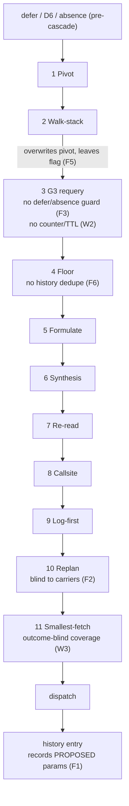

# Adversarial Review — IAP loop-reengineering branch (Part 2 of 4)

[← Part 1](REVIEW-Sonnet-v0.1.md) · §2 forcing cascade, §3 work orders / frontier / carriers · [Part 3 →](REVIEW-Sonnet-v0.1-part3.md)

Evidence codes as in Part 1: **C** I read it, **P** reviewer-executed probe, **R** reviewer-read. Paths are under `src/investigation_agent_platform/` unless noted; `forcing.py` and `run_investigation.py` are both in `application/worker/workflows/`.

## 6. §2 Forcing cascade precedence

### 6.1 Precedence table (as implemented)

Pre-cascade steps in `run_investigation.py`: defer (`:637`), D6 (`:692`, skipped on defer), absence disconfirmation (`:705-720`, skipped on defer or D6, cap 2).

| # | Rule (`forcing.py`) | Trigger | Stands down on | Does **not** check | Sets |
|---|---|---|---|---|---|
| 1 | Pivot `:2222-2235` | Fetch proposal moves surface, ≥2 turns left, surface not in last 10 history entries; no counter | defer, D6, absence | nothing earlier | `forced_pivot_recollect`; rewrites action and params |
| 2 | Walk-stack `:2238-2250` | Intake frames, gather proposal, no banked WALK_STACK, count<2 | defer, D6, absence | pivot (deliberate) | `forced_walk_stack` |
| 3 | G3 requery `:2263-2290` | Newest unconsumed REQUERY carrier within budget; no counter, no TTL | walk-stack, D6, pivot | **defer, absence** | `forced_requery`, `consumed_order_ref` |
| 4 | Floor `:2301-2321` | Committal proposal, `s4_ready` false or <3 rows, code-shaped, count<2 | defer, absence, D6, walk, requery | pivot | `forced_floor` |
| 5 | Formulate `:2322-2342` | Unformulated hypotheses, ≥1 banked row, iteration ≥2 | all above incl. pivot | none | `forced_formulate` |
| 6 | Synthesis `:2345-2366` | ≥8 rows across ≥2 actions, nothing formulated | as #5 | none | `forced_formulate` |
| 7 | Re-read `:2373-2388` | VERIFY proposal with definition language, no prior read | all above except pivot | pivot | `forced_reread` |
| 8 | Callsite `:2392-2415` | CALL_EDGE claim names an unread file | all above | none | `forced_callsite` |
| 9 | Log-first `:2418-2441` | Error words, proposal in code/state set, no SEARCH_LOGS banked | all above | none | `forced_log_search` |
| 10 | Replan `:2445-2469` | Last two history entries are the same empty search and proposal repeats | all above | none | `forced_replan` |
| 11 | Smallest-fetch `:2476-2555` | Open GAP_FILL order in newest feed, per-kind count<2 | all above plus `forced_not_checkable` | `d6_fired` directly (flag stands in) | `forced_smallest_fetch*` |

D6 runs first and outranks everything, so the comment at `:2216` ("intake frames outrank everything") is false.

### 6.2 Precedence inversions (both qualify, the loser carried the better fetch)

- **Requery beats floor on a log-shaped question.** `s4_shape == "log"`, `s4_ready` false, VERIFY proposed, SEARCH_CODE requery pending. The comment at `:1075` says a not-ready log question must gather from the log layer, never code reads; the code-only requery wins anyway. **R**
- **Floor beats smallest-fetch.** Previous verify carried a DEFINITION gap with exact file and window; the model proposes VERIFY with `s4_ready` false. Floor dispatches a whole-file GET_CODE of the first path-like token (or a blind keyword search) and burns cap 2 before the exact gap fetch runs. **R**
- **Pivot beats requery, smallest-fetch, and callsite.** The pivot target is usually the model's own fetch; the carried orders are higher value (F4). **P**
- **Log-first and replan beat smallest-fetch.** Bounded by one verify refresh, so consider-level. **R**

### 6.3 Findings

| ID | Sev | Where | Failure scenario | Fix | Ver. |
|---|---|---|---|---|---|
| F1 | should-fix | `run_investigation.py:1054` (writes at `:1082`) | `_params` is read from `reason_res.data["action_parameters"]` — the model's proposal — while dispatch uses `_reason_data`. Forced call-site/absence reads (`forcing.py:728-742`, `:925-928` read `entry["parameters"]`) are never seen as done and refire to their cap of 2; a pivot the model proposed but another rule overrode counts as "recently collected" (`:1893-1901`), so the pivot is lost; the prompt shows `parameters={}` for forced turns. | Record `_reason_data["action_parameters"]`. | C |
| F2 | should-fix | `forcing.py:1149-1156,1751-1760,1885`; `run_investigation.py:615,839,900,1218,1230-1247` | Carriers (`work_order`, `work_order_feed`) live in `action_history`. Replan reads `entries[-2:]` unfiltered and `_carry_gap_orders` emits a tombstone even for an empty gap list, so after any verify turn `actions == ["SEARCH_CODE", ""]` and replan returns None. Pivot damping window (`limit=10`) shrinks to ~3–5 real turns; carriers render as `action: None` rows in the prompt; shadow `prev_outcome` and `actions_used` count carriers. | Keep carriers in a separate list or filter `kind` in every turn-oriented reader. | P |
| F3 | should-fix | `forcing.py:2263-2267` | G3 guard checks only walk-stack, D6, pivot. On a forced absence-disconfirmation turn the requery overwrites the read, the absence cap was already burned (`run_investigation.py:715`), and verify is skipped (`:1183`). On a defer turn it replaces the repair action while `defer_repairs_used` was incremented (`:674`); the third defer breaks with `defer_repair_budget_exhausted`. `test_pre_cascade_outcomes_freeze_cascade` (`tests/unit/test_cascade_seam.py:326`) has no carrier in history. | Add `not _is_defer and not _absence_forced`; add a carrier-present test. | C (guard) / P (behavior) |
| F4 | should-fix | `forcing.py:327-377,2222,2563-2571` | No per-run pivot cap; a model that changes file every turn pivots every turn and starves requery/smallest-fetch/callsite/log-first. Pivot rebuilds params from file and lines only: `revision="abc1234"` is dispatched as `HEAD`; a SEARCH_CODE with a file path becomes whole-file GET_CODE and drops the query. Shift is measured against the *dispatched* focus, so after a forced gap fetch of file G the model's own proposal for F reads as PIVOTED. | Cap per run; yield when a pending order exists; preserve proposal params except path/window; compare against the model's last proposed focus. | P |
| F5 | should-fix | `forcing.py:2238-2250` | Walk-stack overwrites a pivot but `forced_pivot_recollect` stays true (`WALK_STACK True True`); history stamps both and the pivot target is then damped. | Clear the pivot flag when walk-stack fires. | P |
| F6 | should-fix | `forcing.py:~1011` | Floor has no history parameter; after it read `src/app/Foo.java` and the read banked, the next committal turn returns the identical GET_CODE and burns cap 2. | Pass history; skip targets already read. | P |
| F7 | should-fix | `forcing.py:2606-2607,2246,2317,2275,2603` | Blanket `except` returns the raw proposal after `state.counts` and consumed stamps were mutated in place; counters are burned and every rule is silently disabled for the turn, with no log line. | Work on copies, commit once, log the exception. | R |

Consider-tier (F8–F10):

- **Typed flags (F8).** No live typo exists today — every guard key is also a written key; `forced_smallest_fetch` is written but never used as a guard (benign); `forced_requery` is `True` in reason data but a `dict`/`False` in history (`run_investigation.py:1120,1135`, read at `retrieval_ledger.py:1139`). Recommend a `StrEnum Force`, a typed `fired: set[Force]`, and an ordered `RULES` tuple of `Rule(force, trigger, stands_down_on)` driving one loop, plus a contract test requiring every rule's `stands_down_on` to include every earlier force unless an explicit exemption is documented. Today a new rule can be added with no guards and no test fails.
- **Observability (F9).** `_reason_summary` flags omit floor/callsite/requery/pivot/smallest-fetch/absence (`forcing.py:89-95`); the shadow `forced` list omits pivot and requery (`run_investigation.py:912`); `inputs.py:307-312` silently drops several counters from telemetry; `forcing_used["synthesis"]` reuses `forced_formulate_count` (`:876`).
- **Replay posture (F10).** See 6.5.

### 6.4 Guard completeness and what the pins cover

- There is **no class named `TestPivotPrecedence`**. The pivot pins live in `TestCompetingRules` (`tests/unit/test_cascade_seam.py:81`) and cover pivot beating formulate, synthesis, requery, callsite, log-search, replan, and smallest-fetch, plus walk-stack beating pivot. Not pinned: pivot vs floor or re-read (they are safe today only because pivot needs a fetch proposal via `PIVOT_FILE_ACTIONS`, `focus.py:34`, which has no test reference), defer/absence guards on any rule that has a trigger, and the `forced_pivot_recollect` state after walk-stack wins.
- `tests/unit/test_loop_exit_contract.py` is an AST tripwire over `run_investigation.py` only: it checks no break depends on readiness and that ≥3 breaks exist. It never opens `forcing.py` or `apply_post_reason_cascade`, and an aliased `_r >= 0.95` would pass it. **The pin list is not exhaustive and the AST test does not cover the helper structure.**
- Stale comments claim pivot disjointness from floor and re-read is "pinned by test" (`forcing.py:2298,2372`); it is not.

### 6.5 Replay-safety stress test

- **No non-determinism found in `forcing.py` decisions:** no `now`, `random`, `environ`, `id()`, or hash-order dependence; sets are used only for membership; the one sort (`:1002`) is stable and keyed on path and evidence id. (**R**; reviewer ran the cascade directly.)
- **`uuid4` fallback** in the order-id helper (`forcing.py:~1931`) is unreachable (uuid5 over a string cannot fail), but the Temporal sandbox would raise on `uuid4`; the error would be swallowed at `:2014`. Delete it.
- **Sandbox gap:** `work_orders.py`, `frontier.py`, `retrieval_ledger.py` run passed-through with real `datetime`/`uuid`; `FrontierCandidate.seeded_at` (`frontier.py:142`) and `WorkOrder` id (`work_orders.py:83`) defaults call wall-clock/`uuid4`. Harmless today only because the advisory output is unused (W1) — **delete the layer and this hazard disappears**.
- **In-place history mutation:** low risk today. Activity payloads are serialized at schedule time and the mutations are deterministic functions of activity results; there is no `continue_as_new`, query handler, or memo that serializes history later. The claim "history is workflow state, deterministic functions only" **holds**, with two caveats: (1) `retrieval_ledger.py:277` reads `os.environ` (not called from `forcing.py`, but reachable from adjacent code); (2) no Temporal replay test covers carrier append plus the in-place `consumed` stamp.
- **Versioning:** no `workflow.patched` anywhere. Any guard change — including the F3 fix and the deleted readiness exit — breaks replay of in-flight runs. Acceptable only because IAP has no live deployment; decide explicitly and pin a loop-semantics version per repo contract rather than patching.
- **Fires forever or twice:** pivot and requery have no per-run cap (bounded only by damping — broken by F1 — and by `max_attempts`/`max_iterations`). Floor/callsite/absence refire to their cap of 2 because of F1 and F6.

## 7. §3 Work orders, frontier ranking, carriers

### 7.1 Direct answers

| Question | Answer |
|---|---|
| Can an order dispatch twice (replay, retry, duplicate carriers, re-issue)? | **No path found** (**R**, with **P** probes on id behavior). `action_history` is workflow-local and rebuilt from activity results; the `consumed` stamp is applied in workflow code and replays deterministically; activity retries re-run only `execute_action`, never the cascade; only one carrier is appended per turn. `_carry_requery_order` bakes the turn into the ID (`forcing.py:423-426`) so a later re-issue gets a new ID; dedup is stamp-based (`directive_consumed`, ignoring stamps at or before `turn_issued`). Probes: `{"a":1}` vs `{"a":1.0}`, `{"a":None}` vs `{}`, `True` vs `1` all yield different IDs. Caveat: `_order_id` (`forcing.py:1917-1925`) omits triage route and cost, so content-addressed dedup of two orders differing only there would drop one (advisory only today). |
| Can a tombstone suppress a still-open order that a later verify re-issues? | **It delays by one turn, it does not lose it.** T1 verify → [g1,g2]; T2 dispatches g1; T2 verify returns a no-candidate tombstone `[]`; T3 sees nothing; T3 verify re-emits [g2]; T4 dispatches g2. The real defect is the opposite: a verify path that emits **no `claim_gaps` key** returns `None` from `_carry_gap_orders`, leaving the old carrier "newest" so stale gaps keep dispatching (W3), and REQUERY has no newest-only rule at all (W2). |
| Is the ranking pulling its weight? | **No — delete it.** Nothing reads `advisory_orders`/`advisory_ranking` (W1). Should G3/smallest-fetch dispatch from rank order? Not with today's inputs: REQUERY/GAP orders carry no file/span/revision and are unrankable by design (`work_orders.py:96`, pinned by test), so rank order is empty exactly where it would matter; newest-first would then pick the stale or duplicate-claim order, but the fix is TTL/newest-only (W2), not ranking. |
| Is the pivot/advisory split coherent? | **No — two representations that already disagree** (W4). Delete the advisory half or route pivot through orders (the step-8 candidate); do not keep both. |

### 7.2 Findings

| ID | Sev | Where | Failure scenario | Fix | Ver. |
|---|---|---|---|---|---|
| W1 | should-fix | `forcing.py:~2576-2596,1955`; `frontier.py:142,168,205,209`; `work_orders.py:83` | Advisory state is computed every turn and never consumed. The only emitter yields at most one FETCH_SEED, left PENDING forever. `cost_estimate` is hardcoded 1 (`forcing.py:447,2009,1692`) so VOI collapses to novelty ∈ {0,.5,1} plus a hash tie-break (`candidate_id.hex`), i.e. the "best" order is the smallest hash. `cost=10**400` raises `OverflowError` in `base_score` and the outer `except` silently empties the ranking. `orders_from_cascade_signals(history=…)` has an unused parameter. | Delete `rank_advisory_orders`, `orders_from_cascade_signals`, `advisory_*` state, `_order_id`, `order_candidates`, `work_orders_to_seeds`; rebuild with a consumer. **Owner decision** — designs are retained as rebuild specs and an earlier deletion in this branch was reverted, so confirm before removing. | P |
| W2 | should-fix | `forcing.py:486-497` | `_should_force_order_requery` scans all history for the newest unconsumed carrier. T3 verify issues R3; T4 pivot suppresses G3 (R3 not consumed); later verifies return no requery; R3 fires at turn 9. `WorkOrder.ttl_rounds` is never enforced; G3 has no counter; a degraded-empty turn carries no `retrieval_attempt` so budget never advances. | Newest-carrier-only for REQUERY too, or expire at `iteration - turn_issued > ttl`; add a per-run cap. | P |
| W3 | should-fix | `forcing.py:1772-1796`; `run_investigation.py:~1103` | `forced_smallest_fetch_gap_id` is stamped regardless of fetch outcome, so an empty/degraded/failed fetch covers the gap forever; a pivot/floor/callsite read of the same file and window does not cover it (duplicate GET_CODE); `gap_id = KIND\|target_key` is hypothesis-agnostic so a new candidate with the same group key counts as covered. | Stamp on success only; also check history reads by file+window; include hypothesis in coverage. | P |
| W4 | should-fix | `forcing.py:2062`; `frontier.py:182`; `work_orders.py:173` | A dispatched pivot (`GET_CODE a.py 1-5`) is ranked out (novelty 0) because damping and novelty use different baselines (all params in last 10 entries vs banked reads only). Symbol seeds carry `target="FIND_SYMBOL"` (the action type) instead of the symbol, with only `commit="HEAD"` as identity. | Resolve by W1 or by routing pivot through orders. | P |

Consider-tier:

- **W5 — `focus.py`.** No path normalization: `src/A.java` vs `./src/A.java`, `src\A.java`, `src/a.java`, `/repo/src/A.java`, `src//A.java` all return PIVOTED and force a re-read (`focus.py:111`). `pivot_can_pay_off(float('inf'))` raises `OverflowError` (`:127`, catches only `TypeError`/`ValueError`) and `_clean_line(inf)` (`:59`) loses the whole focus — a model output of `"start_line": 1e999` triggers it, contradicting "never raises". `line_end < line_start` is accepted. `prev_focus` is only overwritten when the turn has a focus (`forcing.py:2568`), so a FORMULATE turn leaves a stale one. Same-file/different-symbol returns NONE and a window change returns REFINED, which is intended. Because `focus.py` was rewritten from the call contract after an accidental deletion, treat the 19-test parity as a floor, not proof of semantic equivalence.
- **W6 — dead surface.** `evaluate_exit`, `FrontierExit`, `seed_from_dormant_templates`, `FRONTIER_VERSION_CURRENT`, `MAX_FRONTIER_DEPTH`, `FIXPOINT_SCORE_FLOOR`, all `CandidateStatus` except `PENDING`, and `FrontierCandidate.service/config/depth/status/seeded_at` have no production consumer; `WorkOrderStatus.CONSUMED/EXPIRED` are never set (the `status != PENDING` branch at `forcing.py:512` is unreachable); `max_attempts` and `ttl_rounds` are ignored; `workorder-v1`/`frontier-v1` stamp but never route behavior, so the version-pinned rule is satisfied cosmetically; stale prose ("chunk 2b will…", "replaces marker"), three empty `with imports_passed_through(): pass` blocks (`forcing.py:13-27`), and `test_stale_marker_dicts_emit_nothing` pins a deleted legacy shape. `_is_json_safe` accepts NaN and `model_dump(mode="json")` turns it into `None`.

### 7.3 What §2–§3 tests do not pin

- A multi-turn stale/unconsumed older REQUERY carrier firing after a newer verify returned nothing; G3 on defer/absence turns with a carrier present; any history reader (`_should_force_replan`, damping) with carriers in the tail; a G3 cap or run-length bound.
- End-to-end tombstone → re-issue → dispatch; dispatch failure plus coverage stamp; "no `claim_gaps` key keeps the stale carrier newest".
- `rank_advisory_orders` with unlocatable orders, the symbol-seed target bug, overflowing cost, and the pivot-dispatched-but-ranking-empty disagreement; `ttl_rounds` honored; `_order_id` collisions across route/cost.
- Pivot preserving a pinned revision or a SEARCH_CODE query; pivot after a forced action; `forced_pivot_recollect` + `forced_walk_stack` flag hygiene; `inf`/`NaN`/path normalization in `focus.py`.
- Replay determinism over carrier append and the in-place `consumed` stamp; and the workflow wiring at `run_investigation.py:1133` (the pure-function tests cannot see it).
