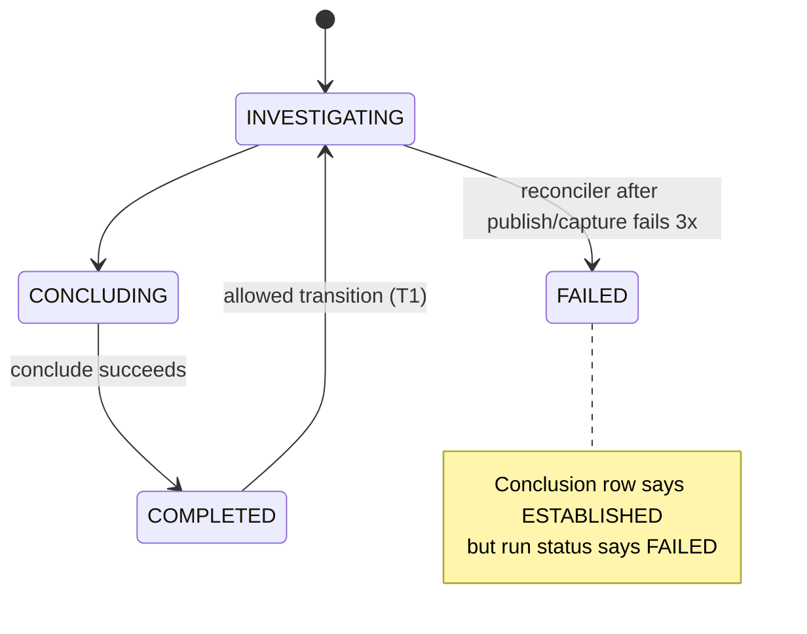

# Adversarial Review — IAP loop-reengineering branch (Part 4 of 4)

[← Part 3](REVIEW-Sonnet-v0.1-part3.md) · §6 termination, honesty, metrics · the four known open items · consolidated test gaps · caveats and calibration

Evidence codes as in Part 1: **C** I read it, **P** reviewer-executed probe, **R** reviewer-read. Paths are under `src/investigation_agent_platform/` unless prefixed `scripts/` or `tests/`.

## 10. §6 Termination, honesty, metrics

### 10.1 Terminal paths and the label each produces

| Path | Where | Run status | Conclusion label |
|---|---|---|---|
| Verified, gate approves | `run_investigation.py:1368`; `lifecycle.py:1944` | COMPLETED | ANSWERED only for location, code-value, doc; history/state/caller-edge get ROOT_CAUSE_ESTABLISHED (H13) |
| Verified, gate denies | `lifecycle.py:1704` | COMPLETED | INSUFFICIENT_EVIDENCE |
| Refuting evidence bound | `lifecycle.py:1546` | COMPLETED | NO_ROOT_CAUSE_FOUND |
| No hypotheses persisted | `lifecycle.py:803` | FAILED (CONCLUSION_DENIED) | none |
| Kernel denies, or throws in shadow mode | `lifecycle.py:2254` | FAILED (CONCLUSION_DENIED) | none (T6) |
| Claim-binding version unreadable | `lifecycle.py:1040-1057` | `NameError` → FAILED (WORKFLOW_ERROR) | none (H9) |
| D6 opinion-only | `run_investigation.py:992` | intended COMPLETED | intended INSUFFICIENT + NOT_CHECKABLE_SKIPPED; likely unreachable as intended (T3) |
| 10 turns exhausted | `run_investigation.py:1429` | COMPLETED | INSUFFICIENT_EVIDENCE (BUDGET_DEFERRED or FRONTIER_EXHAUSTED) |
| `budget_exceeded` (token cap `reasoning.py:933`, tool/evidence cap `execution.py:1027`) | `lifecycle.py:2279` | COMPLETED | INSUFFICIENT_EVIDENCE (BUDGET_DEFERRED) |
| `defer_repair_budget_exhausted` | `run_investigation.py:643` | COMPLETED | INSUFFICIENT_EVIDENCE |
| `provider_blocked:auth_failed` | `run_investigation.py:1161` | COMPLETED | INSUFFICIENT_EVIDENCE (TELEMETRY_DEFERRED) |
| `defer_gathering_invalid` | `run_investigation.py:640,666` | FAILED (UNKNOWN) | none (T7) |
| `reasoning_unavailable` | `run_investigation.py:628` | FAILED (UNKNOWN) | none (T7) |
| `input_expired` | `run_investigation.py:415` | FAILED (INPUT_EXPIRED) | none |
| ActivityError after 3 attempts | `run_investigation.py:207` | FAILED (WORKFLOW_ERROR) | none, or a stale verdict (T1) |
| Cancel | `run_investigation.py:1414` | CANCELLED | none |
| 7200 s execution timeout | `api/v1/routers/investigations.py:371` | Temporal kills the run; aggregate left non-terminal | none (T5) |

Absence claims have no fast path in `_gate_conclusion_or_fail`; they pass the general causal-chain gate or abstain.

### 10.2 Direct answers

| Question | Answer |
|---|---|
| Is the bound priced? Should overconfidence accelerate termination? | **Not priced, and yes.** No wall-clock or cost guard exists although a comment at `run_investigation.py:462-469` promises one; `InvestigationLimits.max_duration_seconds` (`domain/investigation/models.py:342`) has no reader; the 1M-token cap is checked after the call and counts only the last response (T5). Overconfidence only increments `overconfident_turns` (`run_investigation.py:1377-1384`), and it reads `next_action` *after* the cascade, so a forced override hides it (T4). |
| Can the loop reach a verdict with zero banked rows? | **Not today** — the gate blocks it (`verification.py:7973`, `lifecycle.py:1495`). But the domain layer does not defend itself: `InvestigationConclusion` (`domain/finding/models.py:325-336`) forbids ESTABLISHED/ANSWERED without evidence yet allows ROOT_CAUSE_LIKELY, and under `cbv1` a verdict can publish with zero *cited* rows (uncited rows join `bound` via `statement_range_reads`, `lifecycle.py:1124-1141`; H1). |
| Is every abstention path labeled as abstention? | **No.** D6 likely ends FAILED (T3); abstentions carry unverified model prose in `ranked_alternatives` and a supporting-hypothesis link (T8); a published verdict can be rewritten to FAILED after the fact (T1). |
| Does the grader require bindings? | **Partly.** ANSWERED cases require evidence bindings and a fluent model with no cited rows grades PARTIAL (`tranche_b_battery.py:413`). But the grader still has gaps (T9), and the metric you headline, G1, is not computed there at all (T2). |

### 10.3 Findings

| ID | Sev | Where | Failure scenario | Fix | Ver. |
|---|---|---|---|---|---|
| T1 | blocker | `run_investigation.py:1508-1522`, `:207-257`; `domain/investigation/models.py:586,611` | After conclude, `capture_knowledge_activity` and `publish_event_activity` are awaited with no try/except (**C**) even though a comment says capture failures never fail the investigation. If either fails three times the `run()` reconciler (**C**) transitions to FAILED, and the state machine allows `COMPLETED → INVESTIGATING` and `INVESTIGATING → FAILED` (**C**). Result: FAILED run with an ESTABLISHED conclusion. Whether the activities swallow internally was not verified. | Wrap post-conclude steps; skip reconcile when already COMPLETED/CANCELLED. | C (no wrapper, transitions) |
| T2 | blocker | `scripts/live_battery.py:315,462`; `domain/finding/models.py:266-270`; `scripts/tranche_b_battery.py` | `has_handoff = state or next_check or steps` and the handoff builder always appends filler ("Frontier exhausted: no ruled-out rival, ranked alternative, or discriminating fetch was recorded.") when nothing else exists, so **every** abstention counts as a handoff (**C**). `S7Handoff` has no cost field, so "priced" is unmeasurable. `tranche_b_battery.py` has no G1 computation (grep: none). Unmatched abstentions default to "genuine-insufficiency", hiding pipeline defects. The `DES-S7-handoff` design says no path emits generic filler; the code does. | Count a handoff only with a concrete `next_fetch` target or non-empty `eliminated_rivals`; add a numeric price; remove the filler. | C |
| T3 | should-fix (reviewers: blocker; promote on confirmation) | `run_investigation.py:992-994` (break before `execute_action_activity`, **C**); `execution.py:~3910-3953`; `lifecycle.py:803` | Hypotheses are persisted by execute and verify, not by reason. D6 on turn 0 therefore reaches `no_hypotheses` → FAILED/CONCLUSION_DENIED instead of INSUFFICIENT + NOT_CHECKABLE_SKIPPED; on later turns the candidate is a stale checkable hypothesis lacking NC assessments so the marker is absent and the battery grades PARTIAL (`scripts/tranche_b_battery.py:390`). The only workflow-level pin is a source-string check (`tests/unit/test_claim_binding_phase4.py:569-590`); the live injected test pre-seeds the hypothesis and runs verify first (`scripts/live_inject_not_checkable.py:196-224`). Not reproduced live. | Persist D6 hypotheses with NC assessments before the break, or run verify once; add a workflow-level test. | R |
| T4 | should-fix | `run_investigation.py:1377-1384,703,1080-1085,953`; `agent_metrics.py:222` | Counter undercounts (reads post-cascade `_reason_data`; should read `_shadow_proposal["next_action"]`). Existing state suffices for a stall exit: `evidence_added`/`outcome_status` per history entry, `evidence_banked_total`, per-turn readiness, parameter fingerprints, `overconfident_turns`. | Add `stall_streak` (overconfident, zero rows banked, repeated action+params or EMPTY/DEGRADED); at 2 set `last_error="overconfident_no_progress"` and break; add the reason to the epistemic set (`lifecycle.py:2276`), `_failure_code_for` (`inputs.py:226`), the handoff budget branch (`models.py:238`); pin loop semantics by version. | R |
| T5 | should-fix | `run_investigation.py:462-469,555-566,618`; `reasoning.py:880-933`, `application/investigation/reasoning.py:1376`; `openai_adapter.py:255-272` | No wall-clock/cost guard. Adapter timeout 30 s × 3 tenacity attempts per `complete()`, up to 3 `complete()` per decision, activity limit 120 s × 3 attempts; per-turn ceilings (knowledge 30, reason 120, execute 60, retrieve 60, four transitions at 30, verify 60, checkpoint 30) sum to ~480 s × 3 attempts ≈ 24 minutes per turn, ~4 hours over 10 turns against a 7200 s execution timeout, with no heartbeat or `schedule_to_close`. A Temporal timeout skips the reconcile and strands the aggregate; no reaper found. Pause has no timeout and cancel-while-paused hangs because `wait_condition(not self._is_paused)` ignores `_is_cancelled`. Hidden resamples, the structure retry, and timed-out attempts are never counted. | Deterministic budget on `workflow.now()` minus start; accumulate cost; sum all usage; cancel-aware pause with timeout; reaper for stranded aggregates. | R |
| T6 | should-fix | `application/proof/kernel_conclude_wiring.py:427`; `lifecycle.py:2254` | Kernel gate fails closed on any exception regardless of mode, contradicting "shadow never blocks", and an enforcing DENY becomes FAILED with no conclusion rather than an abstention. | Allow in non-enforcing modes on exception; persist an abstention on enforcing deny. | R |
| T7 | should-fix | `reasoning.py:728-737`; `run_investigation.py:628,640,666,1026,1424-1430`; `lifecycle.py:2274,2341-2366`; `inputs.py:226` | Open item 1 confirmed and extended. Epistemic path publishes `root_cause=None`, confidence 0, no support, so degrading is safe. `defer_gathering_invalid` also ends FAILED/UNKNOWN while its sibling `defer_repair_budget_exhausted` abstains. An `ActivityError` on `reason_activity` (e.g. LLM timeout) fails the whole run even after nine good turns — only the idempotency wedge is caught. No test pins `reasoning_unavailable` through conclude. | Degrade schema-invalid-after-varied-resample to INSUFFICIENT_EVIDENCE; keep FAILED for transport/auth outages with no usable evidence; map failure codes properly. | R |
| T8 | should-fix | `lifecycle.py:~960,~1004-1017`; `domain/finding/models.py:262-263`; `scripts/tranche_b_battery.py:109` | `_persist_abstention` stores `supporting_hypothesis_ids=[candidate.id]` and `"STATUS: <model statement>"` alternatives that reach `recommended_next_steps`; the battery's `_supporting_rows` treats a linked hypothesis's evidence as the conclusion's rows. (The epistemic path at `:2341` is clean.) | Label alternatives "unverified"; drop the hypothesis link on abstentions. | R |
| T9 | should-fix | `scripts/tranche_b_battery.py:183,234,390,396,413`; `scripts/live_battery.py:7`; `api/v1/schemas/investigations.py:25` | **Grader gaps:** L2 `_check_callers` never reads the root prose and one of two expected callers suffices; L1/L3/L4 match the named path by case-insensitive substring and only require `line_start` to be an int, any one matching row passes; L5 `_check_values` matches case-insensitive substrings and never checks the relationship (`orderType` is in the question; "standard" matches inside other words); L8 passes on any abstention with no failure rows without checking that a search ran, turns burned, or why. **Leakage and circularity:** expected tokens repeat the symptom in L1/L3/L4/L5 (the case `context` is not leaked — `CreateInvestigationBody` drops `initial_context`); the grader mirrors the verifier's own requirements (range, revision, evidence type) and the oracle is the same team's synthetic checkout. **Representativeness:** all 6 live cases are code lookups — no root-cause, log, or telemetry case. **Comparability:** the baseline is recorded as 1/6, 1/9, and 1/10; the rubric changed (P0 absence rule added; `discovery_only` stamping bug fixed, so the movement is partly a bug fix); n=1 per case, and Wilson 95% intervals are roughly 44–97% for 5/6 and 3–56% for 1/6, so they nearly touch; `tranche_b_battery.py` has no pre-sweep (unlike `live_battery.py:7`) so a repeated symptom in the same tenant can be served from cache and the old run graded. | Binding-level oracles with expected file+range; ≥3 repeats per case; add log/root-cause/denied-capability cases; pre-sweep; report intervals. | R |

Consider-tier (T10–T12):

- **T10 — static gate.** `pyproject.toml` has no ruff `select` (ruff 0.16.8 defaults), no `extend-exclude`, no `per-file-ignores`; mypy is `strict` over the whole package with no excludes. Reviewer-run results: `ruff check src tests migrations` finds 45 errors (14 are intentional parser fixtures under `tests/fixtures/python`; the F821 at `verification.py:5478` is an annotation-only false positive); `ruff format --check` flags 277 files today (not 286). Of four scoped files, `lifecycle.py`, `domain/finding/models.py`, and `tranche_b_battery.py` fail format; `run_investigation.py` passes.
- **T11 — restart log loss.** `scripts/start-platform.sh:114,120,162,168` open the API and worker logs with `>`, so each `--restart` truncates them; `stop_app` SIGKILLs after 2 s; no rotation; `scripts/diagnosis.sh:214-269` reads a single file and prints a note when nothing matches.
- **T12 — post-conclude duplicates.** A conclude retry after `save_finding_record` (`lifecycle.py:1758`) creates a new Finding; `capture_knowledge_activity` runs on every terminal status including abstentions and FAILED runs; D6 writes a synthetic readiness of 1.0 into history (`run_investigation.py:697`); a model can label every claim NC at turn 0 to skip retrieval (moot while the live model does not).

### 10.4 What §6 tests do not pin

- **No Temporal workflow test exists.** `test_loop_exit_contract.py` is an AST scan for the text "readiness" in break conditions.
- Nothing executes end to end: D6 through the workflow; `defer_*`, `reasoning_unavailable`, `input_expired`, `budget_exceeded` through conclude; cancel while paused; a post-conclude activity failure; an execution timeout.
- Only one conclude test uses the FAILED-plus-epistemic reason (`test_claim_binding_phase3.py:1858`, `provider_blocked`). Conclusion-status labels for the history/state/caller-edge paths and token accounting across resamples are untested. No test defines G1. The battery grader is tested only on hand-built conclusions, so it cannot detect circularity.

## 11. The four known open items

| # | Your item | Verdict | Evidence and addition |
|---|---|---|---|
| 1 | Reasoning-unavailable → FAILED; should it degrade? | **Confirmed; degrade, with a transient/dead line** | H6, H7, T7. Not only L3 sampling noise: the resample is byte-identical, only some error classes resample, and the activity returns `success=True` so Temporal retry never runs. Degrade is safe (epistemic path persists `root_cause=None`). |
| 2 | L5 INSUFFICIENT at every baseline: structurally incapable or unguided? | **Hypothesis, not a finding: structurally under-served rather than incapable.** I did not run L5. | Three code-level reasons a semantic/causal question has no collection mechanism: targetless CAUSAL/BEHAVIOR claims fall in NO_TARGET groups that `build_claim_gaps` skips (H8); the S6 rival bar appears unsatisfiable so causal verdicts demote to LIKELY (H12); and the machinery is not running by default anyway (H1). The L5 grader also matches substrings (T9). **Experiment:** run L5 once under `cbv3` and inspect claim kinds, gaps emitted, and the verdict tier. |
| 3 | 286 files fail `ruff format --check`, mypy 512 errors; salvageable? | **Salvageable by re-scoping; one claim partly refuted.** | T10: today 277 files, not 286; "our files are check-clean" holds for the 2b-authored regions but 3 of 4 reviewed files still fail whole-file format. Re-scope: one mechanical format commit recorded in `.git-blame-ignore-revs`, `extend-exclude = ["tests/fixtures"]`, `ruff --fix` for the fixable rules, then `format --check` in CI; mypy `ignore_errors` overrides for legacy modules, strict on `domain/` and `application/investigation/`, changed-files-only in CI with `--follow-imports=silent`, and a per-module error-count baseline that only ratchets down. |
| 4 | `--restart` truncates logs, evidence lost | **Confirmed; minimal fix known** | T11. Before each launch move the existing file to a timestamped name, open with `>>`, and have `diagnosis.sh` glob the rotated set. Retain a bounded count. |

## 12. Consolidated view of what the green suite does not prove

The 4485-test unit suite, 19 DB tests, and 5/6 battery are good evidence of pure-function correctness and of the specific regressions they were written for. They do **not** show:

1. That the claim-binding machinery runs on the default path (H1) — the tests construct `cbv2`/`cbv3` investigations directly.
2. Anything about the workflow wiring: the cascade seam is tested as pure functions, and no Temporal workflow or replay test exists (T-section, F10).
3. Any cross-tenant negative at the repository, vector, cache, or log-index layer, or RLS under a non-superuser role (R-section).
4. Multi-claim, mixed-kind, mixed-NC verdict soundness (H3, H4).
5. Failure injection: post-conclude failure, mid-run provider fault, timeouts, pause/cancel.
6. Modern Java and nested-scope attribution (J1–J3), and Spring precedence (J11–J13).
7. That the grader fails when it should: it is validated only on hand-built conclusions, and G1 is not computed.

## 13. Caveats and calibration

- **Reviewer claims I downgraded:** H9 (self-heals through activity retry), J4 (needs same-line declarations), J11 (depends on whether profile-gen output is later cited), T3 (high-confidence reading but unreproduced). **Reviewer blockers I kept at blocker:** the ones I verified in source (H1–H3, R1 partially, R3, T1, T2).
- **Verified by me:** H1, H2, H3 (property), H9, H10, F1, F3, J1 (walk), J4, J7 (guard), J11 (setdefault), J12 (merge order), R1 (capture and unused flag), R3, R4, T1, T2, and the break-before-execute half of T3. Everything marked **R** in the tables is unverified by me and should be spot-checked before scheduling work.
- **Not covered:** performance and load, observability design beyond the flag-list gaps, MCP tool surface beyond tenant scoping, packaging/deploy, and the Python analysis modules beyond the shared `dispatch.py` swallowing.
- **Deletion advice (W1) needs an owner decision.** An earlier session in this branch deleted and had to restore collection code; recommend deleting only the unconsumed advisory half, in its own reviewed change, with the designs retained.
- **No-legacy and version-pin rules.** Fixes that change loop semantics (T4 stall exit, F3 guard, readiness removal) alter replay for in-flight workflows. Pin a loop-semantics version on the entity rather than using `workflow.patched` or an env switch, per repo contract. R4 and R10(f) are cases where the code carries a back-compat branch the contract says to delete.
- **Recommendation ledger.** All IDs above are recorded `OPEN` in `docs/IAP_Arch_Eng_Recommendations.log`. When an item is implemented, update the affected design doc first, then remove the ledger entry.
