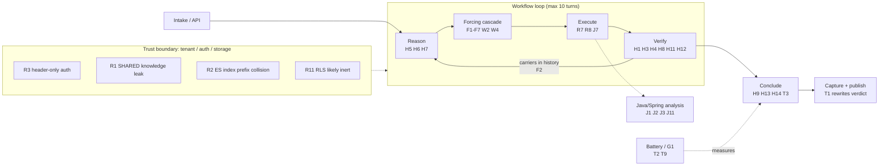
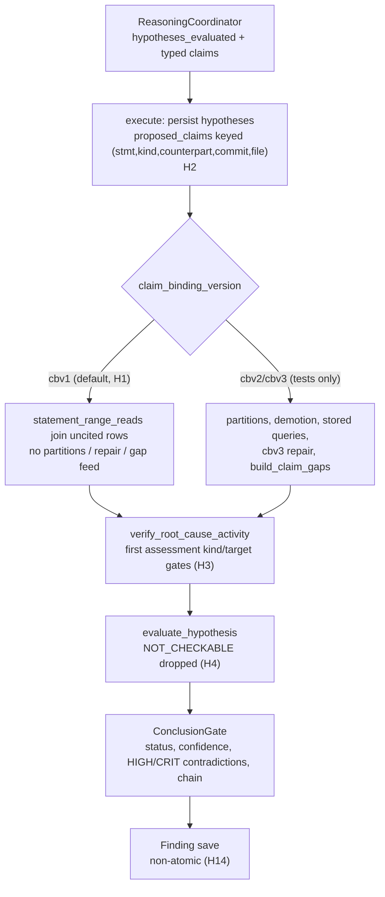

# Adversarial Review — IAP loop-reengineering branch (Part 1 of 4)

- Reviewer: Sonnet (claude-sonnet-5.5), architecture role
- Date: 2026-10-30
- Branch / HEAD: `iap-s1s7-reengineering-v1.0` @ `1c928ff` (working tree clean)
- Parts: **1** summary, method, finding index, top risks, §1 hypothesis→verification · [2](REVIEW-Sonnet-v0.1-part2.md) §2 cascade, §3 work orders · [3](REVIEW-Sonnet-v0.1-part3.md) §4 Java/Spring, §5 retrieval/authz/tenancy · [4](REVIEW-Sonnet-v0.1-part4.md) §6 termination/honesty/metrics, open items, test gaps, caveats
- Every finding below is also recorded as an `OPEN` entry in `docs/IAP_Arch_Eng_Recommendations.log` under the same ID.

## Remediation status (2026-10-30)

Commits: `40870d2` pure ruff format (recorded in `.git-blame-ignore-revs`), `230d34b` tranches 0-5 plus the follow-ups below, then tranche 6 as its own commit so it has a real before tree. Tranches 0-6 were implemented in order, each with a failing test or probe first and a full unit run after. Unit tests went from 4485 to 4598 passing; ruff is clean and the mypy ratchet is at its 506-error baseline. R-marked findings were probed before changing code.

| Tranche | Findings | Status | Where |
|---|---|---|---|
| 0 tooling | T10, T11, T2 | Done | `pyproject.toml` ruff/mypy config, `scripts/mypy_ratchet.py` + `config/mypy_baseline.json`, `scripts/start-platform.sh` `rotate_logs`, `scripts/diagnosis.sh`, `scripts/tranche_b_battery.py` `score_g1` |
| 1 fail-closed | H9, H10, T1, R7 | Done | `activities/lifecycle.py`, `workflows/run_investigation.py` (`_post_conclude_best_effort`, reconciler skip), `activities/execution.py` (`_authorization_infra_failure`) |
| 2 guards | F1, F3, F5, F6, F7, J4, J7 | Done | `workflows/forcing.py`, `domain/investigation/loop_version.py` (F3 pinned lv1/lv2), `analysis/java/window_facts.py`, `activities/execution.py` (`_with_read_mode`) |
| 3 H1 measurement | H1 | Measured on the head tree, default NOT flipped | `tranche_b_battery.py --claim-binding-version`; `IAP-claim-binding-attribution-v1.0.md` |
| 4 Java soundness | J1, J2, J3 | Done | `analysis/java/model.py`, `dataflow.py`, `verification.py` (`_v2_any_from_evidence`) |
| 5 tenancy | R3, R4, R5 done; R2 reproduced, decision needed | Partial | `api/tenant.py`, `security/profile_authorizer.py`, `api/dependencies.py` |
| 6 verdict semantics | H2, H3, H4 code done; battery before/after untested by owner decision | Partial | `activities/execution.py` (`_claim_identity_key`), `verification.py` (`enforce_group_conjunction`), verify + conclude choke points |

### What did not reproduce or could not be completed

- **R2** reproduced (by pattern semantics) but cannot be fixed in code alone; pinned by a strict `xfail`. See the ledger entry.
- **J7**: the reviewer's bypass was confirmed by probe at the TRACE_LOGIC bank site (a file-head read banked with no `read_mode`). The fix stamps the label at both unstamped bank sites, and the guard (`_is_range_read`) now requires an explicit `read_mode == "range"` so an unlabeled provenance window is no longer trusted.
- **T2** is not complete: the generic handoff filler is removed, but `S7Handoff` has no price field and `next_fetch` is still the free-text `next_check` template, so G1 scores abstentions as misses. See the ledger.
- **F7** was reproduced (counter burned and carrier stamped when a later rule faults).
- **H1 attribution (head tree, clean tenant per repeat, 3 repeats per pin):** cbv1 13/18 and cbv3 14/18 case-passes; no measurable pin effect. L5 fails 6/6 on both pins. The earlier single-run cbv3 collapse did not reproduce. The pre-T6 comparison was not run (owner decision) and is a ledger task. See `IAP-claim-binding-attribution-v1.0.md`.
- **G1** scored with the stricter definition is 3–4 of 6 on the head-tree runs (1/6 on the earlier single run), because every abstention carries generic next-fetch template text.
- **Tranche 6 battery gate** (before/after, 3 repeats) was not run: repeats in one tenant are served from cache, and the options (destructive cleanup or fresh tenants) need approval.

## 1. Executive summary

The 2b work is internally disciplined: the cascade extraction is clean, the carrier/order layer has no double-dispatch path I could construct, and the pure-function style holds up under replay scrutiny. The branch's headline result (5/6 live PASS vs 1/9) is real but **measures less than it appears to**, for three reasons that were not on your list:

1. **Every investigation created through the API, intake, or dev seed is pinned `claim_binding_version = cbv1`, and the partition / repair / gap-feed machinery is gated on `cbv2`/`cbv3`, which nothing in `src/` or `scripts/` ever stamps** (H1). The claim-binding phases 1–3 you want challenged are, on the default path, not running. The 5/6 may be mostly the Step 1 range-banking fix, not the 2b collection layer.
2. **The verdict gate is not conjunctive** (H3, H4): only the first typed assessment is gated, and `NOT_CHECKABLE` siblings are dropped, so a verdict can publish on one easy claim while the statement that ships carries claims nobody checked.
3. **Tenant isolation has holes unrelated to the loop** (R1–R3): a cross-tenant knowledge channel, a log-index prefix collision, and header-only authentication for any environment string other than exactly `production`.

Counts after de-duplication across six independent passes: **12 blockers, 46 should-fix, 12 grouped consider-tier items**.

## 2. Method and how to read the evidence column

Six parallel read-only passes (one per review area) read the code and ran read-only probes in the repo venv; no files were edited. I then **personally re-read the source for the headline claims** and downgraded two reviewer blockers whose triggers are narrower than reported (H9, J4). The `Ver.` column in every table uses:

| Code | Meaning |
|---|---|
| **C** | I read the cited lines myself and the defect is as stated |
| **P** | A reviewer executed a probe in the repo venv and observed the stated output; I did not re-run it |
| **R** | A reviewer read the code and traced it; I did not independently verify |

Not done: no live runs, no full test-suite execution, no Temporal replay execution, no review of telemetry/MCP beyond tenant scoping. Findings marked **R** should be spot-checked before work is scheduled. An earlier note in this session said the carrier changes were uncommitted; that was stale — they are committed at HEAD.

## 3. Finding index

| ID | Sev | Area | Headline |
|---|---|---|---|
| H1 | blocker | §1 | Default pin `cbv1` makes cbv2/cbv3 claim-binding machinery unreachable |
| H2 | blocker | §1 | Claims silently overwritten at persistence (key too coarse) |
| H3 | blocker | §1 | Only the first typed assessment is gated; claim order picks the gate |
| H4 | blocker | §1 | `NOT_CHECKABLE` siblings dropped; checkable remainder decides and full statement ships |
| H5–H14 | should-fix | §1 | Checkability classifier, resample, transient/dead, re-fetch route, NameError, dead flag reset, contradictions, S6 bar, labels, atomicity |
| F1–F7 | should-fix | §2 | Proposed-not-dispatched params, carrier pollution, G3 guards, pivot, walk-stack flag, floor, blanket except |
| W1–W4 | should-fix | §3 | Dead advisory layer, stale REQUERY, outcome-blind coverage, pivot/advisory disagreement |
| J1–J3 | blocker | §4 | Lambda/anon-class attribution, anon-class fields, definite assignment by text order |
| J4–J13 | should-fix | §4 | Window/range/boundary/dataflow/Spring defects |
| R1–R3 | blocker | §5 | Cross-tenant SHARED knowledge, ES prefix collision, header-only auth |
| R4–R11 | should-fix | §5 | Authz semantics, profile status, dead deny reason, attempt accounting, RLS |
| T1–T2 | blocker | §6 | Late failure rewrites published verdict; G1 metric vacuous |
| T3–T9 | should-fix | §6 | D6 path, overconfidence, unpriced bound, kernel gate, degrade, prose leak, grader |
| H15–H17, F8–F10, W5–W6, R12, T10–T12 | consider | all | Grouped in the ledger and in the relevant part |

## 4. Top 3 risks before this touches a real tenant

### Risk A — Cross-tenant disclosure and fragile authentication (R1, R2, R3, R11)

A tenant that files an intake with the same error class, repository, revision, and failing symbol reproduces another tenant's unkeyed fingerprint and reads its `SHARED_CODE_ISSUE` artifacts (summary text up to 500 chars). Independently, any environment string other than exactly `production` accepts a bare `X-Tenant-ID` header, and the application database role is a superuser that bypasses RLS even with `FORCE`.

**Single experiment — cross-tenant canary:** as tenant A, run an investigation whose evidence summary contains a unique canary string; as tenant B (non-superuser DB role, `environment=prod`-style value, no bearer token), file an intake with the same four fingerprint inputs, then grep B's reasoning prompt, knowledge retrieval output, and API responses for the canary. Pass = canary never appears and the header-only request is rejected.

### Risk B — Verdicts that are not conjunctive, on machinery that may not be running (H1, H3, H4, plus J1–J3)

Default investigations run `cbv1`. Under any version the gate evaluates the first assessment's kind/target and drops `NOT_CHECKABLE` siblings. The Java fact layer can additionally credit lambda/anonymous-class returns and fields to the wrong host, producing a *RESOLVED* fact from unsound analysis.

**Single experiment — adversarial claim trio:** first query `metadata->>'claim_binding_version'` for the battery's investigations (expect `cbv1`). Then inject three hypotheses and assert none publishes `VERIFIED`/`ANSWERED`: (a) DEFINITION (grounded) + CAUSAL (ungrounded), (b) two DEFINITION claims in one file where the second is false, (c) one trivial checkable claim + three `NOT_CHECKABLE` causal claims. Run under `cbv1` and `cbv3`.

### Risk C — Run integrity: verdicts rewritten to FAILED, transient model faults kill runs, bound unpriced (T1, H7/T7, T5)

A failure in knowledge capture or event publish after a successful conclude is reconciled to `FAILED` and the state machine permits `COMPLETED → INVESTIGATING → FAILED`. A single invalid LLM output after two identical resamples ends a run that already did nine good turns as `FAILED/UNKNOWN`. Nothing enforces wall-clock or cost; worst-case per-turn activity ceilings sum to roughly 24 minutes.

**Single experiment — fault injection:** (1) force `publish_event_activity` to raise after conclude; assert the stored status stays `COMPLETED` with its conclusion. (2) Inject one malformed `reason` output at turn 9; assert the run ends as `INSUFFICIENT_EVIDENCE` with banked evidence preserved, not `FAILED`.

### Next tier (fix soon after the top 3)

F1 + F2 + F3 (cascade correctness around history and guards), J1–J3 (Java attribution), R4–R9 (authorization semantics and abstention labeling), T2 (make G1 mean something before reporting it).

## 5. §1 Hypothesis → verification pipeline

### Direct answers to your five questions

| Choice | Verdict | Counterexample |
|---|---|---|
| Claim identity `(kind, target_key)` | **Disagree** — wrong in both directions, and the two layers use different identities | *Collides:* persistence (`execution.py:787-815`) keys on `(statement, kind, counterpart, commit_id, file_path)`, so DEFINITION claims for `Foo.a` and `Foo.b` in one file with a shared hypothesis statement overwrite each other (H2). Targetless CAUSAL/BEHAVIOR claims collapse into one NO_TARGET group that never gets a gap. *Over-splits:* case, whitespace, leading `./`, `claimed_value`, `scope` each change `target_key` (H16), so rewording a target field mints a new `gap_id`. |
| Uncited → fetch; cited-but-failed → repair, never re-fetch | **Disagree** | A DEFINITION claim cites a pinned range read of lines 1–40 but the symbol is at line 80. The group counts as cited (any cited ID, even unbanked, qualifies), repair needs an already-banked uncited superset row, `build_claim_gaps` skips cited groups, `select_ledger_requery` fires only on unknown/never-retrieved/failed-search. Result: `INCONCLUSIVE`, no route to a re-fetch (H8). Same for stale revision. |
| Claim-local verification | **Disagree** — nothing verifies the conjunction | Claims `[DEFINITION(grounded), CAUSAL("pool exhaustion causes the timeout", no evidence)]`: the location fast path gates the first assessment against the pooled rows ("no causal claim made") and the full causal statement publishes as `root_cause` (H3). Claims may also each pin a different revision; only per-row pin checks exist (H17). |
| `NOT_CHECKABLE` excluded from the denominator | **Disagree** — the LLM is the classifier and there is no denominator | Prompt asks the model for the label (`reasoning.py:~340`), the sanitizer only normalizes case (`:240`), `claim_shape.value_shape_of` exists but is not consulted. One trivial checkable claim + three NC causal claims verifies on the single claim (H4). Conversely an all-NC turn 0 forces CONCLUDE with zero evidence (H5). |
| Resample ×2, then `reasoning unavailable` fails the run | **Partly agree** | Bounded resample is right in principle, but the resample sends the byte-identical request at temperature 0.1 with no seed, so it mostly re-rolls noise (H6); and the transient/dead line is absent — every gateway exception becomes `reasoning_unavailable`, returned as `success=True` so Temporal retry never applies (H7). Recommended line below. |

**Where the transient/dead line should sit.** Timeout, 5xx, and rate-limit → raise a retryable `ApplicationFailure` (let Temporal retry; honor `retry_after`). Auth/not-configured → `provider_blocked:*` epistemic handoff (already exists on the execution side). Malformed model output after a *varied* resample → degrade to `INSUFFICIENT_EVIDENCE` with banked evidence and a handoff naming the model-quality reason. `FAILED` only when no evidence judgement is possible at all. Safe because the previous turn already ran verify, so no banked row is left unjudged.

### Findings

| ID | Sev | Where | Failure scenario | Fix | Ver. |
|---|---|---|---|---|---|
| H1 | blocker | `application/investigation/services.py:265`, `knowledge/intake.py:445`, `api/dev_seed.py:130`; `verification.py:919`; gates at worker `verification.py:427,468,513,1001-1035,1556`, `lifecycle.py:869,880,1080,1104,1148` | API/intake/seed investigations are stamped `cbv1`; `CLAIM_BINDING_CURRENT = CBV1`; no writer of `cbv2`/`cbv3` in `src/` or `scripts/` (only tests). Partitions, repair, kept-filter, gap feed, and therefore GAP_FILL carriers for smallest-fetch are dormant by default. Live 5/6 may not exercise them. | Query pinned versions of battery runs first. Then either make a newer version the stamped default (the version-pin contract allows this) or run the battery under it. | C |
| H2 | blocker | `worker/activities/execution.py:787-815` | Two sibling claims with the same statement/kind/file but different symbol or range overwrite each other; first claim's `evidence_ids` vanish with no log. | Key on `target_group_key(target)` + kind; log drops. | C |
| H3 | blocker | `domain/hypothesis/models.py:179-192`; consumers `verification.py:3333-3341,3884,4393,4926` | Claim order selects the gate; mixed-kind hypotheses are verified on the first claim's kind only. Model controls order. | Gate every `(kind,target)` group over the rows it cites; publish only if all checkable groups pass. | C (property) / R (gates) |
| H4 | blocker | `verification.py:7049-7062` | NC assessments dropped, remainder verified, whole `statement` (including NC content) becomes `root_cause`. | Require all checkable claims pass; publish NC content as a limitation, never as the verdict. | R |
| H5 | should-fix | `reasoning.py:~340`; `forcing.py:~1820`; `run_investigation.py:692` | LLM alone classifies checkability; turn-0 all-NC forces CONCLUDE with zero evidence. | Deterministic floor: causal verb, code identifier, or path ⇒ cannot be NC; do not allow NC-only conclude before any fetch. | R |
| H6 | should-fix | `reasoning.py:~1263,~99,1226-1231,1376` | Resample reuses identical `req`; only `ValidationError`/"LLM decision proposes" errors resample; defer_gathering/disallowed action/not-an-object fail first try; usage counts only the last response. | Vary the retry (hint or temperature), widen coverage, sum usage. | R |
| H7 | should-fix | worker `reasoning.py:~732`; `run_investigation.py:628-633`; `inputs.py:226-242` | Gateway exception → `success=True, reasoning_unavailable` → FAILED/UNKNOWN, no conclusion, no handoff, no Temporal retry. | See line above; reuse `classify_provider_failure` (`common.py:343`). | R |
| H8 | should-fix | `verification.py:~6889,690,678,1569-1660,1158-1280` | See counterexample above; also targetless CAUSAL (NO_TARGET) never gets a gap. | Feed gate failure back into gap/requery selection; give NO_TARGET groups a gap path. | R |
| H9 | should-fix (reviewers: blocker) | `lifecycle.py:856-870` closes over `candidate`, first assigned at `:1066`; called at `:1040,:1048,:1057` | Repo-read failure, investigation-not-found, or unknown pin raises `NameError` instead of persisting an abstention; also labels a repo fault `"refuted"`. **Downgraded:** the activity retries and a transient read failure usually clears, so it is a fail-closed-path crash, not a wrong verdict. | Bind `candidate = None` first, pass as arg, use `"insufficient"`. | C |
| H10 | should-fix | `lifecycle.py:1602-1610` | The `if _enf_status != VERIFIED` reset sits inside the `except` body; normal path never clears fast-path flags. Gate still denies, so effect is wrong abstention reasons. | Dedent out of `except`. | C |
| H11 | should-fix | worker `reasoning.py:~780`; `verification.py:7640-7652,7947` | Model-reported contradictions are always MEDIUM, unlinked, never resolved; one stray prose contradiction poisons causal verification while fast paths ignore it. | Typed contradictions with evidence links and severity; resolution lifecycle. | R |
| H12 | should-fix | `verification.py:~7805,~222-226,5474`; `lifecycle.py:~1875` | `against_evidence` is prose parsed as UUIDs → always fails → `refuting_evidence_ids` never written → elimination record always empty → every causal verdict demoted to LIKELY/RIVAL_UNBEATEN. Candidate structural cause of "semantic questions never reach VERIFIED". | Unit probe first; then write refuting IDs from real bindings. | R |
| H13 | should-fix | `lifecycle.py:~1944-1956,~1742`; `domain/finding/models.py:44` | History/state/caller-edge answers publish `ROOT_CAUSE_ESTABLISHED/LIKELY`; `ANSWERED` wins before the tier check, so demotion only sets `provisional` on a terminal status. | Map answer classes to correct status; enforce evidence invariant in the domain model for LIKELY too. | R |
| H14 | should-fix | `lifecycle.py:~1737`; `domain/finding/models.py:76,86-88` | Hypothesis saved VERIFIED before `Finding` validation; `causal_chain` max 50, `evidence_ids` max 100, `causal_ids` not deduped; failure leaves VERIFIED with no finding, retry recrashes. | Validate, then persist in one unit; dedupe/trim chain. | R |

Consider-tier (H15–H17): causal score is a volume heuristic (`min(1,rows/4)`, `min(1,steps/2)`; zero steps scores exactly the 0.80 threshold and one perfect step scores 0.8999999999999999 and demotes — `verification.py:7735-7786`); `target_key` over-splits and has no overload identity; no cross-claim revision/contradiction check, verify and conclude can select different candidates, and `cites_only_orientation` (`verification.py:5609-5630`) and `_conclude_binding_blocks` (`lifecycle.py:1491`) fail open on exceptions.

### What §1 tests do not pin

- `proposed_claims` persistence keying: no test references it.
- Multi-kind hypotheses; mixed NC + one checkable claim reaching VERIFIED (the existing mixed test, `test_claim_binding_phase4.py:734`, uses an empty bank).
- Any default-pinned (`cbv1`) end-to-end path with the cbv2/cbv3 features expected.
- The version-pin abstention branches (H9) and the `_enf_status` reset (H10).
- `test_reason_requery.py` covers only `ValidationError` resample; not defer_gathering errors, disallowed actions, gateway exception during resample, empty first response, temperature/seed, or usage across attempts. The outage test asserts only the activity return shape, not workflow status or retry.
- Contradiction severity/resolution lifecycle; the production writer of `refuting_evidence_ids`; float boundary of confidence vs policy floors; Finding max-length limits during conclude and retry idempotency.
