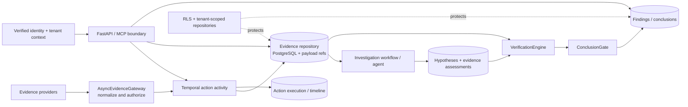
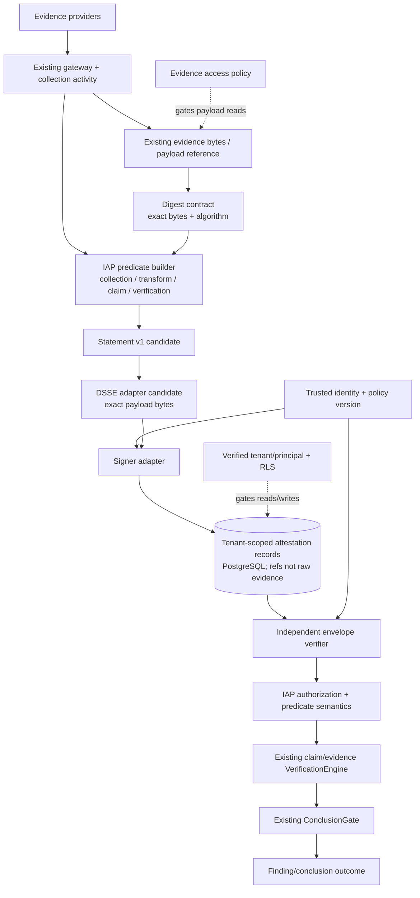

# IAP Attestation Architecture Decision

**Date:** 2026-10-25  
**Status:** Proposed; research/design only. No production code, dependencies, migrations, contracts, or behavior changed for this decision.  
**Research baseline:** [`in-toto-attestation-feature-assessment.md`](in-toto-attestation-feature-assessment.md)

## 1. Decision summary

**Proposed decision: Option C, hybrid format reuse with IAP-owned investigation semantics, while deferring production adoption until the evidence-byte contract, trust policy, and proof-authority boundary are approved.** Use an in-toto Statement/DSSE shape as an interoperability candidate for signed, bounded assertions. IAP must own domain predicates, identity authorization, evidence lifecycle, tenant policy, replay/freshness, semantic checks, persistence, and evidence-sufficiency decisions. Do not use classic in-toto layouts as the investigation workflow engine, do not use SLSA predicates for incident claims, and do not add an attestation service/store/dependency in this research task.

This is not a claim that existing IAP records need signing immediately. Existing evidence provenance and verification are meaningful domain capabilities. The concrete gap is that the repository inspection did not establish an independent signed record format for ordinary evidence/claims, a single digest verification lifecycle, or a durable signer/policy chain. The smallest next step is a contract and threat-model decision, not code.

## 2. Context and system class

IAP is an investigation platform with authenticated tenant-scoped API/MCP surfaces, asynchronous Temporal workflows, PostgreSQL persistence/RLS, and evidence providers. Whether its deployment is an internal tool or customer-facing product, and whether it has forensic/legal assurance obligations, was not established in this task. No requirement was found in the reviewed material for legal chain-of-custody certification, external third-party verification, cryptographic non-repudiation, or administrator-proof transparency; treat those as unresolved requirements rather than assumed non-goals for all deployments.

IAP's current Python requirement is `>=3.13` (`pyproject.toml`); it already depends on `cryptography`, PostgreSQL/SQLAlchemy, Pydantic, and Temporal. A single database and existing workflow architecture are proportionate. There is no measured attestation throughput, evidence size profile, latency budget, or independent-consumer count in this research. Therefore no extra service, queue, cache, transparency log, or distributed database is justified.

### Goals

- Make the provenance and integrity guarantees of investigation records explicit and testable.
- Link evidence, transformations, claims, verifier results, findings, and conclusions without conflating their authority.
- Permit independent verification of immutable record bytes if a real consumer requires it.
- Preserve tenant authorization, existing evidence verification, and Temporal ownership of orchestration.

### Non-goals

- Sign every existing record immediately.
- Replace `VerificationEngine`, `ConclusionGate`, proof-kernel work, evidence repositories, or workflow orchestration.
- Claim that signatures prove facts, collection completeness, or conclusion correctness.
- Introduce an external transparency service, blockchain, new microservice, or universal public API/MCP tool.

## 3. Repository evidence and flow

The repository review was read-only and no tests were executed. Primary locations inspected include:

- Evidence: `domain/evidence/models.py`, `domain/provenance/models.py`, `domain/common/provenance.py`, `application/evidence/gateway.py`, `application/worker/activities.py`, `infrastructure/persistence/evidence_repository.py`, `infrastructure/persistence/models.py`.
- Investigation lifecycle: `domain/investigation/models.py`, `domain/hypothesis/models.py`, `domain/finding/models.py`; `infrastructure/persistence/investigation_repository.py`, `hypothesis_repository.py`, `finding_repository.py`, `action_execution_repository.py`, `transition_repository.py`, `timeline_repository.py`.
- Verification: `application/investigation/verification.py`; Temporal flow in `application/worker/workflows.py` and `application/worker/activities.py`.
- Access boundaries: `api/tenant.py`, `infrastructure/persistence/rls.py`, `migrations/versions/001_add_rls.py` and later tenant-table migrations; `mcp/server.py`, `mcp/registry.py`.
- Other crypto examples: `harness/freeze.py` and `harness/canonical.py`. Harness Ed25519 authorization is not evidence signing.
- Tests reviewed: `tests/unit/test_evidence_bound_verification.py`, `test_shared_evidence.py`, `test_harness_freeze.py`, `test_domain_persistence_coverage.py`, `tests/integration/test_tenancy_rls.py`, `test_proof_publication_live.py`, `tests/unit/test_mcp_tools.py`, `tests/contract/test_mcp_adversarial.py`, and `tests/unit/test_part11_phase2.py`.
- Dependencies: `pyproject.toml`. No in-toto/DSSE package is declared. `cryptography` is present, but this alone is not a reviewed signing implementation or trust policy.

Verified flow from repository source:

1. `AsyncEvidenceGateway` selects/authorizes providers and normalizes/deduplicates returned evidence.
2. Worker `execute_action_activity` dispatches operations and persists banked evidence using `SqlAlchemyEvidenceRepository`.
3. Evidence stores source/provenance/freshness/classification/redaction/fingerprint and optional payload references. Large payloads may be out-of-row.
4. Agent workflow produces hypotheses and actions; action execution records principal, policy version, and result status in `action_executions` (other action-related tables record different details).
5. `VerificationEngine` evaluates claim types and evidence bindings; `ConclusionGate` and finding/conclusion models apply existing domain conditions.
6. Findings/conclusions and timeline/transitions persist through repositories; tenant checks/RLS protect scoped access.

### Findings from inspection (scoped, not exhaustive absence claims)

| ID | Severity | Finding and evidence | Failure scenario / impact | Recommendation | Confidence / disposition |
|---|---|---|---|---|---|
| IAP-ATT-001 | High | `src/investigation_agent_platform/infrastructure/persistence/evidence_repository.py` (`_values`, `save`, `save_batch`) persists supplied `Evidence.fingerprint`; reviewed path did not recompute it from immutable payload bytes. | A stale or incorrect fingerprint can identify content it does not hash, weakening deduplication and any later integrity claim. | Establish exact digest source/byte contract and recompute at a trusted boundary before signed records are considered. | Confirmed within inspected path; remediation is ATT-001, required before authoritative integrity attestation. |
| IAP-ATT-002 | High | `src/investigation_agent_platform/domain/provenance/models.py` (`EvidenceProvenance`) and `src/investigation_agent_platform/domain/common/provenance.py` (`ProvenanceRecord`) capture metadata but are not shown cryptographically signed; `src/investigation_agent_platform/harness/freeze.py` verifies harness freeze authorization instead. | A database writer can change provenance fields without invalidating a signature. | Do not describe provenance as authenticated; define producer identity and integrity boundary. | Confirmed for reviewed paths; addressed by proposed predicate/trust boundary, implementation deferred. |
| IAP-ATT-003 | Medium | `src/investigation_agent_platform/infrastructure/persistence/action_execution_repository.py` (`SqlAlchemyActionExecutionRepository`) stores principal/policy/status; `src/investigation_agent_platform/infrastructure/persistence/models.py` defines other action/tool/agent records with differing fields. No single signed record joining authorization, provider call, result, and evidence IDs was established. | Historical reconstruction may require joins with fields not shared or persisted in the same record. | Start with explicit references and versioned event contract only if audit requirement demands it; avoid a duplicate action ledger. | Confirmed from inspected models; defer until required event fields/consumer are chosen. |
| IAP-ATT-004 | High | `src/investigation_agent_platform/api/tenant.py` and `src/investigation_agent_platform/infrastructure/persistence/rls.py` implement tenant controls; the inspected `tests/integration/test_tenancy_rls.py` reportedly contains in-memory isolation plus migration/helper presence checks, not real PostgreSQL cross-tenant reads. Some tables lack direct tenant columns; effective isolation was not traced for every path. | Attestation lookup could reveal or bind a foreign tenant's evidence if persistence/access boundary is wrong. | Before exposing any attestation retrieval, verify full table/access path and add actual-role isolation tests. | Coverage gap confirmed; not a proven cross-tenant exploit. |
| IAP-ATT-005 | Medium | `src/investigation_agent_platform/domain/evidence/models.py` (`Evidence.fingerprint`/payload refs), `harness/freeze.py`, `harness/canonical.py`, cursor signing, and webhook HMAC serve different purposes. | Reusing a hash/signature by name can falsely imply trust or source authenticity. | Document separate integrity, authenticity, authorization, semantic validity, and evidentiary support layers. | Confirmed; addressed by this design. |
| IAP-ATT-006 | Medium | `src/investigation_agent_platform/application/proof/publication_commit_service.py` explicitly labels `ProofPublicationService` test-only; no production caller was found in the inspected source. The worktree contained unrelated uncommitted proof-kernel work. | Treating proof-kernel persistence or test coverage as production attestation authority would overstate current guarantees. | Keep any integration behind future explicit architecture/owner decision; reconcile against current clean baseline before implementation. | Confirmed at inspection scope; no production authority inferred. |
| IAP-ATT-007 | Informational | Existing domain types include `Evidence`, `Hypothesis`, `Finding`, `InvestigationConclusion`; `application/investigation/verification.py` contains `VerificationEngine`/`ConclusionGate`, and there are action, provenance, and timeline repositories. | Adding a parallel service/model can duplicate authority and complicate persistence without user value. | Prefer a narrow optional format adapter and existing domain logic. | Confirmed; informs proportional design. |

No finding is made that IAP lacks all audit history, provenance, claim binding, or tenant isolation. Existing code implements pieces of each; the gaps concern cryptographic binding, consistency, and evidence that the specific guarantees hold end to end.

## 4. Alternatives and decision matrix

Score: 1 = poor, 3 = acceptable with conditions, 5 = strong. Weighted importance: security assurance, domain fit, and implementation/operational burden are highest; the scores are comparative aids, not an arithmetic verdict. A high complexity score means low burden.

| Dimension | Weight | A: upstream ecosystem broadly | B: native IAP formats and crypto | C: hybrid formats + IAP policy | D: defer/reject |
|---|---:|---:|---:|---:|---:|
| Security assurance | 5 | 3 — envelope helps, trust remains app-owned | 2 — custom protocol risk | 4 — reuse tested format, keep policy explicit | 2 — existing gaps remain |
| Domain fit | 5 | 2 — workflow/SLSA concepts misfit | 4 — fit possible but schema ownership cost | 5 — predicates match domain | 3 — current domain logic remains but signed audit absent |
| Interoperability | 3 | 5 | 1 | 5 | 1 |
| Implementation effort | 4 | 2 — bindings, trust and adaptation substantial | 2 — must build format and verification | 3 — only adopt needed format boundary | 5 — no new implementation |
| Maintenance burden | 4 | 2 — multiple upstreams and version skew | 1 — custom standards burden | 3 — bounded adapter and predicate upkeep | 5 — lowest now |
| Flexibility | 3 | 3 | 5 | 4 | 2 |
| Performance | 2 | 3 — unknown, must measure | 4 — minimal format overhead | 4 — small bounded records | 5 — no overhead |
| Extensibility | 3 | 4 | 2 | 4 | 2 |
| Operational complexity | 4 | 1 — trust roots/identity/transparency broad | 3 — signing keys still needed | 3 — defer optional Sigstore | 5 |
| Runtime compatibility | 4 | 2 — Python binding/API compatibility unverified | 4 — existing `cryptography`, but custom code risk | 3 — library selection remains open | 5 |
| Testability | 3 | 3 | 2 | 5 | 2 |
| Auditability | 4 | 4 | 2 | 5 | 2 |

### Option A — integrate the upstream ecosystem broadly

**Pros:** Reuses established formats and classic in-toto/SLSA ecosystem; high interoperability; potentially complete verification tooling for build claims. **Cons:** Supply-chain abstractions do not represent investigation truth or evidence sufficiency; multiple projects are not one library; Python binding compatibility is uncertain; trust/identity/policy/storage remain IAP work. **Makes harder:** domain-specific corrections, policy versioning, and keeping investigation semantics separate. **Disposition:** Reject as the overall investigation architecture; use SLSA/in-toto in the software supply chain where appropriate.

### Option B — native IAP attestation logic

**Pros:** Direct domain model; exact fit with current IAP types. **Cons:** Duplicates envelope/payload conventions, signature parsing, interoperability, schema evolution, and long-term security maintenance. Custom cryptography is prohibited; using `cryptography` still does not justify inventing a signature protocol. **Makes harder:** third-party verification and cross-tool portability. **Disposition:** Reject custom envelopes and signing formats. Native predicate and policy logic is required regardless.

### Option C — hybrid integration (recommended)

**Pros:** Reuses Statement/DSSE conventions for the byte-binding/claim envelope while IAP owns investigation predicates and policy. Fits current Python/PostgreSQL architecture without requiring a new service. **Cons:** Exact dependency/version is unsettled; standard formats do not solve stable evidence bytes, signer authorization, freshness, tenant access, or semantic correctness. **Makes harder:** strict version tracking and library conformance; some IAP-specific meaning will not be understood by generic verifiers. **Disposition:** Recommended design direction, but production dependency and integration deferred until decision gates close.

### Option D — defer or reject adoption

**Pros:** Lowest immediate cost and avoids signing unsupported assertions; current evidence-bound verification continues. **Cons:** No portable signed record or independent signature verification; current fingerprint/provenance caveats remain. **Makes harder:** external audit and later format conversion. **Disposition:** Correct immediate implementation posture. A deferral does not equal closing ATT-001/ATT-002; document existing records as unsigned/unverified where relevant and retain the design trigger below.

## 5. Target architecture

Architecture is a **future boundary**, not a proposal to create modules now. Attestation must not become the authority for evidentiary sufficiency or conclusion acceptance.

| Component | Responsibility / interface | Security invariants and failures | Boundary / tests |
|---|---|---|---|
| Evidence identity contract | Input: evidence ID, exact bytes/ref, media/schema, tenant/investigation scope. Output: digest + immutable reference. | Digest computed from same bytes to be verified; unsupported algorithm, missing bytes, or mutable pointer returns typed failure. | Extend existing evidence domain/service only after byte availability audit; unit/property tests and persistence integration. |
| Predicate contracts | Versioned records for collection, transformation, agent assertion, verifier result, finding/conclusion linkage. | No raw secrets or large payloads; unknown versions never accepted; fields distinguish asserted actor from signer. | Proposed `domain/attestation` only if approved; schema vectors and semantic validation tests. |
| Creation service | Receives explicit event/evidence snapshot; creates immutable statement/payload and optional envelope. | Idempotent by tenant + event identity + content; does not mutate evidence or conclusion; failed signing is not accepted. | Application boundary invoked by existing activity/service, not API/MCP as authority. |
| Signing adapter | Signs exact payload type and bytes using a vetted cryptographic/library integration. | Private keys outside payload/logs; no custom crypto; signer identity and key ID not trusted from untrusted request. | Infrastructure adapter; known-answer vectors, rotation/revocation and error tests. |
| Persistence adapter | Tenant-scoped append-only record storage, evidence refs, envelope bytes, policy/verifier references. | Enforce tenant boundary and uniqueness; correction is a new record; no cross-tenant existence oracle. | Existing SQLAlchemy/RLS pattern; actual-role PostgreSQL tests before exposure. |
| Trust configuration | Supplies trusted identities/keys/roots, allowed predicate/action scopes, policy version. | Default deny; versioned; no env-switched legacy semantics; root update/recovery controlled. | Config/identity adapter, ownership undecided; tests for unauthorized identity, stale/revoked key. |
| Envelope verifier | Checks type, exact bytes/signature, supported schema and subject digest. | Uses exact verified body for parser; `keyid` cannot decide trust; reports typed status/reason. | Infrastructure adapter plus read-only app service; malformed/oversized/tampered vectors. |
| IAP policy/semantic verifier | Checks actor authorization, tenant/case/run context, freshness/replay, predicate semantics. | Distinct from cryptographic validity; records policy version; indeterminate is never success. | Application/domain service; policy matrix, replay, conflicts, clock-skew tests. |
| Existing evidence verifier/conclusion gate | Assesses cited evidence and claim-specific obligations. | Attestation cannot bypass current evidence binding or conclusion requirements. | Keep current boundary; integration tests assert signed-but-unsupported claims remain rejected/abstained. |
| API/MCP | No new operations initially. Existing protected read paths may later expose verification result if needed. | No caller-controlled trust policy; no direct signer/key access; same auth/tenant checks. | API/MCP contract proposal only after a real consumer exists. |

### Proposed record relationships

The logical chain is append-oriented and reference-based: a collection record binds a collected evidence artifact; transformation records bind input and output digests; an agent assertion references specific evidence and states its epistemic role; a verifier result references the assertion, evidence-set snapshot, verifier version, and policy version; finding/conclusion records reference accepted/rejected/inconclusive verifier results. Reopening or correction creates a later record that supersedes or disputes a prior record. Do not create a generic unconstrained graph with mutable edges; use explicit typed references and queryable relational relationships.

### Lifecycle and outcomes

Avoid a single mutable `DRAFT → SIGNED → VERIFIED` status column as authority. Persist the immutable assertion/envelope and separately persist verifier evaluations. Evaluation result vocabulary should distinguish at minimum:

- `VALID`: format and cryptographic checks succeed; this says nothing yet about policy/claim truth.
- `ACCEPTED`: valid plus identity, tenant, authorization, freshness, subject, and predicate policy pass.
- `REJECTED`: invalid, unauthorized, mismatched, malformed, or policy-denied with explicit reason.
- `INDETERMINATE`: required evidence/trust material/policy is unavailable, unsupported version, or conflict needs adjudication.

These are **proposal-level terms**, not current IAP enums. Existing verification and conclusion statuses remain authoritative for evidentiary support. Missing evidence, inaccessible raw payload, stale evidence, digest mismatch, and conflicting attestations yield explicit failure/indeterminate details; none may become a pass by fallback.

## 6. Trust and data decisions

### What is asserted

Initially, the most defensible candidate is collection and transformation metadata plus a reference to an immutable evidence artifact. Agent claims, verification outcomes, findings, and conclusions are separate assertion classes with distinct producers and verifier obligations. Do not sign a combined opaque “investigation truth” blob. Do not embed log/trace/database bytes or credentials.

### Actors and permissions

Distinguish source system, collector, agent/tool, signing identity, verification service, policy owner, and human reviewer. The signer authenticates bytes as produced by that identity; a separate authorization decision decides whether the identity may make this assertion for this tenant/subject/action. A model agent cannot mint trusted provenance by signing its own assertion. Whether signatures are by collector service, centralized service, or external identity is unresolved pending threat model and deployment key-management review.

### Freshness, replay, and policy changes

Persist distinct `observed_at`, `retrieved_at`, `signed_at` (if trustworthy), and `verified_at`. Record source of time and precision; do not infer trusted time from an unsigned timestamp. Bind every event to tenant, investigation, execution/run, evidence snapshot, and policy/verifier version. Enforce uniqueness on event identity at persistence. Define expiry/replay windows only where an actual workflow needs them. A historical record is re-evaluated under its recorded policy/version or explicitly marked unverifiable when that policy is unavailable; do not silently route old/new semantics via environment variables.

### Immutability and correction

Signed payload bytes and their subject references are immutable. Evidence correction/redaction creates a distinct content version and record; a supersession/dispute edge preserves prior state. Database append-only constraints do not protect against privileged database rollback or deletion; backups/retention and administrator threat model need explicit decision. A public transparency log is deferred.

## 7. Traceability matrix

| Requirement | Upstream capability | IAP implementation/gap | Decision | Target boundary | Verification evidence required |
|---|---|---|---|---|---|
| ATT-001 integrity | Statement subject digest, DSSE signature | Fingerprint stored; recomputation at persistence not established | Mandatory contract before signing | Evidence identity service | Exact-byte vectors; modified/missing payload fails |
| ATT-002 provenance | Typed predicate + signer | Structured provenance exists; signature not shown | IAP predicate, staged adoption | Predicate builder + signer | Source/collector trust negative tests |
| ATT-003 actor attribution | DSSE identity + predicate actor fields | Action records exist, heterogeneous | Bind actor, tool/version, execution; distinguish signer | Event predicate | Actor tamper/unauthorized actor tests |
| ATT-004 claim/conclusion attribution | Statement/predicate | Existing models and verification; signed claim absent | Separate assertion classes; no authority upgrade | Domain predicate + existing verifier | Signed unsupported claim remains unaccepted |
| ATT-005 evidence linkage | Subjects and references | Existing claim evidence binding; no portable signed chain shown | Typed stable references | Predicate + relational repository | Independent reconstruction and missing-link negatives |
| ATT-006 transformation | Predicate can describe parents/output | ProvenanceRecord exists, not shown signed | New immutable lineage event if needed | Transform event builder | Parent/output/tool-version mutation tests |
| ATT-007 signature | DSSE protocol; library needed | Harness Ed25519 is separate-purpose | Reuse vetted library, no custom crypto | Signing adapter | Valid/invalid vectors, key rotation, parser consistency |
| ATT-008 trust policy | External trust policy; Sigstore optional | No attestation-specific signer policy established | Default-deny versioned policy | Trust/policy service | Unauthorized valid signer denied |
| ATT-009 tenant | None | API/JWT/RLS exist; reviewed RLS test is not actual PostgreSQL cross-tenant proof | Verify existing boundary before new retrieval | Persistence/API | Real-role cross-tenant access matrix |
| ATT-010 replay/freshness | No generic replay prevention | Idempotency/freshness mechanisms exist separately | Case/run binding + uniqueness; scoped freshness | Domain policy + DB uniqueness | Cross-run replay/duplicate/race tests |
| ATT-011 tamper-evident history | Signed bytes; optional transparency | Timeline/facts exist; not universal tamper proof | Append-only corrections; external anchor deferred | Persistence/retention | Mutation/deletion/restore tests and explicit residual risk |
| ATT-012 independent verification | Portable formats | Existing domain verifier; no portable verifier established | Read-only verifier; defer until consumer is known | Application verifier | Restart/offline + independent vector validation |
| ATT-013 persistence | None | PostgreSQL/object refs available | Existing DB, no new store initially | SQLAlchemy repository | Exact byte persistence/restart test |
| ATT-014 evolution | Statement/predicate versions | Verifier versioning exists; attestation version absent | Version predicate and policy; unknown fail closed | Schema/policy registry | Old/current/future version fixtures |
| ATT-015 error results | Crypto verification only | Domain statuses exist | Separate structural/crypto/trust/semantic/support statuses | Verifier contract | Fault injection: no false accepted result |
| ATT-016 privacy | No confidentiality | Classification/redaction exists | Metadata/digests only; access separately controlled | API/storage | Secret scan, redaction and auth tests |
| ATT-017 archive | Portable encodings | Evidence/trust retention not established | Archive only if retention need known | Retention/storage | Offline verification with unavailable-artifact outcome |
| ATT-018 incompleteness/conflict | Predicate can represent but not arbitrate | Abstention/contradiction domain exists | Preserve incomplete/conflict; no pass-on-absence | Predicate + existing verifier | Failure vs empty vs conflict matrix |

## 8. Proposed package/file layout (only if adoption is authorized)

No directories should be created now. Avoid duplicating existing evidence/provenance models.

| Proposed location | Responsibility | Status / dependencies | Test boundary |
|---|---|---|---|
| `domain/attestation/predicates.py` | Versioned predicate contracts, explicit actor/time/evidence reference types. | New only if supported records are approved; depend on existing domain evidence/investigation IDs, not crypto. | Schema and semantic unit tests. |
| `domain/attestation/results.py` | Structural/trust/semantic outcome taxonomy, immutable verification report. | New; keep separate from `VerificationResult` until integration boundary proven. | Exhaustive result mapping and unknown-code tests. |
| `application/attestation/service.py` | Create record from trusted event context; request verifier; never decide conclusion. | New application service; called by established activities only if needed. | Idempotency, error, no-conclusion-side-effect tests. |
| `application/attestation/policy.py` | Signer authorization, replay, tenant/run binding, policy-version resolution. | New only after trust owner and policy source are selected. | Deny-by-default and historical-policy tests. |
| `ports/attestation.py` | Narrow persistence/signing/trust interfaces if adapters are truly swappable or independently testable. | Do not add speculative generic ports; may be unnecessary for one implementation. | Contract tests. |
| `infrastructure/attestation/dsse_adapter.py` | Convert exact payload bytes to/from selected DSSE package. | New adapter; package/version must be pinned and reviewed. | Upstream vectors, malformed envelope, exact-byte invariant. |
| `infrastructure/attestation/signing_adapter.py` | Key-service integration. | Optional; no local private key storage without approved ops model. | Rotation, denial, unavailable key, no-secret logging. |
| `infrastructure/persistence/attestation_repository.py` | Tenant-scoped immutable record and evaluation persistence. | Only with approved schema/retention and migration plan. | Real PostgreSQL RLS/uniqueness/concurrency and restart test. |
| `api` / `mcp` | Read-only retrieve/verify/trace only if consumer need appears. | Not in first slice; no new signer operation exposed. | Contract/adversarial auth, tenant and privacy tests. |
| `tests/unit/attestation/`, `tests/integration/attestation/`, `tests/security/attestation/` | Format, policy, DB, and threat tests. | Add only alongside approved implementation. | Test strategy below. |

## 9. Test and verification strategy

These are proposed tests, not executed tests. Existing test suites above were inspected only.

| Category | Cases and expected result | Security invariant |
|---|---|---|
| Unit: digest/subject | Exact bytes produce expected digest; mutation, wrong algorithm, subject swap rejected. | Integrity binds actual bytes, not metadata label. |
| Unit: envelope/parser | Valid DSSE vector verifies; tampered payload/type/signature and malformed/oversized data rejected; exact verified bytes reach parser. | Verify-and-consume same bytes; bounded parser. |
| Unit: signer policy | Valid but unauthorized identity rejected; unknown/revoked/stale identity is rejected or indeterminate per policy. | Valid signature is not authorization. |
| Unit: predicate semantics | Required fields, version, status, timestamps, source/run refs and digest algorithm checked; unknown predicate not accepted. | Structural validity is distinct from semantic acceptance. |
| Integration: lifecycle | Create, persist, restart, retrieve, independently verify exact bytes. | Durable record retains identity and exact payload. |
| Integration: chain | Evidence→claim→verification→finding→conclusion traversal; missing/foreign link is not accepted. | No orphan/foreign evidence can satisfy a claim. |
| Integration: tenant | Actual runtime DB roles, RLS, API/MCP tenant and principal access; no cross-tenant list/get/digest oracle. | New records inherit existing tenant boundary. |
| Integration: race/retry | Concurrent duplicate create, evidence update versus attestation, retry after transient store/signing failure. | Idempotent records; no attestation for a mixed/stale snapshot. |
| Adversarial: replay | Valid prior attestation copied to another investigation/run, replay after expiry, duplicate event ID. | Case/run binding and replay policy work. |
| Adversarial: source/tool | Compromised/unauthorized producer assertion, missing source response, provider failure versus true empty. | Signed false/partial assertion is not elevated to fact. |
| Adversarial: privacy | Cross-tenant ID/digest probing, redacted record retrieval, payload/secret in log scan. | No disclosure by format or signature. |
| Adversarial: conflict/retention | Conflicting claims, deleted/unavailable evidence, rollback/correction, revoked key historical verify. | Missing/conflicting evidence produces indeterminate/rejected, not accepted. |
| Compatibility | Known supported predicate versions, unknown future version, policy/verifier version pinning. | Version behavior is explicit; no env-selected legacy. |

## 10. Implementation roadmap (design only)

| Phase | Objective / touched areas | Prerequisite and acceptance | Risk / rollback |
|---|---|---|---|
| 0. Contract and threat model | No code; settle evidence bytes, identity actors, retention, independent consumer, trust level, and proof-kernel authority. | Named owner decisions for open questions; threat matrix and accepted residual risks. | Stop if no consumer or no stable byte contract; retain current unsigned behavior and make no assurance claim. |
| 1. Predicate and digest contract | Domain evidence/provenance + tests; define IDs, exact bytes, digest algorithm, timestamps, collection/transform/claim semantics. | Golden schema and digest vectors; prove every supported evidence class can bind stable bytes. | Do not sign partial or mutable references; defer unsupported payload classes. |
| 2. Package and crypto spike | Isolated test-only comparison of Statement bindings and DSSE library choices under Python 3.13; no runtime callers. | License, maintenance, package-to-source mapping, Python 3.13, vectors, parser limits, dependency audit pass. | Remove spike if package stale/incompatible; use existing vetted primitives only with explicit owner approval, never custom format. |
| 3. Trust and policy | Define identity source, signer authorization, key rotation/revocation, policy version, freshness/replay. | Security owner sign-off and negative policy tests; no default trust. | No signing in production without operational recovery and root-update procedures. |
| 4. Narrow persistence/verifier | Add record persistence only after schema/retention/RLS review; implement read-only verifier. | Actual-role PostgreSQL isolation, restart/offline vectors, typed failures, mutation/replay cases pass. | Migration rollback plan and no legacy dual readers (IAP is not live); remove pre-production schema directly if contract changes. |
| 5. One vertical slice | Collection event for one evidence class from existing gateway to independently verified record; no claim/conclusion behavior change. | End-to-end bytes/digest/identity/tenant correctness; existing verification result unchanged for signature-present/absent cases. | Feature remains unavailable by default; no conclusion authority. |
| 6. Claim/result linkage | Add only one claim type when proof obligations and proof-kernel authority are resolved; link verifier report, finding and conclusion. | Unsupported signed claim cannot pass; audit reconstruction and conflict/abstention tests. | Revert integration at application seam; retain record format only. |
| 7. API/MCP exposure (optional) | Read-only retrieve/verify/trace operation if a real external consumer needs it. | Contract, auth, tenancy, privacy, error semantics and rate budget approved. | Do not expose sign/create keys through MCP; API surface can remain absent. |

## 11. Decisions deferred and triggers

| Deferred item | Trigger to reopen |
|---|---|
| Select `in-toto-attestation` Python bindings | Exact published package supports Python 3.13, is maintained, and passes required schema/security vectors; map source commit to artifact. |
| Add DSSE library | A concrete consumer requires portable signed records and an approved dependency meets license, maintenance, Python, and parser requirements. |
| Sigstore/keyless signing/transparency | Threat model requires third-party identity proof, public transparency, or offline bundle verification that managed internal keys cannot meet. |
| External append-only log / database tamper resistance | Requirement includes privileged database rollback/deletion resistance, and ordinary backup/retention/audit controls are inadequate. |
| Attestation API/MCP tools | A named consumer requires retrieval or verification beyond existing protected interfaces. |
| Separate service or async queue | Measured verification/signing workload materially affects API/workflow latency or ownership/team boundaries require independent deployment. |
| Broad attestation of hypotheses/conclusions | Stable domain predicates, proof-authority ownership, and evidence-to-claim snapshot semantics are approved and one evidence-class slice meets its gates. |

## 12. Open questions / risks

1. Stable evidence bytes: some evidence uses summaries, references, or out-of-row payloads. Which classes have retained immutable source bytes, and what is the actual byte range hashed?
2. Trust owner: who controls signer authorization, key lifecycle, and policy updates, and can that authority be independently reviewed?
3. Proof authority: the current workspace includes proof-kernel changes; which path is authoritative for production claim verification after Stage gates, and how would an attestation refer to it without creating a second verdict authority?
4. Tenant proof: effective isolation for all evidence/agent/attestation-related tables needs a current role-level catalog and real DB tests before an attestation retrieval endpoint.
5. Retention: should an old conclusion remain verifiable after raw evidence is deleted/redacted? If yes, what residual claim can be made from digest and metadata alone?
6. Independent consumer: is the target a human auditor, a separate service, or an external organization? The answer drives envelope portability and key/trust format.
7. Threat scope: is the database administrator adversarial, or are application-level authorization plus operational backups sufficient?
8. Exact upstream package behavior and Python 3.13 compatibility need a pinned dependency/release/source audit; current research does not authorize dependency addition.

## 13. Repository artifacts reviewed and test accounting

### Files and areas reviewed

The principal file inventory is listed in §3. Additional context includes `pyproject.toml`, ORM and migration sources, API/MCP routers and registries, worker activities/workflows, and evidence/provider adapter wiring. Repository exploration was read-only. No source, dependency manifest, migration, API/MCP contract, or test was modified for this assignment.

### Tests inspected, not executed

`test_evidence_bound_verification.py`, `test_shared_evidence.py`, `test_harness_freeze.py`, `test_domain_persistence_coverage.py`, `test_tenancy_rls.py`, `test_proof_publication_live.py`, `test_mcp_tools.py`, `test_mcp_adversarial.py`, and `test_part11_phase2.py` were inspected/referenced by repository exploration. No tests were run. The test plan in §9 is proposed and not test evidence.

### Scope/acceptance notes

- Research and repository inspection completed; no production implementation was performed.
- The final package/version selection remains unresolved by design; the research document reports current status and compatibility uncertainty.
- The recommendation is explicit but provisional: hybrid format boundary, immediate production integration deferred until contract/trust gates are met.
- The worktree had unrelated modified and untracked files before document authoring. Those files were not edited or reverted; only the two requested deliverables and the recommendations ledger were changed.
- No test, migration, live database, API, MCP, CI, commit, or deployment operation was run.

## 14. Traceability and ledger

Requirement IDs `ATT-001`–`ATT-018` are defined in the [feature assessment matrix](in-toto-attestation-feature-assessment.md#4-capability-to-iap-mapping-baseline) and linked through this document's findings, architecture, tests, and roadmap. The project ledger records the two research observations as OPEN pending owner decision: `docs/IAP_Arch_Eng_Recommendations.log`.
