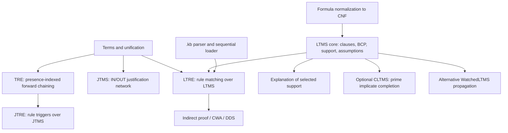
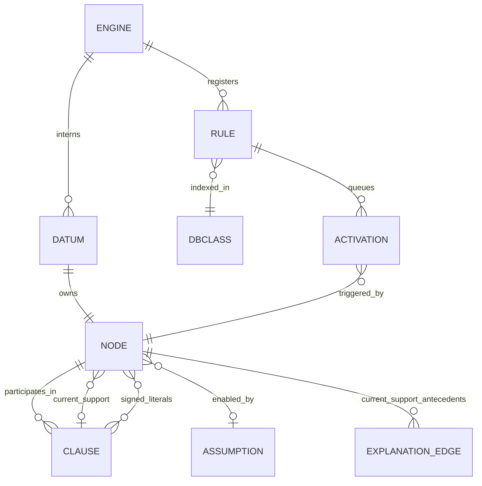

# LTMS Concepts, Capabilities, and Specifications

**Research snapshot:** 2026-10-25  
**Target revision examined:** `738161f2bdc2a938d97c40f974f51766f45d4c0c` (`main`, 2026-09-26)  
**Purpose:** evidence-based engineering reference for a possible future IAP integration; this is not an adoption decision.

> **Evidence labels.** **Formal** means explicit mathematical/normative semantics found in a source. **Theory** means an external published foundation. **Documented** means repository intent or explanation. **Implemented** means confirmed by executable source. **Tested** means an assertion exists in the checked-in tests. **Experiment** means a command was run in this review. **Interpretation** is an engineering conclusion. Where a test could not be run, that is stated rather than inferred.

## 1. Executive summary

LTMS is a small Python reasoning package that layers structural term matching and forward chaining with two forms of truth maintenance, a propositional Boolean Constraint Propagation (BCP) engine, a rule/LTMS bridge, explanation helpers, and optional reasoning facilities. These layers do **not** share one semantic contract: TRE treats presence as a trigger, JTMS uses IN/OUT derivability and Horn justifications, LTMS uses TRUE/FALSE/UNKNOWN labels over propositional clauses, LTRE combines matching with belief-conditioned rules, and completeness facilities compute additional propositional consequences. A safe evaluation must preserve those boundaries.

The package has a repository-level implementation plan and extensive executable examples/tests, but this inspection found no separately versioned normative formal specification or conformance standard. This reference therefore pairs documented intent and theory with actual implementation and test evidence; the companion behavioral specification is explicitly derived/proposed, not an upstream guarantee.

The central LTMS counter engine is described and tested as sound but incomplete unit propagation. It maintains a single current support per known node and performs two-phase retraction. This is useful for finite propositional belief revision and explanation, but it is not calibrated probability, causal inference, temporal reasoning, a complete SAT solver, or a distributed durable state service.

Source inspection identified two concrete correctness defects and one DSL contract gap for the adversarial report: (1) indirect proof can execute rule actions queued by its temporary assumption after that assumption is withdrawn; (2) compound LTRE assumptions omit the informant conflict check present for simple assumptions; and (3) the KB DSL accepts malformed directive forms, while its observed incremental mutation behavior has no explicit atomicity contract. JTRE/LTRE trigger rules are also one-shot per parked activation in the observed implementation; whether that is defective depends on undocumented lifecycle intent.

**IAP assessment:** do not adopt the package as the authority for investigation conclusions. A contained prototype could assess a bounded, deterministic, propositional dependency/retraction service after explicitly separating observed evidence from assumptions and inferred claims. Integration would need durable and versioned derivation records, tenant/investigation isolation, idempotent recomputation, proof/evidence binding, temporal and confidence policy outside Boolean LTMS semantics, and continued enforcement of IAP verification/conclusion gates.

## 2. Goals, non-goals, and system class

### Project goals as documented

`PLAN.md` §§1–2 (lines 14–34, 44–88) describes a clean-room Python 3 port of a pattern-directed forward-chaining engine (TRE/LTRE) and a Logic-based TMS based on clausal BCP, with well-founded support, dependency-directed backtracking, explanation, and advanced facilities. JTMS is a stepping stone/contrast; CLTMS and SAT integration are optional. The plan explicitly excludes ATMS, GDE, physical simulation modules, Lisp macro/code-generation machinery, and raw SAT performance.

### Non-goals and system class

This is a research/learning-oriented Python library (package version 0.1.0), not a deployed IAP service or a stated mission-critical product. It has no mandatory runtime dependency and offers optional development and SAT extras (`pyproject.toml:5–24`). Its single-process, in-memory engine instances suit compact symbolic models; no persistence, service protocol, multi-tenant boundary, or distributed consistency contract was found. **Interpretation:** proportional use is as an embedded/research component, not as a new standalone distributed service absent a concrete need.

## 3. Terminology and semantic layers

| Term | Meaning in this package | Do not conflate with |
|---|---|---|
| Term / proposition | Immutable tuple/atom/`Var` structure in `terms.py`; a proposition may be a compound tuple. | A natural-language claim or evidence item. |
| Fact present | A `Datum` exists in a TRE/LTRE database bucket. | A proposition is believed true. `INTERN` triggers on presence alone. |
| Belief label | JTMS `IN`/`OUT`, or LTMS `TRUE`/`FALSE`/`UNKNOWN`. | Epistemic confidence or real-world truth. `OUT` and `UNKNOWN` are not interchangeable. |
| Justification / support | JTMS justification, or LTMS one support pointer: assumption sentinel or forcing clause. | A complete set of all alternative proofs or a probabilistic provenance graph. |
| Assumption | Explicitly enabled, retractable belief with an owner/informant at LTRE datum level. | A source observation or a permanently asserted clause. |
| Rule activation | Queued callback plus bindings, matched from a pattern and trigger condition. | A logical clause automatically linked to the callback's effects. Rule callback effects are not automatically truth-maintained as one derivation. |
| Clause / literal | Disjunction of signed propositional nodes; the sign is TRUE/FALSE. | First-order rule or temporal/causal relation. |
| Completeness | For a fixed propositional clause set, prime implicates make unit propagation complete for entailed units/refutation under stated conditions. | Faster BCP, completeness of first-order rule matching, or completeness for later-changing theories. |

Presence and belief differ because an interned datum can remain UNKNOWN; a rule conditioned on `INTERN` can fire while `TRUE` cannot. Belief revision tracks support for a label, while data storage tracks proposition identity. Any consumer must preserve this distinction.

## 4. Theoretical foundations and published work

The repository `PLAN.md:229–236` identifies Forbus and de Kleer, *Building Problem Solvers* (MIT Press, 1993), with chapter cross-references: Ch. 4 pattern-directed inference/TRE; Ch. 6 TMS introduction; Ch. 7 JTMS; Ch. 9 LTMS; Ch. 10 LTRE; Ch. 13 CLTMS. The authors' [Northwestern QRG book page](https://www.qrg.northwestern.edu/BPS/readme.html) identifies the book and links a searchable PDF with permission. The companion index at [LTMS study companion](https://pisanuw.github.io/ltms/companion/) provides a chapter navigation crosswalk, not primary-text verification. Exact book page/algorithm numbers were not independently verified here; do not cite them as checked.

| Paradigm / algorithm | Theoretical grounding | Package boundary and trade-off |
|---|---|---|
| TRE / pattern-directed inference | BPS Ch. 4 per `PLAN.md`; executable rules use unification and forward matching. | Extensional presence database; no belief revision in plain TRE. Rule bodies are Python callbacks. |
| JTMS | Doyle, “A Truth Maintenance System,” *Artificial Intelligence* 12(3), 231–272 (1979), [DOI](https://doi.org/10.1016/0004-3702(79)90008-0); MIT [AI Memo record](https://dspace.mit.edu/entities/publication/5377b306-4ecc-4687-b1f5-78cbb4a0543a). | Maintains one current IN/OUT labeling and justifications; OUT means not currently derivable, not false. |
| LTMS | BPS Ch. 9; McAllester, “An Outlook on Truth Maintenance,” MIT AI Memo 551 (1980), and “Truth Maintenance,” AAAI-90, pp. 1109–1116 (`PLAN.md:231–232`). | Propositional clause set closed under unit propagation, with support/retraction. Sound unit propagation is deliberately incomplete. |
| ATMS | de Kleer, “Problem solving with the ATMS,” *Artificial Intelligence* 28(2), 197–224 (1986), [DOI](https://doi.org/10.1016/0004-3702(86)90082-2). | Explicitly out of scope; unlike a single current assumption labeling, it tracks multiple assumption environments. |
| DPLL / BCP and watched literals | Davis, Logemann & Loveland, “A machine program for theorem-proving,” CACM 5(7), 394–397 (1962), [DOI](https://doi.org/10.1145/368273.368557); Moskewicz et al., “Chaff: Engineering an Efficient SAT Solver,” DAC 2001, [DOI](https://doi.org/10.1145/378239.379017). | Watched literals optimize propagation implementation; they do not by themselves strengthen logical completeness. Exact primary-paper internal page locators for watched-literal invariant were not independently extracted. |
| Prime implicates / consensus | Jackson, “Computing prime implicates,” [ACM DOI](https://doi.org/10.1145/131214.131223); formalized propositional resolution/prime implicate treatment in the [Archive of Formal Proofs](https://isa-afp.org/entries/PropResPI.html). BPS Ch. 13 per plan. | Consensus saturation plus subsumption can grow exponentially. This implementation documents brute-force saturation, not incremental Tison/IPIA. |

This bibliography establishes identifiable intellectual lineage; it does not prove that each implementation detail is a faithful transcription. `PLAN.md` calls the work a port and identifies some adaptations (Python tuples/dicts, `FAIL`, closures, no `eval`, no standardizing-apart); correctness claims below are grounded in code/tests rather than inferred from lineage. The inspected docs are not fully synchronized with the source: `STUDY-NOTES.md:213–217` says different informants conflict for compound assumptions, but `LTRE.assume` has no such mismatch check in its compound branch; README text at `94–99` describes watched-literal/completeness work as future, while those implementations exist; test-count statements also differ across docs (`docs/index.md:62–64`, `BRIEFING.md:4`, `CHANGES.md:85`). This review treats executable source as implementation evidence and does not repeat stale counts as current.

## 5. Specification inventory

No independent formal semantics document, versioned schema, or externally defined conformance standard was identified. Types, comments, plan invariants and tests provide de facto behavioral contracts. The following derived specifications are proposals for interpretation, not upstream-normative standards.

| ID | Name / category | Source and goal | Core entities / invariants / operations | Guarantees, limitations, implementation and conformance evidence | Status |
|---|---|---|---|---|---|
| SPEC-LTMS-001 | Terms/unification; algorithmic/API | `terms.py`, `unify.py`; match nested symbolic structures. | `Term`, `Var`, bindings; empty bindings are success; occurs-check; recursive substitution. | `test_unify.py`, `test_unify_properties.py`. Python term equality and name-identity for variables; caller-supplied cyclic bindings are not guarded by `substitute`. | Implemented; no formal proof. |
| SPEC-LTMS-002 | TRE; behavioral/API | `tre/engine.py`; pattern-indexed forward chaining over present facts. | Fact/rule indexes, matching, activation queue; assert/fetch/add_rule/run_rules. | Arrival-order test `test_tre.py::test_order_independence_rule_after_facts`; LIFO queue and callback side effects; no general termination guarantee. | Implemented; partial tests. |
| SPEC-LTMS-003 | JTMS/JTRE; behavioral | `jtms.py`, `jtre.py`; maintain derivable IN/OUT nodes with Horn support. | Nodes, justifications, assumptions; two-phase retraction; add rules and run. | `test_jtms.py`, `test_jtre.py`; no negation semantics in JTMS; retraction does not recheck contradictions per documented reference behavior. | Implemented; no independent proof. |
| SPEC-LTMS-004 | LTMS core; algorithmic/behavioral | `core.py`; unit-propagate clauses, track support, retract assumptions. | Three labels, signed literals, clauses, counters, one support pointer, assumptions, handlers. | `test_core_bcp.py`, `test_core_assumptions.py`, property test; tested BCP soundness differential tests; incompleteness intentional. | Implemented; soundness evidence empirical/property-backed, not theorem proof. |
| SPEC-LTMS-005 | Formula normalization; DSL/algorithmic | `normalize.py`; map connectives to CNF. | TMS node leaves, clauses, `not/and/or/implies/iff/taxonomy`. | `test_normalize.py`; exponential cross-product risk; no transaction across clause installation. | Implemented. |
| SPEC-LTMS-006 | LTRE integration; behavioral/API | `ltre.py`; relate datum presence, node belief and rule activations. | One unsigned datum/node per proposition; guard node for compound assumption; INTERN/TRUE/FALSE rule conditions. | `test_ltre.py`; asserted clauses vs retractable assumptions differ; callbacks are not automatically withdrawn with support; transition re-arming unresolved. | Implemented; integration contract partial. |
| SPEC-LTMS-007 | Explanation; behavioral | `explain.py`; describe current support chain. | One support pointer per node; antecedents/informant; visited traversal. | `test_explain.py`; describes current selected support only, not all proofs/certificates. | Implemented. |
| SPEC-LTMS-008 | Advanced facilities; behavioral | `indirect.py`, `cwa.py`, `dds.py`; refutation, instance closure, learned nogood search. | Temporary assumptions, handlers, queues, nogoods. | `test_advanced.py`; confirmed indirect-proof queue defect in FIND-LTMS-001; compound ownership defect FIND-LTMS-002; conditional CWA ownership hazard OBS-LTMS-002; CWA is finite/current-instance only. | Partial; defects and modeling assumptions. |
| SPEC-LTMS-009 | CLTMS completeness; algorithmic | `cltms.py`; saturate propositional clause set with prime implicates. | Clause sets, consensus, subsumption, added clauses. | `test_cltms.py`, DSL `complete` example; not incremental across future mutations; no independent SAT oracle coverage; worst-case exponential. | Implemented optional, partial validation. |
| SPEC-LTMS-010 | WatchedLTMS; behavioral/algorithmic | `watched.py`; alternative BCP representation. | Watched positions/maps, pending false literals, shared support model. | `test_watched.py` compares to counter engine on random forward cases and SAT-checks entailments/conflicts; random retraction oracle coverage not shown. | Implemented optional; selected differential evidence. |
| SPEC-LTMS-011 | `.kb` DSL; API/behavioral | `dsl.py`; parse, execute world-model statements and query expectations. | Expressions/directives, mutable engine, `KBResult`. | `test_dsl.py`, `test_kb_files.py`; directive separator, trailing complete argument, partial mutation gaps are FIND-LTMS-003. | Implemented; malformed-input contract partial. |
| SPEC-LTMS-012 | Packaging/quality gates; engineering | `pyproject.toml`, `.github/workflows/ci.yml`; supported Python/tooling. | Python >=3.10, pytest/Hypothesis/Ruff/mypy; optional PySAT. | CI matrix 3.10–3.13 runs Ruff, strict mypy, pytest, build; review environment could not run pytest. README/companion roadmap and test-count text has drift (OBS-LTMS-007). | Implemented configured gates; remote CI result not checked. |

## 6. Architecture and dependency layers

The repository's own architecture diagram (`docs/architecture.md:8–45`) presents a bottom-up stack. `WatchedLTMS` is an alternative propositional engine, not the LTRE backend; `watched.py:14–19` explicitly says rule engine/CWA/DDS remain on reference LTMS. The plan's aspirational layering and current module layout differ (for example, modules are flat under `src/ltms`, with `tre/engine.py`, rather than the proposed nested `tms/` tree).

## 7. Entity catalog and relationships

| ID | Entity and implementation | Identity, ownership, lifecycle, key semantics | Evidence / risk |
|---|---|---|---|
| ENT-LTMS-001 | `Var`, `Term` (`terms.py:23–64`) | `Var` equality/hash by name; terms are atoms or immutable tuples. No standardize-apart operation. | `test_terms.py`, `test_unify.py`; same variable names intentionally alias. |
| ENT-LTMS-002 | Binding environment (`dict[Var, Term]`) | Returned from successful unification; extended by copy when binding fresh variable; chains resolved on substitution. | `unify.py:43–103`; `FAIL` differs from `{}`. |
| ENT-LTMS-003 | TRE `Rule`, `Dbclass`, `Tre` (`tre/engine.py`) | Per-engine fact/rule bucket keyed by leftmost symbol; rule callback and seed environment; LIFO activations. | `test_tre.py`; callback effects are external and not truth-maintained. |
| ENT-LTMS-004 | JTMS `Node`, `Justification` (`jtms.py:57–103`) | Per-engine IN/OUT node, multiple justifications, one selected support; assumption/contradiction flags. | `test_jtms.py`; OUT is not false. |
| ENT-LTMS-005 | LTMS `TmsNode`, `Clause`, `Label` (`core.py:37–160`) | Per-engine node with tri-valued label and one current support; clause has signed literals, informant, `pvs`/`sats`; clauses remain live after satisfaction. | BCP/property tests; support selection is operational, not complete proof enumeration. |
| ENT-LTMS-006 | LTRE `Datum`, `Rule`, `Trigger`, `Dbclass` (`ltre.py:36–68`) | Datum owns unsigned proposition and LTMS node; its `assumption` field stores an informant or `None`; trigger records INTERN/TRUE/FALSE. | `test_ltre.py`; simple vs compound assumptions have inconsistent owner-conflict handling. |
| ENT-LTMS-007 | Rule activation (`ltre.py:263–294`) | Queue item is `(body, bindings)`; parked on node for a future TRUE/FALSE label; callback is executed once per queued item. | Trigger lists are cleared when fired; no re-arm after retraction. |
| ENT-LTMS-008 | LTMS assumption/support | `assumption` eligibility boolean plus `ENABLED_ASSUMPTION` support sentinel; assumptions are node-level and support a single label. | `core.py:439–498`; `with_assumptions` cleanup is finally-based. |
| ENT-LTMS-009 | Contradiction handler | Callable over violated clauses and engine; handlers form a stack; truthy means resolved; removed in `finally`. | `core.py:380–409`; handler side effects/queued callback cleanup must be correct. |
| ENT-LTMS-010 | Explanation | `support_for_node`, `why_node`, `explain_node`; traverses chosen forcing clause, visited by object identity. | `explain.py:14–73`; not a full proof DAG/certificate. |
| ENT-LTMS-011 | CLTMS clause set | `frozenset[(node, sign)]`; consensus plus subsumption saturation. | `cltms.py:22–92`; potentially exponential, one-time current set completion. |
| ENT-LTMS-012 | Watched state | Clause-index watch positions, literal-to-watchers/membership maps, pending false-literal stack. | `watched.py:57–60`; alternative core only. |
| ENT-LTMS-013 | KB result and loader | `KBResult` accumulates query states and clauses added; `load_kb` mutates the supplied/new engine statement-by-statement. | `dsl.py:166–200`; no load transaction. |

### Entity relationship model

`DBCLASS` in this diagram means the index bucket (`Dbclass`); it is not a logical class. Semantically, a datum may exist while its node is UNKNOWN; a clause constrains node labels; a support pointer explains one current label; a rule activation is a callback event and is not itself a clause/support edge.

## 8. State transitions

| State transition | Trigger and precondition | Mutation / postcondition | Exception and evidence |
|---|---|---|---|
| Unknown → TRUE/FALSE | Unit clause or enabled assumption; for an assumption the node must be eligible. | Set label/support; update clause counters; enqueue rules for matching polarity; propagate clauses. | Conflict may dispatch handler or raise `LTMSContradiction`; `test_core_bcp.py`, `test_core_assumptions.py`. |
| TRUE/FALSE → UNKNOWN | Retract node currently supported by `ENABLED_ASSUMPTION`. | First withdraw dependent labels using selected support; then requeue touched clauses and rederive alternative support. | Two-phase invariant; tests for alternative and cyclic support in `test_core_assumptions.py:19–48`. |
| Clause → unit consequence | Counter reaches `pvs == 1`; an UNKNOWN literal is found. | Set that node to literal sign; record clause as support. | Guard prevents treating sole satisfying literal as forced (`core.py:361–376`). |
| Violation → recovery | Clause has `pvs == 0`; top-level contradiction check runs. | Newest handler first; if resolved, BCP resumes; otherwise raise. | `core.py:380–398`; handler nesting tests are limited. |
| Datum intern → callback | Matching rule and INTERN trigger, or matching datum registered for rule. | Queue binding/callback; `run_rules` drains LIFO. | `test_ltre.py:44–50`; callback errors can interrupt the queue. |
| Unknown node → trigger activation | TRUE/FALSE trigger already parked and label becomes relevant. | `set_truth` enqueues and clears that polarity's parked list. | No automatic re-arm on subsequent transitions; lifecycle contract unresolved. |
| Completion → expanded clause set | Explicit `complete()`/DSL directive. | Compute prime implicates from clauses present at call, add clauses and propagate. | May be exponential; later-added clauses do not automatically invoke completion. |
| KB load → partial or completed mutation | Each line is parsed and executed in sequence. | Earlier mutations persist if a later line raises. | Confirmed by code path; no rollback contract/test. |

## 9. Subsystem and algorithm analysis

### 9.1 Terms, unification, substitution

`Term` is a recursive union of strings/numbers, `Var`, and tuples (`terms.py:23–26`). Variables compare by name (`terms.py:29–46`). `index_symbol` descends through tuple heads and bound head variables, rejecting empty terms, unbound head variables and non-string keys (`terms.py:72–95`).

`unify(a,b,bindings)` returns the bindings or the singleton `FAIL`; equality short-circuits, compound terms require equal arity, and recursive component matching shares the environment (`unify.py:43–65`). Fresh variable binding invokes `_occurs` and copies the dictionary (`68–88`). `substitute` recursively chases bindings (`91–103`). Complexity is proportional to traversed term structure absent pathological repeated dereferencing; no formal amortized bound is specified. Inputs from `unify` are protected against cycles, but arbitrary cyclic dictionaries passed directly to `substitute` can recurse indefinitely (unverified API hardening concern).

### 9.2 TRE and JTMS/JTRE

TRE (`tre/engine.py`) indexes facts/rules by the leftmost symbol. New facts are tested against existing rules; new rules are back-tested against bucket facts, supporting tested arrival-order independence. It suppresses duplicate facts structurally but does not provide global activation deduplication or general loop/termination control. Callbacks can register rules and add facts; rule execution remains caller-controlled via `run_rules`.

JTMS has two labels, IN/OUT, and a `Justification` with antecedents and consequence (`jtms.py:32–68`). Forward propagation installs a justification when antecedents are IN. Retraction first propagates OUT along the currently selected justification and only then searches all justifications for alternative support (`jtms.py:264–284`). This avoids self-supporting cycles after withdrawal. JTMS does not represent falsehood; contradictions are flagged nodes handled separately.

JTRE binds pattern rules to JTMS nodes and differentiates data arrival from IN/OUT transitions. A parked activation is cleared when transition fires. **Source observation:** a rule is not re-registered after firing; a second transition into the same state does not automatically queue it. Existing JTRE tests cover first activation only (`test_jtre.py:14–25`). Treat repeated activation semantics as unresolved rather than assuming an event stream contract.

### 9.3 LTMS clauses, BCP, contradictions, and retraction

For a clause, `pvs` counts literals not yet false (UNKNOWN plus currently satisfying) and `sats` counts currently satisfying literals (`core.py:16–26, 295–317`). A clause is violated at `pvs=0`, unit-open at `pvs=1`, and satisfied at `sats>0`. Labels update those counters incrementally (`334–376`). Forcing records one clause as the node's support; multiple possible clauses are not retained as a full proof set.

Example: clauses `(¬p ∨ q)` and `(p)` mean a unit `p`; after the second clause forces TRUE, the first has its only non-false literal `q` and forces TRUE. `test_core_bcp.py:26–33` asserts this. By contrast `(x ∨ ¬y)` and `(x ∨ y)` entail `x` but do not make either clause unit, so BCP leaves both UNKNOWN (`test_core_bcp.py:52–60`). A four-clause unsatisfiable two-variable set also evades unit propagation (`:62–72`). This is incompleteness, not a bug.

Contradictions are accumulated during propagation and dispatched after settling to avoid raising while counters are partially updated (`core.py:380–398`). Assumption retraction has phase 1 `_propagate_unknownness`, then phase 2 rechecks all clauses touching freed nodes (`462–498`). `avoid_all` captures a culprit's sign before retraction and installs a nogood (`539–555`). BCP and nogood semantics are tested with representative cases, not proven for all formulas.

### 9.4 Formula normalization

`normalize.py` carries a negation flag through De Morgan, expands implication to `¬a∨b`, biconditional to two implications, and taxonomy to at-least-one plus pairwise exclusion (`27–102`). Empty conjunction yields zero clauses (true); empty disjunction yields an empty clause (false); empty taxonomy raises. Disjunction combines CNFs by a Cartesian product (`64–86`), so conversion can cause exponential expansion. `add_formula` installs clauses internally, then runs BCP and contradiction dispatch (`105–114`); there is no rollback if a later installation/propagation raises.

### 9.5 LTRE: rule and belief integration

LTRE creates one unsigned `Datum` and one node per proposition; negation inverts node label (`ltre.py:70–79,112–127,194–213`). `assert_` installs permanent formula clauses. Simple `assume` directly enables the proposition node; compound `assume` creates a guard proposition and implication so retracting the guard withdraws its consequences (`143–179`).

Rule matching uses unification against each matching datum when either the datum or rule is registered (`227–245,263–283`). Trigger `INTERN` queues immediately; TRUE/FALSE fires immediately if known or parks on a node. `run_rules` pops LIFO callbacks (`287–294`). The LTMS-to-LTRE bridge enqueues parked callbacks upon label changes (`core.py:334–355`). Crucially, callback outputs are ordinary calls to `assert_`/`assume`; the trigger's support is not automatically attached as a justification for those effects. Thus removing the trigger's support does not by itself retract callback-produced permanent assertions.

### 9.6 Explanation and support

`support_for_node` returns UNKNOWN, enabled-assumption, clause antecedents/informant, or premise status (`explain.py:19–32`). `explain_node` traverses selected clause antecedents and emits a topological ordering (`58–73`). This is a readable explanation of the current recorded support, not a full proof certificate, alternative-support enumeration, or guarantee that every informant is independently auditable. Tests are in `test_explain.py`.

### 9.7 Indirect proof, closed-world, dependency-directed search

`try_indirect_proof` assumes the opposite value, uses a contradiction handler that checks whether the target assumption underlies a violated clause, retracts it and learns a nogood, then returns whether the proposition is TRUE (`indirect.py:16–48`). A queued rule action triggered during this temporary assumption is not cleared in the failed branch; FIND-LTMS-001 details the potential post-retraction side effect.

`close_predicate` closes only currently interned, unknown members of an existing predicate bucket (`cwa.py:22–35`). `closed_world` retracts exactly the forms it recorded on exit (`38–46`). This is not universal quantification over uninterned values. A conditional same-informant ownership hazard is recorded as OBS-LTMS-002; it depends on reaching a state where datum ownership remains set while the node is UNKNOWN.

`dd_search` recursively tries choices, skips FALSE, descends on TRUE, and uses a temporary contradiction handler to retract a conflicting choice and learn a nogood; on a failed branch it also clears queued rule actions (`dds.py:23–85`). It does not itself add mutual-exclusion constraints among a choice set; callers must model those constraints as clauses if at-most-one is required. Existing graph-coloring example/tests supply adjacent-node contradictions but not a generic choice-set contract (`test_advanced.py:66–101`).

### 9.8 Completeness and watched literals

`prime_implicates` saturates the current clause set by consensus and subsumption (`cltms.py:26–71`). `complete` adds missing prime implicates then settles (`74–92`). The code documents exponential worst-case cost and future incremental Tison/IPIA work (`1–15`). It provides no automatic re-completion after future assertions/retractions; the guarantee is scoped to the fixed clause set at call time. `test_cltms.py` covers small examples; no SAT-oracle completion test was found.

`WatchedLTMS` uses two watched non-false literals and retraction via support pointers (`watched.py:1–19,120–212,260–297`). Tests compare forward behavior to counter LTMS with Hypothesis and test forced-label/conflict soundness against MiniSat (`test_watched.py:84–165`). The tests do not establish full equivalence for arbitrary retraction/handler sequences. It remains an alternative engine, not a speed claim backed by a benchmark in this review.

### 9.9 DSL, package, and CI

The `.kb` parser supports expressions and statement directives documented at `dsl.py:1–31`; tokenization and precedence parsing live at `48–157`; `load_kb` processes each line as it goes (`197–254`). It supports assertions, assumptions, retractions, contradictions, rules, taxonomy, completion, query and expect. Known input contract defects are in FIND-LTMS-003. It is a trusted model-authoring DSL, not shown to be safe for hostile untrusted inputs or resource-bounded.

Public exports are enumerated by `src/ltms/__init__.py:17–71`. Python minimum is 3.10; dev extras include pytest, Hypothesis, Ruff, mypy, build; SAT extra is `python-sat` (`pyproject.toml:5–24`). CI declares Python 3.10–3.13, Ruff, strict mypy, pytest and wheel/sdist build (`.github/workflows/ci.yml:7–47`). The repository config is evidence of intended gates, not evidence that this exact revision's remote CI passed.

## 10. Invariants and traceability

| ID | Invariant | Why / maintained by | Test evidence and confidence |
|---|---|---|---|
| INV-LTMS-001 | Unification failure is `FAIL`; `{}` is successful. Callers compare identity, not truthiness. | `unify.py:7–10,43–65`; TRE/LTRE matching. | `test_unify.py`; directly asserted. |
| INV-LTMS-002 | For every clause, `pvs = unknown literals + satisfying literals`, `sats = satisfying literals`. | Counter initialization and label mutation in `core.py:295–317,334–350`. | `test_core_properties.py`; property-checked over generated operations in its tested scope. |
| INV-LTMS-003 | Contradiction dispatch is deferred until BCP state settles. | `core.py:357–398`. | `test_core_bcp.py:91–98`; scenario test, no proof. |
| INV-LTMS-004 | Retraction withdraws selected-support dependents before attempting alternative support. | `core.py:462–498`; JTMS equivalent `jtms.py:264–284`. | `test_core_assumptions.py:19–48`; representative cases. |
| INV-LTMS-005 | A known node's selected support is an enabled assumption or a forcing clause (or a JTMS premise/justification). | Core/JTMS state transition methods. | `test_core_properties.py`; tested properties, not all unsafe direct mutations. |
| INV-LTMS-006 | Every LTRE datum maps to one unsigned proposition node; presence and belief are separate. | `ltre.py:112–127,194–213`. | `test_ltre.py`; direct examples. |
| INV-LTMS-007 | Temporary reasoning must not leave callbacks whose trigger support has been retracted, unless explicitly intended. | Cross-cutting LTRE queue plus indirect/DDS. | Violated/at risk by indirect implementation; no test. |
| INV-LTMS-008 | Every temporary assumption is retracted on exceptional exit without retracting a prior owner's assumption. | `with_assumptions`, `closed_world`, compound guard owner lifecycle. | Core cleanup is tested; compound ownership conflict is confirmed by source; CWA collision remains conditional/unverified. |
| INV-LTMS-009 | Completion guarantee applies only to the clause set actually saturated. | `cltms.py:74–92`. | Small tests; future mutation scope needs explicit clarification. |
| INV-LTMS-010 | Parser must either reject malformed statement syntax or execute its unambiguous intended operation; loader failure atomicity must be specified. | `dsl.py:197–254`. | Current implementation fails parts of this contract; FIND-LTMS-003. |

Traceability examples: Theory BPS Ch.9 → `TmsNode`/`Clause` → counter BCP → `core.py::set_truth` → INV-002 → `test_core_properties.py` → limitations in SPEC-LTMS-004; BPS Ch.10 → LTRE `Datum`/`Rule` → trigger enqueue → `ltre.py::_try_rule_on`/`run_rules` and `core.py::set_truth` → INV-006/007 → `test_ltre.py` initial firing only → FIND-LTMS-001 and trigger lifecycle question.

## 11. Capability matrix

| ID / capability | What it actually provides | Boundary / confidence |
|---|---|---|
| CAP-LTMS-001 Terms and unification | Structural tuple matching, occurs-check and substitution. | Implemented; correctness tests present; no proof. |
| CAP-LTMS-002 TRE forward chaining | Index-based matching and callback queue. | Does not revise beliefs; no general termination or callback rollback. |
| CAP-LTMS-003 JTMS | IN/OUT belief with alternative justifications and two-phase retraction. | OUT does not mean false. |
| CAP-LTMS-004 LTMS BCP | Signed clauses, unit propagation, contradiction detection, assumption retraction, nogoods. | Soundness is the intent with property/differential tests; incomplete by design. |
| CAP-LTMS-005 LTRE | Rule matching conditioned on datum presence or propositional label. | Callback effects are not automatically supported/retracted; transition lifecycle unresolved. |
| CAP-LTMS-006 Explanation | Explain the selected support of a current label. | Not all alternatives, calibrated confidence, nor durable proof certificate. |
| CAP-LTMS-007 Indirect proof | Temporary opposite assumption and contradiction-driven refutation. | Queue cleanup defect. |
| CAP-LTMS-008 Closed-world | Mark current unknown interned predicate instances false within a context. | Not a global closed universe; ownership scope assumptions need clarification. |
| CAP-LTMS-009 DDS | Depth-first choices and learned nogoods from implicated assumptions. | Choice exclusivity and solution semantics are caller-modelled. |
| CAP-LTMS-010 CLTMS | Prime implicate saturation to complete BCP for a fixed propositional theory. | Optional, exponential, not incrementally maintained after arbitrary changes. |
| CAP-LTMS-011 WatchedLTMS | Alternative watched-literal BCP with support/retraction. | Partial differential validation; no performance evidence in this review. |
| CAP-LTMS-012 KB DSL | Parse and execute world-model statements. | Nontransactional; malformed directive edge cases. |

## 12. Public API and behavioral contracts

Primary package exports include `Term`, `Var`, `unify`, `substitute`, `FAIL`; `Tre`, `JTMS`, `JTre`, `LTMS`, `WatchedLTMS`, `LTRE`; formula normalization, indirect proof, CWA, DDS, completion/prime implicates, explanations, and DSL functions (`src/ltms/__init__.py:17–71`). These are public names but the package metadata is 0.1.0 and no compatibility guarantee was found.

| API | Contract evidenced in source | Exceptions / caveat |
|---|---|---|
| `unify(a,b,bindings=None)` | Bindings dictionary on success; singleton `FAIL` on mismatch. | `FAIL.__bool__` raises TypeError; no variable standardization apart. |
| `LTMS.add_clause[_literals]` | Simplifies duplicates/tautologies; propagates unless internal; checks contradictions. | May raise `LTMSContradiction`; `internal=True` requires caller to settle. |
| `LTMS.enable_assumption(node,value)` | Enables eligible node, or replaces selected derived support if already same label. | Conflicting known value raises ValueError. |
| `LTMS.retract_assumption(node)` | Retracts enabled support and rederives alternatives. | Does not imply removal of arbitrary rule callback effects. |
| `LTRE.assert_` / `assume` / `retract` | Permanent clauses vs retractable simple/guard assumptions. | Compound assumption ownership mismatch is FIND-002. |
| `LTRE.add_rule` / `run_rules` | Match pattern and enqueue according to trigger; queue drains LIFO. | Re-arming and callback failure semantics underspecified. |
| `complete(ltms)` | Add missing prime implicates for current clauses and settle. | Exponential; later mutation not auto-completed. |
| `load_kb(text, engine=None)` | Execute line sequence and collect query results. | No transaction, some malformed forms silently accepted; FIND-003. |

## 13. Test strategy and verified evidence

The checked-in suite contains 20 test modules. It covers unit examples, property-based counter invariants, rule order, belief retraction, explanation, DSL and all KB examples, watched-vs-counter differential behavior, and optional PySAT soundness checks. CI installs `.[dev,sat]`, so SAT-dependent tests are intended to run there rather than skip (`.github/workflows/ci.yml:21–33`). A passing unit test proves the asserted case, not the entire algorithm or formal completeness.

**Initial execution limitation:** the source audit environment initially used Python 3.9.6 and had no pytest. After the owner noted `uv` was available, the suite was executed from the target repository at the examined revision with `uv run --extra dev --extra sat pytest -ra -o addopts=''` using CPython 3.13.15: **169 passed in 1.17s**. No tests were skipped in the summarized result. The first run omitted pytest's summary due to project `-q` configuration, so it was repeated with `addopts` disabled. `uv` created an untracked `uv.lock`, which was removed; the target working tree was clean afterward.

## 14. Adversarial findings summary

Detailed source evidence and proposed regression tests are in [the adversarial review](ltms-adversarial-review.md).

| Finding | Severity | Summary | Confidence |
|---|---|---|---|
| FIND-LTMS-001 | Medium | Indirect proof may run stale callback activations produced by temporary refutation assumption after retraction. | High source-path confidence; targeted repro not separately run; complete suite passed 169 tests. |
| FIND-LTMS-002 | Medium | Compound assumptions by a second informant are silently treated as success; ownership is not transferred and second informant cannot retract. | High source-path confidence; targeted repro not separately run; complete suite passed 169 tests. |
| FIND-LTMS-003 | Medium | DSL treats tabs after directive as bare assertion and ignores trailing `complete` arguments; sequential partial mutation is observed but its intended contract is unspecified. | High source-path confidence; targeted edge cases not covered by tests; complete suite passed 169 tests. |
| OBS-LTMS-001 | Unresolved contract | LTRE/JTRE trigger activations are cleared after one firing and do not re-arm on a later matching label transition. | Behavior visible in source; defect status depends on intended semantics; full suite passed 169 tests but lacks the repeated-transition case. |
| OBS-LTMS-007 | Documentation drift | Compound-assumption ownership docs, README feature status and test counts disagree with implementation/configuration evidence. | Verified by cross-reading source and repository docs; no runtime test required. |

## 15. Applicability to IAP

IAP stores evidence with provenance, observed/retrieved times, freshness/confidence/relevance (`domain/evidence/models.py::Evidence`), hypothesis assessments and causal steps (`domain/hypothesis/models.py::Hypothesis`), typed proof rules (`domain/proof/rules.py`), and a verification/conclusion gate (`application/investigation/verification.py::ConclusionGate`). Workers persist verification and conclusions in activities; Temporal coordinates retries; repositories use tenant/investigation scoping and hypothesis optimistic concurrency. This is not the same problem as an in-memory propositional LTMS.

| IAP use case | Direct package contribution | IAP-specific semantics still required / boundary |
|---|---|---|
| Hypothesis dependencies | LTMS support and explanation can represent a finite propositional dependency chain. | Map evidence IDs and typed claims to propositions, bind each clause to versioned rule and source evidence, and distinguish observations from assumptions. |
| Assumption tracking/retraction | Retractable assumptions and dependent label withdrawal. | Persist lifecycle and owner, atomically reconcile across retries/concurrent versions; fix ownership and callback issues first. |
| Contradictory evidence | Clauses can expose inconsistent assignments and handlers can revise assumptions. | Evidence reliability and source conflict resolution are not Boolean; human review and source precedence remain outside engine. |
| Rule evaluation | Pattern matching plus Boolean triggers. | Existing typed proof rules and deterministic verifiers remain authority; no unreviewed LLM/model claim can become a logical premise. |
| Explanation | Selected clause support can provide a dependency-oriented explanation. | IAP needs citation/evidence validation, immutable revision/payload provenance, alternative support and audit-grade certificate semantics. |
| Time-dependent observation | None directly. | Event time, valid-time intervals, freshness, ordering, late data and temporal constraints must be modeled separately. |
| Confidence/probability | None. | LTMS TRUE/FALSE is not probability or calibrated confidence; propagation cannot replace IAP score or verifier semantics. |
| Causal diagnosis | Clause dependency can show logical support. | Logical implication is not causal inference; causal-step evidence, interventions, confounding, and runtime proof remain separate. |
| Incomplete telemetry / absence | CWA can close currently interned instances under an explicit assumption. | IAP must establish complete provider/query scope, failures and time bounds; no row is not evidence of absence. |
| Distributed, long-running investigations | None directly; engines are in-memory. | Durable derivation state, rule-version pinning, event/outbox consistency, deterministic replay, tenant RLS, concurrency and retraction protocol are necessary. |
| Large evidence graphs | Basic symbolic/indexed terms, no IAP scale benchmark. | Bound clause expansion, rule fan-out and explanation cost; profile before any scale claim. |
| Human review | Not built into reasoning core. | Review, approval, override and audit trail must remain application workflow controls. |

**Recommendation:** keep LTMS as a research option, not a production dependency. If a concrete IAP case requires Boolean assumption revision that the existing typed proof kernel cannot express, start with an isolated, offline adapter/prototype against synthetic cases. Do not publish LTMS labels as probabilities or verified findings. A later adoption gate should require (a) the semantics match a named IAP proof obligation, (b) each inferred proposition binds to immutable evidence and a versioned rule, (c) withdrawal/replay is deterministic and idempotent, (d) current conclusion gates remain authoritative, and (e) correctness battery and operational cost outperform the simpler current model.

## 16. Known limitations and open questions

1. Is TRUE/FALSE trigger behavior intended once per match or on every transition? What is the contract for callback effects after a trigger retracts?
2. Should LTRE reject a second informant for compound assumptions exactly as it does for simple assumptions?
3. Should `load_kb` be atomic when an engine is supplied, or is partial mutation an intentional streaming contract?
4. Are arbitrary Python callbacks trusted and allowed to mutate rules/engine during queue execution? What happens if one raises?
5. Is completion expected to remain complete after later clause additions or retractions? Current source only completes the current clause set.
6. Are choice sets exactly-one, at-most-one, or merely ordered alternatives? DDS itself does not encode exclusivity.
7. `WatchedLTMS` has no LTRE adapter and test differential retraction scope is limited.
8. No benchmark or exact worst-case bound for actual package workload was verified.
9. Primary book text was linked but exact page/definition citations were unavailable for this review; consult the book PDF/library edition before publishing precise page references.
10. The 169-test local suite passed under CPython 3.13.15; targeted repros for review findings and remote CI status were not obtained.

## 17. Coverage matrix

| Major subsystem | Documentation | Source | Tests | Algorithm correctness | Invariants | Limitations | IAP fit |
|---|---|---|---|---|---|---|---|
| Terms/unification | Complete | Complete | Complete (inspection) | Partial (tests, no proof) | Complete (INV-001) | Complete | Complete |
| TRE | Complete | Complete | Complete (inspection) | Partial | Partial | Complete | Complete |
| JTMS/JTRE | Complete | Complete | Complete (inspection) | Partial | Partial | Complete | Complete |
| LTMS core/BCP | Complete | Complete | Complete (inspection) | Partial (soundness tests inspected; no run/proof) | Complete | Complete | Complete |
| Normalization/CNF | Complete | Complete | Complete (inspection) | Partial | Partial | Complete | Complete |
| LTRE bridge | Complete | Complete | Complete (inspection) | Partial | Complete | Complete | Complete |
| Explanation | Complete | Complete | Complete (inspection) | Partial | Partial | Complete | Complete |
| Indirect proof/CWA/DDS | Complete | Complete | Complete (inspection) | Partial; defects identified | Complete | Complete | Complete |
| CLTMS completion | Complete | Complete | Complete (inspection) | Partial; no independent oracle | Partial | Complete | Complete |
| WatchedLTMS | Complete | Complete | Complete (inspection) | Partial; no randomized retraction oracle | Partial | Complete | Complete |
| DSL/loading | Complete | Complete | Complete (inspection) | Partial; malformed input defects | Complete | Complete | Complete |
| Packaging/CI | Complete | Complete | Complete (configuration inspection) | Not applicable | Partial | Complete | Complete |

“Complete” here means reviewed across the listed dimension, not proof of correctness. The repository code and tests were inspected at the stated revision, and the full test suite passed locally; no formal proof of correctness or remote CI result is claimed.

## 18. References and source traceability

### Repository sources

- `docs/architecture.md:8–166` — current layer diagram and explanatory semantics.
- `PLAN.md:14–113, 117–225, 229–239` — goals, invariants, implementation plan and references.
- `src/ltms/__init__.py:17–73` — public exports/version.
- Core: `src/ltms/terms.py`, `unify.py`, `tre/engine.py`, `jtms.py`, `jtre.py`, `core.py`, `normalize.py`, `ltre.py`, `explain.py`, `indirect.py`, `cwa.py`, `dds.py`, `cltms.py`, `watched.py`, `dsl.py`.
- Tests: `tests/test_terms.py`, `test_unify.py`, `test_unify_properties.py`, `test_tre.py`, `test_jtms.py`, `test_jtre.py`, `test_core_bcp.py`, `test_core_assumptions.py`, `test_core_properties.py`, `test_normalize.py`, `test_ltre.py`, `test_explain.py`, `test_advanced.py`, `test_cltms.py`, `test_watched.py`, `test_differential_sat.py`, `test_dsl.py`, `test_kb_files.py`, `test_examples.py`, `test_exercises.py`.
- `pyproject.toml:5–51`, `.github/workflows/ci.yml:7–47` — packaging, extras, supported Python and CI gates.

### External references

- Forbus & de Kleer, *Building Problem Solvers* (1993): [authors' QRG book page](https://www.qrg.northwestern.edu/BPS/readme.html); chapter map also in repository `PLAN.md:231` and [companion index](https://pisanuw.github.io/ltms/companion/). Exact primary-text pages not independently checked.
- Doyle, “A Truth Maintenance System” (1979): [DOI](https://doi.org/10.1016/0004-3702(79)90008-0), [MIT repository record](https://dspace.mit.edu/entities/publication/5377b306-4ecc-4687-b1f5-78cbb4a0543a).
- de Kleer, “Problem solving with the ATMS” (1986): [DOI](https://doi.org/10.1016/0004-3702(86)90082-2).
- Davis, Logemann & Loveland, “A machine program for theorem-proving” (1962): [DOI](https://doi.org/10.1145/368273.368557).
- Moskewicz et al., “Chaff: Engineering an Efficient SAT Solver” (2001): [DOI](https://doi.org/10.1145/378239.379017).
- Jackson, “Computing prime implicates”: [ACM DOI](https://doi.org/10.1145/131214.131223); [Archive of Formal Proofs entry](https://isa-afp.org/entries/PropResPI.html).
