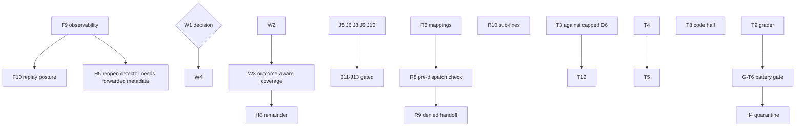

# Sonnet review remediation: detailed design index

This directory holds one detailed design document per group of the remaining adversarial-review findings (`docs/REVIEW-Sonnet-v0.1*.md`). Each document designs every pending item in its group, and each item carries a status line, a verified problem statement (checked against current code, not the review's stale line numbers), a design with working code, version-pinning guidance, and a test-case table with at least one negative control. Nothing here is implemented; these are designs only, and implementation follows the standing rules below.

## Documents

| Group | Document | Scope | Items |
|---|---|---|---|
| F | [Sonnet_F_items_detailed_design.md](Sonnet_F_items_detailed_design.md) | Forcing cascade follow-ups and the replay posture | F9, F10, F8 follow-ups, F2 follow-ups, F4 follow-ups |
| W | [Sonnet_W_items_detailed_design.md](Sonnet_W_items_detailed_design.md) | Work orders, frontier ranking, carriers | W1 (gated), W2, W3, W4, W5, W6, invalid-order label, pivot slot order |
| H | [Sonnet_H_items_detailed_design.md](Sonnet_H_items_detailed_design.md) | Hypothesis, verification, conclusion, reasoning | H4 quarantine (gated), H15, H16, H17, H8 remainder, H11, H13, H14, H7/T7, H5, H6, H12 (declined), H1 (decided) |
| J | [Sonnet_J_items_detailed_design.md](Sonnet_J_items_detailed_design.md) | Java and Python analysis, Spring configuration | J5, J6, J8, J9, J10, J11-J13 (gated), JPS, JNI, JCV, JLS, golden fixtures |
| R | [Sonnet_R_items_detailed_design.md](Sonnet_R_items_detailed_design.md) | Retrieval, authorization, tenant isolation | R1 (gated), R2-ops (gated), R4/R5, R6, R8, R9, R10, R11 (gated), R12, rate-limit key, Kafka logging |
| T | [Sonnet_T_items_detailed_design.md](Sonnet_T_items_detailed_design.md) | Termination, honesty, metrics, battery | T3, T4, T5, T6-kernel, T8, T9 (gated), T12, G-T6 (gated), T2 follow-ups, review section 12 gaps |

"T6" means two things in the ledger. The T document calls the review's kernel-gate finding **T6-kernel** and the before/after battery comparison **G-T6**.

## Loop-version placeholders

Every behavior change that alters loop semantics pins to a new loop version routed with `loop_version_at_least` on the entity's recorded metadata. The shipped current version is `lv7`. The documents use placeholders (`LV_F`, `LV_W`, `LV_H`, `LV_J`, `LV_R`, `LV_T`) so that real numbers are assigned in tranche order at implementation time. A group may share one number when its items land in one tranche; a later tranche takes the next number. Analyzer and data-layer changes normally need no loop version, and each item says so explicitly.

## Suggested order

The order follows dependencies and the backlog order the owner confirmed.

1. **F9, then F10.** F9 is the real defect found while designing these documents (see below), and F10 pins the final shapes.
2. **W2 and W3,** then W4 once the W1 decision is made. W3 unblocks the H8 remainder.
3. **H items** that are not gated, plus the J items outside Spring.
4. **R6, then R8, R9, R10.** R1, R2-ops and R11 wait on owner decisions.
5. **T3, T4, T5, T6-kernel, T8 (code half), T12.** T3's tests must target the lv4-capped D6 behavior. T9, G-T6 and the H4 quarantine are gated.

## Gated items

| Item | Gate |
|---|---|
| R1 | Excluded by a standing owner rule (cross-tenant disclosure, designed in full) |
| R2-ops | Ops-owned delimiter rename and re-index |
| R11 | Owner decision (needs least-privilege roles first) |
| J11, J12, J13 | Spring set excluded by a standing rule; J13 in or out is unresolved |
| W1 deletion | Standing rule: no deletion without the owner |
| T9, T8 grader half | No grader changes without the owner |
| G-T6 | Owner-deferred; another engineer runs it; needs restart on a recorded SHA, tenant cleans and live budget |
| H4 quarantine | Filed behind G-T6 |

Settled and not redesigned: H1 default stays unflipped, H12 is declined (option c), the H5 identifier floor stays excluded, onboarding wiring stays dormant, dash-only index narrowing is final, no bulk profile fix, and a pivot still outranks a waiting requery order.

## Findings made while writing these documents

The writers verified each claim against current code and found the following. They are recorded in the recommendations ledger.

- **Telemetry drops counters that earlier docs say it carries.** `_derive_loop_telemetry` keeps only a fixed key whitelist, so `d6_blocked_no_evidence_count`, `fetches_dispatched`, `forced_pivot_count`, the five smallest-fetch counters, `forced_floor_count` and `forced_callsite_count` never reach `metadata["loop_telemetry"]`. Architecture sections 67 and 70 claim otherwise. This is F9 scope and is a defect in the earlier work, not only in the review.
- **The H5 reopen condition is not observable today.** `reason_activity` never forwards `checkability_floor`, `resample_count` or `resample_reasons`.
- **An unmarked loop pin floats on replay.** The workflow resolves it with `or LOOP_VERSION_CURRENT`, and the bulk-intake child path passes no pin, so a recorded history can replay under a different version. The SDK Replayer also does not compare activity inputs.
- **R1 is wider than the review says.** A caller-supplied `code_issue_fingerprint` is stored as the cross-tenant membership proof, and `other_tenant_sessions` is a presence oracle. A keyed fingerprint alone does not close it.
- **R11 is narrower and different than the review says.** Three of the named tables already have forced RLS and two have no `tenant_id` column. The unprotected tenant tables are `investigation_contradictions`, `log_exemplars`, `evidence_bank_interest` and the four analyzer tables. The `iap_app` and `iap_worker` roles hold grants on only 18 and 10 tables, so least-privilege is a grants project.
- **R10(a) reproduced.** A requery fired 8 times against a budget of 3.
- **J11's premise did not reproduce.** The importer reads exact basenames, so `application-dev.yml` is never read, and the blocker rating is not supported.
- **Review claims found wrong or unsound:** the H16 and W5 case-folding recommendations (symbols and paths are case-sensitive), the W6 "dead constants" claim, the T4 claim that `agent_metrics.py` consumes `overconfident_turns`, and the T5 "last response only" claim (fixed by H6).
- **The failed-group re-fetch (H8) is narrower than designed.** It shares its gap id with the earlier uncited gap, so it fires only for a group never fetched through the smallest-fetch slot. W3 owns the fix.

## Open owner questions

Each document ends with its own list. The questions that unblock the most work:

1. **F10:** confirm "loop pin plus replay corpus, no `workflow.patched` before go-live", and whether F10 lands before or after the W1 decision.
2. **F8:** do the full trigger/apply loop, or stop at the completeness contract.
3. **W1:** option A (delete the advisory emission and ranking, keep the frontier library) or option B (wire a consumer).
4. **H13, H15, H17:** the target Finding type for caller-edge answers, an explicit two-step requirement for ESTABLISHED, and demote versus block on mixed revisions.
5. **J6:** approve the exact dependency pins and the grammar pre-seed, and whether a failed startup check hard-fails.
6. **J11 and J12:** lift the Spring gate, and J13 in or out.
7. **R1:** lift the exclusion, or take the zero-risk option of removing SHARED visibility.
8. **R2-ops and R11:** alias bridge or physical re-index, the delimiter choice, and how to cover the child tables that lack `tenant_id`.
9. **T5 and T6-kernel:** the budget clamp or execution-timeout change, and whether an enforcing-mode kernel fault is FAILED or an abstention.
10. **T9 and G-T6:** which grader change sets to approve, and the shape of the battery run.

## Standing rules these designs follow

One tranche per owner message. Tests first, shown failing before the fix. No commits without the owner. No live runs, restarts, tenant cleans, migrations or dependency changes without owner approval; a design may propose one and flags it. No grader changes and no L5 work without the owner. Profiles and capabilities are ops-owned and are not invented here. No analyzed-repository names, hosts, schemas or class names appear in these documents; synthetic names such as `SampleOrderFilter` and `OrderServiceHandler` are used throughout.
