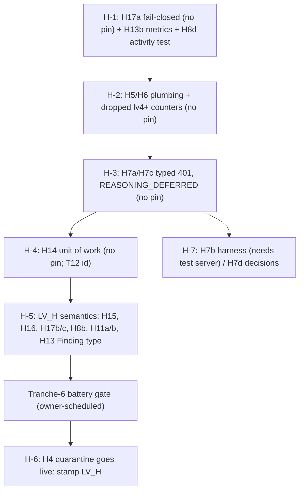

# Design: Group H — hypothesis, verification, conclusion and reasoning items (pending work)

Status: DRAFT for owner review. Date: 2026-10-31. Git HEAD at research time: 7860fb4 (clean). Loop-version placeholder for this group: `LV_H`. The current shipped loop version is lv7; this group never hardcodes a number for a new version. The index document maps `LV_H` to the next free number (lv8, lv9, ...) when an item is implemented.

## Context

Section 1 of the adversarial review (hypothesis to verification to conclusion, findings H1-H17) was remediated across tranches 1-13. Most H findings are IMPLEMENTED (H2, H3, H4 conjunction, H5 floor and D6 cap, H6, H7, H8 re-fetch route, H9, H10, H11 severity filter, H13 ANSWERED mapping, H14 bounded Finding). This document designs only what is still pending, plus the records for the items the owner decided or declined.

Research for this document re-verified every claim against the current tree (the review's line numbers are stale). Findings that matter for the design:

- H15 is reproduced exactly: a CAUSAL claim with zero causal steps scores `0.8` and verifies at the 0.80 threshold; one perfect step scores `0.8999999999999999` and is demoted to `likely`; two steps score `1.0` (probe in the H15 section).
- H17 is reproduced in three of its five parts: `cites_only_orientation` fails open on a faulting citation read, `_conclude_binding_blocks` fails open (the `except: pass` leaves it `False`), and verify and conclude choose different candidates (probe: after one INCONCLUSIVE verify of A, conclude picks B, which verify never judged). No cross-claim revision or contradiction check exists anywhere.
- H4 quarantine is reproduced end to end through the real conclude gate: `root_cause` and `Finding.statement` carry the whole hypothesis statement, opinion included, beside a `NOT_CHECKABLE_EXCLUDED` limitation (probe under cbv1 and cbv3).
- H13 caller-edge was probed end to end for the first time: under lv5 the two-caller shape publishes `ANSWERED`; under lv4 it publishes `ROOT_CAUSE_ESTABLISHED`. One residual survives: the Finding is still typed `ROOT_CAUSE` for caller-edge answers on lv5, while location, code-value, history, doc and state answers write `OBSERVATION`.
- Two telemetry claims in the architecture doc do not hold end to end. `metadata["checkability_floor"]`, `metadata["resample_count"]` and `metadata["resample_reasons"]` are set on the in-memory decision but `reason_activity` never forwards `decision.metadata` on its success path, so nothing persists them. And `_derive_loop_telemetry` whitelists a fixed key set that omits `d6_blocked_no_evidence_count`, `fetches_dispatched`, `forced_pivot_count` and the `forced_smallest_fetch_*` counters, so the workflow passes them to the conclude activity and they are dropped before stamping (offline probe: the derived dict contains only `llm_tokens_total`, the `claim_binding_*` keys, `evidence_banked_repo` and the `hypotheses_*` counts). The H5 reopen detector and the H6 recovery-rate measurement both depend on this plumbing.
- The review's H16 recommendation to fold case is partly unsound: symbols are case-sensitive in the languages IAP analyzes (`getID` and `getId` are different methods). The design folds whitespace, path separators and leading `./`, never symbol case.
- The model is never asked for `contradictions_found`: the output contract in `application/investigation/reasoning.py` does not list the key, so the H11 "stray prose contradiction" arrives only when the model emits an unprompted key (`InvestigationDecision.contradictions_found` accepts it). Typed contradictions therefore need a prompt contract change, not just a schema change.
- The H8 lv3 branch is testable at activity level offline today (probe in the H8 section), so the "no activity-level test" gap is cheap to close.

## References

- `docs/REVIEW-Sonnet-v0.1.md` part 1: remediation table rows 1-13, findings H1-H17, "What section 1 tests do not pin", H3/H4 fixtures section.
- `docs/IAP-architecture-v1.0.md` sections 66-71 (lv2-lv7 remediation sections).
- `docs/IAP-claim-binding-attribution-v1.0.md` (H1 measurement, cbv1 13/18 vs cbv3 14/18).
- `docs/IAP_Arch_Eng_Recommendations.log` entries dated 2026-10-30 and 2026-10-31 for H1, H4, H5, H6, H7, H8, H11, H12, H13, H14, H15-H17, T6, T12, W3.
- `docs/design/README.md` conventions; `docs/design/DES-S7-handoff-v1.0.md` (handoff states).
- Source: `application/investigation/verification.py` (`VerificationEngine`, `enforce_group_conjunction`, `failed_cited_group_ids`, `build_claim_gaps`, `evaluate_hypothesis`, `_evaluate_hypothesis_inner`, `InvestigationConfidence`, `RootCauseVerificationPolicy`, `cites_only_orientation`, `elimination_record`, `apply_verification_outcome`, `select_verifiable_candidate`), `application/evidence/retrieval_ledger.py` (`target_group_key`, `_normalize_target_mapping`), `application/worker/activities/lifecycle.py` (`_gate_conclusion_or_fail`, `_conclude_binding_blocks`, `_answered_shape`), `activities/verification.py`, `activities/reasoning.py`, `activities/execution.py` (`_claim_identity_key`, FORMULATE persistence), `activities/inputs.py` (`_derive_loop_telemetry`, `_policy_for_loop_version`), `activities/common.py` (`classify_provider_failure`, `classify_reasoning_failure`), `worker/reasoning_failure.py`, `worker/workflows/run_investigation.py`, `worker/workflows/forcing.py` (`KIND_FETCH`, `_pick_gap_order`), `domain/hypothesis/models.py`, `domain/finding/models.py`, `domain/investigation/loop_version.py`, `scripts/agent_metrics.py`, `infrastructure/persistence/{finding,hypothesis,contradiction}_repository.py`.
- Tests that already pin part of the group: `test_h5_checkability_floor.py`, `test_h5_d6_evidence_cap.py`, `test_h6_varied_resample.py`, `test_h7_reasoning_degrade.py`, `test_h8_failed_group_refetch.py`, `test_h11_contradiction_severity.py`, `test_h13_answer_status_mapping.py`, `test_h14_finding_persist_order.py`, `test_h3h4_battery_fixtures.py`, `test_tranche6_verdict_semantics.py`, `test_verification_scoring.py`.
- Cross-group documents: the T group document (Tranche-6 battery gate, T9 grader, T12 duplicate Finding), the W group document (W3 outcome-blind gap coverage), the F group document (F10 replay tests, telemetry observability lists).

## Goals / Non-Goals

Goals:

- Make the verification score boundary deterministic and explicit (H15), including the zero-step case.
- Give claim-group identity a canonical form that does not split on whitespace, path separators or a leading `./`, and an overload dimension (H16), without merging case-distinct symbols.
- Close the H17 gaps: fail-closed citation inspection, cross-claim revision and contradiction checks, one candidate from verify to conclude.
- Design the H4 quarantine so opinion text never reaches `root_cause` or `Finding.statement`, ready to land behind the Tranche-6 battery gate.
- Finish the H8 remainder (NO_TARGET gap path, an activity-level test of the lv3 branch) and record the dormant-under-cbv1 and outcome-blind-coverage facts.
- Finish the H11, H13, H14, H7 and H5/H6 follow-ups as designed below, with tests first.
- Record H12 (Declined), H1 (Decided) and the H5 identifier floor (Decided) with their reopen conditions and the detectors that would fire them.

Non-Goals:

- Replacing the heuristic confidence formula with a calibrated model. The volume heuristic stays; only its boundary behavior and the zero-step case change.
- Flipping the default claim-binding pin (decided, H1).
- Building a rival-refuting producer or lowering the causal ceiling (declined, H12; sketched only).
- Changing the battery grader (T9, no-grader-changes rule). Any change that needs a grader change is listed as gated on it.
- Running live batteries, restarts, tenant cleans or migrations. Every such step below is marked "requires owner approval".

## Standing rules honored

One tranche per owner message. Tests first, and each test is shown failing before the fix. No commits without the owner. No live runs, restarts, tenant cleans or migrations without owner approval. No references to scratch directories from durable artifacts. No analyzed-repository names (synthetic names only: `SampleOrderFilter`, `OrderServiceHandler`). No env-switched legacy branches and no compatibility shims: loop-semantics changes route with `loop_version_at_least` on the entity's recorded pin.

## Decisions

These are the cross-cutting decisions. Item-specific decisions (named `<ITEM>-D<n>`) live in each item's Design subsection with their code.

### D1. One loop version, `LV_H`, for every H loop-semantics change

All H changes that alter loop or verdict semantics share one version placeholder, so the owner flips one thing and the index maps one placeholder. Items that need it: H15 (tolerant band, zero-step CAUSAL), H16 (canonical identity stamped at write), H17 (cross-claim checks, candidate handoff), H4 (quarantine), H8 (NO_TARGET gaps), H11 (typed contradictions), H13 (caller-edge Finding type). Items that need no pin say so and why in their section.

```python
# src/investigation_agent_platform/domain/investigation/loop_version.py (shape only; the number is assigned by the index)
LOOP_VERSION_LV_H = "lvN"  # N = next free number at implementation time; never hardcoded in this document


def lv_h_enabled(metadata: Any) -> bool:
    """Whether the entity's recorded pin includes the H group semantics.

    An unreadable or unknown pin keeps the OLD behavior (the lv3/lv4/lv5 precedent:
    in-flight rows keep the semantics they started with), so a pin fault can only
    ever leave a run on the prior behavior, never half-apply the new one.
    """
    try:
        return loop_version_at_least(metadata, LOOP_VERSION_LV_H)
    except Exception:  # UnknownLoopVersion or a malformed metadata value
        return False
```

**Alternative considered:** one loop version per item (LV_H15, LV_H16, ...). Rejected: seven versions for one group makes the pin table unreadable and every combination untestable. Every use site calls the named helper `lv_h_enabled`, so the index can split the group at implementation time if the owner wants a subset.

**Trade-off:** a single version couples unrelated behaviors, so a battery regression bisects over all of them. Mitigation: each item ships as its own tranche (one owner message each). The version number is bumped by the index, not here. Once a version is stamped on real rows, a later H item that changes semantics takes the next number instead of editing a stamped one; the index owns that call.

---

### D2. Pure modules for the new logic; activities stay glue

New logic lives in pure, unit-testable modules, each never raising on hostile input, so activity code only does I/O and routing:

- `application/investigation/claim_identity.py` (H16 canonicalization and identity).
- `application/investigation/cross_claim.py` (H17 revision and contradiction conflicts).
- `application/investigation/verdict_statement.py` (H4 verdict statement assembly).

**Alternative considered:** extend `verification.py` (8264 lines). Rejected: the file is already past reviewability and the new functions have no dependency on the engine.

---

### D3. Fail direction is stated per call site, not assumed

The review's H17 complaint is that two sites fail open. This document sets the rule per site and tests it:

| Site | Today on exception | Direction chosen | Reason |
|---|---|---|---|
| `cites_only_orientation` citation read | `(False, "")` (verifies) | fail closed (orientation-only = True, reason "inspection faulted") | the gate exists to stop unsound VERIFIED; a fault must not skip it |
| `_conclude_binding_blocks` | stays `False` (publishes) | fail closed (blocks) | same; blocking leads to an honest abstention, never a wrong verdict |
| cross-claim check (new) | n/a | fail closed (withdraw to INCONCLUSIVE) | a conjunction we could not check is not certified |
| NO_TARGET gap builder (new) | n/a | fail open to "no gap" | it only adds retrieval; no gap means today's behavior |
| quarantine statement builder (new) | n/a | fail closed to a fixed neutral statement | an opinion must never ship because a helper faulted |
| telemetry plumbing (new) | n/a | fail open | metrics never fail a run |

---

### D4. Tests first, with a named negative control

Every item's tests are written before the fix and run to a red result that is shown to the owner (the failing assertion text, not just a count). Every item also names one negative control: the exact line or condition to break so the test fails. The test tables below carry that in the Notes column. Characterization tests (behavior that is already correct, such as the H8 activity-level test) cannot be red first; they are proven by a mutation run instead, and the test file's docstring says so.

---

### D5. Gated and owner-approval work is designed in full and fenced

The H4 quarantine is GATED behind the Tranche-6 battery gate (see the T group document): the code and offline tests can be written and merged under the tranche rules, but the quarantine is not turned on for any real run, and no verdict-soundness claim is made, until the owner schedules the gate (committed tree, restart on that SHA with the SHA recorded, `clean_battery.py`, before/after, at least 3 repeats on moved cases, including L14-L16). Because the quarantine is pinned to `LV_H`, "not turned on" means: no investigation is stamped `LV_H` until the owner approves the stamp (`LOOP_VERSION_CURRENT` stays at lv7 until then). That is the mechanism that keeps the gate honest.

## Items

| Item | Verdict | Severity | Pin | Gate |
|---|---|---|---|---|
| H4 quarantine | Open (follow-up of an IMPLEMENTED item) | should-fix | LV_H | GATED: Tranche-6 battery gate |
| H15 causal score boundary | Open | consider | LV_H | owner direction decision on the one-step tier |
| H16 target_key identity | Open | consider | LV_H (stamped at write) | none |
| H17 cross-claim checks | Open (a: fail-closed, b: cross-claim, c: candidate) | consider | (a) none, (b)(c) LV_H | none |
| H8 remainder | Open (NO_TARGET, activity test) plus Decided/cross-ref records | should-fix | LV_H (NO_TARGET) | W3 owns coverage |
| H11 follow-ups | Open | should-fix | LV_H (typed, lifecycle), none (persistence test) | prompt contract change |
| H13 follow-ups | (a) Already addressed (probe), residual Finding type Open; (b) Open | should-fix | LV_H (Finding type), none (metrics) | none |
| H14 follow-ups | Open (unit of work) | should-fix | none | T12 for duplicate Finding |
| H7/T7 follow-ups | Open | should-fix | none | harness test needs owner approval to fetch the test server |
| H5 identifier floor | Decided NO (owner) | should-fix | none | reopen detector designed |
| H6 hint measurement | Open (measurement) | should-fix | none | needs the H5/H6 plumbing |
| H12 | Declined (owner, option c) | should-fix | not scheduled | revisit only if causal ESTABLISHED becomes a goal |
| H1 | Decided (do not flip default) | blocker | not applicable | measurement checklist only |

## Item H4: Quarantine NOT_CHECKABLE content from verdict fields — GATED

**Status:** Open, follow-up of an IMPLEMENTED item (H4 conjunction landed in Tranche 6). Severity: should-fix (an opinion can publish inside a verdict beside a limitation that says it was excluded). Dependencies: `LV_H` (D1); H17 does not depend on it. **GATED** behind the Tranche-6 battery gate (T group document; owner-deferred, not authorized): the code and offline tests may land under the one-tranche-per-message rule, but no investigation is stamped `LV_H` until the owner approves the stamp, and the gate must include L14, L15 and L16 with injected claims. The owner's decision stands: this belongs to H4 (verdict assembly), not the H5 floor.

### Verified problem

`conclude_investigation_activity` reaches `_gate_conclusion_or_fail` (`application/worker/activities/lifecycle.py`), which builds three verdict-bearing fields from the raw hypothesis text: `Finding(title=hyp.title, statement=hyp.statement)`, `InvestigationConclusion(root_cause=hyp.statement)`, and the CORROBORATES edge `metadata={"reason": hyp.statement[:500]}`. `VerificationEngine.enforce_group_conjunction` only appends a `NOT_CHECKABLE_EXCLUDED` limitation; it never touches the statement. A hypothesis statement is one string shared by every typed claim under it (the prompt requires each claim's statement to equal one `hypotheses_evaluated` entry), so when the model folds an opinion into the same sentence as a checkable claim, the opinion publishes. `hyp.title` is `statement[:256]` at persistence, so the title leaks it too.

Evidence (offline probe through the real conclude gate with in-memory fakes, H4 shape: one verified DEFINITION plus one NOT_CHECKABLE claim, statement "handleRequest is defined in alpha.py and is the best-designed handler in the service"):

```text
cbv1 ANSWERED | root_cause: handleRequest is defined in alpha.py and is the best-designed handler in the service | finding.statement: <same>
  limitations: ['NOT_CHECKABLE_EXCLUDED: 1 NOT_CHECKABLE claim(s) were exclud...']
cbv3 ANSWERED | root_cause: <same> | finding.statement: <same>
  limitations: ['UNMAPPED_CITATION: ...', 'NOT_CHECKABLE_EXCLUDED: 1 NOT_CHECKABLE claim(s) were exclud...']
```

The L15 fixture's strict xfail (`test_l15_opinion_in_the_verdict_must_not_pass`) pins the grader side of this (T9: the grader reads containment of the expected token only). The xfail calls the grader's pure scoring function on a hand-built conclusion, so it is independent of the production fix and stays xfail until the grader changes.

### Design

**Why not redact spans.** The assessment that carries `NOT_CHECKABLE` has a `claim_target` but no text span, and in the L15 fixture its target is empty. A span redactor would have to guess which words of one shared sentence are the opinion. A guess that leaves part of the opinion in the verdict is the failure we are fixing.

**H4-D1. Build the verdict statement from the checkable groups only, from verified structure, never from free hypothesis prose.** Each checkable group contributes a sentence rendered from its typed target (DEFINITION, CALL_EDGE, HISTORY, ABSENCE) or from the verified causal chain (CAUSAL, which has no templatable target; each chain step is grounded and cited, `causal_step_grounding`). BEHAVIOR templates from symbol and claimed value when both exist. Only when at least one NOT_CHECKABLE claim was excluded does the builder replace the text; with none excluded the original statement ships byte for byte.

```python
# src/investigation_agent_platform/application/investigation/verdict_statement.py
"""Verdict statement assembly (review H4 follow-up).

When NOT_CHECKABLE claims were excluded from verification, the statement that ships
in root_cause, Finding.statement and Finding.title is rendered from the claim groups
that DID verify, never from the raw hypothesis text (which may fold an opinion into
the same sentence as a checkable claim). Pure; never raises; fails closed to a fixed
neutral sentence.
"""

from __future__ import annotations

from collections.abc import Sequence
from dataclasses import dataclass
from typing import Any

from investigation_agent_platform.application.investigation.verification import VerificationEngine
from investigation_agent_platform.domain.hypothesis.models import ClaimKind

_MAX_STATEMENT = 2048
_MAX_SENTENCES = 12
NEUTRAL_STATEMENT = (
    "The checkable claims in this hypothesis verified; the claims that cannot be "
    "checked are excluded and listed under limitations."
)


@dataclass(frozen=True)
class VerdictStatement:
    text: str
    redacted: bool  # True when NOT_CHECKABLE claims were excluded and the text was rebuilt
    basis: tuple[str, ...] = ()  # claim kinds that contributed a sentence
    fell_back: bool = False  # True when only the neutral sentence could be produced


def _one_line(value: object, limit: int = 200) -> str:
    return " ".join(str(value or "").split())[:limit]


def _target(asm: Any) -> dict[str, Any]:
    target = getattr(asm, "claim_target", None)
    dump = getattr(target, "model_dump", None)
    return {k: v for k, v in (dump() if callable(dump) else {}).items() if v is not None}


def _sentence_for(kind: str, targets: list[dict[str, Any]]) -> str | None:
    if kind == ClaimKind.DEFINITION.value:
        parts = [
            f"{_one_line(t.get('symbol'))} is defined in {_one_line(t.get('file_path'))}"
            for t in targets
            if t.get("symbol") and t.get("file_path")
        ]
    elif kind == ClaimKind.CALL_EDGE.value:
        parts = [
            f"{_one_line(t.get('counterpart'))} calls {_one_line(t.get('symbol'))}"
            for t in targets
            if t.get("counterpart") and t.get("symbol")
        ]
    elif kind == ClaimKind.HISTORY.value:
        parts = [
            f"{_one_line(t.get('file_path'))} changed in commit {_one_line(t.get('commit_id'), 12)}"
            + (f" ({_one_line(t.get('commit_subject'))})" if t.get("commit_subject") else "")
            for t in targets
            if t.get("file_path") and t.get("commit_id")
        ]
    elif kind == ClaimKind.ABSENCE.value:
        parts = [
            f"no match for {_one_line(t.get('symbol'))} was found in "
            f"{_one_line(t.get('scope') or 'the searched scope')}"
            for t in targets
            if t.get("symbol")
        ]
    elif kind == ClaimKind.BEHAVIOR.value:
        parts = [
            f"{_one_line(t.get('symbol'))} behaves as claimed ({_one_line(t.get('claimed_value'))})"
            for t in targets
            if t.get("symbol") and t.get("claimed_value")
        ]
    else:
        parts = []
    return "; ".join(parts[:10]) if parts else None


def build_verdict_statement(hypothesis: Any, causal_chain: Sequence[Any] = ()) -> VerdictStatement:
    """The statement to publish for a verified hypothesis. Never raises."""
    try:
        original = str(getattr(hypothesis, "statement", "") or "")
        groups, excluded = VerificationEngine.typed_claim_groups(hypothesis)
        if excluded <= 0:
            return VerdictStatement(text=original[:_MAX_STATEMENT], redacted=False)
        sentences: list[str] = []
        basis: list[str] = []
        for (kind, _key), asms in sorted(groups.items()):
            if kind == ClaimKind.CAUSAL.value:
                steps = [
                    f"{_one_line(getattr(c, 'cause', ''))} leads to "
                    f"{_one_line(getattr(c, 'effect', ''))} via {_one_line(getattr(c, 'mechanism', ''))}"
                    for c in list(causal_chain or [])[:5]
                    if getattr(c, "cause", "") and getattr(c, "effect", "")
                ]
                sentence = "; ".join(steps) or None
            else:
                sentence = _sentence_for(kind, [_target(a) for a in asms])
            if sentence:
                sentences.append(sentence[0].upper() + sentence[1:])
                basis.append(kind)
        if not sentences:
            return VerdictStatement(text=NEUTRAL_STATEMENT, redacted=True, basis=(), fell_back=True)
        text = (". ".join(sentences[:_MAX_SENTENCES]) + ".")[:_MAX_STATEMENT]
        return VerdictStatement(text=text, redacted=True, basis=tuple(basis))
    except Exception:
        # Fail closed: a fault must never ship the raw statement.
        return VerdictStatement(text=NEUTRAL_STATEMENT, redacted=True, basis=(), fell_back=True)
```

Call site (conclude gate), routed by the pin on the entity metadata the gate already holds (`_inv`):

```python
# src/investigation_agent_platform/application/worker/activities/lifecycle.py, inside _gate_conclusion_or_fail,
# immediately before Finding(...) is built
from investigation_agent_platform.application.investigation.verdict_statement import (
    VerdictStatement,
    build_verdict_statement,
)

if lv_h_enabled(getattr(_inv, "metadata", None)):
    _vs = build_verdict_statement(hyp, causal_chain)
else:
    _vs = VerdictStatement(text=str(hyp.statement)[:2048], redacted=False)
_published_title = _vs.text[:256] if _vs.redacted else hyp.title
# Finding(title=_published_title, statement=_vs.text, ...)
# InvestigationConclusion(root_cause=_vs.text, ...)
# EvidenceRelationshipRecord(metadata={"reason": _vs.text[:500]})
# _VerificationEngine.map_conclusion_sentences(_vs.text, list(bound or []), _causal_texts)
```

**Alternative considered (A): redact NC spans.** Rejected for the reason above (no span, empty NC target in the fixture, shared sentence).

**Alternative considered (B): make the producer separate opinions.** Adopted as a complement, not a substitute: a request-text-only prompt line ("put an opinion, preference or taste judgment in its own `hypotheses_evaluated` entry, never inside a sentence that also states a checkable fact") reduces how often the mixed statement happens. A live model never declares NOT_CHECKABLE today (four data points, owner decision J), so this is unmeasurable until it does; the assembly is the guarantee, the prompt is the prevention. The prompt line needs no pin (request text only, like H6) but is not scheduled here.

**Alternative considered (C): withdraw any verdict that excluded an NC claim.** Rejected: it converts a correct, certified checkable answer into an abstention because the model added an opinion, which is the over-correction the owner's H4 disposition avoids ("publish NC content as a limitation, never as the verdict").

**Trade-off:** a verified BEHAVIOR or CAUSAL claim with an NC sibling publishes a templated or chain-derived sentence instead of the model's prose, so the answer reads mechanically, and a BEHAVIOR claim with no symbol falls back to the neutral sentence. That is a deliberate loss of fluency for soundness, bounded to the (so far unobserved live) mixed case. The ranked-alternatives list still quotes other hypotheses' statements, labeled by status; it is not a verdict field and is left alone.

### Version pinning / migration

Pinned to `LV_H`: the published `root_cause` and `Finding.statement` change shape for mixed hypotheses. A run pinned lv7 or older keeps `root_cause=hyp.statement`. With no NC claim excluded the output is byte-identical on every pin, so only the mixed case changes. No data migration: `root_cause` is `Text`, `Finding.statement` max length 2048 is respected, existing rows are not rewritten (the 2026-10-30 ledger rule "old rows are not rewritten" applies).

### Test cases

Tests are written first and shown red (the L15-shaped assertion fails on the current tree because `root_cause` contains "best-designed").

| ID | Name | Level | Setup | Action | Expected | Notes |
|---|---|---|---|---|---|---|
| H4-T01 | opinion absent from root_cause | integration (fakes, as the gate probe) | LV_H pin; verified DEFINITION plus NOT_CHECKABLE (empty target); statement folds an opinion | `_gate_conclusion_or_fail` | `ANSWERED`; `root_cause` names the symbol and file and contains no opinion token; limitations include `NOT_CHECKABLE_EXCLUDED` | Negative control: change the call site back to `root_cause=hyp.statement`; this test must fail |
| H4-T02 | Finding statement and title quarantined | integration | as T01 | read the saved `Finding` | `statement` equals the verdict text; `title` is the first 256 characters of the verdict text, not `hyp.title` | Negative control: keep `title=hyp.title`; fails because the title still holds the opinion |
| H4-T03 | older pin keeps the old statement | integration | same hypothesis, entity pinned lv7 | gate | `root_cause == hyp.statement` including the opinion | version-pin routing; proves no shim and no env switch |
| H4-T04 | no NC claim is byte-identical | unit | LV_H, hypothesis with one DEFINITION, no NC | `build_verdict_statement` | `text == hypothesis.statement`, `redacted is False` | regression pin for the common path |
| H4-T05 | CAUSAL plus NC renders from the chain | unit | LV_H, one CAUSAL group, NC sibling, two verified `CausalRelationship` steps | build | text is the chain sentences; NC wording absent; `basis == ("CAUSAL",)` | CAUSAL has no templatable target |
| H4-T06 | HISTORY and ABSENCE templates | unit | LV_H, HISTORY (file, commit, subject) plus NC; ABSENCE (symbol, scope) plus NC | build | commit sentence truncates the commit id to 12 chars; absence sentence names the scope | one assertion per kind |
| H4-T07 | CALL_EDGE aggregates per caller | unit | two verified edges plus NC | build | one sentence per caller, joined by `;`, at most 10 | bound check |
| H4-T08 | nothing templatable falls back to neutral | unit | BEHAVIOR with no symbol plus NC | build | `NEUTRAL_STATEMENT`, `fell_back is True`, never the original text | fail-closed direction |
| H4-T09 | builder fault fails closed | unit | hypothesis whose `assessments` property raises | build | neutral sentence, not the original | Negative control: change the `except` to return `original`; fails |
| H4-T10 | hostile target text is bounded and single-line | unit | target symbol with newlines and 5000 characters | build | single line, each field at most 200 characters, total at most 2048 | malformed input |
| H4-T11 | mapping runs over the published text | integration | the opinion sentence would map to no cited row | gate | no `CONCLUSION_UNMAPPED` limitation caused by the removed opinion | proves `map_conclusion_sentences` reads the verdict text |
| H4-T12 | correlation edge reason is quarantined | integration | engine and relationship repo faked | gate | recorded edge `metadata["reason"]` is the verdict text | third verdict-bearing field |
| H4-T13 | grader xfails unchanged | unit | `test_h3h4_battery_fixtures.py` | run | the five strict xfails still xfail | the fix must not flip them; they pin T9 |
| H4-T14 | L15 injected-claim battery before/after | battery (live) | owner approval; clean tenant per repeat; at least 3 repeats on L14, L15, L16 plus moved cases | gate procedure from the T group document | L15 conclusion `root_cause` contains no opinion text (read by a read-only query, not the grader) | **requires owner approval**; this is the gate itself |

### Rollout, risks, open owner decisions

- Land code and tests as one tranche; do not stamp `LV_H`. After the Tranche-6 gate is scheduled and passes, the index flips `LOOP_VERSION_CURRENT`.
- Risk: the templated sentence for BEHAVIOR may drop verified nuance. Mitigation: the claim text is still stored on the hypothesis row, and the limitation names the exclusion.
- Open owner decision: whether the prompt-prevention line (alternative B) is wanted. Recommendation: yes, but only when a live model starts declaring NOT_CHECKABLE.

## Item H15: Causal score is a volume heuristic with an accidental float boundary

**Status:** Open (consider-tier). Severity: consider. Dependencies: `LV_H` (D1). Gating: owner direction decision on the one-step tier (below); no battery gate is needed for the boundary fix, but the zero-step rule adds turns, so it should ride the next scheduled battery. Sub-items: H15a tolerant band comparison, H15b zero-step CAUSAL, H15c explicit non-goal (the volume formula stays).

### Verified problem

`InvestigationConfidence.overall_confidence` (`application/investigation/verification.py`) is `0.35*coverage + 0.25*reliability + 0.20*causal + 0.20*(1-penalty)`. `_evaluate_hypothesis_inner` derives `coverage = min(1.0, rows/4)` (capped at 0.5 without cross-layer corroboration), `reliability = with_provenance/rows` and `causal = min(1.0, steps/2)` (0 when the chain is empty). The result is compared with plain `>=` and `<` against the policy floors in three places: the VERIFIED decision (`overall_confidence >= policy.min_confidence_threshold`), the tier decision (`likely_floor <= overall < established_floor`), and `ConclusionGate.evaluate` (`overall < policy.min_confidence_threshold`).

Evidence (offline probe on the current tree, two providers and two evidence types, four rows each, perfect provenance):

```text
zero steps : VERIFIED 0.8                 tier=likely
1 step     : VERIFIED 0.8999999999999999  tier=likely      (mathematically 0.9, so it demotes against the 0.90 floor)
2 steps    : VERIFIED 1.0                 tier=established
```

`tests/unit/test_verification_scoring.py::test_two_independent_layers_verify` already depends on the zero-step VERIFIED outcome (it passes no causal chain and expects VERIFIED). A float sweep over a 7,935-point lattice of plausible inputs (coverage in quarters, reliability and penalty as fractions with denominators up to 8, causal in {0, 0.5, 1}) finds four points on the wrong side of 0.80 and two on the wrong side of 0.90 (for example coverage 1, reliability 1, causal 0.5, penalty 0.5 is exactly 0.8 and computes `0.7999999999999999`, so a perfect one-step claim that shares half its rows with a rival goes INCONCLUSIVE by rounding).

Downstream effect today is bounded: a zero-step CAUSAL verdict reaches the conclude gate, which denies it with "no causal chain established" (the gate requires a chain unless an answer-shape flag is set), and the rival bar (H12, declined) caps every causal verdict at LIKELY anyway. The defect is real but shows up as wasted turns and wrong explanations, not as a wrong published status.

### Design

**H15-D1. Tolerant band comparison, one helper, three call sites.** The score is a four-term float sum; compare with a fixed epsilon instead of changing the formula.

```python
# src/investigation_agent_platform/application/investigation/verification.py
_BAND_EPSILON = 1e-9


def band_at_least(score: float, floor: float, *, tolerant: bool) -> bool:
    """Whether ``score`` meets ``floor``. Tolerant (LV_H) absorbs float rounding."""
    return (score + _BAND_EPSILON >= floor) if tolerant else (score >= floor)


class RootCauseVerificationPolicy(BaseModel):
    ...
    # H15 (LV_H): compare scores to the band floors with a 1e-9 tolerance and require a
    # causal step for a CAUSAL claim. Set from the recorded pin by _policy_for_loop_version
    # in the verify and conclude activities; the defaults keep the old behavior.
    tolerant_band: bool = Field(default=False)
    require_causal_step_for_causal_claims: bool = Field(default=False)
```

```python
# _evaluate_hypothesis_inner, status and tier (replacing the bare comparisons)
overall = float(confidence.overall_confidence)
status = (
    VerificationStatus.VERIFIED
    if band_at_least(overall, policy.min_confidence_threshold, tolerant=policy.tolerant_band)
    else VerificationStatus.INCONCLUSIVE
)
...
likely = float(policy.likely_floor)
established = float(policy.established_floor)
if band_at_least(overall, likely, tolerant=policy.tolerant_band) and not band_at_least(
    overall, established, tolerant=policy.tolerant_band
):
    tier = "likely"

# ConclusionGate.evaluate
if not band_at_least(
    verification.confidence.overall_confidence,
    policy.min_confidence_threshold,
    tolerant=policy.tolerant_band,
):
    blockers.append(...)
```

```python
# src/investigation_agent_platform/application/worker/activities/inputs.py, extending _policy_for_loop_version
updates: dict[str, Any] = {}
if loop_version_at_least(metadata, LOOP_VERSION_LV5):
    updates["blocking_contradictions_only"] = True
if lv_h_enabled(metadata):
    updates["tolerant_band"] = True
    updates["require_causal_step_for_causal_claims"] = True
return policy.model_copy(update=updates) if updates else policy
```

**H15-D2. A CAUSAL claim with no causal step does not verify.** The rule is scoped to the effective claim kind `CAUSAL`, so BEHAVIOR and ABSENCE claims (which legitimately carry no chain; they have their own kind gates) are untouched.

```python
# _evaluate_hypothesis_inner, immediately before causal_step_grounding
if (
    policy.require_causal_step_for_causal_claims
    and not causal_chain
    and VerificationEngine.effective_claim_kind(hypothesis) == ClaimKind.CAUSAL
):
    return VerificationResult(
        hypothesis_id=hypothesis.id,
        status=VerificationStatus.INCONCLUSIVE,
        corroborating_evidence_ids=[],
        explanation=(
            "Causal claim has no causal step: volume of evidence alone does not establish "
            "a mechanism. Propose a cited cause-to-effect step, then re-verify."
        ),
        confidence=InvestigationConfidence(
            coverage_score=0.3, reliability_score=0.5, causal_score=0.0, contradiction_penalty=0.0
        ),
    )
```

**H15-D3. Non-goal: the volume formula stays.** `min(1, rows/4)` and `min(1, steps/2)` remain; replacing them with a calibrated score has no ground truth to calibrate against (the battery has six online cases). The explanation already labels the score "Heuristic only", and the three inputs are printed to two decimals. This section changes only the boundary and the zero-step rule.

**Alternative considered (round the property):** `return round(score, 9)` inside `overall_confidence`. Simpler (one change, all call sites fixed), but it silently changes the stored `confidence_score` and every `:.2f` display for every pin, which the version-pin contract forbids without a flag, and it leaves `>=` brittle for any future consumer that computes its own sum. The helper is explicit at the comparison.

**Alternative considered (integer weights):** compute in hundredths (`35*c + 25*r + ...`). Exact for the weights, still inexact for `c`, `r`, `p` (fractions of row counts). Rejected.

**Owner decision (direction of the one-step tier).** With the tolerant band, one perfect step scores 0.9 and reaches the `established` tier at the verification result (it demotes today only by rounding). Published status is unchanged today because the rival bar still caps causal verdicts at LIKELY (H12 declined). If the owner prefers "one step is likely by design", the explicit form is `established_requires_steps: int = 2` on the policy with `if steps < policy.established_requires_steps: tier = "likely"`, a decision rather than an accident. Recommendation: take the explicit form, because it states the intent and survives a future retune of the weights. This document specifies the tolerant band either way (it fixes the 0.80 boundary, where no intent exists), and the explicit-steps field only if the owner approves it.

### Version pinning / migration

Pinned to `LV_H` through `_policy_for_loop_version`, as H11 was for lv5. A run pinned lv7 or older keeps bare `>=` and keeps verifying a zero-step CAUSAL claim; an unreadable pin keeps the old behavior (D1). No data migration: nothing stored changes shape; `confidence_score` on hypotheses is written by `apply_verification_outcome` from the same property and is unaffected.

### Test cases

| ID | Name | Level | Setup | Action | Expected | Notes |
|---|---|---|---|---|---|---|
| H15-T01 | one perfect step meets the 0.90 floor | unit | `InvestigationConfidence(1, 1, 0.5, 0)` | `band_at_least(c.overall_confidence, 0.90, tolerant=True)` | True | red first: the untolerant comparison is False because the sum is `0.8999999999999999`. Negative control: set `_BAND_EPSILON = 0`; the test fails |
| H15-T02 | tolerant off keeps the old result | unit | same | `band_at_least(..., tolerant=False)` | False | version-pin routing (older pin) |
| H15-T03 | half-shared perfect claim stays VERIFIED | unit | coverage 1, reliability 1, causal 0.5, penalty 0.5 (computes `0.7999999999999999`) | status decision under the tolerant policy | VERIFIED; the untolerant policy returns INCONCLUSIVE | the lattice point found by the sweep |
| H15-T04 | epsilon does not lift a real miss | unit | confidence 0.7999 | tolerant `>= 0.80` | False | boundary: 1e-9 is not a loophole |
| H15-T05 | tier boundary at 0.90 | unit | scores 0.89, 0.8999999999, 0.9, 0.9000001 | tier decision (tolerant) | 0.89 is `likely`; the other three are `established` | both sides of the floor |
| H15-T06 | conclude gate uses the same comparison | integration (gate with fakes) | verification confidence `0.7999999999999999`, tolerant policy | `ConclusionGate.evaluate` | no "below threshold" blocker | proves the third call site |
| H15-T07 | zero-step CAUSAL is INCONCLUSIVE under LV_H | unit | `test_verification_scoring` fixture (two providers, no chain), flag on | `evaluate_hypothesis` | INCONCLUSIVE with the "no causal step" explanation | red first: today VERIFIED at 0.8. Negative control: drop the `not causal_chain` condition; fails |
| H15-T08 | zero-step BEHAVIOR and ABSENCE untouched | unit | typed BEHAVIOR with code plus runtime rows, no chain, flag on | evaluate | verdict identical to flag off | scope check of D2 |
| H15-T09 | zero-step on an older pin still verifies | unit | policy built through `_policy_for_loop_version` with an lv7 pin | evaluate | VERIFIED (the existing `test_two_independent_layers_verify` keeps passing) | version-pin routing |
| H15-T10 | policy factory routes by pin | unit | metadata with `loop_version` lv7, `LV_H`, unmarked, unknown, malformed | `_policy_for_loop_version` | flags False, True, True, False, False | fail-safe direction (unknown keeps old) |
| H15-T11 | group conjunction uses the same rule | integration | hypothesis `[DEFINITION grounded, CAUSAL no steps]` under LV_H | `enforce_group_conjunction` | withdrawn with `UNVERIFIED_CLAIM_GROUP` naming the CAUSAL group | `_group_verifies` reuses the policy |
| H15-T12 | float sweep regression | unit | the 7,935-point lattice with an exact `Fraction` reference | tolerant comparison vs exact at 0.80 and 0.90 | zero mismatches | regression pin; documents the 6 points |

### Rollout, risks, open owner decisions

- One tranche, with `tests/unit/test_h15_band_boundary.py` written first and shown red on T01, T03, T06 and T07.
- Risk: the zero-step rule lengthens a run that today ends at the gate. Mitigation: it routes to INCONCLUSIVE with an explanation that names the next step; fold into the next battery.
- Open: the one-step tier direction (above).

## Item H16: `target_key` over-splits and has no overload identity

**Status:** Open (consider-tier). Severity: consider. Dependencies: `LV_H` (D1), stamped at write. Cross-reference: H2 (the persistence key already uses `target_group_key`), W3 (gap coverage is keyed by `gap_id = KIND|target_key`).

### Verified problem

`target_group_key` (`application/evidence/retrieval_ledger.py`) fingerprints the whole normalized target mapping: SHA-256 of the sorted string pairs, first 16 hex. Offline probe:

```text
symbol=OrderServiceHandler.validateOrder, file=src/Order.java          a16d762dcfe96267
same, symbol with leading/trailing space                                b46c50ffef4271d1
same, file_path "./src/Order.java"                                      947f6f9b39e148f9
same, file_path "src\Order.java"                                        addaeba789d79178
same, line_start=10 added                                               (new key)
declaring_type added                                                    (new key)
```

Every cosmetic variant mints a new key, so the model rewording a target field mints a new `gap_id` (the smallest-fetch coverage stamp then treats it as an uncovered gap) and a new claim group. Separately there is no overload dimension: `ClaimTarget` (`domain/hypothesis/models.py`) has `symbol`, `declaring_type` and ranges but no parameter signature, so two overloads of one method in one file are one group when the model omits ranges and two accidental groups when it adds them.

The review's recommended fix to fold case is not adopted. Symbols are case-sensitive in the languages IAP analyzes (`getID` and `getId` are different methods; `Foo` and `foo` are different Python names). Folding case merges distinct claims into one group, which can make a verified claim certify a different symbol's claim. File paths are case-sensitive on Linux. Persistence already casefolds `file_path` in position 4 of `_claim_identity_key` (long-standing, kept); this design does not extend that to the group key.

### Design

**H16-D1. A canonicalizer that folds only what is semantically the same.** Whitespace is collapsed and trimmed on every text field; paths get separator, duplicate-slash, leading `./` and trailing-slash normalization; signatures lose all whitespace; commit ids are case-folded (hex); symbols keep their case. Line ranges are locators, not identity, when a symbol is present (a window is where the evidence was read, not which claim is made); they stay identity when there is no symbol (a file-range-only claim is identified by its window).

```python
# src/investigation_agent_platform/application/investigation/claim_identity.py
"""Canonical claim-target identity (review H16). Pure; never raises."""

from __future__ import annotations

import hashlib
import json
import re
from collections.abc import Mapping
from typing import Any

_WS = re.compile(r"\s+")
_SLASHES = re.compile(r"/{2,}")
_TEXT_FIELDS = (
    "symbol", "counterpart", "declaring_type", "commit_subject",
    "value_semantics", "claimed_value", "fact_category",
)


def canonical_text(value: object) -> str | None:
    if value is None:
        return None
    raw = getattr(value, "value", value)  # StrEnum members
    text = _WS.sub(" ", str(raw)).strip()
    return text or None


def canonical_path(value: object) -> str | None:
    text = canonical_text(value)
    if text is None:
        return None
    text = _SLASHES.sub("/", text.replace("\\", "/"))
    while text.startswith("./"):
        text = text[2:]
    stripped = text.rstrip("/")
    return stripped or ("/" if text.startswith("/") else None)


def canonical_signature(value: object) -> str | None:
    text = canonical_text(value)
    return _WS.sub("", text) if text else None


def canonical_target(target: Mapping[str, Any] | None) -> dict[str, Any]:
    source = target or {}
    out: dict[str, Any] = {}
    for key in _TEXT_FIELDS:
        value = canonical_text(source.get(key))
        if value is not None:
            out[key] = value
    for key in ("file_path", "scope"):
        value = canonical_path(source.get(key))
        if value is not None:
            out[key] = value
    sig = canonical_signature(source.get("signature"))
    if sig:
        out["signature"] = sig
    commit = canonical_text(source.get("commit_id"))
    if commit:
        out["commit_id"] = commit.casefold()
    for key in ("line_start", "line_end"):
        try:
            number = int(source.get(key))  # type: ignore[arg-type]
        except (TypeError, ValueError):
            continue
        if number >= 1:
            out[key] = number
    return out


def identity_key(canonical: Mapping[str, Any]) -> str:
    """16-hex identity of a canonical target, or ``NO_TARGET`` when it has none."""
    ident = dict(canonical)
    if ident.get("symbol"):
        ident.pop("line_start", None)
        ident.pop("line_end", None)
    if not ident:
        return "NO_TARGET"
    payload = json.dumps(sorted(ident.items()), ensure_ascii=True, default=str)
    return hashlib.sha256(payload.encode("utf-8")).hexdigest()[:16]


def stamp_identity(target: Mapping[str, Any] | None) -> dict[str, Any]:
    """The canonical target plus its ``identity_key``; the write-time stamp (LV_H)."""
    canonical = canonical_target(target)
    stamped = dict(canonical)
    if canonical:
        stamped["identity_key"] = identity_key(canonical)
    return stamped
```

**H16-D2. Overload identity is an optional `signature` field.** `ClaimTarget` gains `signature: str | None` (max 256; for example `process(Order,int)`) and `identity_key: str | None` (max 32; the stamp). The sanitizer `_clean_target` in `application/investigation/reasoning.py` passes `signature` through `_clean_opt_str(..., 256)`; the prompt's target schema gains one line telling the model to state parameter types for an overloaded method. Without a signature two overloads stay one group (today's behavior); with one they split, and the same signature with different whitespace is one group.

**H16-D3. The pin decides at write; reads follow the stamp.** A hypothesis row can only be read consistently with the way its key was minted, so `target_group_key` honors a stamped `identity_key` and otherwise computes the legacy fingerprint. The LV_H pin decides whether the FORMULATE persistence site stamps; every other site (`typed_claim_groups`, `_distinct_typed_claims`, `build_claim_gaps`, `_claim_identity_key`) reads through `target_group_key` and needs neither a pin nor metadata.

```python
# src/investigation_agent_platform/application/evidence/retrieval_ledger.py
def target_group_key(target: object) -> tuple[str, dict[str, object]]:
    try:
        target_dict = _normalize_target_mapping(target)
    except Exception:
        target_dict = {}
    stamped = target_dict.pop("identity_key", None)  # H16: minted at write under LV_H
    if stamped:
        return str(stamped), target_dict
    ...  # legacy fingerprint, unchanged
```

```python
# src/investigation_agent_platform/application/worker/activities/execution.py, FORMULATE persistence,
# before _claim_identity_key(...) and before ClaimTarget.model_validate(...)
if lv_h_enabled(getattr(investigation_obj, "metadata", None)):
    variant_target = stamp_identity(variant_target)
```

The stamped target keeps the canonical (not model-emitted) field text, so the fetch builders (`_definition_fetch_params` and friends) read clean paths and symbols as a side benefit.

**Alternative considered (normalize inside `target_group_key` for everyone):** one function change, no stamp. Rejected: a run in flight when the change deploys would compute a new key for rows persisted under the old key, so `gap_id` coverage stamps in `action_history` stop matching and a covered gap re-fires. Pinning at write keeps each run self-consistent. This is the same "pin on the entity, route on the recorded value" rule as `verifier_version`.

**Alternative considered (case-fold everything):** the review's suggestion. Rejected as unsound (above).

**Trade-off:** `identity_key` rides inside `assessments_json` (a JSONB list); the stamp adds about 40 bytes per assessment. No schema change.

### Version pinning / migration

Pinned to `LV_H` at the write site only. Rows written before `LV_H` have no stamp and keep their legacy keys for their lifetime; the code path for them is the unchanged legacy fingerprint, which is the deliberate, data-recorded routing (not a compatibility shim: there is one `target_group_key` and the stamp is the recorded version). No migration, no backfill (`ClaimTarget` fields are optional and `assessments_json` is schema-free JSONB).

### Test cases

| ID | Name | Level | Setup | Action | Expected | Notes |
|---|---|---|---|---|---|---|
| H16-T01 | whitespace variants collapse | unit | symbol with leading, trailing and doubled interior spaces | `identity_key(canonical_target(...))` | equals the clean form's key | red first: legacy keys differ. Negative control: drop `_WS.sub` in `canonical_text`; fails |
| H16-T02 | path variants collapse | unit | `./src/Order.java`, `src\Order.java`, `src//Order.java`, `src/Order.java/` | canonical keys | all equal | one parametrized case |
| H16-T03 | symbol case never folds | unit | `getID` vs `getId` | keys | different | the review's case-fold recommendation is not adopted; this pins the reason |
| H16-T04 | path case does not fold | unit | `src/Order.java` vs `src/order.java` | keys | different | Linux paths are case-sensitive |
| H16-T05 | range is not identity with a symbol | unit | same symbol and file, `line_start` 10 vs 40 | keys | equal | locator, not identity |
| H16-T06 | range is identity without a symbol | unit | file-only targets with different ranges | keys | different | a file-range claim is its window |
| H16-T07 | overloads split by signature | unit | `process(Order)` vs `process(Order,int)` | keys | different | overload identity |
| H16-T08 | signature whitespace is not identity | unit | `process(Order, int)` vs `process(Order,int)` | keys | equal | D2 |
| H16-T09 | no signature keeps one group | unit | two overloads without signature | keys | equal | documents the limitation explicitly |
| H16-T10 | stamped key wins, unstamped is legacy | unit | one target dict with `identity_key`, one without | `target_group_key` | stamped value returned and `identity_key` absent from the returned dict; unstamped equals the legacy fingerprint (golden `a16d762dcfe96267`) | version routing by recorded stamp; the golden pins the legacy hash |
| H16-T11 | FORMULATE stamps only under LV_H | integration (fakes as `TestH2SiblingClaimsAreNotOverwritten`) | formulate two claims differing by whitespace | persisted assessments on an LV_H pin and an lv7 pin | LV_H: one group, canonical text, stamped; lv7: two groups, no stamp | version-pin routing; reuses the H2 harness |
| H16-T12 | H2 no-overwrite regression | integration | existing `TestH2SiblingClaimsAreNotOverwritten` cases | run under LV_H | still two groups for different symbols and different `claimed_value` | canonicalization must not collapse real differences |
| H16-T13 | malformed input | unit | target values: None, int, list, nested dict, 10 KB string | `canonical_target`, `stamp_identity` | never raises; unusable fields dropped | an empty target becomes `NO_TARGET` |
| H16-T14 | gap id stability end to end | unit | `build_claim_gaps` on a hypothesis whose second claim reworded the path with `./` | gap ids | one gap id, not two | the observable symptom the review named |

### Rollout, risks, open owner decisions

- One tranche; touches `ClaimTarget`, the sanitizer, the ledger helper and the FORMULATE site. The prompt line for `signature` is request text (no pin) and may ship separately.
- Risk: a model that sometimes states a signature and sometimes not splits one overload into two groups. Mitigation: documented (T09); the same happens today with ranges.
- Open: none.

## Item H17: no cross-claim check, verify and conclude can pick different candidates, two sites fail open

**Status:** Open (consider-tier). Severity: consider. Dependencies: `LV_H` for H17b (cross-claim) and H17c (candidate handoff); H17a (fail-closed) needs no pin. Cross-reference: H11 (typed contradictions feed rule R4), W3.

### Verified problem

- **H17a (reproduced).** `VerificationEngine.cites_only_orientation` wraps its citation collection in `except Exception: return (False, "")`, so a faulting read means "not orientation-only" and the claim proceeds to verify (probe: a hypothesis whose `supporting_evidence_ids` property raises returns `(False, '')`). In `_gate_conclusion_or_fail`, the `_conclude_binding_blocks` computation ends in `except Exception: pass`, which leaves the flag `False` and lets the gate proceed.
- **H17b (reproduced by absence).** No code compares claim groups against each other. `enforce_group_conjunction` verifies each group over its own rows; nothing checks that the groups agree on the revision, or that an ABSENCE claim and a CALL_EDGE or DEFINITION claim about the same symbol are not contradictory.
- **H17c (reproduced).** Offline probe on the current tree: two UNDER_INVESTIGATION hypotheses A and B. Verify picks A and `apply_verification_outcome` writes A's INCONCLUSIVE scores (support 0.0, confidence 0.2). `rank_hypotheses` then ranks B first, and `select_verifiable_candidate` at conclude picks B, which verify never judged. Separately, verify excludes `VERIFIED` hypotheses while conclude does not, so the eligible lists (and `_prefer_discriminating`) differ. The conclude activity re-verifies its own candidate, so the verdict stays sound, but the evidence gathered toward A is discarded, and `ConcludeInvestigationInput` carries no candidate id.

### Design

**H17a-D1. Both sites fail closed (D3).**

```python
# VerificationEngine.cites_only_orientation: both except branches
        except Exception:
            return (True, "citation inspection faulted; failing closed")
...
            try:
                if is_orientation_traced_evidence(row):
                    saw_orientation = True
                else:
                    return (False, "")
            except Exception:
                return (True, "citation inspection faulted; failing closed")
```

```python
# lifecycle.py, _conclude_binding_blocks computation
        except Exception:
            _conclude_binding_blocks = True  # was: pass (fail open)
```

The abstention reason for a fault is its own line (`claim binding inspection faulted`), so a fault is distinguishable in the persisted limitations from an evaporated citation.

**H17b-D2. A pure cross-claim conflict checker applied inside `enforce_group_conjunction`.** Three rules now, one more behind H11.

```python
# src/investigation_agent_platform/application/investigation/cross_claim.py
from __future__ import annotations

from collections.abc import Mapping
from dataclasses import dataclass
from typing import Any

from investigation_agent_platform.application.investigation.claim_identity import (
    canonical_path, canonical_target,
)

_POSITIVE = {"DEFINITION", "CALL_EDGE"}


@dataclass(frozen=True)
class ClaimConflict:
    code: str  # REVISION_MIXED (non-blocking) or CLAIM_CONFLICT (blocking)
    detail: str
    blocking: bool


def _targets(asms: list[Any]) -> list[dict[str, Any]]:
    out = []
    for asm in asms:
        dump = getattr(getattr(asm, "claim_target", None), "model_dump", None)
        out.append(canonical_target(dict(dump()) if callable(dump) else {}))
    return out


def cross_claim_conflicts(groups: Mapping[tuple[str, str], list[Any]]) -> list[ClaimConflict]:
    """Conflicts BETWEEN claim groups of one hypothesis. May raise on hostile input; callers fail closed."""
    conflicts: list[ClaimConflict] = []
    by_kind = {key: _targets(asms) for key, asms in groups.items()}

    # R1: claims about code (not HISTORY, whose subject is a commit) pinned to different revisions.
    revisions = {
        t["commit_id"]
        for (kind, _), targets in by_kind.items()
        if kind != "HISTORY"
        for t in targets
        if t.get("commit_id")
    }
    if len(revisions) > 1:
        conflicts.append(ClaimConflict(
            "REVISION_MIXED",
            "claims are pinned to different revisions: " + ", ".join(sorted(revisions))[:200],
            blocking=False,
        ))

    # R2: ABSENCE of a symbol that another group defines or calls (within the absence scope).
    for (kind, _), targets in by_kind.items():
        if kind != "ABSENCE":
            continue
        for absent in targets:
            symbol = absent.get("symbol")
            scope = absent.get("scope") or ""
            if not symbol:
                continue
            for (other_kind, _), others in by_kind.items():
                if other_kind not in _POSITIVE:
                    continue
                for positive in others:
                    path = canonical_path(positive.get("file_path")) or ""
                    in_scope = (not scope) or path.startswith(scope)
                    if positive.get("symbol") == symbol and in_scope:
                        conflicts.append(ClaimConflict(
                            "CLAIM_CONFLICT",
                            f"one claim says {symbol} is absent in {scope or 'scope'}, another says it is present",
                            blocking=True,
                        ))

    # R3: two groups assert different values for the same (kind, symbol, file, value_semantics).
    seen: dict[tuple[str, str, str, str], str] = {}
    for (kind, _), targets in by_kind.items():
        for t in targets:
            if not t.get("claimed_value"):
                continue
            ident = (kind, t.get("symbol", ""), t.get("file_path", ""), t.get("value_semantics", ""))
            previous = seen.setdefault(ident, t["claimed_value"])
            if previous != t["claimed_value"]:
                conflicts.append(ClaimConflict(
                    "CLAIM_CONFLICT",
                    f"two claimed values for {ident[1] or 'the same target'}: "
                    f"{previous[:60]} and {t['claimed_value'][:60]}",
                    blocking=True,
                ))
    return conflicts
```

Wiring (after the per-group loop in `enforce_group_conjunction`, gated on a policy flag set from the pin; a fault withdraws):

```python
# RootCauseVerificationPolicy
cross_claim_checks: bool = Field(default=False)  # H17b (LV_H)

# enforce_group_conjunction, after the existing failures handling, when no group failed
if policy.cross_claim_checks and len(groups) > 1:
    try:
        conflicts = cross_claim_conflicts(groups)
    except Exception:
        conflicts = [ClaimConflict("CLAIM_CONFLICT", "cross-claim inspection faulted", blocking=True)]
    blocking = [c for c in conflicts if c.blocking]
    if blocking:
        return <INCONCLUSIVE result with LimitationCode.CLAIM_CONFLICT detail "; ".join(c.detail ...)>
    mixed = [c for c in conflicts if not c.blocking]
    if mixed:
        result = result.model_copy(update={
            "tier": "likely",
            "limitations": [*result.limitations,
                            VerificationLimitation(code=LimitationCode.REVISION_MIXED, detail=mixed[0].detail)],
        })
```

`LimitationCode` gains `CLAIM_CONFLICT` and `REVISION_MIXED`; `_KNOWN_LIMITATION_CODES` in `activities/common.py` gains both so the telemetry label does not coerce to "other". `_policy_for_loop_version` sets `cross_claim_checks=True` under `lv_h_enabled`.

**Rule R4 (designed, lands with H11).** Once model-reported contradictions carry `evidence_ids` (H11a), an unresolved contradiction of severity MEDIUM or higher whose `evidence_ids` intersect the cited rows of exactly one group fails that group (the group's own gate sees the contradiction as a blocker). Until then no contradiction names evidence, so R4 has nothing to read. It is written but not wired in the first tranche.

**Alternative considered (block on REVISION_MIXED):** withdrawing a verdict whose claims were each proven at their own revision is harsh; the conjunction is a presentation of separately proven facts. Recommendation: demote to likely with the limitation (above); the blocking variant is a one-line change (`blocking=True`) if the owner prefers.

**H17c-D3. Hand the verified candidate to conclude.** The workflow already receives the candidate id from the last verify turn (`verify_res.data["hypothesis_id"]`).

```python
# application/investigation/verification.py
def select_verifiable_candidate(
    ranked, evidence_by_id, exclude_statuses=("REJECTED", "CONTRADICTED"), prefer_id=None
):
    ...
    eligible = [...]  # unchanged
    if prefer_id:
        for candidate in eligible:
            if str(getattr(candidate, "id", "")) == str(prefer_id):
                return candidate  # the candidate verify last judged, if still eligible
    ...  # unchanged ranking
```

```python
# application/worker/activities/inputs.py
@dataclass
class ConcludeInvestigationInput:
    ...
    preferred_candidate_id: str = ""  # H17c (LV_H): the candidate the last verify turn judged
```

```python
# application/worker/workflows/run_investigation.py: capture after each verify turn, pass at conclude
_vd = verify_res.data if isinstance(verify_res.data, dict) else {}
last_verified_candidate_id = str(_vd.get("hypothesis_id") or last_verified_candidate_id or "")
...
ConcludeInvestigationInput(..., preferred_candidate_id=last_verified_candidate_id)
```

```python
# application/worker/activities/lifecycle.py, _gate_conclusion_or_fail candidate selection
prefer = preferred_candidate_id if lv_h_enabled(getattr(_inv, "metadata", None)) else None
candidate = select_verifiable_candidate(ranked, evidence_by_id, prefer_id=prefer)
```

Replay safety: an activity input gains a defaulted field and the workflow adds no command; Temporal replay compares command type and order, not activity input payloads. The F group asks for a replay test over workflow-level changes (F10); this change should be covered by it.

**Alternative considered (persist a "judged candidate" marker on the investigation):** rejected: a new stored field for a value the workflow already holds.

**Alternative considered (leave it):** conclude re-verifies its own candidate, so verdicts are sound. True, and that is why this is consider-tier; the cost is discarded effort and a verdict about a candidate whose gaps the loop never worked on.

**Risk:** a hypothesis formulated in the last execute (after the last verify) is not preferred over the previously judged candidate. Mitigation: the loop runs verify after every execute, so this arises only when the loop breaks between execute and verify (budget or D6); in that case conclude ranks normally if the preferred id is ineligible, and the previously judged candidate is the one with evidence work behind it.

### Version pinning / migration

H17a: no pin. It converts a crash-shaped path (an exception) from "publish" to "abstain"; it changes no stored shape and no in-flight loop semantics (the H9, H10 and H14 precedent). H17b and H17c: pinned to `LV_H` (the first changes which verdicts publish, the second which candidate conclude selects); an older pin passes `cross_claim_checks=False` and `prefer_id=None`. No migration (limitation codes are strings in `limitations`; the new input field defaults to empty).

### Test cases

| ID | Name | Level | Setup | Action | Expected | Notes |
|---|---|---|---|---|---|---|
| H17-T01 | orientation inspection fault fails closed | unit | hypothesis whose `supporting_evidence_ids` raises | `cites_only_orientation` | `(True, "citation inspection faulted...")` | red first: today `(False, '')`. Negative control: restore `return (False, "")` in the outer except; fails |
| H17-T02 | row inspection fault fails closed | unit | evidence row whose `attributes` property raises | same | `(True, ...)` | second except branch |
| H17-T03 | normal evidence unaffected | unit | real rows, one orientation-traced, one real | same | `(False, "")` | regression: the gate still only fires on the marker |
| H17-T04 | conclude binding fault abstains | integration | cbv3, enforcement double whose `cited_ids` raises | `_gate_conclusion_or_fail` | INSUFFICIENT_EVIDENCE, limitation names the inspection fault | red first: today publishes. Negative control: restore `pass`; fails |
| H17-T05 | revision mix demotes | unit | DEFINITION at commit `aaa` and CALL_EDGE at commit `bbb`, both verified, `cross_claim_checks=True` | `enforce_group_conjunction` | VERIFIED kept, tier `likely`, `REVISION_MIXED` | non-blocking by design |
| H17-T06 | same revision is clean | unit | both claims at `aaa` | same | no limitation, tier unchanged | |
| H17-T07 | HISTORY groups may name different commits | unit | two HISTORY groups with different commits | same | no `REVISION_MIXED` | the exemption in R1 |
| H17-T08 | unpinned claims are ignored by R1 | unit | one pinned, one with no commit | same | no conflict | None is not a revision |
| H17-T09 | absence versus present is withdrawn | unit | ABSENCE of `OrderServiceHandler.handle` in scope `src/` plus a DEFINITION of it under `src/service/X.java` | same | INCONCLUSIVE, `CLAIM_CONFLICT` | blocking rule R2 |
| H17-T10 | out-of-scope absence is not a conflict | unit | ABSENCE scope `docs/` plus the same DEFINITION under `src/` | same | no conflict | scope prefix check |
| H17-T11 | two claimed values withdrawn | unit | same symbol and file, `claimed_value` 3 and 5 | same | INCONCLUSIVE, `CLAIM_CONFLICT` | R3 |
| H17-T12 | older pin skips the checks | unit | `cross_claim_checks=False`, T09 input | same | VERIFIED as today | version-pin routing |
| H17-T13 | checker fault fails closed | unit | groups containing an assessment whose target raises | same | INCONCLUSIVE | Negative control: make the `except` produce `[]`; fails |
| H17-T14 | verify and conclude pick the same candidate | unit | the probe: A and B UNDER_INVESTIGATION, A judged INCONCLUSIVE | `select_verifiable_candidate(..., prefer_id=A)` | A | red first without `prefer_id`: B. Negative control: ignore `prefer_id`; fails |
| H17-T15 | ineligible preferred id falls back | unit | preferred hypothesis REJECTED | same | ranking result, no exception | |
| H17-T16 | conclude honors the id only under LV_H | integration | gate with a preferred id on an lv7 pin and an LV_H pin | gate | lv7 picks the ranked winner; LV_H picks the preferred | version-pin routing |
| H17-T17 | workflow passes the id | unit (source check, plus the F10 replay test when it exists) | `run_investigation.py` | inspect | `preferred_candidate_id=` present in the conclude input | follows the repo's source-check pattern; a replay test is owed by F10 |

### Rollout, risks, open owner decisions

- Two tranches: H17a alone first (no pin, smallest), then H17b and H17c with `LV_H`.
- Risk: R2 withdraws a verdict when the model states an absence and a presence claim about the same symbol in different scopes. Mitigation: the scope prefix check (T10); the withdrawal is an honest INCONCLUSIVE with the conflicting claims named.
- Open owner decisions: REVISION_MIXED demotes (recommended) or blocks; R4 ships with H11 or later.

## Item H8: Re-fetch route for a failed cited group — remainder

**Status:** Follow-up of an IMPLEMENTED item (the lv3 re-fetch route is done, unit-proven). Four sub-records: H8a dormant under the default pin (**Decided**, H1); H8b NO_TARGET groups still get no gap (**Open**, `LV_H`); H8c failed-group gaps fire once because coverage is stamp-based and outcome-blind (**cross-reference, W3 owns it**); H8d no activity-level test of the lv3 branch (**Open**, test only, no code). Severity: should-fix. Gating: none for H8b and H8d.

### Verified problem

- **H8a (confirmed by probe).** The verify activity builds the gap feed only inside `if _binding_enforcement is not None and not fault`, and `_binding_enforcement` exists only for `claim_binding_version in (cbv2, cbv3)`. Activity-level probe (miss-read DEFINITION, `verify_root_cause_activity`, in-memory fakes): `cbv1` returns no `claim_gaps` key at either loop version; `cbv3`/lv2 returns `[]`; `cbv3`/lv3 returns `[('DEFINITION', 'cited_gate_failed')]`. The H8 route is therefore dormant for every API, intake and seed investigation (all stamped `cbv1`; owner decision H1: default not flipped).
- **H8b.** `build_claim_gaps` ends a loop iteration with `if not ref or not tkey or tkey == "NO_TARGET": continue`, and `failed_cited_group_ids` skips `NO_TARGET` explicitly. A targetless CAUSAL or BEHAVIOR group can never be a gap, cited or not.
- **H8c.** `_smallest_fetch_already_covered` (`workflows/forcing.py`) scans history for a `forced_smallest_fetch_gap_id` stamp equal to the gap id; the stamp is written whenever the fetch was dispatched, whatever it returned (W3). A failed-group gap re-fires zero times after one empty or degraded fetch.
- **H8d.** `test_h8_failed_group_refetch.py` pins the engine (`failed_cited_group_ids`), the builder and the carrier, and pins the activity only with a source check (`"loop_version_at_least" in source`). The probe above shows an activity-level test is cheap and fully offline.

### Design

**H8a. Decided: leave dormant; record the facts.** Nothing is flipped (H1). The record stays here and in the architecture doc so nobody reads the lv3 route as live on API-created runs. Reopen condition: the day the default pin moves off `cbv1` (see H1). Until then the route is exercised only by battery runs that stamp `--claim-binding-version cbv2` or `cbv3`.

**H8b-D1. A NO_TARGET gap path for BEHAVIOR and CAUSAL, keyed by claim reference.** A targetless group has no symbol, file or scope to build a fetch from, but it has a statement and optionally a stored `search_query`. The gap is keyed `KIND|NO_TARGET|<claim_ref>` (the claim reference is `claim_ref(claim_key(statement, kind))`, so it is hypothesis-specific, unlike the bare `KIND|NO_TARGET` group id that merges every targetless claim of a kind), and its fetch is a keyword SEARCH_LOGS built from the stored query or, failing that, the statement.

```python
# application/investigation/verification.py: build_claim_gaps(..., include_no_target=False)
tkey, _ = target_group_key(target)
no_target = tkey == "NO_TARGET"
if not ref or not tkey or (no_target and not (include_no_target and kind_value in ("BEHAVIOR", "CAUSAL"))):
    continue
base = f"{kind_value}|{tkey}"          # membership key used by enforcement.cited_groups
gid = f"{base}|{ref}" if no_target else base
...
refetch = base in cited and base in failed_cited
if base in cited and not refetch:
    continue
gap = {"gap_id": gid, "claim_ref": ref, "kind": kind_value, "target_key": tkey,
       "target": dict(target), "query": query, "scope": scope}
if no_target:
    gap["no_target"] = True
    gap["query"] = str(group.get("stored_query") or "") or derive_claim_query(statement, kind_value, {})[0]
```

```python
# application/worker/workflows/forcing.py
def _notarget_keywords(query: str) -> list[str]:
    seen: list[str] = []
    for token in re.split(r"[^A-Za-z0-9_.]+", query or ""):
        low = token.lower()
        if len(low) >= 4 and low not in _STOP and low not in seen:
            seen.append(low)
    return seen[:8]

def _causal_fetch_params(gap):  # extended
    ...
    if not file_path and gap.get("no_target"):
        keywords = _notarget_keywords(str(gap.get("query") or ""))
        return {"keywords": keywords, "limit": 10, "_leg": "SEARCH_LOGS"} if keywords else None
    ...

def _smallest_fetch_action_for(kind, params):  # the existing _leg mechanism, generalized
    leg = str((params or {}).pop("_leg", "") or "")
    if leg in ("QUERY_STATE", "SEARCH_LOGS"):
        return leg
    ...

SMALLEST_FETCH_ACTIONS_BY_KIND["CAUSAL"] = frozenset({"GET_CODE", "SEARCH_LOGS"})
```

`_behavior_fetch_params` already builds `keywords` from `query or symbol`, so BEHAVIOR NO_TARGET needs only the `query` the gap now carries. The verify activity passes `include_no_target=True` to both `failed_cited_group_ids` and `build_claim_gaps` when `lv_h_enabled`. Caps are the existing per-kind smallest-fetch caps (default 2 per kind per run), so a run cannot loop on targetless gaps.

**Alternative considered (key by the bare `KIND|NO_TARGET`):** simplest, but it makes one fetch cover every targetless claim of that kind across hypotheses (the W3 "gap_id is hypothesis-agnostic" defect), so rejected.

**Alternative considered (ask the model to always give a target):** a prompt change that reduces NO_TARGET groups but cannot eliminate them (a claim like "pool exhaustion causes the timeout" has no file). Complementary, not a substitute; unscheduled.

**H8c. Cross-reference.** W3 owns the fix (stamp on success only; coverage keyed also by hypothesis and by history reads of the same window). H8 does not duplicate it. Interaction to test when W3 lands: a failed-group gap whose re-fetch returned nothing must stay open and be retried within the cap. Until then the H8b gaps inherit the same outcome-blindness; the per-kind cap bounds the cost.

**H8d. Activity-level test (no code change).** Drive `verify_root_cause_activity` with the existing `test_claim_binding_phase1._activity_ctx` harness (the same one `test_tranche6_verdict_semantics.py` uses). These are characterization tests: they pass on the current tree, so the "red first" step is a mutation run (negative control) rather than a pre-fix failure, and that is stated in the test file's docstring.

### Version pinning / migration

H8b is pinned to `LV_H`: it adds retrieval turns. A run pinned lv7 or older passes `include_no_target=False` and behaves as today. It can only add a fetch; it cannot publish a verdict. H8d needs no pin (tests only). H8a records a decision. No migration.

### Test cases

| ID | Name | Level | Setup | Action | Expected | Notes |
|---|---|---|---|---|---|---|
| H8-T01 | lv3 activity emits the failed-group gap | integration (fakes) | cbv3, `loop_version` lv3, miss-read DEFINITION hypothesis (`_miss_read`, `_def_hyp`) | `verify_root_cause_activity` | `data["claim_gaps"]` contains `DEFINITION` with `reason == "cited_gate_failed"` | characterization; Negative control: remove `loop_version_at_least(...)` from the activity; T02 then fails |
| H8-T02 | lv2 activity emits none | integration | same, `loop_version` lv2 | same | `claim_gaps == []` | version-pin routing |
| H8-T03 | cbv1 has no gap feed | integration | cbv1, lv3 | same | `"claim_gaps" not in data` | documents the H8a dormancy so a flip is noticed |
| H8-T04 | a verified verdict emits no failed gap | integration | cbv3, lv3, hypothesis whose range read contains the symbol | same | `verified is True`, no `cited_gate_failed` gap | regression |
| H8-T05 | NO_TARGET BEHAVIOR becomes a gap under LV_H | unit | hypothesis with an uncited BEHAVIOR claim and empty target, statement "retries exhaust the connection pool" | `build_claim_gaps(..., include_no_target=True)` | one gap, id `BEHAVIOR\|NO_TARGET\|<claim_ref>`, `no_target is True`, query from the statement | red first: today `[]` |
| H8-T06 | NO_TARGET CAUSAL builds a SEARCH_LOGS order | unit | same for CAUSAL | `_carry_gap_orders` | one order, action `SEARCH_LOGS`, `keywords` non-empty, no `_leg` key in the params | Negative control: drop `SEARCH_LOGS` from the CAUSAL allowlist; order unbuildable, test fails |
| H8-T07 | flag off keeps today's behavior | unit | T05 input, `include_no_target=False` | build | `[]` | version-pin routing |
| H8-T08 | two hypotheses do not share a NO_TARGET gap id | unit | two hypotheses with different statements | build both | two distinct gap ids | the W3 "hypothesis-agnostic" defect, avoided by `claim_ref` |
| H8-T09 | cited NO_TARGET that fails its gate is re-fetched | unit | cited CAUSAL NO_TARGET group failing `_group_verifies`, flag on | `failed_cited_group_ids` then `build_claim_gaps` | gap with `reason == "cited_gate_failed"` | extends the existing cited-gate tests |
| H8-T10 | stop words and short tokens dropped | unit | queries "the pool of db" and "db of it" | `_notarget_keywords` | `["pool"]` and `[]` (the second leaves the gap unbuildable) | empty keywords mean no order (fail open to no gap) |
| H8-T11 | hostile query bounded | unit | 10 KB query with control characters | `_notarget_keywords` | at most 8 keywords, none longer than the input tokens, no exception | malformed input |
| H8-T12 | per-kind cap bounds NO_TARGET gaps | unit | three NO_TARGET gaps of one kind | convert path | at most the cap (2) are dispatched | cost bound |
| H8-T13 | W3 interaction (pending) | unit | failed-group gap whose fetch returned zero rows | coverage check after the W3 fix | gap stays open | **blocked on W3**; written as an xfail(strict) that flips when W3 lands |

### Rollout, risks, open owner decisions

- H8d first (tests only, one tranche). H8b second, with `LV_H`.
- Risk: keyword SEARCH_LOGS from a statement is low-precision. Mitigation: cap of two per kind; the result is ordinary evidence that faces the normal gates.
- Open: none (H8a and H8c are recorded as Decided and cross-referenced).

## Item H11: contradictions — typed reports, resolution lifecycle, persistence coverage

**Status:** Follow-up of an IMPLEMENTED item (lv5 severity filter done). Open sub-items: H11a typed contradictions, H11b resolution lifecycle, H11c persistence test. Severity: should-fix. Dependencies: `LV_H` (H11a, H11b), a prompt contract change (H11a), H17 rule R4 consumes H11a. Gating: none.

### Verified problem

- The reasoner output contract in `application/investigation/reasoning.py` never asks for `contradictions_found`; `InvestigationDecision.contradictions_found: list[str]` (`ports/reasoning/reasoner.py`) accepts it only if the model emits the key unprompted. When it arrives, `reason_activity` persists each string as `Contradiction(statement=..., severity=MEDIUM)` with empty `evidence_ids` and `hypothesis_ids`, deduplicated by statement (`activities/reasoning.py`).
- `Contradiction.resolve()` and `accept_risk()` (`application/investigation/verification.py`) have no caller anywhere in `src/`.
- Unresolved contradictions still surface: `_evaluate_hypothesis_inner` copies up to five unresolved statements into `against_evidence` on a VERIFIED verdict, and the conclusion persists them. Since nothing resolves anything, a stale unprompted prose line rides every later verdict for the run.
- `contradictions_found` appears in zero tests (`rg` over `tests/`); the severity tests exercise the policy only.

### Design

**H11a-D1. A typed report, with severity assigned by the platform, not the model.** The model may report a contradiction with the evidence rows it relies on; the platform validates the links and caps the severity. A model-reported contradiction can never block a conclusion (HIGH and CRITICAL stay reserved for deterministic detectors, none of which exist today), so no model output can veto a conclusion by itself.

```python
# src/investigation_agent_platform/ports/reasoning/reasoner.py
class ContradictionReport(BaseModel):
    model_config = ConfigDict(frozen=True, extra="forbid")
    statement: str = Field(..., min_length=1, max_length=2048)
    evidence_ids: list[str] = Field(default_factory=list, max_length=20)  # visible evidence ids it relies on


class InvestigationDecision(BaseModel):
    ...
    contradictions_found: list[ContradictionReport] = Field(default_factory=list, max_length=20)

    @field_validator("contradictions_found", mode="before")
    @classmethod
    def _bare_strings_are_unlinked_reports(cls, value: Any) -> Any:
        # A bare string is an unlinked report (a note), by definition, not a legacy form.
        return [{"statement": v} if isinstance(v, str) else v for v in (value or [])]
```

```python
# activities/reasoning.py: replacing the persistence block
known_rows = {str(getattr(e, "evidence_id", "")) for e in getattr(state, "evidence", []) or []}
for report in decision.contradictions_found:
    linked = [UUID(e) for e in report.evidence_ids if e in known_rows][:20]
    hyp_ids = [h.id for h in state_hypotheses  # the hypotheses the turn already loaded
               if set(map(str, h.supporting_evidence_ids)) & set(map(str, linked))]
    severity = ContradictionSeverity.MEDIUM if linked else ContradictionSeverity.LOW
    await contradiction_repo.save(
        tenant_id,
        Contradiction(statement=report.statement, evidence_ids=linked, hypothesis_ids=hyp_ids, severity=severity),
        investigation_id,
    )
```

A report with no valid evidence link is a LOW note: it stays recorded, never counts toward blocking (lv5 filter) and never enters `against_evidence` (H11b-D2 below filters notes). The loop version gate is `lv_h_enabled` on the investigation metadata `reason_activity` already loads; an older pin keeps persisting MEDIUM unlinked rows. The prompt output contract gains one entry: `"contradictions_found": [{"statement": "...", "evidence_ids": [<visible evidence_id strings>]}]` ("report only a contradiction between two cited rows or between a cited row and a claim"), request text only.

**H11b-D2. A deterministic resolution lifecycle with no human in the loop, and no fake attribution.** `accept_risk` means an attributed human acceptance and keeps no automatic caller. Two automatic transitions use `resolve("system:contradiction-reconciler", rationale)`, run in the verify activity under `LV_H`:

```python
# application/investigation/verification.py
def reconcile_contradictions(contradictions, hypotheses) -> list[Contradiction]:
    """Contradictions to re-save as RESOLVED. Pure; never raises."""
    status_by_id = {h.id: str(getattr(h.status, "value", h.status)) for h in hypotheses}
    out: list[Contradiction] = []
    for c in contradictions:
        if c.resolution_status != "UNRESOLVED" or not c.hypothesis_ids:
            continue
        if all(status_by_id.get(hid) in ("REJECTED",) for hid in c.hypothesis_ids):
            out.append(c.resolve("system:contradiction-reconciler", "every hypothesis it linked was rejected"))
    return out
```

and `against_evidence` selection counts only linked contradictions: `if c.resolution_status == "UNRESOLVED" and c.evidence_ids`. The verify activity re-saves the resolved rows (`contradiction_repo.save` already updates an existing row).

A human acceptance route (an API verb that calls `accept_risk` with the caller's identity) is not designed here: it adds an API and an authorization surface. It is an open owner decision (below). If the owner approves it, the API needs an `## Accessibility` note and an OpenAPI entry, in its own design.

**Alternative considered (let the model resolve contradictions):** rejected, same veto argument as severity.

**Alternative considered (drop contradiction persistence entirely):** it is unprompted today, so removal is defensible. Rejected for now: H17 rule R4 and the against-evidence display want linked contradictions, and the prompt entry is cheap. If the owner prefers removal, H11a and H11b collapse to one deletion plus the T05 test below.

### Version pinning / migration

H11a and H11b are pinned to `LV_H`: the persisted severity and links change for new runs, and the against-evidence selection changes. Older pins keep MEDIUM unlinked persistence and the old against-evidence selection. The decision schema change itself is not pinned because a bare string still parses (as an unlinked note). H11c (the test) needs no pin. No migration: `contradictions.evidence_ids` and `hypothesis_ids` columns exist (the repository already maps them).

### Test cases

| ID | Name | Level | Setup | Action | Expected | Notes |
|---|---|---|---|---|---|---|
| H11-T01 | persistence baseline | integration (fakes, reuse `_reason_ctx` harness of `test_h7_reasoning_degrade.py`) | decision with `contradictions_found=["pool is exhausted"]`, older pin | `reason_activity` | one `Contradiction`, MEDIUM, no links, saved once | characterization of today (closes the "no unit coverage" gap) |
| H11-T02 | dedupe by statement | integration | the same report twice, plus an existing row with that statement | same | no second save | the existing dedupe, now pinned |
| H11-T03 | repository failure never fails reasoning | integration | `contradiction_repo.save` raises | same | activity returns success with the decision data | fail-open direction (D3 table) |
| H11-T04 | typed report links validated evidence | integration | LV_H pin; report cites one visible id and one unknown id | same | saved row has only the known id, severity MEDIUM, `hypothesis_ids` from the hypotheses citing that row | red first: today MEDIUM with no links |
| H11-T05 | unlinked report is a LOW note | integration | LV_H; report with no ids | same | saved LOW; does not appear in `against_evidence` | Negative control: set severity MEDIUM in the no-link branch; fails |
| H11-T06 | a model report can never block | unit | LV_H policy; linked MEDIUM report, status UNRESOLVED | `evaluate_hypothesis` and `ConclusionGate` | no CONTRADICTED, no blocker | no model veto |
| H11-T07 | older pin persists the old shape | integration | lv7 pin | same as T04 | MEDIUM, no links | version-pin routing |
| H11-T08 | bare strings still parse | unit | `InvestigationDecision.model_validate({"contradictions_found": ["x"]})` | validate | one `ContradictionReport(statement="x", evidence_ids=[])` | the declared unlinked-note handling |
| H11-T09 | malformed reports | unit | entries: 5000-char statement, 50 ids, a non-string id, a dict without `statement` | validate and persist | bounded or rejected; reasoning continues | malformed input |
| H11-T10 | reconcile resolves rejected-only links | unit | contradiction linked to two REJECTED hypotheses | `reconcile_contradictions` | one `RESOLVED` copy, `resolved_by == "system:contradiction-reconciler"` | first caller of `resolve()` |
| H11-T11 | reconcile leaves live links alone | unit | contradiction linked to a REJECTED and a SUPPORTED hypothesis | same | `[]` | Negative control: change `all(...)` to `any(...)`; fails |
| H11-T12 | accept_risk has no automatic caller | unit (source check) | grep `accept_risk(` in `src/` | assert | no call site outside the model | pins D2's attribution rule |
| H11-T13 | against_evidence skips notes and resolved rows | unit | VERIFIED result with one LOW note, one resolved linked row, one unresolved linked row | `evaluate_hypothesis` | `against_evidence` holds only the unresolved linked statement | stale prose no longer rides verdicts |

### Rollout, risks, open owner decisions

- One tranche for H11c plus H11a (characterization first); a second for H11b. R4 of H17 wires after both.
- Risk: the new prompt entry is unmeasured against a live model. Mitigation: it only ever creates LOW or MEDIUM rows; it cannot block.
- Open owner decisions: (1) keep or remove model-reported contradictions; (2) whether a human `accept_risk` API verb is wanted (recommendation: no until a HIGH/CRITICAL producer exists, since nothing could be blocked by a contradiction a human would accept).

## Item H13: answer-status mapping — follow-ups

**Status:** Follow-up of an IMPLEMENTED item. H13a (caller-edge never probed end to end under lv5) is **Already addressed** for the status (probe below) with one **Open** residual, the Finding type (`LV_H`). H13b (`scripts/agent_metrics.py` undercounts lv5 runs) is **Open**, tooling, no pin. Severity: should-fix. Gating: none.

### Verified problem

- **H13a probe (offline, in-memory fakes through `_gate_conclusion_or_fail`, two verified callers `OrderQualifyHelper` and `OrderRestProxy` of `OrderServiceHandler.handle`):**

```text
cbv2, loop_version lv5  COMPLETED ANSWERED               provisional=False finding_type=ROOT_CAUSE proven=[OrderQualifyHelper, OrderRestProxy]
cbv2, loop_version lv4  COMPLETED ROOT_CAUSE_ESTABLISHED provisional=False finding_type=ROOT_CAUSE proven=[...]
cbv1, loop_version lv5  COMPLETED ANSWERED               provisional=False finding_type=ROOT_CAUSE proven=[...]
```

  The conclusion status is correct under lv5 on both pins and unchanged under lv4 (version-pin routing holds). The residual: the Finding is built with `FindingType.OBSERVATION if (location or code_value or history or doc or state) else FindingType.ROOT_CAUSE`; `caller_edge_validated` is not in that list, so a caller listing publishes `ANSWERED` beside a `ROOT_CAUSE` Finding. The Finding invariant (a ROOT_CAUSE needs a causal chain) is satisfied only because `_caller_edge_causal_chain` synthesizes one step per verified edge ("caller calls callee"). The review's original H13 text named this ("caller-edge finding typed ROOT_CAUSE"); the H13 disposition fixed the conclusion status and did not touch the Finding type.
- **H13b.** `scripts/agent_metrics.py` computes `established = concl is not None and str(status) == "ROOT_CAUSE_ESTABLISHED"` and counts every run with peak readiness 0.8 or more that is not established as "overconfident". From lv5 a verified history, state or caller-edge answer is `ANSWERED`, so correct answers inflate the overconfident count.

### Design

**H13-D1. Caller-edge answers write an `OBSERVATION` Finding under `LV_H`.** The answer shape set used for the Finding type becomes the same set `_answered_shape` already uses for the status, so the two cannot drift again.

```python
# src/investigation_agent_platform/application/worker/activities/lifecycle.py
_FINDING_AS_OBSERVATION = _answered_shape(
    location=location_answered, code_value=code_value_answered, doc=doc_answered,
    history=history_answered, state=state_answered, caller_edge=caller_edge_validated,
    extended=lv_h_enabled(getattr(_inv, "metadata", None)),
)
# older pin: extended=False keeps today's mix (history/state OBSERVATION from lv5 via _answers_extended,
# caller-edge ROOT_CAUSE); from LV_H every answer shape is OBSERVATION.
finding_type = FindingType.OBSERVATION if _FINDING_AS_OBSERVATION else FindingType.ROOT_CAUSE
```

Concretely the existing expression `location or code_value or history or doc or state` is replaced by `_answered_shape(..., extended=True)` under `LV_H` and left as is otherwise. A caller-edge OBSERVATION Finding needs no causal chain, but `causal_ids` still carries the synthesized chain (harmless; the field is optional for OBSERVATION).

**Interaction:** `_fuse_journey_findings` merges two or more OBSERVATION findings into one incident-level finding when a journey spine exists. A caller-edge answer becoming an OBSERVATION means it can be fused with execute-time observations on a journey investigation. That is the intended behavior for observations; noted so the owner is not surprised.

**H13-D2. `agent_metrics.py` counts both terminal verdicts.** Extract the pure classification so it is testable, and add ANSWERED.

```python
# scripts/agent_metrics.py
ESTABLISHED_VERDICTS = frozenset({"ROOT_CAUSE_ESTABLISHED", "ANSWERED"})


def readiness_calibration(
    peaks_by_inv: dict[str, float], status_by_inv: dict[str, str | None]
) -> tuple[int, int, int]:
    """(established_or_answered, answered_only, overconfident). Pure."""
    established = answered = overconfident = 0
    for inv_id, peak in peaks_by_inv.items():
        status = status_by_inv.get(inv_id)
        if status in ESTABLISHED_VERDICTS:
            established += 1
            answered += status == "ANSWERED"
        elif peak >= 0.8:
            overconfident += 1
    return established, answered, overconfident
```

The summary line prints `established conclusions: N (of which ANSWERED: M)` so a drop in the root-cause rate after lv5 stays visible. LIKELY stays outside the established set (it is a caveated verdict, as before).

**Alternative considered (leave caller-edge as ROOT_CAUSE):** it matches today's data and avoids the fusion interaction. Rejected: a caller listing is not a root cause, and downstream consumers reading `finding_type` (the API lists findings by type) would show a causal finding for a listing.

### Version pinning / migration

H13-D1 is pinned to `LV_H` (the stored Finding type changes for new runs); lv7 and older keep `ROOT_CAUSE` for caller-edge. Old Finding rows are not rewritten. H13-D2 is tooling: no pin. No migration (`finding_type` is a string column).

### Test cases

| ID | Name | Level | Setup | Action | Expected | Notes |
|---|---|---|---|---|---|---|
| H13-T01 | caller-edge status under lv5 | integration (fakes; the probe, using `_two_caller_rows`, `_two_caller_hyp`, `_activity_ctx`) | cbv2, lv5 | gate | `ANSWERED`, both callers proven | characterization of the probe (closes H13a); Negative control: set `extended=False`; fails |
| H13-T02 | caller-edge status under lv4 | integration | cbv2, lv4 | gate | `ROOT_CAUSE_ESTABLISHED` | version-pin routing |
| H13-T03 | caller-edge Finding is an OBSERVATION under LV_H | integration | cbv2, `LV_H` | read the saved Finding | `finding_type == OBSERVATION` | red first: ROOT_CAUSE today. Negative control: keep the old expression; fails |
| H13-T04 | older pin keeps ROOT_CAUSE | integration | cbv2, lv5 | same | `ROOT_CAUSE` | version-pin routing |
| H13-T05 | status and Finding type agree for every shape | unit | `_answered_shape` over all flag combinations, `extended=True` | compare with the Finding-type decision | `OBSERVATION` iff `ANSWERED` | anti-drift pin; fails if the two expressions diverge |
| H13-T06 | calibration counts ANSWERED as a verdict | unit | peaks 0.9 for three runs with statuses `ROOT_CAUSE_ESTABLISHED`, `ANSWERED`, `INSUFFICIENT_EVIDENCE` | `readiness_calibration` | `(2, 1, 1)` | red first: today the ANSWERED run is overconfident. Negative control: remove `ANSWERED` from the set; fails |
| H13-T07 | calibration edge cases | unit | no conclusion row (None), peak below 0.8, empty input | same | None status with peak 0.9 is overconfident; low peak is neither; empty is `(0, 0, 0)` | regression and malformed input |
| H13-T08 | journey fusion with a caller-edge observation | integration | journey spine plus an execute-time observation plus the caller-edge Finding | gate and fuse | one fused finding, no exception | documents the interaction |

### Rollout, risks, open owner decisions

- H13b ships alone, first (tooling, no pin, no approval beyond the tranche). H13a's Finding type rides the `LV_H` tranche.
- Risk: API consumers that treated every caller listing as a root-cause Finding. IAP is not live, so there are no external consumers; no shim.
- Open: none.

## Item H14: one unit of work for hypothesis, finding and conclusion

**Status:** Follow-up of an IMPLEMENTED item (Finding built before any write; a still-invalid Finding persists an abstention). Open: the writes are still not one transaction. Severity: should-fix. Dependencies: none for the design; **cross-reference T12** (a conclude retry after a successful finding save duplicates the Finding). No pin (persistence atomicity, not loop semantics).

### Verified problem

In `_gate_conclusion_or_fail` the conclude path performs, in order: `hypothesis_repo.save(..., VERIFIED, expected_version)`, then `finding_repo.save_finding_record(...)`, then (after journey fusion and the conclusion assembly) `finding_repo.save_conclusion(...)`. Each repository opens its own `rls_session` (`infrastructure/persistence/rls.py`), which commits per call. A fault after the hypothesis save leaves a VERIFIED hypothesis with no Finding; a fault between the finding and the conclusion leaves a Finding with no conclusion (the workflow then reports the activity failure and Temporal retries the whole activity). `Finding.id` defaults to `uuid4()`, so a retry after the finding committed inserts a second Finding (`on_conflict_do_nothing(constraint="findings_pkey")` only catches the same id). That duplicate is T12's defect; atomicity narrows the window but does not close it.

### Design

**H14-D1. A conclusion unit of work that runs the three writes in one `rls_session`.** Each repository exposes its write body as a session-taking method; the public methods keep their signature and wrap the body in their own session, so non-conclude callers are unchanged.

```python
# src/investigation_agent_platform/ports/persistence/repositories.py
@runtime_checkable
class ConclusionUnitOfWork(Protocol):
    async def commit_verdict(
        self,
        tenant_id: str,
        *,
        investigation_id: UUID,
        hypothesis: Hypothesis | None,
        expected_version: int,
        finding: Finding,
        conclusion: InvestigationConclusion,
    ) -> None:
        """Persist the VERIFIED hypothesis, the Finding and the conclusion atomically."""
```

```python
# src/investigation_agent_platform/infrastructure/persistence/conclusion_unit_of_work.py
class PostgresConclusionUnitOfWork:
    def __init__(self, session_factory, hypothesis_repo, finding_repo) -> None:
        self._factory = session_factory
        self._hypotheses = hypothesis_repo
        self._findings = finding_repo

    async def commit_verdict(self, tenant_id, *, investigation_id, hypothesis, expected_version, finding, conclusion):
        async with rls_session(self._factory, tenant_id) as session:  # one transaction; rolls back on any raise
            if hypothesis is not None:
                await self._hypotheses.save_in_session(session, tenant_id, hypothesis, investigation_id, expected_version)
            await self._findings.save_finding_record_in_session(session, tenant_id, finding)
            await self._findings.save_conclusion_in_session(session, tenant_id, conclusion)
```

`save_in_session` is the existing `HypothesisRepository.save` body minus the `rls_session` wrapper (it already calls `session.rollback()` on a version conflict before raising `ConcurrencyError`; inside the shared session that rollback discards the whole unit, which is the required behavior). The same split applies to `save_finding_record` and `save_conclusion` (the latter keeps its `FOR UPDATE` read and the `conclusion_rewrite_allowed` check in the same transaction).

**H14-D2. The gate reorders to compute everything, then commit once.** `_fuse_journey_findings` stays after the commit (it is best-effort and reads committed findings). The conclusion assembly does not depend on the saved Finding, so it moves before the commit.

```python
# lifecycle.py, _gate_conclusion_or_fail, shape
finding = Finding(...)                      # validated and bounded first (H14, existing)
conclusion = InvestigationConclusion(...)   # assembled (alternatives, mapping, handoff) as today
hyp_to_commit = hyp.transition_status(_HStatus.VERIFIED) if hyp.status == _HStatus.SUPPORTED else None
await uow.commit_verdict(
    tenant_id,
    investigation_id=investigation_id,
    hypothesis=hyp_to_commit,
    expected_version=hyp.version,
    finding=finding,
    conclusion=conclusion,
)
await _fuse_journey_findings(...)           # post-commit, best-effort (existing)
```

**H14-D3. The unit of work is required, not optional.** `AppContext` gains `conclusion_uow`; the in-memory repositories in `api/dependencies.py` get an in-memory implementation; test doubles for `finding_repo` in the conclude tests gain a `FakeConclusionUnitOfWork` helper in `tests/unit/conftest.py` that records the call and delegates to the existing fakes. There is no "if uow is None, use the old three writes" branch (that would be the permanent alternate path the repo contract forbids). The blast radius is the conclude-path fixtures: `test_tranche6_verdict_semantics.py`, `test_claim_binding_phase1.py`, `test_h13_answer_status_mapping.py`, `test_h14_finding_persist_order.py`, `test_part11_phase2.py`, plus `test_dev_seed.py` for the seed writer.

**Idempotent retry (T12 cross-reference).** With the three writes atomic, a retry is either a full redo (nothing committed) or a no-op (everything committed). The no-op needs a deterministic Finding id so `on_conflict_do_nothing` actually conflicts: `Finding.id = uuid5(NAMESPACE_URL, f"finding:{investigation_id}:{hypothesis.id}")`. T12 owns that id change; if T12 lands first this design relies on it, otherwise H14-D1 includes it as a one-line `id=` argument at the `Finding(...)` call and T12 drops it.

**Alternative considered (compensating writes):** if the finding save fails, revert the hypothesis to SUPPORTED. Rejected: a second write that can also fail, and a window in which readers see VERIFIED. A transaction has no such window.

**Alternative considered (single repository method that writes everything):** merges three aggregates behind one repository. Rejected: the unit-of-work port keeps repositories per aggregate.

**Trade-off:** one transaction holds the conclusion row's `FOR UPDATE` lock slightly longer (three statements instead of one). The conclusion row is per investigation, so contention is limited to a retry racing the original attempt, which the lock is meant to serialize.

### Version pinning / migration

No pin: atomicity changes no behavior that a run observes in-flight (success is unchanged; a mid-write fault now leaves nothing instead of a partial state). No data migration and no schema change. Rows already in a partial state (a VERIFIED hypothesis with no Finding) are not repaired; the dev database can be checked read-only with a left join before the tranche to state whether any exist (a read; **a repair would be a write and requires owner approval**).

### Test cases

| ID | Name | Level | Setup | Action | Expected | Notes |
|---|---|---|---|---|---|---|
| H14-T01 | finding failure leaves no VERIFIED hypothesis | unit (recording fake session factory) | UoW over a fake whose `save_finding_record_in_session` raises | `commit_verdict` | raises; the recorded session shows a rollback and no commit; hypothesis not persisted | red first: today the hypothesis commits before the finding is attempted. Negative control: run the hypothesis write in its own session; fails |
| H14-T02 | conclusion failure rolls back all three | unit | `save_conclusion_in_session` raises | same | nothing committed | the third write is inside the unit |
| H14-T03 | version conflict rolls back the unit | unit | hypothesis save raises `ConcurrencyError` | same | finding and conclusion not written | `ConcurrencyError` propagates unchanged |
| H14-T04 | happy path is one commit | unit | all succeed | same | exactly one commit, writes in order hypothesis, finding, conclusion | |
| H14-T05 | no hypothesis to commit | unit | `hypothesis=None` (already VERIFIED) | same | finding and conclusion only | retry shape |
| H14-T06 | gate uses the unit of work once | integration (fakes) | conclude fixture with `FakeConclusionUnitOfWork` | `_gate_conclusion_or_fail` | one `commit_verdict` call carrying the Finding built from deduplicated ids and the conclusion | proves the reorder; the H14 ordering tests keep passing |
| H14-T07 | invalid Finding still abstains with no write | integration | an 80-id chain that is capped, plus a forced-invalid Finding | gate | abstention persisted, `commit_verdict` never called | existing H14 guarantee preserved |
| H14-T08 | retry after a full commit is a no-op | unit | commit once, commit again with the same ids | `commit_verdict` twice | one Finding row (deterministic id); conclusion rewrite allowed (same status) | T12 interaction; Negative control: random Finding id; fails |
| H14-T09 | retry after a rolled-back attempt redoes everything | unit | first call raises at the Finding write, second succeeds | two calls | final state complete, one Finding | |
| H14-T10 | Postgres atomicity | integration (live DB) | throwaway test database with the repo migrations; Finding insert forced to violate a constraint | `commit_verdict` | hypothesis row still SUPPORTED, no finding, no conclusion | **requires owner approval** (it writes to a database); the unit tests above are the offline proof |

### Rollout, risks, open owner decisions

- One tranche; the fixture migration is mechanical and should be reviewed as a test-only diff. No restart needed beyond the normal worker restart for any code change (**requires owner approval**).
- Risk: a repository split that changes `save`'s behavior. Mitigation: public methods keep their signatures and the existing repository tests are the regression net.
- Open: none.

## Item H7/T7: reasoning-failure follow-ups

**Status:** Follow-up of an IMPLEMENTED item (reasoning failures degrade; section 66). Open sub-items: H7a typed 401/403 should block, H7b a Temporal-harness test of an exhausted retry (**requires owner approval** to obtain the test server), H7c a dedicated handoff state, H7d other epistemic-style FAILED endings (owner decision). Severity: should-fix. Dependencies: none between sub-items except H7c touching the terminal reason names H7a introduces. No `LV_H` pin (failure-path labels only; see the pin note).

### Verified problem

- **H7a.** `classify_reasoning_failure` (`activities/common.py`) maps `classify_provider_failure`'s result onto four kinds. A message that merely contains `" 401"`, `" 403"`, `"unauthorized"` and similar returns `("provider_unavailable", DEGRADED, blocking=False)`, so it becomes `KIND_TRANSIENT`, is retried by Temporal a bounded number of times, then degrades. For a first-party LLM adapter this is the wrong class: `infrastructure/reasoning/openai_adapter.py` and `anthropic_adapter.py` already treat an HTTP status of 401 or 403 as non-retryable (`_is_retryable_llm_error`), so the exception carries a typed status and sniffing text is unnecessary. The shared classifier's policy ("a third-party message mentioning auth must never halt an investigation") is right for provider fetches and stays.
- **H7b.** The exhausted-retry degradation is pinned by `_caused_by_reasoning_transient` (a pure cause-chain test in `workflows/forcing.py`) and a source check. `temporalio.testing` is installed (1.33.0, `WorkflowEnvironment` and `ActivityEnvironment`); no test uses `WorkflowEnvironment`, and no test-server binary is cached on this machine, so `start_time_skipping()` would download one.
- **H7c.** `classify_terminal_handoff` (`domain/finding/models.py`) sends `provider_blocked`, `auth_failed`, `telemetry` and `reasoning_provider_unavailable` to `HandoffState.TELEMETRY_DEFERRED`. Two existing tests pin that state for a reasoning outage (`test_h7_reasoning_degrade.py`). A reasoning outage is not a telemetry fetch that is blocked, so a reader of the handoff cannot tell the two apart. The reasoning-side blocked reason also reuses the execution side's `provider_blocked:` prefix (`last_error_for(KIND_BLOCKED, ...)`).
- **H7d.** `input_expired` is not in the epistemic set in `conclude_investigation_activity`, so it ends `FAILED` with code `INPUT_EXPIRED` (`_failure_code_for`). A non-reasoning `ActivityError` after many good turns propagates out of `run()`, which reconciles to `FAILED` with `WORKFLOW_ERROR` unless a conclusion is already durable. Neither carries a handoff.

### Design

**H7a-D1. A typed HTTP status of 401 or 403 on the exception (or its cause chain) is `blocked`.**

```python
# src/investigation_agent_platform/application/worker/activities/common.py
def _typed_http_status(exc: BaseException) -> int | None:
    """An int HTTP status carried by the exception or its bounded cause chain (never a message)."""
    current: BaseException | None = exc
    for _ in range(4):
        if current is None:
            return None
        for attr in ("status_code", "http_status_code", "status"):
            value = getattr(current, attr, None)
            if isinstance(value, int) and not isinstance(value, bool):
                return value
        current = current.__cause__ or current.__context__
    return None


def classify_reasoning_failure(exc: BaseException) -> tuple[str, float | None]:
    ...
    if _typed_http_status(exc) in (401, 403):
        return (KIND_BLOCKED, None)  # typed by the adapter, not sniffed from text
    ...  # existing mapping unchanged
```

Message sniffing keeps its degrade policy (no change to `classify_provider_failure`). A 403 that is really a quota or content-policy refusal is a risk: the adapters raise 400/429 for those, so a 403 from an LLM gateway is an authorization problem. Fail direction: a blocked handoff is an honest, resumable abstention, so a misclassification costs a human look, not a wrong verdict.

**H7c-D2. A dedicated `REASONING_DEFERRED` handoff state and a distinct blocked prefix.** Execution-side `provider_blocked:*` keeps `TELEMETRY_DEFERRED`; every reasoning terminal reason maps to the new state.

```python
# src/investigation_agent_platform/domain/finding/models.py
class HandoffState(StrEnum):
    ...
    TELEMETRY_DEFERRED = "TELEMETRY_DEFERRED"   # a provider telemetry fetch is blocked
    REASONING_DEFERRED = "REASONING_DEFERRED"   # reasoning could not complete; resume reasoning
```

```python
# src/investigation_agent_platform/application/worker/reasoning_failure.py
REASON_REASONING_BLOCKED = "reasoning_provider_blocked"
_PREFIX_FOR_KIND = {
    KIND_BLOCKED: REASON_REASONING_BLOCKED,   # was the shared "provider_blocked"
    KIND_MODEL_OUTPUT: REASON_MODEL_OUTPUT_INVALID,
    KIND_TRANSIENT: REASON_PROVIDER_UNAVAILABLE,
    KIND_OTHER: REASON_UNAVAILABLE,
}
```

```python
# domain/finding/models.py, classify_terminal_handoff: a new branch BEFORE the telemetry branch
_REASONING_MARKERS = (
    "reasoning_provider_blocked", "reasoning_provider_unavailable",
    "reasoning_model_output_invalid", "reasoning_unavailable", "defer_gathering_invalid",
)
if any(marker in signal_text for marker in _REASONING_MARKERS):
    resume = directive or "Restore or replace the reasoning provider or model, then resume reasoning and re-verify."
    steps = [resume[:500]] + ([target_step] if target_step else [])
    return S7Handoff(
        state=HandoffState.REASONING_DEFERRED,
        next_fetch=target,
        price=price_next_fetch(target),
        resume_pointer=resume[:1024],
        recommended_next_steps=steps[:20],
    )
```

```python
# activities/lifecycle.py: the epistemic recognition and the next check
def _is_reasoning_terminal_reason(reason_lower: str) -> bool:
    return reason_lower == REASON_DEFER_INVALID or reason_lower.startswith(
        (REASON_REASONING_BLOCKED, REASON_MODEL_OUTPUT_INVALID, REASON_PROVIDER_UNAVAILABLE, REASON_UNAVAILABLE)
    )
# _epistemic_next_check gains, before the generic provider_blocked line:
if reason_lower.startswith(REASON_REASONING_BLOCKED):
    return "Restore access to the reasoning provider (credentials or configuration), then resume and re-verify."
```

A reasoning-blocked ending stays epistemic whether or not evidence is banked (today's behavior: only the provider-unavailable kind requires banked evidence), so the `startswith(REASON_PROVIDER_UNAVAILABLE)` banked-evidence check stays specific to that kind. `_failure_code_for` already maps `reasoning_*` prefixes to `REASONING_UNAVAILABLE`; the new prefix is added to its tuple.

**Alternative considered (rename `TELEMETRY_DEFERRED` to a neutral `PROVIDER_DEFERRED`):** one state for both. Rejected: the DES-S7 handoff states name what to resume (the blocked telemetry fetch versus the reasoning step); one name hides that.

**Alternative considered (label only, keep the state):** put "reasoning" in `resume_pointer` text. Rejected: consumers branch on `state`, not prose.

**H7b-D3. The Temporal-harness test, fenced.** A minimal harness that runs the real `RunInvestigationWorkflow` under `WorkflowEnvironment.start_time_skipping()` with stub activities registered by name (`@activity.defn(name=...)`): the reason stub always raises `ApplicationError("t", type="ReasoningProviderTransient", non_retryable=False)`, the conclude stub records its input, every other activity returns a minimal success. The assertion is on the recorded conclude input: `reason` starts with `reasoning_provider_unavailable` and the workflow did not raise. Obtaining the test server needs network access on first use; **requires owner approval** (the alternative is a pre-fetched binary supplied by the owner). Until then the pure cause-chain test and the source check stay as the pin, and the gap stays recorded.

**H7d-D4. Two owner decisions, with recommendations, not implemented by default.**

1. `input_expired`: with banked evidence, end as `COMPLETED` / `INSUFFICIENT_EVIDENCE` with a new handoff state `INPUT_DEFERRED` ("supply the requested input, then resume"); with nothing banked, stay `FAILED` / `INPUT_EXPIRED`. Recommendation: yes. An expired requirement is a missing input, not a platform failure, and the banked evidence is worth keeping. The API contract for `INPUT_EXPIRED` (Part 11.5) must be checked first, because an existing client may key on `FAILED`; IAP is not live, so there is no external consumer, but the check belongs in the tranche.
2. A non-reasoning `ActivityError` after good turns: recommendation is to keep `FAILED` / `WORKFLOW_ERROR` (it is the alarm for a platform defect; degrading it would hide bugs) and add the banked-evidence count to the failure record so a human sees what was lost: `failure_reason=f"{cause_type}: {cause_msg} (banked_evidence={n})"`. Only the count (an integer) is added; no payload.

### Version pinning / migration

No `LV_H` pin, for stated reasons: H7a and H7c only change the label and handoff state of a run that ended on a reasoning failure, a path with no verdict; they change no stored shape for in-flight rows (the handoff is written once at the end) and no loop behavior (the loop already breaks on the failure). The `HandoffState` enum gains values (additive); existing `TELEMETRY_DEFERRED` rows still parse because the old member is kept. The two existing tests that asserted `TELEMETRY_DEFERRED` for a reasoning outage migrate to `REASONING_DEFERRED` directly (no dual path). H7d (if approved) is also failure-path only. No data migration.

### Test cases

| ID | Name | Level | Setup | Action | Expected | Notes |
|---|---|---|---|---|---|---|
| H7-T01 | typed 401 blocks | unit | exception with `status_code = 401` | `classify_reasoning_failure` | `(blocked, None)` | red first: today transient. Negative control: delete the status check; fails |
| H7-T02 | typed 403 on the cause chain blocks | unit | wrapper exception whose `__cause__` has `http_status_code = 403` | same | blocked | bounded chain walk |
| H7-T03 | sniffed text still degrades | unit | `RuntimeError("request failed 401")` | same | transient (unchanged policy) | the shared classifier's policy is kept |
| H7-T04 | other statuses are not blocked | unit | statuses 400, 404, 429, 500, 503 | same | not blocked (429 and 5xx transient) | |
| H7-T05 | non-int status ignored | unit | `status = True`, `status = "401"`, `status = None` | same | not blocked | malformed input |
| H7-T06 | coordinator end to end | integration (fakes) | gateway raises a 401-typed exception | `reason` then `last_error_for` | `failure_kind == blocked`, reason starts `reasoning_provider_blocked:` | covers the stamp path |
| H7-T07 | reasoning outage uses REASONING_DEFERRED | integration (the `_conclude` harness) | reasons `reasoning_provider_unavailable:...` with banked evidence, and `reasoning_provider_blocked:...` | conclude | handoff state `REASONING_DEFERRED`, resume pointer present | migrates the two TELEMETRY_DEFERRED assertions |
| H7-T08 | execution-side block keeps TELEMETRY_DEFERRED | integration | reason `provider_blocked:auth_failed` | conclude | `TELEMETRY_DEFERRED` | regression; the shared prefix is exclusively execution-side again. Negative control: route all `provider_blocked` to the new state; fails |
| H7-T09 | model-output and other kinds use REASONING_DEFERRED | integration | reasons `reasoning_model_output_invalid:x`, `reasoning_unavailable:x`, `defer_gathering_invalid` | conclude | `REASONING_DEFERRED`; next check names the model for the first | |
| H7-T10 | reasoning-blocked next check | unit | `_epistemic_next_check("reasoning_provider_blocked:x")` | call | mentions the reasoning provider, not "provider fetch" | |
| H7-T11 | reasoning-blocked is epistemic without banked evidence | integration | reason `reasoning_provider_blocked:x`, no evidence | conclude | COMPLETED / INSUFFICIENT_EVIDENCE (as `provider_blocked` today) | behavior preserved |
| H7-T12 | old handoff rows still parse | unit | JSON with `state: "TELEMETRY_DEFERRED"` | `S7Handoff.model_validate` | valid | additive enum |
| H7-T13 | failure code for the new prefix | unit | `_failure_code_for("reasoning_provider_blocked:x", False)` | call | `REASONING_UNAVAILABLE` | |
| H7-T14 | exhausted retry under a real Temporal environment | workflow-harness | owner-approved test server; stubs per H7b-D3 | run `RunInvestigationWorkflow` | no raise; conclude input `reason` starts `reasoning_provider_unavailable` | **requires owner approval** (network on first use) |
| H7-T15 | input_expired with banked evidence (if approved) | integration | reason `input_expired`, evidence banked | conclude | COMPLETED / INSUFFICIENT_EVIDENCE, state `INPUT_DEFERRED` | owner decision 1 |
| H7-T16 | input_expired with nothing banked stays FAILED | integration | no evidence | conclude | FAILED, `INPUT_EXPIRED` | fail-closed side of decision 1 |
| H7-T17 | non-reasoning ActivityError records the banked count | unit | reconcile path with a stubbed cause and 7 banked rows | failure record builder | reason ends `(banked_evidence=7)`; no payload text | owner decision 2 |

### Rollout, risks, open owner decisions

- Tranche 1: H7a plus H7c (one label change, tests migrate). Tranche 2: H7b when the owner supplies or approves the test server. Tranche 3: H7d if approved.
- Risk: an LLM provider returning 403 for a transient edge condition would now block instead of degrade after retries. Mitigation: both are honest, resumable abstentions; the handoff names the credential action.
- Open owner decisions: H7b server access; H7d(1) `INPUT_DEFERRED`; H7d(2) keep FAILED and add the count.

## Item H5: identifier/path checkability floor — Decided NO (owner), with a reopen detector

**Status:** **Decided** (owner, 2026-10-30): the code-identifier and path floor is NOT implemented. The causal-verb and cites-evidence floor is IMPLEMENTED (lv3) and the D6 evidence cap is IMPLEMENTED (lv4). Severity: should-fix. Dependencies: none. This section records the decision, the reopen condition, and designs the detector that would tell the owner the condition has occurred. The detector needs telemetry plumbing that does not exist yet (verified below).

### Decision record

- **Decision:** a named symbol or path in a claim does not make a taste judgment falsifiable ("OrderServiceHandler is the best-designed handler" names real code and is pure taste). Forcing it checkable buys an expensive INCONCLUSIVE (fetch, fail to verify, withdraw) where an honest abstention is free, and L15 depends on NOT_CHECKABLE staying NOT_CHECKABLE (`test_taste_and_named_code_judgments_stay_not_checkable` pins it).
- **Reopen condition (owner wording):** if `metadata["checkability_floor"]` and the not-checkable rate show NC-with-identifier claims at high volume where verification would have succeeded (the exclusion costs correct verdicts, not just turns).
- **Pinning tests that exist:** `test_h5_checkability_floor.py` (`test_taste_and_named_code_judgments_stay_not_checkable`, `test_genuine_opinion_still_forces_the_honest_abstention`), `test_h5_d6_evidence_cap.py` (40 tests), and the L15 fixture.

### Verified problem with the detector's inputs

`metadata["checkability_floor"]` is set by `ReasoningCoordinator._apply_checkability_floor` on the in-memory `InvestigationDecision`, and only when at least one claim was re-typed. `reason_activity` builds its result `data` dict from named fields and never forwards `decision.metadata` on the success path (only the unavailable branch reads it). `rg` over `src/` finds `checkability_floor` only in `application/investigation/reasoning.py`. The condition "metadata[...] shows" therefore cannot be observed today. Separately, `_derive_loop_telemetry` (`activities/inputs.py`) whitelists a fixed key set; the lv4 counters `d6_blocked_no_evidence_count` and `fetches_dispatched` (and the lv7 and smallest-fetch counters) are passed by the workflow and dropped (offline probe), which contradicts the telemetry sentence in architecture section 67. The persisted data that does exist and needs no plumbing: every typed claim persists an assessment row (`assessments_json`) with `claim_kind` and `claim_target`, including a `NOT_CHECKABLE` claim and a claim with no usable evidence (`claim unresolved: no usable evidence`), and every verify turn stamps `not_checkable_count` on the evaluation marker.

### Design

**H5-D1. Plumb the floor measurement end to end (fail open, no pin).** Three changes, all measurement:

```python
# application/investigation/reasoning.py, _apply_checkability_floor: also count what the floor LEFT as NOT_CHECKABLE
_IDENTIFIER = re.compile(
    r"\b[A-Za-z_]\w*(?:\.[A-Za-z_]\w*)+\b"            # dotted symbol
    r"|\b[A-Z][a-z0-9]+(?:[A-Z][a-z0-9]+)+\b"         # CamelCase
    r"|[\w./-]+\.(?:java|py|kt|xml|ya?ml|properties|sql|json)\b"  # file name
    r"|[\w-]+/[\w./-]+"                                # path
)

def nc_names_identifier(statement: str, target: Mapping[str, Any] | None) -> bool:
    """Measurement only: a NOT_CHECKABLE claim that names code. Never changes classification."""
    try:
        if _IDENTIFIER.search(str(statement or "")):
            return True
        return bool((target or {}).get("symbol") or (target or {}).get("file_path"))
    except Exception:
        return False

# in the loop: for a claim that stays NOT_CHECKABLE, kept += 1; kept_with_identifier += nc_names_identifier(...)
merged["checkability_floor"] = {**retyped, "nc_kept": kept, "nc_kept_with_identifier": kept_with_identifier}
# written whenever kept or retyped is non-zero (today only when retyped is non-empty)
```

```python
# application/worker/activities/reasoning.py: forward measurement metadata on the success path
"checkability_floor": dict((getattr(decision, "metadata", None) or {}).get("checkability_floor") or {}),
"resample": {
    "count": int((getattr(decision, "metadata", None) or {}).get("resample_count") or 0),
},
```

```python
# application/worker/workflows/run_investigation.py: accumulate, then pass in loop_telemetry
_cf = _reason_data.get("checkability_floor") or {}
floor_retyped_total += int(_cf.get("causal_mechanism", 0)) + int(_cf.get("cites_evidence", 0))
nc_kept_total += int(_cf.get("nc_kept", 0))
nc_kept_with_identifier_total += int(_cf.get("nc_kept_with_identifier", 0))
claims_total += len(_reason_data.get("claims", []) or [])
```

```python
# application/worker/activities/inputs.py, _derive_loop_telemetry: extend the whitelist
for key in (
    ...existing keys...,
    "checkability_floor_retyped_total", "nc_kept_total", "nc_kept_with_identifier_total", "claims_total",
    "resample_attempts_total", "resample_recovered_total", "resample_exhausted_total",
    # the lv4+ counters the workflow already passes and this function dropped:
    "d6_blocked_no_evidence_count", "fetches_dispatched", "forced_pivot_count",
    "forced_smallest_fetch_definition_count", "forced_smallest_fetch_history_count",
    "forced_smallest_fetch_behavior_count", "forced_smallest_fetch_absence_count",
    "forced_smallest_fetch_causal_count",
):
```

The last block fixes a standing defect found during this research (counters passed but never stamped); it belongs to the F group's observability list (F9) as well and is cross-referenced there.

**H5-D2. The reopen detector, two layers.** Layer 1 is a read-only SQL rate over persisted assessments (works on every run, including ones before the plumbing lands); layer 2 replays the "would verification have succeeded" question offline.

```sql
-- Layer 1: NC-with-identifier rate per run (read-only; run inside SET TRANSACTION READ ONLY)
SELECT h.investigation_id,
       count(*) FILTER (WHERE a->>'claim_kind' = 'NOT_CHECKABLE')                               AS nc,
       count(*) FILTER (WHERE a->>'claim_kind' = 'NOT_CHECKABLE'
                         AND (a->'claim_target'->>'symbol' IS NOT NULL
                              OR a->'claim_target'->>'file_path' IS NOT NULL))                  AS nc_with_identifier,
       count(*) FILTER (WHERE a->>'claim_kind' IS NOT NULL)                                     AS typed
FROM hypotheses h
CROSS JOIN LATERAL jsonb_array_elements(h.assessments_json) AS a
WHERE h.tenant_id = :tenant AND h.created_at > now() - interval '14 days'
GROUP BY h.investigation_id;
```

```python
# scripts/h5_floor_reopen_probe.py (read-only; no writes, no network beyond the database)
def would_verify_if_retyped(hypothesis, evidence_rows) -> bool:
    """Re-type each NC-with-identifier assessment as DEFINITION over the run's banked rows and ask the
    existing location validator. Pure over in-memory objects; the script only reads rows."""
    engine = VerificationEngine()
    retyped = [a.model_copy(update={"claim_kind": ClaimKind.DEFINITION}) for a in nc_with_identifier_assessments(hypothesis)]
    if not retyped:
        return False
    view = hypothesis.model_copy(update={"assessments": retyped})
    result = engine.validate_location_claim(view, evidence_rows, [])
    return bool(result is not None and result.status == VerificationStatus.VERIFIED)


def reopen_verdict(rows, *, min_runs=30, min_rate=0.10, min_would_verify=0.30) -> dict:
    """Pure. The thresholds are PROPOSALS for the owner; the defaults are not decided."""
    runs = len(rows)
    nc_id = sum(r["nc_with_identifier"] for r in rows)
    typed = sum(r["typed"] for r in rows)
    verified = sum(r["would_verify"] for r in rows)
    rate = (nc_id / typed) if typed else 0.0
    wv = (verified / nc_id) if nc_id else 0.0
    return {"runs": runs, "nc_id_rate": rate, "would_verify_rate": wv,
            "reopen": runs >= min_runs and rate >= min_rate and wv >= min_would_verify}
```

The thresholds (30 runs, 10 percent of typed claims, 30 percent would verify) are proposals to put in front of the owner, not decisions; the live model rarely declares NOT_CHECKABLE at all (four data points), so the first reading is likely "insufficient runs". The script is read-only, but running it against any database is an owner-approved step.

**Alternative considered (implement the floor behind a pin and measure by battery):** the decision is NO; a floor that cannot be shown to help should not ship. The detector costs no behavior change.

### Version pinning / migration

None. The plumbing is measurement only (fail open; D3 table), it changes no verdict, loop or stored verdict shape; `loop_telemetry` gains keys in a JSONB map. The H5 floor itself keeps its lv3 gating (an lv2 pin gets no floor and therefore no floor metadata). No migration.

### Test cases

| ID | Name | Level | Setup | Action | Expected | Notes |
|---|---|---|---|---|---|---|
| H5-T01 | decision pin: named-code taste stays NC | unit | claims "OrderServiceHandler is the best-designed handler", "SampleOrderFilter.java is elegant" | `checkability_floor_reason` | `None` (not re-typed) | existing test kept; Negative control: add an identifier rule to the floor; this test and L15 fail |
| H5-T02 | identifier detector table | unit | camel case, dotted symbol, file name, path, plain prose ("is elegant"), empty, None | `nc_names_identifier` | True, True, True, True, False, False, False | measurement helper |
| H5-T03 | floor metadata counts what it kept | integration (fakes) | decision with one re-typed causal claim and two NC claims, one naming a symbol | `_apply_checkability_floor` | `{"causal_mechanism": 1, "nc_kept": 2, "nc_kept_with_identifier": 1}` | red first: today only the retyped counts, and only if any |
| H5-T04 | floor metadata written when nothing was re-typed | integration | one NC claim naming a symbol, nothing re-typed | same | metadata carries `nc_kept == 1` | previously absent |
| H5-T05 | lv2 pin gets no floor metadata | integration | lv2 pin | same | decision untouched | version-pin routing |
| H5-T06 | reason_activity forwards the measurement | integration (the `_reason_ctx` harness) | decision carrying `checkability_floor` and `resample_count` metadata | `reason_activity` | result `data["checkability_floor"]` and `data["resample"]["count"]` present | red first: keys absent. Negative control: drop the forwarding line; fails |
| H5-T07 | loop telemetry keeps the dropped counters | unit | `_derive_loop_telemetry` with `d6_blocked_no_evidence_count`, `fetches_dispatched`, `forced_pivot_count`, the new totals | derive | all keys present | red first (the standing defect). Negative control: remove one key from the whitelist; fails |
| H5-T08 | malformed telemetry input is dropped, not fatal | unit | values: string, bool, negative, None | derive | invalid keys omitted, others kept | fail-open |
| H5-T09 | reopen verdict thresholds | unit | rows at, just below and just above each threshold | `reopen_verdict` | boundary-correct True/False | pure; boundaries are inclusive |
| H5-T10 | would-verify replay | unit | NC-with-identifier assessment plus a banked range read containing the symbol; a second case with an empty bank | `would_verify_if_retyped` | True; False | the "verification would have succeeded" half |
| H5-T11 | SQL rate over real rows | integration (live DB, read-only) | dev database | run the layer-1 query inside a read-only transaction | returns per-run rows; no writes | **requires owner approval** to run against any database |

### Rollout, risks, open owner decisions

- One tranche for the plumbing (H5-D1) with its tests first; the script lands with it. No restart is needed to land code; the worker must restart to emit the new keys (**requires owner approval**).
- Risk: the detector reads zero runs for a long time because the live model rarely emits NOT_CHECKABLE. That is itself the answer ("not reopened").
- Open owner decision: the three reopen thresholds, if the owner wants an automatic trigger.

## Item H6: the resample hint is static text and unmeasured

**Status:** Follow-up of an IMPLEMENTED item (varied hidden resample, widened coverage, summed usage). Open: measurement. Severity: should-fix. Dependencies: the H5-D1 plumbing (shared). No pin (request text of one step only, as architecture section 67 states). Gating: a live A/B needs owner approval.

### Verified problem

`_resample_hint` (`application/investigation/reasoning.py`) returns fixed corrective text naming failed schema fields or the allowed action vocabulary. Nothing records whether the varied retry recovers more often than the old byte-identical one, or at all. The coordinator sets `metadata["resample_count"]` and `["resample_reasons"]` on the decision only when a resample happened, and `reason_activity` drops them (H5 verified-problem section), so even the number of resamples per run is not observable. The 21 tests in `test_h6_varied_resample.py` prove the request differs, the reasons are field names only, usage is summed and coverage is widened; none can say the hint helps.

### Design

**H6-D1. Count outcomes, not just attempts.** The coordinator already knows whether the decision recovered: stamp it.

```python
# application/investigation/reasoning.py, where merged_metadata["resample_count"] is set (recovered path)
merged_metadata["resample_count"] = len(_resample_reasons)
merged_metadata["resample_outcome"] = "recovered"
# and on the exhausted path (the unavailable decision's metadata)
metadata["resample_count"] = len(_resample_reasons)
metadata["resample_outcome"] = "exhausted"
```

The activity forwards `resample = {"count": n, "outcome": "recovered"|"exhausted"|None}`, the workflow sums `resample_attempts_total`, `resample_recovered_total`, `resample_exhausted_total`, and `_derive_loop_telemetry` stamps them (H5-D1 whitelist). Recovery rate per run population is `recovered / (recovered + exhausted)`.

**H6-D2. A passive measurement first, a live A/B only on approval.** Passive: after the plumbing ships, the rate is read from `metadata_json -> 'loop_telemetry'` of finished investigations.

```sql
-- read-only
SELECT sum((metadata_json->'loop_telemetry'->>'resample_recovered_total')::int)  AS recovered,
       sum((metadata_json->'loop_telemetry'->>'resample_exhausted_total')::int)  AS exhausted
FROM investigations
WHERE tenant_id = :tenant AND metadata_json->'loop_telemetry' ? 'resample_recovered_total';
```

Live A/B (**requires owner approval**; uses live model calls): run the battery with the hint and with a byte-identical retry (a diagnostic flag on the battery harness, not an env switch in the product) at equal call budgets, with at least 30 resample events per arm because resamples are rare. The A/B arm flag belongs to the harness only; the product keeps the varied retry.

**Alternative considered (raise the temperature on the retry):** varies the sample rather than the prompt. Not adopted here; it is a model-parameter change, so it would be its own measured experiment.

### Version pinning / migration

None (measurement; request text unchanged). No migration.

### Test cases

| ID | Name | Level | Setup | Action | Expected | Notes |
|---|---|---|---|---|---|---|
| H6-T01 | recovered outcome stamped | unit (the existing fake gateway of `test_h6_varied_resample.py`) | first reply invalid, second valid | coordinator `reason` | `metadata["resample_outcome"] == "recovered"`, `resample_count == 1` | red first: no outcome key. Negative control: drop the stamp; fails |
| H6-T02 | exhausted outcome stamped | unit | three invalid replies | same | unavailable decision with `resample_outcome == "exhausted"`, `resample_count == 2` | |
| H6-T03 | no resample leaves no outcome | unit | first reply valid | same | no `resample_*` keys | regression |
| H6-T04 | activity forwards the counts | integration (the `_reason_ctx` harness) | decision with the metadata | `reason_activity` | `data["resample"]` present in both the success and the unavailable result | shares H5-T06's forwarding |
| H6-T05 | workflow sums totals | unit (pure accumulation helper extracted from the loop) | three turns: recovered, exhausted, none | helper | totals 1, 1, and attempts equal to the sum of counts | |
| H6-T06 | telemetry keeps the totals | unit | `_derive_loop_telemetry` | derive | three keys present, non-negative ints | pairs with H5-T07 |
| H6-T07 | passive rate query | integration (live DB, read-only) | dev database after the plumbing ships | SQL above | returns two integers | **requires owner approval** |
| H6-T08 | live hint A/B | battery (live) | owner approval; harness-only arm flag; at least 30 resample events per arm | recovery rate per arm | a number with its Wilson interval; no pass/fail | measurement; the hint's value stays unknown until this runs |

### Rollout, risks, open owner decisions

- Ships with the H5 plumbing tranche. Risk: none beyond the shared plumbing. Open: whether to schedule the A/B (it spends live model calls for a rarely-hit path; recommendation: collect passively for two weeks of normal use first).

## Item H12: rival bar unsatisfiable by the production data flow — Declined

**Status:** **Declined** (owner, 2026-10-31, option c: leave as is). Severity: should-fix. Not scheduled. Revisit only if causal ESTABLISHED verdicts become a goal.

### Probe evidence (carried from the 2026-10-31 ledger and architecture section 68)

- The only production writer of `refuting_evidence_ids` is `apply_verification_outcome`, which parses `against_evidence` entries as UUIDs. The verifier fills `against_evidence` with unresolved contradiction statements (prose) and only on a VERIFIED result, so every entry is skipped.
- Nothing writes a `CONTRADICTS` assessment and nothing moves a sibling to REJECTED outside tests and seeds, so `elimination_record` (`VerificationEngine.elimination_record`: a REJECTED or CONTRADICTED sibling counts only with refuting ids that resolve in the bank) never finds a ruled-out rival.
- Read-only dev-database check (reported 2026-10-31): 940 hypotheses, 0 REJECTED or CONTRADICTED, 0 with refuting ids, 0 conclusion rows with an eliminated rival.
- The bar governs causal verdicts only (every answer shape is excluded in `_gate_conclusion_or_fail`), so the review's "every causal verdict" holds only where a causal verdict reaches it; such a verdict publishes LIKELY with `RIVAL_UNBEATEN` and `provisional=True`, by design.
- Converting contradiction prose into ids is rejected.

### Tests that pin the decision

| ID | Name | Level | Setup | Action | Expected | Notes |
|---|---|---|---|---|---|---|
| H12-T01 | prose against_evidence writes no refuting ids | unit (characterization; add to `test_verify_outcome.py` if absent) | VERIFIED result with `against_evidence=["pool is exhausted"]` | `apply_verification_outcome` | `refuting_evidence_ids` unchanged | pins the probe; Negative control: parse prose with a loose regex into ids; fails |
| H12-T02 | a causal verdict at the bar publishes LIKELY | integration (the gate fixture) | verified causal hypothesis with no rival ruled out | `_gate_conclusion_or_fail` | `ROOT_CAUSE_LIKELY`, `provisional`, limitation `RIVAL_UNBEATEN` | pins "by design"; flips only if the owner reopens |

### If revisited (design sketch, NOT SCHEDULED)

- **(a) A producer that binds banked evidence to a rival.** The model declares, per rival, the evidence ids that refute it (`rival_refutations: [{"statement": "...", "evidence_ids": [...]}]` on the decision); the platform validates each id against the bank and the rival's own `supporting_evidence_ids`, writes a `CONTRADICTS` assessment on the rival and moves it to REJECTED only if a deterministic check agrees (the refuting row's text must not also be cited by the candidate: `rival_evidence_overlap` already measures shared rows). A verifier pass that tests the rival (run the same kind gate over the rival with the candidate's discriminating evidence) is the stronger variant. Cost: a prompt contract change, a new write path, and a version pin; risk: a model-declared elimination becomes a way to buy ESTABLISHED, so the platform check is mandatory.
- **(b) Accept LIKELY as the causal ceiling.** Delete the ESTABLISHED path of the rival bar for causal verdicts, document LIKELY plus the elimination limitation as the best a causal verdict can be, and remove the dead `elimination_record` consumer. Cost: smaller code, honest contract; it removes the incentive to build (a).
- Either choice needs the Tranche-6-style battery gate and a new loop-version pin. Neither is planned.

## Item H1: default claim-binding pin — Decided (do not flip), with a measurement-and-flip checklist

**Status:** **Decided** (owner, 2026-10-30): the default stays `cbv1`. Evidence: head tree, clean tenant per repeat, 3 repeats per pin, six online cases: cbv1 13/18 case-passes (72 percent, 95 percent interval 49-88), cbv3 14/18 (78 percent, 55-91); intervals overlap almost entirely; L5 fails 6/6 on both pins; the earlier single-run cbv3 collapse did not reproduce. The numbers are informative measurement, not gate evidence. The T6 before/after arm was not run (owner decision). Severity (original): blocker; downgraded in practice by the measurement. Writers of the default today: `application/investigation/services.py` (stamps `cbv1`), `application/knowledge/intake.py`, `api/dev_seed.py`; `CLAIM_BINDING_CURRENT = CBV1`. Dependencies: none for the record; the checklist depends on the T group's battery gate.

### What the decision means for neighboring items

- The H8 lv3 re-fetch route, the gap feed, partitions, repair and the kept-filter are dormant on API, intake and seed investigations; they run only on battery runs that stamp `cbv2` or `cbv3`. H8-T03 pins the dormancy so a flip is noticed.
- Every H design above that touches claim groups (H16 identity, H17 cross-claim checks, H4 quarantine) is written to work under `cbv1` and `cbv3`; none requires the flip. The tranche-6 conjunction (H3/H4) runs on both pins (`TestChokePointsApplyTheConjunction` parametrizes `cbv1` and `cbv3`).

### Measurement-and-flip checklist (to revisit the decision with evidence; none of it runs without owner approval)

1. **Fix the unit of comparison.** Case-pass per pin on one committed tree; record the SHA, restart on it, record the SHA in the report. Requires owner approval (restart, live calls).
2. **Clean isolation.** `clean_battery.py --execute` before every repeat (destructive cleanup; requires owner approval), or fresh tenants per repeat. Repeats in one tenant are served from cache and are not independent.
3. **Sample size.** At least 3 repeats per cell on the existing six online cases, as before, plus L14-L16 with injected claims; for a decision, 10 or more repeats per cell so a 10-point difference is resolvable (n=3 resolves only very large effects).
4. **The 2x2.** Before and after tree (the T6 pair) crossed with cbv1 and cbv3; fill the T6 comparison the attribution document leaves open. Interleave arms (not sequential) to separate provider drift from the pin.
5. **Metrics beyond case-pass.** G1 (bound-or-concrete handoff), abstention honesty on L8, evaporated-citation and repair counts from `loop_telemetry` (they are stamped for cbv2/cbv3), turns to verdict, token spend.
6. **Decision rule agreed before the run.** For example: flip only if cbv3 improves case-pass by at least 10 points with the lower bound of the difference above zero, and no case that passes on cbv1 fails on cbv3. The rule is a proposal for the owner.
7. **The flip itself, if approved.** One change to the three writers and `CLAIM_BINDING_CURRENT` (not an env switch); in-flight and old rows keep `cbv1` (version-pin contract); unmarked rows resolve to the new current by contract (the attribution document and the ledger note 1035 unmarked rows in the dev DB, so decide whether those should be stamped `cbv1` explicitly first; stamping is a write and requires owner approval).

### Tests that pin the decision

| ID | Name | Level | Setup | Action | Expected | Notes |
|---|---|---|---|---|---|---|
| H1-T01 | the default is cbv1 | unit | import the constants | assert `CLAIM_BINDING_CURRENT == "cbv1"` | passes | a deliberate tripwire: flipping the default must fail this test and force the owner decision; Negative control: change the constant; fails |
| H1-T02 | all three writers stamp the default | unit | `services.py`, `intake.py`, `dev_seed.py` metadata builders | read the stamped value | each equals `CLAIM_BINDING_CURRENT` | passes today (characterization): `services.py` and `dev_seed.py` carry the string literal `"cbv1"` and only `intake.py` uses `CLAIM_BINDING_CBV1`; the tranche replaces both literals with the constant so one source of truth remains |
| H1-T03 | the unmarked row resolves to current | unit | `resolve_claim_binding_version({})` | call | `("cbv1", "unmarked")` | contract pin |
| H1-T04 | the gap feed is dormant on cbv1 | integration | cbv1 activity probe (shared with H8-T03) | verify | no `claim_gaps` key | records the consequence |
| H1-T05 | measurement 2x2 | battery (live) | checklist steps 1-6 | run | report with per-cell intervals | **requires owner approval**; this is the revisit procedure, not a pin |

## Data Storage

No new tables, columns or indexes anywhere in this group. Every stored-shape change rides an existing JSONB or string column:

| Change | Column | Shape |
|---|---|---|
| H16 identity stamp and `signature` | `hypotheses.assessments_json[*].claim_target` | two optional keys, `identity_key` (16 hex) and `signature` (at most 256 characters) |
| H4 verdict statement | `investigation_conclusions.root_cause`, `findings.statement`, `findings.title` | same columns, different text for mixed hypotheses under `LV_H` |
| H13 Finding type | `findings.finding_type` | `OBSERVATION` for caller-edge answers under `LV_H` |
| H11 typed contradictions | `contradictions.evidence_ids`, `hypothesis_ids`, `severity`, `resolution_status`, `resolved_by` | columns already exist and are already mapped by the repository |
| H7 handoff states | `investigation_conclusions.handoff` (JSONB) `state` | two additive string values, `REASONING_DEFERRED` and (if approved) `INPUT_DEFERRED` |
| H5/H6 telemetry | `investigations.metadata_json -> loop_telemetry` | additive integer keys (`nc_kept_total`, `resample_*_total`, and the previously dropped lv4+ counters) |
| H17 limitation codes | `investigation_conclusions.limitations` (JSONB list of strings) | `CLAIM_CONFLICT`, `REVISION_MIXED` prefixes |

## Data Structures

- `ClaimTarget` (`domain/hypothesis/models.py`): `+signature`, `+identity_key`.
- `RootCauseVerificationPolicy`: `+tolerant_band`, `+require_causal_step_for_causal_claims`, `+cross_claim_checks` (all default False; set from the pin by `_policy_for_loop_version`).
- `LimitationCode`: `+CLAIM_CONFLICT`, `+REVISION_MIXED`; `_KNOWN_LIMITATION_CODES` gains both.
- `HandoffState`: `+REASONING_DEFERRED` (and `+INPUT_DEFERRED` if H7d(1) is approved).
- `ContradictionReport` and a validator on `InvestigationDecision.contradictions_found` (`ports/reasoning/reasoner.py`).
- `ConcludeInvestigationInput.preferred_candidate_id: str = ""`.
- New dataclasses: `VerdictStatement`, `ClaimConflict`.

## Interfaces

- Ports: `ConclusionUnitOfWork` (`ports/persistence/repositories.py`), with a Postgres implementation and an in-memory one for the dev context.
- Repositories: `save_in_session`, `save_finding_record_in_session`, `save_conclusion_in_session` (the public methods keep their signatures).
- Pure functions: `band_at_least`, `canonical_target`, `stamp_identity`, `identity_key`, `cross_claim_conflicts`, `build_verdict_statement`, `reconcile_contradictions`, `readiness_calibration`, `reopen_verdict`, `nc_names_identifier`, `_typed_http_status`.
- `select_verifiable_candidate(..., prefer_id=None)`; `build_claim_gaps(..., include_no_target=False)`; `failed_cited_group_ids(..., include_no_target=False)`.
- CLI: `scripts/h5_floor_reopen_probe.py` (new, read-only), `scripts/agent_metrics.py` (existing, reports ANSWERED).

## Accessibility

The only new CLI is `scripts/h5_floor_reopen_probe.py`. It prints plain text and a single JSON object (`--json`) so it works in a screen reader and in a pipe; it takes no interactive input, exits 0 on a computed result (including "insufficient runs") and non-zero only on an error, and never writes. No API or UI is added by this group (the optional human `accept_risk` API verb of H11 is explicitly not designed here).

## Implementation Detail

Tranche plan, one tranche per owner message, tests first in each. The order minimizes risk and keeps the pin untouched until the owner decides:



- H-5 is the only tranche that introduces `LV_H`. If the owner wants the items split, the `lv_h_enabled` helper is the single seam (D1).
- The H4 code can land in H-5 but must not be stamped before the gate (D5).
- Each tranche's first commit is the failing tests; the owner sees the red output before the fix (D4).
- Worker restarts are needed for any code to take effect on live runs. They are never done by the implementer without owner approval.

Observations and recommendations produced by this research that are not yet in the ledger (to be appended by the owner or the implementing session, since this research was read-only and did not touch the ledger):

```text
[2026-10-31] (OPEN) H5/H6 measurement plumbing absent — decision.metadata (checkability_floor, resample_count, resample_reasons) is never forwarded by reason_activity on the success path, and _derive_loop_telemetry drops d6_blocked_no_evidence_count, fetches_dispatched, forced_pivot_count and forced_smallest_fetch_*; architecture section 67's telemetry sentence does not hold end to end. Design: Sonnet_H_items_detailed_design.md H5-D1. Source: group H design research.
[2026-10-31] (OPEN) H13 residual — caller-edge answers publish ANSWERED under lv5 (probed) but the Finding is still typed ROOT_CAUSE (lifecycle finding_type expression omits caller_edge_validated). Design: H13-D1 (LV_H). Source: group H design research.
[2026-10-31] (OPEN) H4 quarantine scope is wider than root_cause — Finding.statement, Finding.title (hyp.title is statement[:256]) and the CORROBORATES edge reason also carry the raw hypothesis statement. Design: H4-D1. Source: group H design research.
[2026-10-31] (OPEN) H16 review recommendation partly unsound — folding symbol case would merge distinct symbols; the design folds whitespace, separators and leading ./ only. Source: group H design research.
[2026-10-31] (OPEN) H11 prompt gap — the reasoner output contract never asks for contradictions_found, so model-reported contradictions arrive only unprompted. Source: group H design research.
[2026-10-31] (OPEN) H7c — a reasoning outage reuses TELEMETRY_DEFERRED and the execution side's provider_blocked prefix; design: REASONING_DEFERRED and reasoning_provider_blocked. Source: group H design research.
```

## Migrations

None. There is no Alembic revision in this group: every stored change is an additive key in JSONB or a new string value in an existing string column (Data Storage). Old rows are never rewritten. The one potential write against existing data is the optional repair of a VERIFIED hypothesis with no Finding (H14) and the optional explicit `cbv1` stamping of unmarked rows (H1 checklist step 7); both are writes and **require owner approval**.

## Testing Philosophy

**Pure logic gets pure tests.** The canonicalizer, the cross-claim checker, the verdict statement builder, the band comparison, the reconcile and calibration helpers, and the status classifier are all pure and take hostile input; each has table-driven tests including malformed values (None, wrong types, 10 KB strings, raising properties). The stated fail direction for each (D3) is one assertion per site.

**Version pinning is tested as routing, not as behavior.** Every pinned item has at least one test that runs the same input under an `LV_H` pin and an lv7 pin and asserts the difference, plus a test that an unknown or malformed pin keeps the old behavior. No test sets an environment variable to switch behavior, because there is no such switch.

**Red first, with a negative control.** The Notes column of each table names the line to break. Characterization tests (H8-T01 to T04, H13-T01, H12-T01/T02, H5-T01) pass on the current tree by design; their proof is the mutation named in Notes, and their docstrings say so.

**Integration through the real choke points with in-memory fakes.** The conclude-gate and verify-activity tests reuse the repo's existing harnesses (`test_claim_binding_phase1._activity_ctx`, the H7 `_reason_ctx` and `_conclude` helpers, the H2 FORMULATE harness), so they exercise the production glue instead of a re-implementation. The offline probes in this document were run this way against the current tree.

**Gated and live tests are listed, not assumed.** H4-T14, H6-T08, H1-T05 (batteries), H7-T14 (Temporal test server), H14-T10, H5-T11, H6-T07 (database) are written down with "requires owner approval" so the plan is complete without anything being run. The Tranche-6 gate is the only thing that can turn the H4 quarantine on.

**Regression pins already in the repo stay green.** `test_h3h4_battery_fixtures.py` keeps its five strict xfails (H4-T13), `test_verification_scoring.py` keeps its zero-step expectation on an older pin (H15-T09), and `test_tranche6_verdict_semantics.py` keeps both claim-binding pins.

## Documentation Plan

### docs/IAP-architecture-v1.0.md

**Audience:** engineers and operators reading the remediation sections.

Add one section after section 71 describing each landed tranche under the loop version it received (written at implementation time, with the real number substituted for `LV_H`): what changed, the pin, the fail directions (D3 table), and what is still unproven (the Tranche-6 gate). Correct the two statements in section 67 that do not hold end to end: the telemetry sentence for the D6 counters (they were dropped until the H5-D1 whitelist fix), and note that `metadata["checkability_floor"]` is only observable after the H5-D1 plumbing.

### docs/IAP-claim-binding-attribution-v1.0.md

**Audience:** the owner deciding the H1 flip.

Append the measurement-and-flip checklist (H1) and the proposed decision rule as "Decisions that remain with the owner". Record that the gap feed and the H8 route are dormant on the default pin.

### docs/REVIEW-Sonnet-v0.1.md

**Audience:** review readers.

Update the H4, H8, H11, H13, H14, H15-H17, H7, H5, H6 dispositions with this document's status (Open / Decided / Declined), and fix the H13 line to say the caller-edge Finding type remained until the H13-D1 tranche. Do not renumber findings.

### docs/IAP_Arch_Eng_Recommendations.log

**Audience:** the owner and implementing sessions (the ledger rule).

Append the six `OPEN` lines above, move H4/H8/H11/H13/H14/H7/H5/H6/H15-H17 follow-ups to `PLANNED` as the owner accepts tranches, and remove an item only after its documentation is updated (the ledger rule: document first, then remove).

### docs/design/

**Audience:** component designers.

This group adds no new component; if the owner wants the unit of work (H14) or the claim identity module (H16) as accepted component designs, each becomes a `DES-<topic>-v1.0.md` with `Satisfies:` and `Implements:` headers per `docs/design/README.md`. Not created by this document.

## Risks / Trade-offs

### One loop version couples seven behaviors

**Risk:** a battery regression after `LV_H` cannot be attributed to a single change.
**Mitigation:** ship items as separate tranches before any stamp, run offline tests per tranche, and stamp `LV_H` only when the owner schedules the gate; the `lv_h_enabled` seam lets the index split the group.

### The Tranche-6 gate is deferred

**Risk:** H4 and the other verdict-semantics changes have no measured effect on the battery, and the default path (`cbv1`) has no baseline (the T6 before arm was never run).
**Mitigation:** nothing here claims verdict soundness; every change is fail-closed or retrieval-only, stamped off by default; the gate procedure is written down in D5 and the T group document.

### Tolerant band loosens one boundary

**Risk:** the 1e-9 tolerance and the one-perfect-step tier change can turn a today-demoted verification result into `established`.
**Mitigation:** published status is still capped by the rival bar for causal verdicts (H12 declined); the owner decides the explicit-steps alternative; the lattice regression test (H15-T12) bounds the effect to the six rounding points.

### Cross-claim withdrawals may be too eager

**Risk:** R2 and R3 withdraw verdicts for claim pairs a human would accept.
**Mitigation:** the checks are conservative (exact symbol equality, scope prefix, same value semantics), the withdrawal names the conflict, and REVISION_MIXED only demotes; each rule is a separate, individually testable function.

### Unit of work touches many fixtures

**Risk:** the required `ConclusionUnitOfWork` changes the conclude test fixtures broadly and can hide a mistaken fixture edit.
**Mitigation:** a shared `FakeConclusionUnitOfWork` in `tests/unit/conftest.py`, a test-only diff reviewed on its own, and the existing H14 ordering tests as the regression net.

### Telemetry plumbing grows the stamped metadata

**Risk:** more keys in `loop_telemetry` for every run, and a reader that assumed a fixed set.
**Mitigation:** only non-negative integers, the whitelist is explicit and tested (H5-T07, T08), and the keys were already being computed and thrown away.

### Prompt changes are unmeasured

**Risk:** the `signature`, `contradictions_found` and opinion-separation prompt lines may change live model behavior in ways no test sees.
**Mitigation:** each is request text only, fail-open on the parse side (unknown or missing fields degrade to today's behavior), and none is required for the code to be correct; they are separate, deferrable edits.

### docs/IAP-architecture-v1.0.md changes

No `docs/dev/architecture.md` exists; the architecture document is `docs/IAP-architecture-v1.0.md`. Changes at implementation time, per tranche:

- A new section (number after the current last, 71) titled for the group, listing: the pin (`LV_H` with its assigned number), the version table row, and per item the behavior, the fail direction and the test file.
- Section 66: replace "The shared classifier cannot tell a sniffed third-party 401 from an outage" with the typed-status rule (H7a) and add the `REASONING_DEFERRED` state and the `reasoning_provider_blocked` reason (H7c).
- Section 67: correct the D6 telemetry sentence and the `checkability_floor` observability note (H5-D1); record the H5 identifier floor as Decided with the detector.
- Section 68: add H13's Finding-type residual and its fix, the H14 unit of work, the H11 typed-contradiction and lifecycle design, and keep the H12 paragraph (Declined) with a pointer to the "if revisited" sketch in this document.
- A short "Version pins" table appendix (lv2 through lv7 plus `LV_H`) if one does not exist by then, so a reader can see which pin carries which semantics.

## Open owner decisions (summary)

1. H15: tolerant band only, or also the explicit `established_requires_steps` field (recommended).
2. H17b: `REVISION_MIXED` demotes (recommended) or blocks; whether R4 waits for H11.
3. H11: keep or remove model-reported contradictions; whether a human `accept_risk` verb is wanted (recommended: not yet).
4. H13: confirm caller-edge answers should write an `OBSERVATION` Finding (journey fusion applies).
5. H7: test-server access for the harness test; `INPUT_DEFERRED` for an expired input with banked evidence (recommended); keep `WORKFLOW_ERROR` for non-reasoning activity failures and add the banked count (recommended).
6. H5: whether the reopen thresholds (30 runs, 10 percent, 30 percent) should be an automatic trigger.
7. H6: whether to schedule the live hint A/B (recommended: collect passively first).
8. H4: nothing to decide until the Tranche-6 gate is scheduled; the prompt-prevention line is optional.
9. H14: confirm the unit of work is required (no optional path), and whether the dev database should be read-only checked for partial VERIFIED-without-Finding rows first.
10. D1: confirm one `LV_H` for the group, or split at the index.
