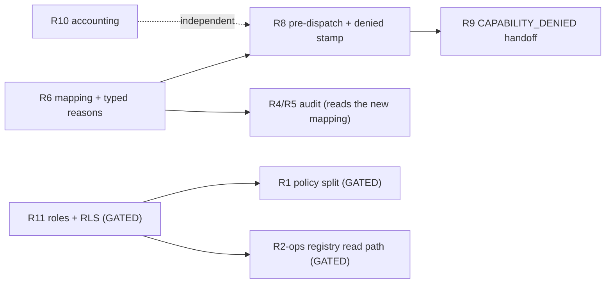

# Design: Retrieval, authorization and tenant isolation remediation (review group R)

- Status: DRAFT for owner review (design only; nothing in this document is implemented or approved)
- Author: Sonnet (architecture role), 2026-10-31, against git HEAD `7860fb4`
- Scope: review section 9 findings R1, R2-ops, R4/R5 follow-up, R6, R8, R9, R10, R11, R12 and two adjacent older security entries (rate-limit key, Kafka payload logging)
- Loop-version placeholder: `LV_R`. The shipped loop version is `lv7`; this document never hardcodes the next number. `LV_R` is replaced by the next free `lvN` at implementation time, one number per tranche that changes loop semantics.

## Context

The adversarial review (`docs/REVIEW-Sonnet-v0.1-part3.md` section 9) found that tenant isolation, authorization and retrieval accounting have holes that sit outside the investigation loop proper. Tranche 5 already closed R3 (header-only auth is dev-only), R4 (an empty `allowed_capabilities` denies), R5 (only the newest ACTIVE profile revision authorizes) and R7 (authorization infrastructure faults raise instead of masquerading as denials), plus the code half of R2 (index-scope guard). What remains is the subject of this document.

Every claim in the review was re-verified against the current tree before being designed. The review's line numbers are stale; claims are located by symbol. The verification changed the picture in several places, and those changes drive the design:

- **R1 is wider than reported.** The fingerprint is unkeyed (confirmed), the profile flag is never consulted (confirmed), the policy `USING` also covers `DELETE` (confirmed in the dev catalog: one `FOR ALL` policy). In addition, `CreateInvestigationService` accepts a caller-supplied `parameters["code_issue_fingerprint"]` and stores it as the investigation's fingerprint; `_caller_fingerprints_for` then uses that stored value as the "membership proof" for cross-tenant reads. A keyed fingerprint alone therefore does not close the hole: the proof must be server-derived.
- **R11 is partly stale.** `action_executions`, `idempotency_keys` and `outbox_events` DO have `ENABLE` + `FORCE` RLS and a `tenant_isolation` policy (migration 002, confirmed in the dev catalog). `hypothesis_evidence` and `evidence_attributes` carry no `tenant_id` column at all (child tables keyed by FK), and no repository reads or writes them. The tables that carry `tenant_id` without RLS are `investigation_contradictions`, `log_exemplars`, `evidence_bank_interest` and the four `analyzer_*` tables. The superuser finding is confirmed: in the dev catalog the role `iap` is `rolsuper` and `rolbypassrls`, owns the core tables, and the least-privilege roles hold grants on only a few onboarding-era tables (`iap_app` 18, `iap_worker` 10), so they cannot run the application today.
- **R6 reproduced** by an offline probe: a profile with `SOURCE_CODE` only and `GET_CODE` declared denies `GET_CODE`; the registry reports every known action name enabled for any tenant; `QUERY_CODE_TOPOLOGY` is denied by both. The two gateway methods that use the non-`ActionType` names have no production caller (only tests).
- **R8 and R9 reproduced.** A denied action returns a typed `BLOCKED` outcome from `execute_action_activity` before `record_retrieval_attempt`; a probe of `classify_terminal_handoff` with a denied-capability limitation yields `FRONTIER_EXHAUSTED`, and a limitation that merely contains the word "telemetry" yields `TELEMETRY_DEFERRED`. The prompt block also resolves the profile with `get_by_application_id` (newest revision of any status) while the authorizer resolves the newest ACTIVE revision, so the prompt can list capabilities the authorizer will not honor.
- **R10(a) reproduced** by an offline probe: with a stored query and no stored scope the requery directive fired on every one of 8 consecutive verify turns against a budget of 3 (the executed attempt is recorded under the derived scope, the budget counts under the empty scope).
- **R12** items are mostly confirmed; one (colon-delimited cache keys) is latent rather than exploitable, and `is_symlink()` after `resolve()` is a no-op but containment still holds because the root check uses the resolved path.
- **R2-ops** is an ops-owned delimiter change. The mapping already carries a `legacy_index_synthesis` flag, which gives a clean version-pin carrier (the profile's `mapping_source_id`) without any environment switch.

IAP is not live. There are no external consumers of stored data or APIs, so no item below carries a compatibility shim. Where engine semantics change, the change is pinned on the entity (`metadata["loop_version"]`) and routed with `loop_version_at_least`.

## References

- `docs/REVIEW-Sonnet-v0.1.md` (remediation table), `docs/REVIEW-Sonnet-v0.1-part3.md` section 9 (R1-R12, 9.1, 9.3)
- `docs/IAP_Arch_Eng_Recommendations.log` (R1, R2, R2-code, R2-ops, R4/R5, R6, R8-R12, rate-limit and Kafka entries, the older RLS-omission and idempotency entries; later IMPLEMENTED entries supersede older OPEN ones)
- `docs/IAP-architecture-v1.0.md` sections 64 (onboarding capability authorization), 66-71 (loop-version-pinned remediation tranches)
- `docs/IAP-TENANT-ONBOARDING-DB-ROLES.md` (role model, `scripts/provision-onboarding-db-roles.sql`)
- `docs/design/README.md`, `docs/design/DES-S7-handoff-v1.0.md` (R9), `docs/design/DES-tenant-telemetry-config-v1.0.md` (R2-ops)
- Source touched by design: `application/knowledge/{capture,retrieve,intake}.py`, `domain/knowledge/{fingerprint,models}.py`, `infrastructure/persistence/{knowledge_repository,profile_repository,onboarding_registry_repository,idempotency_repository,reference_doc_repository,rls}.py`, `infrastructure/security/profile_authorizer.py`, `infrastructure/evidence/runtime/{validation,elastic}.py`, `application/evidence/{gateway,retrieval_ledger}.py`, `application/worker/activities/{execution,verification,reasoning,lifecycle}.py`, `application/worker/workflows/{forcing,run_investigation}.py`, `application/investigation/{reasoning,verification,services}.py`, `domain/finding/models.py`, `domain/investigation/loop_version.py`, `api/{app,rate_limit,tenant}.py`, `api/v1/routers/{evidence,events,knowledge}.py`, `infrastructure/messaging/faststream.py`
- Existing tests extended: `tests/unit/test_r2_index_scope.py`, `tests/unit/test_tranche5_tenancy.py`, `tests/unit/test_onboarding_service.py`, `tests/unit/test_conclusion_rewrite.py`, `tests/unit/test_s7_priced_handoff.py`, `tests/unit/test_claim_binding_phase2.py`, `tests/unit/test_g3_retrieval_benefit.py`

## Goals / Non-Goals

**Goals**

- Close the cross-tenant disclosure paths (R1) and make the database enforce what the application only promises (R11), with a staged role-check that cannot brick the dev stack.
- Make "denied" a first-class, typed, recorded outcome that the loop steers around (R6, R8) and the verdict surface reports honestly (R9), without inventing profiles or capabilities.
- Make attempt accounting exact (R10) so no requery loop is unbounded and no absence is manufactured from a failed save.
- Give ops a safe, reversible path for the index-delimiter change (R2-ops) and a read-only audit and remediation guide for the profile fallout of R4/R5.
- Every item carries tests written first and shown red before the fix, at least one negative control, and an explicit loop-version statement.

**Non-Goals**

- No profile, capability, role-credential or tenant-id is invented. Profiles and capabilities are ops-owned; this document designs the mapping table, the enforcement and the audit only.
- No bulk fix of stored profiles (owner decision, recorded). The audit is read-only.
- No migration, restart, live run or tenant clean is authorized by this document. SQL here is a PROPOSAL and every migration REQUIRES OWNER APPROVAL.
- No change to proof-kernel, cascade rule precedence, verdict gating or the battery grader.
- No new public API except the R4/R5 audit CLI (read-only).

## Decisions

These are the cross-cutting decisions. Item-local decisions are numbered inside each item (`R1-D1`, ...).

### D1: Fail closed at every authorization and tenant boundary; fail open only for steering

An authorization or tenant decision that cannot be computed is a denial (or a raised infrastructure error that Temporal retries, per R7). A *steering* hint that cannot be computed (the prompt's capability list, the cascade's pre-dispatch filter) fails open to "no filtering": the authoritative gate downstream stays fail-closed, so a steering fault can waste a turn but never grant access. Every test table below states which side of this line a case sits on.

**Alternative considered:** fail closed on steering faults too (refuse to run the turn). Rejected: it converts a profile-store hiccup into a run failure, the exact class of failure R7 removed.

---

### D2: One pure capability policy module, consumed by the authorizer, the registry, the prompt, the cascade and the handoff

Today four places each hold their own idea of "what may this application do": `_ACTION_REQUIRED_EVIDENCE_TYPE` plus an inline dict in the authorizer, the registry's name check, the prompt's raw `allowed_capabilities`, and `_ACTION_REQUIRED_EVIDENCE_TYPE_LOCAL` in `activities/common.py`. They have already drifted (R6). The design is one pure domain module that owns the mapping table and the decision function.

```python
# src/investigation_agent_platform/domain/profile/capability_policy.py
"""Single source of truth for 'may this application run this action'.

Pure: no I/O, no clock. Profiles and capabilities are ops-owned; this module
only maps an action to the evidence type and the capability declaration that
the owner-approved authorization model already requires.
"""

from __future__ import annotations

from collections.abc import Iterable, Sequence
from dataclasses import dataclass
from enum import StrEnum
from typing import Any

from investigation_agent_platform.domain.investigation.models import ActionType
from investigation_agent_platform.domain.profile.models import ProfileStatus


class DenyReason(StrEnum):
    """Typed, closed reasons. The string value is what rides outcomes and limitations."""

    UNKNOWN_ACTION = "unknown_action"
    NO_APPLICATION = "no_application_context"
    NO_ACTIVE_PROFILE = "no_active_profile"
    NO_POLICY_ROW = "no_policy_row"
    EVIDENCE_TYPE_NOT_ENABLED = "evidence_type_not_enabled"
    CAPABILITY_NOT_DECLARED = "capability_not_declared"


@dataclass(frozen=True)
class CapabilityRule:
    """What an action needs. ``None`` means 'not gated on that axis'."""

    evidence_type: str | None
    capability: str | None


@dataclass(frozen=True)
class CapabilityDecision:
    allowed: bool
    reason: DenyReason | None = None

    @staticmethod
    def allow() -> CapabilityDecision:
        return CapabilityDecision(True, None)

    @staticmethod
    def deny(reason: DenyReason) -> CapabilityDecision:
        return CapabilityDecision(False, reason)


# Internal reasoning actions never reach a provider and are never gated.
INTERNAL_ACTIONS: frozenset[ActionType] = frozenset(
    {ActionType.FORMULATE_HYPOTHESIS, ActionType.VERIFY_HYPOTHESIS, ActionType.CONCLUDE}
)

# The MAPPING table (R6). Every external ActionType has exactly one row.
# GET_CODE moves from COMMIT_HISTORY to SOURCE_CODE: it reads source, and a
# SOURCE_CODE-only profile could search code but never fetch it.
ACTION_POLICY: dict[ActionType, CapabilityRule] = {
    ActionType.SEARCH_LOGS: CapabilityRule("LOG", "SEARCH_LOGS"),
    ActionType.QUERY_STATE: CapabilityRule("DATABASE_STATE", "QUERY_STATE"),
    ActionType.GET_CODE: CapabilityRule("SOURCE_CODE", "GET_CODE"),
    ActionType.CORRELATE: CapabilityRule("TRACE", "CORRELATE"),
    ActionType.SEARCH_CODE: CapabilityRule("SOURCE_CODE", "SEARCH_CODE"),
    ActionType.FIND_SYMBOL: CapabilityRule("SOURCE_CODE", "FIND_SYMBOL"),
    ActionType.FIND_CALL_GRAPH: CapabilityRule("CALL_GRAPH", "FIND_CALL_GRAPH"),
    ActionType.GET_CODE_HISTORY: CapabilityRule("COMMIT_HISTORY", "GET_CODE_HISTORY"),
    ActionType.WALK_STACK: CapabilityRule("SOURCE_CODE", "WALK_STACK"),
    ActionType.TRACE_LOGIC: CapabilityRule("SOURCE_CODE", "TRACE_LOGIC"),
    ActionType.TRACE_JOURNEY: CapabilityRule("LOG", "TRACE_JOURNEY"),
    ActionType.WALK_SESSION_GRAPH: CapabilityRule("DATABASE_STATE", "WALK_SESSION_GRAPH"),
    ActionType.SEARCH_REF_DOCS: CapabilityRule("DOCUMENTATION", "SEARCH_REF_DOCS"),
    ActionType.PROBE_API: CapabilityRule("API_PROBE", "PROBE_API"),
}


class PlatformOperation(StrEnum):
    """Gateway-internal operations that are not agent actions (R6).

    They are NOT ActionType members: the model must never be able to propose
    them. They get their own row so the gateway can authorize them without
    inventing an action. PROPOSED mapping; ops confirms the evidence type.
    """

    CODE_TOPOLOGY = "QUERY_CODE_TOPOLOGY"
    DOMAIN_ATTRIBUTION = "RESOLVE_DOMAIN_ATTRIBUTION"


PLATFORM_POLICY: dict[PlatformOperation, CapabilityRule] = {
    PlatformOperation.CODE_TOPOLOGY: CapabilityRule("SOURCE_CODE", None),
    PlatformOperation.DOMAIN_ATTRIBUTION: CapabilityRule("SOURCE_CODE", None),
}


def newest_active_revision(revisions: Iterable[Any]) -> Any | None:
    """The newest ACTIVE revision from a newest-first list (R5), else None."""
    for revision in revisions or []:
        if getattr(revision, "status", None) == ProfileStatus.ACTIVE:
            return revision
    return None


def evidence_gate(profile: Any, rule: CapabilityRule) -> DenyReason | None:
    if rule.evidence_type is None:
        return None
    enabled = set(getattr(getattr(profile, "investigation", None), "enabled_evidence_types", []) or [])
    return None if rule.evidence_type in enabled else DenyReason.EVIDENCE_TYPE_NOT_ENABLED


def capability_gate(profile: Any, rule: CapabilityRule) -> DenyReason | None:
    if rule.capability is None:
        return None
    declared = set(getattr(profile, "allowed_capabilities", None) or [])
    return None if rule.capability in declared else DenyReason.CAPABILITY_NOT_DECLARED


def capability_available(profile: Any | None, action: ActionType | str) -> CapabilityDecision:
    """The one decision function. ``profile`` is the already-resolved ACTIVE revision or None."""
    try:
        act = action if isinstance(action, ActionType) else ActionType(str(action))
    except ValueError:
        return CapabilityDecision.deny(DenyReason.UNKNOWN_ACTION)
    if act in INTERNAL_ACTIONS:
        return CapabilityDecision.allow()
    if profile is None:
        return CapabilityDecision.deny(DenyReason.NO_ACTIVE_PROFILE)
    rule = ACTION_POLICY.get(act)
    if rule is None:
        return CapabilityDecision.deny(DenyReason.NO_POLICY_ROW)
    reason = evidence_gate(profile, rule) or capability_gate(profile, rule)
    return CapabilityDecision.deny(reason) if reason else CapabilityDecision.allow()


def unavailable_actions(profile: Any | None) -> tuple[str, ...]:
    """Sorted names of every external action the profile cannot run (steering input)."""
    return tuple(
        sorted(a.value for a in ACTION_POLICY if not capability_available(profile, a).allowed)
    )


def effective_capabilities(profile: Any | None) -> tuple[str, ...]:
    """What the prompt may offer: external actions that pass BOTH gates."""
    return tuple(
        sorted(a.value for a in ACTION_POLICY if capability_available(profile, a).allowed)
    )


def assert_table_complete(actions: Sequence[ActionType] = tuple(ActionType)) -> list[str]:
    """Contract check used by a unit test: every action is internal or has a row."""
    return [a.value for a in actions if a not in INTERNAL_ACTIONS and a not in ACTION_POLICY]
```

**Rationale:** one table means R6, R8 and R9 cannot drift apart again, and the completeness check turns "a new `ActionType` was added without a policy row" into a test failure instead of a silent deny-by-default. The module is pure, so the workflow-side cascade can consume its output (as plain data) without breaking Temporal determinism.

**Alternative considered:** keep the dicts in `profile_authorizer.py` and import them. Rejected: the cascade and the handoff builder live in domain/application layers and must not import infrastructure.

**Trade-off:** `GET_CODE` now needs `SOURCE_CODE`. The dev default profile (`api/dependencies.py` `_DEFAULT_PROFILE`, enabled types `LOG, TRACE, DATABASE_STATE, COMMIT_HISTORY`, capabilities including `GET_CODE`) would then deny `GET_CODE`. That is a dev fixture in the repo (not an ops-owned tenant profile), so the design amends it to add `SOURCE_CODE` to the fixture's `enabledEvidenceTypes` in the same tranche. Stored tenant profiles that rely on `COMMIT_HISTORY` alone to fetch code are found by the audit (R4/R5 section) and remediated by their owners; no any-of shim is added (see R6).

---

### D3: Typed deny reasons travel on the exception, the outcome and the limitation

`ProfileBasedActionAuthorizer` gains `decide(...) -> CapabilityDecision`; `authorize_action` stays a thin boolean wrapper for existing `Protocol` callers. `ExecuteActionService.authorize` raises `SecurityPolicyViolationException(..., details={"deny_reason": "<DenyReason value>"})`. `execute_action_activity` copies the value into `ActionOutcome.error_code` (today it holds the exception class name, which carries no information). `miss_reason` stays `authorization_denied` so the existing S3 log-force rule keeps working. R9 reads the same reason when it writes a limitation.

---

### D4: Loop-semantics changes pin to `LV_R` and route with `loop_version_at_least`

The pre-dispatch filter (R8), the denied-attempt stamp (R8), the typed history parameters (R10b) and the `CAPABILITY_DENIED` handoff (R9) change what a run does. They are gated on `loop_version_at_least(metadata, LV_R)`. Items that are data-layer or security only (R1, R2-ops, R6 enforcement, R11, R12, rate limit, Kafka) need no loop version and say so. If the owner splits the R group across several tranches, each tranche that changes loop semantics takes the next free `lvN` and the doc's `LV_R` becomes that number; the loop-version module docstring gets one bullet per number, as for lv2-lv7.

---

### D5: Tests first, red before green, one negative control per item

Each item lists its tests as case descriptions. The implementer writes them first, runs them against the unmodified tree and records the failures, then implements. Every item names the exact line or condition to break to prove the test can fail (the negative control).

---

### D6: Non-superuser database tests are a separate, opt-in tier

Tests that prove RLS (R1 policy split, R11) must run as a role that is neither superuser nor `BYPASSRLS`, against a disposable Postgres, never the shared dev database. The repo already has the pattern (`pg_guard.require_disposable`, `IAP_RUN_ONBOARDING_DB_TESTS`, scratch schemas, `SET ROLE`). The design reuses it: a new opt-in module `tests/integration/test_rls_role_matrix_postgres.py` gated by `IAP_RUN_RLS_DB_TESTS=1`, with a precondition test that asserts the connecting role has `rolsuper = false` and `rolbypassrls = false` and fails loudly otherwise (a superuser-run RLS test silently proves nothing).

## Items overview

| Item | Verdict | Severity | Gating | Loop version | Tests |
|---|---|---|---|---|---|
| R1 shared-knowledge disclosure | Gated (owner rule) | blocker | owner approval for the migration; standing owner exclusion | none | 17 |
| R2-ops delimiter rename | Gated (ops-owned) | blocker (residual) | owner/ops approval; re-index | none (mapping-pinned) | 9 |
| R4/R5 operational audit | Follow-up of IMPLEMENTED | should-fix (ops impact) | read-only script | none | 7 |
| R6 mappings and dead second reason | Open | should-fix | ops confirms two proposed rows | none | 13 |
| R8 deny leaves no attempt; authorization-blind cascade | Open | should-fix | after R6 | `LV_R` | 14 |
| R9 CAPABILITY_DENIED handoff | Open | should-fix | after R6, R8 | `LV_R` | 11 |
| R10 attempt-accounting edges | Open (sub-items a-h) | should-fix (a: runaway) | none | `LV_R` for a, b, c, d, g; none for e, f, h | 20 |
| R11 RLS inert/incomplete | Gated (owner decision) | should-fix | owner approval for roles and migrations | none | 15 |
| R12 consider-tier (9 sub-items, A-I) | Open; E and G Not reproducible (latent) | consider | none | none | 26 |
| AD1 rate-limit key (older entry) | Open (verified) | should-fix | none | none | 5 |
| AD2 Kafka payload logging (older entry) | Open (verified) | should-fix | none | none | 4 |

Suggested order (owner schedules, one tranche per message): R6, then R8 + R9 (one `LV_R`), then R10, then R12 and the two adjacent items; R1, R2-ops and R11 stay gated behind their approvals. R6 must precede R8: the pre-dispatch check is only as correct as the mapping it reads.



## Items

### Item R1: Cross-tenant disclosure through SHARED knowledge artifacts — GATED

**Status:** GATED. Excluded by a standing owner rule; designed in full so the work is ready if the owner lifts the exclusion. Severity: blocker. Dependencies: the policy split needs a migration (REQUIRES OWNER APPROVAL, shown in Data Storage as a proposal only); the database-level proof needs R11's non-superuser test tier. Loop version: none (security and data layer; no loop behavior changes).

**Verified problem.** All four review sub-claims hold, plus one the review missed.

- `KnowledgeCaptureService._distill` (`application/knowledge/capture.py`) marks every `error_signature` artifact `SHARED_CODE_ISSUE` whenever the investigation has a fingerprint, and embeds `item.summary[:500]` plus the evidence `source` in the statement. Evidence: the `visibility=` conditional in `_distill` keys only on `fingerprint`.
- `enable_cross_tenant_fingerprints` (`domain/profile/models.py` `KnowledgeConfig`, default `False`) is never read: a repository-wide search finds it only in the model and the API schema.
- `build_code_issue_fingerprint` (`domain/knowledge/fingerprint.py`) is a plain SHA-256 of error class, repository, revision, failing symbol, caller symbol and top-frame file. A probe confirms two calls with the same low-entropy inputs return the same digest, so any party who can guess or file the same intake reproduces it.
- Migration 005 creates one policy `knowledge_visibility ... FOR ALL` with `USING (tenant_id = current_setting('app.tenant_id', true) OR visibility = 'SHARED_CODE_ISSUE')`. The dev catalog shows exactly that single `ALL` policy. Every tenant therefore sees every SHARED row and the same `USING` governs `DELETE` and `UPDATE`.
- **Missed by the review:** `CreateInvestigationService.execute` (`application/investigation/services.py`) reads `request.parameters["code_issue_fingerprint"]` and stores it verbatim as `investigation.code_issue_fingerprint`. `_caller_fingerprints_for` (`application/worker/activities/knowledge.py`) then returns that stored value as the "membership proof" and `list_shared_for_fingerprint` returns every SHARED row for it. A caller who learns or guesses a fingerprint (the unkeyed form is guessable) reads another tenant's shared rows by sending it as a request parameter, with no intake at all. Keying the fingerprint without fixing this leaves the same hole for any leaked value.
- The knowledge router (`api/v1/routers/knowledge.py`) also returns `other_tenant_sessions` (session number and timestamp for every other tenant's session on the same fingerprint), a presence oracle independent of artifact content.

**Design.**

*Principle.* Sharing is opt-in on both sides (writer and reader), content is a structured projection of data the reader already supplied to reproduce the fingerprint, and the database enforces the membership proof instead of trusting the application.

**R1-D1: honor the tenant opt-in at write time, fail closed.**

```python
# src/investigation_agent_platform/application/knowledge/capture.py  (new helper + use in _distill)
async def _sharing_opted_in(self, tenant_id: str, application_id: str | None) -> bool:
    """True only when the newest ACTIVE profile revision explicitly opts in. Any fault -> False."""
    if self.profile_repo is None or not application_id:
        return False
    try:
        revisions = await self.profile_repo.list_revisions(tenant_id, application_id)
        profile = newest_active_revision(revisions)
        knowledge = getattr(profile, "knowledge", None) if profile is not None else None
        return bool(getattr(knowledge, "enable_cross_tenant_fingerprints", False)) is True
    except Exception:
        return False
```

`_distill` computes `shared_ok = bool(fingerprint) and seed is not None and await self._sharing_opted_in(...)` once and builds SHARED artifacts only when it is true.

---

**R1-D2: share a structured projection, never evidence content.** The per-evidence `error_signature` artifact keeps its rich statement but is always `TENANT`. At most one additional SHARED `error_signature` per investigation is built from the server-stamped intake seed (`investigation.metadata["intake_seed"]`), which holds exactly the fields that produced the fingerprint.

```python
# src/investigation_agent_platform/application/knowledge/capture.py
def _shared_signature(seed: dict[str, Any]) -> str | None:
    """Projection of the fingerprint inputs only; None when the seed lacks them."""
    error_class = str(seed.get("error_class") or "").strip()
    symbol = str(seed.get("failing_symbol") or "").strip()
    repo = str(seed.get("repository") or "").strip() or "UNPINNED"
    rev = str(seed.get("revision") or "").strip() or "UNPINNED"
    if not error_class or not symbol:
        return None
    return sanitize_statement(f"Code issue: {error_class[:200]} at {symbol[:200]} ({repo[:120]}@{rev[:60]})")
```

The model validator enforces the projection at the type level so a future caller cannot regress it:

```python
# src/investigation_agent_platform/domain/knowledge/models.py  (inside _validate_policy_contract)
if self.visibility == ArtifactVisibility.SHARED_CODE_ISSUE:
    if self.kind != "error_signature":
        raise ValueError("only error_signature artifacts may be shared")
    if self.source_evidence_ids or self.source_log_refs:
        raise ValueError("shared artifacts carry no evidence or log references")
    if len(self.statement) > 600:
        raise ValueError("shared statements are bounded structured projections")
```

SHARED rows also stop being `IMMUTABLE`: they take `RefreshPolicy.TTL` with `valid_to = now + retention_days` so a stale cross-tenant statement ages out. `SHARED_KINDS` in `capture.py` (currently unused) is reduced to `{"error_signature"}`; `domain_attribution` and `code_reference` are not produced by capture and stay tenant-only until a design justifies sharing them.

---

**R1-D3: keyed fingerprint (HMAC) with a per-deployment secret that is never printed.**

```python
# src/investigation_agent_platform/domain/knowledge/fingerprint.py
import hashlib, hmac

FINGERPRINT_PREFIX = "hk1:"
_DOMAIN_LABEL = b"iap.code-issue.v1\x1e"

def build_code_issue_fingerprint(*, key: bytes, error_class: str, repository: str, revision: str,
                                 failing_symbol: str, caller_symbol: str | None = None,
                                 top_frame_file: str | None = None) -> str:
    if not key:
        raise ValueError("fingerprint key must be non-empty")
    ...  # identical validation and `parts` construction as today
    mac = hmac.new(key, _DOMAIN_LABEL + "\x1f".join(parts).encode("utf-8"), hashlib.sha256)
    return FINGERPRINT_PREFIX + mac.hexdigest()
```

The key comes from configuration, held as `SecretStr`, exactly like the Elastic cursor key:

```python
# src/investigation_agent_platform/infrastructure/configuration/config.py  (KnowledgeConfig)
fingerprint_key: SecretStr = Field(default=SecretStr(""))   # env IAP_KNOWLEDGE_FINGERPRINT_KEY

def _validate_knowledge_secrets(knowledge: KnowledgeConfig, environment: str) -> None:
    if environment.strip().lower() not in DEV_ENVIRONMENTS and not knowledge.fingerprint_key.get_secret_value():
        msg = "Boot halted: IAP_KNOWLEDGE_FINGERPRINT_KEY is required outside dev environments"
        logger.critical(msg)          # names the variable, never a value
        raise PlatformConfigurationError(msg)

def resolve_fingerprint_key(knowledge: KnowledgeConfig, environment: str) -> bytes:
    secret = knowledge.fingerprint_key.get_secret_value()
    if secret:
        return secret.encode("utf-8")
    if environment.strip().lower() in DEV_ENVIRONMENTS:
        return b"iap-dev-fingerprint-key-not-a-secret"   # dev only; the validator forbids this elsewhere
    raise PlatformConfigurationError("fingerprint key unavailable")
```

`DEV_ENVIRONMENTS` is the allowlist introduced by R3 in `api/tenant.py`; it moves to a shared module so config can import it without a cycle. The intake path (`application/knowledge/intake.py`, the only caller) receives the key through its constructor. Rotating the key orphans lineage and shared rows by design (documented under Risks); the `hk1:` prefix reserves a version for a future dual-key rotation design.

**Alternative considered:** a per-tenant HMAC key. Rejected: cross-tenant matching, the entire point of opt-in sharing, needs a common key.

---

**R1-D4: the membership proof is server-derived.** `CreateInvestigationService.execute` no longer stores an unverified caller fingerprint. A caller-supplied value is accepted only if it equals the fingerprint of an investigation the caller's tenant already owns (resolved through the tenant-free index and the tenant-scoped repository, the same own-row resolution intake already uses); otherwise it is dropped and a counter-only warning is logged.

```python
# src/investigation_agent_platform/application/investigation/services.py
async def _owned_fingerprint(self, tenant_id: str, candidate: str | None) -> str | None:
    if not candidate or not candidate.startswith(FINGERPRINT_PREFIX) or len(candidate) > 128:
        return None
    try:
        for _n, inv_id, _ts in await self.code_issue_index.sessions_for_fingerprint(candidate):
            if await self.investigation_repo.get_by_id(tenant_id, inv_id) is not None:
                return candidate
    except Exception:
        return None
    return None
```

---

**R1-D5: reader gate.** `_caller_fingerprints_for` returns an empty list unless the reader's own newest ACTIVE profile has opted in (same helper as D1, placed in `application/knowledge/sharing.py` so capture and retrieval share it).

---

**R1-D6: the knowledge router stops being a presence oracle.** `other_tenant_sessions` is populated only when the caller's tenant has opted in; otherwise the list is empty. Residual, accepted and stated: session numbers are global per fingerprint by earlier design (D8 of the knowledge-layer part), so a non-opted-in tenant can still infer from gaps in its own numbering that another party filed the same fingerprint. Closing that needs tenant-salted index keys for non-opted-in tenants; it is raised as an owner question rather than designed here.

---

**R1-D7: database policy split and an enforced proof (PROPOSAL, requires owner approval).** See Data Storage for the SQL. In short: a tenant-only `FOR ALL` policy and a separate `FOR SELECT` policy for shared rows that additionally requires the row's fingerprint to appear in a transaction-local GUC set by the repository.

```python
# src/investigation_agent_platform/infrastructure/persistence/rls.py
_FP_RE = re.compile(r"^hk1:[0-9a-f]{64}$")

@asynccontextmanager
async def rls_session(factory: Any, tenant_id: str, *, shared_fingerprints: Sequence[str] = ()) -> AsyncGenerator[AsyncSession]:
    if not _TENANT_RE.fullmatch(tenant_id):
        raise SecurityPolicyViolationException(f"Unsafe tenant_id for RLS session: {tenant_id!r}")
    proofs = list(dict.fromkeys(shared_fingerprints))[:20]
    if any(not _FP_RE.fullmatch(p) for p in proofs):
        raise SecurityPolicyViolationException("Unsafe fingerprint proof for RLS session")
    async with factory() as session:
        await session.execute(text(f"SET LOCAL app.tenant_id = '{tenant_id}'"))
        if proofs:
            await session.execute(text(f"SET LOCAL app.shared_fingerprints = '{','.join(proofs)}'"))
        ...  # unchanged commit/rollback tail
```

`list_shared_for_fingerprint` opens `rls_session(..., shared_fingerprints=[fingerprint])`, and also filters `status == ACTIVE` and `valid_to` in the future in SQL.

---

**R1-D8: opt-out demotion.** A tenant that flips the flag back to `False` must stop exposing rows it already shared. The janitor gains one sweep step:

```python
# src/investigation_agent_platform/infrastructure/persistence/knowledge_repository.py
async def demote_shared(self, tenant_id: str, application_id: str) -> int:
    async with rls_session(self._session_factory, tenant_id) as session:
        result = await session.execute(
            update(KnowledgeArtifactORM)
            .where(KnowledgeArtifactORM.tenant_id == tenant_id,
                   KnowledgeArtifactORM.application_id == application_id,
                   KnowledgeArtifactORM.visibility == ArtifactVisibility.SHARED_CODE_ISSUE.value)
            .values(visibility=ArtifactVisibility.TENANT.value)
        )
        return int(result.rowcount or 0)
```

**Alternatives considered.** (1) Drop SHARED visibility entirely: removes the channel but also the feature; offered to the owner as the zero-risk option. (2) Keep the FOR ALL policy and rely on application filtering: rejected, that is the current failure. (3) Hash with a per-tenant salt: breaks sharing. **Trade-offs:** the opt-in means no sharing happens until a profile owner sets the flag, which is the intended default; the DB proof adds one GUC round trip per shared read.

**Version pinning / migration.** No loop version: nothing about the loop changes. No compatibility shim: the unkeyed fingerprints already stored (dev rows) simply stop matching; lineage for those rows ends, which is acceptable because IAP is not live. A one-time data step demotes existing SHARED rows to TENANT (proposal in Data Storage) because their statements embed summaries; it must not run before the policy split.

**Test cases.** Written first; the unit and in-memory cases are shown failing against the current tree (capture shares without opt-in, the router leaks sessions, the caller fingerprint is accepted); the DB cases run only in the opt-in non-superuser tier.

| ID | Name | Level | Setup | Action | Expected | Notes |
|---|---|---|---|---|---|---|
| R1-T01 | Keyed fingerprint depends on the key | unit | two distinct 32-byte keys, identical inputs | build with key A twice, key B once, and the legacy unkeyed SHA-256 | A==A, A!=B, both start `hk1:`, neither equals the plain digest | Negative control: replace `hmac.new(key, ...)` with `hashlib.sha256(...)`, the A!=B assertion fails |
| R1-T02 | Key never printed | unit | `SecretStr` key, caplog at DEBUG, call `build`, format config and exception paths | grep captured text and `repr(config)` for the raw key | absent everywhere; empty key raises `ValueError` | Malformed input case: empty key |
| R1-T03 | Boot requires the key outside dev | unit | environments `production`, `staging`, `prod`, `local` | run `_validate_knowledge_secrets` with and without the key | non-dev without key raises `PlatformConfigurationError` naming the variable only; dev uses the dev key | Fail-closed; mirrors the cursor-key test |
| R1-T04 | No opt-in, no SHARED | unit | investigation with fingerprint and seed, profile `enable_cross_tenant_fingerprints=False` | `_distill` | zero artifacts with `SHARED_CODE_ISSUE`; all error_signature rows are TENANT | Fails today (shares whenever a fingerprint exists). Negative control: delete the `shared_ok` check |
| R1-T05 | Opt-in shares a projection only | unit | opted-in ACTIVE profile, evidence whose summary contains the sentinel `SECRET-ORDER-9931` and a source path | `_distill` | exactly one SHARED row; statement equals the structured projection; sentinel and source absent; `source_evidence_ids == []` | Cross-tenant disclosure negative at the content level |
| R1-T06 | No seed, no SHARED | unit | opted-in profile, investigation without `intake_seed` (API-created) | `_distill` | no SHARED artifact | Covers the caller-fingerprint path |
| R1-T07 | Profile fault fails closed | unit | `list_revisions` raises | `_distill` | artifacts all TENANT, capture does not raise | Fail-closed vs fail-open: capture stays fail-open for the run, closed for sharing |
| R1-T08 | Model rejects leaky shared artifacts | unit | construct SHARED artifact with `source_evidence_ids=[uuid]`, with a non-`error_signature` kind, and with a 700-char statement | validate | each raises `ValueError` | Malformed input |
| R1-T09 | Reader must opt in | unit | tenant-b not opted in, own investigation fingerprint equals a stored SHARED row | `_caller_fingerprints_for` then retrieval | proof list empty; retrieval returns no shared facts | Fails today. Cross-tenant negative |
| R1-T10 | Caller-supplied fingerprint is not trusted | unit | tenant-b request carries tenant-a's fingerprint in `parameters` (index holds only tenant-a's investigation) | `CreateInvestigationService.execute` | stored `code_issue_fingerprint` is None; a fingerprint of tenant-b's own investigation is kept | Fails today (stored verbatim). Negative control: remove the `_owned_fingerprint` call |
| R1-T11 | Two-tenant end to end (in-memory) | integration | tenants a and b both opted in, a concluded; then b not opted in | b retrieves for the same fingerprint | opted-in: sees only the projection; not opted-in: sees nothing; a's TENANT rows never appear | Cross-tenant negative, both directions |
| R1-T12 | Router presence oracle | unit | tenant with and without opt-in, index rows from another tenant | GET knowledge for the investigation | `other_tenant_sessions` empty unless opted in | Fails today |
| R1-T13 | RLS test role is not privileged | db-suite | connect as the test role | read `pg_roles` for `current_user` | `rolsuper=false` and `rolbypassrls=false`, else the module aborts | Guards against a vacuous pass |
| R1-T14 | DB enforces the membership proof | db-suite | disposable DB, proposal migration applied, tenant-a SHARED row | tenant-b session with matching GUC, with no GUC, with another fingerprint | visible only with the matching GUC; zero rows otherwise | Fails against the legacy `FOR ALL OR visibility` policy |
| R1-T15 | Cross-tenant DELETE and UPDATE blocked | db-suite | same row | tenant-b `DELETE` and `UPDATE ... SET status` on it | 0 rows affected, row intact; tenant-a delete works | Negative control: recreate the old single policy, the cross-tenant delete succeeds and the test fails |
| R1-T16 | Unsafe proof rejected before SQL | unit | proofs such as `x'; DROP`, wrong prefix, uppercase hex, 21 entries | `rls_session(..., shared_fingerprints=...)` | `SecurityPolicyViolationException` for malformed; list truncated to 20 for valid | Injection and malformed-input case |
| R1-T17 | Opt-out demotes | integration | tenant-a opted in with SHARED rows, flag flipped off | run janitor demote step, tenant-b retrieves | rows are TENANT, tenant-b sees none; call is idempotent | Covers revocation |

**Rollout, risks, open owner decisions.** Order: lift the exclusion, land R11's non-superuser test tier, land code (D1-D6, D8) with all unit tests green, then apply the proposal migration on a disposable database, then (owner-approved) the dev data step, then a staged enablement per application. Risk: key loss orphans lineage (mitigated by secret-manager custody and the `hk1:` version prefix). Owner decisions: (1) lift the R1 exclusion, or take the zero-risk option of removing SHARED visibility; (2) dev-fallback key versus requiring the key everywhere; (3) accept the session-number gap residual or fund tenant-salted index keys; (4) approve the migration and the one-time demotion.

### Item R2-ops: Reserved index delimiter, re-index cutover and the test that flips — GATED

**Status:** GATED (ops-owned; needs owner and ops approval; the cutover touches a live Elasticsearch cluster and filebeat). Severity: blocker residual (the code half is IMPLEMENTED and fail-closed). Dependencies: R11's grant path for the registry lookup used by the legacy guard; the registry-row rules below are enforced by ops at row creation. Loop version: none; the version pin is the profile's `mapping_source_id` (an entity field), not an environment switch.

**Recorded follow-ups of the IMPLEMENTED R2 code half** (so they are not lost):

- (a) Narrowing to exact per-service patterns is **dash-only and final**: index naming varies by deployment and only the dash-boundary risk class justifies a behavior change (rationale lives in the `validation.py` comment; the probe that tried to learn the layout was dropped as non-transferable).
- (b) **Collision audit before the next restart.** The sibling source is now the union of registry, investigation and profile tenant ids, so the guard is no longer inert on an empty registry. In the dev database that union has 40 distinct tenant ids with 10 dash-boundary pairs, so dash-free tenants that are a dash-prefix of another known tenant now fail closed on the wildcard unless a dashed tenant names its services. The audit query is in this section; run it, then rename or accept each pair.
- (c) CLOSED by owner decision 2026-10-31: `OnboardingService` stays unwired; the first-onboarding status gate is committed but dormant by design; new-tenant id enforcement is ops-owned at registry-row creation; revisit only if onboarding is built out, at which point the gate activates with no code change.

**Verified problem.** `build_index_pattern` still synthesizes `logs-{tenant}-*-{env}-*` for a dash-free tenant (or a dashed tenant that names no services); the pinned reproduction test shows tenant `acme`'s wildcard matches `logs-acme-eu-svc-prod-1`. The strict `xfail` in `tests/unit/test_tranche5_tenancy.py` (`test_tenant_pattern_must_not_match_a_sibling_tenants_index`) is the marker that this is unfixed at the pattern level (the test run in this review reports 54 passed, 1 xfailed). The review also called the router fall-through "fail-open"; that is the documented default route (`bootstrap/__init__.py`: the global deployment serves tenants without tenant telemetry configuration), so it is **by design, not a defect**, provided the global path's pattern is tenant-bounded, which is exactly what the delimiter provides.

**Design.**

**R2OPS-D1: the delimiter convention.** Index names become `logs-{tenant}--{service}-{env}-{n}`. The double dash is reserved: tenant and service tokens may not contain `--` and may not begin or end with `-`. Because a tenant token cannot contain `--`, the first `--` in an index name is always the tenant/service boundary, so `logs-acme--*` can only match indexes of tenant `acme`.

```python
# src/investigation_agent_platform/infrastructure/evidence/runtime/validation.py
INDEX_DELIM = "--"
_TOKEN = re.compile(r"^[a-z0-9](?:[a-z0-9._]|-(?!-))*[a-z0-9]$|^[a-z0-9]$")   # no '--', no edge '-', lowercase (ES requires it)

def validate_index_token(value: str, what: str) -> str:
    if not isinstance(value, str) or not 1 <= len(value) <= 128 or not _TOKEN.fullmatch(value):
        raise SecurityPolicyViolationException(f"Invalid {what} for delimited index scope.")
    return value

def build_delimited_pattern(tenant_id: str, environment: str, services: Iterable[str] = ()) -> str:
    validate_index_token(tenant_id, "tenant identifier")
    validate_environment(environment)
    scoped = tuple(sorted({validate_index_token(s, "service") for s in services}))
    if scoped:
        return ",".join(f"logs-{tenant_id}{INDEX_DELIM}{s}-{environment}-*" for s in scoped)
    return f"logs-{tenant_id}{INDEX_DELIM}*-{environment}-*"
```

Proof sketch that no cross-tenant match exists: an index of tenant `u` and service `s` is `logs-u--s-...` with no `--` inside `u` or `s`. A pattern for tenant `t` begins `logs-t--`. For the pattern to match, `logs-t--` must be a prefix of `logs-u--s-...`. Then `t--` is a prefix of `u--s-...`; since `t` and `u` contain no `--` and neither ends with `-`, the first `--` in each string is the delimiter, so `t == u`. The test below checks this exhaustively over a small alphabet rather than relying on the argument.

**R2OPS-D2: the version pin is the mapping.** The mapping model today carries `legacy_index_synthesis: bool`. It becomes a closed enum, and a second reserved built-in mapping id selects the new convention.

```python
# src/investigation_agent_platform/domain/observability/mapping.py
class IndexSynthesis(StrEnum):
    NONE = "none"            # mapping declares explicit index_patterns
    DASH = "dash"            # logs-{tenant}-*-{env}-*   (time-boxed migration aid)
    DELIMITED = "delimited"  # logs-{tenant}--*-{env}-*

GENERIC_ECS_SOURCE_ID = "generic-ecs"                    # DASH, unchanged behavior
GENERIC_ECS_DELIMITED_SOURCE_ID = "generic-ecs-delimited"  # DELIMITED
```

`resolve_index_pattern` dispatches on `mapping.index_synthesis`. A profile revision pins `mapping_source_id`; a tenant is cut over by activating a new profile revision that names `generic-ecs-delimited`, and rolled back by activating one that names `generic-ecs`. There is no environment variable, no global default switch and no silent fallback: an unknown id fails closed with `DomainValidationException`. New profile revisions default to the delimited id once the owner approves the default flip; stored revisions keep the id they were saved with (the field is always serialized). The DASH path, `dash_boundary_siblings`, the dash-only narrowing, the `known_tenant_ids` plumbing in `AsyncElasticAdapter` and the dormant `_reject_ambiguous_new_tenant_id` gate are a **time-boxed migration aid**: one owner-approved cleanup tranche deletes them after the last tenant is cut over, per the no-legacy rule. Until then they stay as they are, unchanged.

**R2OPS-D3: ops runbook (requires owner/ops approval at each gate; nothing here is run by the implementer).**

1. *Collision audit (read-only, any time).* Run against the database as an operator:

```sql
-- Dash-boundary pairs among every tenant id the platform knows (matches list_known_tenant_ids).
WITH ids AS (
    SELECT canonical_id AS t FROM tenant_registry
    UNION SELECT tenant_id FROM investigations
    UNION SELECT tenant_id FROM application_profiles
)
SELECT a.t AS shorter, b.t AS longer
FROM ids a JOIN ids b
  ON a.t <> b.t AND left(b.t, length(a.t) + 1) = a.t || '-'
ORDER BY 1, 2;
```

   `left(...)` is used instead of `LIKE` because `_` is a `LIKE` wildcard and tenant ids may contain it.
2. *Inventory (read-only).* List `logs-*` index names and map each to `(tenant, service, env)` from the registry and the filebeat configuration. A name that two tenants could own is recorded as unresolved and is not aliased.
3. *Dual naming for new data.* Change the filebeat output index template to `logs-{tenant}--{service}-{env}-%{+yyyy.MM.dd}` (the dev shipper's `output.elasticsearch.index` and the self profile's `telemetry.log_indices` are the two repo-owned examples; deployment shippers are ops-owned).
4. *Alias bridge for existing data (no copy).* For each resolved old index add an alias with the new name through the `_aliases` API (metadata only, reversible with `remove`). A wildcard resolves aliases, so `logs-acme--*` reaches the old data without a re-index; a physical re-index is deferred to normal ILM rollover.
5. *Verify per tenant.* Compare the document count for `logs-{tenant}--*-{env}-*` with the old pattern's count for the same tenant over a fixed window; any difference blocks that tenant.
6. *Cut over per tenant.* The profile owner saves a new revision naming `generic-ecs-delimited` and activates it (post-R5 only an ACTIVE revision authorizes). Watch one investigation per tenant. Rollback: activate a revision naming `generic-ecs`.
7. *Registry-row creation rule (ops).* New tenant ids are rejected at row creation unless they match the token pattern above (lowercase, no `--`, no edge dash).
8. *Decommission.* When every tenant is cut over, the owner approves the cleanup tranche that removes the DASH path and flips the default.

**R2OPS-D4: the test that flips.** The strict `xfail` is not removed by editing the assertion to pass; it is converted to assert the new convention and the old reproduction is kept only while the DASH path exists.

```python
# tests/unit/test_tranche5_tenancy.py  (class TestR2IndexPatternTenantIsolation)
@staticmethod
def _pattern(tenant: str, environment: str = "prod") -> str:
    from investigation_agent_platform.infrastructure.evidence.runtime.validation import build_delimited_pattern
    return build_delimited_pattern(tenant, environment)

def test_tenant_pattern_must_not_match_a_sibling_tenants_index(self) -> None:   # xfail marker deleted
    assert not fnmatch.fnmatchcase("logs-acme-eu--svc-prod-1", self._pattern("acme"))
```

**Alternatives considered.** (1) Forbid `-` in tenant ids: breaks existing dashed tenants. (2) Per-tenant ES filtered aliases (`term tenant`): strongest but requires every index to carry a tenant field, which the legacy shippers do not write. (3) A tenant-id prefix with fixed width: brittle. (4) Do nothing beyond the code half: leaves the raw wildcard shape collidable for dash-free tenants whose siblings are not yet registered. **Trade-offs:** alias bridging depends on ops getting the old-name-to-tenant mapping right; the dry-run and the per-tenant count comparison are the controls.

**Version pinning / migration.** Pinned on `mapping_source_id` (entity-recorded on the profile revision); no loop version; no env switch; the DASH strategy is a named, time-boxed migration aid with a removal gate. No database migration. ES changes are ops-run.

**Test cases.** Written first and shown red before the fix (Decision D5).

| ID | Name | Level | Setup | Action | Expected | Notes |
|---|---|---|---|---|---|---|
| R2OPS-T01 | Flipped strict-xfail test | unit | the converted test above, no xfail marker | run | delimited pattern for `acme` does not match `logs-acme-eu--svc-prod-1` | Red before the fix (`build_delimited_pattern` absent). Negative control: change `INDEX_DELIM` to `-`, the test fails |
| R2OPS-T02 | Own indexes still match | unit | tenant `acme-eu`, services `svc` and none | build pattern, fnmatch `logs-acme-eu--svc-prod-1` | matches in both service-named and wildcard forms | Positive path |
| R2OPS-T03 | Reverse direction | unit | tenant `acme-eu`, index of `acme` with service `eu-x`: `logs-acme--eu-x-prod-1` | fnmatch the `acme-eu` pattern | no match | The case the dash guard needed registry data for |
| R2OPS-T04 | Exhaustive no-collision property | unit | all tenant/service tokens over alphabet `{a,b,-,.,1}` up to length 4 that satisfy the token rule | for every ordered pair of distinct tenants, fnmatch tenant X's pattern against tenant Y's generated index | zero matches | Deterministic substitute for a property test; negative control: allow a trailing `-` in `_TOKEN`, a collision appears |
| R2OPS-T05 | Token validation | unit | `a--b`, `-a`, `a-`, `A`, empty, 129 chars, `a b`, `a,b`, `a*` | `validate_index_token` | all raise `SecurityPolicyViolationException`; `a-b`, `a.b`, `a_b` accepted | Malformed input and wildcard/comma injection |
| R2OPS-T06 | Mapping pin routing | unit | three profiles pinned to `generic-ecs`, `generic-ecs-delimited`, `nope` | `resolve_index_pattern` | DASH pattern, DELIMITED pattern, `DomainValidationException` (fail closed, no default) | Version-pin routing without any environment switch |
| R2OPS-T07 | Delimited path needs no registry lookup | unit | adapter with a `known_tenant_ids` callable that counts calls and one that raises | search on a delimited mapping | zero calls, search served even when the lookup raises; DASH mapping still fails closed on lookup failure | Fail-closed vs fail-open boundary |
| R2OPS-T08 | Alias plan dry-run is offline and conservative | unit | fixture index list, tenant/service map with an ambiguous name, a mock ES client | generate the alias action list | actions only for resolved names; ambiguous names in the unresolved list; mock client saw no write call | Never touches a cluster |
| R2OPS-T09 | Collision audit SQL | db-suite | disposable Postgres; ids `acme`, `acme-eu`, `acme-eu-west`, `beta`, `beta_x`, `a_c`, `abc-x` | run the audit query | pairs `acme/acme-eu`, `acme/acme-eu-west`, `acme-eu/acme-eu-west`, and no pair for `beta/beta_x` or `a_c/abc-x` | Negative control: swap `left()` for `LIKE a.t \|\| '-%'`, the `a_c/abc-x` false pair appears |

**Rollout, risks, open owner/ops decisions.** Rollout is the runbook; code lands first (tests T01-T08 green, default unchanged), then ops executes steps 1-6 per tenant. Risks: a wrong alias mapping hides data (control: step 5 counts); a tenant cut over before its aliases exist sees zero hits (control: step 6 only after step 5). Decisions needed: approve the delimiter `--`; approve the alias bridge versus a physical re-index; approve the default flip and the cleanup tranche; confirm whether the global default route should remain for tenants without tenant telemetry configuration.

### Item R4/R5: Operational impact of the empty-capability deny and ACTIVE-only authorization — Follow-up of IMPLEMENTED items

**Status:** Follow-up of IMPLEMENTED items (R4 and R5 code landed in tranche 5). Severity: should-fix (operational). Owner decision recorded: **no bulk fix of stored profiles.** Dependencies: reads the R6 mapping so the audit reflects the corrected `GET_CODE` rule. Loop version: none. Adds one CLI (read-only).

**Verified problem.** `ProfileBasedActionAuthorizer._active_profile` returns only the newest ACTIVE revision (R5) and `authorize_action` denies when `allowed_capabilities` is empty (R4); both are pinned by `tests/unit/test_tranche5_tenancy.py`. The recorded dev audit (before the 2026-10-30 restart) found 124 of 164 stored profiles would deny, mostly DRAFT profiles in two onboarding tenants, plus a few ACTIVE dev and probe profiles with no declared capabilities; the battery tenant was unaffected. That figure was produced by a one-off query; there is no repeatable, reviewed procedure, and R6 will change the answer for profiles that rely on `COMMIT_HISTORY` to fetch code. The audit below makes the number reproducible and the remediation per-profile.

**Design.**

**R45-D1: a pure classifier plus a thin read-only CLI.**

```python
# src/investigation_agent_platform/application/profile/authz_audit.py   (pure, no I/O)
@dataclass(frozen=True)
class AuditRow:
    tenant_id: str
    application_id: str
    newest_status: str            # status of the highest-version revision
    active_version: int | None
    verdict: str                  # OK | PARTIAL | DENY_ALL_NO_ACTIVE | DENY_ALL_NO_CAPABILITIES | RETIRED
    denied: dict[str, str]        # action -> DenyReason value under the shipped mapping
    flips_with_r6: tuple[str, ...]  # actions whose answer differs between the legacy and corrected mapping

def audit_application(tenant_id: str, application_id: str, revisions: Sequence[Any]) -> AuditRow:
    newest = revisions[0] if revisions else None            # newest-first, as list_revisions returns
    active = newest_active_revision(revisions)
    if active is None:
        retired = all(getattr(r, "status", None) in (ProfileStatus.ARCHIVED, ProfileStatus.DEPRECATED) for r in revisions)
        return AuditRow(tenant_id, application_id, _s(newest), None,
                        "RETIRED" if retired else "DENY_ALL_NO_ACTIVE", {}, ())
    declared = list(active.allowed_capabilities or [])
    denied = {a.value: d.reason.value for a in ACTION_POLICY
              if not (d := capability_available(active, a)).allowed}
    verdict = ("DENY_ALL_NO_CAPABILITIES" if not declared
               else "OK" if not denied else "PARTIAL")
    return AuditRow(tenant_id, application_id, _s(newest), int(active.version), verdict, denied,
                    _flips(active))
```

The CLI (`python -m investigation_agent_platform.cli.profile_authz_audit [--tenant T] [--format table|json|csv]`) enumerates tenants, then, per tenant, opens one `rls_session` inside a `READ ONLY` transaction and calls `ProfileRepository.list_revisions` for each application. It prints counts, names and reasons only. It never prints `profile_json` bodies, connection refs or secrets, and it never writes. Under R11 least-privilege roles it needs the same tenant-enumeration grant path as `list_known_tenant_ids`.

**R45-D2: per-profile owner remediation guide** (profiles are immutable revisions; every fix is a new revision that the owner reviews and activates; this document invents no capability, it only shows what each verdict means).

| Verdict | Meaning | Owner action |
|---|---|---|
| `DENY_ALL_NO_ACTIVE`, a DRAFT exists | Nothing authorizes; only the newest ACTIVE revision counts | Review the newest DRAFT; if correct, activate it (activation requires at least one service and no `TBD` connection refs). If it is a leftover, archive it |
| `DENY_ALL_NO_CAPABILITIES` | ACTIVE but `allowed_capabilities` is empty | Declare the capabilities the application is meant to use. The audit lists, per enabled evidence type, which capabilities that type backs, as a menu; the owner chooses |
| `PARTIAL` with `capability_not_declared` | Evidence type enabled but capability not listed | Add the capability, or accept that the action is intentionally unavailable |
| `PARTIAL` with `evidence_type_not_enabled` | Capability listed but the evidence type is off | Enable the evidence type, or remove the capability |
| `flips_with_r6` contains `GET_CODE` | Fetching code was allowed by `COMMIT_HISTORY` and now needs `SOURCE_CODE` | Add `SOURCE_CODE` if code fetch is intended; otherwise drop `GET_CODE` |
| `RETIRED` | Only ARCHIVED or DEPRECATED revisions | No action; denial is intended |
| Dev and probe profiles | Left over from experiments | Archive instead of fixing |

After saving and activating a revision the owner re-runs the audit for that tenant (expected `OK`), then runs one test investigation. No step in this guide is automated and none is performed by the platform.

**Alternatives considered.** A migration or startup task that rewrites stored profiles: rejected by the owner decision and by the ops-owned status of profiles. A grace period that keeps the old fallback: rejected (no legacy branches).

**Version pinning / migration.** No pin: this item adds a read-only report; no stored data changes.

**Accessibility.** The CLI writes plain text tables and machine-readable JSON/CSV; exit code 0 means the report ran, regardless of verdicts (an `--fail-on` flag is deliberately absent so the report cannot gate a deploy by accident).

**Test cases.** Written first and shown red before the fix (Decision D5).

| ID | Name | Level | Setup | Action | Expected | Notes |
|---|---|---|---|---|---|---|
| R45-T01 | Active with no capabilities | unit | one ACTIVE revision, `allowed_capabilities=[]` | `audit_application` | `DENY_ALL_NO_CAPABILITIES` | Mirrors the R4 deny |
| R45-T02 | Newer DRAFT never counts | unit | ACTIVE v1 (caps declared) and DRAFT v2, newest-first | audit | verdict from v1, `active_version == 1`; DRAFT-only gives `DENY_ALL_NO_ACTIVE` | The R5 class (the bulk of the 124) |
| R45-T03 | Retired only | unit | only ARCHIVED and DEPRECATED revisions | audit | `RETIRED` | Distinguishes intended denial |
| R45-T04 | R6 flip is reported | unit | ACTIVE, enabled types `COMMIT_HISTORY` only, `GET_CODE` declared | audit | `GET_CODE` in `flips_with_r6` and in `denied` | Ties the audit to R6 |
| R45-T05 | Read-only by construction | unit | fake session recording every statement | run the CLI core | every statement is a `SELECT`, `SET TRANSACTION READ ONLY` or `SET LOCAL app.tenant_id`; no `INSERT/UPDATE/DELETE/DDL` | Negative control: add an `UPDATE` to the code, the test fails |
| R45-T06 | No secrets or bodies in output | unit | profile whose datasource `connection_ref` and description hold sentinels | render table, json and csv | sentinels absent | Redaction |
| R45-T07 | Tenant isolation of the scan | unit | fake factory that records the GUC | audit two tenants | one session per tenant, GUC set before the first select, no select spans two tenants; `--tenant` limits the scan | Cross-tenant negative at the procedure level |

**Rollout, risks, open owner decisions.** Ship the pure module and tests with R6; the CLI is optional tooling and writes nothing. Risk: an owner reads `OK` as "will work"; the report states it evaluates authorization only. Owner decisions: approve the CLI; decide which stored profiles to retire versus fix (this document does not).

### Item R6: Dead second deny reason and wrong capability mappings

**Status:** Open. Severity: should-fix. Dependencies: ops confirms the two PROPOSED platform rows; the `GET_CODE` change affects the dev default fixture and any stored profile that relied on `COMMIT_HISTORY` (see R4/R5). It precedes R8 and R9. Loop version: none (authorization semantics; pinning would keep a wrong gate alive).

**Verified problem.** An offline probe against the current tree, with an ACTIVE profile declaring `SEARCH_CODE` and `GET_CODE` and enabling only `SOURCE_CODE`: `SEARCH_CODE` authorize True; `GET_CODE` authorize False (the map requires `COMMIT_HISTORY`); the registry returns True for `GET_CODE` and for `SEARCH_LOGS` (which the profile does not allow) and False only for `QUERY_CODE_TOPOLOGY`. Reading the code agrees: `ProfileBasedCapabilityRegistry.is_capability_enabled` (`infrastructure/security/profile_authorizer.py`) ignores `tenant_id` and the profile and answers from the static action table, so "Capability ... is disabled" can fire only for names that are not in the table. `list_allowed_capabilities` returns every `ActionType` for any tenant. The gateway methods `resolve_code_ownership` and `attribute_failure_frames` (`application/evidence/gateway.py`) authorize `QUERY_CODE_TOPOLOGY` and `RESOLVE_DOMAIN_ATTRIBUTION`, which are not `ActionType` members, so the real authorizer always denies them; a repository search finds callers only in tests, so this is a dead, always-denied seam rather than a live outage. `InvestigationActionValidator` (`application/investigation/validator.py`) has no production caller.

**Design.**

**R6-D1: the mapping table** is `ACTION_POLICY` and `PLATFORM_POLICY` in Decision D2. Only one existing row changes.

| Action | Evidence type (today) | Evidence type (proposed) | Capability |
|---|---|---|---|
| `GET_CODE` | `COMMIT_HISTORY` | **`SOURCE_CODE`** | `GET_CODE` |
| `GET_CODE_HISTORY` | `COMMIT_HISTORY` | unchanged | `GET_CODE_HISTORY` |
| every other external `ActionType` | per the table in D2 | unchanged | same name |
| `QUERY_CODE_TOPOLOGY` (platform operation) | none (always denied) | **PROPOSED:** `SOURCE_CODE`, no capability declaration | none; not an `ActionType` |
| `RESOLVE_DOMAIN_ATTRIBUTION` (platform operation) | none (always denied) | **PROPOSED:** `SOURCE_CODE`, no capability declaration | none; not an `ActionType` |

The two platform rows are a policy judgement that ops owns: topology and attribution answer questions about source locations, so the proposal gates them on the same evidence type as code reads. If ops prefers a different type the row changes in one place.

**R6-D2: a profile-aware registry whose reason is reachable.** The port gains an optional application id; the gateway and the action service pass it.

```python
# src/investigation_agent_platform/ports/security/redactor.py
async def is_capability_enabled(self, tenant_id: str, capability_name: str,
                                application_id: str | None = None) -> bool: ...

# src/investigation_agent_platform/infrastructure/security/profile_authorizer.py
class ProfileBasedCapabilityRegistry:
    async def decide(self, tenant_id: str, capability_name: str,
                     application_id: str | None) -> CapabilityDecision:
        if not application_id:
            return CapabilityDecision.deny(DenyReason.NO_APPLICATION)
        revisions = await self._profile_repo.list_revisions(tenant_id, application_id)
        profile = newest_active_revision(revisions)
        return capability_available_by_name(profile, capability_name)   # ActionType or PlatformOperation

    async def is_capability_enabled(self, tenant_id, capability_name, application_id=None) -> bool:
        return (await self.decide(tenant_id, capability_name, application_id)).allowed

    async def list_allowed_capabilities(self, tenant_id: str, application_id: str | None = None) -> list[str]:
        ...  # effective_capabilities(newest ACTIVE profile), [] when unresolved
```

The authorizer remains complete (it enforces both gates through `capability_available`, so R4's guarantee holds even for a caller that uses it alone). The registry independently enforces the same decision. The redundancy is deliberate defense in depth; the second reason becomes reachable whenever the authorizer is permissive (a test double, or a future non-profile authorizer), and both messages carry the typed reason.

**R6-D3: typed deny on the wire** (D3 above): `ExecuteActionService.authorize` and `AsyncEvidenceGateway._enforce_authorization` attach `details={"deny_reason": ...}`; `capability_available_by_name` returns `UNKNOWN_ACTION` for any string that is neither an `ActionType` nor a `PlatformOperation`, so a model-proposed `action_type` of `QUERY_CODE_TOPOLOGY` is still denied (a platform operation can only be invoked by the gateway's own methods).

```python
# src/investigation_agent_platform/application/evidence/gateway.py
await self._enforce_authorization(
    tenant_id, PlatformOperation.CODE_TOPOLOGY.value, file_path, application_id=application_id)
```

**R6-D4: dev fixture.** `_DEFAULT_PROFILE.investigation.enabledEvidenceTypes` gains `SOURCE_CODE` so the dev default keeps granting its declared `GET_CODE` (the fixture is repo code, not a tenant profile).

**Alternatives considered.** (1) An any-of rule (`SOURCE_CODE` or `COMMIT_HISTORY`) for `GET_CODE`: preserves old profiles but encodes a compatibility shim the repo rules forbid and keeps a wrong reading alive. (2) Add the two platform names to `ActionType`: would let the model propose them. (3) Delete the two gateway methods (they have no production caller): the smaller change, offered as the owner's alternative to the PROPOSED rows; recommended against only because the architecture names the gateway as the sanctioned topology seam. **Trade-offs:** two profile reads per action (no cache, so a revoked capability takes effect on the next action); the corrected `GET_CODE` mapping has an operational cost covered by the audit.

**Version pinning / migration.** None. Authorization semantics apply to every request from deploy time; there is no stored-data migration. The `GET_CODE` effect on stored profiles is reported by the R4/R5 audit and remediated by profile owners.

**Test cases.** Written first and shown red before the fix (Decision D5).

| ID | Name | Level | Setup | Action | Expected | Notes |
|---|---|---|---|---|---|---|
| R6-T01 | Table is complete | unit | the enum and the policy module | `assert_table_complete()`; and with a copy of the enum plus an extra member | `[]` for the real enum; the extra member is reported | Negative control: delete one row from `ACTION_POLICY`, the check returns it |
| R6-T02 | GET_CODE needs SOURCE_CODE | unit | ACTIVE profile declaring `GET_CODE`, enabled `SOURCE_CODE` only; then `COMMIT_HISTORY` only | `authorize_action` | allowed; then denied with `evidence_type_not_enabled` | Red today (reversed) |
| R6-T03 | Every row, both gates | unit | for each `(action, rule)` build a profile with exactly that evidence type and capability | `capability_available`; then drop each axis in turn | allowed; then `capability_not_declared` / `evidence_type_not_enabled` | Data-driven over all 14 external actions |
| R6-T04 | Second reason is live | unit | ACTIVE profile without `SEARCH_LOGS` declared | `registry.is_capability_enabled(t, "SEARCH_LOGS", app)` | False with `capability_not_declared` (True today) | Negative control: revert the registry to the name-only check |
| R6-T05 | Registry requires application context | unit | no application id; unknown tenant; no revisions | registry call | False, `no_application_context` / `no_active_profile` | Fail closed |
| R6-T06 | Registry ignores non-ACTIVE | unit | DRAFT v2 declares the capability, ACTIVE v1 does not | registry call | False | R5 parity |
| R6-T07 | Gateway defense in depth | unit | authorizer stub returning True, real registry, profile without the capability | gateway `search_runtime_evidence` | `SecurityPolicyViolationException` "Capability 'SEARCH_LOGS' is disabled" | Proves the second reason fires end to end |
| R6-T08 | Platform operations | unit | profile with `SOURCE_CODE`; then without | `resolve_code_ownership` and `attribute_failure_frames` with the real authorizer | allowed to proceed past authorization; then denied `evidence_type_not_enabled` | Red today (always denied) |
| R6-T09 | Model cannot propose platform operations | unit | `action_type="QUERY_CODE_TOPOLOGY"` and `"query_code_topology"` | `capability_available`, `ActionType(...)` | `UNKNOWN_ACTION`; `ValueError` | Security case |
| R6-T10 | Typed reason rides the exception and outcome | unit | denied action through `ExecuteActionService` and `execute_action_activity` | inspect exception details and returned outcome | `details["deny_reason"]` set; outcome `error_code` equals it; `miss_reason == "authorization_denied"` | Keeps the S3 log-force rule |
| R6-T11 | Effective list is profile-derived | unit | profile declaring two capabilities | `list_allowed_capabilities` | exactly those backed by enabled evidence types; not every `ActionType` | Red today |
| R6-T12 | Dev default still works | unit | `_DEFAULT_PROFILE` made ACTIVE | authorize every declared capability | all allowed including `GET_CODE` | Guards the fixture amendment |
| R6-T13 | Malformed inputs | unit | action `""`, `None`, `"search_logs"`; profile with `allowed_capabilities=None` and non-list `enabled_evidence_types` | `capability_available` | `UNKNOWN_ACTION` for names (case-sensitive); None treated as empty and denied, no exception | Malformed input |

**Rollout, risks, open owner decisions.** Land the policy module, authorizer, registry and fixture together with the tests (the dev stack keeps working because of the fixture amendment). Risk: stored profiles that fetched code through `COMMIT_HISTORY` now deny `GET_CODE` (mitigation: run the R4/R5 audit before the next restart). Owner decisions: confirm or change the two PROPOSED platform rows, or choose deletion; confirm the fixture amendment.

### Item R8: A deny leaves no attempt; prompt and cascade are authorization-blind

**Status:** Open. Severity: should-fix. Dependencies: R6 first (the filter is only as correct as the mapping it reads). Gating: none beyond sequencing. Loop version: **`LV_R`** (the cascade filter, the prompt block and the denied-attempt stamp change what a run does).

**Verified problem.**

- In `execute_action_activity` (`application/worker/activities/execution.py`) a `SecurityPolicyViolationException` from `action_service.authorize` returns a `GenericActivityResult` with a typed `BLOCKED` outcome (`miss_reason="authorization_denied"`) before the code reaches `record_retrieval_attempt` and the `RETRIEVAL_ATTEMPT` timeline marker (both sit after `handler()`). A denial therefore costs a turn, leaves no attempt row and no marker, and is visible only as the history entry's `miss_reason`. The one rule that remembers it is the S3 log-force check (`_LOG_FORCE_DENIED_*` in `forcing.py`).
- The prompt block (`ReasoningCoordinator._application_context_block`, `application/investigation/reasoning.py`) resolves the profile with `get_by_application_id` (newest revision of any status) and lists the raw `allowed_capabilities`. The authorizer resolves the newest ACTIVE revision and also applies the evidence-type gate. So the prompt can offer an action the authorizer will deny (capability declared, evidence type off) and can read a DRAFT the authorizer ignores. The review's "empty list shows `[]` while the authorizer allows all" is **stale**: after R4 an empty list denies, so `[]` is now consistent.
- `forcing.py` contains no capability knowledge. Walk-stack, evidence floor, re-read, call-site, replan, pivot, requery and the smallest-fetch slot each increment their per-run counter and rewrite `next_action` without asking whether the application may run it; `_investigation_plan` emits `WALK_STACK`/`GET_CODE`/`SEARCH_LOGS` skeletons unconditionally; replan treats a `BLOCKED` turn as an empty one (`evidence_added == 0`) and forces `SEARCH_LOGS`/`SEARCH_CODE` regardless of availability. A denied surface can therefore burn every cap in the cascade.

**Design.**

**R8-D1: a steering snapshot computed where the I/O is, carried as plain data.** The workflow is deterministic and cannot read profiles; the reason activity already loads the profile, so it returns the set of unavailable actions in its result (recorded in history, so replay is exact). It fails open: an unreadable profile means "do not filter", and the authoritative gate downstream is unchanged (D1).

```python
# src/investigation_agent_platform/application/security/capability_steering.py
async def steering_snapshot(profile_repo: Any, tenant_id: str,
                            application_id: str | None) -> tuple[tuple[str, ...], bool]:
    """(unavailable_actions, known). known=False on any fault: callers must not filter."""
    if profile_repo is None or not application_id:
        return (), False
    try:
        revisions = await profile_repo.list_revisions(tenant_id, application_id)
    except Exception:
        return (), False
    return unavailable_actions(newest_active_revision(revisions)), True
```

`reason_activity` merges `{"unavailable_actions": list(...)}` into its returned data only when `known` is true and the run is at least `LV_R`.

**R8-D2: the prompt offers exactly the actions both gates allow, from the same revision the authorizer uses.**

```python
# src/investigation_agent_platform/application/investigation/reasoning.py  (inside _application_context_block)
revisions = await self._profile_repo.list_revisions(tenant_id, application_id)
active = newest_active_revision(revisions)
block["allowed_capabilities"] = list(effective_capabilities(active))
block["unavailable_actions"] = [
    {"action": a.value, "reason": d.reason.value}
    for a in ACTION_POLICY if not (d := capability_available(active, a)).allowed
]
```

The `action-authority` prompt rule gains one sentence ("actions under `unavailable_actions` are denied; do not propose them") and `REASONER_PROMPT_VERSION` is bumped, as for earlier prompt edits. Runs pinned below `LV_R` keep the raw `allowed_capabilities` block and the old text, selected with `loop_version_at_least(state.investigation.metadata, LV_R)`.

---

**R8-D3: the cascade asks before it rewrites, and never burns a counter on an unavailable action.** `PostReasonCascadeState` gains `unavailable_actions: tuple[str, ...] = ()`. The cascade builds one frozenset and one helper; version gating mirrors `_carriers_separated`.

```python
# src/investigation_agent_platform/application/worker/workflows/forcing.py
def _authz_aware(loop_version: Any) -> bool:
    try:
        return bool(loop_version_at_least({"loop_version": loop_version}, LOOP_VERSION_LV_R))
    except Exception:
        return False

# inside apply_post_reason_cascade, next to _down():
_unavailable = (frozenset(str(a).upper() for a in state.unavailable_actions)
                if _authz_aware(state.loop_version) else frozenset())

def _denied(action: object) -> bool:
    return str(action or "").upper() in _unavailable
```

Every site checks BEFORE touching a counter. Static-target rules fold the check into the trigger condition; dynamic-target rules check the proposed action; carried orders for a denied action are consumed (so they cannot resurrect, the W2 hazard) rather than dispatched.

```python
# walk_stack (static target)
_walk_params = (None if (_down("walk_stack") or _denied("WALK_STACK"))
                else _should_force_walk_stack(state.knowledge_seed, _reason_data, _history, _count("walk_stack")))

# log_search (static target)
if not _down("log_search") and not _denied("SEARCH_LOGS"):
    _log_params = _should_force_log_search(...)

# floor / callsite / replan (dynamic target): drop the override, leave the counter alone
if _floor and not _denied(_floor["next_action"]):
    _counts["floor"] = _count("floor") + 1
    ...

# pivot: a denied pivot target is not a pivot
if _pivot_override is not None and _denied(_pivot_override["next_action"]):
    _pivot_override = None

# carried REQUERY order for a denied action: consume it, do not dispatch it
if _order_override is not None and _denied(_order_override["action_type"]):
    try:
        _pending_consume.append((_history or [])[_order_override["order_index"]])
    except (TypeError, IndexError, KeyError):
        pass
    _order_override = None

# smallest-fetch: orders for denied actions are not candidates
_carrier_orders = [o for o in _carrier_orders if not _denied(o.get("action_type"))]
```

`reread` (static `GET_CODE`) and `formulate`/`synthesis` (internal, never denied) follow the same pattern. `_should_force_replan` gains `unavailable: frozenset[str] = frozenset()` and returns `None` when the alternative family is unavailable. `_investigation_plan(triage_route, intake_seed, unavailable=frozenset())` drops unavailable external steps (and does not prepend `WALK_STACK` for frames when it is unavailable), keeping at least the internal steps so the plan is never empty.

**Alternative considered:** one post-cascade filter that rewinds a denied override. Rejected: counters and carrier stamps are committed once at the end (F7), so a rewind would need to undo them rule by rule; checking before the write is local and keeps F7's commit-once property.

---

**R8-D4: the verify-time requery obeys the same set.** `select_ledger_requery(..., unavailable_actions=frozenset())` skips a directive whose matched action is unavailable and continues to the next claim, so the ledger requery cannot re-dispatch a denied search. `verify_root_cause_activity` computes the set with `steering_snapshot` (fail open) and passes it for `LV_R` runs.

---

**R8-D5: a denial is recorded as an attempt, with its own outcome.** A new `RetrievalOutcome.AUTH_DENIED` is appended (the enum is "append-only, never rename"); classification puts it first, ahead of the generic failure markers that today would map `authorization_denied` to `SEARCH_FAILED` and so make the requery treat a denial as a retryable failure.

```python
# src/investigation_agent_platform/application/evidence/retrieval_ledger.py
class RetrievalOutcome(str, Enum):
    ...
    AUTH_DENIED = "AUTH_DENIED"          # appended; frozen vocabulary

def classify_retrieval_outcome(status, miss_reason, rows_returned, scope, truncated_rows=0, source_statuses=None):
    if str(miss_reason or "").strip().lower() == "authorization_denied":
        return RetrievalOutcome.AUTH_DENIED      # a denial is not absence and not a retryable failure
    ...  # unchanged
```

`failed_retry` compares only to `SEARCH_FAILED`, so `AUTH_DENIED` can never trigger a requery. The denial branch in `execute_action_activity` calls one helper (the marker-writing code that follows `handler()` is extracted into `_append_attempt_marker` so both paths share it):

```python
# src/investigation_agent_platform/application/worker/activities/execution.py  (denial branch)
if loop_version_at_least(getattr(investigation_obj, "metadata", None), LOOP_VERSION_LV_R):
    attempt = record_retrieval_attempt(
        investigation_id=inv_id_str, action_type=resolved.value, parameters=parameters or {},
        status="BLOCKED", miss_reason="authorization_denied", row_ids=[], rows_returned=0)
    attempt_id = _attempt_id_for_dispatch(data, inv_id_str, resolved, parameters, inv_action)
    await _append_attempt_marker(ctx, tenant_id, investigation_id, inv_action, resolved.value,
                                 "BLOCKED", attempt, attempt_id, miss_reason="authorization_denied")
    blocked = blocked.model_copy(update={"retrieval_attempt": attempt.model_dump(mode="json") if attempt else None,
                                         "error_code": deny_reason})
```

`scripts/retrieval_benefit.py` counts `SEARCH_FAILED` and `PARTIAL_ROWS` as failures; `AUTH_DENIED` is reported as its own bucket (a one-line addition to its tally), so denials do not distort the benefit battery.

**Alternatives considered.** (1) Pre-dispatch denial in the workflow without calling the activity: cheaper per denied proposal, but then the model's own denied proposals leave no attempt row either; the activity path keeps one writer of attempts. (2) Treat the denial as `SEARCH_FAILED`: rejected, it triggers requery. **Trade-offs:** the prompt now carries one more list (about 14 short entries); a profile revision change mid-run is picked up per turn for the prompt and the snapshot but not retroactively for earlier turns.

**Version pinning / migration.** `LV_R`, recorded at creation in `metadata["loop_version"]` and routed with `loop_version_at_least` at three places: the prompt block, the cascade (`_authz_aware`) and the execute activity's denial stamp (plus the verify requery filter). Runs pinned to `lv7` or earlier keep every old behavior byte for byte; unmarked rows resolve to current. No environment variable, no compatibility shim. The `LV_R` docstring bullet states: it only withholds a forced override and records a denial; it cannot publish a verdict. No database migration: attempts ride the existing timeline table.

**Test cases.** Cascade cases use the pure seam (`PostReasonCascadeState` → `apply_post_reason_cascade`) exactly like `test_cascade_seam.py`; there is no Temporal workflow harness in the repo, so "workflow-harness" here means the pure multi-turn loop simulation. Written first, shown red.

| ID | Name | Level | Setup | Action | Expected | Notes |
|---|---|---|---|---|---|---|
| R8-T01 | Prompt honors the evidence-type gate | unit | ACTIVE profile declaring `SEARCH_LOGS` and `GET_CODE`, enabled types without `LOG` | build the application block at `LV_R` | `allowed_capabilities` excludes `SEARCH_LOGS`; `unavailable_actions` carries `{"action":"SEARCH_LOGS","reason":"evidence_type_not_enabled"}` | Red today (raw list). Negative control: return the raw list again |
| R8-T02 | Prompt uses the authorizer's revision | unit | ACTIVE v1 (one capability) and newer DRAFT v2 (many) | build block | only v1's capabilities appear | Red today (newest of any status) |
| R8-T03 | Pre-`LV_R` run keeps the legacy block | unit | investigation metadata pinned `lv7` | build block | raw declared list, no `unavailable_actions` key, old prompt text | Version-pin routing |
| R8-T04 | Steering fails open, gate stays closed | unit | `list_revisions` raises in `steering_snapshot`, then a real denied action is dispatched | snapshot, cascade, execute | `known=False` and the cascade does not filter; the activity still denies the action | The fail-open/fail-closed boundary (D1) |
| R8-T05 | Log forcing yields to a denied surface | unit | cascade state at `LV_R`, `unavailable_actions=("SEARCH_LOGS",)`, a history and complaint that would force logs | run cascade | no `forced_log_search`, `counts["log_search"] == 0`, proposal unchanged | Negative control: delete the `_denied("SEARCH_LOGS")` term, the counter burns and the test fails |
| R8-T06 | Walk-stack yields | unit | intake frames present, `WALK_STACK` unavailable | run cascade | no walk-stack override, `counts["walk_stack"] == 0`, a lower rule (floor) may fire instead | Frames no longer outrank an unavailable action |
| R8-T07 | Every rule honors the set | unit | parametrized over pivot, requery, floor, reread, callsite, log_search, replan, smallest_fetch: a state in which that rule fires, then its target made unavailable | run cascade | that rule's force is absent and its counter unchanged | The rule-table style completeness check; add a rule, add a case |
| R8-T08 | Carried order for a denied action is consumed | unit | carried REQUERY order whose `action_type` is unavailable | cascade over two consecutive turns | order stamped consumed on turn 1, not re-selected on turn 2, no dispatch | Prevents the W2 resurrection for this cause |
| R8-T09 | Plan drops unavailable steps | unit | `BUG` route with frames, `WALK_STACK` and `GET_CODE` unavailable | `_investigation_plan(..., unavailable=...)` | no unavailable external steps, no prepended `WALK_STACK`, plan still non-empty and at most 5 long | Malformed edge: everything unavailable leaves internal steps |
| R8-T10 | Replan alternative must be available | unit | two empty `SEARCH_CODE` turns, `SEARCH_LOGS` unavailable | `_should_force_replan(..., unavailable=...)` | `None` | Replan no longer forces a denied family |
| R8-T11 | Pre-`LV_R` cascade is unchanged | workflow-harness | six-turn loop simulation, `SEARCH_LOGS` unavailable, once pinned `lv7` and once `LV_R` | run the loop | `lv7`: override and counter burn exactly as today (regression pin); `LV_R`: zero forced logs and zero burned caps | Version-pin routing in one test |
| R8-T12 | A denial writes an attempt and a marker | unit | activity harness at `LV_R` with a fake context and timeline repo, profile lacking the capability | execute the action | returned data carries `retrieval_attempt.outcome == "AUTH_DENIED"`; one `RETRIEVAL_ATTEMPT` marker with `miss_reason == "authorization_denied"`; outcome `error_code` is the typed reason | Red today (nothing written) |
| R8-T13 | Pre-`LV_R` denial writes nothing | unit | same harness, run pinned `lv7` | execute | no marker, no attempt (today's behavior) | Regression pin for the pin |
| R8-T14 | A denial never triggers a requery | unit | recorded attempts include an `AUTH_DENIED` for the claim's query; and a stored query whose matched action is unavailable | `select_ledger_requery(..., unavailable_actions=...)` | `None` in both cases | Negative control: classify the denial as `SEARCH_FAILED`, a directive appears |

**Rollout, risks, open owner decisions.** Land after R6. Risks: the filter hides a rule on a profile that is actually fine if the snapshot is stale (one turn at most, and the activity gate remains authoritative); history entries grow by an attempt dict on denied turns. Owner decisions: confirm `AUTH_DENIED` as a new retrieval-outcome code; confirm the prompt text change and version bump; confirm that model-proposed denied actions still reach the activity (the stamp) instead of being short-circuited in the workflow.

### Item R9: Authorization-caused abstention is indistinguishable from absence

**Status:** Open. Severity: should-fix. Dependencies: R6 (typed deny reasons) and R8 (stamps and the unavailable-action set). Gating: none beyond sequencing. Loop version: **`LV_R`** for the new state; the substring tightening is an unpinned terminal-label correctness fix (reason below). Touches `domain/finding/models.py`, the three `classify_terminal_handoff` call sites in `activities/lifecycle.py`, and `docs/design/DES-S7-handoff-v1.0.md`.

**Verified problem.** `HandoffState` has five members (`PROVED`, `BUDGET_DEFERRED`, `FRONTIER_EXHAUSTED`, `CROSS_BOUNDARY`, `TELEMETRY_DEFERRED`) and none for authorization. An offline probe of `classify_terminal_handoff` with `limitations=["Capability SEARCH_CODE denied for application example-app"]` and `gap_fetch="SEARCH_CODE Widget"` returns `FRONTIER_EXHAUSTED`: the abstention reads as "we looked and found nothing". `authorization_denied` lives only on workflow history entries; no lifecycle code reads it, so it never reaches a limitation. The same probe with a limitation that merely says "the claim about the telemetry exporter retry loop was not verified" returns `TELEMETRY_DEFERRED` with the resume pointer "Restore provider authorization, then resume at the blocked telemetry fetch", because the classifier does a bare substring match on `"telemetry"` over the joined reason and limitation text.

**Design.**

**R9-D1: a new state and a deterministic rule.**

```python
# src/investigation_agent_platform/domain/finding/models.py
class HandoffState(StrEnum):
    PROVED = "PROVED"
    BUDGET_DEFERRED = "BUDGET_DEFERRED"
    FRONTIER_EXHAUSTED = "FRONTIER_EXHAUSTED"
    CROSS_BOUNDARY = "CROSS_BOUNDARY"
    TELEMETRY_DEFERRED = "TELEMETRY_DEFERRED"
    CAPABILITY_DENIED = "CAPABILITY_DENIED"      # appended

# Derived from derive_gap_fetch: the actions it can name for each claim kind. A test pins the two together.
CLAIM_ACQUIRING_ACTIONS: dict[ClaimKind, frozenset[str]] = {
    ClaimKind.DEFINITION: frozenset({"GET_CODE", "SEARCH_CODE"}),
    ClaimKind.BEHAVIOR: frozenset({"GET_CODE", "SEARCH_CODE"}),
    ClaimKind.CAUSAL: frozenset({"GET_CODE", "SEARCH_CODE"}),
    ClaimKind.CALL_EDGE: frozenset({"GET_CODE", "SEARCH_CODE"}),
    ClaimKind.ABSENCE: frozenset({"SEARCH_CODE"}),
    ClaimKind.HISTORY: frozenset({"GET_CODE_HISTORY"}),
}

def capability_denied_for(claim_kind: ClaimKind | None, unavailable: Collection[str]) -> list[str]:
    """Actions that block the claim: non-empty only when EVERY acquiring action is unavailable."""
    acquiring = CLAIM_ACQUIRING_ACTIONS.get(claim_kind) if claim_kind is not None else None
    if not acquiring:
        return []
    blocked = sorted(a for a in acquiring if a in set(unavailable))
    return blocked if len(blocked) == len(acquiring) else []
```

`classify_terminal_handoff` gains keyword inputs `gap_claim_kind: ClaimKind | None = None`, `unavailable_actions: Collection[str] = ()`, `deny_reasons: Mapping[str, str] | None = None`, `application_id: str | None = None`. After the PROVED and CROSS_BOUNDARY branches and before the telemetry and budget branches:

```python
blocked = capability_denied_for(gap_claim_kind, unavailable_actions)
if blocked and target is not None:
    why = "; ".join(f"{a} ({(deny_reasons or {}).get(a, 'unavailable')})" for a in blocked)
    app = f" for application {application_id[:128]}" if application_id else ""
    resume = (f"A profile owner must enable {', '.join(blocked)}{app}; then resume at: {target[:300]}")
    return S7Handoff(
        state=HandoffState.CAPABILITY_DENIED,
        next_fetch=target,                 # the concrete blocked fetch, priced like any other
        price=price_next_fetch(target),
        resume_pointer=resume[:1024],
        recommended_next_steps=[f"Capability unavailable: {why}.", resume[:500]][:20],
    )
```

It requires a concrete `target` (the gap fetch the loop wanted but could not run), so G1 keeps counting it as a handoff and the abstention is both honest and actionable. Provider-blocked endings skip gap derivation (lifecycle already does), so they never reach this branch.

---

**R9-D2: the lifecycle supplies the denial context.** A small helper builds it once per conclusion from the same sources the loop used: the profile's current unavailable set (`steering_snapshot`, fail open) plus actions that the timeline shows were actually denied (the RETRIEVAL_ATTEMPT markers R8 now writes, `miss_reason == "authorization_denied"`).

```python
# src/investigation_agent_platform/application/worker/activities/lifecycle.py
async def _denial_context(ctx, tenant_id, investigation_id, application_id) -> tuple[tuple[str, ...], dict[str, str]]:
    unavailable, known = await steering_snapshot(getattr(ctx, "profile_repo", None), tenant_id, application_id)
    observed = await _observed_denied_actions(ctx, tenant_id, investigation_id)   # from timeline; [] on fault
    reasons = ...  # DenyReason value per action from capability_available on the resolved profile, else "denied_by_policy"
    return tuple(sorted(set(unavailable if known else ()) | set(observed))), reasons
```

The three call sites (abstention, verdict, epistemic) pass `gap_claim_kind` from a new `gap_claim_for_hypotheses` (same selection as `gap_fetch_for_hypotheses`, returning the strongest unproven hypothesis's claim kind alongside the fetch) and the denial context, only when `loop_version_at_least(inv.metadata, LV_R)`. The conclusion's `limitations` gain one typed line: `Capability {action} unavailable for application {app}: {reason}.` (this is the first time `authorization_denied` reaches a limitation).

**R9-D3: tighten the telemetry match.** The substring `"telemetry"` is removed; `TELEMETRY_DEFERRED` keys only on the typed tokens `provider_blocked`, `auth_failed` and `reasoning_provider_unavailable`. The two existing tests that exercise the state (`test_conclusion_rewrite.py`) already include `provider_blocked`, so they keep passing. This is **not** loop-version pinned: it corrects a terminal label, no downstream consumer branches on `TELEMETRY_DEFERRED` other than the resume-pointer text, and pinning would preserve a misleading verdict for in-flight runs.

**R9-D4: profile lint (review 9.1).** A pure function lists claim kinds that cannot be investigated under a profile, surfaced as non-blocking warnings where profiles are validated.

```python
# src/investigation_agent_platform/domain/profile/capability_lint.py
def lint_profile_capabilities(profile: Any) -> list[str]:
    unavailable = set(unavailable_actions(profile))
    return [
        f"claims of kind {kind.value} cannot be investigated: {sorted(acq)} are all unavailable"
        for kind, acq in CLAIM_ACQUIRING_ACTIONS.items() if acq <= unavailable
    ]
```

**R9-D5: documentation.** `DES-S7-handoff-v1.0.md` section 1 lists the sixth terminal state ("capability-denied: the only way to fetch the proof for the leading unproven claim is not available to the application; names the denied capability and the owner action") and section 3 notes it is a resumable work order like budget- and telemetry-deferred (resume re-enters at the blocked fetch after the capability is enabled).

**Alternatives considered.** (1) Use `TELEMETRY_DEFERRED` for denials: wrong cause and a wrong resume pointer. (2) Derive the state from limitation text: the failure mode of the substring match. (3) Fail the run on a denied class: the review explicitly wants an honest abstention, not a failure. **Trade-offs:** `CAPABILITY_DENIED` only fires for claim-bound gaps; a run with no typed unproven claim still falls to `FRONTIER_EXHAUSTED` with its elimination record, which is the conservative reading. Rollback hazard: a code rollback after rows with the new state exist would fail to parse them; acceptable because IAP is not live, noted in Risks.

**Version pinning / migration.** The new state and its limitation line are emitted only for `LV_R` runs (`loop_version_at_least` on the investigation metadata at the conclusion). `lv7` and older runs conclude exactly as today. `S7Handoff.version` stays `handoff-v1` (the enum is additively extended; the persisted JSONB shape is unchanged, so no migration). The substring tightening is unpinned by decision R9-D3.

**Test cases.** Written first and shown red before the fix (Decision D5).

| ID | Name | Level | Setup | Action | Expected | Notes |
|---|---|---|---|---|---|---|
| R9-T01 | Denied acquiring actions produce the state | unit | unproven `DEFINITION` claim, gap fetch `GET_CODE a/B.java for Widget`, `GET_CODE` and `SEARCH_CODE` unavailable, reasons supplied | `classify_terminal_handoff` | `CAPABILITY_DENIED`, `next_fetch` the gap fetch, `price` positive, resume pointer names both actions and the reason | Red today (`FRONTIER_EXHAUSTED`). Negative control: delete the `capability_denied_for` branch |
| R9-T02 | An available alternative prevents it | unit | same, but `SEARCH_CODE` available | classify | not `CAPABILITY_DENIED` | The "only capability" rule |
| R9-T03 | Table pinned to the fetch derivation | unit | every claim kind with a target | run `derive_gap_fetch`, extract the action token | token is in `CLAIM_ACQUIRING_ACTIONS[kind]` | Negative control: add a new action to `derive_gap_fetch` without the table, the test fails |
| R9-T04 | Precedence | unit | `PROVED` verdict; upstream identity present; `budget_exceeded` reason with a denied claim | classify | `PROVED`; `CROSS_BOUNDARY`; `CAPABILITY_DENIED` | More budget cannot fix a denial |
| R9-T05 | No claim kind falls through | unit | `gap_claim_kind=None`, denied set non-empty | classify | existing behavior (`FRONTIER_EXHAUSTED` with record) | Conservative edge |
| R9-T06 | Loose telemetry match removed | unit | limitation "the claim about the telemetry exporter retry loop was not verified"; and `provider_blocked:auth_failed` | classify | `FRONTIER_EXHAUSTED`; `TELEMETRY_DEFERRED` | Red today for the first. Malformed-input style case |
| R9-T07 | Lifecycle wiring at `LV_R` | unit | activity harness: run at `LV_R`, profile lacking code capabilities, unproven definition hypothesis | conclude via the abstention and the epistemic paths | persisted conclusion `handoff.state == CAPABILITY_DENIED` and a limitation line with the typed reason | Abstention and epistemic call sites; the verdict site passes the same context, which only matters for a provisional (LIKELY) verdict |
| R9-T08 | Pre-`LV_R` run is unchanged | unit | same inputs, run pinned `lv7` | conclude | `FRONTIER_EXHAUSTED`, no denial limitation | Version-pin routing and regression pin |
| R9-T09 | Context lookup failure fails open | integration | profile repo raises at conclusion; timeline holds an `AUTH_DENIED` marker for `SEARCH_CODE` only | conclude | conclusion still persisted; state falls back to observed denials only (not enough to deny all acquiring actions) so legacy classification; no exception | Fail-open for the label, never for authorization |
| R9-T10 | Profile lint | unit | profile with no code-side capabilities; profile with `GET_CODE_HISTORY` only | `lint_profile_capabilities` | warnings for every claim kind except `HISTORY` in the second case; none for a full profile | Surfaced as warnings only |
| R9-T11 | Round trip and G1 | unit | conclusion carrying the new state saved and reloaded; the battery G1 scorer | rehydrate, score | state survives; G1 counts it as a handoff (concrete fetch, positive price) | Guards the JSONB column and the grader contract |

**Rollout, risks, open owner decisions.** Land after R8 so the denial stamps exist. The DES-S7 doc update ships with the code. Owner decisions: confirm the sixth state name; confirm that the substring tightening ships unpinned; confirm the lint is advisory, not blocking.

### Item R10: Attempt-accounting edges

**Status:** Open, one sub-item per edge (a-h). Severity: should-fix; (a) is the most severe because it makes the requery loop unbounded. Dependencies: none among the sub-items; (g) touches the same marker shape as R8's denied-attempt stamp, so land them in the same tranche or R8 first. Loop version: `LV_R` for (a), (b), (c), (d), (g) (they change what the verify and requery path decides); none for (e), (f) and (h) (failure-path correctness and configuration; reasons given per sub-item). The review's (c) clause that "carriers shrink the window to about 3-4 turns" is **stale**: lv6 (F2) made `recent_actions` a turn-only view, so the window is the last 10 real turns.

**Verified problem (all by reading, and (a) by probe).**

- **(a)** `_match_recent_action` (`application/investigation/verification.py`) forces the stored scope onto the matched action only `if stored_scope`; with no stored scope the action runs under the scope the action itself derives (for a stored code search that is `@HEAD:/:query=Widget`). `re_retrieval_directive` and `select_ledger_requery` count durable attempts under the ledger's key `(q, "")`, which the executed attempt `(q, "@HEAD:/:query=Widget")` never matches, so `durable` stays 0 and `unknown_retry` (or `never_retrieved`) fires again on every verify turn. Probe: 8 consecutive turns produced 8 directives against a budget of 3; the count under `(q, "")` was 0, under the executed key 8.
- **(b)** `run_investigation.py` writes history `parameters` as `{k: str(v)[:200] ...}`. `_match_recent_action` returns those parameters for re-dispatch, so a boolean `False` returns as the truthy string `"False"` and a query over 200 characters is truncated, changing the budget key and the search itself.
- **(c)** In `verify_root_cause_activity` a timeline read failure (or a missing timeline repo) sets `_directive_recorded = _summary_pairs`, the summaries from `recent_actions` (the last 10 turns), and passes them as if they were the whole history. A run with more than 10 turns undercounts durable attempts, so the budget overshoots (fail-open). An existing test (`test_verify_activity_falls_back_to_summaries_without_timeline`) pins this fallback.
- **(d)** `build_claim_ledger` does `linked = linked[:MAX_CLAIM_ATTEMPTS]`, which keeps the 10 oldest linked attempts; `_latest_linked_outcome` then reads `attempt_indexes[-1]`, the tenth oldest, so a newer `SEARCH_FAILED` is invisible once a claim has more than 10 linked attempts.
- **(e)** `EvidenceDeduplicator.deduplicate` (`application/evidence/gateway.py`) calls `_mark_seen` before the caller banks. If the later `save_batch` raises, the activity fails and Temporal retries; the retry's search returns the same rows, all already "seen", so it yields zero rows with no `miss_reason` and the loop reads absence. Rows dropped by the evidence-room truncation in `_bank` are marked seen too and never reappear.
- **(f)** `count_persisted_attempts` counts every attempt that has no `attempt_id` ("legacy behavior"). `merge_recorded_attempts` likewise lets id-less summaries always join (a test pins `"attempt_id" not in merged[2][1]`). The repo's no-legacy rule forbids the branch. The id is only stamped when `ExecuteActionInput.iteration` is set (it is typed `int | None`, "None (legacy ...)").
- **(g)** The count key is `(query, scope)`; `attempt_id` includes the action type. A `SEARCH_CODE` for `Widget` and a `FIND_SYMBOL` for `Widget` share a count and a directive marker, so one action's attempts spend the other's budget.
- **(h)** `select_ledger_requery` is never passed the environment budget: the activity calls it with the default of 3 while `_max_attempts_from_env()` governs the recorded attempts' `max_attempts`, so `IAP_WP_A3_MAX_ATTEMPTS` is ignored by the directive. `_LEDGERS` is a process-local dict (FIFO-evicted at 500) keyed by investigation id; it feeds only `attempt_index`, `over_budget` and `lifted` on the stamped attempt, which are therefore process-local diagnostics.

**Design.**

**R10a: the budget key is the executed attempt's key.** Derive `(query, scope)` from the action that will actually be dispatched and use it for the count, the directive's scope stamp and the marker, so the three agree by construction.

```python
# src/investigation_agent_platform/application/investigation/verification.py  (inside select_ledger_requery)
action_type, params = _match_recent_action(ledger, recent_actions or [])
if action_type is None or params is None:
    continue
if executed_key_budget:                                   # LV_R
    exec_query, exec_scope, _provider = extract_search_query(action_type, params)
    durable = count_persisted_attempts(recorded, exec_query, exec_scope, action_type=action_type)
else:
    durable = count_persisted_attempts(recorded, ledger.search_query, ledger.scope)
if durable >= budget:
    continue
directive = re_retrieval_directive(binding, ledger, latest, recorded, action_type, params, budget,
                                   executed=(exec_query, exec_scope) if executed_key_budget else None)
```

```python
# src/investigation_agent_platform/application/evidence/retrieval_ledger.py  (re_retrieval_directive)
key_query, key_scope = executed if executed is not None else (ledger.search_query, ledger.scope)
durable = count_persisted_attempts(recorded_attempts, key_query, key_scope,
                                   action_type=str(action_type).upper() if executed is not None else None)
...
return {..., "query": key_query, "scope": _normalize_scope(key_scope), "attempt_index": durable, ...}
```

The marker (`directive_consumed`) already counts under the marker's `(query, scope)`, which are now the executed ones. `executed_key_budget` is `loop_version_at_least(inv.metadata, LV_R)`; pre-`LV_R` runs keep the ledger key.

**Alternative considered:** make `_match_recent_action` always force a scope. Rejected: it would change which action is matched and dispatched, a larger behavior change than fixing the key.

---

**R10b: typed history parameters, with an honest "lossy" flag.**

```python
# src/investigation_agent_platform/application/worker/workflows/forcing.py (pure helper; used by the workflow)
_MAX_PARAM_KEYS = 20
_MAX_STR = 1024

def history_params(params: Any, *, typed: bool) -> tuple[dict[str, Any], bool]:
    """(parameters, lossy). typed=False is the pre-LV_R stringified shape."""
    if not isinstance(params, dict):
        return {}, False
    if not typed:
        return {str(k): str(v)[:200] for k, v in params.items()}, False
    out: dict[str, Any] = {}
    lossy = False
    for key, value in list(params.items())[:_MAX_PARAM_KEYS]:
        name = str(key)[:64]
        if value is None or isinstance(value, (bool, int, float)):
            out[name] = value
        elif isinstance(value, str):
            out[name] = value[:_MAX_STR]
            lossy = lossy or len(value) > _MAX_STR
        else:
            out[name] = str(value)[:200]       # lists and objects are never re-dispatchable
            lossy = True
    return out, lossy or len(params) > _MAX_PARAM_KEYS
```

`run_investigation.py` stores `parameters` and `params_lossy` on the history entry via `history_params(..., typed=_params_typed(loop_version))` where `_params_typed` is the usual `loop_version_at_least(..., LV_R)` wrapper. `_match_recent_action` skips an entry with `params_lossy` true (fail closed: a directive built from truncated input is not dispatched). The shadow-turn `params` (the blind-retry comparator) stays stringified; it is a frozen diagnostic definition.

---

**R10c: a failed or absent durable read authorizes nothing.**

```python
# src/investigation_agent_platform/application/worker/activities/verification.py
if _timeline_events is None:
    # LV_R: a failed read, or no timeline repo, is "history unavailable", not "history is the last 10 turns".
    _directive_recorded = None if _fail_closed_history else _summary_pairs
```

`select_ledger_requery` already returns `None` for `recorded_attempts is None`, so no directive is authorized. The existing fallback test is amended: with no timeline repo the result is `ledger_requery is None` at `LV_R`, and a new case pins that a healthy timeline plus summaries still merges (the happy path).

---

**R10d: keep the newest linked attempts.** `linked = linked[-MAX_CLAIM_ATTEMPTS:]` preserves ascending order, so `attempt_indexes[-1]` is the latest linked attempt. Gated on `LV_R` through the same keyword the verify path passes to `build_claim_ledger` (`keep_newest: bool`).

---

**R10e: bank before you remember.** Marks made during one dispatch roll back if the dispatch fails, and rows the evidence room drops are released.

```python
# src/investigation_agent_platform/application/evidence/gateway.py
_DEDUP_SCOPE: ContextVar[list[tuple[str, str, str]] | None] = ContextVar("iap_dedup_scope", default=None)

class EvidenceDeduplicator:
    def _mark_seen(self, tenant_id, investigation_id, fingerprint) -> None:
        key = self._key(tenant_id, investigation_id, fingerprint)
        if key not in self._seen:
            self._seen[key] = None
            scope = _DEDUP_SCOPE.get()
            if scope is not None:
                scope.append(key)
            ...  # eviction unchanged

    @asynccontextmanager
    async def scope(self) -> AsyncIterator[None]:
        """Marks made inside survive only if the block completes (the rows were banked)."""
        marks: list[tuple[str, str, str]] = []
        token = _DEDUP_SCOPE.set(marks)
        try:
            yield
        except BaseException:
            for key in marks:
                self._seen.pop(key, None)
            raise
        finally:
            _DEDUP_SCOPE.reset(token)

    def release(self, tenant_id, investigation_id, items) -> None:
        for item in items:
            self._seen.pop(self._key(tenant_id, investigation_id, item.fingerprint), None)
```

`AsyncEvidenceGateway` exposes `dedup_scope()` and `dedup_release(...)`. `execute_action_activity` wraps `items_count = await handler()` in `async with gateway.dedup_scope():` (one site; `save_batch` exceptions already propagate out of the handlers), and the `_bank` helper calls `dedup_release` for the rows it truncates. Within one investigation a successful repeat still dedupes, exactly as today. **No loop version:** the change only alters failure paths (a retry after a failed save, truncated rows), it cannot change a successful run, and keeping the broken behavior for in-flight rows would preserve manufactured absence.

**Alternative considered:** persistence-backed dedup. Rejected by the existing docstring (cross-investigation suppression corrupts citations; replay is owned by action idempotency).

---

**R10f: delete the id-less branch.** `count_persisted_attempts` and `merge_recorded_attempts` stop special-casing a missing `attempt_id`: such an attempt cannot be deduplicated, so it is skipped with a counter-only warning, and the producer guarantees an id. A default of 0 for `ExecuteActionInput.iteration` is rejected (it would collide ids across turns); the producer instead falls back to the dispatch's deterministic `action_id` (a UUIDv5 over the execution hash, stable across Temporal retries):

```python
# src/investigation_agent_platform/application/worker/activities/execution.py
_attempt_id = (
    _attempt_id_for(inv_id_str, int(_exec_iteration), _resolved_action_name, _attempt_query, _attempt_scope)
    if _exec_iteration is not None
    else f"act-{inv_action.action_id}"
)
```

**No loop version:** the repo is not live and no stored row is read through a compatibility path; the two tests that pinned the "always joins" behavior are rewritten to pin the skip.

---

**R10g: the count key includes the action type.** The timeline marker already carries `attributes["action_type"]` and each history entry carries `action`; the two readers stamp it into the attempt dict (like `attempt_id`), `count_persisted_attempts(..., action_type=None)` filters on it when given, and the directive and its marker carry it so `directive_consumed` counts the same key.

```python
def count_persisted_attempts(recorded, query, scope, action_type: str | None = None) -> int:
    wanted = str(action_type or "").strip().upper()
    ...
    if wanted and str(attempt.get("action_type") or "").strip().upper() != wanted:
        continue
```

Gated on `LV_R` with (a): the executed-key path passes the action type; the legacy path does not.

---

**R10h: pass the real budget; document the process-local ledger.** The verify activity passes `max_attempts=_max_attempts_from_env()` to `select_ledger_requery` so the directive and the recorded attempts agree (the variable is an existing tuning knob, not a semantics switch). `_LEDGERS` stays process-local by decision: `attempt_index`, `over_budget` and `lifted` are diagnostics that no decision reads (every decision path counts durable timeline attempts), and making them durable would add a timeline read to every dispatch for no decision benefit. The contract is made explicit in the `RetrievalAttempt` docstring and pinned by a test that no decision module references `_LEDGERS`. **No loop version** (configuration plus documentation).

**Version pinning summary.** `LV_R` for (a), (b), (c), (d), (g); routed at three points (verify activity keyword arguments, the workflow's history writer, the ledger builder). None for (e), (f), (h), each with the reason above. No environment switch and no compatibility shim.

**Test cases.** Written first; (a), (b), (c), (d), (e), (g) are red on the current tree.

| ID | Name | Level | Setup | Action | Expected | Notes |
|---|---|---|---|---|---|---|
| R10-T01 | Requery is bounded for a scope-less stored query | workflow-harness | stored query `Widget`, no stored scope, recorded attempts appended at the executed scope after each directive, run pinned `LV_R`, 8 verify turns | loop `select_ledger_requery` | at most 3 directives (the budget) | Red today (8). Negative control: count under the ledger key again, 8 fire |
| R10-T02 | Explicit stored scope still bounded | unit | stored scope `src/` | same loop | at most 3 directives, scope in each directive is `src/` | Regression pin for the existing path |
| R10-T03 | Marker, stamp and budget agree | unit | directive built for the scope-less case, then `directive_consumed` over the recorded attempts | evaluate | marker scope equals the executed scope; consumed once the budget is reached | The three keys are one key |
| R10-T04 | Pre-`LV_R` keeps the ledger key | unit | same loop pinned `lv7` | loop | unbounded behavior preserved (documented regression pin, asserts more than 3) | Proves the version routing; deleted when the pin is retired |
| R10-T05 | Booleans and numbers survive history | unit | params `{"case_sensitive": False, "limit": 10, "query": "Widget"}` at `LV_R` | `history_params` then `_match_recent_action` | `False` stays `False`; `10` stays an int; directive params equal the originals | Red today (`"False"`) |
| R10-T06 | Long values are flagged, not silently cut | unit | query of 1500 chars; list value; 25 keys | `history_params`, then match | string kept to 1024 and `lossy`; list `lossy`; extra keys dropped and `lossy`; matcher skips lossy entries (no directive) | Fail-closed behavior for lossy input |
| R10-T07 | Pre-`LV_R` shape unchanged | unit | same inputs pinned `lv7` | `history_params(typed=False)` | stringified, 200-cut, never lossy | Regression pin |
| R10-T08 | Timeline read failure authorizes nothing | unit | activity harness at `LV_R`, `find_by_investigation_id` raises, 12 recent turns that would otherwise allow a requery | verify | `ledger_requery is None` | Red today (summaries used). Negative control: restore the fallback |
| R10-T09 | No timeline repo authorizes nothing | unit | amended `test_verify_activity_falls_back_to_summaries_without_timeline` | verify | `ledger_requery is None` | The amended existing test |
| R10-T10 | Healthy timeline merges with summaries | unit | timeline events plus same-turn summaries, no duplicates | verify | directive built from the merged list, durable count correct | Happy path unchanged |
| R10-T11 | Latest linked attempt is the newest | unit | 12 linked attempts, the 12th `SEARCH_FAILED` | `build_claim_ledger` then `_latest_linked_outcome` | `SEARCH_FAILED`; `attempt_indexes` has 10 entries ending at the newest | Red today (oldest 10 kept) |
| R10-T12 | At most 10 linked is unchanged | unit | 7 linked attempts | build | all 7 kept in order | No behavior change under the cap |
| R10-T13 | Retry after a failed save re-banks | unit | gateway with a deduplicator, handler that dedups then raises before banking; run inside `dedup_scope` | call, catch, call again | first marks rolled back; second call returns the rows | Red today (second returns zero). Negative control: remove the rollback in `scope()` |
| R10-T14 | Truncated rows are released | unit | 5 deduped rows, room for 2 | `_bank` truncation with `dedup_release` | the 3 dropped fingerprints are unseen; a later identical query returns them | Rows beyond the room no longer vanish |
| R10-T15 | A successful repeat still dedupes | unit | same query twice inside two completed scopes | call twice | second call returns no new rows | Documents the preserved behavior |
| R10-T16 | Id-less attempts are skipped; producer always stamps | unit | `count_persisted_attempts` with one id-less attempt; execute activity with `iteration=None` | count; dispatch | id-less not counted (warning counter bumped); the attempt carries `act-<action_id>` | Replaces the "always joins" pin; deterministic across a Temporal retry |
| R10-T17 | Action type separates budgets | unit | `SEARCH_CODE Widget` x3 and `FIND_SYMBOL Widget` x0 recorded | `count_persisted_attempts(..., action_type=...)` | 3 for `SEARCH_CODE`, 0 for `FIND_SYMBOL`; directive for `FIND_SYMBOL` is allowed | Red today (shared count) |
| R10-T18 | Marker carries the action type | unit | directive marker built and consumed | `directive_consumed` | counts the same `(query, scope, action_type)` key; a marker without the type is rejected | Malformed-marker case |
| R10-T19 | Environment budget is honored | unit | `IAP_WP_A3_MAX_ATTEMPTS=5` via `monkeypatch`, 4 durable attempts | verify requery | a directive is still issued; at 5 it stops; default env stops at 3 | Red today (always 3) |
| R10-T20 | Decisions never read the process-local ledger | unit | import-graph scan of `verification.py`, `retrieval_ledger.py` decision functions, `forcing.py` | assert none references `_LEDGERS` or `_ledger_for` outside `record_retrieval_attempt` | holds | Negative control: reference `_LEDGERS` in `select_ledger_requery`, the test fails |

**Rollout, risks, open owner decisions.** One tranche for (a), (b), (c), (d), (g) under `LV_R` (they share the verify path), a second small tranche for (e), (f), (h). Risk: (c) makes a flaky timeline repo suppress requeries (they were unsafe without durable data; the loop still has its other forcing rules). Optional follow-up not designed here: when the deduplicator removes every row of a non-empty provider result, surface `miss_reason = "already_banked"` so an in-investigation repeat is not read as absence (touches 13 handler sites; the owner decides whether it is worth it). Owner decisions: confirm the id-less skip; confirm that `_LEDGERS` stays diagnostic-only.

### Item R11: RLS is probably inert and incompletely applied — GATED

**Status:** GATED (owner decision). Severity: should-fix. Dependencies: provisioning runtime roles is an operator task (credentials never enter the repo); every migration and every role change REQUIRES OWNER APPROVAL; unblocks R1's database proof and R2-ops' registry read path. Loop version: none (data layer). Reconciles an older ledger entry (below).

**Verified problem.** Confirmed with read-only catalog queries against the dev database (role flags and policy lists only, no data, no secrets):

- The role `iap` is `rolsuper = true` and `rolbypassrls = true`, owns the core tables, and `docker/docker-compose.yml` sets `POSTGRES_USER: iap` for the database container. The review reports that the dev application connects with that role; the application DSN lives in operator configuration and was deliberately not inspected here. A superuser bypasses RLS even under `FORCE ROW LEVEL SECURITY`, so every tenant policy is inert in the dev stack.
- The non-superuser roles exist (`iap_app`, `iap_worker`, `iap_migrator`, `iap_registry_admin`, `iap_test1`, all `NOBYPASSRLS`), but `iap_app` holds grants on only 18 tables and `iap_worker` on 10, all onboarding-era. They hold nothing on `investigations`, `evidence`, `knowledge_artifacts`, `application_profiles` and the rest, so the application cannot run as them today. Least-privilege is therefore a grants project, not a connection-string change.
- Nothing checks `rolsuper` or `rolbypassrls` at startup (a search finds those flags only in proof-kernel scripts and docs).
- Tables that carry `tenant_id` and **have no RLS**: `investigation_contradictions`, `log_exemplars`, `evidence_bank_interest`, `analyzer_files`, `analyzer_symbols`, `analyzer_edges`, `analyzer_endpoints`. The first three are read and written by repositories that all filter `tenant_id` explicitly (application predicates are the only control). The `analyzer_*` tables have no production repository.
- **Stale in the review:** `action_executions`, `idempotency_keys` and `outbox_events` already have `ENABLE` and `FORCE` RLS and a `tenant_isolation` policy (migration 002; confirmed in `pg_class` and `pg_policies`). `hypothesis_evidence` and `evidence_attributes` have **no `tenant_id` column** (they hang off `hypotheses` and `evidence` by foreign key), and so do `evidence_references`, `agent_actions`, `investigation_actions` and `investigation_tool_executions`; none has a repository. `code_issue_index` is deliberately tenant-free (documented).
- `SqlAlchemyOnboardingRegistryRepository.list_known_tenant_ids` opens a session **without** a tenant context and unions `tenant_registry.canonical_id`, `investigations.tenant_id` and `application_profiles.tenant_id`. All three have forced tenant-keyed RLS, so under a non-superuser role with no tenant GUC the three selects return zero rows and the R2 index-scope guard silently sees no sibling tenants. This is the owner's recorded acceptance criterion.

**Reconciliation with the older ledger entries.** Two OPEN entries dated 2026-10-19 and 2026-10-20 describe the same finding from an earlier audit ("migration 001 enables RLS on seven initial tables only; later table coverage..." and "RLS policy omissions on later migrations 017/018/019/021"). The catalog audit above is the "current complete catalog audit" they asked for, and it narrows their scope (002 and 3354 cover more than the earlier text assumed; 017, 018, 019 and 021 are confirmed). On implementation of this item both older entries are implemented-and-removed in the ledger, with this item as the surviving record. The 2026-10-22 entry "Tenant registry RLS operator lookup contract" (no magic bypass value in the shared tenant setting) is honored by R11-D5, which uses a role-targeted policy and a narrow function, not a GUC value.

**Design.**

**R11-D1: staged role check, `warn` first, then `enforce`.** The check reads the connecting role's flags and the RLS coverage of tenant tables, produces a typed report, and a pure function turns the report plus a mode into a verdict.

```python
# src/investigation_agent_platform/infrastructure/persistence/role_guard.py
@dataclass(frozen=True)
class RoleReport:
    role: str
    superuser: bool
    bypass_rls: bool
    unprotected_tables: tuple[str, ...]      # tenant_id tables without ENABLE+FORCE RLS

class RoleVerdict(StrEnum):
    OK = "ok"
    WARN = "warn"
    REFUSE = "refuse"

_ROLE_SQL = "SELECT rolname, rolsuper, rolbypassrls FROM pg_roles WHERE rolname = current_user"
_COVERAGE_SQL = """
SELECT c.relname FROM pg_class c JOIN pg_namespace n ON n.oid = c.relnamespace
WHERE n.nspname = 'public' AND c.relkind = 'r'
  AND (NOT c.relrowsecurity OR NOT c.relforcerowsecurity)
  AND EXISTS (SELECT 1 FROM information_schema.columns k
              WHERE k.table_schema = 'public' AND k.table_name = c.relname AND k.column_name = 'tenant_id')
ORDER BY 1
"""

async def inspect_runtime_role(engine: AsyncEngine) -> RoleReport:
    async with engine.connect() as conn:
        role = (await conn.execute(text(_ROLE_SQL))).one()
        tables = tuple(r[0] for r in await conn.execute(text(_COVERAGE_SQL)))
    return RoleReport(str(role[0]), bool(role[1]), bool(role[2]), tables)

def evaluate_role(report: RoleReport | None, mode: str) -> RoleVerdict:
    if mode == "off":
        return RoleVerdict.OK
    privileged = report is None or report.superuser or report.bypass_rls
    gaps = bool(report and report.unprotected_tables)
    if not privileged and not gaps:
        return RoleVerdict.OK
    return RoleVerdict.REFUSE if mode == "enforce" else RoleVerdict.WARN
```

`report is None` (the inspection itself failed) counts as privileged: unknown is not safe (fail closed in `enforce`, a loud warning in `warn`). Configuration: `DatabaseConfig.rls_role_check: Literal["off", "warn", "enforce"]`, env `IAP_DB_RLS_ROLE_CHECK`. The owner-approved stage plan below fixes its defaults; `off` exists only for stage S1 and is deleted at stage S4 (no permanent legacy mode). The check runs once in `_build_production_context` and in the worker bootstrap, after the engine is created. `warn` logs one `CRITICAL` structured line naming the role flags and the unprotected table names (never the DSN), sets a gauge `iap_db_role_privileged`, and reports `db_role: privileged` on the health endpoint detail. `enforce` raises `PlatformConfigurationError` (boot halts), like the cursor-key check. In a `production` environment the default is `enforce`.

**Stage plan.**

| Stage | What | Needs approval | Exit criterion |
|---|---|---|---|
| S0 | Inventory: the per-table privilege matrix derived from the repositories (each repository method's verbs); a provisioning script extending `scripts/provision-onboarding-db-roles.sql` for `iap_app`, `iap_worker`, `iap_migrator`, `iap_registry_admin`, `iap_tenant_directory`. Credentials assigned through the approved secret procedure | Owner (roles, grants) | Matrix reviewed; script dry-run on a disposable database |
| S1 | Code: `role_guard`, config key (default `warn`), health detail, tests. The dev superuser DSN still boots; the report makes the gap visible | None beyond normal review | Unit and db-suite tests green |
| S2 | Migration (proposal in Data Storage): `ENABLE`/`FORCE` RLS plus `tenant_isolation` on the seven tenant tables, the `iap_tenant_directory` objects, the grants matrix. Applied first to a disposable database | **Owner (migration)** | Role-matrix db-suite green as `iap_app` |
| S3 | Switch the dev stack: API as `iap_app`, worker as `iap_worker`, Alembic as `iap_migrator` (operator-side environment change; the compose file stops using the superuser as the application login) | **Owner and ops** | A full dev run as the least-privilege roles; `warn` reports `ok` |
| S4 | Default to `enforce` everywhere, delete the `off` value | Owner | Boot refuses a privileged role |

**R11-D2: least-privilege role setup.** The model already exists in `docs/IAP-TENANT-ONBOARDING-DB-ROLES.md` (no role has `BYPASSRLS`; `iap_migrator` owns objects and runs migrations; `iap_app` does DML subject to RLS; `iap_worker` does worker-pattern access; `iap_registry_admin` is the human operator path). The extension is a grants matrix for the core tables: the minimum verbs each repository needs (for example read-mostly tables get `SELECT` only, tables the retention janitor trims get `DELETE`), no `TRUNCATE`, no `REFERENCES`, no DDL, `USAGE` only on the sequences in use, `CREATE` on the schema only for `iap_migrator`. One interaction to plan for: a `FORCE`d table's owner is also subject to its policies, so a data-backfill migration run by `iap_migrator` must set a tenant context per tenant or use an explicitly approved one-time administrative role; migrations that only change DDL are unaffected.

**R11-D3: RLS for the seven unprotected tenant tables (PROPOSAL, requires owner approval).** The same shape as migrations 001 and 002 (see Data Storage). The six unused child tables without a `tenant_id` column are not given a new column; if the owner keeps them, a policy that derives tenancy from the parent (`EXISTS (SELECT 1 FROM hypotheses h WHERE h.id = hypothesis_id)`, which is itself subject to the parent's forced policy) covers them without a backfill; if the owner agrees they are dead, dropping them is the smaller change. That choice is an owner decision.

**R11-D4: the registry grant path, narrow and role-targeted.** A narrow `SECURITY DEFINER` lookup, owned by a dedicated `NOLOGIN` role that holds column-level `SELECT` on the tenant-id columns and a role-targeted `USING (true)` select policy on the three tables, mirroring the existing worker policy on `onboarding_dispatches`. No GUC value is overloaded and no `BYPASSRLS` is granted.

```sql
-- PROPOSAL (requires owner approval): see Data Storage for the complete migration text.
CREATE FUNCTION iap_known_tenant_ids() RETURNS SETOF text
    LANGUAGE sql STABLE SECURITY DEFINER SET search_path = pg_catalog, public AS $$
    SELECT canonical_id::text FROM tenant_registry
    UNION SELECT tenant_id::text FROM investigations
    UNION SELECT tenant_id::text FROM application_profiles
$$;
```

```python
# src/investigation_agent_platform/infrastructure/persistence/onboarding_registry_repository.py
async def list_known_tenant_ids(self) -> list[str]:
    async with self._session_factory() as session:
        rows = await session.scalars(text("SELECT iap_known_tenant_ids()"))
        return sorted({str(r) for r in rows})
```

**R11-D5: the guard can no longer be silently inert.** Even with the function in place, a missing grant or a wrong role would return an empty list. The adapter therefore checks an invariant: a tenant that is making a request owns at least one investigation or profile row, so it must appear in the directory; if it does not, the directory read is incomplete and the request fails closed.

```python
# src/investigation_agent_platform/infrastructure/evidence/runtime/elastic.py
async def _sibling_scope_ids(self, mapping, tenant_id: str) -> tuple[str, ...] | None:
    ...
    ids = tuple(await self._known_tenant_ids())
    if tenant_id not in ids:
        raise SecurityPolicyViolationException("Tenant directory read is incomplete; request refused.")
    self._known_ids_cache = (now + self._KNOWN_IDS_TTL_SECONDS, ids)
    return ids
```

The failure message names nothing about other tenants (existing rule).

**Alternatives considered.** (1) Only a startup check: proves nothing about table coverage and leaves the dev stack on a superuser. (2) A magic tenant-GUC value for operator reads: explicitly rejected by the ledger. (3) Give `iap_app` `BYPASSRLS` for the directory read: defeats the purpose. (4) Run the three-table union as `iap_registry_admin`: that role has a policy on `tenant_registry` only, so it would still see no `investigations` or `application_profiles` rows. **Trade-offs:** a grants matrix is a large, careful artifact; it is derived from the repositories and verified by the role-matrix suite rather than written by hand and trusted.

**Version pinning / migration.** No loop version. No compatibility mode: `warn` and the `off` value are stage tools with a removal stage (S4), not permanent alternate paths. Migrations are additive and reversible (Migrations section); none runs without owner approval. The fresh-install chain-rot entry (2026-10-22) means the disposable-database proof stamps through the known-rotted revisions exactly as the earlier onboarding gates did; that is recorded, not fixed, here.

**Test cases.** Written first and shown red before the fix (Decision D5). Unit cases run anywhere; db-suite cases run only in the opt-in non-superuser tier on a disposable database (Decision D6).

| ID | Name | Level | Setup | Action | Expected | Notes |
|---|---|---|---|---|---|---|
| R11-T01 | Verdict matrix | unit | reports: superuser, bypass-RLS, plain role, plain role with unprotected tables, `None`; modes `off`, `warn`, `enforce` | `evaluate_role` | plain+clean is `ok` in all modes; privileged or gaps is `warn` in warn, `refuse` in enforce; `off` always `ok`; `None` is `refuse` in enforce | Fail-closed on unknown. Negative control: treat `None` as clean, the test fails |
| R11-T02 | Warn mode boots and says so | unit | fake engine returning a superuser report, mode `warn` | run the startup check | no exception; one `CRITICAL` log line naming the flags and table names; log text contains no DSN or password; gauge set | Redaction case |
| R11-T03 | Enforce refuses | unit | superuser report, mode `enforce`, and `production` environment with no explicit mode | run the check | `PlatformConfigurationError` in both; message free of credentials | Production default is enforce |
| R11-T04 | Inspection failure | unit | the catalog query raises | warn mode, then enforce mode | warn: warning, boots; enforce: refuses | Fail-open for warn only by design, closed for enforce |
| R11-T05 | Coverage query semantics | unit | fake catalog rows: `relrowsecurity` true but `relforcerowsecurity` false; no `tenant_id` column | build the report | the first table listed, the second not | Negative control: drop the `relforcerowsecurity` term, the first is missed |
| R11-T06 | Real flags | db-suite | disposable DB, one superuser DSN and one plain role | `inspect_runtime_role` for each | `(super, bypass)` match `pg_roles`; verdicts `warn` and `ok` | Proves the SQL against a real catalog |
| R11-T07 | Role matrix on the new tables | db-suite | as `iap_app` after the proposal migration; tenant-a row in each of the seven tables | tenant-b session reads, updates, deletes, inserts with tenant-a's id | zero rows visible; zero rows changed; the insert fails `WITH CHECK` | Negative control: disable RLS on one table, that table's case fails |
| R11-T08 | Existing coverage still holds | db-suite | as `iap_app`; rows in `action_executions`, `idempotency_keys`, `outbox_events`, `investigations`, `evidence` | cross-tenant read and write attempts | all blocked | Regression pin for the tables the review wrongly listed |
| R11-T09 | The superuser control | db-suite | same rows, connect as the superuser | cross-tenant read | tenant-a's row IS visible to tenant-b's session | Documents why the role matters and prevents a vacuous pass elsewhere |
| R11-T10 | Directory function works, raw reads do not | db-suite | as `iap_app` with no tenant GUC; rows for three tenants across the three tables | `SELECT iap_known_tenant_ids()` and `SELECT tenant_id FROM investigations` | function returns the union; the raw select returns zero rows | The exact silent-inert scenario |
| R11-T11 | Function privileges | db-suite | a role with no explicit grant, `iap_app`, `iap_worker` | call the function | denied for the ungranted role; allowed for the two runtime roles | `PUBLIC` revoked |
| R11-T12 | Incomplete directory fails closed | unit | adapter whose lookup returns a list lacking the requesting tenant | search | `SecurityPolicyViolationException`, no sibling ids in the message | Negative control: delete the membership check, the guard goes inert and the test fails |
| R11-T13 | Repository uses the function | unit | fake session recording SQL; and a missing-function error | `list_known_tenant_ids` | issues `SELECT iap_known_tenant_ids()` only (no three-table union); the error propagates | Pins the post-S2 shape |
| R11-T14 | Every tenant table is classified | unit | ORM metadata | collect tables with a `tenant_id` column | each is in the RLS table list or the documented exception list (`code_issue_index` has no tenant column and is excluded by construction) | Negative control: add a model with `tenant_id`, the test fails until it is classified |
| R11-T15 | Migration text contract | unit | the proposal migration file, parsed offline | assert statements | `ENABLE`, `FORCE` and a `tenant_isolation` policy for each of the seven tables; the function is `SECURITY DEFINER` with a fixed `search_path` and `EXECUTE` revoked from `PUBLIC`; downgrade drops them | Offline contract, like the onboarding migration tests |

**Rollout, risks, open owner decisions.** Stages S0-S4 above, each its own tranche and each needing its approvals. Risks: the grants matrix omits a verb and the app fails at runtime (control: the role-matrix suite plus a dev run at S3 before enforcement); a backfill migration under `FORCE` fails (plan a per-tenant loop or an approved admin role); the directory function becomes a new cross-tenant read surface (control: column-limited grants, fixed `search_path`, `EXECUTE` limited to two roles, and it returns ids only). Owner decisions: approve the stage plan and the new `iap_tenant_directory` role; decide the six child tables (policy-by-parent or drop); approve the `warn` default and the S4 removal of `off`; schedule the dev switch to least-privilege roles.

### Item R12: Consider-tier tenant and retrieval items (nine sub-items)

**Status:** Open, except R12E (Not reproducible as a collision; latent) and R12G (Not reproducible in the production wiring; latent). Severity: consider. Dependencies: R12A and R12D interact with R1's policy split (a foreign SHARED row can never be written by the reader); R12C absorbs an older ledger entry (below). Loop version: none for every sub-item; each states why. Every sub-item has its own tests, written first.

#### R12A: knowledge `_transition` is an insert-only save

**Status:** Open. Severity: consider. Dependencies: none (R1's policy split would block a foreign write anyway). Loop version: none.

**Verified problem.** `KnowledgeRetrievalService._transition` (`application/knowledge/retrieve.py`) builds `artifact.model_copy(update={"status": ...})` and calls `artifact_repo.save`. `SqlAlchemyArtifactRepository.save` is `session.add(_artifact_to_orm(artifact))`, an INSERT with the same primary key, so every EXPIRED, QUARANTINED and SUPERSEDED transition raises an integrity error that `_transition` catches and logs; the status never changes. For a SHARED row read by another tenant the insert also fails the `WITH CHECK (tenant_id = ...)`. The in-memory repository replaces by key, which is why the unit tests never saw it. The janitor sweep uses the same call, so expiry never persists either.

**Design.** A real update, tenant-predicated, and foreign rows are never written.

```python
# src/investigation_agent_platform/infrastructure/persistence/knowledge_repository.py
async def update_status(self, tenant_id: str, artifact_id: UUID, status: ArtifactStatus) -> bool:
    async with rls_session(self._session_factory, tenant_id) as session:
        result = await session.execute(
            update(KnowledgeArtifactORM)
            .where(KnowledgeArtifactORM.id == artifact_id, KnowledgeArtifactORM.tenant_id == tenant_id)
            .values(status=status.value)
        )
        return bool(result.rowcount)

# src/investigation_agent_platform/application/knowledge/retrieve.py
async def _transition(self, tenant_id, artifact, status) -> None:
    if artifact.tenant_id != tenant_id:
        return                                   # a foreign SHARED row is excluded, never written by the reader
    try:
        await self.artifact_repo.update_status(tenant_id, artifact.id, status)
    except Exception as exc:
        logger.warning("Artifact status transition failed", extra={"context": {"tenant_id": tenant_id, "error": str(exc)}})
```

The port and the in-memory repository gain `update_status`; `save` stays insert-only (write-once envelopes). **Alternative:** upsert in `save`. Rejected: it would let any save overwrite a write-once envelope. **Version pin:** none (it fixes a write that never worked; there is no behavior to preserve).

**Test cases.** Written first; red before the fix.

| ID | Name | Level | Setup | Action | Expected | Notes |
|---|---|---|---|---|---|---|
| R12A-T01 | Transition persists | db-suite | disposable DB, TTL artifact past `valid_to` | retrieval gate, then read the row | status `EXPIRED` | Red today (stays ACTIVE). Negative control: call `save` again, the integrity error returns |
| R12A-T02 | Foreign SHARED row is not written | unit | tenant-b reads tenant-a's expired SHARED row (fake repo counting writes) | gate | excluded from the context; zero write calls | Cross-tenant negative |
| R12A-T03 | Janitor sweep persists | integration | expired TTL rows for a tenant | `sweep_tenant`, then list active | the rows are gone from the active list | The sweep used the same broken call |

#### R12B: refdoc retrieval post-filters `application_id`; the HNSW index is global

**Status:** Open. Severity: consider (retrieval quality, not disclosure). Dependencies: none. Loop version: none.

**Verified problem.** `ReferenceService.search` takes 30 lexical and 30 vector candidates per tenant (each repository call clamps to 60), fuses them and only then filters `application_id`. In a tenant with several applications a busy application crowds the other out of the candidate set and the filtered result can be empty. The vector index `idx_refdoc_vector` is a single global HNSW index; the tenant, lifecycle and generation predicates are applied after the index scan, so a small tenant competes with every other tenant's vectors for the index's `ef_search` candidates and can lose recall (a quality defect, not a disclosure: rows are still tenant-filtered). The dev database has pgvector 0.8.6, which supports iterative scans.

**Design.** Push the filter into SQL for both branches and turn on iterative scan for the vector query.

```python
# src/investigation_agent_platform/infrastructure/persistence/reference_doc_repository.py
async def vector_candidates(self, tenant_id, vector, embedding_model, embedding_version, limit,
                            application_id: str | None = None):
    ...
    async with rls_session(self._session_factory, tenant_id) as session:
        await session.execute(text("SET LOCAL hnsw.iterative_scan = relaxed_order"))
        await session.execute(text("SET LOCAL hnsw.max_scan_tuples = 20000"))
        conditions = [... existing predicates ...]
        if application_id is not None:
            conditions.append(ReferenceDocumentChunkORM.application_id == application_id)
```

`lexical_candidates` gets the same optional predicate; `ReferenceService.search` passes `application_id` down and keeps no post-filter for it (the `kinds` filter, which depends on source metadata, stays). **Alternative:** a partial HNSW index per tenant: rejected (index count scales with tenants). **Version pin:** none (retrieval quality only).

**Test cases.** Written first; red before the fix.

| ID | Name | Level | Setup | Action | Expected | Notes |
|---|---|---|---|---|---|---|
| R12B-T01 | Filter is in the SQL | unit | compile the repository statements for `application_id` set and unset | inspect the `WHERE` | set: `application_id =` present in both statements; unset: absent | Negative control: drop the predicate, the first assertion fails |
| R12B-T02 | A busy sibling no longer starves the answer | unit | fake repository honoring the filter; 40 chunks for app-2 outrank 3 for app-1 | `search(application_id="app-1")` | the 3 app-1 hits are returned | Red today (the filter runs after the top 30) |
| R12B-T03 | Recall with a crowded index | db-suite | disposable DB with pgvector; 90% of vectors belong to another tenant | vector search with and without the iterative-scan settings | with: returns the requested count; without: fewer (documents the defect) | Skipped when pgvector is absent |

#### R12C: expired idempotency rows wedge after a rolled-back delete

**Status:** Open. Severity: consider. Dependencies: none. Loop version: none. Reconciles two older ledger entries.

**Verified problem.** `SqlAlchemyIdempotencyStore.reserve_or_get` finds an expired row, calls `await session.delete(row)` and then `raise IdempotencyInProgressError`. The raise happens inside `rls_session`, whose exception branch rolls the transaction back, so the delete is undone and every later reserve of that key sees the same expired row. This is the same bug recorded twice in the older ledger entries dated 2026-10-20 ("Expired SQL idempotency reservations cannot be reclaimed" and "Durable expired idempotency row rollback"); this item reconciles them (on implementation both are implemented-and-removed). The orphaned-PENDING branch in the same method already does it right (delete, flush, re-insert in the same transaction).

**Design.** Reclaim an expired row exactly like an orphaned one, in one transaction, without raising.

```python
# src/investigation_agent_platform/infrastructure/persistence/idempotency_repository.py
if row.expires_at is not None and row.expires_at.replace(tzinfo=UTC) < now:
    return await self._reclaim_and_reserve(session, row, tenant_id, key, request_hash, now)
...
async def _reclaim_and_reserve(self, session, row, tenant_id, key, request_hash, now):
    await session.delete(row)
    await session.flush()
    inserted = await session.execute(self._reserve_stmt(tenant_id, key, request_hash, now).returning(IdempotencyKeyORM.id))
    if inserted.first() is not None:
        return None, True
    raise IdempotencyInProgressError(f"A request with idempotency key '{key}' is already in progress")
```

The orphan branch is rewritten to use the same helper (one path instead of two copies). An expired row reclaims regardless of the old request hash (it is expired, so a different payload is legitimate). **Version pin:** none. **Alternative:** commit the delete in its own transaction before raising: leaves a window where two callers both see no row; the single-transaction reclaim keeps the unique constraint as the arbiter.

**Test cases.** Written first; red before the fix.

| ID | Name | Level | Setup | Action | Expected | Notes |
|---|---|---|---|---|---|---|
| R12C-T01 | Expired row is reclaimed | db-suite | a completed row with `expires_at` in the past | `reserve_or_get` twice | first returns `(None, True)` and the row is replaced with a future expiry; second sees PENDING (in progress) | Red today (raises every time). Negative control: restore the raise after delete |
| R12C-T02 | Expired row with another payload | db-suite | expired row, different `request_hash` | reserve | reclaimed, no conflict error | An expired key is reusable |
| R12C-T03 | Race on reclaim | db-suite | two concurrent reserves of the same expired key | run both | exactly one wins `(None, True)`, the other gets in-progress; one row remains | The unique constraint arbitrates |

#### R12D: evidence GET not bound to the investigation; approve-action has no role check

**Status:** Open. Severity: consider. Dependencies: the approver-role contract is an owner decision. Loop version: none.

**Verified problem.** `get_evidence` (`api/v1/routers/evidence.py`) verifies the investigation belongs to the tenant, then calls `evidence_repo.get_by_id(tenant, evidence_id)`, which filters by tenant only; any evidence id in the tenant is readable under any owned investigation id (an intra-tenant scoping gap; cross-tenant ids are already 404). `approve_action` (`api/v1/routers/events.py`) requires a verified tenant and principal and a non-`CREATED` investigation, then signals the workflow with whatever `action_id` was sent; it never checks that the action is awaiting approval for this investigation and never checks the principal's authority (the verified identity carries only `tenant_id` and `principal_id`; no role claim is parsed).

**Design.**

```python
# src/investigation_agent_platform/infrastructure/persistence/evidence_repository.py
async def get_for_investigation(self, tenant_id: str, investigation_id: UUID, evidence_id: UUID) -> Evidence | None:
    """Owned rows plus the shared reference rows this investigation has interest in (G6)."""
    rows = await self.find_by_investigation_id(tenant_id, investigation_id)
    return next((e for e in rows if str(e.evidence_id) == str(evidence_id)), None)
```

`get_evidence` uses it, so a row banked under another investigation returns 404 unless the investigation holds bank interest in it. For approve-action: (1) the `action_id` must be a pending approval for this investigation (a workflow query for pending approvals, 404/409 otherwise); (2) the authority check is delegated to a `require_role` dependency that reads a configured approver role from the verified token. The role name is configuration (`IAP_AUTH_APPROVER_ROLE`), not a capability invented here; in `DEV_ENVIRONMENTS` header-only identities are accepted as today; elsewhere, with the role unset the endpoint fails closed. Who may approve is an owner policy decision, so only (1) and the fail-closed hook are designed; the role contract is an open question. **Version pin:** none (API authorization).

**Test cases.** Written first; red before the fix.

| ID | Name | Level | Setup | Action | Expected | Notes |
|---|---|---|---|---|---|---|
| R12D-T01 | Evidence of another investigation | integration | two investigations in one tenant, evidence banked under the second | GET the evidence under the first | 404 `EVIDENCE_NOT_FOUND` | Red today (200) |
| R12D-T02 | Shared bank-interest row is readable | integration | row banked by investigation B, interest recorded for A | GET under A | 200 | The G6 union is preserved. Negative control: use owned-only lookup, this fails |
| R12D-T03 | Cross-tenant evidence id | integration | evidence in tenant-a, request as tenant-b | GET | 404, no existence signal | Cross-tenant negative |
| R12D-T04 | Approve an unknown action | unit | investigation RUNNING, no pending approval for the id; and a missing approver role outside dev | POST approve-action | 404/409 for the unknown id; 403 for the missing role; dev header identity allowed in dev only | Fail-closed hook |

#### R12E: colon-delimited cache keys with colon-capable tenant ids

**Status:** Not reproducible as a collision; latent.

**Verified problem.** The tenant charset in `rls_session` allows `:`, and `cache_key` (`application/knowledge/retrieve.py`) is `prefix:{tenant}:{investigation_id}:{digest32}`. Because `investigation_id` is a UUID (fixed 36 characters) and the digest is fixed 32 hex characters, the tenant is always recoverable from the right-hand side, so the mapping from `(tenant, investigation, digest)` to the key is injective and no cross-tenant collision exists today. It becomes a hazard only if someone adds a prefix scan (for example "delete everything for tenant `a:`"); no such code exists. The same reasoning covers the `uuid5` evidence-id seeds such as `symbol:{tenant}:{investigation}:...`: a collision would need a second tenant whose id equals the first tenant's id plus a UUID.

**Design.** No behavior change. Add a length-prefixed key helper for any new key builder and pin the current injectivity so a future edit cannot regress it.

```python
# src/investigation_agent_platform/domain/common/keys.py
def join_key_parts(*parts: object) -> str:
    """Unambiguous join: each part is length-prefixed, so ':' or any other character in a part cannot shift a boundary."""
    return "".join(f"{len(str(p))}:{p}" for p in parts)
```

Whether tenant ids should drop `:` from the charset is an ops-owned identity decision (ids are issued by ops); raised as a question, not designed. **Version pin:** none.

**Test cases.** Written first; red before the fix.

| ID | Name | Level | Setup | Action | Expected | Notes |
|---|---|---|---|---|---|---|
| R12E-T01 | Cache key is injective | unit | tenants `a`, `a:b`, `a:<uuid>`, investigations from a small set, several kind/fingerprint combinations | compute every key | no two distinct tuples share a key | Regression pin. Negative control: drop `investigation_id` from the key, a collision appears |
| R12E-T02 | Length-prefixed join is unambiguous | unit | `("a:b","c")` versus `("a","b:c")` | `join_key_parts` | different outputs | Guards the helper |

#### R12F: `IAP_FILE_LOG_ROOTS` is global; the symlink check is a no-op

**Status:** Open. Severity: consider. Dependencies: none. Loop version: none.

**Verified problem.** `FileLogAdapter._allowed_roots` returns the same roots for every tenant (`IAP_FILE_LOG_ROOTS`, default `data`), so any tenant whose profile declares a `file_log` datasource can glob anything under a shared root, including another tenant's files if both live under it. Separately, `_resolve_files` calls `candidate.resolve()` and then `resolved.is_symlink()`; `resolve()` already follows links, so the result is never a link and the check does nothing. Containment still holds because the root test uses the resolved path.

**Design.** Per-tenant roots, fail closed outside dev, and a meaningful link check.

```python
# src/investigation_agent_platform/infrastructure/evidence/logs/file_provider.py
class FileLogSettings(BaseModel):
    roots: list[str] = Field(default_factory=lambda: ["data"])            # used only when allow_global_roots
    tenant_roots: dict[str, list[str]] = Field(default_factory=dict)      # env IAP_FILE_LOG_TENANT_ROOTS (JSON)
    allow_global_roots: bool = False        # set by bootstrap only when the environment is in DEV_ENVIRONMENTS

def _allowed_roots(self, tenant_id: str) -> list[Path]:
    if tenant_id in self._settings.tenant_roots:
        raw = self._settings.tenant_roots[tenant_id]
    elif self._settings.allow_global_roots:
        raw = self._settings.roots
    else:
        return []                                                          # fail closed: no mapping, no files
    ...

# in _resolve_files, replace the no-op:
if candidate.is_symlink() or not resolved.is_file():
    continue
```

The dev stack keeps working through the dev allowlist (the same allowlist R3 uses); a deployment outside dev must name roots per tenant. **Alternative:** a mandatory `root/<tenant_id>/` subdirectory: simple but changes the dev layout. **Version pin:** none (configuration and authorization).

**Test cases.** Written first; red before the fix.

| ID | Name | Level | Setup | Action | Expected | Notes |
|---|---|---|---|---|---|---|
| R12F-T01 | Tenant cannot reach another tenant's root | unit | two roots, tenant-a mapped to root-a only, files in both | a's profile with a `**` pattern | only root-a files; nothing from root-b | Cross-tenant negative. Negative control: use the global roots |
| R12F-T02 | No mapping outside dev fails closed | unit | non-dev environment, tenant not mapped; then a dev environment | resolve files | empty; dev uses the global roots | Fail-closed vs dev allowlist |
| R12F-T03 | Link check works | unit | a symlink inside the root pointing outside, and one pointing inside | resolve files | the escaping link is refused (containment) and the link entry itself is skipped; a regular file is read | Replaces the no-op |

#### R12G: a construction-time provider profile would apply to every tenant

**Status:** Not reproducible in the production wiring; latent.

**Verified problem.** `AsyncEvidenceGateway._effective_profile` returns `provider.profile` when it is set, before consulting the profile repository. `AsyncElasticAdapter` stores `self.profile` from its constructor argument, but `bootstrap/__init__.py` and `telemetry_verification.py` construct it without `profile=`, so the attribute is `None` and the repository path is always taken. A future caller that passes a profile would silently apply it to every tenant and application.

**Design.** Accept the attached profile only when it belongs to the request.

```python
profile = getattr(provider, "profile", None)
if profile is not None and getattr(profile, "tenant_id", None) == tenant_id and getattr(profile, "id", None) == application_id:
    return profile
# otherwise fall through to the repository lookup
```

**Version pin:** none.

**Test cases.** Written first; red before the fix.

| ID | Name | Level | Setup | Action | Expected | Notes |
|---|---|---|---|---|---|---|
| R12G-T01 | Another tenant's static profile is ignored | unit | provider carrying tenant-a's profile, request as tenant-b | `_effective_profile` | repository profile for tenant-b, not tenant-a's | Negative control: remove the tenant comparison |
| R12G-T02 | Matching profile is accepted | unit | provider profile equal to the request's tenant and application | same call | the attached profile, no repository read | Happy path |

#### R12H: the datasource registry never disposes stale versions

**Status:** Open. Severity: consider. Dependencies: none. Loop version: none.

**Verified problem.** `DatasourceRegistry._resolve_datasource` keys its cache by `(tenant, application, datasource, profile_version)`. A new profile version creates a new key, so the old version's entry (and its SQLAlchemy engine) is only disposed if that exact old key is looked up again after its TTL, which never happens. Each profile revision therefore leaks an engine and its pool until process exit.

**Design.** Evict superseded versions on resolve, and sweep expired entries opportunistically.

```python
# src/investigation_agent_platform/infrastructure/evidence/datasources/registry.py  (in _resolve_datasource, before the lookup)
for old_key in [k for k in self._cache if k[:3] == key[:3] and k[3] < key[3]]:
    _adapter, engine, _exp = self._cache.pop(old_key)
    await self._dispose_engine(engine)
await self._sweep_expired()      # bounded: at most 8 expired entries disposed per call
```

**Version pin:** none.

**Test cases.** Written first; red before the fix.

| ID | Name | Level | Setup | Action | Expected | Notes |
|---|---|---|---|---|---|---|
| R12H-T01 | New version disposes the old engine | unit | registry with a counting engine factory; resolve v1 then v2 | resolve | v1's engine disposed once, cache holds v2 only | Red today (leaks). Negative control: remove the eviction loop |
| R12H-T02 | Expired entries are swept | unit | entry past TTL for a key never re-resolved, another key resolved | resolve the other key | the expired entry is disposed | Bounded sweep |
| R12H-T03 | Disposal fault does not break resolution | unit | `dispose` raises | resolve | resolution succeeds, the fault is swallowed (existing `_dispose_engine` contract) | Fail-open for cleanup only |

#### R12I: `code_issue_index` session-number race

**Status:** Open. Severity: consider. Dependencies: none. Loop version: none.

**Verified problem.** `SqlAlchemyCodeIssueIndex.next_session_number` takes `pg_advisory_xact_lock(hashtext(fp))`, computes `max + 1` and commits, which releases the lock; `record_session` later inserts in a separate transaction (`ON CONFLICT DO NOTHING` on `uq_code_issue_session`). `ErrorIntakeService` calls the two in sequence. Two concurrent intakes for one fingerprint both read `max = n`, both get `n + 1`, and the second insert is silently discarded: the session is lost from the index while its tenant row keeps the duplicate number.

**Design.** One method, one transaction.

```python
# src/investigation_agent_platform/infrastructure/persistence/knowledge_repository.py
async def allocate_session(self, code_issue_fingerprint: str, investigation_id: UUID, occurred_at: datetime) -> int:
    async with self._session_factory() as session:
        await session.execute(text("SELECT pg_advisory_xact_lock(hashtext(:fp))"), {"fp": code_issue_fingerprint})
        current = await session.scalar(
            select(func.coalesce(func.max(CodeIssueIndexORM.session_number), 0))
            .where(CodeIssueIndexORM.code_issue_fingerprint == code_issue_fingerprint))
        number = int(current or 0) + 1
        session.add(CodeIssueIndexORM(id=uuid4(), code_issue_fingerprint=code_issue_fingerprint,
                                      session_number=number, investigation_id=investigation_id, occurred_at=occurred_at))
        await session.commit()                     # the lock is held until here
        return number
```

`next_session_number` and `record_session` are removed from the port and the in-memory index; `ErrorIntakeService` calls `allocate_session` once. **Version pin:** none (data-layer race).

**Test cases.** Written first; red before the fix.

| ID | Name | Level | Setup | Action | Expected | Notes |
|---|---|---|---|---|---|---|
| R12I-T01 | Concurrent allocations are unique | db-suite | 8 concurrent `allocate_session` calls for one fingerprint | gather | numbers `1..8`, 8 rows, no discards | Red today with the split calls. Negative control: commit before the insert |
| R12I-T02 | Intake makes one call | unit | fake index recording calls | run intake | a single `allocate_session`; no `next_session_number` or `record_session` | Pins the port change |
| R12I-T03 | The race is real with the split API | db-suite | the old two-step sequence driven with a barrier | run | duplicate numbers and a lost row (control) | Proves the harness can detect the race; removed with the old API |

**Rollout, risks, open owner decisions (R12).** Land as small independent tranches in the order A, C, I, then B, H, G, F, D, E. Risks are local: C and I change write paths (the db-suite is the proof); F changes configuration for non-dev deployments (they must list tenant roots, otherwise file-log search returns nothing). Owner decisions: the approver role contract for D; whether tenant ids may contain `:` (E); the per-tenant file root layout (F).

### Item AD1: API rate-limit key is the caller-supplied tenant header (older ledger entry)

**Status:** Open, verified (still true). Severity: should-fix. Dependencies: none. Loop version: none (API layer).

**Verified problem.** In `api/app.py` the `rate_limit_middleware` runs before the endpoint dependencies and keys the limiter from `request.headers.get("X-Tenant-ID")` with `principal=None`: `check_rate_limit(_rate_limit_store, tenant, None, request.url.path)`. The comment claims "the verified layer re-checks", but no later layer re-checks the limiter. Any caller, including an unauthenticated one, can send another tenant's id in the header and consume that tenant's quota (30 creates per minute), a targeted denial of service. The limiter is enabled by default only in production.

**Design.** Two stages with different identities. Pre-auth, a coarse bucket keyed by the transport peer (never by a header). Post-auth, the per-tenant and per-principal bucket keyed from the verified identity.

```python
# src/investigation_agent_platform/api/app.py  (middleware: pre-auth only)
client = request.client.host if request.client else "unknown"
allowed, retry_after, klass = await check_rate_limit(_rate_limit_store, f"ip:{client}", None, request.url.path,
                                                     quotas=PRE_AUTH_QUOTAS)

# src/investigation_agent_platform/api/tenant.py  (in get_verified_identity, after verification succeeds)
store = request.app.state.rate_limit_store          # the middleware's store is published on app.state
allowed, retry_after, klass = await check_rate_limit(store, identity.tenant_id, identity.principal_id, request.url.path)
if not allowed:
    raise ApiError(code="RATE_LIMITED", http_status=429, message=f"Rate limit exceeded for {klass}; retry later.",
                   headers={"Retry-After": str(retry_after)})
```

`PRE_AUTH_QUOTAS` is a generous per-peer ceiling that stops floods without ever naming a tenant. Forwarded-for headers are not trusted unless a trusted-proxy setting exists (not added here). The limiter still fails open on store errors (availability over strictness, as designed), at both stages.

**Alternatives considered.** Verify the JWT inside the middleware: duplicates endpoint auth and its JWKS fetch for every request. Keep the header key but add the principal: still spoofable pre-auth. **Version pin:** none.

**Test cases.** Written first; red before the fix.

| ID | Name | Level | Setup | Action | Expected | Notes |
|---|---|---|---|---|---|---|
| AD1-T01 | A spoofed header cannot spend a victim's quota | unit | ASGI client, limiter enabled via `monkeypatch`, quota 30; 40 unauthenticated requests with `X-Tenant-ID: tenant-victim` | then one verified request as the victim | the victim's request is allowed; the unauthenticated flood is limited by the per-peer bucket | Red today (victim bucket exhausted). Negative control: key from the header again |
| AD1-T02 | Verified requests count per tenant and principal | unit | two principals in one tenant, quota 3 | 4 requests from principal one | the fourth is 429 with `Retry-After` and code `RATE_LIMITED`; principal two unaffected | Post-auth bucket |
| AD1-T03 | Unauthenticated flood still limited | unit | no token, repeated requests | exceed the per-peer ceiling | 429 before any dependency runs | Pre-auth bucket |
| AD1-T04 | Store failure fails open at both stages | unit | store raising | requests | allowed, warning logged | Documented availability trade |
| AD1-T05 | Limiter off by default outside production | unit | non-production environment, variable unset | burst of requests | no 429 | Behavior unchanged |

**Rollout, risks, open owner decisions.** Ship with the production default unchanged; the limiter stays process-local (a shared store remains the production requirement stated in `rate_limit.py`). Risk: many clients behind one NAT share the pre-auth peer bucket (mitigation: the ceiling is generous and a trusted-proxy setting is a later, separate decision). Owner decision: the pre-auth ceiling.

### Item AD2: Generic Kafka event logging logs the full payload (older ledger entry)

**Status:** Open, verified (still true). Severity: should-fix. Dependencies: none. Loop version: none (messaging layer).

**Verified problem.** `build_faststream_app` (`infrastructure/messaging/faststream.py`) registers a subscriber that logs `msg.model_dump()` under `extra={"context": {"event": ...}}` for every received investigation event. The handler's parameter is the generic `BaseModel`, and the publisher side wraps arbitrary domain events in `EventEnvelope.payload`, so the log line carries the full payload model, whatever it holds.

**Design.** Log an allowlisted envelope only, and never let logging fail the consumer.

```python
# src/investigation_agent_platform/infrastructure/messaging/faststream.py
_LOGGABLE_FIELDS = ("event_id", "event_type", "investigation_id", "tenant_id", "application_id",
                    "schema_version", "timestamp", "correlation_id")

def envelope_for_log(msg: object) -> dict[str, Any]:
    try:
        data = msg.model_dump(mode="json") if hasattr(msg, "model_dump") else {}
    except Exception:
        return {"unreadable": True}
    out = {k: str(data[k])[:128] for k in _LOGGABLE_FIELDS if k in data}
    payload = data.get("payload")
    out["payload_keys"] = len(payload) if isinstance(payload, dict) else 0
    return sanitize_extra(out)

@broker.subscriber(topic, group_id=group_id)
async def handle_investigation_event(msg: BaseModel) -> None:
    logger.info("Received investigation event", extra={"context": {"event": envelope_for_log(msg)}})
```

Only identifiers, the event type, counts and timestamps are logged; payload values never are. **Version pin:** none.

**Test cases.** Written first; red before the fix.

| ID | Name | Level | Setup | Action | Expected | Notes |
|---|---|---|---|---|---|---|
| AD2-T01 | Payload values are never logged | unit | envelope whose payload holds the sentinel `SECRET-PAYLOAD-7741` and a bearer-token-shaped string | run the handler, capture logs | sentinel and token absent; `payload_keys` present | Red today. Negative control: log `model_dump()` again |
| AD2-T02 | Allowlisted fields are present | unit | `InvestigationCreatedEvent` | `envelope_for_log` | exactly the allowlisted keys, values bounded to 128 characters | Happy path and bound |
| AD2-T03 | Logging never fails the consumer | unit | object without `model_dump`; model whose `model_dump` raises | handler | no exception; `unreadable` marker logged | Malformed-input case |
| AD2-T04 | Redaction applies to the envelope | unit | event whose id field holds a secret-shaped value | `envelope_for_log` | passes through `sanitize_extra` (redacted key policy) | Reuses the existing redaction contract |

**Rollout, risks, open owner decisions.** No data or schema change; operators lose payload detail in these log lines (the event is still in Kafka and the audit trail). Owner decision: whether any further envelope field should be loggable.

## Data Storage

All SQL in this section is a **PROPOSAL and requires owner approval**. Nothing is run by the implementer. Migration numbers are placeholders after head `038_conclusion_s7_handoff`; each proposal is idempotent in the repo's style (`IF NOT EXISTS`, `DO $$ ... $$` guards).

### R1 policy split (proposal `039_knowledge_shared_policy_split`; requires owner approval)

```sql
-- Order matters: demote first, then replace the policy.
-- 1. One-time data step (bulk UPDATE; requires explicit owner approval): existing SHARED rows embed summaries.
UPDATE knowledge_artifacts SET visibility = 'TENANT' WHERE visibility = 'SHARED_CODE_ISSUE';

-- 2. Replace the single FOR ALL policy.
DROP POLICY IF EXISTS knowledge_visibility ON knowledge_artifacts;

CREATE POLICY knowledge_tenant_all ON knowledge_artifacts
    FOR ALL
    USING (tenant_id = current_setting('app.tenant_id', true))
    WITH CHECK (tenant_id = current_setting('app.tenant_id', true));

-- Cross-tenant READ only, and only for fingerprints the repository proved for this transaction.
CREATE POLICY knowledge_shared_read ON knowledge_artifacts
    FOR SELECT
    USING (
        visibility = 'SHARED_CODE_ISSUE'
        AND status = 'ACTIVE'
        AND code_issue_fingerprint = ANY (
            string_to_array(coalesce(current_setting('app.shared_fingerprints', true), ''), ',')
        )
    );

-- Shared rows carry no evidence or log references (mirrors the model validator).
ALTER TABLE knowledge_artifacts ADD CONSTRAINT ck_knowledge_shared_projection
    CHECK (visibility <> 'SHARED_CODE_ISSUE'
           OR (source_evidence_ids = '[]'::jsonb AND source_log_refs = '[]'::jsonb AND kind = 'error_signature'));
```

Rollback: drop both new policies and the constraint, recreate `knowledge_visibility` exactly as in migration 005. RLS compatibility: `ENABLE` and `FORCE` stay in place; permissive policies are OR-ed, so `SELECT` sees own rows or proven shared rows, while `INSERT`, `UPDATE` and `DELETE` see only the tenant policy (the `FOR SELECT` policy does not apply to them), which closes the cross-tenant delete.

### R11 RLS for the seven unprotected tenant tables and the directory function (proposal `040_rls_remaining_tenant_tables`; requires owner approval)

```sql
-- Template, applied to each of: investigation_contradictions, log_exemplars, evidence_bank_interest,
-- analyzer_files, analyzer_symbols, analyzer_edges, analyzer_endpoints
ALTER TABLE <t> ENABLE ROW LEVEL SECURITY;
DO $$ BEGIN
    IF NOT EXISTS (SELECT 1 FROM pg_policies WHERE tablename = '<t>' AND policyname = 'tenant_isolation') THEN
        CREATE POLICY tenant_isolation ON <t>
            USING (tenant_id = current_setting('app.tenant_id', true))
            WITH CHECK (tenant_id = current_setting('app.tenant_id', true));
    END IF;
END $$;
ALTER TABLE <t> FORCE ROW LEVEL SECURITY;

-- Tenant directory (registry read path for the R2 index-scope guard and the onboarding id gate).
DO $$ BEGIN
    IF NOT EXISTS (SELECT 1 FROM pg_roles WHERE rolname = 'iap_tenant_directory') THEN
        CREATE ROLE iap_tenant_directory NOLOGIN NOSUPERUSER NOCREATEDB NOCREATEROLE NOBYPASSRLS;
    END IF;
END $$;
GRANT SELECT (tenant_id) ON investigations, application_profiles TO iap_tenant_directory;
GRANT SELECT (canonical_id) ON tenant_registry TO iap_tenant_directory;
CREATE POLICY tenant_directory_read ON investigations FOR SELECT TO iap_tenant_directory USING (true);
CREATE POLICY tenant_directory_read ON application_profiles FOR SELECT TO iap_tenant_directory USING (true);
CREATE POLICY tenant_directory_read ON tenant_registry FOR SELECT TO iap_tenant_directory USING (true);

CREATE OR REPLACE FUNCTION iap_known_tenant_ids() RETURNS SETOF text
    LANGUAGE sql STABLE SECURITY DEFINER SET search_path = pg_catalog, public AS $$
    SELECT canonical_id::text FROM tenant_registry
    UNION SELECT tenant_id::text FROM investigations
    UNION SELECT tenant_id::text FROM application_profiles
$$;
ALTER FUNCTION iap_known_tenant_ids() OWNER TO iap_tenant_directory;
REVOKE ALL ON FUNCTION iap_known_tenant_ids() FROM PUBLIC;
GRANT EXECUTE ON FUNCTION iap_known_tenant_ids() TO iap_app, iap_worker;
```

Rollback: revoke and drop the function, drop the three `tenant_directory_read` policies, drop the role, `DROP POLICY tenant_isolation` and `DISABLE ROW LEVEL SECURITY` on the seven tables. The grants matrix for the core tables is generated from the repositories (stage S0) and shipped with this migration or as a separate approved grants migration in the style of `034` and `036`. The role is created `NOLOGIN` by the migration only because it is a function owner, not a service identity; login roles stay provisioned outside Alembic.

### No schema change

R2-ops (ES and profile revisions), R4/R5 (read-only CLI), R6, R8, R9 (the `CAPABILITY_DENIED` value lives inside the existing JSONB handoff column), R10, R12 (all but the new repository methods), AD1 and AD2 change no tables. R10's `AUTH_DENIED` outcome is a new string value in the existing timeline attributes.

## Data Structures

- `DenyReason`, `CapabilityRule`, `CapabilityDecision`, `ACTION_POLICY`, `PLATFORM_POLICY`, `PlatformOperation` (domain, pure; Decision D2).
- `HandoffState.CAPABILITY_DENIED`, `CLAIM_ACQUIRING_ACTIONS` (domain/finding; R9).
- `RetrievalOutcome.AUTH_DENIED` (append-only vocabulary; R8).
- `RoleReport`, `RoleVerdict` (infrastructure/persistence; R11).
- `AuditRow` (application/profile; R4/R5).
- `IndexSynthesis` enum and the reserved mapping id `generic-ecs-delimited` (domain/observability; R2-ops).
- `PostReasonCascadeState.unavailable_actions: tuple[str, ...]` (R8) and history entry key `params_lossy` (R10b).

## Interfaces

- `ArtifactRepository`: `update_status(tenant_id, artifact_id, status) -> bool` (R12A); `list_shared_for_fingerprint` opens a proof-carrying session (R1).
- `CapabilityRegistryPort.is_capability_enabled(tenant_id, capability_name, application_id=None)` and `list_allowed_capabilities(tenant_id, application_id=None)` (R6).
- `ProfileBasedActionAuthorizer.decide(...) -> CapabilityDecision` (R6).
- `CodeIssueIndex.allocate_session(...)` replaces `next_session_number` plus `record_session` (R12I).
- `EvidenceRepository.get_for_investigation(...)` (R12D); `ReferenceChunkRepository.lexical_candidates/vector_candidates(..., application_id=None)` (R12B).
- `build_code_issue_fingerprint(*, key, ...)` and the `IAP_KNOWLEDGE_FINGERPRINT_KEY` setting (R1).
- Configuration keys introduced: `IAP_KNOWLEDGE_FINGERPRINT_KEY` (secret, never printed), `IAP_DB_RLS_ROLE_CHECK` (`off|warn|enforce`, with a stage plan that deletes `off`), `IAP_FILE_LOG_TENANT_ROOTS` (JSON), `IAP_AUTH_APPROVER_ROLE`.
- CLI: `python -m investigation_agent_platform.cli.profile_authz_audit` (read-only; R4/R5).

## Accessibility

The only new CLI is the R4/R5 audit. It prints plain-text tables with explicit column headers (no color dependence), supports `--format json` and `--format csv` for assistive and automation use, writes errors to stderr with a stable exit code (0 ran, 2 usage error, 3 database unavailable), and never prompts interactively.

## Migrations

Creation order (every step needs owner approval; none runs without it):

1. `039_knowledge_shared_policy_split` (R1; after the dev-data demotion statement; after the code that stops creating unproven SHARED rows is deployed).
2. `040_rls_remaining_tenant_tables` plus the S0-derived grants (R11; before enabling `enforce`).
3. No migration for R2-ops (profile revisions and Elasticsearch aliases are operational changes).

Rollback: each migration's downgrade is listed under Data Storage and restores the prior state; the R1 demotion is not reversible (it is a one-way data step, which is why it is a separate, explicitly approved statement). RLS compatibility notes: both migrations keep `FORCE ROW LEVEL SECURITY`; a data-backfill under a forced table runs as a non-bypass owner and is itself subject to the policies (plan a per-tenant loop or an approved administrative role); the fresh-install chain-rot recorded in the ledger (2026-10-22) means disposable-database proofs stamp through the known-rotted revisions as the onboarding gates did.

## Testing Philosophy

**Tests first, red before green.** Every item's cases are written before the code and shown failing against the unmodified tree; the implementer records the failure output in the tranche notes. Each item names the line or condition to break (its negative control) so that a passing test is known to be capable of failing.

**Unit and cascade-seam tests.** The cascade, capability policy, handoff classifier, ledger functions and audit classifier are pure; their tests use plain data and the same seam style as `test_cascade_seam.py` and `test_f8_forcing_rules.py`. Multi-turn behavior (R8, R10) is a pure loop simulation. The repo has no Temporal workflow-harness test infrastructure; replay determinism is argued structurally (the new workflow inputs arrive as recorded activity results and every behavior change is gated on a recorded loop version), and a real replay test is recorded as a recommendation rather than designed here.

**Fail-open versus fail-closed is asserted explicitly.** Authorization and tenant decisions fail closed (tests for unreadable profile, unknown action, missing application context, incomplete directory read, malformed proof). Steering and diagnostics fail open (unreadable steering snapshot, process-local ledger, logging). Each table marks which side a case is on.

**Cross-tenant negative tests.** Every item that touches data visibility has at least one test in which a second tenant tries the read, update, delete or insert and gets nothing: R1 (content, proof, delete), R11 (seven tables), R12A (foreign SHARED write), R12D (evidence and ids), R12F (file roots), AD1 (quota). Application predicates and RLS are proven **separately**: unit tests prove the predicates with a fake that ignores RLS; the db-suite proves RLS with predicates deliberately removed from the probe SQL.

**Non-superuser role test strategy.** The db-suite tier (`IAP_RUN_RLS_DB_TESTS=1`) runs against a disposable Postgres (`pg_guard.require_disposable`, never port 5432 or 5452), provisions the least-privilege roles in a scratch database, connects as `iap_app`, `iap_worker` and a no-grant role, and begins with a precondition that the connecting role has `rolsuper = false` and `rolbypassrls = false`; it also contains an explicit superuser control proving that a privileged role sees across tenants, so no RLS test can pass vacuously. Concurrency cases (R12C, R12I) use real transactions and barriers, not mocks.

**Live and battery.** None of these items needs a live run. The R4/R5 audit and the R2-ops runbook touch operator systems and are run only by the owner or ops, with approval. No battery gate is implied or claimed; any later battery measurement of R8/R9 uses a fresh tenant with an ACTIVE-promoted profile (a DRAFT profile denies everything after R5).

**Regression pins for version routing.** Each `LV_R` item has one test that runs the same input pinned `lv7` and asserts today's behavior, and one at `LV_R` asserting the new behavior. These pins are deleted when the old pin is retired, as for earlier loop versions.

## Documentation Plan

### docs/IAP-architecture-v1.0.md

**Audience:** engineers and reviewers maintaining the platform. A new section (next free number) "Retrieval, authorization and tenant isolation remediation (review group R)" with one paragraph per implemented item, in the style of sections 66-71: the defect, what changed, the loop version, the unit-proven-only statement.

### docs/design/DES-S7-handoff-v1.0.md

**Audience:** engineers working on terminal handoffs and the battery G1 grader. Section 1 gains the capability-denied state; section 3 notes it is resumable; section 4 notes the typed-token telemetry match.

### docs/IAP-TENANT-ONBOARDING-DB-ROLES.md

**Audience:** operators provisioning database roles. A new section for the runtime least-privilege roles, the stage plan S0-S4, the `iap_tenant_directory` role and the directory function, and the role-matrix test tier.

### docs/IAP_Arch_Eng_Recommendations.log

**Audience:** the owner and any engineer picking up work. Append (before implementing, per the ledger rule) the recommendations and observations this design produced, one entry per item, each marked OPEN or PLANNED; on implementation, update docs first and then remove the entry. Specific reconciliations: fold the two 2026-10-19/20 RLS-omission entries into R11; fold the two 2026-10-20 idempotency entries into R12C; record the R1 gap that a caller-supplied fingerprint is accepted; record the stale review claims listed in the final summary of this work.

Proposed ledger lines produced by this design (to append before any implementation; this session was restricted to one output file, so they are listed here rather than written to the log):

```text
[2026-10-31] (OPEN) R1 widening: a caller-supplied parameters["code_issue_fingerprint"] is stored verbatim by CreateInvestigationService and used as the cross-tenant membership proof; a keyed fingerprint alone does not close R1, the proof must be server-derived. Source: R-group design review.
[2026-10-31] (OPEN) R1 residual: other_tenant_sessions and global session numbering are a presence oracle for non-opted-in tenants; closing it needs tenant-salted index keys. Source: R-group design review.
[2026-10-31] (OPEN) R11 verified scope: action_executions, idempotency_keys and outbox_events already have forced RLS; hypothesis_evidence and evidence_attributes have no tenant_id column; the unprotected tenant tables are investigation_contradictions, log_exemplars, evidence_bank_interest and four analyzer_* tables; iap_app/iap_worker hold grants on 18/10 onboarding-era tables only, so least-privilege is a grants project. Supersedes the 2026-10-19/20 RLS-omission entries. Source: R-group design review.
[2026-10-31] (OPEN) R8 prompt block resolves the newest profile revision of any status while the authorizer resolves the newest ACTIVE one; both must read the same revision. Source: R-group design review.
[2026-10-31] (OPEN) R6 dev default profile enables COMMIT_HISTORY but not SOURCE_CODE; correcting GET_CODE to SOURCE_CODE requires amending the fixture and auditing stored profiles. Source: R-group design review.
[2026-10-31] (OPEN) R10 review claim (c) about carriers shrinking the recent_actions window is stale since lv6; the timeline-failure fallback itself is real and pinned by an existing test that must be amended. Source: R-group design review.
[2026-10-31] (OPEN) Test infrastructure gap: no Temporal workflow-harness or replay test exists; version-gated workflow changes rely on structural argument. Source: R-group design review.
[2026-10-31] (OPEN) R12E and R12G reproduce only as latent hazards (cache keys are injective today; no production wiring passes a static Elastic profile); pin with tests, no behavior change. Source: R-group design review.
```

### docs/runbooks (new, ops-owned): index delimiter cutover

**Audience:** operators and the platform owner. The R2-ops runbook (collision audit, inventory, alias bridge, per-tenant cutover and rollback, registry-row rule, decommission).

### docs/design/DES-tenant-telemetry-config-v1.0.md

**Audience:** engineers wiring tenant telemetry. A paragraph on the delimited index convention and the mapping-id pin, and the note that the global default route is deliberate.

### docs/REVIEW-Sonnet-v0.1.md and part 3

**Audience:** reviewers. Annotate the stale claims (R11's three tables, R8's empty-list clause, R10c's carrier window, R12E and R12G reproducibility) so the review stays a trustworthy record.

## Risks / Trade-offs

### Key loss or rotation orphans lineage (R1)

**Risk:** the HMAC key is a deployment secret; losing or rotating it changes every fingerprint, ending lineage and orphaning shared rows.
**Mitigation:** secret-manager custody; the `hk1:` prefix reserves a version for a future dual-key design; shared rows carry a TTL so orphans age out; rotation is an owner-approved event, not routine.

### The corrected `GET_CODE` mapping denies profiles that relied on `COMMIT_HISTORY` (R6)

**Risk:** stored profiles that fetch code through `COMMIT_HISTORY` alone lose `GET_CODE` at the next restart.
**Mitigation:** the read-only audit lists them (R4/R5) and owners add `SOURCE_CODE`; the dev fixture is amended in the same tranche; no any-of shim is added.

### Steering state goes stale within a run (R8)

**Risk:** a profile change mid-run is reflected per turn, not retroactively, so one turn can be wasted on a freshly denied action.
**Mitigation:** the activity gate stays authoritative and fail-closed; the denial is stamped and the next turn's snapshot corrects the filter.

### A flaky timeline read suppresses requeries (R10c)

**Risk:** failing closed on a timeline read removes the requery directive for that turn.
**Mitigation:** the requery is a bounded optimization; the other forcing rules still run; the alternative (counting only the last 10 turns) overshoots the budget.

### The least-privilege grants matrix is incomplete (R11)

**Risk:** a missing verb surfaces at runtime after the switch to `iap_app`.
**Mitigation:** the matrix is derived from the repositories, proven by the role-matrix suite, exercised in a full dev run at stage S3 under `warn`, and only then made `enforce`.

### Code rollback cannot read new values (R9, R8)

**Risk:** rows with `CAPABILITY_DENIED` or `AUTH_DENIED` fail to parse in a build that predates them.
**Mitigation:** IAP is not live, so there are no external readers; a rollback tranche would need to tolerate unknown enum values, which is deliberately not built.

### The directory function is a new cross-tenant read surface (R11)

**Risk:** a `SECURITY DEFINER` function that reads tenant ids across tenants widens the attack surface.
**Mitigation:** column-limited grants, a fixed `search_path`, ids only, `EXECUTE` limited to two roles, a role-targeted policy rather than any GUC value, and the invariant check that the requesting tenant must appear in the result.

### Alias-based index cutover depends on a correct old-name mapping (R2-ops)

**Risk:** a wrong tenant-to-index mapping hides or misattributes data.
**Mitigation:** conservative dry-run that lists ambiguous names as unresolved, a per-tenant document-count comparison before each cutover, per-tenant rollback by activating the previous profile revision.

### Session-number gap residual (R1)

**Risk:** a tenant that does not opt in can still infer, from gaps in its own session numbering, that another party filed the same fingerprint.
**Mitigation:** accepted as a stated residual; closing it needs tenant-salted index keys for non-opted-in tenants, raised as an owner decision.

### docs/IAP-architecture-v1.0.md changes

- Add one section, "Retrieval, authorization and tenant isolation remediation (review group R, 2026-10-31)", after section 71. Sub-paragraphs, each with the unit-proven-only caveat and the loop version used:
  - Capability policy module and typed deny reasons (R6): the mapping table, the `GET_CODE` change, the platform-operation rows, the live second deny reason.
  - Authorization-aware loop (R8, `LV_R`): steering snapshot, prompt block, cascade filter, `AUTH_DENIED` attempts; replay argument (inputs arrive as recorded activity results; behavior is version-gated).
  - Capability-denied handoff (R9, `LV_R`): the sixth S7 state, the claim-acquiring-action table pinned to the gap-fetch derivation, the typed-token telemetry match.
  - Attempt accounting (R10): executed-key budget, typed history parameters, fail-closed timeline, newest linked attempts, bank-before-remember dedup, action-type key, environment budget, the process-local ledger decision.
  - Tenant isolation: R1 (gated; opt-in sharing, keyed fingerprint, server-derived proof, split policy), R11 (gated; staged role check, least-privilege roles, directory function), R2-ops (gated; reserved delimiter and the mapping-id pin).
  - Consider-tier fixes (R12A-I) and the two adjacent items (rate-limit key, Kafka payload logging).
- Amend section 4 (data model; the PostgreSQL + RLS paragraph) and the system-overview diagram label so they no longer imply RLS is active in the dev stack: state that the dev role is privileged until stage S3 and name the role check.
- Amend section 64 with the platform-operation rows and the typed deny reasons.
- Do not renumber existing sections; the section number is assigned at implementation time.
