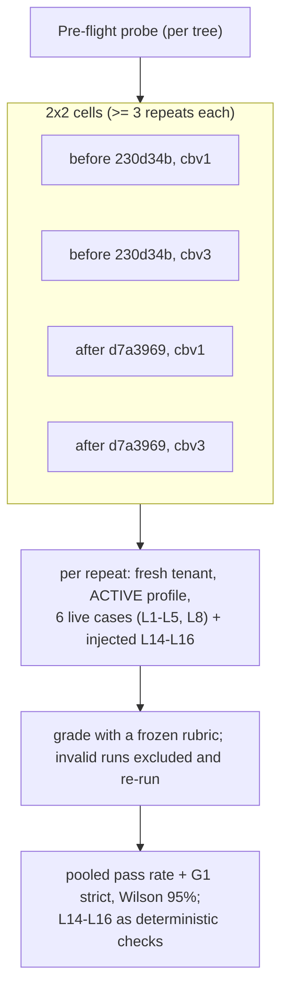

# Design: Termination, honesty, metrics and the battery (review section 10, group T)

- Status: DRAFT for owner review. Nothing in this document is implemented.
- Repo state verified against: `7860fb4` (clean). Python 3.13, `temporalio` 1.33.0, `pytest` 9.1.1, `pytest-asyncio` 1.4.0.
- Loop-version placeholder for this group: `LV_T`. The shipped loop version is `lv7` (`LOOP_VERSION_CURRENT`); this document never hardcodes the next number. The implementer adds `LOOP_VERSION_LV<N>` with `N = CURRENT + 1` at implementation time and writes `LV_T` as that constant.
- Items: T3, T4, T5, T6-kernel, T8, T9 (GATED), T12, G-T6 (GATED), T2 follow-ups, L5 (observation only), and the review section 12 test gaps for this group.

## Context

Review section 10 found that the loop ends in more ways than it labels honestly, that the iteration bound is not priced, and that the battery grades less than it appears to. Many first-wave findings (T1, T2 code, T7, T10, T11) are already IMPLEMENTED. This document designs everything that is still open in the group, and records for each item what the current code actually does, because several review claims are stale after the 2026-10-30/31 remediation waves (H5, H6, H7, lv4 to lv7, F8).

### The two meanings of "T6"

The ledger uses "T6" for two unrelated things. This document keeps them apart everywhere:

| Name used here | Meaning | Where it lives |
|---|---|---|
| **T6-kernel** | The review's KERNEL-GATE finding: `kernel_conclude_wiring.py` fails closed on any exception in every mode, and `lifecycle.py` turns a kernel deny or throw into FAILED/CONCLUSION_DENIED with no conclusion. | `## Item T6-kernel` below. IDs `T6K.nn`. |
| **G-T6** | The "Tranche 6" before/after battery gate: the 2x2 comparison of the tree before and after the H2/H3/H4 verdict-semantics commit (`d7a3969`), under claim-binding pins `cbv1` and `cbv3`. | `## Item G-T6` below. IDs `GT6.nn`. Owner-deferred; GATED. |

### Verdict summary

This table is the result of verifying every claim against current code, not a restatement of the review. Offline probes were run for T3 (lifecycle half), T4, T6-kernel, T8, T12 and the telemetry whitelist; their output is quoted in each item.

| Item | Verdict | Severity | Pin needed | Gating |
|---|---|---|---|---|
| T3 D6 opinion-only path | **Open, partly reproduced offline.** The lifecycle half reproduces. The lv4 cap narrows when it fires, so the turn-0 FAILED shape is gone on lv4 and newer pins and remains on lv2/lv3. The residual on current pins is a stale-candidate abstention without the NOT_CHECKABLE_SKIPPED marker. | should-fix (not promoted to blocker: no run ends FAILED on a current pin) | `LV_T` | Needs a Temporal harness test; live injected rerun requires owner approval |
| T4 overconfidence / stall | **Open, reproduced offline.** A forced override hides the proposal from the counter. The review's claim that `agent_metrics.py` consumes the counter is stale: it computes its own peak-readiness proxy. | should-fix | `LV_T` for the stall exit; none for the counter | none |
| T5 priced bound | **Open, partly stale.** The "last response only" token claim is fixed by H6. `max_duration_seconds` still has no reader; pause still ignores cancel; no schedule-to-close bound; no reaper. New: the workflow drops token usage on every break path before the accumulate line. | should-fix | `LV_T` (the pause timer and activity bounds change the Temporal command sequence) | Harness tests; no live run |
| T6-kernel | **Open, reproduced offline** (shadow mode with a raising policy returns `(False, ...)`). | should-fix | none (flag-governed, default off) | none |
| T8 abstention prose | **Open, reproduced offline** (link and `PROPOSED:` prose observed). G1 half already done by T2; battery `_supporting_rows` half is GATED. | should-fix | none | Code half open; grader half GATED |
| T9 grader and comparability | **GATED** (no-grader-changes rule). Mostly confirmed; the path-matching claim is partly stale (rows use exact basename/suffix; only the prose containment is a substring). | should-fix | n/a | GATED |
| T12 post-conclude | (a) duplicate Finding **reproduced offline**; (b) fusion snowballs on retry (reading); (c) synthetic readiness is **not harmful** (never read after the break); (d) NC-at-turn-0 retrieval skip is **already addressed** by the lv4 cap | consider | none | none |
| G-T6 | **GATED**, owner-deferred, another engineer runs it. New finding: `RESTART_FRESH` reprocess is a non-destructive repeat path the ledger did not list (valid for the default-pin cell only). | n/a | n/a | GATED |
| T2 follow-ups | Follow-up of an IMPLEMENTED item | consider | none | live G1 measure rides G-T6 |
| L5 | Observation only (standing rule: no L5 work) | n/a | n/a | EXCLUDED |
| Review section 12 gaps | Turned into test cases (`GAP.nn`), cross-referenced to F10 (replay) and the R group (tenancy) | n/a | n/a | none |

### Two new defects found while verifying

1. **The loop telemetry whitelist drops H5's own metrics.** The workflow passes `fetches_dispatched`, `d6_blocked_no_evidence_count`, `forced_pivot_count`, `defer_repairs_used`/`_limit`, the smallest-fetch counters and `forced_absence_disconfirmation_count` in `loop_telemetry`, but `_derive_loop_telemetry` (`activities/inputs.py`) only stamps an explicit key list. Probe: `_derive_loop_telemetry({... "fetches_dispatched": 3, "d6_blocked_no_evidence_count": 1, "forced_pivot_count": 2 ...}, {}, 5)` returns keys `claim_binding_*`, `evidence_banked_repo`, `hypotheses_*`, `iterations`, `llm_tokens_total`, `overconfident_turns` and nothing else. The 2026-10-30 ledger entry for the lv4 cap says the cap's firing rate is measurable from `loop_telemetry`; it is not. T3, T4 and the T9 L8 check all need these keys. Decision D4 fixes it with a key-parity test.
2. **`RESTART_FRESH` is a sanctioned non-destructive repeat path.** `ReprocessInvestigationService` documents that disposition matching is never invoked for restarts. The ledger's "tranche_b_battery repeat validity" item lists only `clean_battery.py --execute` or a fresh tenant. See `## Item G-T6`.

## References

- `docs/REVIEW-Sonnet-v0.1.md` (remediation table, rows 1 to 13) and `docs/REVIEW-Sonnet-v0.1-part4.md` (sections 10, 11, 12).
- `docs/IAP_Arch_Eng_Recommendations.log` (T3, T4, T5, T6, T8, T9, T12 OPEN entries of 2026-10-30; T2 follow-ups; the H3/H4 follow-ups; the H5 D6 cap IMPLEMENTED entry; the tranche_b_battery repeat-validity entry; the T6 gate entries).
- `docs/IAP-architecture-v1.0.md` sections 66 to 71 (reasoning failures, reasoning quality and the lv4 cap, verdict hygiene, carriers, pivot, forcing table).
- `docs/IAP-claim-binding-attribution-v1.0.md` (H1 attribution method; the pre-T6 arm that was not run).
- `docs/design/DES-S7-handoff-v1.0.md` section 4 (priced handoff, G1), `docs/design/DES-measurement-v1.0.md` (battery protocol), `docs/design/README.md` (conventions).
- Source: `application/worker/workflows/run_investigation.py`, `workflows/forcing.py`, `activities/lifecycle.py`, `activities/inputs.py`, `activities/execution.py`, `application/proof/kernel_conclude_wiring.py`, `domain/investigation/models.py`, `domain/investigation/loop_version.py`, `domain/finding/models.py`, `application/knowledge/capture.py`, `scripts/tranche_b_battery.py`, `scripts/live_battery.py`, `scripts/agent_metrics.py`, `scripts/clean_battery.py`, `tests/fixtures/battery_cases/L1-L16.json`.
- Sibling group documents: the F group document (F10: Temporal replay tests) and the R group document (tenancy, R1 shared-knowledge channel, cross-tenant negatives). This document cross-references them and does not duplicate them.
- Temporal Python SDK (verified through Context7 and by introspecting the installed 1.33.0): `WorkflowEnvironment.start_time_skipping(test_server_existing_path=...)`, `WorkflowEnvironment.sleep`, `Worker(client, task_queue=, workflows=, activities=)`, `Replayer(workflows=[...]).replay_workflow(WorkflowHistory.from_json(...))`, `workflow.wait_condition(fn, timeout=)`, `workflow.execute_activity(..., schedule_to_close_timeout=, start_to_close_timeout=, retry_policy=)`, `temporalio.exceptions.TimeoutError(type=TimeoutType.SCHEDULE_TO_CLOSE)`.

## Goals / Non-Goals

**Goals**

- Every abstention path ends COMPLETED with an honest, labeled INSUFFICIENT_EVIDENCE conclusion, never FAILED with no conclusion, and carries no unverified model prose that reads as a finding (T3, T6-kernel, T8).
- The iteration bound is priced: a wall-clock budget and a token budget measured on `workflow.now()` and cumulative usage, bounded activities, a cancel-aware and bounded pause, and an overconfidence stall exit (T4, T5).
- Post-conclude steps are idempotent and do not publish unverified knowledge (T12).
- The battery design for the grader, comparability and the Tranche-6 gate is written in full, GATED, so another engineer can run it without redesign (T9, G-T6).
- Every item has test cases written first, shown to fail before the fix, and at least one negative control.

**Non-Goals**

- No grader changes and no L5 work without the owner (standing rules). T9 grader changes and the L5 observations are designed as GATED or recorded as observations only.
- No live run, restart, tenant clean, migration, commit or push is performed or scheduled by this document. Anything that needs one is flagged "requires owner approval".
- No Temporal heartbeat. All long activities already carry a `start_to_close_timeout` of at most 120 seconds, which detects a dead worker within that window; a heartbeat adds nothing for single-await provider calls. See D10.
- No change to the default claim-binding pin, the rival bar (H12 declined), or the checkability floor (decided against).
- No duplication of the F group's replay design (F10) or the R group's tenancy design (R1, R2, R11).

## Decisions

Cross-cutting decisions are numbered here. Item-local decisions continue the numbering inside each item so that every `D<n>` in this document is unique.

### D1: One loop-version bump for the group, `LV_T`

**Decision.** The loop-semantics changes of this group share one bump, `LV_T`: the T3 conclude routing, the T4 stall exit, and the T5 budget exits with the cancel-aware pause. If the owner splits the group into separate tranches (one tranche per owner message), each tranche that changes loop semantics takes the next number in order; the document text is unchanged except for which constant each decision names. Items that do not change loop semantics (T6-kernel, T8, T12, T9, G-T6, T2 follow-ups) carry no pin and say why.

```python
# src/investigation_agent_platform/domain/investigation/loop_version.py  (shape; N = CURRENT + 1 at implementation)
LOOP_VERSION_LV_T = f"lv{N}"          # the implementer writes the literal, e.g. the constant after LV7
LOOP_VERSION_CURRENT = LOOP_VERSION_LV_T
KNOWN_LOOP_VERSIONS = frozenset({..., LOOP_VERSION_LV_T})
_LOOP_VERSION_ORDER[LOOP_VERSION_LV_T] = N
# docstring entry (house style):
# - ``lvN``: lv7 plus terminal honesty and a priced bound (review T3, T4, T5). The opinion-only
#   abstention concludes through the gate even when no hypothesis was persisted; two confident
#   turns that bank nothing end the run as an abstention; the run has a wall-clock and token
#   budget on the workflow clock; a pause is cancel-aware and bounded. It only ends runs earlier
#   or more honestly; it cannot publish a verdict.
```

```python
# src/investigation_agent_platform/application/worker/workflows/forcing.py  (pure; same shape as _d6_cap_enabled)
def _lv_t(loop_version: Any) -> bool:
    """Whether the run's pin includes the terminal-honesty/priced-bound semantics (pure).

    Any fault or unrecognized pin returns False, which keeps the old behavior. An unknown pin
    cannot reach the workflow: dispatch resolves it with ``resolve_loop_version`` and fails loudly.
    """
    try:
        return loop_version_at_least({"loop_version": loop_version}, LOOP_VERSION_LV_T)
    except Exception:
        return False
```

**Alternative considered:** `workflow.patched("...")`. Rejected by the repo contract (version pin on the entity, not Temporal patch markers), and a patch marker would not reach the activity half of T3.

**Alternative considered:** an environment switch. Rejected by the contract (no env-switched legacy).

**Rationale.** In-flight runs keep the semantics they started with, which is exactly what keeps their Temporal replay deterministic (T5's pause timer and activity bounds add commands). New runs follow the new version. Unmarked rows resolve to current, as for lv4 to lv7.

**Trade-off.** Runs pinned lv2 to lv7 keep the old behavior for as long as they exist. IAP is not live, so this is a bounded cost, and the old branches are removed when the last pinned row is gone (the lv1 precedent: deleted after a DB check found zero rows).

---

### D2: Test IDs, the two "T6" names, and test-first discipline

Test case IDs use the item prefix and a two-digit number: `T3.01`, `T4.07`, `T5.12`, `T6K.03`, `T8.02`, `T9.10`, `T12.05`, `GT6.04`, `T2F.01`, `GAP.06`. They are unique across this document and greppable (`rg 'T5\.0'`). Every item's tests are written first and shown to fail against the current tree before the fix is written; the table says which line or condition to break for the negative control. One tranche per owner message: the implementation order proposed in `## Implementation Detail` is a proposal, not a schedule.

---

### D3: The Temporal workflow-harness approach (closes review section 12, gap 2)

**Problem.** No Temporal workflow test exists (`test_loop_exit_contract.py` is an AST scan). T3, T4 and T5 change workflow control flow, so they need tests that execute the real `RunInvestigationWorkflow`.

**Decision.** Add an opt-in workflow-harness test layer under `tests/workflow_harness/`. It starts a time-skipping test server, registers stub activities with the same names as the real ones, and drives the real workflow class through the sandboxed runner. Stubs record their inputs, which is how tests assert "execute was not called on the D6 turn" and "conclude received these statements".

```python
# tests/workflow_harness/conftest.py
from __future__ import annotations

import os
from collections.abc import AsyncIterator

import pytest
import pytest_asyncio
from temporalio.testing import WorkflowEnvironment


def _server_path() -> str | None:
    # Operator-provided binary; avoids a network download in CI. Absent -> download on first use
    # only when explicitly allowed.
    return os.environ.get("IAP_TEMPORAL_TEST_SERVER") or None


def _allowed() -> bool:
    return bool(_server_path()) or os.environ.get("IAP_TEMPORAL_TEST_DOWNLOAD") == "1"


@pytest_asyncio.fixture(scope="session")
async def temporal_env() -> AsyncIterator[WorkflowEnvironment]:
    if not _allowed():
        pytest.skip("workflow harness needs IAP_TEMPORAL_TEST_SERVER or IAP_TEMPORAL_TEST_DOWNLOAD=1")
    env = await WorkflowEnvironment.start_time_skipping(test_server_existing_path=_server_path())
    try:
        yield env
    finally:
        await env.shutdown()
```

```python
# tests/workflow_harness/stubs.py
from __future__ import annotations

from dataclasses import dataclass, field
from typing import Any, Callable

from temporalio import activity

from investigation_agent_platform.application.worker.activities import (
    CheckpointInput, ConcludeInvestigationInput, CreateInvestigationInput, CreateInvestigationOutput,
    ExecuteActionInput, GenericActivityResult, ReasonInput, RetrieveEvidenceInput, RetrieveKnowledgeInput,
    TransitionInvestigationInput, VerifyRootCauseInput, CaptureKnowledgeInput, PublishEventInput,
)


@dataclass
class Script:
    """Per-turn scripted activity results plus a call log (plain data; the stubs close over it)."""
    reason: list[dict[str, Any]] = field(default_factory=list)       # one reason `data` dict per turn
    execute: Callable[[ExecuteActionInput], dict[str, Any]] | None = None
    verify: list[dict[str, Any]] = field(default_factory=list)
    calls: list[tuple[str, Any]] = field(default_factory=list)


def build_stubs(script: Script, *, on_activity: Callable[[str], Any] | None = None) -> list[Any]:
    """Activities registered under the real names. ``on_activity`` lets a test advance virtual time
    (``await env.sleep(...)``) from inside an activity."""

    async def _tick(name: str) -> None:
        if on_activity is not None:
            await on_activity(name)

    @activity.defn(name="create_investigation_activity")
    async def create(p: CreateInvestigationInput) -> CreateInvestigationOutput:
        script.calls.append(("create", p))
        return CreateInvestigationOutput(investigation_id=p.investigation_id or "inv-harness", status="CREATED")

    @activity.defn(name="transition_investigation_activity")
    async def transition(p: TransitionInvestigationInput) -> GenericActivityResult:
        script.calls.append(("transition", p.target_status))
        return GenericActivityResult(success=True, data={})

    @activity.defn(name="retrieve_knowledge_activity")
    async def knowledge(p: RetrieveKnowledgeInput) -> GenericActivityResult:
        return GenericActivityResult(success=True, data={})

    @activity.defn(name="reason_activity")
    async def reason(p: ReasonInput) -> GenericActivityResult:
        script.calls.append(("reason", p.iteration))
        await _tick("reason")
        return GenericActivityResult(success=True, data=dict(script.reason[min(p.iteration, len(script.reason) - 1)]))

    @activity.defn(name="execute_action_activity")
    async def execute(p: ExecuteActionInput) -> GenericActivityResult:
        script.calls.append(("execute", p))
        await _tick("execute")
        data = script.execute(p) if script.execute else {"action_outcome": {"status": "EMPTY", "evidence_ids": []}}
        return GenericActivityResult(success=True, data=data)

    @activity.defn(name="retrieve_evidence_activity")
    async def retrieve(p: RetrieveEvidenceInput) -> GenericActivityResult:
        return GenericActivityResult(success=True, data={})

    @activity.defn(name="verify_root_cause_activity")
    async def verify(p: VerifyRootCauseInput) -> GenericActivityResult:
        script.calls.append(("verify", p.iteration))
        await _tick("verify")
        return GenericActivityResult(success=True, data=dict(script.verify[min(p.iteration, len(script.verify) - 1)] if script.verify else {"verified": False}))

    @activity.defn(name="checkpoint_activity")
    async def checkpoint(p: CheckpointInput) -> GenericActivityResult:
        return GenericActivityResult(success=True, data={})

    @activity.defn(name="conclude_investigation_activity")
    async def conclude(p: ConcludeInvestigationInput) -> GenericActivityResult:
        script.calls.append(("conclude", p))
        return GenericActivityResult(success=True, data={"status": p.status})

    @activity.defn(name="capture_knowledge_activity")
    async def capture(p: CaptureKnowledgeInput) -> GenericActivityResult:
        script.calls.append(("capture", p))
        return GenericActivityResult(success=True, data={})

    @activity.defn(name="publish_event_activity")
    async def publish(p: PublishEventInput) -> GenericActivityResult:
        script.calls.append(("publish", p))
        return GenericActivityResult(success=True, data={})

    return [create, transition, knowledge, reason, execute, retrieve, verify, checkpoint, conclude, capture, publish]
```

```python
# tests/workflow_harness/runner.py
from __future__ import annotations

import uuid

from temporalio.client import WorkflowHandle
from temporalio.testing import WorkflowEnvironment
from temporalio.worker import Worker

from investigation_agent_platform.application.worker.workflows.run_investigation import (
    RunInvestigationInput, RunInvestigationWorkflow,
)

from .stubs import Script, build_stubs


async def start(env: WorkflowEnvironment, script: Script, *, on_activity=None, **input_overrides) -> tuple[WorkflowHandle, Worker]:
    queue = f"harness-{uuid.uuid4().hex[:8]}"
    worker = Worker(env.client, task_queue=queue, workflows=[RunInvestigationWorkflow], activities=build_stubs(script, on_activity=on_activity))
    inv = str(uuid.uuid4())
    payload = RunInvestigationInput(application_id="app", tenant_id="t", description="Where is SampleOrderFilter implemented?", investigation_id=inv, **input_overrides)
    return await env.client.start_workflow(RunInvestigationWorkflow.run, payload, id=f"wf-{inv}", task_queue=queue), worker
```

A test then reads `async with worker: result = await handle.result()` and asserts on `script.calls`.

**Alternative considered:** extend the AST contract test. Rejected: it cannot observe call order, activity inputs, timers or pause/cancel behavior, which is where T3 to T5 live.

**Alternative considered:** mock `temporalio.workflow` and call `_run_inner` as a coroutine. Rejected: it bypasses the sandbox and the real command sequence, so it cannot catch a determinism regression, and mocks of `wait_condition`/`now` would re-implement the SDK.

**Rationale.** The stubs return exactly the dict shapes the workflow reads (`reason_res.data`, `execute_res.data["action_outcome"]`, `verify_res.data["verified"]`), so the harness tests the control flow and nothing else. Sandbox stays on so `workflow.now()` usage and imports are validated as in production.

**Trade-offs.**

- The time-skipping server is a downloaded binary. The fixture skips unless `IAP_TEMPORAL_TEST_SERVER` (a path) or `IAP_TEMPORAL_TEST_DOWNLOAD=1` is set, so the default `pytest` run is unchanged. A first download is an external call: **requires owner approval** to enable in CI, and was not attempted while writing this document (no server binary is present locally and external calls were out of bounds).
- Virtual time only advances while the test waits on the workflow result; activity bodies run in real time. T5's budget tests therefore advance the workflow clock from inside a stub with `await env.sleep(timedelta(...))` (`WorkflowEnvironment.sleep` advances virtual time when time skipping is supported). That interaction is an assumption to prove with the first spike test `T5.00` (a stub that sleeps 40 virtual minutes and a workflow that reads `workflow.now()`); the fallback, if the spike fails, is a real-time stub sleep with `max_duration_seconds=1`.
- Replay tests (feeding recorded histories to `Replayer`) belong to the F group (F10). This layer only adds one forward-compatibility test per pinned behavior (`GAP.03`).

---

### D4: Loop telemetry key parity (found defect)

**Problem.** `_derive_loop_telemetry` stamps only a hand-listed set of keys, so `fetches_dispatched`, `d6_blocked_no_evidence_count`, `forced_pivot_count`, `defer_repairs_used`/`defer_repairs_limit`, the smallest-fetch counters and `forced_absence_disconfirmation_count` never reach `metadata["loop_telemetry"]` (probe above). Two counters the workflow maintains, `forced_callsite_count` and `forced_floor_count`, are never placed in the dict at all; the decision adds them to both.

**Decision.** Add the missing numeric keys to the whitelist, add this group's new keys, and add a parity test that parses the workflow's `loop_telemetry` dict literal and fails when a key is neither whitelisted nor in an explicit exemption set.

```python
# src/investigation_agent_platform/application/worker/activities/inputs.py  (_derive_loop_telemetry)
_LOOP_COUNTER_KEYS = (
    "llm_tokens_total", "llm_cost_total", "formulated_count", "evidence_banked_total",
    "fetches_dispatched", "d6_blocked_no_evidence_count",
    "forced_formulate_count", "forced_reread_count", "forced_log_search_count",
    "forced_walk_stack_count", "forced_replan_count", "forced_pivot_count",
    "forced_synthesis_count", "forced_callsite_count", "forced_floor_count", "forced_absence_disconfirmation_count",
    "forced_smallest_fetch_definition_count", "forced_smallest_fetch_history_count",
    "forced_smallest_fetch_behavior_count", "forced_smallest_fetch_absence_count",
    "forced_smallest_fetch_causal_count",
    "defer_repairs_used", "defer_repairs_limit",
    "overconfident_turns", "stall_streak_max", "stall_exits",
    "active_seconds", "paused_seconds",
    "iterations",
)
# ... the loop body becomes: for key in _LOOP_COUNTER_KEYS: (same numeric, non-bool, non-None rule)
# run_investigation.py: add "forced_callsite_count": forced_callsite_count and "forced_floor_count": forced_floor_count to the
# loop_telemetry dict beside the other forced_* counters
```

```python
# tests/unit/test_loop_telemetry_key_parity.py
import ast
from pathlib import Path

import investigation_agent_platform.application.worker.activities.inputs as inputs

_WORKFLOW = Path(inputs.__file__).parents[1] / "workflows" / "run_investigation.py"
# Keys the workflow passes that are deliberately handled by dedicated blocks in _derive_loop_telemetry.
_HANDLED_ELSEWHERE = {
    "triage_route", "plan", "shadow_trace", "shadow_summary", "definition_shadow_trace",
    "shadow_definition_summary", "claim_binding_kept", "claim_binding_evaporated",
    "claim_binding_unmapped", "claim_binding_version", "claim_binding_repaired",
    "claim_binding_repair_shadow",
}

def _workflow_loop_telemetry_keys() -> set[str]:
    tree = ast.parse(_WORKFLOW.read_text(encoding="utf-8"))
    for node in ast.walk(tree):
        if isinstance(node, ast.keyword) and node.arg == "loop_telemetry" and isinstance(node.value, ast.Dict):
            return {k.value for k in node.value.keys if isinstance(k, ast.Constant)}
    raise AssertionError("loop_telemetry literal not found")

def test_every_workflow_telemetry_key_is_stamped_or_explicitly_exempt() -> None:
    missing = _workflow_loop_telemetry_keys() - set(inputs._LOOP_COUNTER_KEYS) - _HANDLED_ELSEWHERE
    assert not missing, f"loop_telemetry keys dropped by _derive_loop_telemetry: {sorted(missing)}"
```

**Alternative considered:** stamp the whole dict. Rejected: the whitelist exists to bound row size and keep non-scalars out of JSONB; shadow traces are already handled with caps.

**Rationale.** A silent drop defeated a decision that depended on a metric (the lv4 cap's firing rate). The parity test makes the next dropped key a test failure, not a measurement gap.

**Pinning.** None: telemetry only, no loop semantics. Keys absent on old rows are simply absent (readers already treat missing keys as unknown).

**Test cases:** `T3.20`, `T4.13`, `T5.15` (each asserts its own keys), plus the parity test itself `GAP.07`.

---

## Items

### Item T3: D6 opinion-only fast path cannot yield its intended abstention

**Status.** Open. Severity: should-fix (the reviewers' blocker promotion rule, "promote if an experiment confirms", is evaluated below and does not trigger). Dependencies: the lv4 D6 evidence cap (IMPLEMENTED) defines when the path fires; overlaps H5 (cap landed), T8 (what an abstention may show) and T12 (synthetic readiness, NC-at-turn-0). Gating: none for the code; the live injected-claim rerun requires owner approval (it writes to Postgres).

#### Verified problem

What the code does today:

- `run_investigation.py`, `_run_inner`: `_d6_decision(...)` forces `next_action = "CONCLUDE"` and sets `forced_not_checkable`. A few lines later `if _forced_conclude_break(_reason_data): _d6_concluded = True; break` leaves the loop **before** `execute_action_activity`. The concluding block then maps `_d6_concluded` to `final_status = "COMPLETED"`.
- Hypotheses are persisted only inside `execute_action_activity` (`_persist_proposed_hypotheses`, runs for every action type) and by verify. The reason activity persists nothing. So on a D6 turn the statements the model just evaluated are **not** in the hypothesis store.
- `lifecycle.py::_gate_conclusion_or_fail` begins with `if not hypotheses: return InvestigationStatus.FAILED` (log reason `no_hypotheses`), and `conclude_investigation_activity` maps a denied COMPLETED request to FAILED/`CONCLUSION_DENIED` with no conclusion.
- When some hypothesis exists, `select_verifiable_candidate(rank_hypotheses(hypotheses), evidence_by_id)` picks the best-ranked persisted one, which is whatever earlier turns persisted, not the statements D6 matched.
- The only workflow-level pin is a source-string check (`test_claim_binding_phase4.py::test_d6_concluded_requests_completed`), and the live injected test pre-seeds the hypothesis and runs verify first.

**The lv4 cap changes when this path fires.** `_d6_decision` only fires when the run has banked at least one row or dispatched at least one gathering fetch (`evidence_banked_total > 0 or fetches_dispatched > 0`). An all-NOT_CHECKABLE turn 0 with nothing banked is blocked by the cap (`d6_blocked_no_evidence_count += 1`) and the cascade proceeds to gather. Consequences for T3:

1. The review's headline shape, turn-0 D6 reaching `no_hypotheses` and ending FAILED, is **unreachable on lv4 and newer pins**. It remains reachable on lv2 and lv3 pins, which have no cap.
2. On lv4 and newer pins D6 fires only after a gathering fetch. By then the gather turn's own `hypotheses_evaluated` were persisted by `execute_action_activity`. If the model restates the same NC statements, the candidate is an NC hypothesis and the abstention works (probe case B). If the persisted set contains a checkable hypothesis from an earlier turn and the D6 turn's statements are new, the candidate is the stale checkable one (probe case C): the abstention carries no `NOT_CHECKABLE_SKIPPED`, and the battery grades a `not_checkable` case PARTIAL (`score_supported`, ABSTAIN branch).
3. T3's tests must therefore be written against the capped behavior: turn 0 does **not** fire D6; D6 fires after the first dispatched fetch. A test that asserts turn-0 D6 on a current pin would pin the pre-cap behavior and conflict with `tests/unit/test_h5_d6_evidence_cap.py`.

**Evidence: the offline probe (run during this design).** The lifecycle half is executable offline because `_gate_conclusion_or_fail` accepts a fake context. The probe builds the in-memory context used by the existing conclude tests (`_activity_ctx` in `tests/unit/test_claim_binding_phase1.py`), injects hypotheses, calls the real gate, and prints what is persisted. It writes nothing and uses only synthetic names.

```python
# probe (read-only, in memory): run with  .venv/bin/python probe_t3.py   from the repo root
import asyncio, sys
from types import SimpleNamespace
from unittest.mock import AsyncMock
from uuid import uuid4

sys.path.insert(0, "tests/unit")
import test_claim_binding_phase1 as fx
from investigation_agent_platform.application.worker.activities import lifecycle
from investigation_agent_platform.domain.hypothesis.models import (
    AssessmentStrength, AssessmentType, ClaimKind, Hypothesis, HypothesisEvidenceAssessment)


def hyp(inv, statement, kind):
    hid = uuid4()
    asm = [HypothesisEvidenceAssessment(
        hypothesis_id=hid, evidence_id=None, assessment=AssessmentType.SUPPORTS,
        strength=AssessmentStrength.MODERATE, reason="claim unresolved: no usable evidence",
        claim_kind=kind, reason_code="CLAIM_UNRESOLVED", schema_version="v2")] if kind else []
    return Hypothesis(id=hid, tenant_id="t", investigation_id=inv, title=statement[:200],
                      description=statement, statement=statement, supporting_evidence_ids=[], assessments=asm)


async def run(label, hyps):
    inv = uuid4()
    hyps = [h.model_copy(update={"investigation_id": inv}) for h in hyps]
    ctx = fx._activity_ctx({"claim_binding_version": "cbv1", "verifier_version": "v2"}, None, [], [])
    ctx.hypothesis_repo.find_by_investigation_id = AsyncMock(return_value=hyps)
    cap = {"c": None}
    async def save_conclusion(t, c): cap["c"] = c
    ctx.finding_repo = SimpleNamespace(save_conclusion=save_conclusion, save=AsyncMock(),
                                       save_finding=AsyncMock(), save_finding_record=AsyncMock())
    status = await lifecycle._gate_conclusion_or_fail("t", inv, ctx, shadow_notes=None, triage_route="")
    c = cap["c"]
    print(label, "->", status.value, "|", None if c is None else (
        c.status.value, c.limitations[:2], "linked_hyp=" + str(bool(c.supporting_hypothesis_ids)),
        c.ranked_alternatives[:1]))


async def main():
    inv = uuid4()
    await run("A no hypothesis persisted", [])
    await run("B NC hypothesis persisted", [hyp(inv, "The design feels over-engineered", ClaimKind.NOT_CHECKABLE)])
    await run("C stale checkable only", [hyp(inv, "OrderServiceHandler is invoked by SampleOrderFilter", ClaimKind.DEFINITION)])
    await run("D stale checkable plus NC", [hyp(inv, "OrderServiceHandler is invoked by SampleOrderFilter", ClaimKind.DEFINITION),
                                           hyp(inv, "The design feels over-engineered", ClaimKind.NOT_CHECKABLE)])

asyncio.run(main())
```

Observed output on `7860fb4` (before any fix):

```text
A no hypothesis persisted -> FAILED | None
B NC hypothesis persisted -> COMPLETED | ('INSUFFICIENT_EVIDENCE', ['NOT_CHECKABLE_SKIPPED', 'no bound supporting evidence'], 'linked_hyp=True', ['PROPOSED: The design feels over-engineered'])
C stale checkable only -> COMPLETED | ('INSUFFICIENT_EVIDENCE', ['no bound supporting evidence', 'no validated causal chain'], 'linked_hyp=True', ['PROPOSED: OrderServiceHandler is invoked by SampleOrderFilter'])
D stale checkable plus NC -> COMPLETED | ('INSUFFICIENT_EVIDENCE', ['no bound supporting evidence', 'no validated causal chain'], 'linked_hyp=True', ['PROPOSED: OrderServiceHandler is invoked by SampleOrderFilter', 'PROPOSED: The design feels over-engineered'])
```

Reading it both ways:

| Case | Reproduces the review? | What it means |
|---|---|---|
| A | **Yes.** FAILED, no conclusion. | Reachable only when the break fires with nothing persisted: lv2 and lv3 pins today. Unreachable on lv4+ through D6. |
| B | Intended outcome, with the T8 defect visible (hypothesis link and `PROPOSED:` prose). | The path works when the NC statements are already persisted. |
| C, D | **Yes.** An abstention without `NOT_CHECKABLE_SKIPPED`; the candidate is the stale checkable hypothesis. | Reachable on lv4+ whenever a checkable hypothesis was persisted before the D6 turn. The battery would grade the `not_checkable` case PARTIAL. |

Expected output **after** the fix, when the same four calls carry `opinion_only_statements` for the D6 turn's statements and the run is pinned `LV_T`: all four rows are `COMPLETED | ('INSUFFICIENT_EVIDENCE', ['NOT_CHECKABLE_SKIPPED', ...], 'linked_hyp=False', ...)`. A and C change from FAILED and from a marker-less abstention; B and D change only in losing the hypothesis link (T8).

**The workflow half has no offline probe.** It needs a running workflow. The harness probe to run once D3 exists, before any fix:

```python
# tests/workflow_harness/test_t3_probe.py  (probe form of T3.12; expected values both ways in the comments)
async def test_d6_after_first_fetch(temporal_env):
    all_nc = {"next_action": "CONCLUDE", "conclusion_readiness": 0.4,
              "hypotheses_evaluated": [{"statement": "the design is over-engineered"}],
              "claims": [{"statement": "the design is over-engineered", "claim_kind": "NOT_CHECKABLE"}]}
    gather = {**all_nc, "next_action": "SEARCH_CODE", "action_parameters": {"query": "OrderServiceHandler"}}
    script = Script(reason=[all_nc, all_nc])      # turn 0 all-NC (cap blocks), turn 1 all-NC (fires)
    ...
    # before the fix : calls == [... ("execute", turn0), ("reason", 1)] with NO execute on turn 1 and
    #                  ("conclude", p) carrying no statements -> lifecycle sees no hypothesis (case A/C)
    # after the fix  : same call order, and ("conclude", p).opinion_only_statements == [the statement]
```

**Verdict.** The experiment does not confirm a FAILED outcome on a current pin, so T3 stays should-fix. It confirms that the abstention is mislabeled (case C, D) and that older pins fail (case A). The owner may still choose to treat the lv2/lv3 shape as acceptable, because those pins are not used by new runs (IAP is not live; six lv2 rows were the last count).

#### Design

**D5. Carry the D6 turn's statements to conclude; route on the recorded pin.**

The break stays where it is (it is the point of D6: skip execute, retrieve and verify, which cost tool calls and would only produce INCONCLUSIVE). What changes is what the conclude activity is told.

```python
# src/investigation_agent_platform/application/worker/opinion_only.py   (new; stdlib only, sandbox-importable like reasoning_failure.py)
"""Opinion-only (D6) statement identity shared by the workflow and the conclude activity (T3)."""

from __future__ import annotations

from collections.abc import Callable, Sequence
from typing import Any

OPINION_STATEMENT_CAP = 10
OPINION_STATEMENT_MAX_CHARS = 512


def normalize_statement(text: Any) -> str:
    """Same join key as forcing._norm_statement: strip, casefold. Pure; never raises."""
    try:
        return str(text or "").strip().casefold()
    except Exception:
        return ""


def opinion_statements(reason_data: Any) -> list[str]:
    """Normalized, bounded, de-duplicated statements the D6 turn evaluated. Pure; never raises."""
    out: list[str] = []
    try:
        raw = (reason_data or {}).get("hypotheses_evaluated") or []
        if not isinstance(raw, list):
            return []
        for item in raw[:OPINION_STATEMENT_CAP]:
            text = (item.get("statement") or item.get("text")) if isinstance(item, dict) else item
            if not isinstance(text, str):
                continue                      # a statement is a string; anything else is not evidence of D6's match
            key = normalize_statement(text)[:OPINION_STATEMENT_MAX_CHARS]
            if key and key not in out:
                out.append(key)
    except Exception:
        return []
    return out


def select_opinion_candidate(
    ranked: Sequence[Any],
    statements: Sequence[str],
    is_opinion_only: Callable[[Any], bool],
) -> Any | None:
    """The best-ranked persisted hypothesis whose statement the D6 turn evaluated and whose typed
    claims are all NOT_CHECKABLE. None when no such hypothesis was persisted. Pure; never raises."""
    try:
        wanted = {normalize_statement(s)[:OPINION_STATEMENT_MAX_CHARS] for s in statements or []}
        wanted.discard("")
        for hypothesis in ranked or []:
            key = normalize_statement(getattr(hypothesis, "statement", ""))[:OPINION_STATEMENT_MAX_CHARS]
            if key in wanted and is_opinion_only(hypothesis):
                return hypothesis
    except Exception:
        return None
    return None
```

```python
# src/investigation_agent_platform/application/worker/activities/inputs.py
@dataclass
class ConcludeInvestigationInput:
    ...
    conclude_iteration: int = 0
    # T3: normalized statements of the D6 opinion-only turn; empty unless D6 ended the loop.
    opinion_only_statements: list[str] = field(default_factory=list)
```

```python
# src/investigation_agent_platform/application/worker/workflows/run_investigation.py
from investigation_agent_platform.application.worker.opinion_only import opinion_statements   # passthrough import block

_d6_concluded = False
_d6_statements: list[str] = []            # plain JSON scalars; replay-safe

...
if _forced_conclude_break(_reason_data):
    _d6_concluded = True
    _d6_statements = opinion_statements(_reason_data)
    break

...
ConcludeInvestigationInput(
    ...,
    conclude_iteration=iteration,
    opinion_only_statements=list(_d6_statements),
    ...
)
```

```python
# src/investigation_agent_platform/application/worker/activities/lifecycle.py  (_gate_conclusion_or_fail)
async def _gate_conclusion_or_fail(
    tenant_id: str, investigation_id: UUID, ctx: Any,
    shadow_notes: list[dict[str, Any]] | None = None,
    triage_route: str = "",
    opinion_only_statements: list[str] | None = None,        # T3
) -> Any:
    ...
    # Fast path identical to today: nothing persisted and no D6 statements to route on.
    if not hypotheses and not opinion_only_statements:
        _log_no_hypotheses(tenant_id, investigation_id)
        return InvestigationStatus.FAILED
    ...
    # (after the claim-binding pin is resolved from _cb_inv.metadata, still before candidate selection)
    _opinion_only = False
    if opinion_only_statements:
        try:
            _opinion_only = loop_version_at_least(getattr(_cb_inv, "metadata", None), LOOP_VERSION_LV_T)
        except Exception:
            _opinion_only = False           # unreadable pin keeps the old behavior
    if not hypotheses and not _opinion_only:
        _log_no_hypotheses(tenant_id, investigation_id)
        return InvestigationStatus.FAILED
    ...
    ranked = rank_hypotheses(list(hypotheses))
    if _opinion_only:
        candidate = select_opinion_candidate(ranked, opinion_only_statements, all_typed_claims_not_checkable)
        if candidate is None:
            # Nothing the D6 turn evaluated was persisted. The honest outcome is still an abstention
            # with the marker, not a FAILED run: D6 already decided the turn was opinion-only.
            await _persist_abstention("insufficient", ["NOT_CHECKABLE_SKIPPED", "no bound supporting evidence"])
            return InvestigationStatus.COMPLETED
    else:
        candidate = select_verifiable_candidate(ranked, evidence_by_id)       # unchanged
        if candidate is None:
            await _persist_abstention("refuted", ["all hypotheses rejected or contradicted"])
            return InvestigationStatus.COMPLETED
```

```python
# conclude_investigation_activity: pass it through
target = await _gate_conclusion_or_fail(
    tenant_id, investigation_id, ctx,
    shadow_notes=_conclude_shadow_notes,
    triage_route=str(data.get("triage_route", "") or ""),
    opinion_only_statements=[str(s) for s in (data.get("opinion_only_statements") or [])][:OPINION_STATEMENT_CAP],
    kernel_blockers=...,                                                     # T6-kernel, D14
)
```

`_log_no_hypotheses` is the existing `story_log(... "ConclusionGate: no hypotheses; denying COMPLETED" ...)` call extracted to a module-level helper so it is not duplicated. When the candidate is an NC hypothesis the existing `_nc_early_conclude` block (which already exists and already adds `NOT_CHECKABLE_SKIPPED`) handles the rest unchanged. When there is no candidate the closure `_persist_abstention` runs with `candidate = None`, which H9 already made safe; its `gap_fetch_for_hypotheses(hypotheses)` still derives a concrete next fetch from a stale open checkable hypothesis, which makes the abstention a G1 handoff when one exists.

**Alternative considered (the review's suggestion A): move the break after `execute_action_activity`.** Persists the NC hypotheses through the normal path. Rejected: it spends a tool call on a no-op `CONCLUDE` action, is blocked by the tool-call and evidence budget gate that runs before the handler (a budget-exhausted run would again persist nothing and the bug returns), and it writes opinion text into the hypothesis store, which T8 is removing from abstentions.

**Alternative considered (suggestion B): run verify once.** Costs a verify activity and produces an INCONCLUSIVE marker only to be overridden at conclude; the hypothesis store still lacks the statements.

**Alternative considered: a boolean `opinion_only` instead of statements.** Rejected because the candidate join needs the statements, and a boolean cannot distinguish "the D6 turn's hypothesis" from "a stale checkable one" (probe case C).

**Rationale.** D6's own decision (every evaluated statement carries only NOT_CHECKABLE claims) is the authority; conclude should honor it rather than re-derive it from a store that may not hold the statements. The statements are a bounded list of short strings, so the activity input stays small and replay-safe.

**Trade-offs.**

- The D6 turn's statements are not persisted as hypotheses when they were not already. The audit trail of what the model said lives in the action history and timeline reason trace, which is where observations belong; the hypothesis store stays free of unverified opinions.
- The normalization must match between workflow and activity. `normalize_statement` is the single definition; test `T3.09` asserts it equals `forcing._norm_statement` on a corpus.

**D6. Stop synthesizing readiness 1.0 (T12 sub-item, folded in here because it is the same lines).**

`_reason_data["conclusion_readiness"] = 1.0` in the D6 block writes a synthetic value into the final turn's history entry. Nothing reads it afterwards: the loop breaks, the overconfidence code reads `reason_res.data` (the original), and the D6 turn never reaches the transition descriptions that `agent_metrics.parse_reason_trace` parses. It is not harmful, but it is a false datum in a structure other code may someday read. Delete the assignment; the history entry keeps the model's own reported readiness. No pin: nothing observable depends on it. Test `T3.18`.

#### Version pinning / migration

- **Pin: `LV_T`**, routed in the activity with `loop_version_at_least(metadata, LV_T)` on the investigation metadata, the same pattern as H13's lv5 answer mapping and `_policy_for_loop_version`. The workflow always sends the statements; the activity decides. A run pinned lv2 to lv7 therefore keeps the old gate exactly (no hypotheses means FAILED; stale candidate means a marker-less abstention). Test `T3.05` pins this.
- No env switch, no `workflow.patched`, no compatibility shim. The old branch is the `else` of one `if`, deleted when no pinned rows remain.
- Deleting the `conclusion_readiness = 1.0` assignment needs no pin (see D6).
- **Migration:** none. `opinion_only_statements` is a new optional dataclass field with a default; the activity input is JSON and old workflow histories that did not send it decode to `[]`.

#### Test cases

Tests are written first and shown to fail against `7860fb4` before any change. `T3.01`, `T3.02`, `T3.03` and `T3.10` to `T3.12` fail today for the stated reasons; `T3.04`, `T3.07` and `T3.09` pass today and are regression pins.

| ID | Name | Level | Setup | Action | Expected | Notes |
|---|---|---|---|---|---|---|
| T3.01 | D6 with nothing persisted abstains (probe case A) | unit | `_activity_ctx` with a current-pin investigation, `hypothesis_repo` returning `[]`, `opinion_only_statements=["the design is over-engineered"]` | `_gate_conclusion_or_fail(..., opinion_only_statements=...)` | Returns COMPLETED; the saved conclusion is INSUFFICIENT_EVIDENCE with `NOT_CHECKABLE_SKIPPED` first in `limitations`; `supporting_hypothesis_ids == []` | Fails today: returns FAILED, no conclusion. Happy path |
| T3.02 | D6 with a stale checkable hypothesis (case C) selects no stale candidate | unit | One persisted DEFINITION hypothesis (no match for the D6 statements); statements for a new NC statement | Same call | COMPLETED; conclusion carries `NOT_CHECKABLE_SKIPPED`; `ranked_alternatives` do not present the stale statement as bare `PROPOSED:` (T8); `handoff.next_fetch` is the stale hypothesis's concrete fetch | Fails today (no marker). Edge: stale checkable present |
| T3.03 | D6 with NC persisted plus stale checkable picks the NC candidate (case D) | unit | Two hypotheses (checkable and NC); statements equal to the NC statement | Same call | Candidate is the NC hypothesis; marker present | Fails today: stale checkable ranks first |
| T3.04 | Matching NC hypothesis behaves as before (case B) | unit | NC hypothesis persisted, statements equal to it | Same call | Marker present, INSUFFICIENT_EVIDENCE, COMPLETED | Regression pin; passes today |
| T3.05 | Older pin keeps the old behavior | unit | Investigation metadata `{"loop_version": "lv7"}` (an older pin), no hypotheses, statements supplied | Same call | FAILED, no conclusion (old behavior) | Version-pin routing. Same test with `lv3`. Passes today and must keep passing |
| T3.06 | Unmarked metadata resolves to current and follows the new path | unit | Investigation metadata without `loop_version` | Same call as T3.01 | COMPLETED + marker | Pin default |
| T3.07 | No statements and no hypotheses stays FAILED (fail closed) | unit | `opinion_only_statements=[]`, no hypotheses | Same call | FAILED; log reason `no_hypotheses` | Regression pin; the no-D6 `no_hypotheses` contract is unchanged |
| T3.08 | Malformed statements are bounded | unit | `opinion_only_statements` = 50 strings, one 5,000 chars, one non-string, one empty | `opinion_statements`/activity pass-through | At most 10 entries, each at most 512 chars, non-strings and empties dropped; no exception | Malformed input. The activity slices to the cap again (defense in depth) |
| T3.09 | Normalization parity | unit | A corpus: mixed case, padding, unicode casefold cases (`"ß"`, `"İ"`), None, dict | Compare `normalize_statement` with `forcing._norm_statement` | Equal on every input | Regression pin so the join key cannot drift |
| T3.10 | Workflow: turn 0 all-NC with nothing banked is blocked by the cap | workflow-harness | `Script(reason=[all_nc, all_nc])`, pin current, stub execute returns `EMPTY` for the gather | Run | Call log has `("execute", turn 0)`; no `conclude` with statements on turn 0; `d6_blocked_no_evidence_count == 1` in the conclude `loop_telemetry` | Written against the capped behavior (states the cap explicitly). Fails today only on the telemetry key (D4) |
| T3.11 | Workflow: turn 0 all-NC on an lv3 pin still fires (pre-cap) | workflow-harness | Same script, `loop_version="lv3"` | Run | No `execute` call; `conclude` called with `status="COMPLETED"` | Older pin keeps the old behavior (no cap) |
| T3.12 | Workflow: all-NC after one fetch fires D6 and skips execute | workflow-harness | Turn 0 proposes `SEARCH_CODE` (executes, returns `EMPTY`), turn 1 all-NC, pin current | Run | Turn 1 has no `execute`, no `retrieve`, no `verify`; `conclude` input has `status="COMPLETED"` and `opinion_only_statements == [normalized statement]` | Fails today (no statements field). Replaces the source-string pin `test_d6_concluded_requests_completed` |
| T3.13 | Workflow: D6 never fires on a defer turn | workflow-harness | Turn with `disposition="DEFER_GATHERING"` and all-NC claims | Run | Defer path taken, D6 not counted blocked | Edge; mirrors the existing unit test at workflow level |
| T3.14 | End to end (activity plus gate) through the real conclude activity | integration | `iap_test` DB (opt-in, as `test_s2_flow_battery_db.py`), investigation row, no hypotheses, conclude input with statements | `conclude_investigation_activity` | Investigation COMPLETED; `get_conclusion` INSUFFICIENT_EVIDENCE with the marker | Requires the opt-in DB env; no live services |
| T3.15 | Battery grading of the D6 abstention | battery | Offline fixture L13 (`not_checkable`) with a conclusion shaped as T3.01's output | `score_supported` | PASS ("honest abstention ..., retrieval skipped") | Existing grader, unchanged; confirms the label the fix produces is the one the grader reads |
| T3.16 | Live injected-claim rerun | live | **Requires owner approval.** `scripts/live_inject_not_checkable.py` against a throwaway tenant, current tree | Run the driver | OVERALL PASS; conclude INSUFFICIENT_EVIDENCE + `NOT_CHECKABLE_SKIPPED` with `supporting_hypothesis_ids == []` | Not scheduled by this document |
| T3.17 | Negative control: remove the `not hypotheses and not opinion_only_statements` guard (restore the unconditional early return) | unit | Revert that one condition | Run T3.01 | T3.01 fails (FAILED returned) | Proves T3.01 exercises the early-return fix, not the candidate fix |
| T3.18 | Readiness is not synthesized | workflow-harness | Turn with all-NC and `conclusion_readiness` 0.4 after one fetch | Run; read the final history entry via the conclude telemetry or a recorded call | Reported readiness stays 0.4, never 1.0 | D6 sub-item. Negative control: re-add `_reason_data["conclusion_readiness"] = 1.0` and the test fails |
| T3.19 | Negative control: select by rank only (drop `select_opinion_candidate`) | unit | Replace the call with `select_verifiable_candidate` | Run T3.03 | T3.03 fails | Proves the candidate join matters (probe cases C, D) |
| T3.20 | Telemetry carries the cap's firing rate | unit | `_derive_loop_telemetry({"fetches_dispatched": 3, "d6_blocked_no_evidence_count": 1}, {}, 0)` | Call | Both keys present | D4. Fails today (keys dropped) |

#### Rollout, risks, open owner decisions

- Tests first; the fix is small (one module, one input field, one gate branch). No live run is needed to land it. The live injected rerun (`T3.16`) and any battery rerun need approval.
- Risk: an `opinion_only_statements` list that matches nothing silently abstains. Acceptable: D6 already established the turn was opinion-only.
- Risk: a future change to claim normalization on the reason side would desynchronize the join. Mitigation: `T3.09`.
- **Owner decision 1:** keep T3 at should-fix (this document's recommendation) or promote it to blocker because lv2/lv3 pins can still end FAILED.
- **Owner decision 2:** whether lv2/lv3 pinned rows still matter. If not, the pin check is deleted and the new behavior applies to all runs, which is simpler under the no-legacy rule.

### Item T4: Overconfidence only counts, and under-counts; add a stall exit

**Status.** Open. Severity: should-fix. Dependencies: D4 (telemetry keys), D1 (`LV_T`); `scripts/agent_metrics.py` is a reader. Gating: none.

#### Verified problem

- `run_investigation.py`: after a failed verify the loop computes `_proposed = str((_reason_data or {}).get("next_action", ""))` and increments `overconfident_turns` when `_proposed in ("VERIFY_HYPOTHESIS", "CONCLUDE") or _readiness_value >= 0.8`. At that point `_reason_data` is the **post-cascade** copy, so a forced override (floor, formulate, synthesis, call-site, replan, pivot) replaces the model's proposal before it is read. The pre-override proposal is frozen earlier as `_shadow_proposal` for exactly this kind of reader. The counter is the only consumer of the signal; nothing acts on it.
- Probe (offline, real `apply_post_reason_cascade`, synthetic state): the model proposes `CONCLUDE` with readiness 0.5, zero rows banked, triage route BUG; the cascade forces `SEARCH_CODE` (`forced_floor`). The shipped counter expression on the final action is `False`; on the pre-override proposal it is `True`. A second probe (proposal `VERIFY_HYPOTHESIS`, three rows banked, never formulated) is forced to `FORMULATE_HYPOTHESIS` (`forced_formulate`): shipped `False`, pre-override `True`. When no rule fires (two other probe states) both agree, so the undercount is specific to forced turns, which are exactly the turns a stalled model produces.
- `overconfident_turns` is stamped into `loop_telemetry` (it is in the whitelist). The review says `scripts/agent_metrics.py:222` consumes the counter. **That is stale:** `agent_metrics.py` computes `overconfident_runs` from the peak readiness in parsed reason traces and the conclusion status (`peak >= 0.8` and not ESTABLISHED), and never reads `loop_telemetry.overconfident_turns`. Nothing reads the counter today.
- Existing state suffices for a stall exit, as the review says: per-turn `evidence_added`/`outcome_status`/`parameters` in the history entry, `evidence_banked_total`, and the dispatched parameters. Nothing is unmeasured.

The Step-1 exit contract (`test_loop_exit_contract.py`) says "a high self-reported readiness without verification buys more turns, never an early exit". The stall exit below does not violate it: readiness alone never ends the run; the exit requires an overconfident turn **and** zero rows banked **and** a repeated dispatch or an EMPTY/DEGRADED outcome, twice in a row.

#### Design

**D7. A pure stall step, a pre-override overconfidence read, and a two-turn exit pinned by `LV_T`.**

```python
# src/investigation_agent_platform/application/worker/workflows/forcing.py
import hashlib
import json

STALL_STREAK_LIMIT = 2
STALL_REASON = "overconfident_no_progress"
_STALL_OUTCOMES = frozenset({"EMPTY", "DEGRADED"})
_OVERCONFIDENT_ACTIONS = frozenset({"VERIFY_HYPOTHESIS", "CONCLUDE"})
_OVERCONFIDENT_READINESS = 0.8


def overconfident_turn(proposal: Any, readiness: Any) -> bool:
    """Whether the model's own proposal pushed for a verdict (pure, pre-override, never raises).

    ``proposal`` is the frozen pre-cascade decision (``_shadow_proposal``), not the dispatched one.
    """
    try:
        action = str((proposal or {}).get("next_action", "") or "").strip().upper()
    except AttributeError:
        action = ""
    try:
        value = float(readiness or 0.0)
    except (TypeError, ValueError):
        value = 0.0                        # unreadable readiness is not evidence of confidence; the action still counts
    return action in _OVERCONFIDENT_ACTIONS or value >= _OVERCONFIDENT_READINESS


def dispatch_fingerprint(reason_data: Any) -> str:
    """Stable fingerprint of what was dispatched: action plus bounded parameters (pure)."""
    if not isinstance(reason_data, dict):
        return ""                          # never "repeated": stall_step ignores an empty fingerprint
    try:
        data = reason_data
        params = data.get("action_parameters") or {}
        params = {str(k): str(v)[:200] for k, v in sorted(params.items())} if isinstance(params, dict) else {}
        blob = json.dumps([str(data.get("next_action", "") or "").upper(), params], sort_keys=True)
        return hashlib.sha1(blob.encode("utf-8")).hexdigest()[:16]
    except Exception:
        return ""


def stall_step(
    streak: int,
    *,
    overconfident: bool,
    rows_banked: int | None,
    outcome: Any,
    fingerprint: str,
    previous_fingerprint: str | None,
) -> tuple[int, bool]:
    """Advance the stall streak by one failed-verify turn. Returns ``(streak, tripped)`` (pure).

    A turn extends the streak only when the model was overconfident, the turn banked nothing
    (an unknown count never extends), and the dispatch repeated the previous one or came back
    EMPTY/DEGRADED. Any other turn resets it.
    """
    try:
        repeated = bool(fingerprint) and fingerprint == previous_fingerprint
        degraded = str(outcome or "").strip().upper() in _STALL_OUTCOMES
        if overconfident and rows_banked == 0 and (repeated or degraded):
            streak += 1
        else:
            streak = 0
    except Exception:
        streak = 0
    return streak, streak >= STALL_STREAK_LIMIT
```

```python
# src/investigation_agent_platform/application/worker/workflows/run_investigation.py  (_run_inner)
stall_streak = 0
stall_streak_max = 0
stall_exits = 0
_prev_dispatch_fp: str | None = None
...
while iteration < max_iterations and not self._is_cancelled:
    _banked_at_turn_start = evidence_banked_total
    _turn_rows_banked: int | None = None      # None = this turn never reached the execute update
    _turn_outcome = ""
    ...
    # in the post-execute history update (inside `if action_history:`):
    _turn_rows_banked = len(_outcome.get("evidence_ids", []) or [])
    _turn_outcome = str(_outcome.get("status") or "")
    ...
    # defer and absence-disconfirmation turns `continue` before verify; they neither extend nor end a
    # stall, but a turn that banked rows resets it:
    if _is_defer or _reason_data.get("forced_absence_disconfirmation"):
        if evidence_banked_total > _banked_at_turn_start:
            stall_streak = 0
        iteration += 1
        continue
    ...
    # after verify is refused (replaces the post-cascade read; the counter is now pre-override):
    _readiness_raw = (reason_res.data or {}).get("conclusion_readiness", 0.0)
    _overconfident = overconfident_turn(_shadow_proposal, _readiness_raw)
    if _overconfident:
        overconfident_turns += 1
    _fp = dispatch_fingerprint(_reason_data)
    stall_streak, _stalled = stall_step(
        stall_streak, overconfident=_overconfident, rows_banked=_turn_rows_banked,
        outcome=_turn_outcome, fingerprint=_fp, previous_fingerprint=_prev_dispatch_fp,
    )
    _prev_dispatch_fp = _fp
    stall_streak_max = max(stall_streak_max, stall_streak)
    if _stalled and _lv_t(input_data.loop_version or LOOP_VERSION_CURRENT):
        last_error = STALL_REASON
        stall_exits += 1
        break
```

Terminal handling (the reason is epistemic, so the run abstains instead of failing):

```python
# application/worker/reasoning_failure.py  (the terminal-reason vocabulary already lives here)
REASON_STALLED = "overconfident_no_progress"
REASON_DURATION = "duration_budget_exceeded"     # T5, D9
REASON_TOKENS = "token_budget_exceeded"          # T5, D9
REASON_PAUSE_TIMEOUT = "pause_timeout"           # T5, D11
EPISTEMIC_BUDGET_REASONS = frozenset(
    {"verification_failed_or_limit_reached", "budget_exceeded", "defer_repair_budget_exhausted",
     REASON_STALLED, REASON_DURATION, REASON_TOKENS, REASON_PAUSE_TIMEOUT}
)
```

- `lifecycle.py::conclude_investigation_activity`: `epistemic = _epistemic_reason_lower in EPISTEMIC_BUDGET_REASONS or _epistemic_reason_lower.startswith("provider_blocked")` replaces the inline tuple.
- `_epistemic_next_check`: add `REASON_STALLED` -> "Change the retrieval approach (a different action, scope or query): the last two confident turns repeated a fetch that banked nothing. Then re-verify."
- `inputs._failure_code_for`: `REASON_STALLED` -> `"UNVERIFIED"` (same family as `verification_failed_or_limit_reached`); T5's reasons map to `"BUDGET_EXCEEDED"`.
- `run_investigation.py` final-status mapping: add the new reasons next to `budget_exceeded` (they already land in the `else: FAILED` branch, which the conclude activity converts; the explicit set is for readability and the AST pin).
- `domain/finding/models.py::classify_terminal_handoff`: **no change for the stall reason.** `duration_budget_exceeded` and `token_budget_exceeded` already match the `"budget_exceeded" in signal_text` branch (BUDGET_DEFERRED, resume at the blocked fetch). The stall reason deliberately falls through to FRONTIER_EXHAUSTED with its directive: a bigger budget would not help a run that repeats an empty fetch. (The review asked to add it to the budget branch; this design declines that part, see the alternative below.)

**D8. Fix the counter, stamp the new keys, and let `agent_metrics.py` read them.**

`overconfident_turns` now counts the pre-override proposal (above). The new keys `stall_streak_max` and `stall_exits` ride D4's whitelist. `scripts/agent_metrics.py` gains a per-turn rate next to its existing run-level proxy:

```python
# scripts/agent_metrics.py  (inside the aggregation over concluded investigations; metadata["loop_telemetry"] is already loaded per row)
tele = (getattr(inv, "metadata_json", None) or {}).get("loop_telemetry") or {}
turns = int(tele.get("iterations") or 0)
confident = int(tele.get("overconfident_turns") or 0)
stalls = int(tele.get("stall_exits") or 0)
overconfident_turn_total += confident
turn_total += turns
stall_exit_total += stalls
...
lines.append(f"overconfident turns (pre-override): {overconfident_turn_total}/{turn_total}; stall exits: {stall_exit_total}")
```

**Alternative considered: add `STALL_REASON` to the budget-deferred handoff branch** (the review's wording). Rejected as above: BUDGET_DEFERRED tells the next operator to raise a budget, which is the wrong action for a stall.

**Alternative considered: break on the first overconfident empty turn.** Rejected: one empty fetch is normal exploration; two consecutive confident empties is the cheapest signal that the model's confidence is decoupled from its evidence.

**Alternative considered: make the threshold per-profile.** Deferred. A constant of two follows the other rules' precedent (F4's pivot cap of two); a profile knob is an owner decision after measurement (D8's telemetry gives the data).

**Alternative considered: a Shape-1 critic.** Out of scope; the stall exit is a zero-LLM-cost predecessor, and the telemetry decides whether a critic is still needed.

**Rationale.** The exit is the cheapest possible termination that is still honest: the run ends as an INSUFFICIENT_EVIDENCE abstention with a directive that names the stall, instead of spending the remaining turns repeating a fetch.

**Trade-offs.** False positives: a model that is genuinely ready (high readiness) but whose two consecutive fetches legitimately return nothing (a scoped search of a true absence) now ends early. The abstention is honest and resumable, and the G-T6 gate should include an absence case (L3) to see it; D8's `stall_exits` makes the rate visible. The pin keeps old runs unchanged.

#### Version pinning / migration

- **Stall exit: `LV_T`**, routed in the workflow with `_lv_t(...)` (replay-safe: it reads only the input). It adds no Temporal command; it ends the loop earlier on the same activity results, but ending earlier changes the command sequence, so in-flight older pins must not see it.
- **Counter fix and new telemetry keys: no pin.** They affect no control flow; `overconfident_turns` is documented as pre-override from now on (the old definition under-counted; IAP is not live, so no dual-definition reader). Rows written earlier carry the old value; `agent_metrics` does not compare across the boundary.
- **Migration:** none.

#### Test cases

Written first; `T4.01` to `T4.03` fail against `7860fb4` (the helpers do not exist; the counter test fails on the forced-override states).

| ID | Name | Level | Setup | Action | Expected | Notes |
|---|---|---|---|---|---|---|
| T4.01 | Pre-override read sees a forced override | unit | The two probe states through the real `apply_post_reason_cascade` (floor-forced `CONCLUDE`, formulate-forced `VERIFY_HYPOTHESIS`) | `overconfident_turn(_shadow_proposal, 0.5)` and the shipped post-cascade expression | Helper returns True; the shipped expression is False | Reproduces the under-count; fails today (helper missing) |
| T4.02 | `overconfident_turn` table | unit | Proposals `VERIFY_HYPOTHESIS`, `CONCLUDE`, `GET_CODE`, a non-dict proposal, x readiness 0.79/0.8/None/"x"/NaN | Call | True only for the two verdict actions or readiness >= 0.8; unreadable readiness counts as 0.0 (a verdict action still qualifies); a non-dict proposal contributes no action (readiness still counts); never raises | Edge, malformed input |
| T4.03 | `stall_step` extends only on the full condition | unit | Streak 0 | Overconfident + 0 rows + repeated fp -> 1; + EMPTY -> 1; + DEGRADED -> 1; not overconfident -> 0; rows 1 -> 0; rows None -> 0; distinct fp and SUCCEEDED -> 0 | Streak and `tripped` as listed; trips at 2 | Happy path and each edge |
| T4.04 | Trips on the second consecutive stall | unit | Two successive calls both qualifying | Call twice | `(1, False)` then `(2, True)` | Boundary |
| T4.05 | A progress turn resets the streak | unit | Streak 1 | One turn with `rows_banked=2` | `(0, False)` | Reset |
| T4.06 | `dispatch_fingerprint` is stable and param-sensitive | unit | Same action with reordered keys; same action with a changed `query`; non-dict | Compare | Equal for reordering; different for changed param; `""` for non-dict | Malformed input |
| T4.07 | Workflow: two confident empty turns end the run as an abstention | workflow-harness | Reason returns `VERIFY_HYPOTHESIS` readiness 0.9 on every turn, execute returns `EMPTY` (0 evidence ids), verify `verified=False`; pin current | Run | Loop ends after the second turn; `conclude` input `reason == "overconfident_no_progress"`, `status == "FAILED"` (converted to COMPLETED/INSUFFICIENT by the activity); only 2 `reason` calls | Fails today (runs all `max_iterations`) |
| T4.08 | Workflow: a banked row in between prevents the exit | workflow-harness | Turn 2 banks one evidence id | Run | No stall exit; loop continues | Edge |
| T4.09 | Workflow: older pin never exits on stall | workflow-harness | Same as T4.07 with `loop_version="lv7"` | Run | Runs to `max_iterations`; `conclude.reason == "verification_failed_or_limit_reached"` | Version-pin routing; passes today and must keep passing |
| T4.10 | Workflow: readiness alone never exits | workflow-harness | Readiness 0.95 with a banked row every turn | Run | No stall exit | Guards the Step-1 contract |
| T4.11 | Defer turn does not extend or end a stall, a banking defer resets it | workflow-harness | Script a defer turn between two confident empties; and a defer turn that banks | Run | First: stall exit still needs two non-defer confident empties; second: streak reset | Edge |
| T4.12 | Conclude maps the reason to an abstention, not FAILED | unit | `conclude_investigation_activity` with `reason="overconfident_no_progress"`, `status="FAILED"`, fake ctx | Call | Conclusion INSUFFICIENT_EVIDENCE, status COMPLETED; `next_check` is the stall directive; handoff state FRONTIER_EXHAUSTED (not BUDGET_DEFERRED) | Terminal path. Fails today (reason unknown -> FAILED/UNKNOWN) |
| T4.13 | New telemetry keys are stamped | unit | `_derive_loop_telemetry({"stall_streak_max": 2, "stall_exits": 1, "overconfident_turns": 4, "iterations": 5}, {}, 0)` | Call | Keys present | D4. Fails today |
| T4.14 | `agent_metrics` reports the per-turn rate | unit | Fake conclusion/metadata rows with `overconfident_turns`/`stall_exits`/`iterations` | Run the aggregation helper | Output line `overconfident turns (pre-override): a/b; stall exits: c` | The review's "consumes the counter" claim becomes true |
| T4.15 | Negative control: read the post-cascade action again | unit | Revert the helper input to `_reason_data` in the workflow | Run T4.07 | T4.07 fails (the forced override hides the proposal) | One-line break proves the pre-override read matters |
| T4.16 | Negative control: drop the `rows_banked == 0` term | unit | Remove it from `stall_step` | Run T4.05 and T4.08 | Both fail | Proves progress resets the streak |
| T4.17 | Exit-contract pin updated, not weakened | unit | `test_loop_exit_contract.py` | Add: the stall break's condition names `_stalled`, and `stall_step`'s source requires `rows_banked == 0` | Passes; the readiness-gated-break tripwire still passes | Keeps "readiness alone never exits" mechanical |

#### Rollout, risks, open owner decisions

- Land the helpers, the telemetry and the counter fix first (no semantics change), then the pinned exit.
- Risk: early exit on legitimate empty probing (see D8 trade-off). Mitigation: G-T6 includes L3; `stall_exits` per case is reported.
- **Owner decision:** the streak limit of two and whether it should become a profile knob after measurement.

### Item T5: The iteration bound is not priced

**Status.** Open, partly stale. Severity: should-fix. Dependencies: D1 (`LV_T`), D3 (harness), D4 (telemetry keys); H6 (usage summed across resample attempts) is IMPLEMENTED and is relied on. Gating: none for code; no live run is needed.

#### Verified problem

Each review sub-claim checked against `7860fb4`:

| Claim | Verdict | Evidence |
|---|---|---|
| `InvestigationLimits.max_duration_seconds` has no reader | **Confirmed** | `rg max_duration_seconds src`: the field definition (`domain/investigation/models.py`, default 1800), the config layers, and the `_BUDGET_FIELDS` overlay tuple. No code compares it to a clock. The workflow's own comment ("Budget guard: wall-clock + token/cost + max iterations ... workflow.time is not available in all SDKs") is wrong: `workflow.now()` exists in temporalio 1.33.0 and is deterministic. |
| Token cap is checked after the call and counts the last response only | **Half stale** | The cap is still checked after the call (`reason_activity`, `cumulative_tokens >= limits.max_llm_tokens`), so a run overshoots by at most one decision. "Last response only" was fixed by H6: `_sum_llm_usage` totals every gateway attempt of one decision. Timed-out attempts and attempts lost to an activity retry are still uncounted (not observable). |
| **New:** the workflow drops usage on every break path before the accumulate line | **Confirmed by reading** | `llm_tokens_total += ...` runs after the cascade; `budget_exceeded`, `reasoning_unavailable`, `defer_gathering_invalid` and `defer_repair_budget_exhausted` all `break` earlier, so that decision's usage never reaches `loop_telemetry` or the checkpoint. It cannot change control flow (the loop has ended), so it is a measurement error only. |
| Per-turn activity timeouts sum to a large multiple of the execution timeout, no heartbeat | **Confirmed arithmetic; heartbeat claim is weak** | Per-turn `start_to_close`: knowledge 30, reason 120, execute 60, retrieve 60, four transitions at 30, verify 60, checkpoint 30 = 480 s, times 3 attempts = 1,440 s (about 24 minutes) worst case per turn, over 10 turns about 4 hours, against `execution_timeout = 7200`. No `schedule_to_close_timeout` bounds the retries. A heartbeat would only speed dead-worker detection, which the `start_to_close_timeout` of at most 120 s already bounds; see D10. |
| A Temporal timeout skips the reconcile and strands the aggregate | **Confirmed by reading** | `run()` reconciles only on a workflow exception. When the server kills an execution at `execution_timeout`, no workflow code runs, so the aggregate stays in its last non-terminal status. No reaper exists (`rg -i 'reaper|stranded'` finds only the comment in `run()`). |
| Pause wait ignores cancel and has no timeout | **Confirmed** | `await workflow.wait_condition(lambda: not self._is_paused)`; `cancel()` sets `_is_cancelled` but the predicate never reads it. A cancel while paused waits until a resume that may never come, until the 7200 s timeout kills the run and strands the aggregate. |
| Hidden resamples, the structure retry and timed-out attempts are never counted | **Half stale** | Resamples and the structure retry are summed by H6; timed-out attempts remain uncounted. |

The arithmetic matters for the fix: the budget must be enforced where time is spent (the activity calls), not only at the loop top, or one turn can still run for many minutes past the budget.

#### Design

**D9. A pure budget on the workflow clock, with limits resolved at dispatch.**

```python
# src/investigation_agent_platform/application/worker/loop_budget.py  (new; stdlib only, sandbox-importable)
"""Priced loop bound (T5): pure budget arithmetic on the workflow clock."""

from __future__ import annotations

from dataclasses import dataclass
from datetime import datetime, timedelta
from typing import Any

from investigation_agent_platform.application.worker.reasoning_failure import (
    REASON_DURATION, REASON_TOKENS,
)

LOCAL_DURATION_GUARD_SECONDS = 1800          # equals the InvestigationLimits default
LOCAL_TOKEN_GUARD = 1_000_000                # equals the InvestigationLimits default
EXECUTION_TIMEOUT_SECONDS = 7200             # the one definition; the API start calls import it
PAUSE_MAX_SECONDS = 3600
CONCLUDE_RESERVE_SECONDS = 300               # conclude plus post-conclude activities after the budget ends
MIN_ACTIVITY_SECONDS = 10.0
#: The largest active-time budget that still leaves room for a maximal pause and the conclude steps.
MAX_DURATION_SECONDS = EXECUTION_TIMEOUT_SECONDS - PAUSE_MAX_SECONDS - CONCLUDE_RESERVE_SECONDS   # 3300
#: Per-activity ceiling on total time including retries: attempts x start_to_close plus backoff slack.
ACTIVITY_S2C_CAP_SECONDS = {"reason": 400, "execute": 200, "verify": 200}


@dataclass(frozen=True)
class LoopBudget:
    started_at: datetime
    max_duration_seconds: int
    max_llm_tokens: int


def _bounded_int(value: Any, guard: int, low: int, high: int) -> int:
    try:
        number = int(value) if value is not None and not isinstance(value, bool) else guard
    except (TypeError, ValueError):
        number = guard
    return max(low, min(number, high))


def make_budget(started_at: datetime, max_duration_seconds: Any, max_llm_tokens: Any) -> LoopBudget:
    """Resolve the budget (pure). None or malformed values fall back to the guards; the duration is
    clamped so budget + maximal pause + conclude fits inside the execution timeout."""
    return LoopBudget(
        started_at=started_at,
        max_duration_seconds=_bounded_int(max_duration_seconds, LOCAL_DURATION_GUARD_SECONDS, 10, MAX_DURATION_SECONDS),
        max_llm_tokens=_bounded_int(max_llm_tokens, LOCAL_TOKEN_GUARD, 1000, 50_000_000),
    )


def active_seconds(budget: LoopBudget, now: datetime, paused_seconds: float) -> float:
    return max(0.0, (now - budget.started_at).total_seconds() - max(0.0, paused_seconds))


def remaining_seconds(budget: LoopBudget, now: datetime, paused_seconds: float) -> float:
    return budget.max_duration_seconds - active_seconds(budget, now, paused_seconds)


def budget_verdict(budget: LoopBudget, now: datetime, paused_seconds: float, llm_tokens_total: Any) -> str | None:
    """The terminal reason when the budget is spent, else None (pure, never raises).

    Time is active time: a pause does not consume the duration budget (the pause has its own bound).
    """
    try:
        if remaining_seconds(budget, now, paused_seconds) <= 0:
            return REASON_DURATION
        tokens = int(llm_tokens_total or 0)
        if tokens >= budget.max_llm_tokens:
            return REASON_TOKENS
    except Exception:
        return None
    return None


def bounded_schedule_to_close(kind: str, budget: LoopBudget, now: datetime, paused_seconds: float) -> timedelta:
    """schedule_to_close for a turn activity: its own retry ceiling, cut to the time that is left."""
    cap = float(ACTIVITY_S2C_CAP_SECONDS.get(kind, 100))
    left = remaining_seconds(budget, now, paused_seconds)
    return timedelta(seconds=max(MIN_ACTIVITY_SECONDS, min(cap, left)))


def is_schedule_to_close_timeout(exc: BaseException) -> bool:
    """Whether an ActivityError wraps a SCHEDULE_TO_CLOSE timeout (duck-typed walk of the cause chain)."""
    cause: BaseException | None = exc
    for _ in range(5):
        if cause is None:
            return False
        kind = getattr(getattr(cause, "type", None), "name", "")
        if kind == "SCHEDULE_TO_CLOSE":
            return True
        cause = getattr(cause, "__cause__", None) or getattr(cause, "__context__", None)
    return False


def reason_usage(data: Any) -> tuple[int, float]:
    """Token and cost usage carried by one reason result, from either shape (pure, never raises)."""
    def _i(v: Any) -> int:
        try:
            return max(0, int(v or 0))
        except (TypeError, ValueError):
            return 0
    def _f(v: Any) -> float:
        try:
            return max(0.0, float(v or 0.0))
        except (TypeError, ValueError):
            return 0.0
    try:
        d = data if isinstance(data, dict) else {}
        tokens, cost = _i(d.get("llm_tokens")), _f(d.get("llm_cost"))
        if not tokens:
            usage = d.get("llm_usage") if isinstance(d.get("llm_usage"), dict) else {}
            tokens = _i(usage.get("prompt_tokens")) + _i(usage.get("completion_tokens"))
            cost = cost or _f(usage.get("cost_usd"))
        return tokens, cost
    except Exception:
        return 0, 0.0
```

Limits reach the workflow the same way `max_iterations` does:

```python
# RunInvestigationInput (run_investigation.py)
    max_duration_seconds: int | None = None      # resolved by the API at dispatch; None -> local guard
    max_llm_tokens: int | None = None

# api/v1/routers/investigations.py::_dispatch_workflow  (next to max_iterations)
        max_duration_seconds: int | None = None
        max_llm_tokens: int | None = None
        try:
            if revisions:
                effective_limits = overlay_evidence_budget(InvestigationLimits(), revisions[0])
                max_iterations = int(effective_limits.max_iterations)
                max_duration_seconds = int(effective_limits.max_duration_seconds)
                max_llm_tokens = int(effective_limits.max_llm_tokens)
        except Exception:
            ...
        # reprocess budgets (metadata["effective_limits"]) win over the profile, as max_iterations does
        wf_input = RunInvestigationInput(..., max_duration_seconds=max_duration_seconds, max_llm_tokens=max_llm_tokens)
        ...
        execution_timeout=timedelta(seconds=EXECUTION_TIMEOUT_SECONDS),
        run_timeout=timedelta(seconds=EXECUTION_TIMEOUT_SECONDS),
```

Workflow wiring (all on `workflow.now()`):

```python
_budget_on = _lv_t(input_data.loop_version or LOOP_VERSION_CURRENT)
_budget = make_budget(workflow.now(), input_data.max_duration_seconds, input_data.max_llm_tokens)
_paused_seconds = 0.0
...
while iteration < max_iterations and not self._is_cancelled:
    ...pause handling (D11)...
    if _budget_on:
        _spent = budget_verdict(_budget, workflow.now(), _paused_seconds, llm_tokens_total)
        if _spent is not None:
            last_error = _spent          # duration_budget_exceeded | token_budget_exceeded
            break
```

The activity-side token check stays (it is the authority across checkpoint restarts); the workflow-side check only stops the next call earlier.

**D10. Bound the turn activities and treat the budget's timeout as a budget exit.**

`reason`, `execute` and `verify` (the three that can take minutes) get `schedule_to_close_timeout = bounded_schedule_to_close(kind, ...)`. The four transitions, knowledge, retrieve and checkpoint keep their 30 to 60 s `start_to_close` with three attempts (about 100 to 200 s each, bounded).

```python
# run_investigation.py: at each of the three call sites
reason_res = await workflow.execute_activity(
    reason_activity, ReasonInput(...),
    start_to_close_timeout=timedelta(seconds=120),
    schedule_to_close_timeout=(bounded_schedule_to_close("reason", _budget, workflow.now(), _paused_seconds) if _budget_on else None),
    retry_policy=retry_policy,
)
...
except ActivityError as exc:
    # T5: the budget's own schedule_to_close expiry is a budget exit, not a workflow error
    if _budget_on and is_schedule_to_close_timeout(exc) and budget_verdict(_budget, workflow.now(), _paused_seconds, llm_tokens_total) == REASON_DURATION:
        last_error = REASON_DURATION
        break
    if not _caused_by_reasoning_transient(exc):     # existing H7 branch, unchanged
        raise
    ...
```

The execute site adds the same first branch before its `_caused_by_idempotency_wedge` test; the verify site, which has no `try` today, gains `try: ... except ActivityError as exc:` with the budget branch and a bare `raise` for anything else. The run still reaches CONCLUDING with the evidence gathered; conclude, capture and publish are not budget-bound (they run after the loop and carry their own timeouts).

Worst-case arithmetic after the change, with the default budget of 1,800 s: the loop ends at the first loop-top or activity timeout after 1,800 s of active time; the overshoot is at most one bounded non-turn activity chain (transitions at most 3 x 30 s each, up to four of them, about 6 minutes in the absolute worst case) plus the conclude steps, so a run is bounded by `1800 + 3600 (pause) + 300 (reserve) = 5700 s < 7200 s`. `T5.14` pins that inequality so a future change to a default cannot silently break it.

**No heartbeat (decision, supersedes the review's wording).** Heartbeats detect a stuck activity before its timeout. Every activity here has a `start_to_close_timeout` of at most 120 s and its work is single awaits against a provider or the database, so a stuck activity is detected within 120 s already. Adding `heartbeat_timeout` without making each activity heartbeat would make Temporal fail healthy activities; making them heartbeat adds a background task per activity for no detection gain. Declined; revisit only if an activity grows a long loop.

**D11. A cancel-aware, bounded pause.**

```python
# run_investigation.py (replaces `await workflow.wait_condition(lambda: not self._is_paused)`)
if self._is_paused:
    await _transition("PAUSED", "Workflow pause signal handled")      # unchanged
if _budget_on:
    if self._is_paused:
        _pause_started = workflow.now()
        try:
            await workflow.wait_condition(
                lambda: (not self._is_paused) or self._is_cancelled,
                timeout=timedelta(seconds=PAUSE_MAX_SECONDS),
            )
        except TimeoutError:
            last_error = REASON_PAUSE_TIMEOUT
        _paused_seconds += (workflow.now() - _pause_started).total_seconds()
        if last_error == REASON_PAUSE_TIMEOUT:
            break
else:
    await workflow.wait_condition(lambda: not self._is_paused)        # older pins: byte-identical
if self._is_cancelled:
    break
```

Cancel while paused now falls through to `if self._is_cancelled: break`, then CONCLUDING with `final_status = "CANCELLED"` as for any other cancel. A pause that outlives 3,600 s ends as a `pause_timeout` abstention (epistemic set, D7) whose `next_check` says "Resume the investigation (it was paused past the allowed window), then re-verify." The timed wait is entered only when paused, so unpaused turns issue no timer.

**D12. Accumulate usage immediately, on every path.**

```python
# right after reason_res is obtained and before any `break`:
_t, _c = reason_usage(reason_res.data)
llm_tokens_total += _t
llm_cost_total += _c
# and delete the later `llm_tokens_total += int(_reason_data.get("llm_tokens", 0) or 0)` block so a turn is never counted twice
```

**D13. Reaper for stranded aggregates: designed, deferred to an owner decision.**

With D9 and D10 the execution timeout becomes a backstop that a healthy run never reaches, which removes the common stranding path. The remaining ones (an operator terminates a workflow; a bug in a non-turn activity chain) can still strand an aggregate. A DB-only reaper is cheap and needs no Temporal query, because the execution timeout is an upper bound on any run:

```python
# application/worker/activities/maintenance.py  (sketch; the cross-tenant scan needs a system role, see the R group)
@activity.defn
async def reap_stranded_investigations_activity(params: ReapInput) -> GenericActivityResult:
    cutoff = datetime.now(UTC) - timedelta(seconds=EXECUTION_TIMEOUT_SECONDS + 600)
    stale = await ctx.investigation_repo.list_non_terminal_older_than(cutoff)     # new repo method; RLS-aware
    for inv in stale:
        await transition_to_failed(inv, failure_code="EXECUTION_TIMEOUT",
                                   reason="workflow execution ended without reconciling the aggregate")
    return GenericActivityResult(success=True, data={"reaped": len(stale)})
```

Scheduled from `bootstrap/worker.py::_reconcile_schedules` like the clustering schedules. It needs a new repository method and a cross-tenant read, which is the same trust-boundary question the R group owns (R11, RLS). **Not part of the first implementation tranche; owner decision below.**

**Alternative considered: enforce only at the loop top.** Leaves one turn able to run up to 24 minutes past the budget (the arithmetic above). Rejected.

**Alternative considered: Temporal `workflow` timers (a budget timer racing the loop).** Rejected: heavier, harder to test, and the loop-top plus bounded-activity approach gives the same bound with no concurrency.

**Alternative considered: lower the 7200 s execution timeout instead of adding a budget.** Rejected: it kills without reconciling (the stranding problem) and the budget gives an honest, resumable abstention.

**Alternative considered: count paused time against the duration budget.** Rejected: a paused investigation would be abstained for being paused; the pause has its own bound.

**Rationale.** The budget is the loop's price tag: it makes "how long is this allowed to run" a number, measured on the clock the workflow can trust. Ending on budget produces INSUFFICIENT_EVIDENCE with a resume pointer (`classify_terminal_handoff` already routes any reason containing `budget_exceeded` to BUDGET_DEFERRED), which is the honest outcome.

**Trade-offs.** Clamping `max_duration_seconds` to 3,300 s lowers a profile that asks for more; raise `EXECUTION_TIMEOUT_SECONDS` (one constant) if a longer budget is wanted. A tight `schedule_to_close` near the end of the budget can cut a reason call short; that is the point of the budget.

**Cost.** Cost is already accumulated (`llm_cost_total`) and now complete on every path (D12). No cost cap exists in `InvestigationLimits`; adding `max_llm_cost_usd` touches the config layers and the profile overlay, so it is an **owner decision** (below). `LoopBudget` is designed to take it with one more field.

#### Version pinning / migration

- **Pin: `LV_T`** for the budget exits, the three `schedule_to_close_timeout` arguments, the timeout-to-budget mapping, and the timed pause. Reason: the timed pause adds a `StartTimer` command that older in-flight histories do not contain, so replaying an older paused workflow on the new code would be non-deterministic; the older pin takes the byte-identical old branch (`T5.11`). The bounded timeouts change activity scheduling attributes and are pinned with it for the same reason.
- **Unpinned:** D12 (usage accumulation). The missing accumulation only occurs on turns that break, after which no later call reads the total, so no control flow depends on it. It corrects `loop_telemetry` and the checkpoint total.
- **Unpinned:** the `EXECUTION_TIMEOUT_SECONDS` constant (same value, 7200).
- **Migration:** none. `RunInvestigationInput` gains two optional fields with defaults.
- Replay of recorded histories under the pinned code is the F group's (F10); `GAP.03` here asserts only that an older-pin history still replays.

#### Test cases

All workflow-harness cases need D3. `T5.00` is the spike that proves the harness can move the workflow clock; if it fails the other budget cases use the real-time fallback (`max_duration_seconds=1`).

| ID | Name | Level | Setup | Action | Expected | Notes |
|---|---|---|---|---|---|---|
| T5.00 | Spike: `env.sleep` inside a stub advances `workflow.now()` | workflow-harness | A stub reason activity that does `await env.sleep(timedelta(minutes=40))` and a test workflow (or the real one) that records `workflow.now()` before and after | Run | The difference is about 40 virtual minutes | De-risks D3; not a product test |
| T5.01 | `budget_verdict` table | unit | Budgets with 1800 s / 1e6 tokens | Elapsed 1799/1800/1801 s; paused 600 s; tokens 999,999/1,000,000; malformed tokens | Duration at >= 1800 active seconds; pause excluded; tokens at >= cap; malformed -> None, never raises | Happy path and edges |
| T5.02 | `make_budget` clamps and defaults | unit | `None`, `0`, `-5`, `"x"`, `True`, `99999` | Call | Guards for None/malformed; floor 10; duration capped at 3300 | Malformed input |
| T5.03 | `bounded_schedule_to_close` | unit | Remaining 900/50/-5 s for `reason` (cap 400) | Call | 400 / 50 / 10 s | Floor and cap |
| T5.04 | `is_schedule_to_close_timeout` | unit | A real `temporalio.exceptions.TimeoutError(type=SCHEDULE_TO_CLOSE)` wrapped in an `ActivityError`; one with `START_TO_CLOSE`; a plain `ValueError` | Call | True / False / False | Uses the real SDK exception classes |
| T5.05 | `reason_usage` both shapes | unit | `{"llm_tokens": 7, "llm_cost": 0.2}`; `{"llm_usage": {"prompt_tokens": 5, "completion_tokens": 3, "cost_usd": 0.1}}`; garbage | Call | (7, 0.2); (8, 0.1); (0, 0.0) | Malformed input |
| T5.06 | Workflow ends on the duration budget | workflow-harness | Pin current, `max_duration_seconds=1800`, a stub `reason` that advances 600 virtual s per turn and never verifies | Run | After the turn that crosses 1800 s the loop exits; `conclude.reason == "duration_budget_exceeded"` | Fails today (runs `max_iterations`) |
| T5.07 | Workflow ends on the token budget before the next call | workflow-harness | `max_llm_tokens=1000`, stub reason returns `llm_tokens=600` per turn | Run | Exit at the loop top after turn 2; no third `reason` call; `conclude.reason == "token_budget_exceeded"` | Pre-call check (today the check is post-call only) |
| T5.08 | A schedule-to-close timeout past the budget is a budget exit | workflow-harness | Stub `execute` that blocks; budget nearly spent | Run | `conclude.reason == "duration_budget_exceeded"`; no workflow failure; `run()` result status COMPLETED path | D10 mapping. Negative: a timeout with budget remaining re-raises (reconciles FAILED as today) |
| T5.09 | Cancel while paused ends the run | workflow-harness | Send `pause`, then `cancel`, pin current | Run | Workflow completes; `conclude.status == "CANCELLED"` | Fails today (hangs until timeout). Use a short result wait so a hang fails fast |
| T5.10 | A pause longer than the bound abstains | workflow-harness | `pause`, no resume, advance time past `PAUSE_MAX_SECONDS` | Run | `conclude.reason == "pause_timeout"` | New pinned behavior. `paused_seconds` is stamped |
| T5.11 | Older pin keeps the unbounded pause | workflow-harness | `loop_version="lv7"`, `pause`, `cancel` | Run for a short time | Workflow is still running after the cancel (old behavior) | Version-pin routing. Documents the old hang rather than endorsing it; deleted with the old pin. Terminate the workflow in teardown |
| T5.12 | Usage accumulates on a `budget_exceeded` break | workflow-harness | Stub reason returns `{"budget_exceeded": True, "llm_tokens": 900}` on turn 1 | Run | `conclude.loop_telemetry["llm_tokens_total"] == 900` | Fails today (total is 0). Unpinned fix |
| T5.13 | Usage is not double counted | workflow-harness | Stub reason returns `llm_tokens=100` on three normal turns | Run | `llm_tokens_total == 300` | Negative control for deleting the old accumulation block |
| T5.14 | Arithmetic pin | unit | Constants | Assert `LOCAL_DURATION_GUARD_SECONDS + PAUSE_MAX_SECONDS + CONCLUDE_RESERVE_SECONDS < EXECUTION_TIMEOUT_SECONDS` and `MAX_DURATION_SECONDS` equals the difference; the API router passes the same constant | Both hold | Regression pin |
| T5.15 | Budget telemetry is stamped | unit | `_derive_loop_telemetry({"active_seconds": 1790, "paused_seconds": 30, "llm_tokens_total": 5}, {}, 0)` | Call | Keys present | D4 |
| T5.16 | Limits reach the workflow | unit | A fake investigation and profile with `max_duration_seconds` and `max_llm_tokens` overrides; `_dispatch_workflow` with a stub Temporal client | Capture `start_workflow` input | `max_duration_seconds` and `max_llm_tokens` equal the effective limits; `execution_timeout == 7200` | Integration of D9 plumbing; reprocess `effective_limits` wins |
| T5.17 | Negative control: remove the `remaining`-bounded schedule-to-close | workflow-harness | Pass `None` for the three timeouts | Run T5.08 | T5.08 fails | Proves the bound is applied at the activity, not only at the loop top |
| T5.18 | Negative control: drop `or self._is_cancelled` from the pause predicate | workflow-harness | Edit the lambda | Run T5.09 | T5.09 fails (hangs, caught by the short wait) | One-condition break |
| T5.19 | Terminal mapping | unit | `conclude_investigation_activity` with each of `duration_budget_exceeded`, `token_budget_exceeded`, `pause_timeout` and a FAILED request | Call with a fake ctx | Each persists INSUFFICIENT_EVIDENCE/COMPLETED; the first two give handoff BUDGET_DEFERRED; `pause_timeout` gives FRONTIER_EXHAUSTED with the resume directive; failure code on a persist failure is `BUDGET_EXCEEDED` / `UNVERIFIED` | Terminal paths |

#### Rollout, risks, open owner decisions

- Order: constants and pure helpers; telemetry; usage accumulation (unpinned); then the pinned exits and pause behind `LV_T`.
- Risk: a too-tight default budget abstains runs that would have finished. Mitigation: the defaults equal today's `InvestigationLimits` (1800 s, 1M tokens); G-T6 reports duration per case; the previous runs' `duration_s` in the live battery reports (tens of seconds) are far below the budget.
- Risk: the harness spike (`T5.00`) fails. Fallback described in D3.
- **Owner decisions:** (1) clamp at 3,300 s versus raising the execution timeout; (2) whether to add `max_llm_cost_usd` (config and profile plumbing); (3) whether to build the D13 reaper now or accept the backstop; (4) `PAUSE_MAX_SECONDS = 3600`.

### Item T6-kernel: the kernel gate contradicts "shadow never blocks"

**Status.** Open. Severity: should-fix. Dependencies: none (the kernel is flag-governed, default `off`). Gating: none. Not to be confused with G-T6.

#### Verified problem

- `kernel_conclude_wiring.kernel_gate_for_conclusion` documents "``off`` and ``shadow`` always allow", but its outer `except Exception` returns `False, [f"kernel-gate-failure:{type(exc).__name__}"]` in every mode.
- Probe (offline, no writes): with `select_policy` patched to raise, the gate returns `off (True, [])`, `shadow (False, ['kernel-gate-failure:RuntimeError'])`, `enforcing (False, ['kernel-gate-failure:RuntimeError'])`. Shadow blocks.
- `lifecycle.py::conclude_investigation_activity` imports the gate inside a `try`; an import failure sets `_kernel_allowed = False` with `["kernel-gate-import-failed"]` in every mode, again including shadow.
- A False result becomes `target = FAILED; reason = "kernel_promotion_denied: ..."`, which `_failure_code_for` maps to `CONCLUSION_DENIED` (the COMPLETED request wins), and **no conclusion is persisted**: an enforcing policy deny produces a FAILED run with nothing for the API to show instead of an honest abstention.
- The kernel runs before the ConclusionGate, so it can deny a run the gate would have abstained on anyway, hiding the gate's more specific reasons.

#### Design

**D14. Mode-aware failure, classified blockers, and the deny applied at the approval point as an abstention.**

```python
# src/investigation_agent_platform/application/proof/kernel_conclude_wiring.py
KERNEL_DENIED_PREFIX = "kernel-denied:"
_INFRASTRUCTURE_PREFIXES = ("kernel-gate-failure:", "kernel-evidence-unavailable:", "kernel-no-policy")


def kernel_blockers_are_infrastructure(blockers: list[str]) -> bool:
    """True when every blocker is a fault or misconfiguration, not a policy verdict (pure)."""
    return bool(blockers) and all(str(b).startswith(_INFRASTRUCTURE_PREFIXES) for b in blockers)


async def kernel_gate_for_conclusion(tenant_id: str, investigation_id: Any, ctx: Any) -> tuple[bool, list[str]]:
    """Never raises. ``off`` and ``shadow`` always allow, including on an internal fault.
    ``enforcing`` fails closed on a fault (infrastructure blocker) and denies on an evaluated DENY."""
    mode = MODE_OFF
    try:
        mode = kernel_wiring_mode()
        ...                                    # body unchanged
    except Exception as exc:
        logger.warning("kernel wiring: gate fault (mode=%s): %r", mode, exc)
        if mode == MODE_ENFORCING:
            return False, [f"kernel-gate-failure:{type(exc).__name__}"]
        return True, []
```

```python
# lifecycle.py: import at module top (the module has no dependency on lifecycle; a failure now surfaces at worker start),
# deleting the in-function try/except import and its "kernel-gate-import-failed" branch.
from investigation_agent_platform.application.proof.kernel_conclude_wiring import (
    kernel_blockers_are_infrastructure,
    kernel_gate_for_conclusion,
)

# conclude_investigation_activity, where the kernel call is today:
_kernel_allowed, _kernel_blockers = await kernel_gate_for_conclusion(tenant_id, investigation_id, ctx)
if not _kernel_allowed and kernel_blockers_are_infrastructure(_kernel_blockers):
    # enforcing mode only: no verdict was evaluated, so fail closed and say why (not CONCLUSION_DENIED)
    target = InvestigationStatus.FAILED
    reason = "kernel_gate_unavailable: " + "; ".join(_kernel_blockers[:5])
else:
    target = await _gate_conclusion_or_fail(
        tenant_id, investigation_id, ctx,
        shadow_notes=_conclude_shadow_notes,
        triage_route=str(data.get("triage_route", "") or ""),
        opinion_only_statements=...,                                            # T3, D5
        kernel_blockers=(None if _kernel_allowed else list(_kernel_blockers)),  # an evaluated deny
    )
```

```python
# _gate_conclusion_or_fail(..., kernel_blockers: list[str] | None = None): applied where the gate has approved,
# before anything is written for the verdict:
if decision.approved and kernel_blockers:
    await _persist_abstention(
        "insufficient",
        ["KERNEL_DENIED: " + str(b)[:300] for b in kernel_blockers[:5]],
    )
    return InvestigationStatus.COMPLETED

# inputs._failure_code_for: before the CONCLUSION_DENIED precedence
if (reason or "").strip().lower().startswith("kernel_gate_unavailable"):
    return "KERNEL_GATE_ERROR"
```

Shadow mode still evaluates and logs for every COMPLETED request (the call site is unchanged); only enforcement moved to the approval point.

**Alternative considered: keep the check before the gate.** It would continue to hide the gate's own abstention reasons whenever both fire, and an abstention needs the closure (`candidate`, hypotheses) the gate holds.

**Alternative considered: also abstain on an infrastructure fault in enforcing mode.** An abstention says "evidence was insufficient", which a kernel outage is not; a distinct FAILED code (`KERNEL_GATE_ERROR`) tells the operator to fix the kernel configuration. Flagged as an owner decision.

**Alternative considered: a typed result object instead of the tuple.** Cleaner, but it would change every call site and test for no behavioral gain; blocker prefixes plus one classifier suffice.

**Rationale.** "Shadow never blocks" is a promise operators rely on when they turn the kernel on to observe. An enforcing deny is a verdict about the evidence, so it publishes as an abstention with the kernel's reason in the limitations.

**Trade-off.** Hoisting the import means a broken kernel module fails worker start loudly instead of at the first conclude; that is the desired failure time.

#### Version pinning / migration

**No loop-version pin.** The kernel is an operator mode flag (`IAP_KERNEL_WIRING`: off by default), not a legacy-versus-new loop behavior, and no run's loop semantics change; with the flag off (the default) nothing in this item executes. The change fixes a bug in a documented contract. No migration. (If the owner prefers every behavior change to be pinned regardless, the check would use `LV_T`; the cost is that shadow-blocking persists on older pins.)

#### Test cases

| ID | Name | Level | Setup | Action | Expected | Notes |
|---|---|---|---|---|---|---|
| T6K.01 | Shadow never blocks on a fault | unit | `IAP_KERNEL_WIRING=shadow`, `select_policy` patched to raise | `kernel_gate_for_conclusion` | `(True, [])` | Fails today (`(False, ['kernel-gate-failure:RuntimeError'])`) |
| T6K.02 | Off mode never blocks on a fault | unit | Mode off, evidence repo raising | Call | `(True, [])` | Regression pin (passes today) |
| T6K.03 | Enforcing fails closed on a fault | unit | Mode enforcing, `select_policy` raising | Call | `(False, ['kernel-gate-failure:RuntimeError'])` | Fail-closed preserved |
| T6K.04 | Enforcing evidence-load failure | unit | Evidence repo raising | Call | `(False, ['kernel-evidence-unavailable:...'])`; classified infrastructure | Edge |
| T6K.05 | Classifier | unit | `["kernel-denied:foo:bar"]`, `["kernel-no-policy"]`, mixed, empty | `kernel_blockers_are_infrastructure` | False / True / False / False | Malformed input |
| T6K.06 | Enforcing deny becomes an abstention | unit | Fake ctx where the gate would approve (use the H14 fixture hypothesis), kernel returning `(False, ["kernel-denied:SampleOrderFilter:no-commit"])` | `conclude_investigation_activity` | Investigation COMPLETED; conclusion INSUFFICIENT_EVIDENCE with `KERNEL_DENIED: ...` in `limitations`; no Finding saved | Fails today (FAILED, no conclusion) |
| T6K.07 | A deny does not hide the gate's own reasons | unit | Gate would abstain for "no bound supporting evidence"; kernel denies | Same | Limitations contain the gate's reason (the kernel deny is applied only on approval) | Ordering edge |
| T6K.08 | Enforcing infrastructure fault fails with a distinct code | unit | Kernel returns `(False, ["kernel-no-policy"])` | Same | FAILED; `metadata["failure"]["code"] == "KERNEL_GATE_ERROR"`; no `CONCLUSION_DENIED` | Fail-closed path |
| T6K.09 | Shadow still evaluates and logs | unit | Mode shadow, a denying claim | Call | `(True, [])` and the log line `kernel wiring shadow: ...` | Regression pin |
| T6K.10 | Negative control: restore the unconditional `return False` in the outer `except` | unit | Revert that branch | Run T6K.01 | T6K.01 fails | One-line break |
| T6K.11 | Negative control: move the deny back before the gate | unit | Call the deny before `_gate_conclusion_or_fail` | Run T6K.07 | T6K.07 fails | Proves the ordering |
| T6K.12 | Import hoist | unit | Import `lifecycle` with the kernel module importable | Import | No in-function import remains (`rg "kernel-gate-import-failed" src` empty) | Pins deletion of the dead branch |

#### Rollout, risks, open owner decisions

- Small, local, default-off. No live run needed.
- **Owner decision:** infrastructure faults in enforcing mode as FAILED/`KERNEL_GATE_ERROR` (recommended) or as an abstention.

---

### Item T8: Abstentions surface unverified model prose

**Status.** Open (code half); the battery half is **GATED** by the no-grader-changes rule. Severity: should-fix. Dependencies: T3 (the abstention path it touches), T9 (grader half). Gating: grader half only.

#### Verified problem

- `lifecycle.py::_gate_conclusion_or_fail._persist_abstention(kind, limitations, hypothesis_id=None)` writes `supporting_hypothesis_ids=([hypothesis_id] if hypothesis_id is not None else [])`; five call sites pass `candidate.id` (the NC early return, the code-value return, the refuting/insufficient return, the gate denial and the finding-invalid path) so an abstention is linked to a hypothesis it did not verify.
- `_ranked_alternative_statements()` emits `f"{status}: {statement}"` for the top three non-rejected hypotheses, e.g. `PROPOSED: The design feels over-engineered`. `classify_terminal_handoff` puts the first into `recommended_next_steps` as `Ranked alternatives: PROPOSED: ...`. Probe (T3 cases B to D above): `ranked_alternatives=['PROPOSED: ...']`, `recommended_next_steps=['Ranked alternatives: PROPOSED: ...', ...]`, `linked_hyp=True`.
- The battery's `_supporting_rows` unions the conclusion's evidence ids with the `supporting_evidence_ids` of every linked hypothesis, so a linked unverified hypothesis lends its cited rows to the abstention. `score_g1` already reads only the conclusion's own ids (T2 did that, citing T8); `score_supported` and `live_battery.diagnose` do not.
- The epistemic persistence path (`conclude_investigation_activity`, `supporting_hypothesis_ids=[]`, no alternatives) is clean, as the review says.

#### Design

**D15. Label abstention alternatives as unverified and stop linking the hypothesis.**

```python
# lifecycle.py
def _ranked_alternative_statements() -> list[str]:
    ...
                out.append(f"UNVERIFIED ({_status}): {_statement}"[:500])      # was f"{_status}: {_statement}"

async def _persist_abstention(kind: str, limitations: list[str]) -> None:       # hypothesis_id parameter removed
    ...
    InvestigationConclusion(..., supporting_hypothesis_ids=[], ...)

# all call sites: _persist_abstention("insufficient", reasons)   (no candidate.id argument)
```

```python
# domain/finding/models.py::classify_terminal_handoff
if alternatives:
    record.append(f"Ranked alternatives (unverified, not evidence-backed): {alternatives[0][:300]}")
```

The test that asserts `"Ranked alternatives" in step` (`test_conclusion_rewrite.py`) keeps passing because the substring is unchanged. The **verdict** path's runner-up alternatives keep their plain status labels: they sit beside a published verdict and carry the status the reader needs to weigh them.

**D16. Battery half (GATED): read only the conclusion's own evidence.**

```python
# scripts/tranche_b_battery.py (GATED, see T9)
def _supporting_rows(conclusion: dict, hypotheses: dict, by_id: dict) -> list:
    ids = {str(i) for i in (conclusion or {}).get("supporting_evidence_ids") or []}
    return [by_id[i] for i in ids if i in by_id]          # hypotheses are unverified; they lend no rows
# scripts/live_battery.py::diagnose: same change at the hypothesis-link union
```

This can flip an answered case that previously passed on hypothesis-borrowed rows to PARTIAL ("answered with no citable supporting rows"); that is the intended honesty, and is why the change waits for the owner (it moves the measured pass rate).

**Alternative considered: keep the link but mark it.** A link is a claim that the hypothesis supports the conclusion; an abstention supports nothing. Dropping it is the honest data model.

**Alternative considered: drop alternatives entirely.** They are useful handoff content (what to try next); the label keeps them without the implied endorsement.

**Rationale.** Anything a reader could mistake for a finding on an abstention is a small lie. This removes the two places it surfaces without losing the handoff content.

**Trade-off.** `ranked_alternatives` text changes shape for abstention rows written from now on; older rows keep the old `STATUS:` form (no backfill, no reader depends on the prefix: `rg ranked_alternatives` shows only the model, repository and handoff).

#### Version pinning / migration

**No pin.** This changes the shape of a persisted abstention (data), not loop control flow. IAP is not live and no consumer depends on the old shape (the only readers are the repository, the handoff builder and the battery). The G-T6 before/after comparison will see this change only if the "after" tree includes it; GATED. **Migration:** none (same JSONB columns; no backfill).

#### Test cases

| ID | Name | Level | Setup | Action | Expected | Notes |
|---|---|---|---|---|---|---|
| T8.01 | Abstention is not linked to a hypothesis | unit | The T3 probe cases B, C, D through the real gate | Inspect the saved conclusion | `supporting_hypothesis_ids == []` | Fails today (`True` in the probe) |
| T8.02 | Alternatives carry the unverified label | unit | Same | Inspect `ranked_alternatives` and `recommended_next_steps` | Every alternative starts with `UNVERIFIED (`; the step reads `Ranked alternatives (unverified, ...)`; no element starts with a bare status word | Fails today |
| T8.03 | Verdict alternatives keep their status labels | unit | A verdict path with a runner-up | Inspect | Unchanged `STATUS: statement` | Regression pin; limits blast radius |
| T8.04 | The epistemic path stays clean | unit | `conclude_investigation_activity` with `budget_exceeded` | Inspect | No link, no alternatives | Regression pin |
| T8.05 | G1 ignores hypothesis links | unit | `score_g1` with an abstention linked to a hypothesis with evidence | Call | Not a `bound` result (already true) | Confirms the T2 half stays done |
| T8.06 | **GATED** grader ignores hypothesis-borrowed rows | unit | `score_supported` with an ANSWERED conclusion whose own `supporting_evidence_ids` is empty but a linked hypothesis cites a row | Call | PARTIAL ("answered with no citable supporting rows") | Fails today (PASS on borrowed rows). Needs the owner's grader approval |
| T8.07 | **GATED** a linked hypothesis cannot rescue an NC abstention | unit | `not_checkable` case, abstention with `rows` only via the link | `score_supported` | The "cites N supporting rows for an opinion claim" PARTIAL no longer triggers on borrowed rows | Same gating |
| T8.08 | Negative control: restore the link | unit | Pass `candidate.id` again at one call site | Run T8.01 | T8.01 fails | Proves each call site was changed |
| T8.09 | Negative control: restore the unlabeled alternative | unit | Revert the f-string | Run T8.02 | T8.02 fails | One-line break |
| T8.10 | Older rows still load | unit | A stored abstention with `STATUS:` alternatives and a link | Rehydrate through the repository model | Loads; no validation error | Compatibility is by tolerance of the data, not a code shim |

#### Rollout, risks, open owner decisions

- The code half lands with T3 (same function). The grader half is held for the owner.
- **Owner decision:** approve the `_supporting_rows` change (it can lower measured pass rates, by design) together with the rest of T9.

### Item T12: Post-conclude duplicates and what the run publishes afterwards

**Status.** Open for (a) the duplicate Finding, (b) fusion on retry and (c-extra) capture on every terminal status; **not harmful** for the synthetic readiness; **already addressed** for the NC-at-turn-0 retrieval skip. Severity: consider (a is a correctness bug on a retry path, low frequency). Dependencies: T3 (the readiness line is removed there, D6), R1 (shared knowledge visibility, R group). Gating: none; the capture-gating default needs an owner decision.

#### Verified problem

| Sub-claim | Verdict | Evidence |
|---|---|---|
| A conclude retry after `save_finding_record` creates a duplicate Finding | **Confirmed (offline probe)** | `Finding.id` defaults to `uuid4()`; `save_finding_record` is `insert ... on_conflict_do_nothing(constraint="findings_pkey")`, which only dedupes the same id. The gate saves the Finding before `conclude_investigation_activity` transitions the aggregate, so a retry (the activity has three attempts) re-runs the gate. The probe calls `_gate_conclusion_or_fail` twice with the H14 fixture hypothesis and a recording finding repository: `finding ids saved over two conclude attempts: 2 distinct of 2`. |
| Journey fusion repeats and snowballs on retry | **Confirmed by reading** | `_fuse_journey_findings` lists OBSERVATION findings, fuses them into a new `Finding(...)` with a fresh `uuid4()`, and counts any earlier fused finding as an observation, so each conclude pass adds another fused row whose title says "across N journey observations" with N growing. Only active when a journey spine exists. |
| `capture_knowledge_activity` runs on every terminal status | **Confirmed** | The workflow awaits it unconditionally after conclude. `KnowledgeCaptureService._distill` reads banked evidence and VERIFIED hypotheses and never reads the conclusion, so abstained and FAILED runs distill `error_signature` artifacts (SHARED across tenants when the investigation has a code-issue fingerprint) and TENANT `evidence_summary` rows from unverified evidence. Verified premises are already gated on `VERIFIED`. |
| D6 writes a synthetic readiness of 1.0 into history | **Not harmful** | The value is written into the final turn's in-memory history entry; the loop then breaks. The overconfidence code reads `reason_res.data` (the original), and the turn never reaches the transition descriptions `agent_metrics` parses. Removed as hygiene in T3 (D6). |
| A model can label every claim NC at turn 0 to skip retrieval | **Already addressed** | The lv4 D6 cap: D6 may not fire while the run has banked zero rows and dispatched no gathering fetch, which covers turn 0 and any never-banked turn; the H5 floor re-types NC claims that state a mechanism or cite evidence. Pins: `tests/unit/test_h5_d6_evidence_cap.py` (40 tests) and `tests/unit/test_h5_checkability_floor.py` (24). Workflow-level proof is `T3.10`. |

#### Design

**D17. Deterministic finding ids make the write idempotent (no migration).**

```python
# src/investigation_agent_platform/domain/finding/models.py
from uuid import NAMESPACE_URL, UUID, uuid5

_FINDING_NAMESPACE = uuid5(NAMESPACE_URL, "iap:finding:v1")


def deterministic_finding_id(
    tenant_id: str, investigation_id: UUID, *, role: str = "verdict", hypothesis_id: UUID | None = None
) -> UUID:
    """Stable id for the finding an investigation publishes (pure).

    A conclude retry rebuilds the same finding, so the same id lets ``on_conflict_do_nothing`` make the
    write idempotent on (investigation, role, hypothesis) without a schema change.
    """
    return uuid5(_FINDING_NAMESPACE, f"{tenant_id}:{investigation_id}:{role}:{hypothesis_id or ''}")
```

```python
# lifecycle.py::_gate_conclusion_or_fail
finding = Finding(
    id=deterministic_finding_id(tenant_id, investigation_id, hypothesis_id=hyp.id),
    tenant_id=tenant_id, investigation_id=investigation_id, ...
)

# execution.py::_fuse_journey_findings
fused_id = deterministic_finding_id(tenant_id, investigation_id, role="journey-fusion")
observations = [f for f in observations if getattr(f, "id", None) != fused_id]      # a fusion never fuses itself
...
fused = Finding(id=fused_id, tenant_id=tenant_id, ...)
```

**Alternative considered: a unique constraint on `(investigation_id, finding_type, related_hypothesis_ids)`.** The hypothesis ids are in a JSONB array; a clean index needs a schema change and a migration (requires owner approval) for the same result.

**Alternative considered: upsert (`on_conflict_do_update`) so a retry refreshes the content.** A retry rebuilds from the same state, so the first write is correct; an upsert would let a later partial state overwrite a good row. Do-nothing keeps the first.

**Alternative considered: guard in the activity ("if a finding exists, skip").** A read-then-write race under concurrent attempts; the primary-key conflict is atomic.

**Rationale.** Idempotency belongs in the write's key, not in each caller's memory. The two ids differ by `role`, so the verdict finding and the fused finding cannot collide.

**Trade-off.** A retry with different content (for example after a code change mid-run) keeps the first row's content. Retries happen within seconds of each other on the same inputs; accepted.

**D18. Capture only what a conclusion earns.**

```python
# src/investigation_agent_platform/application/knowledge/capture.py
#: Verdicts whose evidence-derived artifacts may be shared across tenants (R1 owns the visibility rules).
SHAREABLE_STATUSES = frozenset({"ANSWERED", "ROOT_CAUSE_ESTABLISHED"})


async def _conclusion_state(self, tenant_id: str, investigation_id: UUID) -> tuple[bool, str]:
    """(conclusion_known, status). ``(False, "")`` when no finding repository is configured."""
    repo = self.finding_repo
    if repo is None:
        return False, ""
    try:
        conclusion = await repo.get_conclusion(tenant_id, investigation_id)
    except Exception:
        return True, ""                 # repo present but unreadable: treat as no conclusion (fail closed)
    raw = getattr(conclusion, "status", None)
    return True, str(getattr(raw, "value", raw) or "").upper()


# in _distill, before building artifacts
known, status = await self._conclusion_state(tenant_id, investigation_id)
if known and not status:
    return []                           # FAILED or unreadable: nothing was concluded, nothing is captured
shareable = status in SHAREABLE_STATUSES
fingerprint = fingerprint if shareable else None    # SHARED artifacts require a shareable verdict; otherwise the
                                                    # existing fail-closed downgrade makes them TENANT
```

Abstentions and provisional (ROOT_CAUSE_LIKELY) verdicts keep TENANT `evidence_summary` rows (facts about what was retrieved) but publish nothing cross-tenant. FAILED runs capture nothing.

**Alternative considered: skip capture for every non-verdict.** Evidence summaries are facts about retrieved rows and help the same tenant's later orientation; the leakage risk is the SHARED visibility, which the downgrade removes. Flagged as an owner decision.

**Alternative considered: decide in the workflow from `final_status`.** The workflow's requested status is not the persisted conclusion (the conclude activity converts epistemic FAILED requests to COMPLETED abstentions), so the repository is the authority.

**Rationale.** Knowledge capture's contract is "distill concluded state"; an unverified run should not seed other runs' orientation. This narrows R1's channel without redesigning it.

**Trade-off.** Fewer artifacts from abstained runs. Capture is best-effort and never fails the investigation, so the cost is recall, not correctness.

#### Version pinning / migration

**No loop-version pin** for D17 and D18: neither changes loop control flow or any in-flight run's Temporal command sequence (both run inside activities after the durable conclusion). Old Finding rows keep their random ids; no backfill (a duplicate pair from a past retry is harmless history). The README no-legacy rule is honored: there is no old/new branch, only a changed key. **Migration:** none. The D6 readiness line is T3's.

#### Test cases

| ID | Name | Level | Setup | Action | Expected | Notes |
|---|---|---|---|---|---|---|
| T12.01 | Conclude retry saves one finding id | unit | The probe: H14 fixture hypothesis, recording `save_finding_record` | `_gate_conclusion_or_fail` twice | One distinct id across both saves; both saves target the same row | Fails today (2 distinct) |
| T12.02 | Id is stable and role-separated | unit | Same tenant/investigation/hypothesis; different `role`; different hypothesis | `deterministic_finding_id` | Equal for equal inputs; different across role, hypothesis, investigation, tenant | Pure |
| T12.03 | Real repository dedupes on the id | integration | `iap_test` DB (opt-in) | `save_finding_record` twice with the same `Finding` | One `findings` row | Uses the real `on_conflict_do_nothing` |
| T12.04 | Fusion does not fuse itself or repeat | unit | Two observation findings plus a journey evidence row; run `_fuse_journey_findings` twice | Inspect saved findings | Exactly one fused finding (same id both times), second run fuses only the two originals | Fails today (a second, larger fusion) |
| T12.05 | Fusion without a journey spine is a no-op | unit | No JOURNEY evidence | Run | No fused finding | Regression pin |
| T12.06 | Capture skips a FAILED run | unit | `KnowledgeCaptureService` with a finding repo whose `get_conclusion` returns None | `capture_for_investigation` | Returns `[]`; no artifact saved | Fails today (artifacts stored) |
| T12.07 | Abstention captures TENANT only | unit | Conclusion INSUFFICIENT_EVIDENCE; investigation with a code-issue fingerprint; banked evidence | Capture | No artifact has `SHARED_CODE_ISSUE` visibility; `evidence_summary` rows are TENANT | Fails today (error_signature SHARED). Edge |
| T12.08 | A shareable verdict still shares | unit | Conclusion ANSWERED with a fingerprint | Capture | `error_signature` is `SHARED_CODE_ISSUE` as today | Regression pin |
| T12.09 | ROOT_CAUSE_LIKELY is TENANT only | unit | Conclusion ROOT_CAUSE_LIKELY | Capture | No SHARED artifact | Provisional verdict |
| T12.10 | Unreadable conclusion fails closed | unit | `get_conclusion` raising | Capture | `[]` | Fail-closed |
| T12.11 | No finding repository configured keeps today's capture, unshared | unit | `finding_repo=None` | Capture | TENANT artifacts only, no SHARED | Backward-safe default without a shim: "unknown" never shares |
| T12.12 | Failure injection: post-conclude capture failure | workflow-harness | Stub `capture_knowledge_activity` raising a non-retryable error | Run to completion | Result status COMPLETED, `error` unset or the best-effort log only; no reconcile to FAILED | Extends T1's unit pins to the real workflow (also `GAP.01`) |
| T12.13 | NC at turn 0 does not skip retrieval | workflow-harness | See `T3.10` | Run | First `execute` call happens on turn 0 | Records the "already addressed" sub-item at workflow level |
| T12.14 | Negative control: restore `uuid4()` default at the lifecycle call site | unit | Drop the `id=` argument | Run T12.01 | T12.01 fails | One-line break |
| T12.15 | Negative control: skip the `fused_id` self-exclusion | unit | Remove the filter | Run T12.04 | T12.04 fails | One-line break |
| T12.16 | Negative control: never downgrade the fingerprint | unit | Remove `fingerprint = fingerprint if shareable else None` | Run T12.07 | T12.07 fails | One-line break |

#### Rollout, risks, open owner decisions

- D17 is risk-free to land. D18 reduces knowledge recall; land it with the owner's answer.
- Cross-reference: **R group (R1)** owns the SHARED knowledge channel's design; this item only narrows what feeds it.
- **Owner decisions:** (1) FAILED runs capture nothing (recommended) versus TENANT-only; (2) whether ROOT_CAUSE_LIKELY may share.

---

### Item T9: Battery grader and comparability weaknesses (GATED)

**Status.** **GATED.** Reason: the standing no-grader-changes rule. Everything below is designed in full and nothing is applied; the owner approves grader changes explicitly, per change set. Severity: should-fix. Dependencies: T8 (`_supporting_rows`), D4 (telemetry keys the L8 check reads), G-T6 (consumes the harness half). The grader files are `scripts/tranche_b_battery.py` (`score_supported`, `score_g1`) and `scripts/live_battery.py` (`diagnose`).

#### Verified problem

| Review claim | Verdict against `7860fb4` | Evidence |
|---|---|---|
| L2 `_check_callers` never reads the root prose; one of two expected callers suffices | **Confirmed** | `_check_callers(expect, root, rows)` never uses `root`; it returns True when any one `expect_any` caller is grounded by a cited range row. Fixture L2 expects `OrderQualifyHelper` or `OrderServiceRestProxy`. |
| L1/L3/L4 match the named path by case-insensitive substring; only `line_start` must be an int; any one matching row passes | **Half stale** | The **prose** check is a substring (`want.lower() not in root.lower()`), so `OrderServiceHandler.java` matches inside `NotOrderServiceHandler.java`. The **row** check is stricter than the review says: `_path_matches` requires an exact path or `/`-anchored suffix or exact basename, and a definition case also requires the symbol as a whole word in the row's snippet. `line_start` only has to be an int, and any one matching row passes: true. |
| L5 matches substrings and the question already contains the expected token | **Confirmed** | `_check_values` uses `value.lower() in root.lower()`; fixture L5's symptom contains `orderType`, and `standard` would match `nonstandard`. The relationship (null orderType defaults to STANDARD in LegacyCodeMapper) is never checked. |
| L8 passes on any abstention with no failure rows | **Confirmed** | ABSTAIN branch: status in `ABSTAIN_SET` plus `_check_no_failure(rows)`; nothing checks that a search ran, how many turns were spent, or why. With the lv4 cap this matters: it is the grader's only chance to detect "abstained before trying". |
| All live cases are code lookups | **Confirmed** | L1 to L5 and L8 run against the code-only sample; L6 (logs) and L7 (refdocs) print "N/A". |
| Expected tokens repeat the symptom | **Confirmed for L1/L3/L4/L5** (symbols, file names in the question). For definition questions the symbol must be in the question; the discriminating token is the **path**, which the question does not contain (L4 contains a mistyped path on purpose). |
| Baseline recorded as 1/6, 1/9, 1/10 under a changed rubric | **Confirmed** | Ledger entries record three denominators; the P0 absence rule was added and the `discovery_only` stamping bug fixed after the first number. |
| n=1 per case | **Confirmed**; Wilson 95%: 5/6 is 44% to 97%, 1/6 is 3% to 56% (computed during this design). |
| `tranche_b_battery.py` has no pre-sweep | **Confirmed** | No cleanup call; `live_battery.py` calls `cleanup_scope`. A repeated symptom in one tenant is served from cache and `_follow_primary` grades the old primary. |
| L14 to L16 gaps | **Confirmed**; five strict xfails in `tests/unit/test_h3h4_battery_fixtures.py` (ran: `86 passed, 5 xfailed` across the group's test files) |

#### Design: part A, the grader (GATED)

**D19. Stamp a rubric version and refuse cross-rubric comparison.**

```python
# scripts/tranche_b_battery.py
RUBRIC_VERSION = "r2"      # bump whenever any dimension below changes; printed in every report header

# every record the battery or the stats tool writes carries it:
print(f"rubric: {RUBRIC_VERSION}")
```

`battery_stats.compare()` (D23) raises unless both cells carry the same `rubric` value. The existing 1/6, 1/9, 1/10 numbers are read as `rubric: r0` (unstamped) and are never compared with `r2` results; the first `r2` run is a **new baseline**. That is the honest fix for "baseline recorded under a changed rubric".

**D20. Callers, definitions and values: read the prose, bind the token to the row, count the requirement.**

```python
# scripts/tranche_b_battery.py
def _check_callers(expect: dict, root: str, rows: list) -> tuple:
    ...                                                   # existing grounding loop builds `grounded` (list of callers)
    required = [c for c in (expect.get("expect_all") or []) if str(c).strip()]
    need = int(expect.get("min_callers", len(required) or 1))
    # the prose must name each grounded caller it claims (word boundary, stem)
    named = [c for c in grounded if _word_in(c.rsplit(".", 1)[-1], root)]
    if required:
        missing = [c for c in required if c not in named]
        if missing:
            return (False, f"callers not both grounded and named: missing {missing} (grounded {grounded}, named {named})")
    elif len(named) < need:
        return (False, f"{len(named)} of {need} expected callers grounded and named in the conclusion")
    return (True, "")


_DECLARES = r"\b(?:class|interface|enum|record|def|function|func)\s+{name}\b"

def _declares(symbol: str, snippet: str) -> bool:
    """The window declares the symbol; a mere mention (a call, an import, a comment) does not count."""
    return re.search(_DECLARES.format(name=re.escape(symbol)), snippet or "") is not None

def _check_definition(expect: dict, root: str, rows: list) -> tuple:
    want = expect.get("cited_path", "")
    base = want.rsplit("/", 1)[-1]
    if not _word_in(base, root):                                  # word boundary, not substring
        return (False, f"conclusion names no {want}")
    symbol = expect.get("expect_symbol", "")
    for row in rows:
        file_path, line_start, line_end, _ = _row_location(row)
        if not _path_matches(want, file_path) or not isinstance(line_start, int):
            continue
        snippet = str(row.get("content_snippet") or "")
        if symbol and not (_declares(symbol, snippet) or _word_in(symbol, snippet)):
            continue
        if expect.get("declaration_required") and not _declares(symbol, snippet):
            continue
        return (True, "")
    return (False, f"no cited range read of {want}")


_SENTENCE = re.compile(r"(?<=[.!?])\s+|\n+")

def _check_values(case: dict, expect: dict, root: str, rows: list) -> tuple:
    symptom = str(case.get("symptom") or "")
    texts = [_row_texts(r) for r in rows]
    for value in expect.get("expect_values") or []:
        if not _word_in(value, root):                              # whole word, case-insensitive
            return (False, f"value '{value}' not in conclusion")
        if not any(_word_in(value, t) for t in texts):
            return (False, f"value '{value}' in prose but no cited row shows it")
    # a token the question already contains proves nothing; require at least one answer token it does not
    answer_tokens = [v for v in expect.get("expect_values") or [] if not _word_in(v, symptom)]
    if (expect.get("expect_values") or []) and not answer_tokens:
        return (False, "every expected token is already in the question; fixture cannot discriminate")
    for rel in expect.get("relations") or []:                      # subject, predicate_any, object in one sentence
        if not any(
            _word_in(rel["subject"], s) and _word_in(rel["object"], s)
            and any(p.lower() in s.lower() for p in rel.get("predicate_any") or [""])
            for s in _SENTENCE.split(root)
        ):
            return (False, f"conclusion does not relate {rel['subject']} to {rel['object']}")
    return (True, "")
```

The L5 **fixture** (adding `relations`, a discriminating answer token) is an L5 change and is excluded by the standing L5 rule; the mechanism is exercised with a synthetic fixture (`T9.06`). `score_supported` passes `case` into `_check_values`.

**D21. Abstentions must earn their label; G1 gains an explicit named-gap tier.**

```python
# scripts/tranche_b_battery.py
def _abstention_earned(expect: dict, concl: dict, evidence: dict, investigation: dict | None) -> tuple[bool, str]:
    """L8-style: an honest abstention shows that evidence was attempted and says why it stopped.
    Uses only fields present on both sides of a before/after comparison (iterations, evidence rows);
    ``fetches_dispatched`` is read when D4 has stamped it."""
    tele = ((investigation or {}).get("metadata") or {}).get("loop_telemetry") or {}
    iterations = tele.get("iterations")
    rows = len((evidence or {}).get("items") or [])
    fetches = tele.get("fetches_dispatched")
    attempted = (fetches or 0) > 0 or rows > 0
    if iterations is not None and int(iterations) < int(expect.get("min_turns", 1)):
        return (False, f"abstained after {iterations} turn(s); expected at least {expect.get('min_turns', 1)}")
    if investigation is not None and not attempted:
        return (False, "abstained with no fetch dispatched and no evidence banked (no search shown)")
    if not (concl.get("limitations") or (concl.get("handoff") or {}).get("state")):
        return (False, "abstained with no stated reason (no limitation, no handoff state)")
    return (True, "")


def _check_required_limitations(expect: dict, concl: dict) -> tuple[bool, str]:
    text = " ".join(str(x) for x in (concl.get("limitations") or []))
    for code in expect.get("required_limitations") or []:
        if code not in text:
            return (False, f"limitation {code} missing")
    for token in expect.get("limitation_mentions") or []:                  # e.g. the false target's symbol
        if not _word_in(token, text):
            return (False, f"limitations do not name '{token}'")
    return (True, "")
```

In the ABSTAIN branch, after the existing rows/no-failure checks, `score_supported` calls `_abstention_earned` when `expect.get("strict_abstention")` and `_check_required_limitations` when the fixture lists any. `score_case` already holds the investigation dict (`inv`) and passes it as a new optional argument; offline callers that pass `None` skip the first check, so every existing offline test keeps its meaning.

```python
# G1: a named-gap tier, reported separately so the headline stays strict
def _named_gap(concl: dict) -> tuple[bool, str]:
    for lim in concl.get("limitations") or []:
        if str(lim).startswith(("UNVERIFIED_CLAIM_GROUP", "NOT_CHECKABLE_EXCLUDED")):
            return (True, f"names its unproven group: {str(lim)[:60]}")
    return (False, "")
# score_g1, ABSTAIN branch: priced handoff -> ("handoff"); else named gap -> (True, "named_gap", detail); else miss
# g1_summary: adds "strict_rate" (bound + handoff only) next to "rate"; the headline prints strict_rate first
```

**D22. Mixed-kind, opinion and multi-target expectations (flips the five xfails).**

```python
# fixtures (L14 to L16), additive keys only:
#   L14.expect: "strict_abstention": true, "required_limitations": ["UNVERIFIED_CLAIM_GROUP"]
#   L15.expect: "required_limitations": ["NOT_CHECKABLE_EXCLUDED"], "forbid_root_text_from_groups": ["NOT_CHECKABLE"]
#   L16.expect: "accept": ["abstain_naming_false_target", "answered_grounded_only"],
#               "targets": [{"symbol": "doFilter", "grounded": true}, {"symbol": "validateOrder", "grounded": false}]

def _check_forbidden_root_text(expect: dict, root: str) -> tuple[bool, str]:
    """An opinion claim's statement must not appear in the verdict (>= 60% of its content words)."""
    for group in expect.get("claim_groups") or []:
        if group.get("kind") not in expect.get("forbid_root_text_from_groups", []):
            continue
        words = {w for w in re.findall(r"[a-z0-9]+", str(group.get("statement", "")).lower()) if len(w) > 3}
        if words and sum(1 for w in words if w in root.lower()) / len(words) >= 0.6:
            return (False, "verdict repeats an excluded opinion claim")
    return (True, "")

def _check_targets(expect: dict, concl: dict, root: str) -> tuple[str, str] | None:
    """Per-target grading for multi-target DEFINITION. ABSTAIN naming the false target passes;
    ANSWERED passes only when root names every grounded target and no ungrounded one."""
    targets = expect.get("targets") or []
    ...
```

Which grader change flips which strict xfail in `tests/unit/test_h3h4_battery_fixtures.py` (each flips to XPASS-strict, a hard failure, the day it lands, so the owner edits the tests in the same change set):

| xfail test | Flipped by | New assertion (replaces the xfail) |
|---|---|---|
| `test_l14_abstention_must_name_the_unverified_claim_group` | D21 `_check_required_limitations` with `UNVERIFIED_CLAIM_GROUP` on L14 | An abstention with no limitation scores PARTIAL; with it, PASS |
| `test_l14_abstention_with_its_limitation_is_a_g1_handoff` | D21 named-gap tier | `score_g1` returns `(True, "named_gap", ...)` and `g1_summary` counts it outside `strict_rate` |
| `test_l15_opinion_in_the_verdict_must_not_pass` | D22 `_check_forbidden_root_text` | ANSWERED whose root repeats "best-designed handler" scores PARTIAL |
| `test_l15_answered_without_the_exclusion_limitation_must_not_pass` | D21 required limitation `NOT_CHECKABLE_EXCLUDED` on L15 | ANSWERED without it scores PARTIAL |
| `test_l16_abstention_must_name_the_false_target` | D21 `limitation_mentions: ["validateOrder"]` (or D22 `targets`) | An abstention that does not name `validateOrder` scores PARTIAL |

The sixth gap, **H2 overwrite invisible**, has no xfail (the grader scores only the conclusion surface). It cannot be scored from the API (hypothesis items carry no assessments); it is checked by the injected-claim harness in G-T6 (`score_assessments`, `GT6.08`), which reads the stored assessments directly.

**D24. Representativeness: fixtures for what the live set does not cover (offline first).**

Add offline-only fixtures (`live: false`) whose conclusions are built by the injected-claim path, so no new environment is required: a **denied-capability** case (the profile lacks a capability the question needs; expect an abstention whose limitations name the denial and a `provider_blocked`/`TELEMETRY_DEFERRED` handoff), a **log-evidence root-cause** case (a banked log row plus a code row; expect a bound answer or a LIKELY verdict with the rival bar noted), and a **telemetry-absence** case. Making any of them live needs an indexed log source in the sample environment, an operator task outside this document (owner decision). No L5 fixture work.

**Alternative considered: loosen nothing, add a second "strict" grader.** Two rubrics double the maintenance and split the history; a version stamp on one rubric is simpler.

**Alternative considered: LLM-as-judge for the prose.** Introduces a second stochastic model into a measurement meant to isolate the first; rejected for the headline metric.

**Rationale.** The grader is the instrument; each change above makes it fail where it previously could not, and the version stamp keeps old numbers from being read as new.

**Trade-offs.** Pass rates will fall when the stricter grader lands (that is the point). The new baseline starts at the new rubric, so continuity with the 1/6 to 5/6 history is lost on purpose.

#### Design: part B, comparability and the harness (GATED, same file)

**D23. Repeats, intervals, fresh tenants, a pre-sweep and an invalid-run rule.**

```python
# scripts/battery_stats.py  (new; stdlib only; pure and unit-testable)
from __future__ import annotations
from math import comb, sqrt

def wilson(k: int, n: int, z: float = 1.959964) -> tuple[float, float]:
    if n <= 0:
        return (0.0, 1.0)
    p = k / n
    d = 1 + z * z / n
    centre = (p + z * z / (2 * n)) / d
    half = z * sqrt(p * (1 - p) / n + z * z / (4 * n * n)) / d
    return (max(0.0, centre - half), min(1.0, centre + half))

def fisher_two_sided(a: int, n1: int, b: int, n2: int) -> float:
    """Exact two-sided p for a/n1 vs b/n2 passes."""
    total, k = n1 + n2, a + b
    pmf = lambda x: comb(n1, x) * comb(n2, k - x) / comb(total, k)
    p0 = pmf(a)
    return min(1.0, sum(pmf(x) for x in range(max(0, k - n2), min(n1, k) + 1) if pmf(x) <= p0 + 1e-12))

def summarize(cell: str, rubric: str, runs: list[dict]) -> dict:
    """runs: {case, verdict, valid, g1_kind}. Invalid runs (cache-served, wrong tree) are excluded and counted."""
    valid = [r for r in runs if r.get("valid", True)]
    k, n = sum(1 for r in valid if r["verdict"] == "PASS"), len(valid)
    lo, hi = wilson(k, n)
    return {"cell": cell, "rubric": rubric, "pass": k, "n": n, "invalid": len(runs) - n, "ci95": (lo, hi)}

def compare(a: dict, b: dict) -> dict:
    if a["rubric"] != b["rubric"]:
        raise ValueError(f"cross-rubric comparison refused: {a['rubric']} vs {b['rubric']}")
    return {"p_fisher": fisher_two_sided(a["pass"], a["n"], b["pass"], b["n"]),
            "delta": a["pass"] / a["n"] - b["pass"] / b["n"]}
```

Battery flags (all additive; defaults reproduce today's behavior):

```text
--repeat N              run each selected case N times (default 1)
--fresh-tenant          per repeat, use a new tenant id  n-<label>-r<k>-<utc timestamp>  (ensure an ACTIVE profile first)
--presweep              print the doomed-row counts for the battery tenant (dry run; calls clean_battery.count_scope)
--presweep --execute    delete them (destructive: requires owner approval; refuses tenants other than the documented one)
--strict-fresh          grade only a run that executed itself; a serve_cached/duplicate disposition marks the run INVALID and re-runs it
--cell LABEL            record the cell label in the output (before/after x cbv)
--json PATH             write machine-readable per-run records (case, verdict, g1, disposition, loop_version, pin, rubric, git sha)
--expect-rubric R       exit 2 if the grader's RUBRIC_VERSION differs
```

`--strict-fresh` replaces `_follow_primary` for gated runs: following a cached primary silently grades **another run's** answer, which in a two-arm comparison can be an answer produced by the **other tree**. A run whose created investigation is CANCELLED with `disposition.action in ("serve_cached", "duplicate")` is recorded `valid: false` and excluded from the denominator, and the harness retries it in a fresh tenant.

**Statistics plan.** Computed during this design (Wilson 95%, Fisher exact; case-runs treated as independent, which is optimistic because repeats of one case are correlated):

| Quantity | Value |
|---|---|
| One case, n = 3 | 3/3 is 44% to 100%; 2/3 is 21% to 94%; 0/3 is 0% to 56% |
| Fisher p for 3/3 vs 0/3 (the largest possible single-case difference) | 0.10 |
| Pooled, 6 cases x 3 repeats (n = 18) | 13/18 is 49% to 88%; 14/18 is 55% to 91% (cbv1 vs cbv3 on the head tree: p = 1.0) |
| Power to detect a drop from 78% at n = 18 per cell (80% needs about 30 points) | 32% for 78 to 50; 57% for 78 to 40; 79% for 78 to 30; 94% for 78 to 20 (Monte Carlo, 4,000 trials) |
| Same at n = 36 per cell (6 repeats) | 64% for 78 to 50; 90% for 78 to 40; 98% for 78 to 30 |

Reading: at n = 3 per case **no single-case difference is detectable** (p cannot go below 0.10), and at n = 18 pooled only a drop of about 35 points is detectable at 80% power. Therefore: report pooled pass rate and G1 with intervals as the primary endpoints; call a result "no regression observed" or "gross regression", never "no effect"; treat the H3/H4 fixtures (L14 to L16) as **deterministic checks** (any run that publishes an ungrounded statement is a defect regardless of n); use 6 repeats if a 25-point effect matters.

**Alternative considered: report only the point rate.** That is how 5/6 vs 1/6 looked decisive while the intervals almost touch.

**Alternative considered: delete the cache between runs always.** Destructive; the fresh-tenant and `RESTART_FRESH` options (G-T6) avoid it.

#### Version pinning / migration

**No loop-version pin.** This is measurement tooling. Its own versioning is `RUBRIC_VERSION`. Fixtures gain additive keys only (existing readers ignore unknown keys; `load_cases` is generic). **Migration:** none. The five xfail tests are rewritten in the same change set as the grader.

#### Test cases

All **GATED**: written first (they fail against the current grader for the stated reason), applied only with the owner's approval of the grader change set. Offline, on hand-built API-shaped dicts, like `test_battery_scoring.py` and `test_h3h4_battery_fixtures.py`.

| ID | Name | Level | Setup | Action | Expected | Notes |
|---|---|---|---|---|---|---|
| T9.01 | L2 requires every required caller grounded and named | unit | L2 with `expect_all` both callers; conclusion names only `OrderQualifyHelper`, rows ground only it | `score_supported` | PARTIAL ("missing ['OrderServiceRestProxy']") | Fails today (PASS on one caller) |
| T9.02 | L2 prose must name the grounded caller | unit | Rows ground the caller; `root_cause` never names it | `score_supported` | PARTIAL | Fails today (`root` unused). Negative control: restore the unused `root` |
| T9.03 | Definition prose match is a word, not a substring | unit | L1-shape case, `root` mentions `NotSampleOrderFilter.java` only | `score_supported` | PARTIAL ("names no ...") | Fails today (substring PASS) |
| T9.04 | A mere mention is not a declaration | unit | `declaration_required` fixture; row snippet `72| import x.SampleOrderFilter;` | `score_supported` | PARTIAL ("no cited range read") | Fails today |
| T9.05 | Values are whole words | unit | `expect_values: ["standard"]`, root says `nonstandard` | `score_supported` | PARTIAL | Fails today |
| T9.06 | A fixture whose tokens are all in the question is refused; relations are checked | unit | Synthetic values case (not L5); symptom contains every token; second case with `relations` and prose that names both tokens in different sentences | `score_supported` | PARTIAL ("cannot discriminate"); PARTIAL ("does not relate") | Mechanism only; no L5 fixture change |
| T9.07 | L8 abstention with no search is PARTIAL | unit | `strict_abstention` fixture; investigation telemetry `iterations: 1`, no evidence, no `fetches_dispatched` | `score_supported(..., investigation=inv)` | PARTIAL ("no search shown") | Fails today (PASS). Written against the lv4 cap (an abstention before any fetch is the case it forbids) |
| T9.08 | L8 abstention after a search passes | unit | Same, `evidence` has one empty-search row | Same | PASS | Happy path |
| T9.09 | L8 abstention with no stated reason is PARTIAL | unit | No limitations, no handoff state | Same | PARTIAL | Edge |
| T9.10 | Offline callers without an investigation dict keep their verdicts | unit | Every existing `test_battery_scoring.py` case | Run | Unchanged | Regression pin: the new argument is optional |
| T9.11 | L14 abstention must carry `UNVERIFIED_CLAIM_GROUP` | unit | Replaces xfail 1 | `_score("L14", INSUFFICIENT, [])` | PARTIAL; with the limitation PASS | Flips `test_l14_abstention_must_name_the_unverified_claim_group` |
| T9.12 | L14 named gap is a G1 named_gap, outside the strict rate | unit | Replaces xfail 2 | `score_g1`, `g1_summary` | `(True, "named_gap", ...)`; `strict_rate` excludes it | Flips xfail 2 |
| T9.13 | L15 verdict repeating the opinion is PARTIAL | unit | Replaces xfail 3 | `_score("L15", ...)` | PARTIAL | Flips xfail 3 |
| T9.14 | L15 ANSWERED without `NOT_CHECKABLE_EXCLUDED` is PARTIAL | unit | Replaces xfail 4 | `_score("L15", ...)` | PARTIAL | Flips xfail 4 |
| T9.15 | L16 abstention must name the false target; an answered-grounded-only verdict also passes | unit | Replaces xfail 5, plus the `accept` path | `_score("L16", ...)` | Abstention without `validateOrder`: PARTIAL; with it: PASS; ANSWERED naming doFilter only with the exclusion limitation: PASS; naming both: FAIL | Flips xfail 5; first test of the per-target expectation |
| T9.16 | Rubric version refuses cross-rubric comparison | unit | `compare` with `r0` vs `r2` cells | Call | `ValueError` | Comparability |
| T9.17 | Wilson and Fisher against known values | unit | (5,6), (1,6), (3,3), (13,18) | Call | (0.44, 0.97), (0.03, 0.56), (0.44, 1.00), (0.49, 0.88) within 0.01; Fisher(3/3 vs 0/3) = 0.10; Fisher(13/18 vs 14/18) = 1.0 | Pins the stats code |
| T9.18 | Invalid runs are excluded and counted | unit | Runs with `valid: false` | `summarize` | `n` excludes them; `invalid` counts them | Harness rule |
| T9.19 | `--strict-fresh` marks a cache-served run invalid | unit | A stubbed API returning a CANCELLED investigation with `disposition.action == "serve_cached"` | Harness run function | Record `valid: false`; no primary followed | Replaces `_follow_primary` in strict mode. Negative control: call `_follow_primary` and the test fails |
| T9.20 | `--presweep` is a dry run by default | unit | Fake connection | Call with and without `--execute` | Without: counts printed, zero deletes; with: refuses a non-battery tenant and needs the flag | **Destructive path needs owner approval** to run for real |
| T9.21 | Expected-token leakage report | unit | All live fixtures | `leakage_report()` | Lists L1, L3, L4, L5 symbols in their symptoms; asserts `cited_path` is not in any symptom except L4 (the deliberate typo) | Documents instead of hiding circularity |
| T9.22 | Negative control: lower the whole-word check back to a substring | unit | Revert `_word_in` to `in` in `_check_definition` | Run T9.03 | T9.03 fails | Proves the new check is the one tested |

#### Rollout, risks, open owner decisions

- Nothing here is applied. The change set is cohesive: D19 to D22 together (a half-applied stricter grader makes a confusing history), D23 separately (harness only).
- Risk: the stricter grader lowers headline numbers. Mitigation: the version stamp and a new baseline.
- **Owner decisions:** approve grader change sets (and which of D20 to D22); whether `min_callers` for L2 is "any" (today) or "all"; whether named-gap counts toward the G1 headline or only a second tier; which new fixture kinds (D24) to build.

---

### Item G-T6: The Tranche-6 before/after battery gate (GATED, owner-deferred)

**Status.** **GATED.** Owner-deferred: another engineer will run it, and this document **does not schedule it**. Every step that writes (restarts, tenant and profile creation, LLM spend, any cleanup) is marked "requires owner approval". Severity: n/a (a measurement). Dependencies: T9 part B (harness flags, statistics), T9 part A (optional, see below), D4 (telemetry keys), the injected-claim harness below, and the outstanding fixes the ledger says must land first. Not to be confused with T6-kernel.

#### Verified problem: what is unmeasured, and what was already learned

H1 attribution (`docs/IAP-claim-binding-attribution-v1.0.md`) measured the **head tree** under `cbv1` and `cbv3`, 3 repeats each, with a cleaned tenant per repeat (owner-approved then): 13/18 and 14/18, not distinguishable. The **before** arm was not run, so the effect of tranche 6 (H2 claim keying, H3/H4 conjunctive gating, commit `d7a3969`) on battery outcomes is untested under either pin, and the default `cbv1` path has no comparison at all. The H3/H4-sensitive fixtures L14 to L16 are offline-only and have never run with injected claims against the live stack.

The commit pair is clean for attribution: `git diff --stat 230d34b d7a3969` touches only `verification.py`, `execution.py`, `lifecycle.py` and the verify activity (plus docs and one test file); no migration. **Before = `230d34b`** (tranches 0 to 5), **After = `d7a3969`** (tranche 6). Because no schema differs, both trees can share one database. Using the current head as the "after" arm would also include H5/H6/H8/H7/T7 and lv4 to lv7, which would attribute their effects to T6; if the owner also wants the head, add it as a third tree and report the head-versus-`d7a3969` contrast separately.

#### Design

**D25. The experiment.**



| Element | Specification |
|---|---|
| Cells | `{230d34b, d7a3969} x {cbv1, cbv3}`; at least 3 repeats per cell; 6 repeats if a 25-point effect matters (see the T9 statistics table: at n = 18 only about a 35-point drop is detectable) |
| Case runs | 4 cells x 3 repeats x 6 live cases = 72, plus 4 x 3 x 3 injected = 36 (an injected run supplies the claims itself and runs the real verify and conclude, so it needs no model call) |
| Tenant | **A fresh tenant per repeat** (`n-gt6-<cell>-r<k>-<utc>`), each with an **ACTIVE** profile that declares capabilities. Post-R5 a DRAFT profile or an empty capability list denies every action, which would grade as a false regression |
| Committed tree | Each arm runs from a worktree at its recorded SHA with a clean `git status --porcelain`; the worktree is not the owner's working tree |
| Restart | Each arm's API and worker are (re)started from that worktree. **Requires owner approval** for each restart. The recorded SHA is captured by the pre-flight probe from the processes' working directories |
| Pins | `loop_version` is whatever the tree stamps (lv2 on `230d34b`; record it). `claim_binding_version` is stamped by the harness on each CREATED investigation (`--claim-binding-version`, operator DB stamp) |
| Sampler | Provider, model and temperature recorded per run (`loop_telemetry.llm_*`) and **equal across arms**; if the provider drifts mid-experiment the run set is void |
| Order | **Preferred:** both trees live side by side (two worktrees, two API ports via `PORT`, two workers on distinct `IAP_TEMPORAL_TASK_QUEUE` names, one database), so arms interleave in time with no restarts between blocks. **Fallback:** sequential blocks in a seeded random order, one round per repeat, the seed recorded. Time-of-day provider drift is the confounder either way |
| Repeat validity | Valid repeats come from (1) a fresh tenant per repeat (default, non-destructive), (2) `RESTART_FRESH` reprocess **for the default-pin cell only** (it dispatches immediately, so there is no CREATED window to stamp `cbv3`), or (3) `clean_battery.py --execute` on the battery tenant between runs (destructive; dry run first; **requires owner approval**) |
| Invalid runs | A run that is not startable or is served from `serve_cached`/`duplicate` is INVALID: excluded from the denominator, counted, re-run in a fresh tenant. `_follow_primary` is **disabled** (`--strict-fresh`): it can grade another arm's answer through the cross-tenant lineage the ledger recorded |

**The "repeat validity" problem, stated and resolved.** Repeating a case in one tenant is served from cache (the ledger entry; `serve_cached` disposition) and `tranche_b_battery.py` grades the old primary, which cannot even be stamped with a new pin. Resolution order: fresh tenant per repeat (needs no deletion), validated per run by the invalid-run rule; `RESTART_FRESH` as a documented non-destructive alternative for the default-pin cell (the `ReprocessInvestigationService` docstring: "Disposition matching/linking is NEVER invoked"; the ledger's repeat-validity entry did not list it); `clean_battery.py --execute` only if the owner prefers one shared tenant. Knowledge capture is a remaining cross-run channel (a prior run's evidence summaries can orient the next run in the same tenant, and SHARED artifacts cross tenants, R1). T12 (D18) narrows what an unverified run publishes; the harness additionally records, per run, whether knowledge retrieval returned any artifact (covariate), and the report states the arms' exposure. Closing the channel is R1's.

**D26. Pre-flight probe (per tree, before any graded run).**

```python
# scripts/gate_preflight.py  (new; read-only against the API; git is read through `git -C`)
from __future__ import annotations
from dataclasses import dataclass

@dataclass(frozen=True)
class Check:
    name: str
    ok: bool
    detail: str

def evaluate(*, expect_sha: str, expect_loop_version: str, api_cwd_sha: str, worker_cwd_sha: str,
             api_dirty: bool, worker_dirty: bool, health_ready: bool, profile: dict,
             tenant_investigation_count: int, canary_loop_version: str, pin_stamp_rows: int,
             canary_verdict: str) -> list[Check]:
    caps = (profile.get("investigation") or {}).get("allowed_capabilities") or profile.get("allowed_capabilities") or []
    return [
        Check("api tree", api_cwd_sha == expect_sha and not api_dirty, f"{api_cwd_sha[:8]} dirty={api_dirty}"),
        Check("worker tree", worker_cwd_sha == expect_sha and not worker_dirty, f"{worker_cwd_sha[:8]} dirty={worker_dirty}"),
        Check("readiness", health_ready, "GET /health/ready"),
        Check("profile ACTIVE", str(profile.get("status")) == "ACTIVE", str(profile.get("status"))),
        Check("capabilities declared", bool(caps), f"{len(caps)} declared"),
        Check("tenant is fresh", tenant_investigation_count == 0, f"{tenant_investigation_count} investigations"),
        Check("loop version stamped", canary_loop_version == expect_loop_version, canary_loop_version),
        Check("claim-binding pin stamps", pin_stamp_rows == 1, f"{pin_stamp_rows} row(s)"),
        Check("canary L1 passes", canary_verdict == "PASS", canary_verdict),
    ]

def main_ok(checks: list[Check]) -> bool:
    return all(c.ok for c in checks)
```

The I/O wrapper (thin, not unit-tested) reads the processes' working directories with `ps`/`lsof`, runs `git -C <cwd> rev-parse HEAD` and `git -C <cwd> status --porcelain`, creates **one** investigation (CREATED, never started) to read the stamped `loop_version` and exercise the pin stamp, and runs the L1 canary in a **separate canary tenant** (running it in the graded tenant would make later L1 repeats cache-served). The canary and the stamp probe write rows: **requires owner approval**.

**D27. Injected-claim harness for L14 to L16.**

The live model chooses its own claim groups, so the H3/H4 shapes cannot be forced live (the fixtures say so). The existing driver (`scripts/live_inject_not_checkable.py`, adopted 2026-10-27) already runs the NOT_CHECKABLE path in-process against live Postgres and worker code; the gate generalizes it, driven by the fixtures' `claim_groups`:

```python
# scripts/gate_inject_claims.py  (new; in-process against the tenant's database; writes rows: requires owner approval)
async def run_fixture(case: dict, tenant: str, pin: str) -> dict:
    inv = await create_investigation(tenant, case["symptom"])           # CREATED
    stamp_claim_binding_version(tenant, inv, pin)
    rows = {}
    for group in case["expect"]["claim_groups"]:
        if group.get("grounded"):
            rows[group_key(group)] = await bank_range_read(tenant, inv, group["target"])   # real bank path: SOURCE_CODE, read_mode=range
    claims = [claim_dict(g, rows.get(group_key(g))) for g in case["expect"]["claim_groups"]]
    await formulate(tenant, inv, statement=combined_statement(case), claims=claims)         # execute_action_activity FORMULATE_HYPOTHESIS
    verify = await verify_root_cause_activity(...)                                          # real activity
    await conclude_investigation_activity(... status="COMPLETED")                           # real gate
    api = await fetch_api_views(tenant, inv)                                                # conclusion, evidence, hypotheses
    verdict, detail = score_supported(case, api.conclusion, api.findings, api.evidence, api.hyps, investigation=api.inv)
    assessments = await read_assessments(tenant, inv)                                       # DB read for the H2 check
    return {"case": case["id"], "verdict": verdict, "detail": detail, "h2": score_assessments(case, assessments)}

def binds(assessment: dict, group: dict) -> bool:
    """A persisted assessment that carries evidence for this group's target (not an unresolved placeholder)."""
    target = assessment.get("claim_target") or {}
    want = group["target"]
    return (assessment.get("evidence_id") is not None
            and target.get("symbol") == want.get("symbol") and target.get("file_path") == want.get("file_path"))


def score_assessments(case: dict, assessments: list[dict]) -> tuple[bool, str]:
    """H2: each grounded group's evidence binding must survive its sibling (no overwrite)."""
    for group in case["expect"]["claim_groups"]:
        if group.get("grounded") and not any(binds(a, group) for a in assessments):
            return (False, f"binding for {group['target'].get('symbol')} was overwritten or never persisted")
    return (True, "")
```

It runs **once per fresh tenant per pin per tree** (3 fixtures x 4 cells x repeats). Grading uses the current rubric; until T9 part A lands, the five known gaps mean L14 to L16 abstentions pass regardless of limitations, so the harness also asserts the limitations directly (`GT6.07`) and reports them beside the verdict.

**D28. Analysis plan and decision rules (fixed before running).**

- Primary endpoints per cell: pooled case-pass rate and **strict** G1 rate, each with a Wilson 95% interval (`battery_stats.summarize`); per-case table with intervals as context, not as tests.
- Contrast: after minus before, within each pin, with the two-sided Fisher exact p; and the pin effect within each tree. Report the interaction qualitatively (four cells at n = 18 cannot support a formal test).
- **Flag as a regression** if, on either pin, the after pooled rate is lower by at least 25 points **and** Fisher p < 0.10, or if any L14 to L16 run **publishes** an answered verdict that includes an ungrounded or excluded statement (deterministic defect; no statistics needed), or if H2's `score_assessments` ever fails.
- State the detectable effect in the report (the T9 power table) and the words to use: "no regression observed at this sample size", never "no effect".
- The rubric version, git SHAs, loop versions, pins, provider/model/temperature, invalid-run counts and the knowledge-exposure covariate go in the report header. A report with mismatched rubrics or an unverified tree is rejected by the stats tool.
- T2 follow-up (b) rides here: report strict G1 on the new priced handoffs for the arms that include them (the after arm at `d7a3969` predates T2's priced handoff, commit `bd1d6da`; the G1 comparison is meaningful only if the owner adds the head tree).

**D29. Runbook (for the engineer who runs it; each marked step needs the owner).**

1. Freeze the plan: trees, pins, repeats, seed, rubric version, sampler config, the decision rules above. Record them in the report skeleton.
2. Create two worktrees at `230d34b` and `d7a3969` outside the owner's working tree; confirm clean. *(read/write on disk; no repo state change)*
3. **[owner approval]** Start the side-by-side stacks (or sequential blocks) from the worktrees; capture the SHAs.
4. Run the pre-flight probe per tree (D26). **[owner approval]** (writes one canary investigation and one CREATED row per tree).
5. For each repeat and cell, in the recorded order: **[owner approval for the standing batch]** create a fresh tenant and an ACTIVE profile; run `tranche_b_battery.py --fresh-tenant --strict-fresh --cell <label> --claim-binding-version <pin> --json <path>`; run `gate_inject_claims.py` for L14 to L16; re-run invalid runs.
6. Aggregate with `battery_stats` into the report; apply the decision rules.
7. Tear down the stacks. Tenant rows are left for forensics (no destructive cleanup is part of the default plan).
8. Record outcomes: a ledger entry with the SHAs and verdict, then the architecture note; update the attribution document's "T6 before/after" section.

**Alternative considered: run only the after arm again.** Reproduces the 13/18 and 14/18 figures but tells nothing about T6.

**Alternative considered: one shared tenant with `clean_battery.py --execute` between runs (the H1 method).** Valid and already used once; destructive, and it deletes forensic rows. Kept as the fallback.

**Alternative considered: compare against the head.** Confounds T6 with later waves; offered only as a third arm.

**Rationale.** Each rule closes a way the last measurement could have been wrong: unclean trees, DRAFT profiles, cached primaries, a changed rubric, and a sample too small to support the words used.

**Trade-offs.** 72 live case-runs and 36 injected runs is real LLM spend and wall time; the side-by-side stacks need a second port and queue; fresh tenants need the sample repository and indexes reachable from each tenant (the pre-flight canary proves it).

#### Version pinning / migration

**No loop-version pin** (measurement). Each tree stamps its own `loop_version`; the report records it. **Migration:** none; the injected-claim harness writes only to fresh tenants.

#### Test cases

The harness code is testable offline; the runs are not scheduled.

| ID | Name | Level | Setup | Action | Expected | Notes |
|---|---|---|---|---|---|---|
| GT6.01 | Pre-flight passes on a healthy probe | unit | `evaluate(...)` with every field good | Call | Nine checks, all ok | Happy path |
| GT6.02 | Pre-flight fails on each defect | unit | One field bad at a time: wrong SHA, dirty tree, DRAFT profile, empty capabilities, non-fresh tenant, wrong loop version, stamp rows 0, canary FAIL | Call | The matching check is not ok; `main_ok` False | Each condition separately; DRAFT/empty-capability cases are the R5 trap |
| GT6.03 | Strict-fresh refuses cache-served runs | unit | Stubbed API with `disposition.action == "serve_cached"` | Harness run | `valid: false`, not graded | Same mechanism as `T9.19` |
| GT6.04 | Cells are validated before analysis | unit | Records with a mismatched rubric, an unverified SHA, or a pin that does not match the requested one | `battery_stats` loader | Rejected with the reason | Garbage-in guard |
| GT6.05 | Pin stamp is requested and verified | unit | Harness with `--claim-binding-version cbv3`; read-back returns `cbv1` | Run | Run marked invalid with a mismatch note | Existing behavior prints MISMATCH; strict mode invalidates |
| GT6.06 | Decision rule: a 25-point drop with p < 0.10 flags | unit | Cells 15/18 vs 10/18 | Apply the rule | Flagged; 15/18 vs 13/18 not flagged | Rule is code, not prose |
| GT6.07 | Injected L14 grounded-plus-ungrounded never publishes | integration | **Requires owner approval.** Fresh tenant, `cbv1` and `cbv3`, injected claims | `run_fixture(L14)` | Conclusion is an abstention; `root_cause` empty; limitations name `UNVERIFIED_CLAIM_GROUP` | Asserted directly until T9 part A lands |
| GT6.08 | Injected L16 keeps both bindings | integration | **Requires owner approval.** Same, L16 | `run_fixture(L16)` | `score_assessments` ok (doFilter's binding survives validateOrder's); abstention names `validateOrder` | H2 overwrite check |
| GT6.09 | Injected L15 excludes the opinion | integration | **Requires owner approval.** Same, L15 | `run_fixture(L15)` | ANSWERED location; `NOT_CHECKABLE_EXCLUDED` limitation; the opinion text is **not** asserted absent from `root_cause` until the H4 follow-up lands (the ledger records it as a known gap) | Honest about the open H4 follow-up |
| GT6.10 | The 2x2 plan enumerates every cell and repeat | unit | Plan generator with seed | Generate | 4 cells x 3 repeats, each tenant id unique, order reproducible from the seed | Plan correctness |
| GT6.11 | Negative control: allow `_follow_primary` in strict mode | unit | Re-enable it | Run `GT6.03` | `GT6.03` fails | Proves the invalid-run rule |
| GT6.12 | Negative control: skip the ACTIVE check | unit | Remove the profile-status check | Run `GT6.02` | The DRAFT case no longer fails | Proves the R5 guard |

#### Rollout, risks, open owner decisions

- Not scheduled. The code halves (stats, pre-flight evaluation, plan generator, injected harness) can be built and unit-tested without any live action.
- Risk: fresh tenants may not have the sample repository indexed. Mitigation: the pre-flight canary. Fallback: the destructive-cleanup method with approval.
- Risk: provider drift or a shared knowledge channel contaminate arms. Mitigation: side-by-side stacks, sampler equality, the exposure covariate; R1 owns closure.
- **Owner decisions:** which "after" tree (`d7a3969` only, or also head); side-by-side stacks or sequential blocks; 3 or 6 repeats; whether `RESTART_FRESH` is acceptable for the default-pin cell; who approves the standing batch of tenant/profile creation.

---

### Item T2 follow-ups (code IMPLEMENTED)

**Status.** Follow-up of an IMPLEMENTED item (T2 remainder: `S7Handoff.price`, concrete `next_fetch`, G1 consumes both). Severity: consider. Dependencies: G-T6 for the live measurement, T9 for any grader consequence. Gating: (a) is a script change outside the grader proper; (b) rides G-T6.

#### Verified problem

**(a) `live_battery.py` still scores `has_handoff` from the proxy.** Verified: `_analyze_one` sets `out["has_handoff"] = bool(handoff_state) or bool(next_check) or bool(recommended_next_steps)`. T2 removed the generic filler, so the proxy is less wrong than before, but it still counts a state label or any next-check prose as a handoff, and it is not the G1 definition the battery now uses (`_concrete_handoff`: a concrete, priced `next_fetch`, or a non-empty elimination record).

#### Design

Compute it with the same function so the two instruments cannot disagree (a decision, **D30**):

```python
# scripts/live_battery.py::_analyze_one  (after the conclusion row is read)
from tranche_b_battery import _concrete_handoff
ok, detail = _concrete_handoff({
    "handoff": handoff if isinstance(handoff, dict) else {},
    "eliminated_rivals": _j(concl["eliminated_rivals"], []),
})
out["has_handoff"] = ok
out["handoff_detail"] = detail
```

The SQL select needs `eliminated_rivals` (it already selects `jsonb_array_length(...) AS n_eliminated`; add the column). `build_report` keeps printing the field; the label becomes "priced handoff".

**(b) Measure G1 on the new priced handoffs when G-T6 is scheduled** (no code; rides G-T6). The after arm at `d7a3969` predates the priced handoff (`bd1d6da`); a G1 comparison needs the head tree as a third arm. No claim that abstention G1 improved exists today (the ledger says so); this stays unmeasured until then.

**(c) L5-style BEHAVIOR/CAUSAL abstentions get only the code half as `next_fetch`.** Verified in `derive_gap_fetch` (DES-S7-handoff section 4: "a runtime fetch is never invented for a BEHAVIOR or CAUSAL claim"). This is a deliberate honesty rule, not a defect; whether a code-only `next_fetch` unblocks such a case is an L5 question and is recorded in the L5 observations, not designed here.

#### Version pinning / migration

No pin (instrument change). No migration.

#### Test cases

| ID | Name | Level | Setup | Action | Expected | Notes |
|---|---|---|---|---|---|---|
| T2F.01 | `has_handoff` agrees with G1 | unit | A conclusion row with `handoff.next_fetch` concrete and priced; one with a state label only; one with next-check prose only; one with an elimination record | Run the shared function | True / False / False / True | Fails today for the last three shapes (proxy is True) |
| T2F.02 | `live_battery` imports the shared function | unit | Source | `inspect` | `_concrete_handoff` is referenced; the old `bool(concl["next_check"])` expression is gone | Pin |
| T2F.03 | Negative control: restore the proxy | unit | Revert the assignment | Run T2F.01 | T2F.01 fails | One-line break |
| T2F.04 | Report prints the detail | unit | `build_report` on a record with `handoff_detail` | Render | The report row shows the detail text | Reporting |

#### Rollout, risks, open owner decisions

- (a) is a small script change that can land with tranche T-E or alone; it touches no grader function (`_concrete_handoff` is imported, not edited), but `live_battery.py` is a scoring script, so the owner confirms it is outside the no-grader-changes rule.
- Risk: the report's handoff column will drop for abstentions that carry only a state label; that is the intended correction, not a regression.
- **Owner decision:** whether (a) is treated as a grader change (hold with T9) or as reporting (land now).

---

### Observations, not scheduled: L5

L5 work is **excluded by a standing rule**; nothing in this document designs it. Recorded for the owner:

- Review section 11, item 2 calls L5 "structurally under-served rather than incapable". That is a **hypothesis, not a finding**; the reviewer did not run L5.
- The code-level reasons given (targetless CAUSAL/BEHAVIOR claims fall into NO_TARGET groups that `build_claim_gaps` skips (H8); the S6 rival bar demotes causal verdicts to LIKELY (H12, declined); the claim-binding machinery is not on the default path (H1, default not flipped)) are reasons to expect no collection mechanism, not measurements of L5.
- The measured fact is only that L5 failed 6/6 on both pins on the head tree (H1 attribution), ending `verification_failed_or_limit_reached` after 7 to 9 verify turns with its hypothesis never reaching VERIFIED.
- The review's proposed experiment (run L5 once under `cbv3` and inspect claim kinds, gaps emitted and the verdict tier) would need a live run; it is not scheduled.
- Interaction with this group: T4's stall exit and T5's budget could end an L5-shaped run earlier. They are pinned by `LV_T` and reported per case in G-T6 (`stall_exits`), so the effect on L5 will be visible rather than assumed.

---

### Review section 12 gaps: test case descriptions for this group

Section 12 lists what the green suite does not prove. The items below belong to this group; each is a test-case description. Cross-references avoid duplication: **replay tests are the F group's (F10)** and **tenancy and cross-tenant negatives are the R group's**.

| Section 12 gap | Where it is covered |
|---|---|
| 2. Workflow wiring and replay | D3 (the harness) and `T3.10`-`T3.13`, `T4.07`-`T4.11`, `T5.06`-`T5.13`, `GAP.01`-`GAP.05`; replay of recorded histories: **F10** |
| 5. Failure injection (post-conclude failure, mid-run provider fault, timeouts, pause/cancel) | `GAP.01` to `GAP.05` below, `T5.08`-`T5.11` |
| 3. Cross-tenant negatives | `GAP.08`, `GAP.09` (this group's surfaces only); everything else: **R group** |
| 7. The grader fails when it should | `T9.*` (GATED) and `GAP.10` |
| 4 and 6 (H3/H4 soundness, Java) | other groups; the H3/H4 battery side is T9 and G-T6 |

| ID | Name | Level | Setup | Action | Expected | Notes |
|---|---|---|---|---|---|---|
| GAP.01 | Post-conclude failure keeps the verdict | workflow-harness | Stub `capture_knowledge_activity` and `publish_event_activity` raising; conclude returns COMPLETED | Run | Workflow result COMPLETED; no `transition_investigation_activity(target_status="FAILED")` in the call log | Extends T1's unit pins (`test_tranche1_failclosed.py`) to the real workflow; also `T12.12` |
| GAP.02 | Mid-run provider fault degrades, not fails | workflow-harness | Stub `reason_activity` raises the transient `ReasoningProviderTransient` application error on every attempt after turn 3 | Run | Loop ends with `provider_unavailable`-prefixed reason; conclude abstains (evidence banked); no reconcile to FAILED | H7/T7 wired end to end; today only unit-tested |
| GAP.03 | An older-pin history still replays after the pinned change | workflow-harness | Record a history on the pre-change workflow code (a checked-in JSON fixture from the F10 tooling), then replay with `Replayer` on the new code | `replay_workflow` | `replay_failure is None` | The one forward-compatibility test per pinned behavior; fixture generation and ownership: **F10** |
| GAP.04 | Activity timeout surfaces as a budget exit or a reconcile, never a hang | workflow-harness | Stub `execute_action_activity` that sleeps past its `schedule_to_close_timeout`, budget spent / budget remaining | Run | Spent: `duration_budget_exceeded` abstention; remaining: reconcile FAILED (existing) | Both branches of D10 |
| GAP.05 | Cancel and pause matrix | workflow-harness | Cancel mid-turn; pause then resume; pause then cancel; cancel during `AWAITING_INPUT` | Run each | Cancel -> CANCELLED conclude; pause/resume continues from the same iteration; pause+cancel ends; input wait still cancel-aware (existing) | Regression net around D11 |
| GAP.06 | Idempotent conclude under a mid-activity retry | integration | `iap_test` DB; conclude input; fail the first attempt after the Finding write (inject at the transition) | Run twice | One Finding, one conclusion, aggregate COMPLETED | DB-level proof of D17 (`T12.03`'s sibling) |
| GAP.07 | Telemetry key parity | unit | AST of the workflow's `loop_telemetry` literal | Compare with `_LOOP_COUNTER_KEYS` plus the exemption set | No dropped key | D4's durable guard |
| GAP.08 | This group's reads are tenant-scoped | unit | Two tenants; the capture service and the finding repository fakes keyed by tenant | `capture_for_investigation(tenant_a, inv_b)` and `get_conclusion` cross-tenant | Returns nothing / `[]`; no artifact saved under tenant A for B's investigation | Negative control: remove the tenant argument from the fake's lookup and the test fails. Layer-level tenancy tests: **R group** |
| GAP.09 | A SHARED artifact never comes from a non-shareable verdict | unit | Tenant A abstention with a fingerprint | Capture | No `SHARED_CODE_ISSUE` artifact exists for another tenant's retrieval | Cross-tenant negative for D18 (`T12.07`'s consumer side). R1 owns the channel |
| GAP.10 | The grader is validated on a hand-built wrong conclusion for each dimension | unit | For every `score_supported` dimension, a conclusion that is wrong on exactly that dimension | Grade | Not PASS | The "does the grader fail when it should" net; most rows are GATED with T9 |

---

## Data Structures

New or changed shapes, all additive (no persisted-schema change in this group):

| Structure | Where | Change |
|---|---|---|
| `LOOP_VERSION_LV_T` | `domain/investigation/loop_version.py` | New constant, added to `KNOWN_LOOP_VERSIONS`, `_LOOP_VERSION_ORDER`, and the module docstring; becomes `LOOP_VERSION_CURRENT` |
| `ConcludeInvestigationInput.opinion_only_statements` | `activities/inputs.py` | `list[str]`, default `[]` (T3) |
| `RunInvestigationInput.max_duration_seconds`, `.max_llm_tokens` | `workflows/run_investigation.py` | `int \| None`, default `None` (T5) |
| `opinion_only.py` | `application/worker/` | New stdlib-only module: `normalize_statement`, `opinion_statements`, `select_opinion_candidate` (T3) |
| `loop_budget.py` | `application/worker/` | New stdlib-only module: `LoopBudget`, `make_budget`, `budget_verdict`, `bounded_schedule_to_close`, `is_schedule_to_close_timeout`, `reason_usage`, constants (T5) |
| Terminal reasons | `application/worker/reasoning_failure.py` | `REASON_STALLED`, `REASON_DURATION`, `REASON_TOKENS`, `REASON_PAUSE_TIMEOUT`, `EPISTEMIC_BUDGET_REASONS` (T4, T5) |
| `stall_step`, `overconfident_turn`, `dispatch_fingerprint`, `_lv_t` | `workflows/forcing.py` | New pure helpers (T4, D1) |
| `deterministic_finding_id` | `domain/finding/models.py` | New pure function (T12) |
| `SHAREABLE_STATUSES`, `_conclusion_state` | `application/knowledge/capture.py` | New (T12) |
| `kernel_blockers_are_infrastructure`, `KERNEL_DENIED_PREFIX` | `application/proof/kernel_conclude_wiring.py` | New (T6-kernel) |
| `loop_telemetry` keys | `activities/inputs.py` `_LOOP_COUNTER_KEYS` | Adds `fetches_dispatched`, `d6_blocked_no_evidence_count`, `forced_pivot_count`, `forced_callsite_count`, `forced_absence_disconfirmation_count`, the five smallest-fetch counts, `defer_repairs_used`/`_limit`, `stall_streak_max`, `stall_exits`, `active_seconds`, `paused_seconds` (D4) |
| Failure codes | `inputs._failure_code_for` | `KERNEL_GATE_ERROR` (new); the T4/T5 reasons map to existing `UNVERIFIED` / `BUDGET_EXCEEDED` |
| `RUBRIC_VERSION` and fixture keys (GATED) | `scripts/tranche_b_battery.py`, `tests/fixtures/battery_cases/*.json` | `expect.expect_all`, `min_callers`, `declaration_required`, `relations`, `strict_abstention`, `min_turns`, `required_limitations`, `limitation_mentions`, `forbid_root_text_from_groups`, `accept`, `targets` |

## Interfaces

No HTTP API changes. The conclusion JSON keeps its fields; only values change (`ranked_alternatives` text, `supporting_hypothesis_ids` empty on abstentions, `limitations` gain `KERNEL_DENIED:`).

Battery and measurement CLIs (all GATED with T9/G-T6; defaults reproduce today's behavior):

```text
scripts/tranche_b_battery.py
  --repeat N              run each selected case N times
  --fresh-tenant          a new tenant per repeat (ensures an ACTIVE profile first)
  --strict-fresh          cache-served/duplicate runs are INVALID, not followed
  --presweep [--execute]  dry-run row counts; --execute deletes (owner approval; battery tenant only)
  --cell LABEL            cell label recorded in the output
  --json PATH             machine-readable per-run records
  --expect-rubric R       exit 2 on a rubric mismatch
scripts/battery_stats.py            summarize / compare cells (Wilson, Fisher); refuses cross-rubric
scripts/gate_preflight.py           pre-flight evaluation and probe wrapper
scripts/gate_inject_claims.py       injected-claim runner for L14-L16 (writes to fresh tenants)
```

Operator-facing environment (new, test-only): `IAP_TEMPORAL_TEST_SERVER` (path to a time-skipping server binary) and `IAP_TEMPORAL_TEST_DOWNLOAD=1` (allow a first download). No runtime environment variable is added; no behavior is env-switched.

## Implementation Detail

Proposed slicing, one tranche per owner message, tests first in every tranche, each tranche ending with the targeted tests plus the full unit suite (the owner runs or approves the full run; this document ran only the specific existing files named in `## Testing Philosophy`).

| Tranche | Contents | Pin | Needs |
|---|---|---|---|
| T-A: measurement | D4 telemetry whitelist and parity test; T4 counter fix, `agent_metrics` rate; T5 usage accumulation | none | nothing external |
| T-B: honest endings | T6-kernel (D14); T8 code half (D15); T12 (D17, D18) | none | nothing external |
| T-C: harness | D3 workflow-harness layer and the `T5.00` spike | none | owner approval for the test-server binary |
| T-D: pinned loop semantics | `LV_T`: T3 (D5, D6), T4 stall exit (D7), T5 (D9 to D11) | `LV_T` | T-A and T-C landed |
| T-E (GATED): grader and comparability | T9 parts A and B; T8 grader half | `RUBRIC_VERSION` | owner approval per change set |
| T-F (GATED): the gate | G-T6 harness code (stats, pre-flight, injection) | none | owner approval to run anything live |
| Deferred | D13 reaper; `max_llm_cost_usd`; new fixture kinds (D24) | n/a | owner decisions |

File map for T-D, the largest: `run_investigation.py` (budget, pause, stall, usage, D6 statements), `forcing.py` (`_lv_t`, stall helpers, `opinion_statements` re-export if wanted), `opinion_only.py`, `loop_budget.py`, `reasoning_failure.py`, `lifecycle.py` (candidate routing, epistemic set, next checks), `inputs.py` (`ConcludeInvestigationInput`, `_failure_code_for`, telemetry), `api/v1/routers/investigations.py` and `bulk_intake.py` (limits, `EXECUTION_TIMEOUT_SECONDS`), `loop_version.py`. `test_loop_exit_contract.py` and `test_claim_binding_phase4.py::test_d6_concluded_requests_completed` are updated in the same tranche (the latter is replaced by `T3.12`).

Failure-first discipline: for each tranche the tests are committed first (by the owner's instruction) in a state that fails, the failure output is recorded, then the fix lands. Negative controls are run once by hand and their failing output is recorded in the tranche notes.

## Migrations

None. No schema change, no data backfill, no new table. Specifically: `deterministic_finding_id` needs no unique index; `opinion_only_statements` is an activity-input dataclass field; `loop_telemetry` is JSONB; the abstention shape change is value-level. If the owner later chooses a database constraint for finding idempotency instead of D17, that is a migration and **requires owner approval**.

## Testing Philosophy

**Level mix.** Pure helpers carry most cases as unit tests (fast, offline, no mocks beyond the in-memory contexts the repo already uses: `_activity_ctx`, `test_cascade_seam.py` states). Control-flow changes (T3 break and statements, T4 exit, T5 budget and pause) get workflow-harness tests because the bugs live in ordering and timing that pure tests cannot see. The one DB-backed case per item uses the existing opt-in `iap_test` pattern (`tests/integration/test_s2_flow_battery_db.py`). Live and battery cases are described but never scheduled here.

**Written against the capped behavior.** The lv4 cap decides when D6 fires; every T3 test models a run that fetches first. A test asserting turn-0 D6 on a current pin is wrong by construction and would conflict with `test_h5_d6_evidence_cap.py`; the pre-cap case is tested only on a `lv3` pin (`T3.11`).

**Tests first, shown to fail.** Each table names which cases fail on `7860fb4` and why; regression pins that already pass are labeled so. A failing test that fails for the wrong reason (an import error rather than the behavior) does not count; the failure output is recorded.

**Negative controls.** Every item has at least one: a named line or condition to break so a specific test fails (T3.17, T3.19; T4.15, T4.16; T5.17, T5.18; T6K.10, T6K.11; T8.08, T8.09; T9.22; T12.14 to T12.16; GT6.11, GT6.12; T2F.03). They prove the test exercises the fix and not an unrelated path.

**Fail-open versus fail-closed.** The repo's convention is explicit and the tests follow it: helpers that only add information fail open (`opinion_statements` returns `[]`, `_lv_t` returns False so old behavior stands); gates that protect honesty fail closed (kernel enforcing fault denies; an unreadable conclusion skips capture; `select_opinion_candidate` returns None and the activity abstains rather than guessing). Each is a named case.

**Version-pin routing.** For every pinned behavior there is a test on an older pin that asserts the old behavior is unchanged (`T3.05`, `T3.11`, `T4.09`, `T5.11`) and one on an unmarked row that follows the new path (`T3.06`). The old-behavior tests are deleted with the old pin, never kept as a compatibility shim.

**Malformed input.** Statements, usage dicts, limits, timeouts and readiness all have a malformed-input row (T3.08, T4.02, T5.02, T5.05, T6K.05) because the loop already treats activity results as untrusted.

**What was actually run while writing this document.** `pytest -q -p no:cacheprovider` on `tests/unit/test_h3h4_battery_fixtures.py`, `test_h5_d6_evidence_cap.py`, `test_loop_exit_contract.py`, `test_kernel_conclude_wiring.py`: 86 passed, 5 xfailed (the five known grader gaps). The offline probes for T3, T4, T6-kernel, T8, T12 and the telemetry whitelist were run read-only in memory. The Temporal harness probes were **not** run (no test-server binary; external calls were out of bounds); they are specified so the first implementation tranche can run them.

## Documentation Plan

### docs/IAP-architecture-v1.0.md

**Audience:** architects and engineers changing the loop, the conclude path or the battery.

Add one section per landed tranche (house style: dated, numbered after the last, currently 71), summarizing the decision, the pin, and the evidence: terminal honesty and the priced bound (`LV_T`), kernel gate semantics, abstention shape, post-conclude idempotency and capture gating, the telemetry parity rule, and (when applicable) the grader rubric version. Each section states the lv number it pins.

### docs/design/DES-S7-handoff-v1.0.md

**Audience:** engineers working on terminal outcomes and G1.

Section 4 gains the T8 label rule for abstention alternatives, the named-gap G1 tier (when T9 is approved), and the T4/T5 terminal reasons and their handoff states (budget reasons are BUDGET_DEFERRED; the stall reason is FRONTIER_EXHAUSTED).

### docs/design/DES-measurement-v1.0.md

**Audience:** whoever runs or reads a battery.

Section 1 (battery protocol) gains the rubric version, fresh-tenant and strict-fresh rules, the statistics plan and the detectable-effect table, and the G-T6 runbook reference. Section 4 (baselines) records that the 1/6, 1/9, 1/10 numbers are rubric `r0` and not comparable to `r2`.

### docs/IAP-claim-binding-attribution-v1.0.md

**Audience:** the owner deciding the default pin.

When G-T6 is run, fill the "T6 before/after" section with the cells, intervals and decision-rule outcome. Until then it stays "UNTESTED", as it is.

### docs/IAP_Arch_Eng_Recommendations.log

**Audience:** the owner and every future session.

This design's own observations must be appended before implementation starts (ledger rule): the telemetry whitelist drop (D4), `RESTART_FRESH` as a repeat path, the `agent_metrics` claim being stale, T5's usage-on-break defect, and the heartbeat decline. Each T item entry moves OPEN to PLANNED when a tranche is accepted and is removed when implemented and documented; retention only for decisions future readers need.

### docs/REVIEW-Sonnet-v0.1-part4.md

**Audience:** readers of the review.

Add a short "status after remediation" note per T item pointing to the architecture sections (the review's remediation-status table convention), including the stale claims found here.

## Risks / Trade-offs

### Early termination on confident empties (T4)

**Risk:** the stall exit abstains a run that would have recovered on turn three (two confident, empty, consecutive fetches).

**Mitigation:** two zero-row confident turns with a repeat or EMPTY/DEGRADED outcome is a deliberately narrow condition; readiness alone never exits; the pin keeps older runs unchanged; `stall_exits` per case is reported in G-T6 and the threshold becomes a profile knob only if the data warrants.

### A budget that is too tight or too loose (T5)

**Risk:** the 1,800 s default abstains a legitimately slow investigation, or the 3,300 s clamp cuts a profile that asked for more.

**Mitigation:** defaults equal today's `InvestigationLimits`; the clamp is one constant tied to `EXECUTION_TIMEOUT_SECONDS`; the arithmetic is pinned by a test; the abstention carries a resume pointer.

### The harness depends on a downloaded server (D3)

**Risk:** CI cannot fetch the binary, so the highest-value tests silently never run.

**Mitigation:** the fixture skips with an explicit message, a CI job that sets `IAP_TEMPORAL_TEST_SERVER` makes them mandatory, and the spike `T5.00` proves the clock mechanism before any budget test depends on it. Owner approval is required to enable the download.

### Knowledge capture narrows recall (T12)

**Risk:** abstained runs seed less tenant knowledge.

**Mitigation:** TENANT evidence summaries are kept; only cross-tenant sharing and FAILED-run capture are removed; best-effort capture never fails an investigation.

### Cross-arm contamination in G-T6

**Risk:** shared knowledge or cached lineage makes one arm's answer the other's input.

**Mitigation:** fresh tenant per repeat, `--strict-fresh`, side-by-side stacks, sampler equality, and the knowledge-exposure covariate; R1 owns closing the channel.

### Stricter grader lowers headline numbers (T9)

**Risk:** a lower pass rate is read as a regression.

**Mitigation:** `RUBRIC_VERSION` stamps every result; cross-rubric comparison is refused; the first `r2` run is a new baseline.

### Pinned old branches linger (D1)

**Risk:** every pinned branch is a code path to maintain.

**Mitigation:** each old branch is an `else` of one condition and is deleted when a DB check shows no rows pinned to the old version (the lv1 precedent); the old-behavior tests are deleted with it.

### docs/IAP-architecture-v1.0.md changes

No `docs/dev/architecture.md` exists; the architecture document is `docs/IAP-architecture-v1.0.md`. Proposed additions (section numbers continue after 71; content is written when each tranche lands, per the ledger rule that documentation precedes removal of a ledger entry):

- **Terminal honesty (`LV_T`)**: the D6 conclude routing (statements carried to conclude; no FAILED for an opinion-only turn), the stall exit, and the terminal reason vocabulary; extend the section 10.1-style terminal-path table with the new rows (`duration_budget_exceeded`, `token_budget_exceeded`, `pause_timeout`, `overconfident_no_progress`, kernel deny as an abstention, `KERNEL_GATE_ERROR`).
- **Priced bound**: the workflow-clock budget, active versus paused time, the bounded activities, the heartbeat decline and its reasoning, the arithmetic invariant (`budget + pause + reserve < execution timeout`).
- **Abstention shape**: no hypothesis link, unverified labels.
- **Post-conclude**: deterministic finding ids, capture gating by conclusion status.
- **Telemetry parity**: the `loop_telemetry` whitelist rule and its test.
- **Measurement**: rubric version, fresh-tenant and strict-fresh rules, the statistics plan, the G-T6 design (when run).

## Accessibility

The CLI additions (`tranche_b_battery.py` flags, `battery_stats.py`, `gate_preflight.py`, `gate_inject_claims.py`) follow the existing scripts' conventions: `--help` text for every flag (including the destructive `--execute` warning), plain-text output readable without color, nonzero exit codes with a one-line reason (exit 2 for a rubric mismatch or failed pre-flight), error messages that name the failing condition and the fix, and `--json PATH` for machine-readable output so no consumer has to scrape the table. No secrets are printed (the existing scripts' rule); tenant ids and SHAs are printed, DSNs and keys never.
