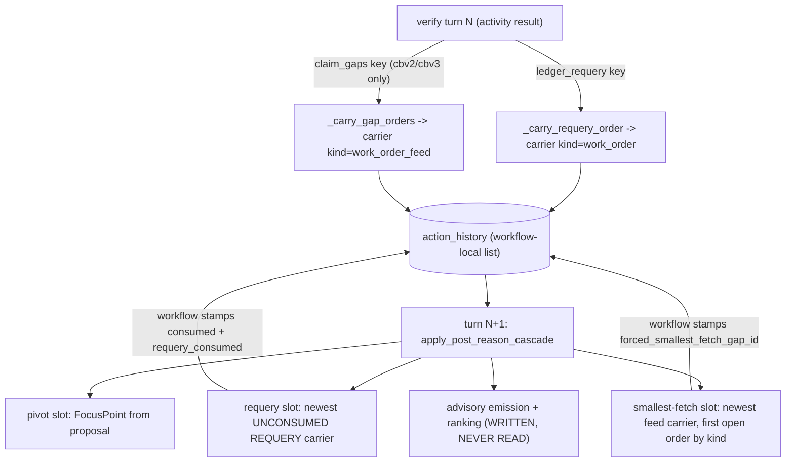
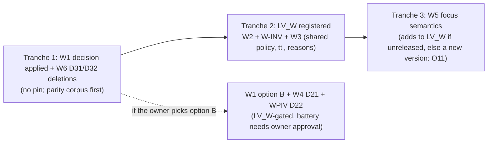

# Design: Work orders, frontier ranking and carriers (review section 7, group W)

- Status: DRAFT (design only; nothing in this document is implemented)
- Group: W (W1-W6 plus two ledger items: invalid requery order label, pivot slot order uniformity)
- Loop version placeholder: `LV_W` (the index maps it to the next free number after the current shipped `lv7`; this document never names a number for a new version)
- Review source: `docs/REVIEW-Sonnet-v0.1-part2.md` section 7, ledger entries dated 2026-10-30 and 2026-10-31
- Baseline: git HEAD `7860fb4`; the ten test files this group touches (`test_work_order_emission`, `test_advisory_ranking`, `test_focus`, `test_cascade_seam`, `test_g3_retrieval_benefit`, `test_f2_carrier_separation`, `test_f8_forcing_rules`, `test_work_orders`, `test_frontier`, `test_f4_pivot_bounds`) pass: 317 tests

## Context

Since the loop reengineering (P6 2b), the post-reason gathering cascade lives in `apply_post_reason_cascade` (`application/worker/workflows/forcing.py`). Two of its slots dispatch from typed work orders that the verify turn carries in the action history beside the real turn entries: a REQUERY order (`kind: "work_order"`, the G3 slot) and a GAP_FILL feed (`kind: "work_order_feed"`, the smallest-fetch slot). The pivot slot dispatches from a `FocusPoint` (`domain/collection/focus.py`) read straight from the model's proposal. After the cascade, an "advisory" layer converts the pivot into a FETCH_SEED work order and ranks it with the frontier (`domain/collection/frontier.py`); nothing reads the result.

The adversarial review (section 7) found the carrier and ranking layer is internally disciplined (no double-dispatch path was constructed) but has four should-fix defects (W1-W4) and two consider-tier groups (W5-W6). Thirteen remediation tranches have landed since the review; this document re-verified every claim against HEAD `7860fb4` by reading code by symbol and running offline probes. Line numbers in the review are stale and are not used here.

Foundations already landed and relied on here (not redesigned):

- F2 carrier separation (`turn_entries`, `CARRIER_KINDS`, `_carriers_separated`, loop version lv6): positional "last N turns" readers skip carriers.
- F4 bounded pivot (loop version lv7): `PIVOT_RECOLLECT_CAP = 2`, non-destructive rewrite, anchor on the model's own proposal. The owner DECIDED (2026-10-31) to leave the F4 precedence as is: a genuine model pivot outranks a pending REQUERY order, and the order waits. This document designs around that decision (the requery time-to-live in D4 is sized so a waiting order survives two pivots) and does not reopen it.
- F8 rule table (`Force`, `Rule`, `RULES`, `check_rule_contract`, `_stands_down`): every rule's stand-down set is a table, and the cascade asks `_down("<rule>")`.

What the cascade reads today, as a flow:



## References

- `docs/REVIEW-Sonnet-v0.1.md` (remediation table rows 1-13) and `docs/REVIEW-Sonnet-v0.1-part2.md` section 7 (7.1 direct answers, 7.2 findings W1-W6, 7.3 untested list)
- `docs/IAP_Arch_Eng_Recommendations.log`: W1 through W6 (OPEN, 2026-10-30), "Invalid requery order is mislabeled as exhausted budget" (OPEN), "Pivot slot order uniformity (step 8 candidate)" (OPEN), the H8/H5/H6 follow-up entry item (c) (OPEN, depends on W3), F4 follow-up (f) (DECIDED, left as is), F2 and F8 follow-ups (IMPLEMENTED foundations), the entry "Correction: restored workorder-v1, frontier-v1, and focus pivot deleted in error" (IMPLEMENTED; the reason W1 deletion is gated)
- `docs/IAP-architecture-v1.0.md` sections 66-71 (lv2-lv7 remediation); section 69 (carriers are not turns), section 70 (bounded pivot), section 71 (rule table)
- `docs/design/DES-collect-frontier-v1.0.md`, `docs/design/DES-reason-workorders-v1.0.md`, `docs/design/README.md` (conventions: version-pinned, no legacy branches, no env switches)
- Source: `application/worker/workflows/forcing.py` (`_should_force_order_requery`, `_carry_requery_order`, `_carry_gap_orders`, `_gap_order_for`, `_pick_gap_order`, `_smallest_fetch_already_covered`, `orders_from_cascade_signals`, `rank_advisory_orders`, `_order_id`, `apply_post_reason_cascade`), `application/worker/workflows/run_investigation.py` (history stamps, `_carry_*` call sites, `consumed` stamp), `application/evidence/retrieval_ledger.py` (`directive_consumed`, `recorded_attempt_summaries`), `domain/collection/focus.py`, `domain/collection/frontier.py`, `domain/collection/work_orders.py`, `domain/investigation/loop_version.py`, `application/worker/activities/verification.py` (where the `claim_gaps` and `ledger_requery` keys are produced), `application/investigation/verification.py` (`build_claim_gaps`)
- Tests: `tests/unit/test_work_order_emission.py`, `test_advisory_ranking.py`, `test_focus.py`, `test_cascade_seam.py`, `test_g3_retrieval_benefit.py`, `test_f2_carrier_separation.py`, `test_f8_forcing_rules.py`, `test_f4_pivot_bounds.py`, `test_work_orders.py`, `test_frontier.py`

## Goals / Non-Goals

Goals:

- Decide W1 (the advisory layer) by designing both options completely, with a recommendation, an exact deletion list and the blast radius. The deletion itself is GATED on the owner.
- Make carrier dispatch bounded in time (W2) and honest about outcomes (W3): a stale REQUERY carrier cannot resurrect, a failed fetch does not cover its gap forever, and the H8 failed-cited-group route is reachable.
- Make the invalid-order case observable and distinctly labeled instead of reported as exhausted budget.
- Make `focus.py` honor its own "never raises" contract and compare surfaces by a canonical identity (W5), and give the unused work-order fields an honest disposition (W6).
- Pin every loop-semantics change to one new loop version (`LV_W`) routed with `loop_version_at_least`; say explicitly where no pin is needed.
- Tests first, shown failing before the fix; at least one negative control per item.

Non-Goals:

- Reopening F4 precedence (pivot over a pending requery order): DECIDED by the owner, left as is.
- Redesigning the F2 carrier-separation view or the F8 rule table: both landed and are foundations here.
- Wiring the H8 gap feed under the default `cbv1` pin (H1 decision), or the NO_TARGET gap path (H8 second half): separate items.
- Deleting `domain/collection/frontier.py` or `work_orders.py` wholesale. `WorkOrder`, `WorkOrderKind` and `FailureCharacter` are live (carriers). An earlier whole-layer deletion in this branch was reverted as an error; this design never proposes it.
- Live runs, restarts, tenant cleans, migrations: none are needed to implement this group; where a design step would want a live measurement it is flagged "requires owner approval".

Standing rules restated: one tranche per owner message; tests first; no commits without the owner; no scratch-directory references in durable artifacts; no analyzed repository named (synthetic names only); IAP is not live, so no compatibility shims, only loop-version routing.

## Decisions

These are the cross-cutting decisions. Item-specific decisions (D6 onward) live inside each item below.

### D1: One loop version, `LV_W`, for every behavior change in the group

Every behavior change in this group that alters what the cascade dispatches (W2 newest-only and expiry, W3 outcome-aware coverage and gap expiry, W5 surface canonicalization and window sanitizing) is routed on the pin recorded on the investigation, under a single new loop version `LV_W`. The index maps the placeholder to the next free number at implementation time. A run pinned `lv7` or older keeps today's behavior byte for byte; a new or unmarked run follows `LV_W`. There is no environment switch and no second flag.

```python
# src/investigation_agent_platform/domain/investigation/loop_version.py  (sketch of the registration)
#
# - ``LV_W``: lv7 plus bounded work-order carriers and honest coverage (review W2,
#   W3, W5). A REQUERY order is read newest-carrier-only and expires after its
#   time-to-live in turns; a smallest-fetch gap is covered only by a fetch that
#   produced evidence (or cleanly proved emptiness), a failed or degraded fetch
#   may be retried once, and a failed-cited-group gap is no longer covered by the
#   earlier uncited fetch of the same group; a gap feed older than its
#   time-to-live is ignored; the pivot compares file surfaces by canonical
#   identity and ignores an inverted line window. It only withholds or retries
#   retrieval; it cannot publish a verdict.

LOOP_VERSION_LV_W = "<next lvN, assigned by the index>"   # placeholder, never a literal here
LOOP_VERSION_CURRENT = LOOP_VERSION_LV_W
KNOWN_LOOP_VERSIONS = KNOWN_LOOP_VERSIONS | {LOOP_VERSION_LV_W}
_LOOP_VERSION_ORDER[LOOP_VERSION_LV_W] = _LOOP_VERSION_ORDER[LOOP_VERSION_LV7] + 1
```

**Alternative considered:** one loop version per item (W2, W3, W5 separately). Rejected: the owner's rule is one tranche per message and the three changes interact (the requery and gap slots share the carrier age helper; W3's expiry reuses W2's helper and policy), so three versions would give three pins that can never be mixed in practice and triple the routing tests. The cost of one shared pin is that the three changes cannot be rolled back independently; the mitigation is that each is gated by its own predicate (D2), so a split later is a one-line change.

**Alternative considered:** no pin, because "stale carriers firing" is a bug. Rejected: dispatch changes, and the repo contract is explicit that loop-semantics changes route on the recorded version even when IAP is not live (the pin is what makes a before/after battery comparison possible).

---

### D2: One routing predicate and one policy value, built once per cascade

```python
# src/investigation_agent_platform/application/worker/workflows/forcing.py
from dataclasses import dataclass

from investigation_agent_platform.domain.investigation.loop_version import (
    LOOP_VERSION_LV_W,
    loop_version_at_least,
)


def _work_orders_hardened(loop_version: Any) -> bool:
    """Whether the run's pin carries the LV_W work-order semantics (fail-safe False).

    Same shape as ``_pivot_hardened`` (lv7): an unrecognized or unreadable pin keeps
    the old behavior.
    """
    try:
        return bool(loop_version_at_least({"loop_version": loop_version}, LOOP_VERSION_LV_W))
    except Exception:
        return False


@dataclass(frozen=True)
class WorkOrderPolicy:
    """What the carrier readers may assume this turn (pure value, JSON-free).

    ``hardened`` False reproduces the lv7 reads exactly: scan all history for the
    newest unconsumed REQUERY carrier, no expiry, stamp-only gap coverage.
    ``iteration`` is the cascade's current turn, used to age carriers; None when the
    turn counter is unreadable, which makes every age unreadable (carriers fail closed).
    """

    hardened: bool = False
    iteration: int | None = None
```

Inside `apply_post_reason_cascade` the policy is built once, next to `_separate` and `_pivot_v2`:

```python
        _wo_policy = WorkOrderPolicy(
            hardened=_work_orders_hardened(state.loop_version),
            iteration=_safe_int(state.iteration),
        )
```

`_safe_int` is a small helper beside the existing `_non_negative_count` in `forcing.py`: it returns `int(value)`, or None for a boolean, a non-number or an overflow. An unreadable turn counter therefore makes every carrier age unreadable, and an unreadable age retires the carrier as an invalid order (fail closed: no dispatch).

**Alternative considered:** pass `loop_version` into every reader and let each decide. Rejected: five readers would each re-parse the pin, and a reader that forgets the check silently applies new semantics to an old run. A single value built at the top of the cascade is the F4 precedent (`_pivot_v2`).

**Trade-off:** `WorkOrderPolicy` is a small object threaded through three function signatures. The alternative (module-level state) is forbidden in workflow code.

---

### D3: A closed consume-reason vocabulary, stamped and observable

Today a carrier can be retired three ways and only one is recorded: dispatched (the workflow sets `consumed = True` and a `requery_consumed` stamp), budget exhausted, and "invalid" (which is silently labeled budget exhausted). With expiry added there are four non-dispatch reasons. They become a closed vocabulary so a reader of the history, the loop telemetry or the logs can tell them apart.

```python
# src/investigation_agent_platform/application/worker/workflows/forcing.py
from enum import StrEnum


class ConsumeReason(StrEnum):
    """Why a REQUERY carrier was retired without dispatching (closed set)."""

    BUDGET_EXHAUSTED = "budget_exhausted"   # directive_consumed: attempts spent or stamp matched
    EXPIRED = "expired"                     # LV_W: age in turns exceeded the order's ttl_rounds
    INVALID_ORDER = "invalid_order"         # payload missing/malformed/wrong kind/not PENDING/unknown version
    # "dispatched" is stamped by the workflow, not by the cascade, and is not a retirement without dispatch.
```

The cascade records each retirement in a new output field, replacing the two dead advisory outputs:

```python
@dataclass
class PostReasonCascadeState:
    ...
    #: Carrier retirements this cascade decided (committed with the stamps, F7).
    #: Each is {"event": "requery_order_retired", "reason": ConsumeReason value,
    #: "detail": short code, "claim_ref": str, "turn_issued": int, "age": int | None}.
    #: The workflow appends them to loop telemetry; nothing else reads them.
    order_events: list = field(default_factory=list)
```

Stamping stays inside the F7 commit point: `_pending_consume` becomes a list of `(entry, reason, detail)` and the commit loop sets `entry["consumed"] = True` and `entry["consumed_reason"] = reason.value`. The workflow's dispatch stamp (`run_investigation.py`, the `forced_requery` branch) additionally sets `consumed_reason = "dispatched"` so every spent carrier carries exactly one reason. An invalid order also logs one warning (event `requery order invalid`, error code only, never the payload) so a corrupted carrier is visible in the story log.

**Alternative considered:** keep the free string `"budget-exhausted"` and add more strings. Rejected: the free string is the bug being fixed (it lied for invalid payloads); a closed enum plus a test that the cascade only ever stamps members makes a new lie a failing test.

**Alternative considered:** raise on an invalid order. Rejected: the cascade's contract is never-raises, and an invalid carrier must not stop the loop. The failure is made observable (stamp, event, log, telemetry) and the turn proceeds un-forced, which is the safe direction.

**Version pin:** none for D3 alone. It changes a label and adds observability keys; dispatch is identical (an invalid or budget-exhausted carrier was consumed and the turn proceeded un-forced before, and still is). Only the EXPIRED reason is new behavior and it is reachable only under `LV_W` (D2).

---

### D4: Time-to-live constants derived from the existing bounds, not invented

```python
# src/investigation_agent_platform/application/worker/workflows/forcing.py

#: A REQUERY order issued at verify turn N is first evaluated at turn N+1. The F4 pivot
#: may outrank it for at most PIVOT_RECOLLECT_CAP turns, so the order must survive
#: PIVOT_RECOLLECT_CAP + 1 turns of age to be dispatchable on the first turn the pivot
#: has stood down. (Owner decision 2026-10-31: the pivot outranks a waiting order.)
REQUERY_ORDER_TTL_TURNS = PIVOT_RECOLLECT_CAP + 1

#: A GAP_FILL feed is re-emitted by every healthy verify turn (age 1 on the next cascade).
#: Three turns tolerates one skipped verify (a defer turn) plus one fault turn, after which
#: the feed describes a hypothesis the loop has moved past.
GAP_ORDER_TTL_TURNS = 3

#: One initial fire plus one retry per (gap identity, reason).
GAP_MAX_ATTEMPTS = 2
```

The orders carry their own ttl so the enforcement reads the payload, not a constant: `_carry_requery_order` writes `"ttl_rounds": REQUERY_ORDER_TTL_TURNS` into the order dict and `_gap_order_for` passes `ttl_rounds=GAP_ORDER_TTL_TURNS` to `WorkOrder`. `WorkOrder.ttl_rounds` is today never read; this makes it a live field (W6) with a meaning ("turns of age after which the carrier is no longer dispatchable"). A payload without a ttl keeps the model default (`DEFAULT_CANDIDATE_TTL_ROUNDS = 10`, longer than any run), which expires nothing.

**Alternative considered:** a single global TTL of 10 (the existing default). Rejected: equal to `max_iterations`, so it would never fire and the fix would be cosmetic.

**Alternative considered:** TTL measured in executed attempts (like the ledger budget). Rejected: the review's scenario includes a degraded-empty turn that carries no `retrieval_attempt`, so attempt-based age does not advance exactly when a carrier is most likely to linger. Turn age is monotone and replay-deterministic.

**Trade-off:** the numbers are uncalibrated. `REQUERY_ORDER_TTL_TURNS` is derived (cap plus one), so it moves with the pivot cap automatically; `GAP_ORDER_TTL_TURNS` is a judgment and is the one number to put in front of the owner (open decision O3). A calibration needs a battery run: requires owner approval.

---

### D5: Test strategy for the group

1. Parity first. Before any deletion or semantic change, a table-driven parity corpus records the cascade's dispatch outputs (next action, parameters, forced flags, counts, anchor, consumed ref) for about a dozen scenarios on current code. It passes before and after the W1 deletion (it pins that nothing observable changed); once `LV_W` is registered the rows where the pin must not matter also run under it.
2. Pins that fail first. Every behavior change gets a test written against the current code that fails for the stated reason, then the fix. The parity corpus is the only test expected to pass before and after.
3. Source pins for the workflow wiring. The workflow glue (`run_investigation.py`) cannot be driven by a pure test and the repo has no Temporal test-server tests, so the wiring uses the repo's existing convention: `inspect.getsource` pins (as `test_f8_forcing_rules.py` and `test_f2_carrier_separation.py` do) plus pure tests on the functions the glue calls.
4. One negative control per item, written as "break this line, this test must fail", and demonstrated once by hand during implementation.
5. One deferred workflow-harness test (a Temporal replay of carrier append plus the in-place stamp) is specified but flagged: the first Temporal test-server test in the repo needs owner approval (it downloads a server binary), so it is listed as optional and is not on the critical path.

## Items

Severity vocabulary follows the review (blocker / should-fix / consider). Every item has a Status line, the verified problem, the design, version pinning, test cases and rollout.

### Verification summary

| Item | Review claim | Verdict at HEAD `7860fb4` | Evidence |
|---|---|---|---|
| W1 | advisory outputs never read; one emitter, at most one FETCH_SEED | Holds | `run_investigation.py` has no reference to `advisory_*`; only tests read them; `orders_from_cascade_signals` emits only on a fired pivot |
| W1 | `cost_estimate` hardcoded 1 | Holds | three sites in `forcing.py` (`_carry_requery_order` payload, `_gap_order_for`, pivot emission) |
| W1 | `cost=10**400` empties the ranking silently | Holds, synthetic only | probe: `rank_advisory_orders([order(cost=10**400)], [], 0)` returns `ranked: []`, `skipped: []`; unreachable today because every emitted cost is 1 |
| W1 | `orders_from_cascade_signals(history=...)` unused | Holds | parameter never referenced in the body |
| W1 | wall-clock and `uuid4` hazard in the workflow path | Holds, harmless today | `FrontierCandidate.seeded_at` default factory calls `datetime.now(UTC)` on every pivot turn via `rank_advisory_orders`; value is discarded; `WorkOrder.work_order_id` defaults to `uuid4` |
| W2 | stale carrier fires turns later | Holds | probe: carrier issued turn 3, five unrelated turns, cascade at turn 9 dispatches it; an older unconsumed carrier also fires behind a consumed newer one |
| W2 | `ttl_rounds` never enforced | Holds | `_carry_requery_order` does not even set it; the `WorkOrder` default 10 is never read |
| W3 | stamp is outcome-blind | Holds | the stamp is written from `_reason_data` and covers regardless of the `outcome_status` on the same entry; probe: a stamped entry with `outcome_status: FAILED` still covers |
| W3 | pivot/floor/callsite read of the same window does not cover | Holds (probe); fix declined, see W3 D18 | probe: after a pivot read of `a.py` 1-5, the gap order for the same window dispatches a duplicate GET_CODE |
| W3 | keyless verify leaves a stale carrier newest | Holds | `_carry_gap_orders` returns None when `claim_gaps` is absent; the slot keeps reading the older carrier |
| W3 | gap id is hypothesis-agnostic | Holds; judged correct once coverage is outcome-aware, see W3 D17 | gap id is KIND plus target key from `build_claim_gaps` |
| W3 (new) | H8 failed-cited-group gap collides with the original uncited gap | NEW finding, probe | an H8 gap shares the gap id of the earlier uncited gap; after the uncited fetch fired, `_pick_gap_order` returns None for the H8 gap, so the lv3 H8 re-fetch route is dead whenever the group was fetched before |
| W4 | pivot dispatched yet ranked out | Holds | probe: pivot fired on `a.py` 1-5, `advisory_orders` has 1 order, `advisory_ranking["ranked"] == []` (a banked read 12 turns back is outside the 10-turn damping window but inside the all-history novelty baseline) |
| W4 | symbol seed carries `target="FIND_SYMBOL"` | Holds | probe: ranked entry `target: "FIND_SYMBOL"` for symbol `computeTotal` |
| W5 | no path normalization | Holds, except case | probe: `./src/A.java`, `src\A.java`, `src//A.java`, `src/./A.java`, `/repo/src/A.java` all PIVOTED. Case folding is rejected, see W5 D26 |
| W5 | `inf` raises `OverflowError` | Holds | probe: `_clean_line(float("inf"))` and `pivot_can_pay_off(float("inf"))` raise; `focus_from_reason_data` swallows it and loses the whole focus |
| W5 | `end < start` accepted | Holds | probe: `line_start=50, line_end=10` kept |
| W5 | stale `prev_focus` across non-focus turns | Holds; by-design ambiguity, see W5 D28 | the cascade overwrites the anchor only on a turn with a model focus |
| W5 | NaN accepted by `_is_json_safe` | Holds | probe: `{"q": nan}` validates and `model_dump(mode="json")` yields `{"q": None}` |
| W6 | dead surface | Holds | no production consumer of `evaluate_exit`, `seed_from_dormant_templates`, `FrontierExit`, the status values; `ttl_rounds` and `max_attempts` ignored on orders; three empty `imports_passed_through()` blocks remain at the top of `forcing.py` |
| W6 | `status != PENDING` branch unreachable | Holds in production; becomes the invalid-order detector (W-INV) | no producer sets CONSUMED or EXPIRED |
| LEDGER | invalid order mislabeled budget-exhausted | Holds | probe: non-REQUERY kind, CONSUMED status and `order: None` all return `mark_consumed: "budget-exhausted"` |
| LEDGER | pivot slot order uniformity | Holds as stated | pivot dispatches from `FocusPoint`; advisory FETCH_SEED orders are never dispatched |

The review also named a `uuid4` fallback in `_order_id` that the Temporal sandbox would reject: confirmed present and unreachable (`uuid5` over a string cannot fail); it is deleted by W1 option A or, independently, by W6 D31.

### Item W1: The advisory layer is dead weight

**Status: GATED** (the standing rule forbids deleting the layer without the owner; an earlier deletion in this branch was reverted as an error). Severity should-fix. Dependencies: none inbound; W1 option A resolves W4 and the pivot-slot-uniformity ledger item and removes the sandbox hazard named in W6. Open ledger entry: W1 (2026-10-30).

**Verified problem.**

`apply_post_reason_cascade` (`forcing.py`, the block after the turn-focus record) calls `orders_from_cascade_signals(...)` and `rank_advisory_orders(...)` every turn and writes the results to `state.advisory_orders` and `state.advisory_ranking`. `run_investigation.py` reads `_cascade_state.reason_data`, `.prev_focus`, `.counts` and `.consumed_order_ref` and nothing else; a search for `advisory` in `run_investigation.py` is empty. The only consumers of the two fields are `test_work_order_emission.py` and `test_advisory_ranking.py`. Consequences, each verified by probe:

- The only emitter produces at most one FETCH_SEED, and only on a turn where a pivot fired; REQUERY and GAP_FILL emission were retired in 2b steps 5 and 6 (two tests pin "carriers emit nothing"). The seed stays PENDING forever and is recomputed from scratch next turn.
- `cost_estimate` is a literal 1 at all three construction sites, so `base_score = 1 / (1 + cost)` is the constant 0.5 and the "value of information" ranking collapses to novelty in {0, 0.5, 1}, then depth, then `candidate_id.hex` (a uuid5 of the order id): the "best" order among equals is an arbitrary hash.
- A cost of `10**400` raises `OverflowError` in `base_score`; the outer `except Exception` in `rank_advisory_orders` swallows it and returns an empty ranking with an empty `skipped` list: silent. Unreachable in production today (every emitted cost is 1); a landmine for any future non-constant cost.
- `FrontierCandidate.seeded_at` defaults to `datetime.now(UTC)` and runs on every pivot turn inside workflow code (the module is imported passed-through, so Temporal's sandbox does not intercept it). The value is discarded, so replay is unaffected today; a consumer that recorded it would break determinism. `WorkOrder.work_order_id` defaults to `uuid4`; the advisory path always passes an explicit id.
- The `history` parameter of `orders_from_cascade_signals` is unused.

**Design.**

Two options are designed in full. The recommendation (D8) follows them.

#### D6: Option A: delete the advisory emission and ranking, keep the retained designs

Delete exactly the dead glue and nothing else. The domain library (`frontier.py`, `work_orders.py`) stays: `WorkOrder`, `WorkOrderKind`, `WorkOrderStatus` and `FailureCharacter` are live in the carriers, and the frontier ordering, seed translation and exit rule are the retained implementation of two ACCEPTED designs (`DES-collect-frontier`, `DES-reason-workorders`) with their own passing tests. Deleting them is out of scope (see Non-Goals) and would repeat the reverted mistake.

Exact deletion list:

| Where | Symbol or block | Action |
|---|---|---|
| `forcing.py` | `orders_from_cascade_signals` | delete |
| `forcing.py` | `rank_advisory_orders` | delete |
| `forcing.py` | `_order_id` (and its unreachable `uuid4` fallback) | delete |
| `forcing.py` | `PostReasonCascadeState.advisory_orders`, `.advisory_ranking` | delete (replaced by `order_events`, D3) |
| `forcing.py` | in `apply_post_reason_cascade`: the "2b step 3" and "2b step 4" blocks (`_pivot_surface`, `_advisory_models`, the two `state.advisory_*` assignments) | delete |
| `forcing.py` | imports `order_candidates`, `FrontierEvidenceState`, `MAX_WORK_ORDER_SEEDS`, `WORK_ORDER_VERSION_CURRENT`, `work_orders_to_seeds`; `import json` | delete (verified: each is used only by the deleted functions; `uuid`, `hashlib`, `FailureCharacter`, `WorkOrderStatus` and `_flat_scalar_params` stay, they are used by the carriers) |
| `forcing.py` | the three empty `with workflow.unsafe.imports_passed_through(): pass` blocks | delete (W6 D31) |
| `tests/unit/test_work_order_emission.py` | whole file (five classes; every test targets the emission or its seam outputs) | delete |
| `tests/unit/test_advisory_ranking.py` | `TestRanking`, `TestRankingCap`, and the seam test `test_pivot_turn_ranks_seed_first` | delete |
| `tests/unit/test_advisory_ranking.py` | `test_gap_carrier_turn_dispatches_without_advisory_copy`: its real content is "a carried REQUERY order outranks a carried gap order end to end" | migrate to `test_cascade_seam.py` (drop the `advisory_orders == []` assertion) |
| `tests/unit/test_advisory_ranking.py` | `test_focus_tracks_dispatched_fetch_not_proposal`, `test_from_lv7_a_forced_fetch_does_not_become_the_focus_anchor` | already covered by `test_f4_pivot_bounds.py` (`test_a_forced_fetch_used_to_become_the_pivot_anchor`, `test_from_lv7_a_forced_fetch_does_not_move_the_anchor`); verify the overlap in the PR, then delete with the file |
| docs | `DES-reason-workorders-v1.0.md`, `DES-collect-frontier-v1.0.md` | add a "Rebuild notes" section capturing the lessons below BEFORE the code is deleted (the ledger promises "designs are retained"; today the DES files are about 20 lines each and do not carry the defects found) |
| docs | `IAP-architecture-v1.0.md` | add a new section (number assigned by the index, next after 71) |

Rebuild notes to write into the DES files (so a future consumer does not relearn them): cost must come from the fetch (windowed read size, search breadth) or the ranking is novelty plus a hash; novelty and any damping must read one baseline function; an unlocatable order (REQUERY and GAP orders for ABSENCE and BEHAVIOR carry no file, span or revision) cannot be ranked and needs a fallback; seed identity for a symbol must carry the symbol, not the action name; ids and timestamps must be deterministic (uuid5, no wall clock) because the code runs in workflow context; a dispatched order must leave the ranked pool.

Blast radius of A: zero runtime behavior change. The workflow reads none of the deleted outputs; the history, checkpoint and loop telemetry shapes are unchanged; `advisory_*` were never persisted. Verified by the parity corpus (D5): the dispatch outputs of the dozen scenarios are identical before and after. Compile-time blast radius: the two removed fields are attributes of a dataclass built only in `run_investigation.py` (which does not set them) and in tests. The domain library keeps `work_orders_to_seeds`, `order_candidates` and `FrontierCandidate` with their own suites (`test_work_orders.py`, `test_frontier.py`), now with no production caller; W6 D29 labels that state honestly.

**Alternative considered (A2):** also delete `work_orders_to_seeds`, `order_candidates`, `FrontierCandidate`, `seed_from_dormant_templates`, `evaluate_exit`, `FrontierExit` and their tests. Rejected for now: the two designs are ACCEPTED, the earlier deletion was reverted, and the library is pure, small and tested. A2 is a larger gated deletion the owner can take later as a separate decision.

#### D7: Option B: wire a real consumer

A consumer is real only if a decision reads the ranking. The one slot with more than one candidate is the smallest-fetch slot: today `SMALLEST_FETCH_ORDER` (DEFINITION, HISTORY, BEHAVIOR, ABSENCE, CAUSAL) is fixed and the first kind with an open order wins. Option B ranks the locatable open orders by value density and keeps the fixed kind order as the fallback and tie-break.

Four defects must be fixed for the ranking to mean anything (each is a verified W1/W4 finding):

1. Real cost: a priced cost per order, set at carry time, uncalibrated and monotone in fetch size.
2. One baseline: novelty reads the same "collected" definition as the pivot damping window (turn entries only, F2 view, last 10).
3. Total function: a non-finite or oversized cost is clamped, never raised, and an order the ranking cannot place falls back to kind order instead of vanishing.
4. Seed identity carries the symbol (W4 D21).

```python
# src/investigation_agent_platform/application/worker/workflows/forcing.py  (Option B only)

_MAX_ORDER_COST = 1_000


def order_cost(action: str, params: dict[str, Any]) -> int:
    """Uncalibrated priced cost of a fetch: monotone in how much it reads (pure, total).

    A bounded windowed read costs 1 plus one per 100 lines; a whole-file read is priced
    as a 400-line read; a search or state query costs 3; anything else 2. The result is
    clamped to [1, _MAX_ORDER_COST] so ``1/(1+cost)`` is always finite.
    """
    try:
        if action in ("GET_CODE", "GET_SOURCE"):
            start = int(params.get("start_line") or 0)
            end = int(params.get("end_line") or 0)
            lines = max(0, end - start + 1) if start and end else 400
            cost = 1 + lines // 100
        elif action in ("SEARCH_CODE", "SEARCH_LOGS", "QUERY_STATE"):
            cost = 3
        else:
            cost = 2
    except (TypeError, ValueError, OverflowError):
        cost = 5
    return max(1, min(int(cost), _MAX_ORDER_COST))


def _collected_reads(history: Any) -> list[tuple[str | None, str | None]]:
    """(file, span) pairs for the novelty baseline: turn entries, last 10, clean reads only."""
    out: list[tuple[str | None, str | None]] = []
    for entry in turn_entries(history)[-10:]:
        params = entry.get("parameters") or {}
        if not isinstance(params, dict):
            continue
        if str(entry.get("action", "")).upper() not in ("GET_CODE", "GET_SOURCE"):
            continue
        if str(entry.get("outcome_status") or "") not in ("SUCCEEDED", "EMPTY"):
            continue
        file_path = str(params.get("file_path") or "").strip() or None
        start, end = params.get("start_line"), params.get("end_line")
        span = f"{start}-{end}" if start and end else (str(start) if start else None)
        out.append((file_path, span))
    return out


def rank_open_gap_orders(orders: list[WorkOrder], history: Any, banked_total: int) -> list[WorkOrder]:
    """Locatable open orders, best value density first (pure, never raises).

    Unlocatable orders (no file, span or revision) are absent from the result; the slot
    falls back to ``SMALLEST_FETCH_ORDER`` for them, so a ranking gap never blocks a fetch.
    """
    try:
        state = (
            FrontierEvidenceState.NO_ROWS
            if int(banked_total or 0) <= 0
            else FrontierEvidenceState.ROWS_WITHOUT_MATCH
        )
        by_candidate: dict[uuid.UUID, WorkOrder] = {}
        seeds = []
        for order in orders:
            cid = uuid.uuid5(uuid.NAMESPACE_URL, f"frontier-candidate|{order.work_order_id.hex}")
            got, _skipped = work_orders_to_seeds(
                [order], order.addresses, state, candidate_ids={order.work_order_id.hex: cid}
            )
            for seed in got:
                by_candidate[seed.candidate_id] = order
            seeds.extend(got)
        return [by_candidate[s.candidate_id] for s in order_candidates(seeds, _collected_reads(history))]
    except Exception:
        return []
```

The slot then tries ranked orders first and kind order second:

```python
            _ranked = (
                rank_open_gap_orders(_open_orders, _history, state.evidence_banked_total)
                if _wo_policy.hardened
                else []
            )
            # first ranked order whose kind cap and coverage still allow it, else the
            # existing per-kind scan over SMALLEST_FETCH_ORDER (unlocatable orders).
```

A prototype of `order_cost` and `rank_open_gap_orders` against the real `WorkOrder` and `order_candidates` was run offline: a 400-line DEFINITION window priced 5, a 20-line CAUSAL window priced 1, the cheaper CAUSAL order ranked first, and a fully collected window dropped out of the ranking.

Blast radius of B: it changes which fetch a turn gets when two kinds are open at once, so it is a behavior change and needs `LV_W` plus a battery before/after (requires owner approval; repeats in one tenant are served from cache, so it needs fresh tenants). The cost values are invented. Dropping a window another slot already read carries the same stranding hazard W3 D18 declines for cross-read coverage (a window read by another slot is not stamped as a `fetch_reason` row, so dropping the gap can leave it uncited). Only DEFINITION, CAUSAL and HISTORY orders are locatable, so B would rank two or three of five kinds.

**Recommendation (D8): Option A, now. Option B is not justified by evidence.**

- No ledger entry or forensic shows an ordering failure at the smallest-fetch slot; the ledger's own deletion entry recorded "no live forensic exhibits an ordering failure". The measured wins (L1, L2, L4) came from the carrier and verdict-blindness fixes, not from ranking.
- B needs a cost table of invented numbers and a battery to validate it, and it can rank at most three of five kinds; A removes a per-turn cost and a standing hazard at zero behavioral risk.
- A keeps the rebuild path open (the DES rebuild notes plus the retained library), so choosing A forecloses nothing.
- The decision is the owner's: this document deletes nothing. If the owner chooses B, D7 is the plan and W4 D21 plus WPIV D22 apply.

**Version pinning / migration.**

Option A: NO pin needed. It removes outputs nobody reads; the dispatch is identical for every pin (proved by the parity corpus, which runs under the `lv7` pin and, once `LV_W` exists, under it too). Option B: pins on `LV_W` (the ranked pick runs only when `_wo_policy.hardened`); an `lv7` run keeps the fixed kind order.

**Test cases** (written first; the parity test passes before and after by design, every other option-A test fails against current code; B tests are only implemented if the owner picks B).

| ID | Name | Level | Setup | Action | Expected | Notes |
|---|---|---|---|---|---|---|
| W1-T01 | dispatch parity corpus | unit | a table of about twelve cascade scenarios built from the existing helpers: file pivot, symbol pivot, scoped SEARCH_CODE (no pivot), carried requery, carried gap, tombstone, walk-stack over pivot, floor, defer, D6, forced absence, cascade fault; each under the `lv7` pin (and under `LV_W` once it is registered in the next tranche) | run `apply_post_reason_cascade`; compare (next_action, action_parameters, forced flags, counts, prev_focus, consumed_order_ref presence) to a frozen expected table | identical before and after the deletion | the only A test that passes before the fix; the expected table is committed first, from current output |
| W1-T02 | cascade state has no advisory fields | unit | `dataclasses.fields(PostReasonCascadeState)` | collect field names | `advisory_orders` and `advisory_ranking` absent, `order_events` present | fails before: both exist |
| W1-T03 | removed symbols are gone | unit | import `forcing` | `hasattr` for `orders_from_cascade_signals`, `rank_advisory_orders`, `_order_id` | all False | fails before |
| W1-T04 | negative control: advisory field re-added | unit | a scratch copy of the state dataclass with an `advisory_orders` field re-added | run the W1-T02 check against it | W1-T02's assertion fails | proves T02 detects a resurrected field (break: add the field back) |
| W1-T05 | workflow never reads advisory outputs | unit | `inspect.getsource(run_investigation)` | search for `advisory` | no match | guards a half-wired consumer |
| W1-T06 | forcing does not import the frontier ranking | unit | AST of `forcing.py` imports | collect names imported from `domain.collection.frontier` | none of `order_candidates`, `FrontierCandidate`, `FrontierEvidenceState` | sandbox hazard pin (wall-clock default); fails before |
| W1-T07 | requery outranks carried gap end to end | unit | history with a REQUERY carrier and a gap carrier, model proposes FORMULATE | cascade | `forced_requery` True, `forced_smallest_fetch` not set, `consumed_order_ref` is the carrier | migrated from `test_advisory_ranking.py`; passes before and after |
| W1-T08 | retained domain library untouched | unit | run `test_work_orders.py` and `test_frontier.py` unchanged | execute | all pass | regression pin: deleting the glue must not touch the library |
| W1-T09 | fail-open on cascade fault | unit | monkeypatch a rule trigger to raise | cascade | proposal returned unrewritten, counters and stamps uncommitted, `order_events` empty | existing F7 test, kept; proves the deletion did not disturb the fault path |
| W1-T10 | B: cheaper locatable order ranks first | unit | two open orders, a 400-line DEFINITION window and a 20-line CAUSAL window, `LV_W` pin | slot pick | the CAUSAL order dispatches | B only |
| W1-T11 | B: priced cost is monotone and clamped | unit | `order_cost` over windows, a search, `inf`, `10**30`, junk params | call | monotone, always in [1, 1000], never raises | B only |
| W1-T12 | B: overflow cost is clamped, not dropped | unit | order with `cost_estimate=10**400` | `rank_open_gap_orders` | order present in the ranking, no exception | B only; the review's regression pin |
| W1-T13 | B: unlocatable orders fall back to kind order | unit | an ABSENCE order (no file) plus a locatable one | slot pick | locatable ranked first, then kind order for the rest; no order lost | B only |
| W1-T14 | B: older pin keeps the fixed kind order | unit | same orders under an `lv7` pin | slot pick | DEFINITION first (fixed order), not the cheaper CAUSAL | B only; version-pin routing |
| W1-T15 | B: junk input never raises | unit | `rank_open_gap_orders` with None, junk, non-WorkOrder items | call | returns `[]`, slot falls back | B only; malformed input |
| W1-T16 | B negative control: reverse the sort | unit | scratch copy with the ordering reversed | run W1-T10 | W1-T10 fails | B only |
| W1-T17 | B: battery before/after | battery | fresh tenants, 3 repeats per arm, `lv7` vs `LV_W` | run the T6-style gate | no stage worse than baseline | B only; REQUIRES OWNER APPROVAL (fresh tenants or destructive clean) |

**Rollout, risks and open owner decisions.**

- Rollout (A): one tranche. Order: (1) write the DES rebuild notes and commit the parity corpus on current code, green; (2) add W1-T02, T03, T05, T06 and watch them fail; (3) delete per D6; (4) migrate the one precedence test; (5) full run of the touched test files, ruff, mypy ratchet; (6) architecture doc section; (7) ledger: mark W1 IMPLEMENTED (then remove per the ledger rule), and record W4 and the pivot-uniformity item as resolved by this decision. No commit without the owner.
- Risk: someone later wires a consumer to a missing field. Mitigation: W1-T05 fails loudly and the DES notes say the layer was removed deliberately.
- Open owner decision O1: A or B (recommendation A). O2: A2 (also delete the retained frontier library) is not recommended; confirm it stays.

---

### Item W2: Stale REQUERY carriers resurrect indefinitely

**Status: Open** (follow-up of the IMPLEMENTED 2b step 5 carrier work; not gated). Severity should-fix. Dependencies: pin `LV_W`; sized against the F4 decision (pivot outranks a waiting order, left as is); shares D3 and D4 with W3. Open ledger entry: W2.

**Verified problem.**

`_should_force_order_requery` (`forcing.py`) walks the whole history newest to oldest and takes the first entry with `kind == "work_order"`, `order_kind == "REQUERY"` and `consumed` falsy. Three verified consequences (probe on the real functions, plus the real cascade for the first):

1. Age is never checked. A carrier issued at verify turn 3, with five unrelated turns in between (a pivot suppressed it at turn 4 and later verifies returned no directive), dispatches at turn 9: `forced_requery True, action_parameters {'query': 'order filter'}`.
2. A consumed newest carrier is skipped. With history `[old (unconsumed), new (consumed)]` the function returns the OLD carrier. The GAP slot already reads newest-carrier-only (step 6), so the two slots disagree about what "the carrier" is.
3. `WorkOrder.ttl_rounds` is declared (default 10) and read nowhere; `_carry_requery_order` does not even set it. The only bounds are the per-claim attempt budget in `directive_consumed` and `max_iterations`; a degraded-empty turn carries no `retrieval_attempt`, so the attempt count does not advance there.

The verify activity re-issues a directive on every verify turn that still has an unsatisfied claim (`select_ledger_requery` is recomputed from the bank each turn), so a fresh carrier normally exists when one is still wanted; an old carrier firing is a staleness bug, not a lost-work protection.

**Design.**

#### D9: Newest-carrier-only for REQUERY, matching the gap slot

Under `LV_W` the slot reads exactly one carrier: the newest `work_order` REQUERY entry, whether or not it is consumed. A consumed newest carrier means "nothing is waiting"; an older unconsumed carrier is superseded and never fires. The code below was prototyped offline against the real `directive_consumed`, `WorkOrder` and `_carry_requery_order` (stale carrier at turn 9 returned expired; consumed-newest returned None; an invalid kind, an invalid status and a missing payload each returned invalid_order).

```python
# src/investigation_agent_platform/application/worker/workflows/forcing.py
REQUERY_ORDER_TTL_TURNS = PIVOT_RECOLLECT_CAP + 1


def _carrier_age(carrier: dict[str, Any], iteration: int | None) -> int | None:
    """Turns since the carrier was issued (pure). None when unreadable."""
    try:
        if iteration is None or isinstance(iteration, bool):
            return None
        issued = carrier.get("turn_issued", carrier.get("iteration"))
        if isinstance(issued, bool) or issued is None:
            return None
        return int(iteration) - int(issued)
    except (TypeError, ValueError, OverflowError):
        return None


def _retire(index: int, reason: ConsumeReason, detail: str) -> dict[str, Any]:
    return {"mark_consumed": reason, "detail": detail, "order_index": index}


def _should_force_order_requery(
    action_history: list[Any] | None,
    recorded_summaries: list[Any] | None,
    policy: WorkOrderPolicy = WorkOrderPolicy(),
) -> dict[str, Any] | None:
    """G3 order forcing decision: dispatch the live REQUERY carrier, retire a dead one.

    Returns the typed override (``action_type``, ``action_parameters``, ``order_index``),
    or ``{"mark_consumed": ConsumeReason, "detail": str, "order_index": int}`` for a
    carrier that must be retired without dispatching, or None when the turn proceeds.
    ``policy.hardened`` (LV_W) reads only the newest REQUERY carrier and expires it by age;
    otherwise the lv7 reads apply unchanged. Pure. Never raises.
    """
    try:
        entries = list(action_history or [])
    except Exception:
        return None
    try:
        recorded = list(recorded_summaries or [])
    except Exception:
        recorded = []
    candidate_index: int | None = None
    for index in range(len(entries) - 1, -1, -1):
        entry = entries[index]
        if not isinstance(entry, dict) or entry.get("kind") != "work_order":
            continue
        if entry.get("order_kind") != WorkOrderKind.REQUERY.value:
            continue
        if entry.get("consumed"):
            if policy.hardened:
                return None  # the newest carrier is spent: never resurrect an older one
            continue
        candidate_index = index
        break
    if candidate_index is None:
        return None
    carrier = entries[candidate_index]
    try:
        if directive_consumed(carrier, entries, recorded):
            return _retire(candidate_index, ConsumeReason.BUDGET_EXHAUSTED, "attempt_budget")
    except Exception:
        return None
    invalid = _invalid_order_detail(carrier)  # W-INV D13: None when the order is valid
    if invalid is not None:
        return _retire(candidate_index, ConsumeReason.INVALID_ORDER, invalid)
    order = WorkOrder.model_validate(carrier["order"])
    if policy.hardened:
        age = _carrier_age(carrier, policy.iteration)
        if age is None:
            return _retire(candidate_index, ConsumeReason.INVALID_ORDER, "unreadable_age")
        if age > order.ttl_rounds:
            return _retire(
                candidate_index, ConsumeReason.EXPIRED, f"age_{age}_gt_ttl_{order.ttl_rounds}"
            )
    return {
        "action_type": order.action_type,
        "action_parameters": dict(order.action_parameters or {}),
        "order_index": candidate_index,
    }
```

**Alternative considered:** expiry only, keep scanning all unconsumed carriers. Rejected: an older unconsumed carrier would still resurrect behind a consumed newer one within its ttl, and the two carrier slots would keep disagreeing. Newest-only is one invariant ("a slot reads exactly one carrier") shared by both slots, and expiry covers the case newest-only cannot (the newest carrier itself ages out when later verify turns issue no directive).

**Alternative considered:** newest-only without expiry. Rejected: the review's exact scenario (a pivot-suppressed carrier, later verifies with no directive) leaves the newest carrier unconsumed forever; only age bounds it.

**Trade-off:** an unconsumed older carrier superseded by a newer one is dropped, so a claim whose requery was pending is not requeried until a later verify selects it again. The loss is bounded: `select_ledger_requery` re-selects the first unsatisfied claim each verify turn, the attempt budget is keyed by (claim, query, scope) and is unaffected, and the dropped carrier is retired with an explicit `consumed_reason` (D3) so the drop is visible.

#### D10: Age expiry from the order's own `ttl_rounds`

The expiry compares `iteration - turn_issued` with `order.ttl_rounds`, and `_carry_requery_order` writes `"ttl_rounds": REQUERY_ORDER_TTL_TURNS` into the order payload (D4). `turn_issued` is the verify turn N (the carrier is appended at the end of iteration N in `run_investigation.py`), and the first cascade that can see it is turn N+1 (age 1). A ttl of `PIVOT_RECOLLECT_CAP + 1 = 3` lets a waiting order survive two pivot turns (ages 1 and 2) and still fire at age 3; it expires at age 4. Retirement is stamped through the F7 commit point (`_pending_consume`), so an expiry never burns a counter and a cascade fault leaves the carrier untouched.

Cascade wiring (the only change in the requery block): pass the policy and carry the reason.

```python
        if not _down("requery"):
            _recorded_summaries = recorded_attempt_summaries(_history or []) or []
            _order_override = _should_force_order_requery(_history, _recorded_summaries, _wo_policy)
            if _order_override is not None and _order_override.get("mark_consumed"):
                _mark_idx = _order_override.get("order_index")
                try:
                    _mark_entry = (_history or [])[_mark_idx]
                    if isinstance(_mark_entry, dict):
                        _reason = ConsumeReason(_order_override["mark_consumed"])
                        _pending_consume.append(
                            (_mark_entry, _reason, str(_order_override.get("detail") or ""))
                        )
                        _events.append(
                            _retirement_event(_mark_entry, _reason, _order_override, _wo_policy)
                        )
                        _consumed_order_ref = None
                except (TypeError, IndexError, KeyError, ValueError):
                    pass
                _order_override = None
```

#### D11: No per-run requery cap is added now

The review suggests a per-run cap. With D9 and D10 the number of requery dispatches is at most one per verify turn (one live newest carrier), each carrier is bounded by the per-(claim, query, scope) attempt budget and by its ttl, so the run-length bound is `max_iterations`. A run-level cap would be a fourth overlapping bound with no observed failure behind it. Not added; recorded as open decision O4 with the measurement that would justify it (the new `order_events` telemetry shows requery dispatches per run). A test pins the bound instead of a cap (W2-T16).

**Alternative considered:** `forced_requery_count` with a cap of 2 like the other rules. Rejected for now: G3's design is a bounded re-retrieval governed by a per-claim attempt budget, not a count of overrides; capping at 2 could starve a legitimate third distinct claim. Revisit with data.

#### D12: The carrier sets its own ttl; consumers read the payload

`_carry_requery_order` and `_gap_order_for` write `ttl_rounds` (D4). Carry-time writing needs no pin: an `lv7` run carries a ttl nobody enforces, which is harmless and keeps the carry functions pin-free (a carrier built by a run's own code is read under the same run's pin).

**Version pinning / migration.**

Newest-only (D9) and expiry (D10) are pinned on `LV_W` through `WorkOrderPolicy.hardened`. A run pinned `lv7` or older keeps scan-all-history and no expiry (tests assert this: the legacy resurrection is preserved for old pins). The `ttl_rounds` write at carry time, the `order_events` output and the stamped `consumed_reason` need no pin (additive keys; no dispatch change). No migration: carriers live only in workflow-local history; no stored data is rewritten.

**Test cases** (all written first against current code; the stale-fire tests fail before the fix because the carrier dispatches).

| ID | Name | Level | Setup | Action | Expected | Notes |
|---|---|---|---|---|---|---|
| W2-T01 | stale carrier expires (end to end) | unit | `LV_W` pin; REQUERY carrier issued turn 3 (ttl 3), five unrelated turns appended, cascade at turn 9 | `apply_post_reason_cascade` | no `forced_requery`; carrier consumed with `consumed_reason == "expired"`; one `order_events` entry | fails before: the carrier dispatches (probe) |
| W2-T02 | fresh carrier dispatches | unit | carrier issued turn 8, cascade at turn 9, `LV_W` | cascade | `forced_requery` True, params equal the order's, `consumed_order_ref` is the carrier | happy path |
| W2-T03 | ttl boundary | unit | carrier ttl 3 issued turn 5; evaluate at 8 and at 9 | `_should_force_order_requery` | age 3 dispatches; age 4 returns `mark_consumed` expired | boundary off-by-one pin |
| W2-T04 | consumed newest does not resurrect an older carrier | unit | history `[old unconsumed, new consumed]`, `LV_W` | `_should_force_order_requery` | None | fails before: returns the old carrier (probe) |
| W2-T05 | version-pin routing: lv7 keeps scan-all | unit | same history, `WorkOrderPolicy(hardened=False)` and a cascade with `loop_version="lv7"` | decision and cascade | old carrier still returned and dispatched | older pin keeps old behavior |
| W2-T06 | newer carrier supersedes an older unconsumed one | unit | `[old unconsumed (issued 3), new unconsumed (issued 5)]`, cascade at 6 | cascade | the new carrier dispatches; the old is never touched | supersede semantics |
| W2-T07 | pivot-suppressed carrier survives two pivots | unit | carrier issued turn 3; cascades at turns 4 and 5 each with a genuine pivot (F4 cap 2), then turn 6 without | three cascades threading counts | turns 4 and 5 pivot and leave the carrier unconsumed; turn 6 (age 3) dispatches it | pins the D4 sizing against the F4 decision; fails if ttl were 2 |
| W2-T08 | waiting past the F4 window expires | unit | as T07 but a defer turn at 6, normal turn at 7 (age 4) | cascade at 7 | carrier retired `expired`; turn proceeds un-forced | expiry after the F4 window |
| W2-T09 | expiry stamps a reason and burns no counter | unit | expired carrier, counts snapshot | cascade | `consumed_reason == "expired"`, `counts` unchanged, event has `age` and `turn_issued` | observable failure |
| W2-T10 | unreadable age fails closed to invalid | unit | carrier with `turn_issued` None, "x" and True; and a valid carrier with an unreadable turn counter (`policy.iteration` None); `LV_W` | decision | `mark_consumed` invalid_order, detail `unreadable_age`; never dispatches | malformed input; fail-closed |
| W2-T11 | `ttl_rounds` 0 expires next turn | unit | order payload `ttl_rounds=0`, age 1 | decision | expired | edge: zero ttl |
| W2-T12 | stand-down turns still age the carrier | unit | defer, D6 and absence turns at ages 1-3, then a normal turn at age 4 | cascades | slot does not evaluate on stand-down turns; at age 4 the carrier is retired expired, not dispatched | stand-downs do not resurrect |
| W2-T13 | carry writes the ttl and round-trips | unit | `_carry_requery_order(directive, 3)`; `json.dumps` then `loads`; `WorkOrder.model_validate` | inspect | `order["ttl_rounds"] == REQUERY_ORDER_TTL_TURNS`, payload JSON-safe | fails before: ttl absent |
| W2-T14 | degraded-empty turns do not extend a carrier's life | unit | five turns with no `retrieval_attempt` after the carrier | decision at age 5 | expired | age is turn-based, not attempt-based |
| W2-T15 | workflow wiring: policy and reason reach the slot | unit | `inspect.getsource` of `forcing.apply_post_reason_cascade` and `run_investigation` | search | `_should_force_order_requery(` is passed `_wo_policy`; the workflow dispatch stamp sets `consumed_reason` to `dispatched` | source pin (no Temporal harness) |
| W2-T16 | run-length bound without a cap | unit | simulate N verify turns each issuing a new carrier | count dispatches across the run | dispatches <= number of verify turns, never > `max_iterations` | pins D11 instead of adding a cap |
| W2-T17 | negative control: remove expiry | unit | scratch copy deleting the `age > order.ttl_rounds` branch | run W2-T01 and T03 | both fail | break that condition |
| W2-T18 | negative control: remove newest-only | unit | scratch copy dropping the `return None` under `entry.get("consumed")` | run W2-T04 | fails | break that `return None` |
| W2-T19 | replay determinism of carrier append and consumed stamp | workflow-harness | Temporal replay of a recorded two-verify-turn history with a requery carrier | replay | identical decisions | OPTIONAL and DEFERRED: first Temporal test-server use; REQUIRES OWNER APPROVAL (downloads a server binary) |

**Rollout, risks and open owner decisions.**

- Rollout: one tranche with W3 (shared D1-D4); W2 tests first, shown failing; then D9, D10, D12.
- Risk: expiry drops a requery that a slow F4 sequence needed. Mitigation: ttl is cap-plus-one by construction, and T07 and T08 pin both sides.
- Risk: dropping a superseded carrier loses a pending claim's requery. Mitigation: the claim is re-selected by the next verify; retirement is observable (`consumed_reason`, `order_events`).
- Open owner decisions: O3 (ttl values; `REQUERY_ORDER_TTL_TURNS` is derived, `GAP_ORDER_TTL_TURNS = 3` is a judgment), O4 (per-run cap deferred; revisit with `order_events` data).

---

### Item W-INV: An invalid requery order is mislabeled as exhausted budget

**Status: Open** (ledger entry, exception-triage audit, 2026-10-30; not gated). Severity should-fix (correctness of a failure label and observability). Dependencies: D3 (shared vocabulary), W2 (same function). No pin needed for the label and event (see below).

**Verified problem.**

In `_should_force_order_requery` the order payload is validated after the budget check:

```python
    try:
        payload = carrier.get("order")
        order = WorkOrder.model_validate(payload) if isinstance(payload, dict) else None
    except Exception:
        order = None
    if order is None or order.status != WorkOrderStatus.PENDING:
        return {"mark_consumed": "budget-exhausted", "order_index": candidate_index}
```

A missing payload, a payload that fails `WorkOrder` validation (non-JSON-safe parameters, bad field types) and a non-PENDING status all return the string `"budget-exhausted"`, and the cascade (`_pending_consume.append(_mark_entry)`) consumes the carrier without recording why. Probe (real functions): a carrier whose order has `kind="GAP_FILL"`, one with `status="CONSUMED"` and one with `order=None` each returned `{'mark_consumed': 'budget-exhausted', ...}`. Additionally, a carrier whose `order.kind` is not REQUERY passes `WorkOrder.model_validate` (any kind is valid) and would DISPATCH its action; nothing checks the order kind against the carrier's `order_kind`.

**Design.**

#### D13: A distinct invalid reason with a small, closed set of detail codes

`_invalid_order_detail(carrier)` returns None for a valid order and a short code otherwise. The detail codes are the observable part; they never include payload content.

```python
# src/investigation_agent_platform/application/worker/workflows/forcing.py
from investigation_agent_platform.domain.collection.work_orders import KNOWN_WORK_ORDER_VERSIONS


def _invalid_order_detail(carrier: dict[str, Any]) -> str | None:
    """Why a REQUERY carrier's order cannot dispatch, or None when it can (pure, never raises).

    Codes: ``not_a_dict`` (payload missing or wrong type), ``validation_failed`` (the WorkOrder
    model rejects it), ``wrong_kind`` (a valid order that is not REQUERY), ``not_pending``
    (status CONSUMED or EXPIRED on a carrier still marked unconsumed: inconsistent state),
    ``unknown_version`` (a version this build does not understand; see W6 D30).
    """
    try:
        payload = carrier.get("order")
        if not isinstance(payload, dict):
            return "not_a_dict"
        try:
            order = WorkOrder.model_validate(payload)
        except Exception:
            return "validation_failed"
        if order.version not in KNOWN_WORK_ORDER_VERSIONS:
            return "unknown_version"
        if order.kind != WorkOrderKind.REQUERY:
            return "wrong_kind"
        if order.status != WorkOrderStatus.PENDING:
            return "not_pending"
        return None
    except Exception:
        return "validation_failed"
```

`wrong_kind` is a real hardening, not only a label: today a kind mismatch dispatches. It changes dispatch only for a corrupted carrier that our own code never produces (`_carry_requery_order` always writes `kind: REQUERY`), so it is a no-pin contract repair.

**Alternative considered:** raise `ValueError` from the slot on an invalid order and let the F7 fault path pass the proposal through. Rejected: the cascade-wide fault path discards ALL of the turn's decisions (counters, stamps) for one bad carrier; the right scope is to retire that carrier and let the rest of the cascade run.

**Alternative considered:** leave the invalid carrier unconsumed so it stays "visible". Rejected: with newest-only reading (W2 D9) an unconsumed invalid newest carrier would block the slot every turn.

#### D14: Fail-open, retire, report

An invalid carrier is retired (consumed with `consumed_reason == "invalid_order"`), the turn proceeds un-forced, and the failure is reported three ways: the carrier stamp, an `order_events` entry with the detail code, and one warning log line from the cascade (`event: "requery order invalid"`, fields `error` = detail code, tenant and investigation ids; no payload, no query text).

```python
def _retirement_event(
    entry: dict[str, Any], reason: ConsumeReason, decision: dict[str, Any], policy: WorkOrderPolicy
) -> dict[str, Any]:
    return {
        "event": "requery_order_retired",
        "reason": reason.value,
        "detail": str(decision.get("detail") or ""),
        "claim_ref": str(entry.get("claim_ref") or ""),
        "turn_issued": _safe_int(entry.get("turn_issued")),
        "age": _carrier_age(entry, policy.iteration),
    }
```

#### D15: Telemetry plumbing

The workflow appends `_cascade_state.order_events` to a bounded list (at most 20 entries, oldest dropped) and writes it to `loop_telemetry["requery_order_events"]` beside the existing counters. `loop_telemetry` is a plain dict passed into the conclude activity, so no schema change is needed. This is the consumer that the deleted `advisory_*` outputs never had.

**Version pinning / migration.**

NO pin for the label, the stamp, the event and the log: dispatch is unchanged for every pin (an invalid or exhausted carrier was consumed and the turn proceeded un-forced before, and still does). The `wrong_kind` rejection changes behavior only for payloads our code never generates, so no pin; it is stated in the architecture section so the change is not silent. The EXPIRED reason is reachable only under `LV_W` (W2). No migration.

**Test cases** (written first; the label tests fail against current code).

| ID | Name | Level | Setup | Action | Expected | Notes |
|---|---|---|---|---|---|---|
| WINV-T01 | missing payload is invalid, not budget | unit | REQUERY carrier with `order=None` | `_should_force_order_requery` | `mark_consumed == ConsumeReason.INVALID_ORDER`, detail `not_a_dict` | fails before: label `budget-exhausted` |
| WINV-T02 | validation failure is invalid | unit | order with a non-JSON-safe parameter (object()) | decision | invalid_order, detail `validation_failed` | fails before |
| WINV-T03 | non-PENDING status is invalid | unit | order status CONSUMED on an unconsumed carrier | decision | invalid_order, detail `not_pending` | fails before |
| WINV-T04 | wrong kind never dispatches | unit | order kind GAP_FILL inside a REQUERY carrier | decision | invalid_order, detail `wrong_kind` | fails before: it dispatches the action |
| WINV-T05 | genuine budget exhaustion keeps its label | unit | `directive_consumed` true (attempts at budget) | decision | `ConsumeReason.BUDGET_EXHAUSTED`, detail `attempt_budget` | regression: only the invalid cases changed |
| WINV-T06 | invalid carrier is retired, stamped and reported | unit | cascade with an invalid newest carrier | cascade | carrier `consumed True`, `consumed_reason == "invalid_order"`, one `order_events` entry with the detail code, turn proceeds un-forced (no `forced_requery`) | observable failure; fail-open |
| WINV-T07 | the warning log names the code, not the payload | unit | caplog around the cascade with a payload containing a marker string | cascade | warning event `requery order invalid`, `error` field is the detail code, the marker string appears nowhere in the record | never log content |
| WINV-T08 | the vocabulary is closed | unit | run every retirement branch | collect stamped reasons | every stamped `consumed_reason` is a `ConsumeReason` value or `dispatched` | stops a new free-string label |
| WINV-T09 | fail-open on a retirement fault | unit | monkeypatch `_retirement_event` to raise | cascade | proposal returned unrewritten, counters and stamps uncommitted (F7), no exception | fault path |
| WINV-T10 | negative control: restore the old label | unit | scratch copy returning `"budget-exhausted"` for invalid orders | run WINV-T01 to T04 | all four fail | break the `_retire(..., INVALID_ORDER, ...)` line |
| WINV-T11 | telemetry plumbing | unit | `inspect.getsource(run_investigation)` | search | `requery_order_events` written into `loop_telemetry` and bounded to 20 | source pin |

**Rollout, risks and open owner decisions.**

- Rollout: same tranche as W2 (same function). Tests first.
- Risk: a legitimate carrier rejected by the new `wrong_kind` or `unknown_version` check. Mitigation: `_carry_requery_order` always writes `kind: REQUERY` and the default version; WINV-T05 and the existing requery tests pass unchanged.
- No open owner decision beyond O3 and O4.

---

### Item W3: Smallest-fetch coverage is stamp-only and outcome-blind

**Status: Open** (follow-up of the IMPLEMENTED 2b step 6 and of the IMPLEMENTED H8 re-fetch route; not gated). Severity should-fix. Dependencies: pin `LV_W`; D1-D4; an H8 follow-up depends on it (ledger entry "H8/H5/H6 follow-ups" item (c)). The gap feed exists only under `cbv2` or `cbv3` (H1 decision: the default pin is `cbv1`), so this item is unit-proven only and cannot be exercised live on default-pinned investigations. Open ledger entry: W3.

**Verified problem.**

The smallest-fetch slot picks the first open order of a kind (`_pick_gap_order`) whose gap is not already covered. "Covered" is `_smallest_fetch_already_covered(history, gap_id)`: any history entry carrying `forced_smallest_fetch_gap_id == gap_id`. The stamp is written by the workflow (`run_investigation.py`, the post-execute history update) from `_reason_data` at the same time as `outcome_status`, `evidence_added` and `miss_reason`, but the coverage test reads only the stamp. Verified by probe on the real functions:

1. Outcome-blind. A stamped entry with `outcome_status: "FAILED"` and `evidence_added: 0` covers the gap: `_smallest_fetch_already_covered(...) == True`. A timeout, a provider outage or the idempotency-wedge degrade (`_degraded_empty_result`) therefore covers the gap for the rest of the run, and the slot never fetches it again.
2. Duplicate fetch. After a pivot read of `a.py` lines 1-5 (`forced_pivot_recollect`, SUCCEEDED, evidence added), the DEFINITION gap order for the same window still dispatches a second GET_CODE for it (probe: `forced_smallest_fetch True`, same params).
3. Stale carrier. `_carry_gap_orders` returns None when verify returned no `claim_gaps` key (a legacy-pinned result, a faulted enforcement, or an error envelope, per Finding M the key is deliberately absent then); the slot keeps reading the older carrier and keeps dispatching its gaps. Only an explicit empty list (a tombstone) supersedes.
4. Hypothesis-agnostic identity. `gap_id` is `KIND|target_key` (`build_claim_gaps`), with no hypothesis in it.
5. NEW, found while verifying the H8 interplay: an H8 gap (a cited group that failed its own gate, `reason = "cited_gate_failed"`) has the SAME `gap_id` as the original uncited gap for that group, and `_gap_order_for` drops the `reason`. Probe: history `[carrier(uncited gap g), turn stamped g (SUCCEEDED), carrier(H8 gap g)]`; `_pick_gap_order(h8_orders, kind="DEFINITION", history, forced_count=1)` returns None. So whenever the group was smallest-fetched earlier (the usual case: the uncited gap is what got it cited in the first place), the lv3 H8 re-fetch route is dead.

**Design.**

#### D16: Outcome-aware coverage, classified by what the entry already records

No new stamp is needed for the outcome: the stamped history entry already carries `outcome_status` and `miss_reason`. Under `LV_W` coverage reads them:

| Outcome on the stamped entry | Meaning | Covers the gap? |
|---|---|---|
| `SUCCEEDED` | evidence found (banked or already banked) | yes |
| `EMPTY` | ran clean, found nothing; a deterministic re-run returns the same, and for ABSENCE the empty result is the proof | yes |
| `BLOCKED` | authorization denied; never retry a denied fetch (same stance as `_LOG_FORCE_DENIED_STATUSES`) | yes |
| `FAILED` | dispatcher recorded an exception | no (retryable) |
| `DEGRADED` with a transient `miss_reason` (`timeout`, `provider_unavailable`, `rate_limited`, `idempotency_owner_busy`) | infrastructure, not the question | no (retryable) |
| `DEGRADED` with any other `miss_reason` (`code_path_not_found`, `missing_file_path`, `invalid_parameters`, `unsupported_capability`, ...) | deterministic miss; the same params miss again | yes |
| missing or unknown status | cannot tell | yes (fail toward the old, no-refire behavior) |

A gap that is not covered may be fired again, at most `GAP_MAX_ATTEMPTS = 2` times in total per (gap identity, reason), and always after every never-fired gap (D19). The kind cap (`_FORCED_SMALLEST_FETCH_DEFAULT_CAP = 2`) still bounds the total per kind.

```python
# src/investigation_agent_platform/application/worker/workflows/forcing.py
_TRANSIENT_MISS_REASONS = frozenset(
    {"timeout", "provider_unavailable", "rate_limited", "idempotency_owner_busy"}
)


def _fetch_retryable(entry: dict[str, Any]) -> bool:
    """Whether a stamped smallest-fetch turn ended in a failure worth one retry (pure)."""
    try:
        status = str(entry.get("outcome_status") or "").upper()
        if status == "FAILED":
            return True
        if status == "DEGRADED":
            return str(entry.get("miss_reason") or "") in _TRANSIENT_MISS_REASONS
        return False
    except Exception:
        return False


def _gap_coverage(
    action_history: list[Any] | None, gap_id: str, reason: str = ""
) -> tuple[bool, int]:
    """(covered, attempts) for one gap identity (gap_id, reason) under LV_W (pure, never raises).

    ``attempts`` counts the history entries stamped for this identity. The gap is covered
    when any such entry ended in a non-retryable outcome, or when the attempts reached
    ``GAP_MAX_ATTEMPTS``. An entry stamped with a different reason is a different identity.
    """
    try:
        want, want_reason = str(gap_id or ""), str(reason or "")
        if not want:
            return False, 0
        attempts, covered = 0, False
        for entry in action_history or []:
            if not isinstance(entry, dict):
                continue
            if str(entry.get("forced_smallest_fetch_gap_id") or "") != want:
                continue
            if str(entry.get("forced_smallest_fetch_reason") or "") != want_reason:
                continue
            attempts += 1
            if not _fetch_retryable(entry):
                covered = True
        return (covered or attempts >= GAP_MAX_ATTEMPTS), attempts
    except Exception:
        return True, 0  # fail toward no refire
```

The old `_smallest_fetch_already_covered` stays as the `hardened == False` path, unchanged (version-pinned, not deleted: an `lv7` run reads it).

**Alternative considered:** treat EMPTY as retryable, so a clean empty window fetch is tried again. Rejected: the fetch is deterministic over the same parameters, so a retry returns the same nothing at the price of a turn and a kind-cap slot; the H8 follow-up (c) wording "a re-fetch that returns nothing is never retried" is addressed for the cases a retry can change (transient failures) and left for the case it cannot. A different request (a widened window) is a separate H8 design question (open decision O5), not a retry.

**Alternative considered:** a new `forced_smallest_fetch_outcome` stamp. Rejected: the outcome is already on the same entry; a second copy could drift from it.

**Trade-off:** `DEGRADED` classification by `miss_reason` is a closed string set. A new transient reason added to the provider classifier (`classify_provider_failure`) that is not in `_TRANSIENT_MISS_REASONS` would be treated as deterministic (covered, the old behavior). The failure mode is the old behavior, never a retry storm.

#### D17: Identity is `(gap_id, reason)`; the hypothesis is deliberately not in it

The H8 gap needs its own identity so the earlier uncited fetch of the same group does not cover it. The reason rides the order and the stamp:

```python
# src/investigation_agent_platform/domain/collection/work_orders.py  (WorkOrder, one new field)
    #: Why this gap order exists: None for a plain uncited gap, "cited_gate_failed" for an
    #: H8 re-fetch of a cited group that failed its own gate. Part of the coverage identity.
    gap_reason: str | None = Field(default=None, max_length=64)
```

```python
# src/investigation_agent_platform/application/worker/workflows/forcing.py  (_gap_order_for)
        return WorkOrder(
            work_order_id=uuid.uuid5(
                uuid.NAMESPACE_URL, f"gap-order|{gap_id}|{kind}|{int(turn_issued)}"
            ),
            kind=WorkOrderKind.GAP_FILL,
            action_type=action,
            action_parameters=params,
            addresses=FailureCharacter(triage_route="UNKNOWN", claim_kind=claim_kind[:64]),
            cost_estimate=1,
            ttl_rounds=GAP_ORDER_TTL_TURNS,
            gap_id=gap_id,
            gap_reason=str(gap.get("reason") or "") or None,
            claim_ref=str(gap.get("claim_ref") or "") or None,
            seed_source=f"gap:{gap_id}",
            status=WorkOrderStatus.PENDING,
        )
```

```python
# in the slot, when a gap order is picked:
                _reason_data["smallest_fetch_context"] = {
                    "kind": str(_fetch_kind),
                    "gap_id": str(_picked_order.gap_id or ""),
                    "claim_ref": str(_picked_order.claim_ref or ""),
                    "reason": str(_picked_order.gap_reason or ""),
                }
```

and the workflow's history update adds one stamp, read from that context dict (not a new `_reason_data` flag key, so the F8 payload-key guard test is unaffected):

```python
                        "forced_smallest_fetch_reason": str(
                            (_reason_data.get("smallest_fetch_context") or {}).get("reason", "") or ""
                        ),
```

The hypothesis is deliberately NOT part of the identity. The evidence bank is investigation-scoped, the fetched rows are stamped `fetch_reason = smallest_fetch:KIND:gap_id` and kept in the Tier-1 partition of the reasoner's context (`context_compiler`), so a different candidate with the same group sees the rows a successful earlier fetch banked. Keying by hypothesis would re-fire the same window every time the ranked candidate flips and burn the kind cap, to fetch rows the bank already holds. With outcome-aware coverage the real residual risk (the first fetch failed) is closed by D16; a successful fetch the new candidate ignores is a citation problem (H-series), not a retrieval one. The reason, by contrast, is a different question about the same window (the cited rows failed the gate), so it is part of the identity.

**Alternative considered:** put the hypothesis id in the gap identity, as the review suggests. Rejected for the reasons above; recorded here so the review's claim has a reasoned answer (open decision O6 if the owner disagrees).

**Alternative considered:** give H8 gaps a distinct `gap_id` prefix (`REFETCH|KIND|target_key`). Rejected: `gap_id` is also read by `build_claim_gaps` callers, the bank stamp (`fetch_reason`) and telemetry; changing its shape ripples, while a separate `gap_reason` field is additive.

**What H8 still does not fix:** the H8 re-fetch of a failed cited group builds its params with the same builder as the original gap (`KIND_FETCH[kind]["builder"]`), so for a DEFINITION group it requests the same window the group already cites. W3 makes the route reachable and retryable; whether the same request can help is an H8 design question (open decision O5: a widened-window variant for `cited_gate_failed`).

#### D18: Reads by other slots do NOT cover a gap (declined, with the evidence)

The review wants a pivot, floor or callsite read of the same window to cover the gap. Verified the duplicate (finding 2) and DECLINED the fix in this tranche, because suppressing the duplicate can strand the gap: the smallest-fetch fetch is the only path that stamps `fetch_reason = smallest_fetch:...` on the banked rows, and the context compiler keeps `fetch_reason` rows in their own Tier-1 partition so the reasoner can cite them (`context_compiler`, "fetch_reason rows sort into their own partition"). A window read by the pivot is an ordinary code row; it may or may not survive the 100-row projection. If the gap were treated as covered by it, the gap would stay uncited, the order would be suppressed every turn, and the claim would stay INCONCLUSIVE with no route. The duplicate costs one fetch (bounded by the kind cap of 2) and is the mechanism that pins the row. Pinned by a test (W3-T18) so a future "cover by other reads" change must consciously flip it. Open decision O7: if the owner wants it, the safe form is "cover only when the covering row is already cited by a kept binding", which needs the verify activity to expose that set to the workflow (a larger change).

#### D19: First fires before retries, across kinds

With retries, one flapping DEFINITION gap could consume the whole DEFINITION cap and starve a sibling gap that never fired, or a retry in an earlier kind could beat a first fire in a later kind. The slot therefore scans in two passes: first the orders with zero attempts across every kind (in `SMALLEST_FETCH_ORDER`), then, only if none, the retries.

```python
            _picked_order = None
            _fetch_kind = ""
            for _allow_retry in (False, True) if _wo_policy.hardened else (False,):
                for _fetch_kind in SMALLEST_FETCH_ORDER:
                    ...  # counter lookup unchanged
                    _picked_order = _pick_gap_order(
                        _carrier_orders,
                        kind=_fetch_kind,
                        history=_history,
                        forced_count=_counter,
                        policy=_wo_policy,
                        carrier_turn=_carrier_turn,
                        allow_retry=_allow_retry,
                    )
                    if _picked_order is not None:
                        break
                if _picked_order is not None:
                    break
```

`_pick_gap_order` gains `policy`, `carrier_turn` and `allow_retry`. Under `hardened` it uses `_gap_coverage` (attempts 0 is a first fire; `0 < attempts < GAP_MAX_ATTEMPTS` and uncovered is a retry, taken only when `allow_retry`), skips an order whose carrier age exceeds the order's `ttl_rounds` (D20), and otherwise behaves exactly as today. Not hardened, it calls `_smallest_fetch_already_covered` and ignores the other three parameters.

#### D20: A stale gap feed expires

A healthy verify turn re-emits the feed every turn, so the newest carrier is normally age 1. When verify returns no `claim_gaps` key the newest carrier is never superseded. Under `LV_W` a feed whose age exceeds the orders' ttl (`GAP_ORDER_TTL_TURNS = 3`) is ignored, which bounds the keyless case without changing Finding M's distinction (a missing key is a fault signal, not a tombstone: it must not wipe a still-fresh feed, but it must not keep a stale one alive either). The cascade emits one `order_events` entry per turn the newest feed is ignored for age (`event: "gap_feed_stale"`, with the age), so the condition is observable.

```python
            for _evt in reversed(_history or []):
                if isinstance(_evt, dict) and _evt.get("kind") == "work_order_feed":
                    _raw_orders = _evt.get("orders")
                    if isinstance(_raw_orders, list):
                        _carrier_orders = [o for o in _raw_orders if isinstance(o, dict)]
                    _carrier_turn = _evt.get("turn_issued", _evt.get("iteration"))
                    break
```

**Alternative considered:** make a keyless verify result append an explicit tombstone carrier. Rejected: Finding M deliberately distinguishes "no gaps" (an empty list) from "enforcement faulted" (no key); converting a fault into a tombstone would drop fresh, valid gaps on a one-turn transient fault. TTL is the smaller, age-based answer.

**Version pinning / migration.**

D16, D17 (the reason-aware identity and its stamp), D19 and D20 change which gap dispatches, so they are pinned on `LV_W` through `WorkOrderPolicy.hardened`. A run pinned `lv7` keeps stamp-only coverage, one fire per gap, no feed expiry. Additive pieces need no pin: `WorkOrder.gap_reason` (default None), the `reason` key inside `smallest_fetch_context` (execution reads only `kind` and `gap_id`), the `forced_smallest_fetch_reason` history stamp (an older reader ignores it), and `ttl_rounds` on gap orders. No migration: carriers and history are workflow-local; the reason stamp is written for every run (empty string for plain gaps).

**Test cases** (written first; outcome, H8-reachability and stale-feed tests fail against current code).

| ID | Name | Level | Setup | Action | Expected | Notes |
|---|---|---|---|---|---|---|
| W3-T01 | a failed fetch does not cover its gap | unit | `LV_W`; gap order for gap A; history entry stamped A with `outcome_status FAILED` | cascade | gap A dispatches again (smallest_fetch forced, same params) | fails before: stamp covers forever (probe) |
| W3-T02 | a transient degrade does not cover | unit | stamped entry with `DEGRADED` and `miss_reason` each of the four transient reasons | `_gap_coverage` | `(False, 1)` for each | closed transient set |
| W3-T03 | a deterministic degrade covers | unit | `DEGRADED` with `code_path_not_found`, `invalid_parameters`, `unsupported_capability` | `_gap_coverage` | covered | fail toward no refire |
| W3-T04 | SUCCEEDED covers | unit | stamped entry `SUCCEEDED`, evidence added | `_gap_coverage` | covered | happy path |
| W3-T05 | a clean EMPTY covers | unit | stamped entry `EMPTY`; also an ABSENCE gap | `_gap_coverage` | covered | deterministic; ABSENCE proof |
| W3-T06 | BLOCKED covers | unit | stamped entry `BLOCKED` | `_gap_coverage` | covered | never retry a denied fetch |
| W3-T07 | unknown or missing status covers | unit | entries with `outcome_status` None, "", "WEIRD", and a non-dict entry in history | `_gap_coverage` | covered, no exception | malformed input; fail toward old behavior |
| W3-T08 | per-gap attempt limit | unit | two stamped FAILED entries for gap A | `_gap_coverage` and cascade | covered at attempts 2; no third fire | `GAP_MAX_ATTEMPTS` boundary |
| W3-T09 | first fires before retries | unit | DEFINITION gap A (FAILED once, `smallest_fetch_definition` count 1), never-fired DEFINITION sibling B, never-fired HISTORY gap | cascade, three turns threading counts | B fires first (not A's retry); then the HISTORY gap; A's retry is then blocked by the DEFINITION cap (count 2) | starvation guard (D19); a retry only happens when the cap has room |
| W3-T10 | kind cap still bounds retries | unit | counts `smallest_fetch_definition: 2`, gap A failed once | cascade | no dispatch | cap unchanged |
| W3-T11 | H8 gap is reachable after the uncited fetch | unit | history `[carrier(uncited gap g), turn stamped g SUCCEEDED (reason ""), carrier(H8 gap g with reason cited_gate_failed)]`, `LV_W` | `_pick_gap_order` and cascade | the H8 order dispatches | fails before: returns None (probe) |
| W3-T12 | H8 gap is covered by its own success | unit | as T11 plus a stamped entry for g with reason `cited_gate_failed`, SUCCEEDED | pick | covered, no refire | identity is (gap id, reason) |
| W3-T13 | the reason rides the stamp end to end | unit | cascade picks an H8 order; inspect `smallest_fetch_context`; `inspect.getsource(run_investigation)` | cascade plus source pin | context has `reason`; the history update writes `forced_smallest_fetch_reason` from it | wiring pin; F8 payload-key test still passes |
| W3-T14 | a stale feed is ignored | unit | feed carrier issued turn 2, verify turns after it returned no `claim_gaps` key (no new carrier), cascade at turn 7, `LV_W` | cascade | no smallest-fetch dispatch; one `gap_feed_stale` event | fails before: the stale carrier dispatches |
| W3-T15 | a fresh feed dispatches; tombstone supersedes | unit | feed at age 1; then `[feed, tombstone]` | cascade | dispatches; then nothing | regression (exists in part: `test_empty_carrier_supersedes_older_orders`) |
| W3-T16 | tombstone, re-issue, dispatch end to end | unit | T1 verify `[g1, g2]`; T2 dispatches g1; T2 verify tombstone `[]`; T3 nothing; T3 verify re-emits `[g2]`; T4 | cascades threading history | g2 dispatches on T4; g1 is never re-fired | review 7.3 untested item; passes before and after |
| W3-T17 | version-pin routing: lv7 keeps stamp-only | unit | the T01, T11 and T14 setups under `loop_version="lv7"` | cascade | failed fetch still covers; H8 gap not reachable; stale feed still dispatches | older pin keeps old behavior |
| W3-T18 | other slots' reads do not cover (decision pin) | unit | pivot read of the same file and window (SUCCEEDED) in history, gap order for it, `LV_W` | cascade | the duplicate GET_CODE still dispatches | pins D18; flips only by a conscious change |
| W3-T19 | hypothesis is not in the identity (decision pin) | unit | a successful stamp for gap A, then a new carrier for the same gap id from a different hypothesis | pick | covered; and with a FAILED stamp it refires | pins D17 |
| W3-T20 | negative control: remove the outcome check | unit | scratch copy of `_gap_coverage` that returns covered on any stamp | run W3-T01 | fails | break `if not _fetch_retryable(entry)` |
| W3-T21 | negative control: remove the attempt limit | unit | scratch copy with `GAP_MAX_ATTEMPTS = 99` | run W3-T08 | fails | break the constant or the `attempts >= GAP_MAX_ATTEMPTS` test |
| W3-T22 | fail-open on a corrupt history | unit | history of junk (None, ints, dicts with non-string gap ids) | `_gap_coverage`, `_pick_gap_order`, cascade | no exception; fails toward no refire | fault path |

**Rollout, risks and open owner decisions.**

- Rollout: one tranche with W2 (shared D1-D4). Order: W3 tests first and watched failing; `WorkOrder.gap_reason`; `_gap_order_for`; the stamp; `_gap_coverage` and the two-pass slot; the feed expiry.
- Risk: retries add fetches. Mitigation: at most one retry per gap and the per-kind cap of 2; first fires are always taken first.
- Risk: a transient `miss_reason` not in the closed set is treated as deterministic. Mitigation: the failure mode is the old behavior; the set is one constant.
- Risk: no live evidence (cbv1 default). Mitigation: unit-proven only; a live check needs a `cbv2`/`cbv3`-pinned run and fresh tenants, requires owner approval.
- Open owner decisions: O5 (a widened-window request for `cited_gate_failed`, an H8 design), O6 (hypothesis in identity; recommendation: no), O7 (cover by other reads; recommendation: no for now).

---

### Item W4: Pivot and advisory seeds are two representations that disagree

**Status: Open, resolved by the W1 decision** (depends on W1; under option A it is closed by the deletion, under option B it needs D21). Severity should-fix. Open ledger entry: W4.

**Verified problem.**

Two representations of "the pivot" exist, and they disagree:

1. The dispatched pivot is a `FocusPoint`-derived override (`_should_force_pivot_recollect`) damped by `_recent_collection_surfaces`: the surfaces of the last 10 TURN entries, banked or not, any outcome.
2. The advisory FETCH_SEED is ranked by `_novelty` against `collected` built from ALL history entries that are GET_CODE or GET_SOURCE with `evidence_added > 0`.

Probe: a banked read of `a.py` 1-5 at turn 0, eleven unrelated turns, then the model proposes `a.py` 1-5 against a different previous focus. The pivot FIRES (the old read is outside the 10-turn damping window), the advisory emits one FETCH_SEED, and `advisory_ranking["ranked"] == []` (novelty 0: the same file and span is in the unbounded banked-read baseline, so the candidate is dropped at the fixpoint floor). The cascade dispatched a fetch that its own ranking refused to place. Separately, a symbol seed's `SeedFetch.target` is `"FIND_SYMBOL"` (the action type) because `work_orders_to_seeds` takes the target from `file_path` and falls back to `action_type`; the symbol itself (`symbol_name`) is never read there. Probe: `ranked[0].target == "FIND_SYMBOL"` for symbol `computeTotal`, with only `commit="HEAD"` as identity.

**Design.**

#### D21: Resolve by W1; if option B, one baseline and a real symbol target

Option A (recommended, W1 D6): the advisory representation is deleted, so there is one representation (the `FocusPoint` override) and nothing to disagree with. The two dispatched-versus-ranked tests die with the file; the parity corpus (W1-T01) pins that the pivot dispatch is unchanged. No code beyond W1.

Option B (only if the owner picks W1 option B): three fixes.

```python
# 1. one baseline: the ranking's novelty uses _collected_reads (W1 D7), which reads the same
#    turn-entries / last-10 window as _recent_collection_surfaces, instead of all history.

# 2. a dispatched pivot leaves the ranked pool: the pivot slot, not the advisory pass, owns
#    the order, so it is CONSUMED at dispatch and never ranked afterwards. Under B the pivot
#    override constructs its FETCH_SEED order and the slot dispatches it (WPIV D22), so there
#    is exactly one representation per pivot.

# 3. src/investigation_agent_platform/domain/collection/work_orders.py  (work_orders_to_seeds)
        locator = order.action_parameters.get("file_path")
        symbol = order.action_parameters.get("symbol_name")
        target = str(locator or symbol or order.action_type)[:1024]
```

A symbol seed has no file or span, so novelty stays 1.0 for it; its identity for dedupe is `seed_source = "pivot:symbol:<name>"`. A symbol-aware novelty would need a new identity field on `FrontierCandidate` (a `frontier-v2` shape change) and is out of scope.

**Version pinning / migration.**

Option A: NO pin (nothing remains to route). Option B: the ranked pick is `LV_W`-gated (W1); the `work_orders_to_seeds` target fix is an unpinned bug fix on a function with no production caller before B (after B it is reached only inside the `LV_W` branch).

**Test cases.**

| ID | Name | Level | Setup | Action | Expected | Notes |
|---|---|---|---|---|---|---|
| W4-T01 | premise: pivot dispatched but ranked out | unit | the probe: banked read at turn 0, eleven unrelated turns, model proposes the same file and span against a different prior focus | current cascade | pivot fires AND `advisory_ranking["ranked"] == []` | demonstrates the disagreement on current code; deleted with W1 option A |
| W4-T02 | one representation after option A | unit | the same scenario after the deletion | cascade | pivot fires; the state exposes no ranking field | passes after W1 D6; fails before |
| W4-T03 | B: symbol seed target is the symbol | unit | order with `action_parameters={"symbol_name": "computeTotal", "revision": "HEAD"}` | `work_orders_to_seeds` | `seed_fetch.target == "computeTotal"` | B only; fails before (target `FIND_SYMBOL`) |
| W4-T04 | B: file seed target unchanged | unit | order with `file_path` | `work_orders_to_seeds` | target is the path | regression |
| W4-T05 | B: novelty and damping share a baseline | unit | a read 12 turns back with `_collected_reads` | rank | the window is NOT collected (outside the 10-turn window), so the order ranks | B only; fails before |
| W4-T06 | B: a dispatched pivot is not ranked | unit | pivot fired and consumed | rank | the consumed order is absent from the ranked pool | B only |
| W4-T07 | negative control (B) | unit | scratch copy of `_collected_reads` reading all history | run W4-T05 | fails | break the `[-10:]` window |
| W4-T08 | malformed symbol params | unit | `symbol_name` is a list, None, empty | `work_orders_to_seeds` | falls back to action type, never raises | B only; malformed input |

**Rollout, risks and open owner decisions.** Rollout follows W1: nothing to do under option A beyond closing the ledger entry. Risk (B): ranking symbol seeds without a symbol-aware novelty is still coarse; accepted and documented. No additional owner decision beyond O1.

---

### Item WPIV: Pivot slot order uniformity (step 8 candidate)

**Status: Open, decision recommended: DECLINE for now** (depends on W1; ledger entry "Pivot slot order uniformity (step 8 candidate)", plan presented 2026-10-30, not authorized). Severity consider. No pin for the decline; the optional design needs `LV_W`.

**Verified problem.**

The requery and smallest-fetch slots consume carried orders; the pivot slot dispatches straight from `_should_force_pivot_recollect(prev_focus, reason_data, ...)`, which returns a dispatch dict and constructs no order. The advisory FETCH_SEED that mirrors it is never dispatched (W1). The ledger asks whether every slot should go order-driven.

**Design.**

#### D22: Do not route the pivot through orders unless a queued consumer exists

What uniformity would buy, tested against each possible benefit:

| Possible benefit | Does the pivot need it? |
|---|---|
| One history shape | The pivot already stamps `forced_pivot_recollect` on the turn entry (the F8 `Force` table). A pivot order would add a second representation of the same event. |
| Ranking among competing pivots | At most one pivot per turn (one model proposal); there is nothing to rank. |
| Queueing a pivot across turns | A pivot is a function of the model's proposal on THIS turn against its previous proposal; a queued pivot would act on a stale proposal. The owner decided (F4 follow-up (f)) that a pivot outranks a pending order and a blocked pivot does not wait. |
| Replay determinism | The pivot is computed from reason output and history each turn; nothing is stored. |
| Same cap and damping machinery | The pivot already has `PIVOT_RECOLLECT_CAP`, damping and the F8 stand-down table. |

An order-driven pivot would create an order and consume it inside one function call: a new object with no decision input, in a path the owner has just hardened (F4, F8). Recommendation: decline; keep the three slot kinds as they are (pivot from focus, requery and smallest-fetch from carriers), and record the reason in the architecture section so the question is not reopened without a queued consumer. If the owner picks W1 option B and wants one representation, the plan is: `_should_force_pivot_recollect` returns the FETCH_SEED order, the pivot slot dispatches it, and the order is consumed at dispatch (W4 D21 item 2); this is `LV_W`-gated and needs the W1-T17 battery.

**Version pinning / migration.** The decline needs no pin and changes no code. The optional order-driven pivot (option B only) pins on `LV_W`.

**Test cases** (pin the contract so the decision is explicit; all pass today except T05 which a future change would flip deliberately).

| ID | Name | Level | Setup | Action | Expected | Notes |
|---|---|---|---|---|---|---|
| WPIV-T01 | the pivot creates no carrier | unit | file pivot cascade | cascade | `len(action_history)` unchanged, no `work_order` entry added, dispatch has the forced flag | pins "pivot is not order-driven" |
| WPIV-T02 | the order-driven slots are exactly requery and smallest_fetch | unit | AST scan of `apply_post_reason_cascade` for `WorkOrder` reads per rule block | scan | only the two blocks read carriers | structural pin |
| WPIV-T03 | pivot dispatch parity | unit | the W1-T01 corpus rows for pivot (file, symbol, scoped search) | cascade | unchanged under `lv7` and `LV_W` | parity |
| WPIV-T04 | a blocked pivot does not wait | unit | pivot suppressed by walk-stack on turn N; model re-proposes the same file on turn N+1 | cascades | pivot is re-evaluated from the proposal, nothing queued | F4 decision pin (F5 anchor leaves the pivot able to refire) |
| WPIV-T05 | negative control: a pivot carrier would be a visible change | unit | scratch copy that appends a `work_order` entry on pivot | run WPIV-T01 | fails | break: append a carrier in the pivot block |
| WPIV-T06 | pending requery vs pivot unchanged (F4 decision) | unit | carried REQUERY order waiting, model proposes a different file | cascade | pivot fires, order waits, not consumed | existing `test_pivot_beats_valid_carried_order`; keeps the owner decision pinned |

**Rollout, risks and open owner decisions.** Rollout: documentation only (architecture note) plus the pin tests. Risk: none. Open owner decision O8: confirm the decline (recommended) or authorize step 8 under W1 option B.

---

### Item W5: `focus.py` has no path normalization, can raise, accepts inverted windows, keeps stale anchors

**Status: Open** (consider-tier; not gated). Severity consider. Dependencies: pin `LV_W` for the decision-changing parts (D23, D25); D24 is a contract repair. `focus.py` was rewritten from the call contract after an accidental deletion (ledger: "Correction: restored workorder-v1, frontier-v1, and focus pivot"), so its 19-test parity is a floor, not proof of semantic equivalence; this item adds the missing semantic pins. Open ledger entry: W5-W6.

**Verified problem.** Probes on the real module:

1. No path normalization. With a previous focus on `src/A.java`, a proposal for any of `./src/A.java`, `src\A.java`, `src//A.java`, `src/./A.java`, `/repo/src/A.java` returns `PIVOTED` (identity is the raw `(surface_kind, surface)` tuple), forcing a re-read of the same file; the damping set built by `_recent_collection_surfaces` is also raw, so the same spelling difference defeats damping. (`src/A.java ` with trailing whitespace is already stripped by `_clean_str` and returns NONE.)
2. Case: `src/a.java` also returns `PIVOTED`. The review lists this as a defect; it is not (D26).
3. `_clean_line(float("inf"))` and `pivot_can_pay_off(float("inf"))` raise `OverflowError` (they catch only `TypeError` and `ValueError`). `focus_from_reason_data` catches it in its outer `try`, so a model output of `"start_line": 1e999` (parsed as infinity) loses the WHOLE focus (the function returns None), contradicting the module's "never raises" contract in spirit and the one-bad-field-drops-everything behavior. NaN is already handled (`int(nan)` raises `ValueError`).
4. `line_start=50, line_end=10` is accepted as a window, and a 10**30 line number is accepted too.
5. Across a turn with no model focus (FORMULATE, VERIFY, CONCLUDE) the cascade leaves `prev_focus` unchanged (`_proposal_focus is None`), so the anchor can be many turns old.
6. Same file with a different symbol returns NONE and a window change returns REFINED: intended, unchanged.

**Design.**

#### D23: Compare file surfaces by a canonical identity; dispatch keeps the model's spelling

A small total function canonicalizes a file surface for COMPARISON only. It reuses the repository's existing strip rules (`domain.proof.canonical.normalize_path`: drop `.` segments and empty segments, collapse duplicate slashes, strip a trailing slash, preserve case) and wraps them so it never raises: backslashes become slashes first (the shared function rejects them), and a leading slash is preserved so an absolute path stays distinct from a relative one. Prototyped offline: `./src/A.java`, `src\A.java`, `src//A.java`, `src/./A.java`, `src/A.java/` and `  src/A.java ` all map to `src/A.java`; `/repo/src/A.java` stays `/repo/src/A.java`; `src/a.java` stays distinct.

```python
# src/investigation_agent_platform/domain/collection/focus.py
from investigation_agent_platform.domain.proof.canonical import normalize_path


def canonical_surface(surface: Any, kind: str = "file") -> str:
    """Comparison identity of a focus surface (pure, total, never raises).

    A file surface is slash-normalized with the repository's path strip rules (``./``,
    ``//``, trailing slash) and keeps its case and any leading slash. A symbol surface is
    only stripped. The dispatched fetch keeps the model's own spelling; this value is used
    to decide whether two proposals name the same file, never to rewrite a request.
    """
    try:
        text = str(surface or "").strip()
    except Exception:
        return ""
    if kind != "file" or not text:
        return text
    text = text.replace("\\", "/")
    try:
        body = normalize_path(text)
    except Exception:
        return text
    return ("/" + body) if text.startswith("/") and body else body


class FocusPoint(BaseModel):
    ...

    @property
    def identity(self) -> tuple[str, str]:
        """(kind, canonical surface): what makes two foci the same surface."""
        return (self.surface_kind, canonical_surface(self.surface, self.surface_kind))


def detect_shift(prev: FocusPoint | None, curr: FocusPoint | None, *, hardened: bool = False) -> FocusShift:
    try:
        if curr is None or prev is None:
            return FocusShift.NONE
        same_surface = (
            prev.identity == curr.identity
            if hardened
            else (curr.surface_kind, curr.surface) == (prev.surface_kind, prev.surface)
        )
        if not same_surface:
            return FocusShift.PIVOTED
        if (curr.line_start, curr.line_end) != (prev.line_start, prev.line_end):
            return FocusShift.REFINED
        return FocusShift.NONE
    except Exception:
        return FocusShift.NONE
```

The damping comparison in `_should_force_pivot_recollect` canonicalizes both sides when `hardened`:

```python
        recent = {str(r or "") for r in (recent_targets or []) if str(r or "")}
        if hardened:
            recent = {_canonical_recent(r) for r in recent}
            key = "%s:%s" % curr.identity
        else:
            key = f"{curr.surface_kind}:{curr.surface}"
        if key in recent:
            return None


def _canonical_recent(entry: str) -> str:
    kind, _, rest = entry.partition(":")
    return f"{kind}:{canonical_surface(rest, kind)}"
```

Under `preserve_proposal` (lv7) the pivot already keeps the proposal's parameters; the dispatched `file_path` stays the raw spelling the model used (`kept["file_path"] = curr.surface`), so canonicalization cannot change what is fetched, only whether a "pivot" is declared.

**Alternative considered:** canonicalize at extraction (`FocusPoint.surface` stored canonical). Rejected: the pivot rewrites `kept["file_path"] = curr.surface`, so a canonical `surface` would silently change the dispatched path from the model's spelling to ours. A comparison-only `identity` property keeps lv7's non-destructive principle (F4).

**Alternative considered:** reuse `topology.models.normalize_file_path`. Rejected: it raises on an absolute path or a traversal segment; a proposal with either would then lose its focus instead of comparing. `canonical_surface` is total.

#### D24: Contract repair: no `OverflowError`, no loss of the whole focus

```python
def _clean_line(value: Any) -> int | None:
    try:
        if isinstance(value, bool):
            return None
        line = int(value)  # type: ignore[arg-type]
    except (TypeError, ValueError, OverflowError):
        return None
    return line if line >= 1 else None


def pivot_can_pay_off(turns_remaining: Any) -> bool:
    try:
        if isinstance(turns_remaining, bool):
            return False
        return int(turns_remaining) >= 2  # type: ignore[arg-type]
    except (TypeError, ValueError, OverflowError):
        return False
```

An infinite line number now means "no line", not "no focus". This is unpinned: it makes the documented never-raises contract true and turns an accidental exception path (inputs of 1e309 or more) into the same handling every other non-integer already gets. It does change the outcome for that one pathological input (previously the whole focus was lost, now the focus survives without that bound). If the owner wants strict version routing even for this, it is a one-line move under `hardened` (open decision O9; recommendation: leave unpinned).

#### D25: Sanitize the window (pinned)

Under `LV_W`, `focus_from_reason_data(..., hardened=True)` drops an inverted end (`line_end < line_start` becomes `line_end = None`) and treats a line number above `MAX_FOCUS_LINE = 10_000_000` as absent. The pivot's rewrite keeps the model's own parameters (F4), so the dispatch is the model's request either way; the sanitizing only keeps the FocusPoint well-formed so REFINED and NONE are decided on a real window.

```python
MAX_FOCUS_LINE = 10_000_000


def _sanitized_window(start: int | None, end: int | None) -> tuple[int | None, int | None]:
    start = start if start is not None and start <= MAX_FOCUS_LINE else None
    end = end if end is not None and end <= MAX_FOCUS_LINE else None
    if start is not None and end is not None and end < start:
        end = None
    return start, end
```

#### D26: Case is NOT folded (the review's case claim is rejected)

`src/a.java` and `src/A.java` address different files on a case-sensitive filesystem, and the repository's own path normalizer states that case is preserved for that reason. Folding case would merge two real files and suppress a legitimate pivot. A test pins that they stay distinct.

#### D27: Absolute paths stay distinct from relative ones

`/repo/src/A.java` cannot be mapped to `src/A.java` without knowing the checkout root, and the focus layer is pure (no profile, no I/O). They compare as different surfaces, as today. Stripping a profile's `source_roots` prefix would need the root threaded in (the reasoner already receives profile roots); out of scope, recorded as open decision O10.

#### D28: The anchor outliving non-focus turns is left as is (decision), with the option designed

The cascade keeps the previous focus across FORMULATE, VERIFY and CONCLUDE turns. That is defensible: the model's working focus persists while it reasons, and the first fetch on a different file after a thinking turn IS a shift. The harm is bounded by F4 (cap of two pivots per run; the rewrite is non-destructive and a scoped SEARCH_CODE is left alone). Recommendation: leave it and pin the behavior so it is a decision, not an accident.

Option, only if a battery case shows a stale-anchor mispivot: stamp the anchor with its turn and ignore it after `FOCUS_STALE_TURNS`:

```python
FOCUS_STALE_TURNS = 4

# cascade, where the anchor is recorded (hardened only):
state.prev_focus = {**_proposal_focus.model_dump(mode="json"), "as_of_turn": int(state.iteration)}

# _should_force_pivot_recollect (hardened only), before validating prev_focus:
as_of = prev_focus.get("as_of_turn") if isinstance(prev_focus, dict) else None
if isinstance(as_of, int) and not isinstance(as_of, bool) and current_turn - as_of > FOCUS_STALE_TURNS:
    prev_focus = None  # treated as a first focus: no pivot from a stale anchor
```

`FocusPoint` ignores the extra `as_of_turn` key (`extra: ignore`), so older readers are unaffected.

**Version pinning / migration.**

D23 and D25 (and D28 if adopted) change which proposals count as pivots: pinned on `LV_W` through the `hardened` parameter threaded from `_wo_policy.hardened` into `focus_from_reason_data`, `detect_shift` and `_should_force_pivot_recollect`; an `lv7` run keeps raw-tuple identity and unsanitized windows. D24 is a contract repair with no pin (stated above). D26 and D27 are non-changes. No migration: the anchor is workflow-local JSON scalars (`prev_focus` dict) and an `lv7` anchor read under `LV_W` is still a valid `FocusPoint`.

**Test cases** (written first; the normalization, inf and window tests fail against current code).

| ID | Name | Level | Setup | Action | Expected | Notes |
|---|---|---|---|---|---|---|
| W5-T01 | same file, different spelling is not a pivot | unit | prev focus `src/A.java`; proposals `./src/A.java`, `src\A.java`, `src//A.java`, `src/./A.java`, `src/A.java/`; `hardened=True` | `detect_shift` (parametrized) | NONE for each | fails before: PIVOTED (probe) |
| W5-T02 | case is preserved | unit | prev `src/A.java`, proposal `src/a.java`, `hardened=True` | `detect_shift` | PIVOTED | pins D26; guards against case folding |
| W5-T03 | absolute stays distinct | unit | prev `src/A.java`, proposal `/repo/src/A.java` | `detect_shift` | PIVOTED | pins D27 |
| W5-T04 | version-pin routing: lv7 keeps raw identity | unit | proposal `./src/A.java` through the cascade with `loop_version="lv7"` and again with `LV_W` | cascade | lv7 forces a pivot; `LV_W` does not | older pin keeps old behavior |
| W5-T05 | damping compares canonical spellings | unit | history surface `file:./src/A.java`, proposal `src/A.java`, different prev focus, `LV_W` | `_should_force_pivot_recollect` | None (damped) | fails before; lv7 still fires |
| W5-T06 | dispatch keeps the model's spelling | unit | genuine pivot to `./src/B.java`, `LV_W` | cascade | dispatched `file_path == "./src/B.java"` (not canonicalized) | F4 non-destructive principle |
| W5-T07 | infinite line number keeps the focus | unit | `start_line=float("inf")` (what a JSON `1e999` parses to) and the string `"1e999"` | `focus_from_reason_data` | FocusPoint on the file with `line_start None` | fails before: returns None (probe); unpinned repair |
| W5-T08 | `pivot_can_pay_off` never raises | unit | `inf`, `-inf`, `nan`, `10**400`, True, "3", None, a list | call | bool result, no exception; `inf`, `-inf`, `nan`, `10**400` and bools return False | fails before for `inf` (raises `OverflowError`) |
| W5-T09 | NaN and non-integers drop only the line | unit | `start_line` nan, "x", 1.5e400, a dict | `focus_from_reason_data` | file focus kept, bad line None | malformed input |
| W5-T10 | oversized line number is absent under LV_W | unit | `start_line=10**30`, `hardened=True` and False | `focus_from_reason_data` | None when hardened; unchanged when not | version-pin routing |
| W5-T11 | inverted window drops the end | unit | `start_line=50, end_line=10`, `hardened=True` and False | `focus_from_reason_data` | `(50, None)` hardened; `(50, 10)` not | fails before |
| W5-T12 | inverted window is not a spurious refinement | unit | prev window `(50, None)`, proposal `(50, 10)`, `LV_W` | `detect_shift` | NONE (not REFINED) | decision made on a real window |
| W5-T13 | `canonical_surface` is total | unit | None, "", ".", NUL byte, a 1 MB string, bytes, an object | call | returns a string, never raises; "" and "." yield "" (no focus) | fuzz-style junk |
| W5-T14 | a symbol surface is not path-normalized | unit | FIND_SYMBOL `./Foo` vs `Foo` | `detect_shift` hardened | PIVOTED (symbols compare stripped, not path-normalized) | kind-aware |
| W5-T15 | the anchor survives a non-focus turn (decision pin) | unit | turn 1 GET_CODE `a.py`; turn 2 FORMULATE; turn 3 GET_CODE `b.py` | cascades threading `prev_focus` | turn 3 is a pivot from `a.py` | pins D28's recommendation to leave it |
| W5-T16 | optional: a stale anchor is ignored | unit | D28 adopted; anchor older than `FOCUS_STALE_TURNS` | cascade | no pivot (first-focus handling) | ONLY if the owner adopts D28 |
| W5-T17 | anchor is replay-safe JSON | unit | `json.dumps(state.prev_focus)` after a cascade | serialize | round-trips with the same fields | scalars only |
| W5-T18 | negative control: remove canonical comparison | unit | scratch copy of `detect_shift` comparing raw tuples when hardened | run W5-T01 | fails | break `prev.identity == curr.identity` |
| W5-T19 | negative control: drop the OverflowError catch | unit | scratch copy with `except (TypeError, ValueError)` | run W5-T07 and T08 | both fail | break the except tuple |
| W5-T20 | wiring: hardened flag reaches focus code | unit | `inspect.getsource(apply_post_reason_cascade)` | search | `focus_from_reason_data(` and `_should_force_pivot_recollect(` receive `hardened=` from `_wo_policy` | source pin |

**Rollout, risks and open owner decisions.**

- Rollout: after W2/W3 (so `_wo_policy` exists). Tests first. The existing 19 `test_focus.py` tests and the F4 tests must pass unchanged under both pins.
- Risk: canonicalization hides a real pivot between two spellings that name different files on an odd checkout. Mitigation: only separator, `.` and duplicate-slash differences are folded; case and absolute paths are not.
- Risk: D24 changes behavior for one pathological input. Mitigation: stated; O9 offers strict routing.
- Open owner decisions: O9 (route D24 under `LV_W`; recommendation no), O10 (profile source-root stripping for absolute paths; recommendation defer), D28 adopt or leave (recommendation leave).

---

### Item W6: Dead surface in `domain/collection`

**Status: Open** (consider-tier; not gated, but its largest part is decided by W1). Severity consider. Dependencies: W1 (the library's only production caller is the advisory glue), W2/W3 (they make `ttl_rounds` live), W-INV (the `not_pending` check). Open ledger entry: W5-W6.

**Verified problem.**

Each claim in review W6 was checked by symbol; the corrected disposition is the heart of this item.

| Symbol or field | Review claim | Verified state at HEAD | Disposition |
|---|---|---|---|
| `evaluate_exit`, `FrontierExit`, `seed_from_dormant_templates` | no production consumer | true; tests only | keep as the ACCEPTED-design library, label it (D29) |
| `FRONTIER_VERSION_CURRENT`, `MAX_FRONTIER_DEPTH`, `FIXPOINT_SCORE_FLOOR` | no production consumer | partly wrong: `MAX_FRONTIER_DEPTH` (`admissible`) and `FIXPOINT_SCORE_FLOOR` (`order_candidates`) are live inside the library; they are only "dead" because the library has no caller after W1-A | keep |
| `CandidateStatus` other than PENDING; `FrontierCandidate.service/config/depth/status/seeded_at` | no consumer | true; spec fields for the P9 and multi-service designs | keep, label (D29); `seeded_at` wall-clock default is a hazard only if constructed in workflow code (pinned out by W1-T06) |
| `WorkOrderStatus.CONSUMED/EXPIRED` | never set; the `status != PENDING` branch is unreachable | true that nothing sets them; the branch is reachable by a corrupt payload and becomes the `not_pending` invalid-order detector (W-INV D13) | keep; now has a purpose |
| `WorkOrder.ttl_rounds` | ignored | true today | made live by W2 D10 and W3 D20 |
| `WorkOrder.max_attempts` | ignored | the carrier's top-level `max_attempts` is what `directive_consumed` reads; the order's copy is a mirror (REQUERY sets both to the same value; gap orders keep the default 1) | keep as a labeled mirror; drift pinned (W6-T07) |
| `workorder-v1` and `frontier-v1` pins "stamp but never route" | true | nothing reads either version today | `workorder-v1` starts routing (D30); `frontier-v1` stamps candidates nothing persists, so it stays a label until a consumer persists them |
| stale prose ("chunk 2b will...", "replaces marker") | true | present in `work_orders.py` and `frontier.py` docstrings and in `forcing.py` carrier docstrings | rewrite (D31) |
| three empty `imports_passed_through(): pass` blocks | true | present at the top of `forcing.py` | delete (D31) |
| `test_stale_marker_dicts_emit_nothing` pins a deleted legacy shape | true | it tests that retired marker dicts produce no orders; it lives in `test_work_order_emission.py` | deleted with that file under W1-A; if W1 is deferred, delete it anyway (no legacy shapes) |
| `_is_json_safe` accepts NaN | true | probe: `{"q": nan}` is accepted and `model_dump(mode="json")` turns it into `None` | fix (D32) |
| `uuid4` default of `work_order_id` | true (W1) | the default is a sandbox footgun | remove the default (D31) |

**Design.**

#### D29: Keep the ACCEPTED-design library, label it honestly, fence it from workflow code

The domain library is the retained implementation of `DES-collect-frontier` and `DES-reason-workorders`, both ACCEPTED, and an earlier deletion of it was reverted as an error. The honest state after W1-A is "tested, correct, no production caller". Make that explicit rather than leaving it to read as live:

```python
# src/investigation_agent_platform/domain/collection/frontier.py (module docstring, replacing "chunk 1" prose)
"""Collect frontier (DES-collect-frontier v1.0): the retained implementation.

Best-first ordering, seed translation and the three-exit rule, tested and pure. As of the
advisory-layer decision (review W1) there is no production caller: the loop's pivot,
requery and smallest-fetch slots do not read it. It must NOT be imported from workflow
code: ``FrontierCandidate.seeded_at`` defaults to the wall clock and ids default to uuid4,
neither of which is replay-safe. A consumer (a future frontier-driven slot) must pass
explicit ids and timestamps. See the rebuild notes in the design document.
"""
```

A guard test (W1-T06 and W6-T09) fails if any module under `application/worker/` imports from `domain.collection.frontier`.

**Alternative considered:** delete the unused spec fields and the status values to make the model "honest". Rejected: the two designs name them, the earlier deletion was reverted, and deleting spec fields from a frozen model for tidiness would be A2 (a separate gated decision, O2).

#### D30: `workorder-v1` starts routing: an unknown version is an invalid order

The only place a work order's version matters is when a carrier is read. Give the pin a use: a payload whose `version` this build does not know is invalid, so a future `workorder-v2` shape is never silently dispatched by a v1 reader.

```python
# src/investigation_agent_platform/domain/collection/work_orders.py
WORK_ORDER_VERSION_CURRENT = "workorder-v1"
KNOWN_WORK_ORDER_VERSIONS = frozenset({WORK_ORDER_VERSION_CURRENT})
```

`_invalid_order_detail` (W-INV D13) already returns `unknown_version` when `order.version not in KNOWN_WORK_ORDER_VERSIONS`. This is routing on the recorded version, not an env switch and not a legacy branch.

#### D31: Delete what is unambiguously dead; require explicit, deterministic ids

```python
# 1. forcing.py: delete the three `with workflow.unsafe.imports_passed_through(): pass` blocks.

# 2. work_orders.py: a work order's identity must be supplied (deterministic), never random.
    work_order_id: UUID   # was: Field(default_factory=uuid4)

# 3. forcing.py: drop the uuid4 fallback in _order_id (the function is deleted with W1-A;
#    if W1 is deferred, delete just the fallback: uuid5 over a string cannot fail).

# 4. rewrite the stale prose ("chunk 2b", "replaces the ... marker", "2b step N") in
#    work_orders.py, frontier.py and the forcing.py carrier docstrings to describe the
#    current contract only.
```

The two construction sites in production (`_carry_requery_order`, `_gap_order_for`) already pass explicit uuid5 ids, so requiring the field changes no runtime path; tests that build a `WorkOrder` without an id (`test_work_orders.py` helper) pass one.

**Alternative considered:** keep the `uuid4` default and document it. Rejected: the Temporal sandbox rejects `uuid4` and the default is invisible at the call site; making the field required turns a latent replay hazard into an immediate `ValidationError`.

#### D32: Parameters must be strictly JSON-safe

```python
def _is_json_safe(value: object) -> bool:
    """Parameters ride Temporal workflow state: only strict JSON survives replay.
    NaN and infinity are not strict JSON and ``model_dump(mode="json")`` would turn them
    into null, silently changing a request."""
    try:
        json.dumps(value, allow_nan=False)
        return True
    except (TypeError, ValueError):
        return False
```

**Version pinning / migration.**

NO pin needed for any W6 change: D29 is documentation and a guard test; D30 changes behavior only for payloads our code never produces (it adds no version other than the current one); D31 removes dead blocks, a never-taken fallback and a default no production path uses; D32 rejects values (NaN, infinity) that no producer generates (carry-time parameters are scalars from verify output; a NaN there would previously have become null silently). `ttl_rounds` becoming live is the pinned part and is accounted under W2 and W3. No migration.

**Test cases** (written first; W6-T01, T02, T03, T05 fail against current code).

| ID | Name | Level | Setup | Action | Expected | Notes |
|---|---|---|---|---|---|---|
| W6-T01 | no empty import blocks | unit | AST of `forcing.py` | find `with` statements whose body is only `pass` | none | fails before (three) |
| W6-T02 | a work order needs an explicit id | unit | construct `WorkOrder` without `work_order_id` | construct | `ValidationError`; and the carriers still produce equal ids on two runs | fails before: uuid4 default |
| W6-T03 | NaN and infinity are not JSON-safe | unit | `WorkOrder(action_parameters={"q": float("nan")})`, `inf`, nested | construct | `ValidationError` (parameters not JSON-serializable) | fails before: accepted, dumps to null |
| W6-T04 | accepted parameters round-trip unchanged | unit | a corpus of valid scalar parameter dicts | `model_dump(mode="json")` then compare | equal to the input | property pin: nothing is silently altered |
| W6-T05 | unknown order version is an invalid order | unit | REQUERY carrier with `version="workorder-v9"` | `_should_force_order_requery` | `INVALID_ORDER`, detail `unknown_version` | fails before: dispatches |
| W6-T06 | the current version dispatches | unit | default version | decision | dispatches | regression |
| W6-T07 | `max_attempts` mirror agrees | unit | `_carry_requery_order` with `max_attempts` 1, 3, 7, junk | compare carrier key with the order's | equal, junk falls to the default on both | drift pin for the labeled mirror |
| W6-T08 | `ttl_rounds` is live | unit | AST of `_should_force_order_requery` and `_pick_gap_order` | search names | both read `ttl_rounds` | fails before; liveness pin |
| W6-T09 | the frontier library is fenced from workflow code | unit | AST of every module under `application/worker/` | collect imports from `domain.collection.frontier` | none | guard for D29; holds after W1-A |
| W6-T10 | the stale prose is gone | unit | text search of `work_orders.py`, `frontier.py`, `forcing.py` | search for "chunk 2b", "chunk 2a", "replaces the", "2b step" outside the history comment allowlist | none | weak but cheap; keeps docstrings describing the current contract |
| W6-T11 | negative control: restore the uuid4 default | unit | scratch copy with `default_factory=uuid4` | run W6-T02 | fails | break the field definition |
| W6-T12 | negative control: allow NaN | unit | scratch copy with `json.dumps(value)` (no `allow_nan=False`) | run W6-T03 | fails | break the `allow_nan=False` argument |

**Rollout, risks and open owner decisions.**

- Rollout: D31 (deletions) and D32 are safe to land with W1 or on their own; D29/D30 with W2/W-INV. Tests first.
- Risk: requiring `work_order_id` breaks a test helper. Mitigation: the only helper (`test_work_orders.py` `_order`) passes an id.
- Open owner decision: O2 (A2, delete the retained library) stays declined here.

---

## Data Structures

Everything below is workflow-local or in-process. Nothing is persisted outside the loop telemetry dict, and no database object changes.

| Structure | Change | Pin | Notes |
|---|---|---|---|
| `WorkOrderPolicy` (new, frozen dataclass in `forcing.py`) | `hardened: bool`, `iteration: int` | built from the pin | D2; threaded into the requery slot, the gap picker and the focus helpers |
| `ConsumeReason` (new `StrEnum`) | `budget_exhausted`, `expired`, `invalid_order` | none | D3; the workflow stamps `dispatched` separately |
| REQUERY carrier (history dict) | adds `consumed_reason`; the order payload gains `ttl_rounds` | none (additive) | `consumed` stays the boolean the readers use |
| `WorkOrder` (`work_orders.py`) | adds `gap_reason`; `work_order_id` becomes required; `KNOWN_WORK_ORDER_VERSIONS` constant | none (see W6) | `ttl_rounds` becomes live; `max_attempts` stays a labeled mirror |
| GAP feed carrier | orders gain `ttl_rounds` and `gap_reason` | none (additive) | the feed dict itself is unchanged |
| `smallest_fetch_context` (reason-data dict) | adds `reason` | none | execution reads `kind` and `gap_id` only; no new flag key, so the F8 payload-key guard is unaffected |
| turn history entry | adds `forced_smallest_fetch_reason` | none | read only by `_gap_coverage` (hardened) |
| `PostReasonCascadeState` | removes `advisory_orders`, `advisory_ranking` (W1 option A); adds `order_events` | none | the new field has a consumer (workflow telemetry) |
| `loop_telemetry` | adds `requery_order_events` (list, at most 20) | none | plain dict into the conclude activity |
| `FocusPoint` | adds an `identity` property and (hardened) sanitized windows | `LV_W` | no stored field changes; `prev_focus` dict gains an optional `as_of_turn` only if D28 is adopted |
| constants | `REQUERY_ORDER_TTL_TURNS`, `GAP_ORDER_TTL_TURNS`, `GAP_MAX_ATTEMPTS`, `MAX_FOCUS_LINE`, `_TRANSIENT_MISS_REASONS` | `LV_W` where read | uncalibrated except the derived requery ttl |

## Interfaces

Internal function signatures only; no HTTP route, CLI command or activity contract changes, so no Accessibility section applies.

| Function | Before | After |
|---|---|---|
| `_should_force_order_requery` | `(history, recorded)` returns override, `{"mark_consumed": str, "order_index"}` or None | `(history, recorded, policy)`; the retire dict carries a `ConsumeReason` and a `detail` |
| `_pick_gap_order` | `(orders, kind, history, forced_count)` | adds `policy`, `carrier_turn`, `allow_retry` (defaults reproduce lv7) |
| `_smallest_fetch_already_covered` | stamp-only coverage | unchanged, now the `hardened == False` path; `_gap_coverage` is the hardened path |
| `_gap_order_for` | cost 1, no ttl, no reason | sets `ttl_rounds` and `gap_reason` |
| `_carry_requery_order` | order payload without ttl | order payload with `ttl_rounds` |
| `detect_shift`, `focus_from_reason_data`, `_should_force_pivot_recollect` | no flag | keyword `hardened: bool = False`; `_should_force_pivot_recollect` also gets the current turn only if D28 is adopted |
| `canonical_surface` | n/a | new pure function in `focus.py` |
| `orders_from_cascade_signals`, `rank_advisory_orders`, `_order_id` | present | deleted under W1 option A |

## Implementation Detail

Tranches (one per owner message; each starts with its tests written and watched failing):



Order inside tranche 2 (so each step is independently testable and failing first):

1. Write the W2, W-INV and W3 tests against current code; watch them fail for the stated reasons (stale dispatch, label, failed fetch covers, H8 gap unreachable, stale feed dispatches). The parity corpus from tranche 1 stays green throughout.
2. Register `LV_W` in `loop_version.py` (constant, known set, order table, docstring bullet) and add `_work_orders_hardened`, `WorkOrderPolicy`, `ConsumeReason` (D1-D3).
3. W-INV: `_invalid_order_detail`, the retire shape, the `order_events` output, the F7 commit loop stamping `consumed_reason`, the warning log, the workflow telemetry append and the dispatch stamp `consumed_reason = "dispatched"`.
4. W2: newest-only and expiry in `_should_force_order_requery`; `ttl_rounds` written by `_carry_requery_order`.
5. W3: `WorkOrder.gap_reason`; `_gap_order_for` sets ttl and reason; `smallest_fetch_context.reason` and the history stamp; `_gap_coverage`; the two-pass slot; the feed age check.
6. Full run of the touched test files under both pins, ruff, the mypy ratchet; negative controls demonstrated once by hand; no commit without the owner.

Tranche 1 specifics: commit the parity corpus on current code first (green), then land D6's deletions in one change with the DES rebuild notes, then D30's version constant, D31 and D32 (separate small commits are the owner's call). The `KNOWN_WORK_ORDER_VERSIONS` constant must exist before tranche 2 because `_invalid_order_detail` imports it.

Verification commands (offline, no suite-wide run): the ten test files named in the header; `ruff check` and `ruff format --check` on touched files; `scripts/mypy_ratchet.py` for the touched modules.

## Migrations

None. Carriers, history and the focus anchor are workflow-local; no database object, API shape or stored row changes.

Loop-version registration is the only versioning step (`LV_W`, D1). Unmarked investigation rows resolve to the current version by contract (`resolve_loop_version`), so once `LV_W` is registered an unmarked row follows it; the ledger already records that old unmarked dev-database rows follow the current version (H8 follow-up (f)). An `lv7`-pinned investigation keeps today's behavior exactly (every pinned behavior above has an "older pin keeps the old behavior" test).

## Testing Philosophy

### Parity before change

The first test of the group is the dispatch parity corpus (W1-T01). It is built from the existing cascade helpers, frozen from current output, and run under both an `lv7` and an `LV_W` pin for the rows where the pin must not matter. It is the only test expected to pass before the fix; it exists so the advisory deletion and every later change can be shown to leave the other slots alone. Its expected table is committed before any code moves.

### Fail first, with the reason stated

Every behavior-changing test names the observable it expects to break on current code (a stale carrier dispatching at turn 9, `budget-exhausted` for a kind mismatch, a FAILED fetch covering forever, the H8 gap returning None, `./src/A.java` PIVOTED, `OverflowError` from `inf`). The implementer runs the new tests against the unchanged tree and records the failures before writing code, as the earlier tranches did. A test that passes on the unchanged tree is either a regression pin (labeled as such) or a mistake.

### Version-pin routing is tested both ways

For each pinned behavior there is a pair: the `LV_W` run gets the new behavior and an `lv7` run keeps the old one (W2-T05, W3-T17, W5-T04, W5-T10, W5-T11, W1-T14). There is no environment switch to test and no second legacy path: the old behavior is the pre-existing code reached by the policy value, not a copy.

### Fail-open versus fail-closed is a stated property per path

The decision paths fail in the direction that withholds forcing: an unreadable carrier age, an unreadable payload, an unknown version or an unrecognized pin means no dispatch (W2-T10, WINV-T01 to T04, W6-T05); an unreadable outcome status or a corrupt history means "covered", the old no-refire behavior (W3-T07, W3-T22). The cascade-wide fault path stays as F7 built it: the proposal passes through with counters and stamps uncommitted (W1-T09, WINV-T09).

### Negative controls

Each item has at least one test that is demonstrated to fail when a named line is broken (W1-T04, W1-T16, W2-T17, W2-T18, WINV-T10, W3-T20, W3-T21, W4-T07, W5-T18, W5-T19, WPIV-T05, W6-T11, W6-T12). A control is not a separate test file: it is the same test run against a scratch copy with the stated line broken, done once by hand during implementation and recorded in the tranche summary.

### Workflow wiring has no pure test

`run_investigation.py` cannot be driven without Temporal and the repo has no test-server tests. The wiring is therefore pinned two ways: source pins (the repo's existing convention, as in `test_f8_forcing_rules.py` and `test_f2_carrier_separation.py`) and pure tests on every function the glue calls. The one gap that needs a real replay (carrier append plus the in-place stamp, review 7.3 and the F2/F4/F8 follow-ups) is specified as W2-T19 and flagged: it is optional and REQUIRES OWNER APPROVAL (it would be the first Temporal test-server test and downloads a server binary).

### Live and battery

None of this group can be measured live on default pins: the gap feed (W3) exists only under `cbv2` or `cbv3` (H1 decision), and the requery carrier depends on a verify turn that selects a directive. A live confirmation would need a claim-binding pin that produces gap feeds, fresh tenants (repeats in one tenant are served from cache) and the T6 gate; all of that REQUIRES OWNER APPROVAL and is not part of this design's critical path. Option B (W1-T17) is the only item whose acceptance is a battery.

## Documentation Plan

### docs/IAP-architecture-v1.0.md

**Audience:** engineers and operators reading the architecture, and future reviewers re-deriving why the carriers look the way they do. Sections 69-71 are the neighbors; the new text follows them (see the subsection below).

### docs/design/DES-reason-workorders-v1.0.md and docs/design/DES-collect-frontier-v1.0.md

**Audience:** whoever rebuilds a ranking or frontier consumer. Add a "Rebuild notes" section to each BEFORE the W1 deletion lands (the lessons in W1 D6: priced cost, one baseline, unlocatable orders, symbol identity, deterministic ids and timestamps, consumed orders leave the pool). The status stays ACCEPTED; the notes record why the first consumer was removed and what a second one must not repeat. A short note in `DES-reason-workorders` section 2 states that REQUERY and GAP_FILL orders are the live kinds and FETCH_SEED is unconsumed.

### src/investigation_agent_platform/domain/investigation/loop_version.py (module docstring)

**Audience:** engineers routing on a pin. Add the `LV_W` bullet (D1) in the same form as the lv2-lv7 bullets: what changes, what it cannot do (it cannot publish a verdict), and which readers route on it.

### docs/IAP_Arch_Eng_Recommendations.log

**Audience:** the project ledger readers. At implementation, per the ledger rule: append first, then implement, then remove the implemented entries. Proposed entries (not appended by this read-only design task):

- (OPEN) W3 follow-up: an H8 failed-cited-group gap shared the gap id of the earlier uncited gap and was unreachable after it (probe); made reachable by identity (gap_id, reason) under LV_W; whether the same request can help is an H8 design question (widened window for cited_gate_failed). Source: group W design.
- (OPEN) W2 telemetry: requery dispatches per run and retirements by reason now ride loop_telemetry.requery_order_events; revisit a per-run cap if the data shows runaway. Source: group W design.
- (OPEN) W3 D18: reads by other slots do not cover a gap because only the smallest-fetch fetch stamps the fetch_reason pin; a safe cover-by-cited-row form needs the verify activity to expose cited rows to the workflow. Source: group W design.
- (OPEN) W5 O10: absolute-path proposals compare distinct from relative ones; profile source-root stripping would need the root threaded into the pure focus layer. Source: group W design.
- (DECLINED, pending owner) WPIV: pivot slot uniformity (step 8): the pivot is a function of this turn's proposal and has no queued consumer. Source: group W design.

### docs/REVIEW-Sonnet-v0.1.md

**Audience:** reviewers tracking remediation. Add a remediation-table row for the group once it lands (items, status, where), as rows 1-13 do; mark W1-W6 and the two ledger items with their outcomes.

### docs/architecture or docs/dev/architecture.md

No such file exists; the architecture document is `docs/IAP-architecture-v1.0.md`. Nothing to add elsewhere.

### docs/IAP-architecture-v1.0.md changes

Two new sections after section 71 (numbers assigned by the index at implementation time):

1. **Work-order carriers are bounded and coverage is outcome-aware (review W2, W3, invalid-order label; loop version `LV_W`).** Contents: the placeholder-to-number mapping note; the defect list with the probes (stale dispatch at turn 9, resurrection behind a consumed newest carrier, ttl never read, a failed fetch covering forever, the H8 gap collision, the keyless stale feed, the mislabeled invalid order); the fixes (newest-carrier-only and expiry sized as the pivot cap plus one against the owner's F4 decision, the `ConsumeReason` vocabulary and `order_events` telemetry, outcome classification table, `(gap_id, reason)` identity, first-fires-before-retries, feed ttl); what is deliberately not changed (hypothesis stays out of the identity, reads by other slots do not cover, no per-run requery cap, EMPTY is not retried, F4 precedence untouched); the no-pin items (label, stamp, event, `wrong_kind`, `unknown_version`); "unit-proven only; cbv2/cbv3 required for any live check."
2. **The advisory layer decision and the focus surface contract (review W1, W4, W5, W6).** Contents: option A or B as decided by the owner (the exact deletion list or the consumer), the retained library and its label, the fence against workflow imports, the focus canonical-identity contract (case preserved, absolute distinct, dispatch keeps the model's spelling), the `OverflowError` contract repair, the window sanitizing, and the stale-anchor decision.

The existing section 69 sentence "forced-flag observability gaps ... are separate consider-tier items" and section 70's pending-requery observation are not edited; the new section 1 cross-references section 70 for the F4 decision.

## Risks / Trade-offs

### One loop version for three behavior changes

**Risk:** W2, W3 and W5 share `LV_W`, so a regression found in one cannot be rolled back without the others, and tranche 3 (W5) may land after `LV_W` was already used by a run.

**Mitigation:** each change is gated by its own predicate and parameter (`_wo_policy.hardened` for carriers and coverage, `hardened=` for focus), so a split is a one-line change; IAP is not live, so no run is pinned to a half-built `LV_W`; the index may assign W5 its own number (open decision O11) at implementation time.

### Expiry and newest-only drop work the old code would have done

**Risk:** a requery that would have fired late, or an older pending carrier superseded by a newer one, no longer fires, so a claim could stay unsatisfied one verify turn longer.

**Mitigation:** the loss is bounded by design (the verify turn re-selects an unsatisfied claim every turn; the attempt budget is untouched); the ttl is derived from the F4 cap so the owner's decision (a pivot outranks a waiting order) is preserved exactly; every drop is observable (`consumed_reason`, `order_events`).

### Retries add fetches

**Risk:** a flapping provider turns one gap into two fetches.

**Mitigation:** at most one retry per (gap, reason), the per-kind cap of 2 still applies, first fires always precede retries, and only transient outcomes retry.

### The transient classification is a closed string set

**Risk:** a new transient `miss_reason` is not in `_TRANSIENT_MISS_REASONS` and is treated as deterministic.

**Mitigation:** the failure mode is the old behavior (covered, no refire), never a retry storm; the set is one constant next to its test.

### Declining cross-read coverage leaves a duplicate fetch

**Risk:** a pivot read followed by a smallest-fetch gap for the same window wastes one fetch.

**Mitigation:** the duplicate is bounded by the kind cap and is the mechanism that stamps the `fetch_reason` pin the reasoner needs to cite the row; W3-T18 pins the decision so a change must be conscious; the safe alternative (cover by a cited row) is recorded as O7.

### Option A deletes code the owner once restored

**Risk:** repeating the earlier mistake, deleting a live or specified layer.

**Mitigation:** the deletion list is exact and limited to unread outputs and their tests; the domain library stays; the parity corpus proves no dispatch changed; the DES rebuild notes are written first; and the deletion is GATED on the owner (this document deletes nothing).

### Unit-proven only

**Risk:** the carrier slots and the coverage change have no live evidence (the gap feed is dormant under the default claim-binding pin) and no Temporal replay test.

**Mitigation:** source pins for the wiring, the optional replay test (W2-T19) specified, and a documented live path that needs owner approval; the changes only withhold or retry retrieval and cannot publish a verdict.

### Uncalibrated constants

**Risk:** `GAP_ORDER_TTL_TURNS = 3`, `GAP_MAX_ATTEMPTS = 2`, `FOCUS_STALE_TURNS = 4` and option B's cost table are judgments.

**Mitigation:** the requery ttl is derived, not guessed; the others are named constants with a test on each boundary; calibration needs a battery run that REQUIRES OWNER APPROVAL.

## Open owner decisions

| ID | Question | Recommendation |
|---|---|---|
| O1 | W1: option A (delete the advisory glue) or option B (wire a ranking consumer)? GATED on the owner | A |
| O2 | W1 A2: also delete the retained frontier library and its tests? | No; keep (ACCEPTED designs, earlier deletion reverted) |
| O3 | Confirm `REQUERY_ORDER_TTL_TURNS = PIVOT_RECOLLECT_CAP + 1` (derived) and `GAP_ORDER_TTL_TURNS = 3` | Yes; calibrate later with `order_events` data |
| O4 | Add a per-run requery cap (W2 D11)? | Not now; revisit with telemetry |
| O5 | H8: widen the window for a `cited_gate_failed` re-fetch (the same request cannot help a group that already cites it)? | Separate H8 design item |
| O6 | Put the hypothesis in the gap identity (the review's W3 wording)? | No (D17 reasons) |
| O7 | Cover a gap by another slot's read, only when the covering row is cited? | No for now; larger verify-activity change |
| O8 | WPIV: confirm the decline of step 8 (order-driven pivot) | Decline |
| O9 | Route the `OverflowError` repair (D24) under `LV_W` for strictness? | No; contract repair |
| O10 | Profile source-root stripping so absolute proposals compare equal to relative ones? | Defer |
| O11 | Does W5 share `LV_W` or take its own version if it lands in a later tranche? | Share while no run is pinned to it; the index decides |
| O12 | Adopt the stale-anchor expiry (W5 D28)? | Leave; adopt only on battery evidence |

Actions that REQUIRE OWNER APPROVAL (none is part of the recommended path): any deletion under W1; option B's battery (fresh tenants or destructive clean); a live `cbv2`/`cbv3` confirmation run; the first Temporal test-server test (W2-T19); a calibration battery for the constants.
